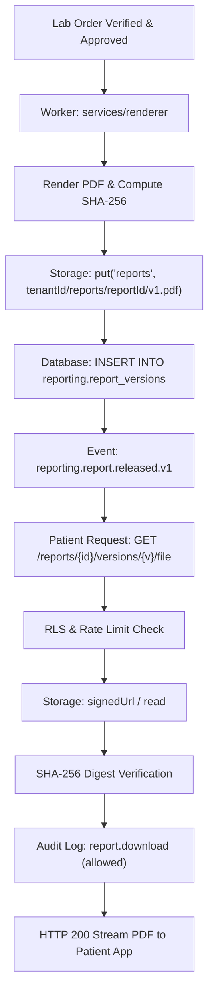

# Architecture Decision Proposal: MHN Secure Report Storage Wiring

**Document ID**: ADR-MHN-REPORT-STORAGE-PROPOSAL  
**Status**: PROPOSAL (Requires Architectural Sign-off from C0-0C / C1 / Platform Lead)  
**Related References**:
- Change Request: `.orchestra/cr/T0D-17.nonblocking.md` (CR-C0-0D-T0D-17)
- Core Storage Contract: `services/api/src/core/storage/index.ts`
- Pipeline Boot: `services/api/src/core/pipeline/boot.ts`
- Reporting Port: `services/api/src/modules/reporting/ports/ReportingPort.impl.ts`
- Engagement Service: `services/api/src/modules/engagement/service/report.service.ts`
- Patient App UI: `apps/patient_app/lib/features/reports/report_viewer_screen.dart`
- Architectural Baseline: 03-IC §13.4, §13.6; 07-SECURITY §6; 08 R12b, A13 P-2/P-12/P-13

---

## 1. Existing Storage Architecture

The LIMS architecture implements a secure, modular storage isolation layer defined in `services/api/src/core/storage/index.ts`:

1. **StorageAdapter Interface**:
   ```ts
   export interface StorageAdapter {
     put(bucket: BucketName, objectPath: string, bytes: Uint8Array, opts: { contentType: string; ifAbsent?: boolean }): Promise<{ sha256: string; byteSize: number }>;
     read(bucket: BucketName, objectPath: string): Promise<Uint8Array>;
     move(bucket: BucketName, fromPath: string, toPath: string): Promise<void>;
     signedUrl(bucket: BucketName, objectPath: string, ttlSeconds: number): Promise<string>;
     delete(bucket: BucketName, objectPath: string): Promise<void>;
   }
   ```
2. **Bucket Ownership & Tenant Boundaries**:
   - Bucket `reports` is strictly owned by the `reporting` module (`BUCKET_OWNERS['reports'] = 'reporting'`).
   - Every object path is strictly validated: first segment MUST equal `tenantId` (`assertTenantPath`), preventing any cross-tenant data traversal.
   - Credentials are read exclusively from the file path defined in `LIMS_CORE_STORAGE_KEY_FILE` (07-SECURITY §6).
3. **Current Pipeline Gate**:
   - In `services/api/src/core/pipeline/boot.ts:189`, `ctx.storage` is deliberately unwired using `unwired('put', 'read', 'move', 'signedUrl', 'delete')`.
   - Any runtime call to `ctx.storage` throws `LimsError('common.dependency_unavailable')` (HTTP 503).
   - In `report.service.ts:128` (E23 `downloadMyReport`), calls fail closed with HTTP 404 or 503 because `ReportingPort.openReleasedReportFile` cannot generate a signed URL without `ctx.storage.signedUrl`.
   - In `apps/patient_app`, `ReportViewerScreen` invokes E23 and renders error states when the file cannot be retrieved.

---

## 2. Exact Missing Interface & Root Cause

Per `.orchestra/cr/T0D-17.nonblocking.md`:
1. **Missing Config Key**: Specifications 03-IC §13.6 and 02-TRD §11 omit a configuration key for the storage service URL, and the storage-api HTTP REST shape is marked `UNVERIFIED` (C1 02-TRD §8.2 row `core_storage_service_key`).
2. **Missing `connect` Implementation**: `createStorage({ ... })` requires an injected `connect: (credential: string, url?: string) => RawStorage` function. Without it, `createStorage` throws `common.internal` and fails closed at boot.
3. **Delete Reason Cardinality**: `ctx.storage.delete(bucket, objectPath)` lacks a `reason` parameter required by Prometheus metric `lims_core_storage_deletes_total{bucket,reason}`.

```ts
export interface RawStorage {
  put(bucket: string, key: string, bytes: Uint8Array, o: { contentType: string; ifAbsent?: boolean }): Promise<void>;
  get(bucket: string, key: string): Promise<Uint8Array>;
  move(bucket: string, from: string, to: string): Promise<void>;
  remove(bucket: string, key: string): Promise<void>;
  sign(bucket: string, key: string, ttlSeconds: number): Promise<string>;
}
```

---

## 3. Required Operations for MHN Released PDF Reports

For the patient application to securely view released diagnostic reports:
1. **`signedUrl(bucket: 'reports', objectPath: string, ttlSeconds: number): Promise<string>`**:
   - Invoked by `ReportingPort.impl.ts:87` with `ttlSeconds = 60` (URL_TTL_SECONDS).
   - Generates an ephemeral cryptographic signed URL allowing the backend to stream report bytes or redirect authorized clients.
2. **`read(bucket: 'reports', objectPath: string): Promise<Uint8Array>`**:
   - Invoked by `report.service.ts:142` to stream bytes from storage, compute SHA-256 integrity digest, record audit access log (`report.download`), and return PDF bytes directly with `Content-Disposition: attachment`.
3. **`put(bucket: 'reports', objectPath: string, bytes, opts)`**:
   - Invoked by the background worker `services/renderer` when compiling report PDFs upon `reporting.report.released.v1`.

---

## 4. Storage Client Dependency

- **Standard Library / Native Fetch**:
  Node.js 20+ includes standard global `fetch`. The storage HTTP protocol (compatible with Supabase Storage API, AWS S3, or MinIO) can be implemented directly using standard HTTP requests:
  - `GET /storage/v1/object/authenticated/<bucket>/<key>`
  - `POST /storage/v1/object/sign/<bucket>/<key>`
  - `POST /storage/v1/object/<bucket>/<key>`
- **No External Dependencies**:
  Avoids adding large SDKs (`@aws-sdk/client-s3` or `@supabase/storage-js`), honoring Ponytail minimalist guidelines and monorepo C0 dependency budgets.

---

## 5. Environment Configuration

The following environment variables are proposed for the storage layer:

| Variable Name | Environment | Description | Example |
| :--- | :--- | :--- | :--- |
| `LIMS_CORE_STORAGE_KEY_FILE` | All | Path to file containing storage secret token | `/run/secrets/storage_service_key` |
| `LIMS_CORE_STORAGE_URL` | Dev / Staging / Prod | Base URL of storage service | `http://127.0.0.1:54325` (local test stack) |
| `LIMS_TEST_STORAGE_URL` | Test | Isolated test runner override | `http://127.0.0.1:54325` |

---

## 6. Tenant Security & Authorization Constraints

1. **Path Isolation**:
   Every report object path is rigidly structured:
   `${tenantId}/reports/${reportId}/${versionNo}.pdf`
   `assertTenantPath` enforces that segment 0 matches `ctx.tenantId`.
2. **Zero Client Uploads**:
   The `reports` bucket is owned exclusively by `reporting`. Patients and phlebotomists have NO upload permissions.
3. **Ephemeral URLs**:
   Signed URLs have a strictly capped TTL (maximum 300s, default 60s). They are never returned directly to untrusted clients or logged in access logs (Rule P-2).
4. **Integrity Validation**:
   Upon download, `report.service.ts` recomputes the SHA-256 digest of the downloaded bytes and compares it to `patient_reports.pdf_sha256`. If mismatched, it fails closed with `common.service_unavailable` and does not write an access audit row.

---

## 7. Report Object Lifecycle



---

## 8. Local Test Storage Setup

In the local development environment:
1. Docker container `test_stack_storage` is already running (`public.ecr.aws/supabase/storage-api:v1.69.0` on port `54325`).
2. For testing, an isolated bucket `reports` can be seeded with synthetic report fixtures matching `mhn-t13.fixture.sql`.
3. In lightweight unit tests, an in-memory `RawStorage` mock (`Map<string, Uint8Array>`) verifies `createStorage` without requiring Docker or network calls.

---

## 9. Alternatives & Tradeoffs

| Alternative | Pros | Cons | Recommendation |
| :--- | :--- | :--- | :--- |
| **Option 1: Native Fetch REST Adapter (Proposed)** | Zero dependencies; uses standard `fetch`; adheres to CR-C0-0D-T0D-17; small codebase | Requires explicit HTTP endpoint pinning for Supabase / S3 | **Recommended** |
| **Option 2: Direct File Streaming via Fastify** | No signed URL step; Fastify streams bytes directly from storage | Ties Fastify process memory/bandwidth to large file downloads | Suitable as internal implementation of Option 1 |
| **Option 3: External Storage SDK (`@supabase/storage-js`)** | Pre-built client methods | Adds npm dependencies; violates C0 frozen dependency table | **Rejected** |

---

## 10. Required Action & Approval Gate

1. **Gate**: Do NOT edit `services/api/src/core/pipeline/boot.ts` or wire live storage until formal approval of CR-C0-0D-T0D-17.
2. **Patient App S40 Status**: Retain S40 (`PDF viewer`) at Level 6 (`lvl7_real_local_integration_passed = NO`) in `SCREEN_TRACEABILITY_155.csv` until this proposal is approved and implemented.
3. **Next Step Upon Approval**: Implement `RawStorage` adapter in `services/api/src/core/storage/raw.ts`, wire `connect` in `boot.ts`, and run `tests/e2e/mhn-live-e2e.sh` with `LIMS_TEST_STORAGE_URL`.
