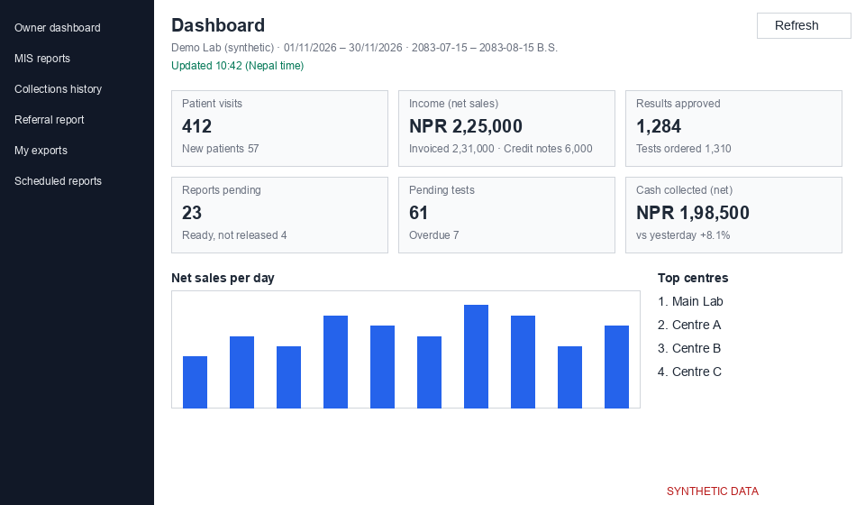

# Owner dashboard (`/analytics`)

The dashboard shows how the lab is doing today. Use the period selector to look at another period; the default is Today.

*Screenshot from a synthetic demo lab. All names and numbers are made up.*

## Tiles

| Tile | Shows | Metric |
|---|---|---|
| Patient visits | patients per centre per day; the same person can be counted again on another day | M04 |
| Income (net sales) | invoices issued minus credit notes | M12 (M10, M11) |
| Results approved | approved results, with tests ordered | M42, M08 |
| Reports pending | orders with no report released yet | M52 |
| Pending tests | tests still in progress, with overdue ones | M50, M51 |
| Cash collected (net) | payments minus reversals, cash basis; only with collections access | M27 |

Each tile opens the matching report. The arrow compares with yesterday or with the previous days of the same length. Pending tiles are a live snapshot and have no arrow.

## Below the tiles

A chart of net sales per day, a chart of the top departments, a table of reports pending by stage and age, pending tests by status, the top 5 referrers (orders and patient visits, no money) and the top 5 centres.

## Freshness and refresh

"Updated {time} (Nepal time)" shows when figures were last calculated. If you see "Data may be out of date", wait a moment or press Refresh (Alt+R). Refresh is available again after 5 minutes.

## Business day and centres

Days are counted in Nepal time. The period is shown in A.D. and B.S. You only see the centres you have access to.
