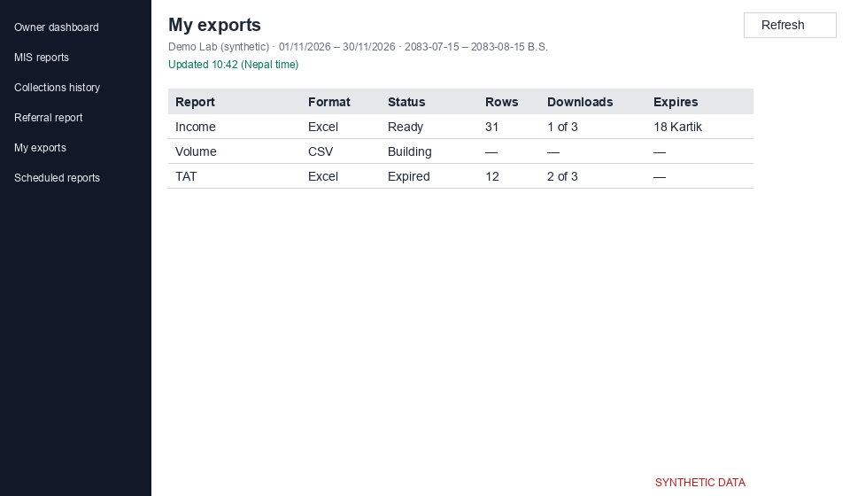

# My exports (`/analytics/exports`)

Use Export on any report page to get an Excel or CSV file (PDF may not be available yet). Files are built in the background and appear in My exports. This is internal MIS and not a statutory register.

*Screenshot from a synthetic demo lab. All names and numbers are made up.*

## Exporting

1. Choose Export, then a format.
2. Tick "I will keep this file inside the lab and delete it when no longer needed."
3. Press Export. You see "Export queued" and can open My exports.

The period can be at most 366 days. Every export asks for MFA (a verification code) first if you have not verified yet.

## The list

Status is Queued, Building, Ready, Failed or Expired. Ready files have a Download button. Downloads show "1 of 3" (used of allowed) and each file has an expiry time. The list refreshes every 3 seconds while a file is building.

If an export failed, the reason is shown, for example "Too much data — choose a shorter period or fewer centres."

## Freshness

A file holds the figures as they were when it was built (Nepal time). Export again for updated figures. You only get data for the centres you have access to.
