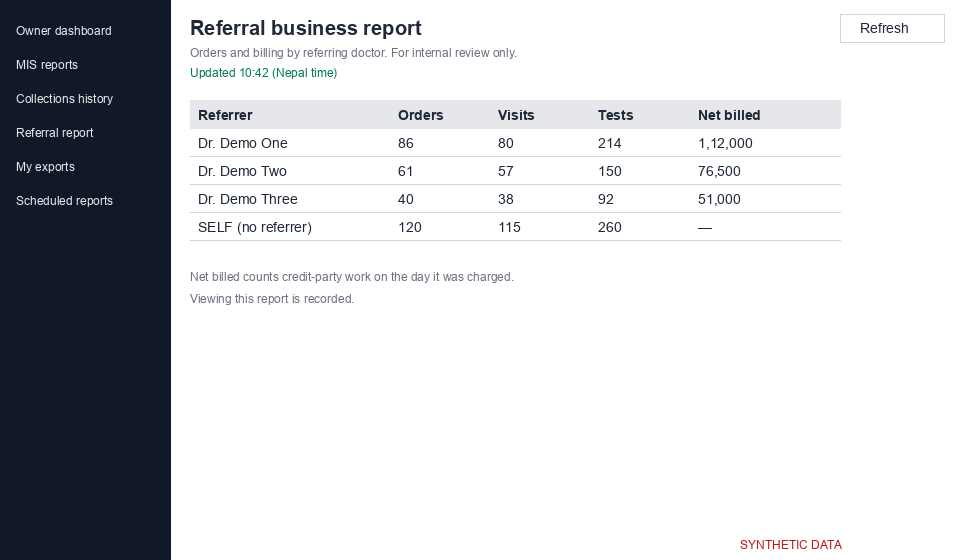

# Referral business report (`/analytics/referral-incentive`)

Orders and billing by referring doctor, for internal review only. Viewing this report is recorded. The report can be switched off for your lab; then the page says "This report is not enabled for your lab."

*Screenshot from a synthetic demo lab. All names and numbers are made up.*

## Opening the report

You are asked to verify with your authenticator app first. Press "Verify now", enter the code, and the report opens.

## Columns

| Column | Meaning | Metric |
|---|---|---|
| Orders | non-cancelled orders from the doctor | M30 |
| Patient visits | patient-days; the same person can be counted again on another day | M31 |
| Tests ordered | tests on those orders | M32 |
| Net billed | cash invoices net, plus credit-party charges before tax, minus credit notes | M33 |

Net billed is not equal to the doctor's share of income (M12). The SELF row means no referrer and shows "—" for Net billed. The report shows no rate or amount payable.

## Period and grouping

The default period is Last B.S. month. Group by Referrer, Referrer × A.D. month or Referrer × B.S. month. Days are counted in Nepal time (UTC+05:45). "Updated {time}" shows freshness. You only see the centres you have access to.
