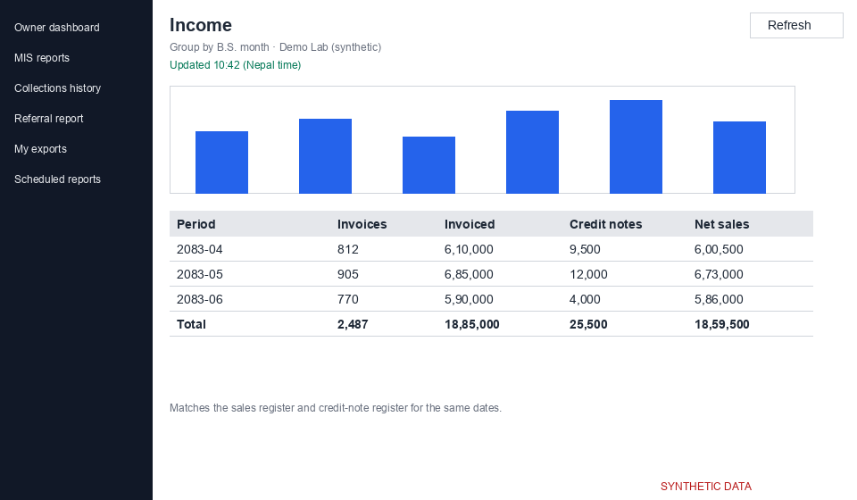
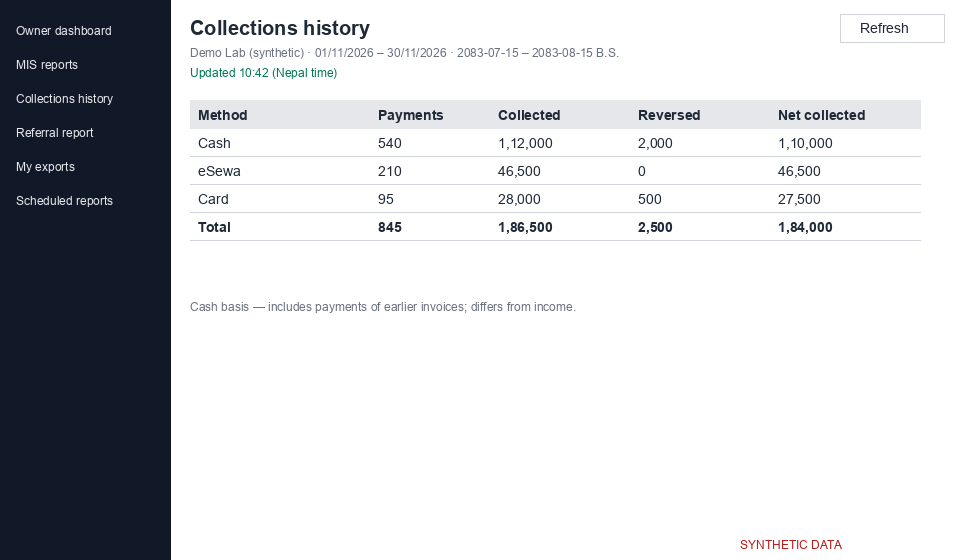
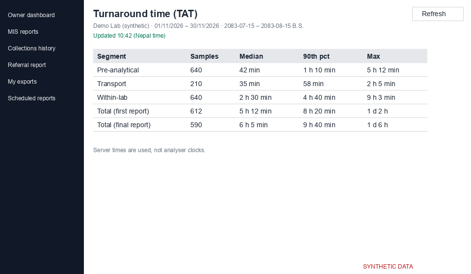

# MIS reports

The report hub is at `/analytics/reports`. It has one tab per report. Tabs you may not use are not shown. All reports share the same frame: period selector, centre filter, freshness line and an Export menu.

*Screenshot from a synthetic demo lab. All names and numbers are made up.*

## Report pages

| Report | Route | Main metrics |
|---|---|---|
| Income | `/analytics/reports/income` | M10, M11, M12 |
| Departments | `/analytics/reports/department-income` | M21, M22 |
| Volume | `/analytics/reports/volume` | M01 to M08 |
| Referrers | `/analytics/reports/top-referrers` | M30 to M32 |
| Centres | `/analytics/reports/top-centres` | M35 to M38 |
| Tests done | `/analytics/reports/tests-done` | M40 to M47 |
| TAT | `/analytics/reports/tat` | M60 to M64 |
| Pending tests | `/analytics/reports/pending-tests` | M50, M51 |
| Quality | `/analytics/reports/quality-indicators` | M70 to M78 |
| Delivery | `/analytics/reports/delivery` | M80, M85 to M87 |
| Interfaces | `/analytics/reports/interfaces` | M90, M91 |

Income = invoices issued minus credit notes (M12). It matches the sales register and credit-note register for the same dates. Cash collected is shown separately.

## Collections history

Route `/analytics/collections`. It shows money received by method, staff, centre or day: collected (M25), reversed or refunded (M26) and net collected (M27). It is on a cash basis, so it includes payments of earlier invoices and differs from income.

*Screenshot from a synthetic demo lab. All names and numbers are made up.*

## Turnaround time

The TAT report lists five segments with the number of samples, median, 90th percentile and maximum: pre-analytical, transport, within-lab, total (first report) and total (final report).

*Screenshot from a synthetic demo lab. All names and numbers are made up.*

## Periods, freshness and scope

Business days run 00:00–24:00 Nepal time (UTC+05:45). Pick a preset such as This B.S. month or a custom range of up to 366 days; both A.D. and B.S. dates are shown. "Updated {time}" shows the last calculation, and "Data may be out of date" means changes are still being processed. You only see the centres you have access to. Pending tests have no period because they show the live situation.
