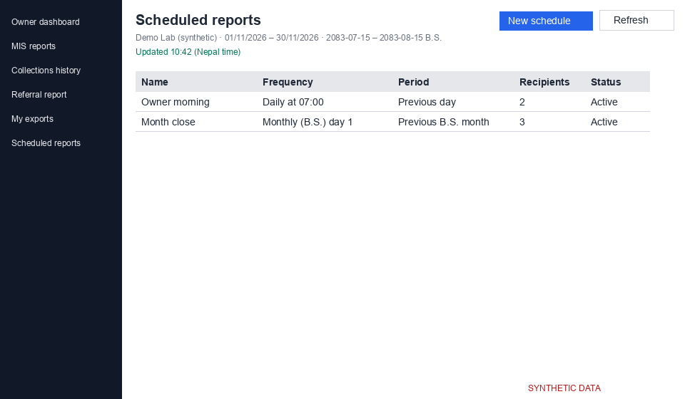
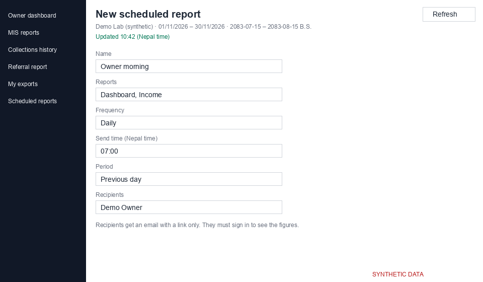

# Scheduled reports (`/analytics/schedules`)

A schedule emails a link to selected reports at a set time. Recipients get an email with a link only. They must sign in to see the figures.

*Screenshot from a synthetic demo lab. All names and numbers are made up.*

## Creating a schedule

Open New schedule (`/analytics/schedules/new`) and fill in:

| Field | Notes |
|---|---|
| Name | up to 80 characters; no email addresses, phone numbers or web addresses |
| Reports | 1 to 10; default Dashboard and Income |
| Frequency | Daily, Weekly, Monthly (A.D.) or Monthly (B.S.) |
| Send time | Nepal time, steps of 15 minutes |
| Period | for example Previous day or Previous B.S. month |
| Centres | all centres (only if you have them) or a selection |
| Recipients | 1 to 20 staff |

*Screenshot from a synthetic demo lab. All names and numbers are made up.*

Ctrl+Enter saves. The run log on the edit page shows the last 20 runs. Deactivate asks "Stop sending this report?".

## What recipients see

The link opens `/analytics/report-runs/{id}` after sign-in. The page shows the figures as of now for the period, limited by the recipient's own access. Reports they may not see are left out. A link for another account or an old link shows "This report link is not for your account or has expired."

Periods follow the Nepal-time business day (UTC+05:45) and are shown in A.D. and B.S. Because figures are calculated when the page opens, they can be updated after the email was sent. "Data may be out of date" means changes are still being processed. This is internal MIS and not a statutory register.
