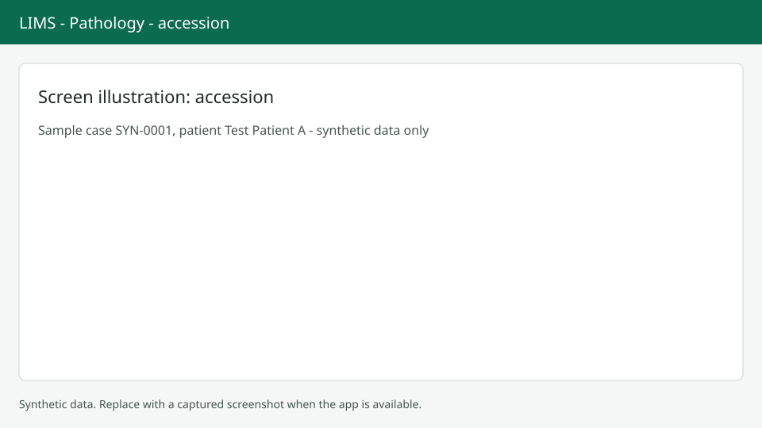

# Accession a case

Accessioning gives a received specimen its accession number. This page uses synthetic data only in its screenshots.

## Open the dialog

From the case at `/anatomic/cases/{case_id}`, choose Accession in the Actions menu or press `Alt+A` (only when the case is allowed to be accessioned). If the lab setting for automatic accession is on, this happens on receipt and you can skip this step.

## Fill in the parts

Each row is one part with a letter assigned by the system. Site is required (up to 200 characters). Description is optional (up to 1000). Add clinical history (up to 4000 characters) and, if you know one, choose the assigned pathologist. Press Accession or `Ctrl+Enter`. A message confirms "Accessioned as {accession_no}".

## If it fails

If the accession numbering is not set up you see "Accession numbering is misconfigured." Ask an administrator to check the accession pattern in tenant settings. If someone else changed the case, choose Reload and try again.

## Next steps

Continue with [Grossing](grossing.md). Back to the [Worklist](worklist.md).
