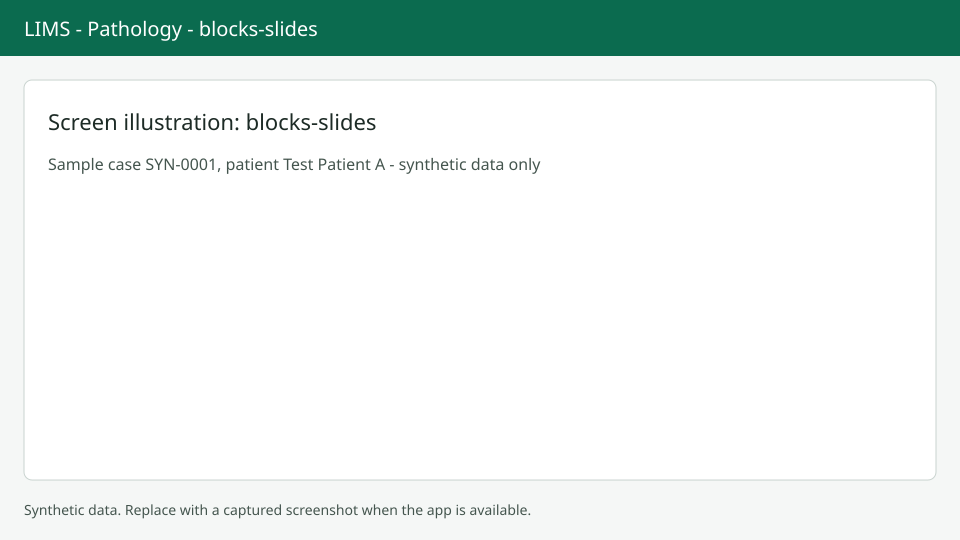

# Blocks and slides

Blocks and slides carry their own labels, stain and location. Screenshots show synthetic data only.

## Open the tab

Choose Blocks & slides on the case page or press `Alt+B`. Two tables appear: blocks and slides.

## Blocks

Use Add blocks to pick the part, a count from 1 to 50 and an optional note. Select one block and use Add slides to choose the stain and a count from 1 to 20. Select up to 200 blocks to record a movement.

## Slides and cytology

Slides show source, stain, status (Pending stain or Ready) and location. Use Mark ready for bulk changes. A toast tells you how many were marked ready and how many were skipped, and skipped reasons open in a drawer. For cytology slides you can record an adequacy and a finding, and choose Include in report.

## Labels

Press `Alt+L` or choose Print block labels or Print slide labels to open the labels page at `/anatomic/cases/{case_id}/labels`. Press Print. If barcode symbols are not available you see a note that only text labels are produced.

## Next steps

Order special work in [Stains and IHC](stains-ihc.md), or move items in [Tracking](tracking.md).
