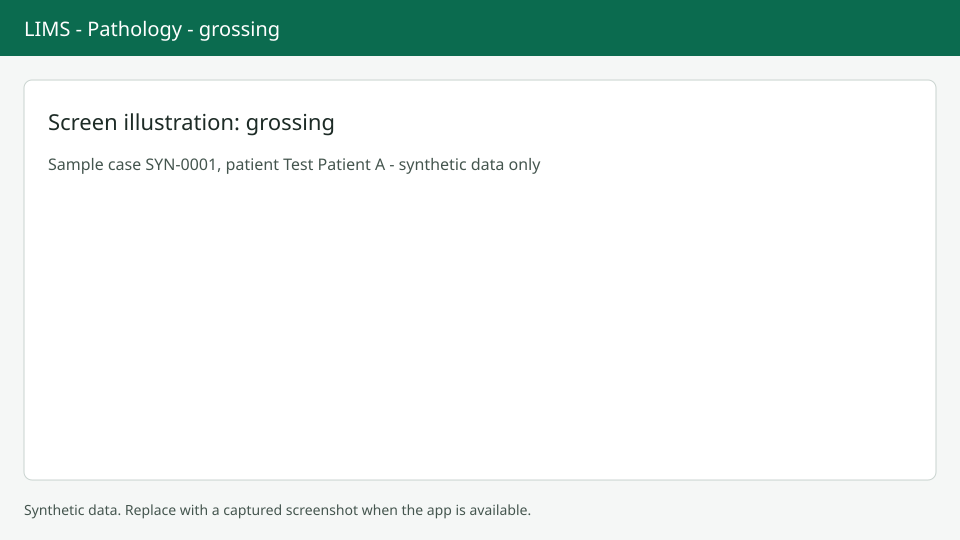

# Parts and gross description

Each part of a case has its own gross record. Screenshots here use synthetic data only.

## Open the tab

On the case page choose the Parts & gross tab or press `Alt+G`. Every part appears as a card titled "Part {letter} - {site}".

## Record the gross

Write the gross description (up to 20000 characters, plain text). Enter the number of pieces, the dimensions in millimetres and the weight in grams. Fill Length first, then Width, then Depth. Type `;` and a short code, then Tab, to insert a text template. Press `Alt+S` or Save part to save the part you are working in. Turn on Gross complete when finished. Histology parts that need gross must have a description before they can be marked complete.

## Add or move on

Use Add part for an extra part (site is required). When all parts are done, choose Start processing, then Mark ready for reporting when the case is in the right step. Gross photos are uploaded on the Images tab, see [Images](images.md).

## Next steps

Continue with [Blocks and slides](blocks-slides.md).
