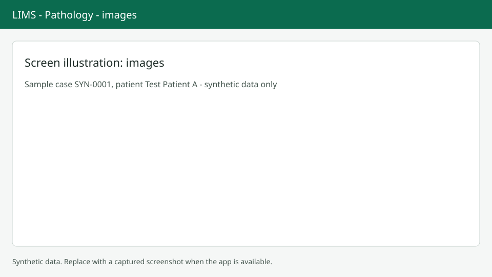

# Images

Gross and microscopy photos are attached to a case on the Images tab. Screenshots show synthetic data only.

## Open the tab

Choose Images on the case page or press `Alt+I`.

## Upload

Choose Upload images. Only PNG and JPEG files up to 15 MB are accepted, up to 10 files at once. Each file is checked by the system before it can be shown. A file that is still being checked is not displayed. If a file is too big you see "This file is larger than 15 MB." and other types are refused with "Only PNG and JPEG images can be uploaded."

## Describe

Set the kind (gross or microscopy), the part and a caption. Images already in a signed report cannot be changed and show "In a signed report - can't be changed". You can still upload new images after sign-out.

## Use in the report

Images are chosen for the report on the Report tab, up to the limit set in [Setup](setup.md). See [Report and sign-out](report-signout.md).
