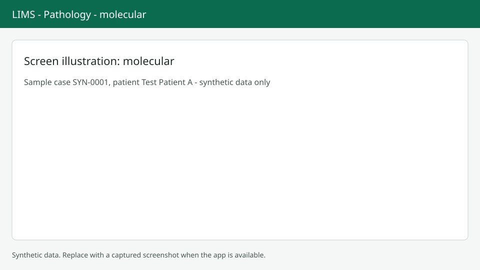

# Molecular cases and batches

Molecular cases record results per assay target, and runs are grouped in batches. Screenshots show synthetic data only.

## Enter results

On a molecular case open the Molecular tab. Choose Add row for each assay target. Pick the assay, the target and the result. A numeric value is only allowed when the target is quantitative; the unit comes from the target. Method, kit name, kit lot, kit expiry, batch and comment are optional. Abnormal results show the word "Abnormal" next to the value. Press `Alt+S` to save: the whole table is replaced, so reload if someone else saved first.

## Batches

The list at `/anatomic/batches` shows batch number, assay, status, kit lot, run time and members against capacity. Choose New batch and fill the assay (required), kit, instrument, run time and capacity (1 to 384, default 96). The batch page shows a plate-style grid of 12 columns. Scan an accession to take the next free position, or choose a position first. Use Remove selected to take samples out and Close batch to finish the run.

## Next steps

Molecular results go into the report as an addendum or in the report body. See [Revisions and addenda](revisions-addenda.md).
