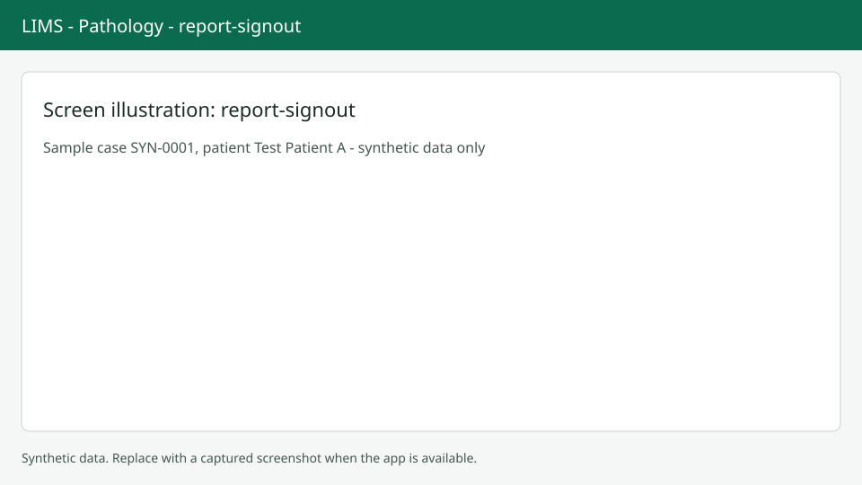

# Report and sign-out

Write the report on the Report tab and sign it out for lab verification. Screenshots show synthetic data only.

## Write the draft

Choose Report or press `Alt+R`. If there is no draft choose Start report. Fill Gross (choose Insert gross from parts if you want), Microscopy, Diagnosis, Comment, ancillary results, synoptic templates, images and diagnosis codes. Diagnosis is required to sign out. Use Add synoptic for a published checklist; required fields are marked. The Preview card shows the plain report. Press `Alt+S` or `Ctrl+Enter` to save the draft. There is no autosave.

## Sign out

Press `Alt+U` or choose Sign out (needs the sign-out permission). Review the version number and the list of tests. Tick "I have reviewed this report and its images", then Sign out. Version {n} is created and sent to lab verification. If a test was removed from the order or a billed add-on has no result, sign-out is blocked. If the lab needs a second approval you are asked to confirm your identity again.

## After sign-out

A viewer shows the signed version and a Versions table. To change a signed report use Revise or Amend; see [Revisions and addenda](revisions-addenda.md). An amendment of an approved result always needs a reason.

## Next steps

Back to the [Worklist](worklist.md).
