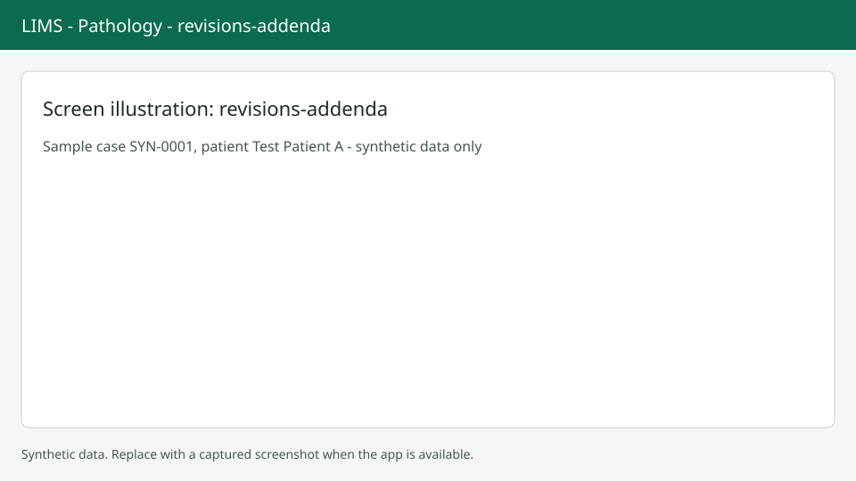

# Revisions and addenda

After sign-out a report is never overwritten. You create a new version instead. Screenshots show synthetic data only.

## Revise or amend

The button on the Report tab depends on the lab status. While the lab result is not yet approved it says Revise. Once the result is approved it says Amend, and your change creates an amended report while the earlier version stays on record. Choose the button, pick a reason from the list and, if you want, add free text of up to 500 characters. An amendment needs a reason: without one you see "An amendment needs a reason." Some system reasons are not offered to you. While the change is in progress a banner shows who started it and when. When ready, sign out with `Alt+U`.

## Add an addendum

An addendum adds a later finding without changing the report. Choose Add addendum. Pick the kind (IHC, Special stain, Molecular or Other), write the text (required, up to 8000 characters), tick the completed stain orders it covers and, if needed, link a billed add-on item. Save, then Sign addendum.

## Versions table

The Versions table lists version, kind, when and who signed, the reason and the lab status at submit. Full-scope reports carry the case addenda.

## Next steps

See [Report and sign-out](report-signout.md) for the first version.
