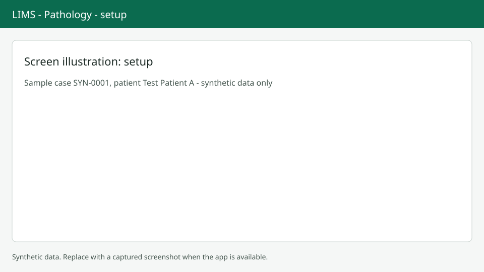

# Pathology setup

Lab managers configure pathology at `/anatomic/config`. Screenshots show synthetic data only.

## Settings

The Settings tab has switches for automatic accession on receipt and for requiring complete gross before processing, the default routine stain, and the maximum images per case and per report. The accession pattern is shown for reference; administrators change it in tenant settings.

## Master lists

Each master is a list with a right drawer and its own Save. Use the tabs for Stains, Test profiles (case kind, add-on, requires gross, default stain and synoptic templates), Assays (with targets and result values), Coded lists (diagnoses, cytology adequacy, cancellation reasons) and Text templates (short code, section, body). Codes are never deleted, only made inactive. Add only codes your lab is licensed to use; no external code sets are included.

## Synoptic templates

Open Synoptic templates to create a template. The builder is on the left and a live preview on the right. Publish to make it available; published and retired templates are read-only, so create a new version to change one. Write your own checklists and do not copy protocol text you do not have rights to. The list lives at `/anatomic/config` and the editor under `/anatomic/config/templates/{template_id}`.

## Next steps

If a test has no profile, a banner on the case asks for setup here. See [Worklist](worklist.md).
