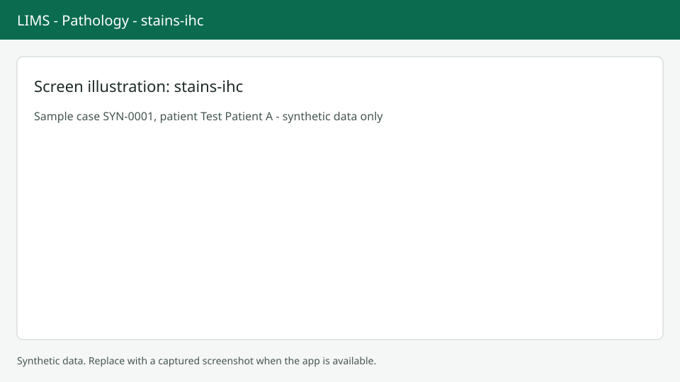

# Special stains and IHC

Use the Stains tab for special stains and immunohistochemistry orders. Screenshots show synthetic data only.

## Open the tab

Choose the Stains tab or press `Alt+T`. The table lists each order with its stain, kind (Routine, Special or IHC), the block or part it is on, status, lot and linked add-on test.

## Order a stain

Choose Order stain. Pick the stain. IHC must be ordered on a block: choose a block that is in the lab, stored or sent out (a sent-out block says "complete after return"). Special stains can be ordered on a part when no block is chosen. You can link a billed add-on item and add a note.

## Start, complete, cancel

Use the row menu: Start, Complete, Cancel or Link add-on item. Complete asks for slides made (1 to 20), the reagent lot and the time performed. Cancel needs a written reason. A billed add-on needs a result before sign-out; see [Report and sign-out](report-signout.md).

## Next steps

Completed stains appear as ancillary results in the report. See also [Molecular](molecular.md).
