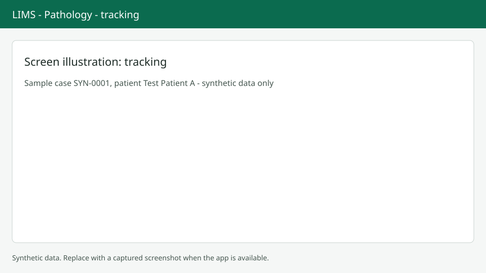

# Tracking blocks and slides

Tracking shows where every block and slide is and records movements. Screenshots show synthetic data only.

## Look up an item

Open `/anatomic/tracking`. The lookup field is focused; scan or type a block or slide label. The result shows type, case accession, part, stain, current location and last movement, with a timeline of movements (newest first). If nothing matches you see "No block or slide with this label."

## Basket mode

Turn on Basket mode to scan many items. A duplicate scan shows "Already in the list." Press `Alt+V` or Record movement to move all items in one go.

## Record a movement

Choose Store, Retrieve, Send out, Return or Discard. Store needs a location. Send out needs a destination and a reason. Discard needs a reason and a confirmation, because discarded blocks and slides can't be used again. The same dialog is used from the case page.

## Sent out

The Sent out tab lists items that left the lab with where they went, since when and why, oldest first.

## Next steps

See [Blocks and slides](blocks-slides.md) for labels, and the [Worklist](worklist.md).
