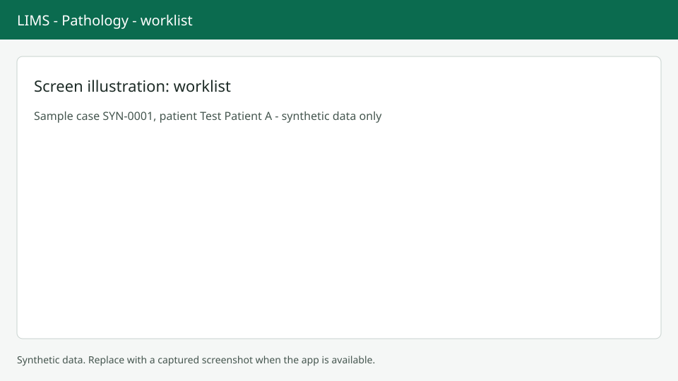

# Pathology worklist

The worklist at `/anatomic` is the starting point for histology, cytology, IHC and molecular cases. All screenshots in this manual use synthetic data only.

## Find a case

Press `Alt+F` to focus the lookup field. Scan or type an accession, block or slide label. Opening a result takes you to the case at `/anatomic/cases/{case_id}`.

## Queue tabs

Use the arrow keys to move between tabs: To accession, Grossing, Bench, Reporting, Awaiting lab approval, Signed out, Cancelled and All. The badge shows the count for the current tab only.

## Filters and columns

Filter by case kind, centre, priority, assigned pathologist and received date (up to 92 days). The Status column shows a chip plus icons with text for Profile missing, Specimen rejected, Change open and Stains pending. Urgent cases show an "Urgent" badge. Sorting by priority puts the oldest urgent case first.

## Next steps

Open a case and continue with [Accession](accession.md). To track blocks and slides, see [Tracking](tracking.md).
