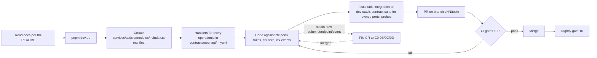

# C0 — Foundation & Contracts — 03 APP FLOW

Status: DRAFT for build, 2026-11-05. Abbreviations as in `01-PRD.md`. C0 has no business state machines (those are in IC §10 and owner chunks). Its state machines are the platform mechanics: idempotency keys, dead letters, BFF sessions, the port registry, and the delivery of one event.

---

## 1. Builder flows (developer/agent experience)

### 1.1 Module lifecycle (any chunk, against C0 output)



Steps an agent follows to add a module (exact):
1. Confirm `contracts/openapi/<m>.yaml` exists (C0 transcribed it from the chunk TRD). If not: file a CR to C0-0C and work with the Prism mock meanwhile.
2. Create `index.ts` exporting `manifest: ModuleManifest` (`02-TRD.md` §6.3). `produces` = the module's producer list in IC §3.25.
3. Create one handler file per operationId and export the `handlers` map.
4. Run `pnpm --filter @lims/api dev`. The autoloader logs `module_loaded {module, operations, ports, fakes_used}`.
5. Boot fails with a precise message if anything is missing (AC-0D-1.2).

### 1.2 Change-request handling inside C0

```mermaid
sequenceDiagram
  participant R as Requesting chunk
  participant T as C0 triage (owner workstream)
  participant W as C0 workstream agent
  participant CI as CI
  R->>T: Issue CR-<from>-<nnn> (labels cr, to:C0-0x, from:Cyy)
  T->>T: Classify additive vs breaking (program/04 §3.1); blocking → triage ≤ 1 working day
  alt breaking
    T->>R: Request sign-off from every consumer (CM §5.1/§6) + founder
  end
  T->>W: Assign
  W->>W: Change db/ or contracts/ or packages/ or core/; regenerate clients/fakes in the same PR (CV §12)
  W->>CI: PR with "Refs: CR-…"
  CI-->>W: gates (oasdiff label rule for breaking)
  W->>R: Merge notice in CR thread; requester switches from fake/mock to new contract
  W->>W: Owner chunk's 05-SCHEMA/02-TRD updated in the same PR when C0 changed it (program/04 §3.5) — doc PR raised to doc owner
```

### 1.3 Contract wave (Wave 2 / Wave 3)

1. 0B and 0C take the wave's chunk documents (`05-SCHEMA.md`, `02-TRD.md`).
2. 0B writes migrations in DAG order, and 0C writes specs, event schemas (if any new) and fakes (if new ports).
3. Each wave PR set must pass gates 1–15 and the full isolation suite.
4. Freeze: tag `contracts-wave-<n>`. From then on, changes go through CRs only.
5. The wave can overlap Wave 1 (CM §1). C0 never changes a frozen Wave-1 contract in a breaking way without the program/04 §3 sign-offs.

### 1.4 Deploy-time database flow (C1 runs it; C0 provides every step)

```mermaid
sequenceDiagram
  participant P as Pipeline (C1)
  participant DB as Postgres
  participant M as Migration runner (lims_migrator)
  participant W as registry-sync (lims_migrator)
  P->>DB: (first deploy only) db/bootstrap/*.sql as provisioning superuser
  P->>M: apply db/migrations (lock_timeout 5s)
  M->>DB: each file: SET LOCAL ROLE lims_owner; DDL; RLS; grants
  P->>W: pnpm worker:registry-sync
  W->>DB: upsert core.g_task_registry; deactivate removed identifiers
  P->>M: seeds 001–003 (prod) / all seeds (dev, ci, staging)
  P->>P: start API (boot checks), worker (boot checks)
```

Failure handling: a failing migration stops the pipeline with nothing partially applied in that file (transactional files). A failed non-transactional `CREATE INDEX CONCURRENTLY` leaves an `INVALID` index. The next file in the same PR must be `DROP INDEX CONCURRENTLY IF EXISTS` plus a re-create, and `check-migrations.ts` requires that pattern for every CONCURRENTLY file.

---

## 2. Runtime flows

### 2.1 Staff request end-to-end (BFF → API → DB)

```mermaid
sequenceDiagram
  autonumber
  participant B as Browser
  participant N as nginx (C1)
  participant W as Next.js BFF (apps/web core)
  participant S as C2 identity API (resolveSession, bffSession)
  participant A as API core
  participant I as IdentityPort (C2 / fake)
  participant H as Module handler
  participant D as Postgres via PgBouncer
  B->>N: POST /frontdesk/... (cookie __Host-lims_sid, Origin)
  N->>W: forward (X-Request-Id added; X-Lims-Background passed through on BFF origins, 08 A25 D-206)
  W->>W: middleware: Origin == LIMS_ORIGIN_STAFF_WEB? else 403 auth.csrf_failed
  W->>S: POST /v1/identity/auth/... resolveSession (opaque session id, X-Lims-Bff-Key; touch:false if X-Lims-Background)
  alt idle > tenant idle timeout, age > absolute, revoked or refresh failed (decided by C2, 08 R10)
    S-->>W: 401 auth.session_expired
    W-->>B: 401 auth.session_expired (relayed; shell shows sign-in)
  end
  S-->>W: access JWT (C2 refreshed it server-side if needed; refresh token never leaves identity.sessions)
  W->>A: POST /v1/frontdesk/... Authorization: Bearer <JWT>, X-Lims-Bff-Key, Idempotency-Key, X-Request-Id, traceparent
  A->>A: spec validation (unknown field → 400)
  A->>A: verify JWT (pinned alg, exp 0 s leeway, iss, aud); app.client_ip from X-Forwarded-For only with a valid BFF key or trusted peer (08 A25 P-61)
  A->>A: rate limit (general tier)
  A->>D: idempotency claim (autocommit)
  A->>D: BEGIN; SELECT set_config(claims…), …, now()
  A->>H: handler(req, ctx)
  H->>I: assertRole(ctx, {permission, centreId})
  I->>D: (privileged) re-read membership in ctx.tx
  H->>D: domain SQL (RLS applies) + events.publish → event_log + app.enqueue_job
  A->>D: status < 400: UPDATE idempotency_keys SET completed…; COMMIT (≥ 400: nothing stored, key released — 08 A25 D-202)
  A-->>W: 201 body
  W-->>B: 201 (no tokens in response)
```

Error branches:
- JWT invalid → `401 auth.token_invalid`/`auth.token_expired`. The BFF calls `resolveSession` once more (C2 refreshes server-side), then shows sign-in. The BFF never holds a refresh token in staging/production; the dev in-memory provider (`BffSessionStore`) is dev-only (08 R10).
- `assertRole` throws → handler error → rollback → `403 auth.forbidden` / `auth.mfa_required`.
- RLS denial on write (`42501`) → rollback → `404 common.not_found`.
- DB unavailable → `503 common.dependency_unavailable`. The BFF shows the shell error state with a retry button and keeps the user's form state (the form never auto-resubmits).

### 2.2 Token issuance and claims (08 R10)

```mermaid
sequenceDiagram
  participant W as BFF (staff_web / partner) or app
  participant I as identity module (C2)
  participant G as GoTrue (API network only)
  participant A as API core
  participant D as app.identity_resolve_session (DEFINER)
  W->>I: login on /v1/identity/auth/* (+ X-Lims-Bff-Key) or app endpoint family
  I->>G: password grant via GoTrueGateway (C2 flow)
  G-->>I: access JWT (≤1 h, 04 A5; claims sub, session_id, aal) + refresh token (kept server-side, encrypted)
  I-->>W: opaque LIMS session token (cookie / app secure storage)
  W->>A: request with access JWT (from resolveSession / app refresh)
  A->>A: verify JWT (pinned alg, 0 s leeway, iss/aud); ignore every claim except sub, session_id, aal, exp, iat
  A->>I: claimsResolver.resolve({sub, sessionId, aal})
  I->>D: (session_id, sub)
  D-->>I: session row + membership + tenant state
  alt session valid
    I-->>A: claims JSON (tenant_id, membership_id, actor_type, lims_session_id, session_state, …)
    A->>A: set_config('request.jwt.claims', …, true)
  else no session_id / no row / revoked / expired / locked
    I-->>A: rejected → 401 auth.token_invalid | auth.unauthenticated | auth.session_expired | 403 …
  end
```

The GoTrue custom access-token hook is not used; there is no fallback lookup path. Session-kind binding comes from the BFF key or the endpoint family, never from a client header.

### 2.3 Event delivery (one event, two consumers)

```mermaid
sequenceDiagram
  autonumber
  participant P as Producer handler (e.g. C4)
  participant DB as Postgres
  participant Q as graphile_worker
  participant F as core.event_fanout
  participant C1x as evt.lab.frontdesk.order.created.v1
  participant C2x as evt.reporting.frontdesk.order.created.v1
  P->>DB: domain write
  P->>DB: INSERT core.event_log … ON CONFLICT DO NOTHING
  P->>Q: app.enqueue_job('core.event_fanout', {event_id, tenant_id}, job_key=event_id)
  P->>DB: COMMIT (all-or-nothing)
  Q->>F: run (worker, system claims of core)
  F->>DB: SELECT envelope FROM core.event_log
  F->>Q: enqueue evt.lab.… (job_key event_id:lab), evt.reporting.… (event_id:reporting)
  Q->>C1x: run (system claims of lab)
  C1x->>DB: INSERT lab.event_inbox ON CONFLICT DO NOTHING RETURNING
  C1x->>DB: module consumer logic; COMMIT
  Q->>C2x: run (independent; failure here does not affect lab)
```

### 2.4 Port call with fake → real swap

```mermaid
sequenceDiagram
  participant H as C6 handler (release report)
  participant R as Port registry (core)
  participant F as BillingPort fake (@lims/fakes)
  participant Real as BillingPort impl (billing module, C4)
  H->>R: ctx.ports.BillingPort
  alt billing module loaded and not in LIMS_CORE_FAKE_PORTS
    R-->>H: Real
    H->>Real: getReleaseEligibility(ctx, {orderId}) in ctx.tx
  else
    R-->>H: F (dev/ci only; staging/prod boot would have failed)
    H->>F: getReleaseEligibility(ctx, {orderId})
  end
```

---

## 3. State machines (C0 platform mechanics)

### 3.1 Idempotency key (`core.idempotency_keys`)

| # | From | To | Trigger | Guard | Side effects |
|---|---|---|---|---|---|
| K1 | (none) | `in_progress` | first request with the key | insert succeeds | handler runs |
| K2 | `in_progress` | `completed` | handler status < 400 | same transaction as domain write | response stored; later replays return it with `Idempotent-Replayed: true` |
| K3 | `in_progress` | (deleted) | any status ≥ 400 (4xx or 5xx): after the rollback in a separate transaction, or — when the handler called `ctx.commitOnError()` — inside the request transaction before commit (08 A25 D-202) | own actor, state in_progress | nothing stored; a retry re-runs the handler |
| K4 | `in_progress` (age > 60 s) | `in_progress` (taken over) | retry after a crash | `created_at <= now() - 60 s` | handler runs again |
| K5 | `completed` | (deleted) | retention purge | `expires_at < now()` (7 days) | key reusable |
| — | any | — | same key, different hash | — | `422 common.idempotency_key_reused`, no state change |
| — | `in_progress` (age ≤ 60 s) | — | concurrent request | — | `409 common.idempotency_in_progress`, `Retry-After: 1` |

### 3.2 Dead letter (`core.dead_letters`)

| From | To | Trigger | Actor | Effect |
|---|---|---|---|---|
| (none) | `open` | task's final attempt fails | worker core | metric + alert |
| `open` | `replayed` | console "Replay" (C2 UI) via `ctx.core.deadLetters.replay` | platform operator with `platform.dead_letter.manage` | original payload re-enqueued with `job_key = coalesce(job_key, task_identifier:id):replay:<version after the bump>` (`job_key` copied from the failed job at dead-lettering); a tenant row is enqueued inside `withTenantScope(row.tenant_id, owning module's system actor)`, never by the platform actor directly (08 A23.2); consumers stay idempotent through the inbox; optional `reasonText` (1–500) → `resolution_note` (08 A8.4, A9.3) |
| `open` | `discarded` | console "Discard" via `ctx.core.deadLetters.discard({ deadLetterId, expectedVersion, reasonText })` | same | `resolution_note = reasonText` (1–500 chars, 08 A8.4); nothing enqueued |
| `replayed`/`discarded` | (deleted) | retention 90 days after `resolved_at` | `app.purge_dead_letters()` | — |

Forbidden: any other transition (`app.tg_dead_letter_transition` → `common.immutable_record`). Replay and discard also increment `version` (If-Match, 08 A3.4) and may set `resolution_note` (08 A8.4); the trigger allows those columns to change (with `state`, `resolved_by`, `resolved_at`). Both take `expectedVersion` (the caller's If-Match value, 08 A6.4); a mismatch → `409 common.version_conflict`, no state change, nothing enqueued. The only writer is C0 core (`ctx.core.deadLetters`, worker wrapper); C2 calls `ctx.core.deadLetters` and has no SQL of its own on the table (08 A8.6). Reads (`ctx.core.deadLetters.list` with the 08 A9.2 filters, `ctx.core.deadLetters.get` → `common.not_found` when absent, 08 A9.1) return `DeadLetterRow` (02-TRD §6.8) with `version`, never `job_payload` (08 A8.5). Platform rows (`tenant_id IS NULL`) go through `app.dl_list_platform` / `app.dl_resolve` with the same guard and transition (05-SCHEMA §10, 08 A9.4). The `__platform` policies admit only tenant rows (08 A10.4). On a platform-row replay, `app.dl_resolve` returns the stored `job_payload` to core only. Core strips it before building any `DeadLetterRow` and re-enqueues it through `app.enqueue_job` in the same transaction (02-TRD §7.4; 08 A10.1). No HTTP response or log contains it.

### 3.3 BFF session (web core)

| From | To | Trigger | Guard | Effect |
|---|---|---|---|---|
| (none) | `active` | C2 login completes (C2 creates the `identity.sessions` row) | — | cookie `__Host-lims_sid` set (HttpOnly, Secure, SameSite=Lax) |
| `active` | `active` | any request | C2 `resolveSession` (bffSession + BFF key) finds idle and absolute limits not exceeded | C2 touches the session (not for `X-Lims-Background` requests) and refreshes tokens server-side (08 R10) |
| `active` | `warning` (UI only) | client timer: idle − 2 min | — | `SessionTimeoutDialog` ("Stay signed in" → keep-alive ping to BFF) |
| `active`/`warning` | `expired` | request after idle limit (15–30 min, tenant setting) or after absolute limit (≤ 12 h) | decided by C2 `resolveSession` | C2 returns `401 auth.session_expired`, the BFF relays it; shell shows sign-in; unsaved form data kept in memory only (no storage) |
| `active` | `expired` | refresh fails (token revoked, reuse detected) | — | same as above |
| `active` | (destroyed) | logout (C2) or admin revoke (C2, REQ-SEC-073) | — | cookie cleared |

### 3.4 Port registry resolution (boot)

| Condition | Resolution | Boot outcome |
|---|---|---|
| owner module loaded, name not in `LIMS_CORE_FAKE_PORTS` | real | ok |
| owner module absent, env dev/ci | fake, warning log `fake_port_active` | ok |
| owner module absent or name forced fake, env staging/production | — | **boot fails** listing the ports |
| two modules export the same port | — | boot fails (ownership violation) |
| a module exports a port it does not own (`PORT_OWNERS`) | — | boot fails |

### 3.5 Delivery of one event to one consumer

| State | Meaning | Next |
|---|---|---|
| `logged` | row in `core.event_log`, fan-out job queued (same commit as the domain change) | `fanned_out` |
| `fanned_out` | consumer job queued (`job_key = event_id:module`) | `processed` or `retrying` |
| `retrying` | consumer threw; Graphile Worker backoff | `processed` or `dead` after 10 attempts |
| `processed` | inbox row committed with the consumer's work | duplicates → no-op |
| `dead` | `core.dead_letters` row `open` (with the job's `job_key`) | `processed` after replay (new job, `job_key = <job_key>:replay:<version>`, enqueued inside `withTenantScope` of the event's tenant — 08 A23.2), or stays dead (discarded) |

### 3.6 Per-tenant cron tick (08 A13 P-6, A23.1)

| Step | Who | What |
|---|---|---|
| 1 | worker core, core system-actor claims, no tenant | `SELECT * FROM app.cron_tenant_ids()` → ids of `active` and `suspended` tenants |
| 2 | worker core, per id, own transaction | `withTenantScope(id, <module system actor>)` → `app.enqueue_job('<identifier>', {tenant_id: id}, '<identifier>:<id>:<tick ISO minute>')`; a repeated tick for the same minute dedupes on `job_key` |
| 3 | module task | runs under that tenant's claims for the module's system actor |

---

## 4. Screens owned by C0 (web shell) — all states

C0 owns no feature screens. It owns the shell around them and the shared page states that every module's `loading.tsx` / `error.tsx` composes (CV §2.4). Layout details are in `04-UI-UX.md` §7.

| Screen / part | Empty | Loading | Error | Success | Permission denied |
|---|---|---|---|---|---|
| App shell (`(staff)/layout.tsx`) | no nav entries for the user → "You have no modules assigned. Contact your lab administrator." (`core.shell.no_modules`) | `PageShell` skeleton (top bar + nav placeholders) ≤ 300 ms before showing it [CONV, avoids flicker] | API/BFF unreachable → `ErrorState` "We can't reach the server. Your work on this page is not lost — try again." + Retry (`core.shell.offline`) | nav filtered by permissions; tenant name; current centre selector when the membership has > 1 centre | n/a |
| Session timeout dialog | — | — | keep-alive fails → falls through to expired | "Stay signed in" extends the session | — |
| Sign-in prompt (expired) | — | — | — | redirect to C2 login with `returnTo` (route id + params only, no PHI) | — |
| Permission-denied page part | — | — | — | — | "You don't have access to this page." + required permission label (not the code) + link back (`core.shell.forbidden`) |
| Not-found page part | "We couldn't find that record. It may not exist, or it may belong to another centre." (`core.shell.not_found`) — the same text for missing and invisible records (REQ-SEC-044) | — | — | — | — |
| Generic error page part | — | — | `ErrorState` with `request_id` shown as "Reference: <first 8 chars>" for support, never stack traces (REQ-SEC-095) | — | — |
| Help panel | "Help for this screen is being written." (only in dev; CI fails a production build if any route lacks a help entry — CV §14) | skeleton | help content failed to load → "Help is unavailable right now." | content | — |

## 5. Edge cases

| # | Case | Behaviour |
|---|---|---|
| E-1 | Double-click "Save" on any mutating form | `api/actions.ts` creates one `Idempotency-Key` per form submission attempt (stored in component state until success or edit). The second click reuses it → replay or `409 idempotency_in_progress` → the button stays disabled until the first response |
| E-2 | Two tabs submit the same key with different bodies | `422 common.idempotency_key_reused`; UI shows "This form was already submitted with different values. Reload to see the current state." |
| E-3 | Process crash after commit, before response | client retries with the same key → `completed` → replay (K2) |
| E-4 | Process crash before commit | key `in_progress` remains → retry within 60 s gets 409 → retry after 60 s takes over (K4) |
| E-5 | Serialization failure / deadlock | whole request transaction retried ≤ 3× (`02-TRD.md` §6.4); idempotency claim reused |
| E-6 | PgBouncer reuses a server connection between tenants | context is transaction-local only; an untransacted statement sees NULL claims → zero rows (AC-0D-2.3, AC-0B-3.7) |
| E-7 | Fan-out job runs before the producer's commit is visible | impossible: the job is inserted in the producer's transaction and becomes visible only at commit |
| E-8 | Fan-out runs twice (worker crash after enqueue) | consumer jobs deduped by `job_key` (`unsafe_dedupe`) while pending, then by the inbox |
| E-9 | Consumer partially done, then throws | whole consumer transaction rolls back, including the inbox row; retry redoes everything. External side effects are only enqueued tasks with their own idempotency keys (CV §7.3) |
| E-10 | Event older than 90 days replayed by a late-joining consumer | `pnpm worker:replay` refuses ranges beyond `event_log` retention; that consumer must backfill from published views or ports (owner chunk decides; CR) |
| E-11 | Consumer receives an event with unknown extra payload fields (additive `.v1` change) | ignored (known-field validation — CV §7.2) |
| E-12 | Producer payload invalid | `publish` throws → producer's transaction rolls back → API error `500 common.internal` + log `event_schema_violation` (a producer bug, surfaced immediately) |
| E-13 | Clock skew between API host and token issuer | `nbf`/`iat` tolerance 60 s; `exp` has **0 s** leeway (04 A7) |
| E-14 | Redis down | `general` tier fails open with an alert; sensitive tiers fail closed with 503 (`02-TRD.md` §6.7) |
| E-15 | BFF offline from API (network) | BFF returns `503 common.dependency_unavailable`; shell offline state; no browser-side retry of mutations without user action |
| E-16 | Tenant suspended mid-session | IdentityPort (C2) returns `identity.tenant_suspended` on the next call; shell shows the error page part with that title |
| E-17 | User loses a centre while working | next request: `current_centre_ids()` no longer contains it → that centre's rows become invisible → `404 common.not_found`; the shell refreshes nav/centre selector on the next page load |
| E-18 | Migration adds a NOT NULL column to a hot table | forbidden in one step (§4.2 zero-downtime rules); add nullable → backfill job → constrain |
| E-19 | Two C0 workstreams need the same file | impossible by §1.1 ownership; cross-workstream needs go through §1.3 artefacts and PR review |
| E-20 | JWT without `session_id`, or no matching `identity.sessions` row (e.g. a token minted outside C2's login flow) | API rejects with `401 auth.token_invalid` / `auth.unauthenticated` (08 R10). A staff user with no or more than one active staff membership cannot log in: C2's login page shows "Your account is not linked to a lab, or is linked to more than one. Contact support." (C2 copy) |
| E-21 | Job enqueued for a different tenant than the context | `app.enqueue_job` raises `job_tenant_mismatch` → transaction rolls back (defence against a producer bug writing cross-tenant jobs) |
