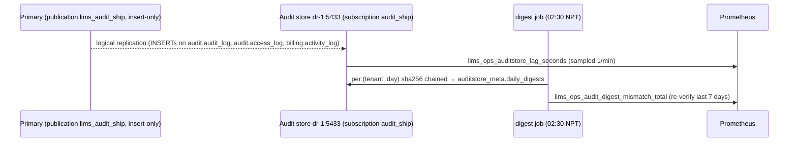

# C1 — Infrastructure & Operations — 03 APP FLOW

Status: DRAFT for build, 2026-11-06. C1 has no product screens or endpoints. Its "flows" are request paths through the infrastructure, operational pipelines and runbook procedures. Section numbers are referenced by `06-IMPLEMENTATION-PLAN.md` and the runbooks. Names of hosts, networks, files and metrics are those of `02-TRD.md`.

---

## 1. Runtime request paths

### 1.1 Staff browser request (edge view; complements C0 03-APP-FLOW §2.1)

```mermaid
sequenceDiagram
  autonumber
  participant B as Browser
  participant N as nginx (app-1, C1)
  participant F as fail2ban (C1)
  participant W as web BFF (C0/C2)
  participant A as API (C0 core)
  participant P as PgBouncer (data-1)
  participant D as Postgres (data-1)
  B->>N: HTTPS (TLS 1.2/1.3, 04 I5) Host = staff_web
  N->>N: perip limit (100 r/s, burst 200) + limit_conn 200
  alt login/recovery BFF route (POST only)
    N->>N: zone=login 60r/m burst 20 — flood guard only (08 Addendum A1); per-IP failure throttle in C2
  end
  alt limit exceeded
    N-->>B: 429 problem+json common.rate_limited, Retry-After
    N->>F: access.json line status 429 + limit_req_status REJECTED → login zone: lims-auth (≥ 300/10 min → ban 15 min + LimsAuthJailBan); other zones except agent/otp/psession: lims-ratelimit (08 A3.2, A27.2; 401s never counted)
  end
  N->>N: strip X-Lims-* except X-Lims-Background (BFF origin, 08 A25 D-206), X-Request-Id; set X-Forwarded-For=$remote_addr, X-Edge-Request-Id
  N->>W: proxy (edge_net)
  W->>A: http://api:8080 (app_net) session/JWT, X-Lims-Bff-Key (staff_web), X-Forwarded-For as received, X-Request-Id (UUIDv7 generated by BFF)
  A->>P: transaction (lims_api)
  P->>D: server connection (transaction pool)
  D-->>A: rows (RLS)
  A-->>W: JSON
  W-->>N: HTML/JSON (+ app CSP)
  N-->>B: + HSTS, nosniff, Referrer-Policy, XFO, Permissions-Policy (02-TRD §6.4)
```
Guards: `/v1/` and the Supabase prefixes on staff_web → 404 at edge (explicit denies, 02-TRD §6.3); `/v1/identity/auth/*` is never reachable from the internet (CR-C2-012) because no public origin proxies it (C16's two patient-session operations are the documented later exception). The API takes the client IP from `X-Forwarded-For` only because the request carries a valid BFF key (08 A25 P-61). The portal and partner BFFs follow the same path with their own key kinds.

### 1.2 Bridge agent (C7 → api origin)

```mermaid
sequenceDiagram
  autonumber
  participant G as Bridge agent (lab PC, C7)
  participant N as nginx (api origin)
  participant A as API instruments module (C7)
  participant W as worker-a/b (C7 agent-state evaluation)
  participant M as Prometheus (ops-1)
  G->>N: POST /v1/instruments/agent/message-batches (or another E01–E08 path) Authorization: device token, ≤ 100 msgs, ≤ 4 MiB (attachments ≤ 16 MB)
  N->>N: prefix in public-routes.yaml? else 404 (no jail counts 404s — 08 A25 D-211)
  N->>N: zone=agent key=client IP 600r/m burst 200 (flood guard, 08 A13 D-43); body > limit → 413
  alt over flood guard
    N-->>G: 429 Retry-After: 60 (agent backs off — 04 N11)
  end
  N->>A: proxy (X-Forwarded-For = client IP; API trusts it because the peer is nginx — P-61)
  A->>A: device auth + per-device tier `ingest` 60/min (C0/C7 — the real limit)
  A-->>N: 2xx/4xx (idempotent on 04 N10 keys)
  N-->>G: response
  Note over W,M: C7 evaluates agent state from heartbeats in the worker; exports lims_instruments_agent_state{tenant_id,centre_id,agent_id,state}
  M->>W: scrape worker-a :9466 / worker-b :9467 /metrics every 30 s (wg0)
```

### 1.3 File download (no files origin — 08 A14.2 / A13 P-2)
Stored files reach browsers only through the API: browser → nginx (staff_web/portal/partner origin) → BFF → API on `app_net` → `ctx.download.stream` (C0) reads the object from Storage through `api-gw` on `app_net` and streams it with the download headers (P-2). No public host name, nginx server or path proxies to Storage; `ctx.storage.signedUrl` stays internal and never appears in a response. Storage signing-key rotation (REQ-SEC-035) therefore affects only internal callers; runbook `secrets.md#storage-signing-key`.

### 1.4 Worker outbound call (provider)
Worker or API → `LIMS_CORE_EGRESS_PROXY_URL=http://squid:3128` → Squid checks `CONNECT host:443` against `egress_allowlist` → allowed: tunnel; denied: `403` from Squid, logged (`egress_denied`), counter `lims_ops_egress_denied_total{dest_class}` (destination host is logged only in ops logs, not as a metric label) → alert `EgressDenied` (warn). Renderer and sandbox have no route at all (02-TRD §3.2). Database traffic leaves only over `db_net` to the primary's wg IP on 5432/6432; GoTrue's SMTP to the relay on 587 is the single non-Squid exception (02-TRD §5.5, 08 A25 D-203); BFFs on `edge_net` have no egress.

### 1.5 Edge cases on the request path

| Case | Behaviour |
|---|---|
| Client sends its own `X-Forwarded-For` | overwritten with `$remote_addr`; the API uses it only from a BFF with a valid key or from the nginx peer address (`LIMS_CORE_TRUSTED_PROXY_CIDRS`, 08 A25 P-61) |
| Client sends `X-Lims-Background` | passed through unchanged on staff_web/partner/portal (the browser's `@lims/ui` polling/SSE helpers set it; the BFF maps it to `touch: false`, so it can only shorten the sender's own session — 08 A25 D-206); stripped on the api origin |
| Client sends `X-Request-Id` or another `X-Lims-*` header | cleared at the edge; only the BFF/API set them internally |
| Non-GET/HEAD or a request body on a payment route | 405 / 413 from nginx (CR-C15-008) |
| Unknown path on the api origin (e.g. a renamed agent path) | 404 from nginx; no ban (08 A25 D-211); sustained > 30 per 5 min from one IP for 15 min → `EdgeNotFoundSpike` (warn) |
| Upstream `api-a` unhealthy | nginx `upstream` with `max_fails=3 fail_timeout=10s` [CONV] sends to `api-b`; both down → 502 → `Edge5xxRate` |
| Request body > limit | 413 from nginx (API also returns `common.payload_too_large` for its own caps) |
| Token path `/r/…` or `/v/…` | logged as `/r/{token}` / `/v/{token}`; never the raw path or query (IC §7) |
| Slowloris | `client_header_timeout`/`client_body_timeout` 15 s; `limit_conn` 200/IP |
| Banned IP | nftables set drop at app-1 input; ban list never contains wg0 ranges |

## 2. Deploy pipeline

### 2.1 State machine (release per environment)

| State | Entered when | Next | Guard | Side effects |
|---|---|---|---|---|
| `built` | `ci/build.sh` succeeded | `scanned` | — | SBOM stored |
| `scanned` | trivy finished | `pushed` / `blocked` | no critical without unexpired triage entry | scan report in CI log |
| `pushed` | digests in registry; `releases/<env>.lock.yaml` PR opened | `approved` (prod) / `deploying` (dev, staging) | lock PR merged | — |
| `approved` | founder approval in CI environment `prod` | `deploying` | approver ≠ author of the release PR [CONV] | `ops_audit` entry |
| `deploying` | `deploy.yml` started (env lock acquired) | `smoke` / `failed` | pre-flight checks (02-TRD §12.3 step 1) | pre-deploy backup (prod); audit-store schema sync; DB flow; rolling update |
| `smoke` | all services healthy | `live` / `rolling_back` | — | smoke + external tests |
| `live` | smoke green | — | — | status page note; `ops_audit` |
| `rolling_back` | smoke red or health timeout (5 min [CONV]) | `rolled_back` / `failed` | previous lock file exists | redeploy previous digests (no DB down-migration) |
| `rolled_back` | previous digests healthy | — | — | page alert `DeployRolledBack`; incident ticket |
| `failed` | any step error before rolling update, or rollback failed | — | — | page; env lock kept until an engineer releases it |
| `blocked` | scan gate failed | `scanned` (after fix/triage) | — | — |

Env lock: `flock` on `/var/lock/lims-deploy-<env>` on ops-1 plus a lock file in the env (`/srv/lims/deploy.lock` on app-1); a second deploy waits ≤ 10 min then fails [CONV].

### 2.2 Sequence (prod)

```mermaid
sequenceDiagram
  autonumber
  participant R as Runner (ops-1)
  participant K as SOPS decrypt service (ops-1)
  participant DB as data-1
  participant DR as dr-1 (audit store)
  participant AP as app-1
  participant M as Prometheus/Alertmanager
  R->>R: acquire env lock; no drill lock; verify approval; last drill < 35 d; no backup-family page firing
  R->>K: request prod secrets for release id
  K-->>R: rendered secret files (memory → ansible → tmpfs on targets)
  R->>DB: pgbackrest backup --type=incr --repo=1
  R->>DR: auditstore/gen-schema.sh --apply (new columns first)
  R->>AP: docker compose run --rm migrate (C0 api image on db_net): migrations as lims_migrator → data-1 (lock_timeout 5s)
  R->>AP: same one-shot container: pnpm worker:registry-sync; seeds 001–003
  R->>AP: roll api-a → ready → api-b → ready
  R->>AP: worker-a SIGTERM (60 s grace) → start new → worker-b
  R->>AP: web, portal, renderer, pdf-sandbox (C6 images)
  R->>AP: smoke + tests/external
  alt smoke red
    R->>AP: rollback.sh previous digests
    R->>M: DeployRolledBack
  end
  R->>R: release lock; ops_audit "live vX.Y.Z"
```

### 2.3 Deploy edge cases

| Case | Handling |
|---|---|
| Migration fails mid-PR | transactional file rolls back; pipeline `failed`; app keeps old digests (C0 03-APP-FLOW §1.4) |
| `CREATE INDEX CONCURRENTLY` leaves INVALID index | next file in the PR drops/recreates (C0 rule); C1 alert `PostgresInvalidIndex` (count of `pg_index.indisvalid = false` > 0) |
| Audit-store schema sync fails | deploy stops **before** migrations (otherwise replication would break on the new column) |
| Registry unreachable | pre-flight fails; nothing changed |
| Secrets decrypt fails | pre-flight fails; nothing changed |
| Worker still busy after 60 s | Docker SIGKILL; Graphile Worker re-runs the job (at-least-once; consumers idempotent — CV §7.4) |
| Two releases approved together | env lock serialises; the second re-runs pre-flight |
| Rollback image incompatible with new schema | prevented by C0's additive-first rule; if it happens: `failed` + incident; forward-fix only |

## 3. Backup, WAL archiving and standby

### 3.1 Continuous flow

```mermaid
sequenceDiagram
  participant PG as Postgres (data-1)
  participant BR as pgBackRest (in db container)
  participant R1 as repo1 (data-1 vg_repo)
  participant R2 as repo2 (dr-1 SFTP, site B)
  participant SB as Standby (dr-1)
  participant T as Timer (every 15 min)
  PG->>BR: archive_command archive-push %p (async; segment switched at least every 60 s under write load — archive_timeout, 08 A25 D-205)
  BR->>R1: encrypted WAL (aes-256-cbc, cipher pass 1)
  BR->>R2: encrypted WAL (cipher pass 2) over wg0 SFTP
  PG-->>SB: streaming replication (lims_replicator, slot dr1)
  T->>BR: pgbackrest check
  BR->>PG: force WAL switch, wait for archive in repos (archive-timeout)
  BR-->>T: ok / failed → lims_ops_wal_check_consecutive_failures
  Note over T,R2: every minute pgbackrest_metrics.sh: lims_ops_wal_repo2_newest_age_seconds = now − time of newest WAL in repo2 (info + repo-ls); > 600 s WalArchiveLagging, > 840 s RpoAtRisk (while WAL is unarchived)
```

### 3.2 Backup job states

| State | Transition | Metric / alert |
|---|---|---|
| `scheduled` → `running` | timer fires (01:30 NPT) | — |
| `running` → `succeeded` | exit 0 | `lims_ops_backup_last_success_timestamp_seconds{repo,type}` |
| `running` → `failed` | non-zero exit | job retried once after 30 min [CONV]; second failure → `BackupMissed` fires at 26 h |
| any → `skipped` | another backup holds the stanza lock | logged; next run normal |

### 3.3 Edge cases

| Case | Behaviour |
|---|---|
| dr-1 unreachable | WAL queues in spool (`archive-async`) up to `archive-push-queue-max` 20 GiB; `RpoAtRisk` pages after 840 s of unarchived WAL and `check` fails → `WalArchiveFailing` within 30 min (2 runs); standby slot retains WAL up to `max_slot_wal_keep_size` 50 GB then the slot is invalidated (data-1 protected); runbook: re-seed standby from repo2 after link returns |
| Spool reaches 20 GiB | pgBackRest drops queued WAL and reports success to Postgres (documented behaviour) → PITR gap until next full backup; prevented by paging at the `check` failure long before; runbook forces a full backup immediately after recovery |
| repo1 disk full | backup fails; `DiskFillForecast` should have fired earlier; expire runs. Multi-repo archive behaviour (pgBackRest documentation for multiple repositories, read 2026-11-06 via the EDB-hosted pgBackRest guide, a secondary source; re-checked against pgbackrest.org for the pinned 2.60 in T-09 and recorded there): `archive-push` tries every reachable repo and still returns an error to PostgreSQL when one repo fails, so PostgreSQL keeps the segment and retries; with `archive-async=y` the asynchronous process keeps delivering WAL to the working repo (repo2), so the off-site archive and `lims_ops_wal_repo2_newest_age_seconds` stay current while `pg_wal` grows on data-1 → `WalArchiveFailing` (the `check` fails) and `DiskFillForecast` on data-1 (page). Runbook `backup.md#repo1-full`: free space on repo1 (expire, extend `vg_repo`), or as a last resort remove repo1 from `pgbackrest.conf` temporarily (documented step, founder notified), then `check` |
| Backup during deploy | deploy pre-backup and nightly backup share the stanza lock; second waits/skips |
| Clock skew on data-1 | PITR targets use DB time; `ClockSkew` alert |

## 4. Restore drill (04 I3)

### 4.1 State machine

| State | Next | Guard | Side effect |
|---|---|---|---|
| `scheduled` | `preparing` | timer (first Saturday 02:00 NPT) or manual | — |
| `preparing` | `restoring` / `aborted` | scratch LV created on ops-1 LUKS VG; no other drill running | `ops_audit` |
| `restoring` | `verifying` / `failed` | `pgbackrest restore --repo=2 --type=time` exit 0 and Postgres accepts connections ≤ 2 h [CONV timeout] | RTO timer stops at "accepting connections" |
| `verifying` | `reporting` | all checks executed (failures counted, not fatal) | — |
| `reporting` | `cleaning` | metrics + report written | report PR |
| `cleaning` | `succeeded` / `succeeded_with_failures` | LV discarded and removed | `lims_ops_restore_drill_last_success_timestamp_seconds` only on `succeeded`; `succeeded_with_failures` (any failed check) → `RestoreDrillFailed` page, like `failed` |
| `failed` / `aborted` | `cleaning` | — | `RestoreDrillFailed` page |

### 4.2 Sequence

```mermaid
sequenceDiagram
  autonumber
  participant O as ops-1 drill playbook
  participant R2 as repo2 (dr-1)
  participant X as scratch Postgres (ops-1)
  participant A as app-1 Storage
  participant Y as dr-1 object replica
  participant M as Prometheus
  O->>O: lvcreate scratch on vg_ops (LUKS); fetch repo2 cipher pass from SOPS (drill scope)
  O->>R2: pgbackrest restore --repo=2 --type=time --target=now-30m
  R2-->>X: base backup + WAL
  O->>X: start; wait "accepting connections" (RTO measured)
  O->>X: drill/verify.sql (recency, per-tenant counts, amcheck, billing export dry run)
  O->>A: list + sha256 of 200 random objects
  O->>Y: sha256 of same objects
  O->>M: textfile metrics (RTO, checks_failed, timestamp)
  O->>O: blkdiscard + lvremove scratch; report PR (counts/timings only)
```

### 4.3 Edge cases
- Drill target falls inside a WAL gap → `restore` fails → `failed` + page; this is a real finding (RPO breach), handled as an incident.
- Drill coincides with a deploy → deploy pre-flight blocks while `/var/lock/lims-drill` held (≤ 3 h).
- Scratch instance must never accept app connections: it binds only to `127.0.0.1` inside ops-1 and has `archive_mode = off`, `max_wal_senders = 0`.
- Real PHI on ops-1 during the drill: LUKS VG, LV discarded after; nobody queries row contents; verify.sql returns counts only.

## 5. Object replication
Timer every 15 min → `rsync --ignore-existing` (no delete) → on success write timestamp metric → nightly `--checksum` pass. Failure states: SSH failure (retry next cycle; `ObjectReplicaStale` after 1 h), disk full on dr-1 (`DiskFillForecast`), partial transfer (`--partial` resumes). A ransomware-style overwrite on app-1 cannot modify existing files on dr-1 (`--ignore-existing`); a *new* malicious file would be copied — detection via `StorageVolumeForecastFull`/anomalous growth panel and the integrity sample.

## 6. Audit shipping (04 D11)



| Case | Behaviour |
|---|---|
| New column on a published table | deploy runs `gen-schema.sh --apply` on the subscriber first (§2.2); CI job `auditstore-drift` fails the release if lists differ |
| Subscription error (apply conflict, missing column) | subscription stops; `AuditShippingDown` page; runbook: fix schema, `ALTER SUBSCRIPTION … ENABLE` |
| Replication slot invalidated (link down > 50 GB WAL) | rows from the gap are missing in the store → runbook `audit.md#backfill`: founder-approved one-off export of the gap range on the primary by the image superuser (`COPY (SELECT … WHERE occurred_at BETWEEN …) TO STDOUT`) piped over wg0 into the store; record the backfill in `ops_audit`; create a new slot and re-enable |
| Primary-side retention purge (future) | insert-only publication → store keeps the rows (≥ 5 years) |
| Duplicate apply after restart | logical replication resumes from the slot's confirmed position; PK `(tenant_id, occurred_at, id)` rejects a duplicate and stops the subscription → runbook skips the already-present LSN (documented `ALTER SUBSCRIPTION … SKIP`, PG ≥ 15) after verifying the row is identical |

## 7. Alert lifecycle

| State | Transition | Who | Side effects |
|---|---|---|---|
| `inactive` → `pending` | expression true | Prometheus | — |
| `pending` → `firing` | true for `for:` duration | Prometheus | Alertmanager notified |
| `firing` → `notified` | route matched | Alertmanager | e-mail (page immediate / warn digest 30 min); tenant e-mail if `notify_tenant` |
| `notified` → `acknowledged` | on-call creates a silence with comment "ack <name>" ≤ 15 min after a page [CONV] | `ops_oncall` | silence ≤ 4 h [CONV] |
| `notified` → `escalated` | no ack in 15 min (page) | Alertmanager `repeat_interval 15m` to on-call + escalation contact (founder) after 30 min [CONV] | — |
| `firing` → `resolved` | expression false | Prometheus | resolved e-mail |
| any → `inhibited` | inhibition rule (site down, host down) | Alertmanager | suppressed child alerts |
| `Watchdog` missing 6 h | founder mailbox notices absence | human | runbook `monitoring.md#watchdog-missing` |

## 8. Bridge agent health (X6)
`C7 heartbeat evaluator` → gauge set → Prometheus scrape → rule `BridgeAgentOffline` (15 min) → warn digest → `BridgeAgentOfflineLong` (60 min, lab hours) → page + `notify_tenant` e-mail to the lab's ops contact with route `staff.instruments.agent` (opaque agent UUID only). Resolution when state returns to `online`. If C7 metrics are absent while `c7_metrics_live = true` → `BridgeAgentMetricsAbsent`. The series are scraped from worker-a/b (C7 evaluates heartbeats in the worker); duplicate series from the two worker replicas are de-duplicated by `max by`. C7's own rules (`InstrumentsAgentUpdateFailed`, `InstrumentsAgentConfigRejected`, `InstrumentsDeviceAuthFailureSpike`, `InstrumentsAttachmentQuarantined` page; `InstrumentsQuarantineRate`, `InstrumentsIngestSlow` warn) are imported from C7's rule file (02-TRD §11.3).

## 9. Studio break-glass

| State | Next | Guard | Side effects |
|---|---|---|---|
| `off` | `requested` | engineer opens a runbook entry with reason | — |
| `requested` | `on` | founder approval recorded (Studio uses `postgres`, BYPASSRLS — 04 D5) | rotate `DASHBOARD_PASSWORD`; start studio+meta; timer N ≤ 4 h; `StudioEnabled` info hourly; `ops_audit` |
| `on` | `off` | timer expiry or `disable` | stop containers; rotate password again; `ops_audit` |

Access only via `ssh -L 8000:127.0.0.1:8000` over wg0; `127.0.0.1:8000` exists only while the break-glass override is up (02-TRD §7.10). Nothing in nginx changes.

## 10. Secret rotation

```mermaid
sequenceDiagram
  participant E as Engineer
  participant R as rotate-secret.yml
  participant S as lims-secrets repo (ops-1)
  participant DB as Postgres
  participant C as Consumers
  E->>R: -e secret_id=lims_api_db_password -e env=prod
  R->>R: generate (CSPRNG, schema rule)
  R->>DB: ALTER ROLE lims_api PASSWORD '…' (scram)
  R->>S: sops --set new value; commit (encrypted)
  R->>C: re-render /run/lims/secrets; rolling restart api-a, api-b
  R->>R: verify: synthetic requests 5 min, zero auth failures (AC-19.2)
```
Special cases (02-TRD §8.5): JWT signing keys (dual-key overlap with C2/C0), Storage signing key (invalidates all signed URLs), pgBackRest cipher pass (new repo + full backup), WireGuard keys (per host, peers updated by `site.yml`), LUKS keys (`cryptsetup luksAddKey` then `luksRemoveKey`).

## 11. Disaster recovery

### 11.1 Primary DB host loss (data-1)

```mermaid
sequenceDiagram
  participant M as Alertmanager
  participant O as On-call
  participant SB as dr-1 standby
  participant AP as app-1
  M->>O: TargetDown data-1 + PostgresDown (page)
  O->>O: confirm data-1 unrecoverable within 30 min [CONV]; founder informed
  O->>SB: dr-promote.yml (pg_ctl promote; archive to repo2 continues from dr-1)
  O->>AP: db_primary_wg_ip := dr-1 wg IP → re-render POSTGRES_HOST / DB URLs and the db_net DOCKER-USER rule; restart api, worker, supabase services
  O->>AP: smoke; status page update
  O->>O: incident record opened: "degraded — no second-site archive, audit store on the primary's host" (08 A25 D-210 (c))
  O->>SB: within 4 h [CONV]: dr-promote.yml step "interim repo" — pgBackRest repo on ops-1 (different host, same site B) + stanza-create + check
  M->>O: NoOffsiteArchive (page) keeps firing until a repo on a site other than dr-1's site is configured
  Note over O: RPO = streaming lag at failure (seconds) ≤ archive guarantee 15 min; RTO target ≤ 1 h [CONV]. Degraded mode: RPO holds against host loss (with the ops-1 repo), not against loss of site B
```
After failover: dr-1 is primary in site B (app still at site A over wg0); rebuild data-1 as new standby from repo2, then planned switch-back in a window. **Degraded mode (08 A25 D-210):** until switch-back (or until a repo on another site exists) there is no second-site WAL archive (04 I2) and the audit store shares the primary's host (04 D11); `NoOffsiteArchive` pages for the whole period and the incident record names it. No third site is ordered here (B12 procurement item).

### 11.2 Site A loss
`dr-site-failover` runbook: provision app VM at site B (or promote a pre-provisioned cold VM if B12 allows), `site.yml` with inventory `prod-siteB`, promote standby, restore Storage from dr-1 replica (mount replica volume as `/srv/lims/storage`), move DNS records of the origins to site B's public IP (DNS provider is a B12 item; TTL 300 s [CONV] set in advance), issue certificates via ACME at site B. RTO target ≤ 4 h [CONV]; RPO ≤ 15 min.

### 11.3 Storage loss on app-1
DECISION: rsync back from dr-1 to a fresh `vg_storage` LV (`--ignore-existing` reversed direction), then Storage restarts; during the copy, report downloads fail with Storage 404s (portal shows its error state; C6). Gap = objects written in the last replica interval (≤ 15–30 min): their DB rows exist (C6 re-renders from DB on demand per its TRD, else listed in the incident).

### 11.4 Ransomware / host compromise
Isolate (nftables drop all except wg0 from ops-1), preserve disk (provider snapshot if available; else `dd` of LV to dr-1 over wg0), rebuild host from `site.yml`, restore from repo2 to a point before compromise, rotate every secret the host held (secrets schema lists consumers per host). Follow §12 for the privacy part.

## 12. Incident response (REQ-SEC-134; 04 L17)

### 12.1 States

| State | Entered when | Exit criteria | Mandatory records |
|---|---|---|---|
| `detected` | alert, tenant report, staff report, external report | on-call acknowledges | time detected, source |
| `triaged` | severity assigned (SEV1–SEV4, 04-UI-UX §5.1) | incident commander named | severity, PHI-possible yes/no |
| `contained` | blast radius stopped (block IP, revoke tokens/sessions, disable account via C2, isolate host, disable a route at nginx) | no ongoing access | actions with timestamps |
| `evidence_preserved` | (PHI-possible) audit-store snapshot (`pg_dump` of affected tenant range, sha256), VictoriaLogs export of the window (sha256), nginx logs, host snapshot | hashes recorded in `ops_audit` | within 4 h of `triaged` [CONV] |
| `assessed` | facts established: which tenants, which records (counts by class), which actor | privacy assessment form filled (04-UI-UX §5.3) | sections considered: s.12(4) disclosure, s.26(1) bodies corporate, s.25/s.27(1) if tenant is a public body, s.29 offences, s.30 three-month complaint window, s.31 compensation (04 L17) |
| `notified` | tenant(s) informed per decision; patient notification is the tenant's decision with the LIMS provider support; legal contact consulted | records of who/when/what | **04 L17 lists no breach-notification deadline; whether the Act or the Regulation sets one is UNVERIFIED — counsel to confirm (B16). Our own target: affected tenant informed ≤ 72 h after `assessed` [CONV].** Privacy Regulation 2077 content UNVERIFIED (04 L18; B16) |
| `recovered` | service normal; secrets rotated; patched | — | — |
| `reviewed` | post-incident review ≤ 10 working days [CONV] | actions tracked | review doc |

### 12.2 Sequence for a suspected PHI disclosure

```mermaid
sequenceDiagram
  participant D as Detector (alert/report)
  participant IC as Incident commander (on-call)
  participant F as Founder / legal contact
  participant C2 as C2 console (platform admin)
  participant AS as Audit store
  participant T as Tenant admin
  D->>IC: signal
  IC->>IC: triage SEV; PHI possible?
  IC->>C2: contain (lock user / revoke sessions / suspend support session)
  IC->>AS: preserve evidence (export + sha256)
  IC->>F: inform (SEV1/SEV2 immediately)
  IC->>AS: assess: access_log/audit_log queries (audit_reader, founder-approved)
  F->>T: notification per assessment (template 04-UI-UX §5.4)
  IC->>IC: recover, review
```

## 13. Patching flow
`patch.yml` per env: snapshot inventory of versions → `apt` upgrade via ops proxy → pull new image digests (mirror) → staging soak 24 h (normal) → prod in window; reboot order: dr-1 → data-1 (standby healthy) → ops-1 → app-1 (announced). Emergency: same steps, no soak, staging smoke mandatory. Failure on a host → stop, roll back package (apt pin of previous version) or image digest, alert.

## 14. pdf-sandbox (removed flow — 08 A25 D-204)
The former qpdf spool-job state machine is deleted: C6's `pdf-sandbox` is an HTTP service (`POST /internal/sanitize`, `POST /internal/assemble`, `GET /internal/health`; C6 02-TRD §5.2) called by C6's worker tasks, and its job states, timeouts and retries are C6's. C1's part is the envelope (02-TRD §7.5): container restart on crash (`restart: unless-stopped`), health via C6 `GET /internal/health` → `lims_ops_container_health{service="pdf-sandbox"}` → C6's imported "Renderer / sandbox down" rule.

## 15. Operator UI states (Grafana, Alertmanager, VictoriaLogs UI, status page)

| UI | Empty | Loading | Error | Permission denied |
|---|---|---|---|---|
| Grafana dashboard panel | "No data" + panel description says which exporter/flag feeds it (e.g. agent panels: "C7 metrics not live yet — flag c7_metrics_live") | Grafana default spinner | datasource error banner → runbook `monitoring.md#prometheus-down` | role lacks folder access → Grafana 403 page; `ops_readonly` cannot open Logs/Security folders |
| Alertmanager UI | "No alerts" | default | ops-1 unreachable → use `amtool` on ops-1 | basic auth 401 |
| VictoriaLogs UI | "no results for query/time range" | default | ingestion stopped → `TargetDown{service="victorialogs"}` | basic auth 401; `ops_readonly` has no account here (IPs in nginx logs are personal data) |
| Status page (DECISION: static HTML served by nginx itself at `^~ /status/` on the portal origin, rendered by the `status_page` role from `infra/status/status.yaml`; C6 reserves the `/status/` prefix — CR-C1-005) | "All systems operational" | n/a (static) | stale > 15 min shows "status unknown" banner | public |

The status page must contain no tenant names or PHI; only component states and maintenance notices (REQ-SEC-142).
