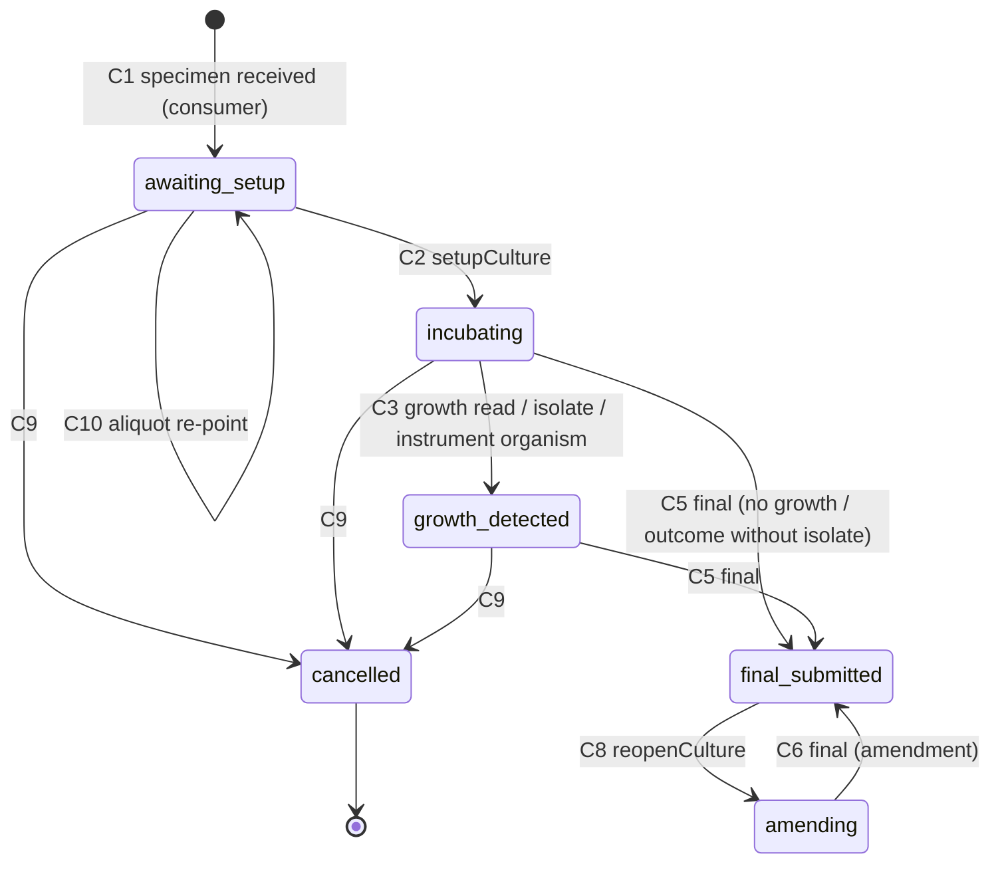
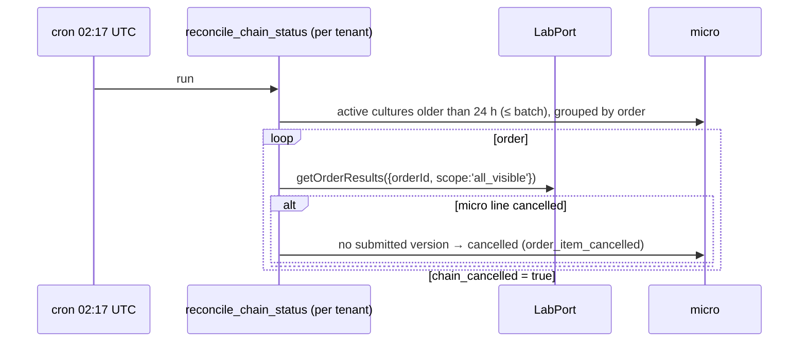

# C10 Microbiology — 03 App Flow

Status: DECISION, 2026-11-06. State names are the CHECK values of 05-SCHEMA §2. Operation ids are 02-TRD §5. Permissions per 02-TRD §5 (CR codes per CR-C10-004).

---

## 1. Flow index

| # | Flow | Actor | Cross-chunk |
|---|---|---|---|
| F-01 | Culture creation / cancellation from specimen events | system | C5 event, LabPort, CatalogPort |
| F-02 | Worklist + barcode scan | technologist | C5 HTTP (lookup), C4 HTTP (patient display) |
| F-03 | Setup, plates, observations | technologist | — |
| F-04 | Isolates, identification, AST panel, AST entry, suggestions | technologist | — |
| F-05 | Instrument ID/AST record ingestion and matching | system, technologist | C7 event, LabPort (CR-C10-003) |
| F-06 | Preliminary / final submission | technologist, pathologist | LabPort.submitModuleResult → C5 events → C6 |
| F-07 | Reopen and amend | pathologist / technologist | LabPort (C5 R7) |
| F-08 | Breakpoint import, validation, activation, retirement | lab manager ×2 | core `ctx.uploads`/`ctx.storage` (08 §4.13) |
| F-09 | Chain reconciliation | system | LabPort |
| F-10 | Configuration | lab manager | — |

## 2. State machines

### 2.1 Culture (`micro.cultures.status`)



| # | From | To | Trigger | Permission | Guards | Side effects |
|---|---|---|---|---|---|---|
| C1 | ∅ | `awaiting_setup` | `lab.specimen.status_changed.v1` `to_status = received` with a microbiology item | system | item test `workflowType = microbiology`; creation key `(order_item_id, specimen_id)` free; not an aliquot of a specimen that already has a culture for the item (02-TRD §8.2); without `order_item_ids`, the item's specimen types match and the order has exactly one non-rejected specimen of that type | culture row (`centre_id` = event `centre_id`); transition row; barcode snapshot if CR-C10-003; retry `pending_match` instrument records of that barcode |
| C2 | `awaiting_setup` | `incubating` | `setupCulture` | `micro.culture.work` | ≥1 plate (explicit or protocol); media codes active; `planted_at` window | plates 1..n; `planted_at`, `next_read_due_at`, `final_due_at`; protocol snapshot id |
| C3 | `incubating` | `growth_detected` | `recordCultureObservation` (plate_read, growth code `indicates_growth`) / `createIsolate` / instrument organism applied | `micro.culture.work` / system | — | — |
| C4 | `awaiting_setup`, `incubating`, `growth_detected` | (unchanged) | `submitCultureReport` phase `preliminary` | `micro.culture.work` (+ `lab.result.amend` checked by C5 when the C5 line is approved) | ≥1 observation or isolate (`micro.report_incomplete`); size guard (02-TRD §4.6). When the C5 line is `approved` and its last approved phase is `preliminary`, C10 sends `amendment.reasonCode = module_preliminary_update` automatically (08 A17 D-61) | report version (kind `amendment` with that reason when sent, else `initial`/`update`); `current_report_version_no`, `last_report_phase = preliminary` |
| C5 | `incubating`, `growth_detected` | `final_submitted` | `submitCultureReport` phase `final` | `micro.culture.work` (+ `lab.result.amend` checked by C5 when the C5 line is approved) | PRD AC-10.1–10.3 | report version; `outcome_code`; working rows locked |
| C6 | `amending` | `final_submitted` | `submitCultureReport` phase `final` | as C5 | as C5; amendment reason present (set at C8) | report version kind `amendment` |
| C7 | `amending` | — | `submitCultureReport` phase `preliminary` | — | **forbidden**: `409 micro.culture_invalid_transition` | — |
| C8 | `final_submitted` | `amending` | `reopenCulture` | `micro.culture.work` | reason code (`micro.amendment_reason_required`) | `amendment_reason_*` stored; working rows editable |
| C9 | `awaiting_setup`, `incubating`, `growth_detected` | `cancelled` | consumer `to_status = rejected` (`specimen_rejected`); `cancelCulture`; reconciliation (`order_item_cancelled`) | system / `micro.culture.work` | no submitted version — except reconciliation/`cancelCulture` when the C5 line is `cancelled` | `cancel_*`; transition row; open instrument records of the culture → `pending_match` (`culture_cancelled`) |
| C10 | `awaiting_setup` | `awaiting_setup` | aliquot event (parent → aliquot) | system | culture still `awaiting_setup` | `specimen_id` re-pointed (audited); `last_specimen_seq` = the aliquot event's `aggregate.seq` (review m#17) |

Forbidden (unit-tested): `cancelled → *`, `final_submitted → incubating`, `awaiting_setup → final_submitted`, `amending → cancelled`, any change in `final_submitted` except C8. Edits of children while `final_submitted` → `409 micro.report_final_locked`; while `cancelled` → `409 micro.culture_invalid_transition`.

### 2.2 Isolate (`micro.isolates.status`)

| # | From | To | Trigger | Guard |
|---|---|---|---|---|
| I1 | ∅ | `pending_id` / `identified` | `createIsolate` (with/without organism); instrument organism record | culture ∈ {incubating, growth_detected, amending}; `awaiting_setup` (no plates yet) → `micro.culture_invalid_transition` |
| I2 | `pending_id` | `identified` | `identifyIsolate`; instrument organism | organism active |
| I3 | `identified` | `identified` | `identifyIsolate` (re-identification) | culture editable |
| I4 | `pending_id`, `identified` | `withdrawn` | `withdrawIsolate` | reason |
| — | `withdrawn` | any | forbidden → `micro.isolate_invalid_transition` |

`assignAstPanel` requires `identified` (`micro.isolate_invalid_transition`). Re-identification keeps existing AST rows; the UI warns "Panel was chosen for <previous organism>" and offers re-assigning (rows with values are kept; new panel antibiotics are added as pending; antibiotics no longer in the panel become `off_panel = true`).

### 2.3 AST row (no status column; derived)

`pending` (no `raw_value`) → `valued` (raw value, no category) → `interpreted` (category + standard + version). Reportability = `is_reportable` and `report_visibility = shown`. Rows are upserted by `recordAstResults` (manual) or instrument apply (§4 F-05). Each change is audited; the reported values are the immutable snapshot.

### 2.4 Instrument record (`micro.instrument_records.match_status`)

| # | From | To | Trigger |
|---|---|---|---|
| IR1 | ∅ | `applied` / `pending_match` / `needs_mapping` / `conflict` / `late_after_final` / `ignored` (older rerun: `ignore_reason_code = duplicate`) | consumer (02-TRD §4.8) |
| IR2 | `pending_match` | `applied` / `needs_mapping` / `conflict` / `late_after_final` | `assignMicroInstrumentRecord` |
| IR3 | `needs_mapping`, `late_after_final`, `pending_match` (culture known) | `applied` / `conflict` / `needs_mapping` | `applyMicroInstrumentRecord` |
| IR4 | `conflict` | `applied` | apply/assign with `resolution = use_instrument` |
| IR5 | `conflict` | `ignored` | `resolution = keep_existing` (reason `kept_manual`) |
| IR6 | `pending_match`, `needs_mapping`, `conflict`, `late_after_final` | `ignored` | `ignoreMicroInstrumentRecord` |
| — | `applied`, `ignored` | any | forbidden → `409 micro.instrument_record_conflict` |

Entering `applied` or `ignored` sets `expires_at` (02-TRD §4.8 step 8); `micro.purge_instrument_records` deletes the record after expiry unless an AST row references it (08 A17 D-65). `pending_match` reasons: `lookup_unavailable`, `unknown_barcode`, `no_culture`, `multiple_cultures`, `isolate_missing`, `isolate_seq_out_of_range` (> 99), `culture_cancelled`.

### 2.5 Breakpoint set (`micro.breakpoint_sets.status`)

| # | From | To | Trigger | Guard |
|---|---|---|---|---|
| B1 | ∅ | `uploaded` | `createBreakpointImport` | aal2; file checks; sha256 not duplicate |
| B2 | `uploaded` | `validating` | job start | — |
| B3 | `validating` | `validated` / `invalid` | job end | errors = 0 ⇒ validated |
| B4 | `validated` | `active` | `activateBreakpointSet` | actor ≠ `created_by` (`micro.breakpoint_four_eyes_required`); `effective_from` ≥ now − 60 s; in the same tx the previous `active` set of the same standard → `retired` with `effective_to = new.effective_from` |
| B5 | `active` | `retired` | `retireBreakpointSet` | `effective_to = greatest(now, effective_from)` |

Retry of the validation job (review m#20): B2 runs once; a retried job finds `validating` and leaves the status as is (no `validating → validating`).
| B6 | `uploaded`, `validated`, `invalid` | `discarded` | `discardBreakpointSet` | — |
| — | others | — | `409 micro.breakpoint_set_invalid_transition` | — |

Serialisation: activation and retirement lock `micro.settings` of the tenant (`SELECT … FOR UPDATE`, row created with defaults if absent) so two concurrent activations cannot both see "no active set" [DECISION; no exclusion constraint because `btree_gist` presence in the pinned image is UNVERIFIED].

## 3. Sequence diagrams (cross-chunk)

### 3.1 F-01 Culture creation (A4)

```mermaid
sequenceDiagram
  participant C5 as C5 lab (producer)
  participant Q as Worker core (fan-out)
  participant W as micro consumer
  participant LP as LabPort (C5)
  participant CP as CatalogPort (C3)
  participant DB as micro schema
  C5->>Q: lab.specimen.status_changed.v1 (to_status=received)
  Q->>W: evt.micro.lab.specimen.status_changed.v1
  W->>DB: INSERT event_inbox ON CONFLICT DO NOTHING
  alt duplicate
    W-->>Q: commit, done
  end
  W->>LP: getOrderResults({orderId, scope:'all_visible'})
  LP-->>W: items[{orderItemId, testId}]
  loop item in payload.order_item_ids (absent: items of order_id whose specimenTypeCodes contain specimen_type_code — 02-TRD §8.2)
    W->>CP: getTest({testId})
    CP-->>W: workflowType, specimenTypeCodes
    alt microbiology
      W->>DB: INSERT cultures (creation key) ON CONFLICT DO NOTHING + transition
    end
  end
  opt CR-C10-003 enabled
    W->>LP: lookupSpecimens({specimenIds:[id]})
    LP-->>W: barcode
    W->>DB: UPDATE cultures barcode snapshot; retry pending_match records with that barcode
  end
  W-->>Q: commit
```

Rejected: same entry steps; `to_status = rejected` → `UPDATE cultures SET status='cancelled' … WHERE specimen_id = $1 AND status IN (…) AND current_report_version_no = 0`.

### 3.2 F-02 Barcode scan (BFF composition)

```mermaid
sequenceDiagram
  participant B as Browser (micro worklist)
  participant F as BFF (features/micro/server)
  participant L as API lab (C5)
  participant M as API micro (C10)
  participant P as API frontdesk (C4)
  B->>F: scan barcode (BarcodeInput, never in URL)
  F->>L: POST /v1/lab/specimens/lookup {barcode}
  L-->>F: SpecimenDto (id, barcode, registration_no) | 404
  F->>M: GET /v1/micro/cultures?specimen_id=…
  M-->>F: cultures (0..n)
  alt exactly 1
    F-->>B: navigate /micro/cultures/{culture_id}
  else >1
    F-->>B: chooser (test name, status)
  else 0 or 404
    F-->>B: "No microbiology culture for this specimen"
  end
  Note over F,P: culture page header: GET /v1/frontdesk/patients/{patient_id} (name, age/sex) and GET /v1/lab/specimens/{specimen_id} (barcode, reg no) under the user's own permissions; nothing stored by C10
```

### 3.3 F-05 Instrument record

```mermaid
sequenceDiagram
  participant C7 as C7 ingest (producer)
  participant W as micro consumer
  participant LP as LabPort (C5)
  participant DB as micro schema
  C7->>W: instruments.result.received.v1 (record_kind organism_id|ast)
  W->>DB: inbox; INSERT instrument_records ON CONFLICT (idempotency_key) DO NOTHING
  alt CR-C10-003 enabled
    W->>LP: lookupSpecimens({barcode})
    LP-->>W: [specimen] | []
  else not yet enabled
    W->>DB: match_status = pending_match (lookup_unavailable)
  end
  W->>DB: cultures of specimen (non-cancelled)
  alt 1 culture, not final
    W->>DB: vocab map → apply organism / upsert AST → applied | needs_mapping | conflict
  else final_submitted
    W->>DB: late_after_final
  else 0 or >1
    W->>DB: pending_match (no_culture | multiple_cultures)
  end
```

### 3.4 F-06 Submission → C5 → C6

```mermaid
sequenceDiagram
  participant U as User (BFF)
  participant M as micro API
  participant LP as LabPort (C5, same tx)
  participant C5E as C5 outbox
  participant C6 as C6 reporting
  participant V as micro.v_pub_report_content
  U->>M: POST /cultures/{id}/report-versions (Idempotency-Key, If-Match)
  M->>M: tx: lock culture, guards, snapshot, ajv validate
  M->>LP: getOrderResults(all_visible) → micro line status
  M->>LP: submitModuleResult({orderItemId, kind, reportPhase, payloadRef{micro, culture_id, vNo}, summaryText, flag, isCritical, idempotencyKey})
  LP-->>M: {resultId, versionNo, status, replayed}
  M->>M: INSERT report_versions; UPDATE culture; commit (C5's writes commit atomically)
  M-->>U: 201 ReportVersionDto
  Note over LP,C5E: C5 publishes in the same tx: lab.critical_value.detected.v1 (isCritical), lab.result.amended.v1 (R7) …
  Note over U,C6: later: technologist verifies and pathologist approves on C5 screens → lab.result.approved.v1 → lab.order.ready_for_report.v1
  C6->>V: SELECT … WHERE entity_id = moduleRef.entityId AND version_no = moduleRef.versionNo (CR-C6-006)
  V-->>C6: report content row → micro section rendered
```

If `submitModuleResult` throws, the whole transaction rolls back: no report version, no culture change, the C5 error code is returned (PRD AC-09.2).

### 3.5 F-07 Reopen and amend

```mermaid
sequenceDiagram
  participant U as Pathologist
  participant M as micro API
  participant LP as LabPort (C5)
  U->>M: POST /cultures/{id}/reopen {amendment_reason_code}
  M-->>U: culture amending (working rows editable)
  U->>M: edits (identify, AST…)
  U->>M: POST /cultures/{id}/report-versions {report_phase: final}
  M->>LP: getOrderResults → status approved?
  M->>LP: submitModuleResult({…, amendment:{reasonCode, reasonText}})  (CR-C10-001; reason also stored in report_versions)
  alt actor lacks lab.result.amend
    LP-->>M: throws lab.result_locked → rollback → 409
  else holds it
    LP-->>M: {status: approved, versionNo: n+1} (C5 emits lab.result.amended.v1)
    M-->>U: 201 version (kind amendment); culture final_submitted
  end
```

Phase progression (no reopen): the preliminary was approved in C5 and the user now submits the final → C10 sends `amendment.reasonCode = module_phase_progression` (CR-C10-001, 08 R1); C5 accepts that code only for a micro `final` replacing an approved `preliminary` (else `lab.module_result_invalid`), and C6 prints the report as "Final", not "Amended"; the same `lab.result.amend` rule applies; the UI warns technologists beforehand (`permissions_hint.can_amend_approved = false` → "A pathologist must submit the final because the preliminary is already approved").

Updated preliminary (no reopen; 08 A17 D-61): the preliminary was approved in C5 and the user submits another **preliminary** (e.g. Gram prelim approved, then growth/ID prelim) → C10 sends `amendment.reasonCode = module_preliminary_update`; C5 accepts it only for micro `preliminary` replacing an approved `preliminary` (else `lab.module_result_invalid`), creates version n+1 and emits `lab.result.amended.v1` with that code; C6 labels the report "Preliminary". The `lab.result.amend` rule and the same UI warning apply. A preliminary from `amending` (C7) stays forbidden.

### 3.6 F-08 Breakpoint import

```mermaid
sequenceDiagram
  participant A as Lab manager A (aal2)
  participant M as micro API
  participant S as Storage (micro-imports)
  participant J as Job breakpoint_import_validate
  participant B as User B (aal2)
  A->>M: POST /breakpoint-sets (multipart metadata + csv, Idempotency-Key)
  M->>S: ctx.uploads.accept(file, {allow:['text/csv'], maxBytes: LIMS_MICRO_IMPORT_MAX_BYTES, bucket:'micro-imports', objectPath:`${tenantId}/breakpoints/${setId}.csv`, scan:'not_applicable'}) — size, UTF-8/NUL check, sha256; writes the object (no separate put)
  M->>M: duplicate check on returned sha256; INSERT set (uploaded; file_object_path/file_sha256/file_bytes = returned objectPath/sha256/byteSize; intended_effective_from); enqueue job (job_key=set_id); access_log breakpoint_set.import
  M-->>A: 201 uploaded
  J->>S: ctx.storage.read file
  J->>J: parse + validate (timeout 60 s)
  J->>M: tx: rows, bands, issues, counts, status validated|invalid
  A->>M: POST /breakpoint-sets/{id}/activate
  M-->>A: 403 micro.breakpoint_four_eyes_required
  B->>M: POST /breakpoint-sets/{id}/activate {effective_from}
  M->>M: tx: lock settings; previous active → retired (effective_to); this → active; access_log breakpoint_set.activate
  M-->>B: 200 active
```

### 3.7 F-09 Reconciliation



## 4. Screen flows

Every screen has: **loading** = `LoadingSkeleton` (variant per screen); **empty** = `EmptyState` (copy in 04-UI-UX); **error** = `ErrorState` with `requestId` and Retry; **permission denied** = page-level "You don't have access to this screen." (BFF 403); **success** = `useToast` for actions. Server problem codes map to the copy in 04-UI-UX §10.

### 4.1 Worklist `/micro/worklist`
1. Load `listCultures` for the selected tab (status filter + sort per 04-UI-UX §2). Tab counts: one `listCultures` call per tab with `limit=1&include_total=true` (02-CV §4.3; cost bound: count over the partial status index, capped at 10,000 and shown as "10,000+" [CONV]).
2. Barcodes: when `barcode` is absent in rows (CR-C10-003 lookup not yet enabled), the BFF resolves barcode + registration no via C5 `getSpecimen` for the visible page (concurrency `LIMS_MICRO_BFF_LOOKUP_CONCURRENCY`); failures show "—".
3. Scan → F-02. Row action Enter → culture page.
4. Filters: centre (options from C2 `listCentres`, GET `/v1/identity/centres`, through the BFF under the user's `identity.centre.read` — 08 A13 D-16; on 403 the filter is hidden), received date range, "reads overdue", "instrument data waiting".

### 4.2 Culture page `/micro/cultures/{culture_id}`
1. Load `getCulture`; BFF loads patient display (C4 `getPatient`) and specimen display (C5 `getSpecimen`) in parallel; access-log action `culture.view` written by `getCulture` (08 §4.4). Staff names in the page (`*_display`) come from the API (02-TRD §5.6, D-47).
2. Header shows status, chain status (`lab_result.status` → "Awaiting verification", "Verified", "Approved", "Cancelled in lab") when present.
3. Tabs: Setup & plates · Reads & stains · Isolates & AST · Reports · Instrument data (badge = open count).
4. Banners: `late_after_final` records ("Instrument data arrived after the final report — reopen to review"); `chain_cancelled` ("This test was cancelled in the lab after a report was submitted"); amending ("Amendment in progress: <reason>").
5. Actions by state (buttons hidden when not allowed; server still guards):

| State | Actions |
|---|---|
| awaiting_setup | Set up culture, Record Gram stain/microscopy, Cancel |
| incubating | Record read, Add plate, Record stain, Add isolate, Preliminary report, Final report, Cancel |
| growth_detected | as incubating |
| final_submitted | Reopen for amendment; view only |
| amending | edits as growth_detected, Final report (amendment) |
| cancelled | view only |

### 4.3 Setup dialog
Protocol preselected by precedence (§4.2 of 02-TRD, computed server-side on `getCulture` as `suggested_protocol`) → user may change protocol or edit plates → site (default protocol's `default_specimen_site_code`) → planted at (default now) → Submit (`setupCulture`, If-Match). Error `micro.culture_invalid_transition` → reload culture, toast "This culture was already set up."

### 4.4 Observation dialog
Kind select → plate (required for plate read) → growth code (plate read) / finding text (others) → quantity → observed at → Save (`recordCultureObservation`, Idempotency-Key per dialog open). Correction: "Correct" on an observation opens the dialog prefilled with `corrects_observation_id`.

### 4.5 Isolates & AST
1. "Add isolate" → optional organism (Combobox over `listMicroCodedSet(organisms, q=…)`), plate, description, quantity → `createIsolate`.
2. Identify → `identifyIsolate`. Withdraw → `ConfirmDialog` with reason → `withdrawIsolate`.
3. "Choose AST panel" → panel suggested (server precedence) or chosen → `assignAstPanel`.
4. AST grid: one row per panel antibiotic: raw value (TextField), category (Select of the standard's codes), standard (Select; default tenant `manual_ast_standard` or the instrument's default), version (TextField; default = active set's `standard_version` when a suggestion is shown), reportable (Checkbox).
5. On raw-value blur (debounced 300 ms [CONV]) the client calls `previewAstInterpretation` for changed rows; a suggestion shows as "Suggested: S (CLSI M100-Ed36 import)" with "Use" button; using it sets category/standard/version and `accept_suggestion` with `breakpoint_band_id`.
6. "Save AST" → `recordAstResults` (Idempotency-Key per save click) → per-row outcome shown inline; failed rows keep their input and show the error text.

### 4.6 Report compose drawer
1. User clicks "Preliminary report" or "Final report".
2. Drawer shows: outcome (final), generated summary (editable TextArea, 4000), comments, critical checkbox (pre-ticked when an alert organism is in the snapshot), early-final reason (when no-growth before due), amendment reason (read-only, from reopen), preview of isolates/AST that will be included (client-side from current detail; server builds the authoritative snapshot).
3. Pre-check: if `lab_result.status = approved` and `permissions_hint.can_amend_approved = false` → submit disabled with the explanation (F-07; applies to both a final and an updated preliminary — D-61).
4. Submit → `submitCultureReport` (Idempotency-Key generated when the drawer opens; reused on retry) → success toast "Report version N sent for verification" → Reports tab.
5. Errors: `micro.report_incomplete` / `micro.ast_standard_required` → `errors[]` paths link to offending rows; `lab.result_locked` → "Only a pathologist can submit a change to an approved result."; `lab.result_invalid_transition` → "The lab has cancelled this test." + offer Cancel culture.

### 4.7 Instrument data inbox `/micro/instrument-records`
List open records (`listMicroInstrumentRecords`) → row actions: Assign (dialog: scan/enter specimen barcode → BFF C5 lookup → choose culture → isolate number) / Apply / Resolve conflict (shows instrument vs existing value, choose) / Ignore (reason). Barcode is shown to authorised staff only and never placed in the URL.

### 4.8 Settings `/micro/settings` (tabs)
Dictionaries (set selector → table → edit dialog `upsertMicroCode`) · Plating protocols (list, create, new version, deactivate) · AST panels (same) · Instrument mappings (vocab maps + per-instrument default standard) · General (`updateMicroSettings`).

### 4.9 Breakpoint sets `/micro/breakpoint-sets`, `/micro/breakpoint-sets/{breakpoint_set_id}`
List (status chips) → Import dialog (metadata form + CSV `FileUpload` + licence attestation + "Download template") → detail page polls `getBreakpointSet` every 3 s [CONV] while `uploaded`/`validating` → issues table (`listBreakpointImportIssues`) → rows browser (`listBreakpointRows`, filter by antibiotic/organism) → Activate (ConfirmDialog with effective-from) / Retire / Discard.

## 5. Edge cases

| Case | Behaviour |
|---|---|
| Duplicate event delivery | inbox no-op (02-CV §7.4) |
| Two different events for the same received specimen (e.g. receive retried by C5 with new version) | creation key prevents a second culture |
| Received event before C3 catalog has the test active | `getTest` without `requireActive` (deactivated tests readable — 03-IC §4.2) |
| `getOrderResults` throws `common.not_found` (order invisible / race) | consumer throws → retry (max 10) → dead letter + alert |
| Micro item on a specimen that is never "received" (lab auto-receive by ingest) | C5 still emits `received` (S4 performed as system) — covered by the same consumer |
| Two micro tests on one specimen | two cultures; isolate numbers shared per specimen (counter); instrument records → `multiple_cultures` unless the user assigns |
| Aliquot after setup | original culture kept on the parent specimen; no culture is created for the aliquot; metric `lims_micro_aliquot_after_setup_total` (review m#18) |
| Received event without `order_item_ids` | items filtered by specimen type; two same-type specimens on the order → no culture, metric + alert (02-TRD §8.2) |
| Recollection | old culture cancelled by `rejected`; new culture on new specimen at its `received` |
| Concurrent edits | `If-Match` on the operations listed in 02-TRD §5 (actions and updates of an existing object); creates under a culture lock the culture row instead; `recordAstResults` per-row `version` |
| Double click on submit | Idempotency-Key replay (core) + `version_no` unique + port idempotency key |
| Submission while C5 is mid-approval | C5 row locks inside the same tx; `lab.result_invalid_transition`/`common.version_conflict` surfaces → user retries |
| Port throws after snapshot built | full rollback (single transaction) |
| Network failure after commit, before response | client retries with the same Idempotency-Key → stored response replayed |
| Instrument sends AST before the organism record | AST → `pending_match` (`isolate_missing`); applying the organism record re-tries open records of that culture in the same tx |
| Instrument rerun with older `instrument_result_time` | `ignored` (`ignore_reason_code = duplicate`) |
| Instrument `isolate_seq` > 99 | `pending_match` (`isolate_seq_out_of_range`); user assigns an isolate number 1..99 |
| Snapshot over 20 isolates / 600 AST rows | `422 micro.report_incomplete` (02-TRD §4.6) |
| Instrument data after final | `late_after_final`; reopen → apply |
| Unmapped organism/antibiotic codes | `needs_mapping`; mapping screen links back to the record |
| Breakpoint file with formula-looking cells (`=1+2`) | treated as text → `row.value_invalid`; never evaluated |
| Two managers activate two sets at once | settings row lock serialises; second sees the first as previous |
| Retire the only active set | suggestions return `no_active_set`; existing AST rows keep their references |
| Tenant changes `manual_ast_standard` | affects new suggestions only; stored interpretations keep their standard/version |
| Offline | staff web requires connectivity (no offline mode for micro, DECISION); unsaved AST grid edits kept in component state, warning on navigation |
| Partial failure in `recordAstResults` | per-row outcomes; successful rows committed (each row in a SAVEPOINT) |
