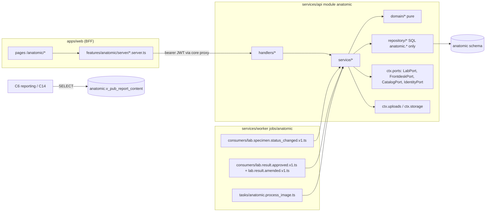

# C11 Specialty Pathology — 02 TRD (module `anatomic`)

Status: DECISION, 2026-11-06. Inputs: 01-CM, 02-CV, 03-IC, 04, research 01 §2.4, C0/C5/C6 chunk docs (contracts only). Names follow 03-IC verbatim; gaps are in §16 and used as if accepted, marked **(CR-C11-nnn)**. `[CONV]` = value chosen here with a one-line rationale.

---

## 1. Owned paths (01-CM §3)

| Path | Content |
|---|---|
| `services/api/src/modules/anatomic/**` | API module: manifest, handlers, services, domain, repositories, mappers, tests |
| `services/worker/src/jobs/anatomic/**` | worker manifest, consumers `lab.specimen.status_changed.v1`, `lab.result.approved.v1`, `lab.result.amended.v1` (CR-C11-011), task `anatomic.process_image` |
| `apps/web/src/app/(staff)/anatomic/**` | route segment (pages, `loading.tsx`, `error.tsx`) |
| `apps/web/src/features/anatomic/**` | nav manifest, BFF server functions, components, forms, help, tests |
| `docs/manual/anatomic/**` | user-manual pages |

C11 never edits `db/`, `contracts/`, `packages/*`, any `core/` folder, or another module. DDL in `05-SCHEMA.md` and the OpenAPI content in §5 are the **specification** C0 transcribes into `db/migrations/*anatomic*` and `contracts/openapi/anatomic.yaml`.

## 2. Stack and pinned libraries

| Item | Value | Source |
|---|---|---|
| Runtime | Node.js 26.x LTS (C0 pins patch) | 02-CV §1.1 |
| API | Fastify (C0 pins) + `fastify-openapi-glue` 4.12.0; handlers mounted from `contracts/openapi/anatomic.yaml` | 04 T7; 02-CV §2.2 |
| Worker | Graphile Worker 0.18.0 through the C0 worker core | 04 S10, T7 |
| DB | PostgreSQL 17 (`supabase/postgres:17.6.1.136`), RLS, PgBouncer transaction mode for API | 04 D9, S8 |
| Web | Next.js App Router (C0 pins), server-only BFF; `@lims/ui` only | 04 S4; 02-CV §14 |
| Client types | `openapi-typescript` 7.13.0 / `openapi-fetch` 0.17.0 (generated by C0) | 04 T7 |
| IDs | `@lims/shared-ts/uuidv7` | 04 D9 |
| Dates | `@lims/shared-ts/bsdate` (display only); A.D. year for `{yy}` | 04 D12, D13 |
| Decimal handling | strings validated by regex; no float arithmetic (dimensions/weights/quantitative values are stored and displayed, never computed) | 02-CV §4.9 analogue |
| Image decode/re-encode, malware scan | C0 upload pipeline `ctx.uploads` (CR-C2-011, accepted-modified in 08 R12b; API 08 §4.13); decoder library **C0 pins** | 02-CV §10.2 |
| Object storage | C0 storage adapter `ctx.storage` (CR-C2-011; 08 §4.13) on bucket `anatomic-images` (CR-C11-008; 08 §4.8), server-side only | 04 D15 pattern; REQ-SEC-034 |
| Code 128 label symbols | `@lims/ui` `BarcodeSymbol` (CR-C11-007); C11 adds **no** dependency | 02-CV §15 |

**Dependencies table (02-CV §15.1):** C11 adds **no** third-party dependency. Everything comes from C0 packages.

## 3. Internal architecture

### 3.1 Layers



### 3.2 File skeleton (02-CV §2.2/§2.3/§2.4)

```
services/api/src/modules/anatomic/
├── index.ts                       # ModuleManifest { name:'anatomic', openapi:'contracts/openapi/anatomic.yaml', handlers, ports:{}, produces:[],
│                                  #   systemPermissions: ['anatomic.case.work','frontdesk.order.read','catalog.test.read'] }
│                                  #   (C0 02-TRD ModuleManifest.systemPermissions = permissions of the module's system actor, used by the worker too)
├── permissions.ts                 # 'anatomic.case.read' | 'anatomic.case.work' | 'anatomic.case.signout' | 'anatomic.config.manage'
├── config.ts                      # LIMS_ANATOMIC_* (§10.1)
├── handlers/index.ts + one file per operationId (§5)
├── service/
│   ├── intake.service.ts          # consumer logic: specimen → case/part/items (§4.1)
│   ├── case.service.ts            # accession, details, parts, transitions, cancel
│   ├── numbering.service.ts       # accession + batch numbers (§4.2)
│   ├── gross.service.ts
│   ├── material.service.ts        # blocks, slides, stain orders, movements, labels, lookup
│   ├── image.service.ts           # upload, processing, content stream
│   ├── report.service.ts          # drafts, sign-out, changes, addenda, content snapshot (§4.4–4.7)
│   ├── molecular.service.ts       # results, batches
│   ├── config.service.ts          # settings, stains, test profiles, assays, coded values, templates
│   └── labstatus.service.ts       # read-through of C5 chain status (§4.8)
├── domain/
│   ├── case.ts  case.state.ts     # §7 state table (pure)
│   ├── labels.ts                  # part letters, block/slide labels (§4.3)
│   ├── accession-pattern.ts       # pattern parse/render (§4.2)
│   ├── synoptic.ts                # definition validator, value validator, display renderer (§4.5)
│   ├── plaintext.ts               # NFC, control-char strip, line-ending normalise (§4.6)
│   ├── report-content.ts          # snapshot builder (§4.7)
│   └── molecular.ts               # result validation against assay definition
├── repository/
│   ├── cases.repo.ts parts.repo.ts gross.repo.ts blocks.repo.ts slides.repo.ts stainOrders.repo.ts
│   ├── movements.repo.ts images.repo.ts drafts.repo.ts versions.repo.ts submissions.repo.ts addenda.repo.ts
│   ├── molecular.repo.ts batches.repo.ts counters.repo.ts specimenLinks.repo.ts
│   └── config.repo.ts templates.repo.ts codedValues.repo.ts
├── mappers/*.dto.ts               # explicit per-role field lists (REQ-SEC-081)
└── __tests__/{unit,integration,contract,probes}/

services/worker/src/jobs/anatomic/
├── index.ts                       # WorkerManifest (below)
├── consumers/lab.specimen.status_changed.v1.ts
├── consumers/lab.result.approved.v1.ts             # CR-C11-011 (06 T-27)
├── consumers/lab.result.amended.v1.ts              # CR-C11-011 (06 T-27)
├── tasks/anatomic.process_image.ts                 # re-scan of pending/unavailable uploads (§4.9, 08 A17 P-19)
└── __tests__/{unit,integration}/

apps/web/src/app/(staff)/anatomic/
├── page.tsx loading.tsx error.tsx                     # worklist
├── cases/[case_id]/page.tsx (+loading/error)          # case workspace (tabs)
├── cases/[case_id]/labels/page.tsx                    # print page
├── tracking/page.tsx  batches/page.tsx  batches/[batch_id]/page.tsx
└── config/{page.tsx, templates/[template_id]/page.tsx} # configuration
apps/web/src/features/anatomic/
├── nav.manifest.ts  server/*.server.ts  components/  forms/  hooks/  help/  __tests__/
```

```ts
// services/worker/src/jobs/anatomic/index.ts
// WorkerManifest has no `permissions` field (C0 02-TRD); the system actor's permissions are
// ModuleManifest.systemPermissions in services/api/src/modules/anatomic/index.ts (above).
export const manifest: WorkerManifest = {
  module: 'anatomic',
  tasks: { 'anatomic.process_image': processImage },
  subscriptions: { 'lab.specimen.status_changed.v1': onSpecimenStatusChanged,          // 03-IC §3.7 (A4)
                   'lab.result.approved.v1': onResultApproved,                           // 03-IC §3.10 (CR-C11-011, 08 R13) — added in T-27
                   'lab.result.amended.v1': onResultAmended,                             // 03-IC §3.11 (CR-C11-011, 08 R13) — added in T-27
  },
  crontab: [],
  maxAttempts: { 'anatomic.process_image': 5 },                                          // 08 A17 P-19 (§4.9)
};
```

The two `lab.result.*` subscriptions and their handler files are added by 06 T-27; until then the manifest subscribes only `lab.specimen.status_changed.v1`.

Layer rules from 02-CV §2.2 apply. `repository/` reads only `anatomic.*`, `core.*` through `ctx.core`, and no `v_pub_*` of other schemas (C11 needs none).

## 4. Key algorithms

### 4.1 Intake (consumer of `lab.specimen.status_changed.v1`)

Runs in the worker core's consumer wrapper (02-CV §7.4): tenant context from the envelope, inbox insert first.

```
onSpecimenStatusChanged(ctx, env):
 1. INSERT anatomic.event_inbox ON CONFLICT DO NOTHING → if no row: return (duplicate).        // AC-01.2
 2. p = env.payload; link = specimenLinks.get(p.specimen_id) FOR UPDATE
    if link && env.aggregate.seq <= link.last_seq: metric ignored{reason=stale}; return          // AC-01.5
 3. switch p.to_status:
    'received':
       a. if p.parent_specimen_id and specimenLinks.exists(p.parent_specimen_id):
            kind := 'aliquot_ignored'; metric ignored{reason=aliquot}; goto 4                   // DECISION §4.1.1
       b. order = FrontdeskPort.getOrderSummary({orderId: p.order_id})
       c. candidate items = order.items where status='active'
             and (p.order_item_ids absent OR orderItemId ∈ p.order_item_ids)
       d. for each item, for each testId: t = CatalogPort.getTest({testId});
             keep if t.workflowType ∈ {'anatomic','molecular'}
          none kept → kind := 'not_anatomic'; metric ignored{reason=no_anatomic_items}; goto 4   // AC-01.4
       e. profile = testProfiles.get(testId) (tenant) ;
             caseKind = profile?.case_kind ?? (t.workflowType==='molecular' ? 'molecular' : 'histology')  // AC-01.7
          group kept items by caseKind
       f. for each (caseKind, items):
            if all items have profile.is_addon AND openCase(order_id, caseKind) exists:
                 add case_items(role='addon') to it; no part                                  // add-on received as specimen
                 kind := 'addon' (case_id = that case, part_id absent) unless a part link was set for this specimen
                 continue
            c = openCase(order_id, caseKind)  -- partial unique index, see 05-SCHEMA
                 ?? INSERT case(status 'received', centre_id=p.centre_id, branch_id=p.processing_branch_id,
                                patient_id=p.patient_id, order_id, priority=max(item.priority), profile_missing)
                    ON CONFLICT (open-case index) DO NOTHING → re-select                        // concurrency
            if p.replaces_specimen_id and part linked to it in c:                              // AC-01.10
                 part.specimen_id := p.specimen_id; part.specimen_state := 'received'
            else: INSERT part(next letter, specimen_id=p.specimen_id, specimen_type_code)       // AC-01.3
            kind := 'part' (case_id = c.id, part_id = that part)  -- first case of the event if items span two case kinds
            INSERT case_items(role='primary' unless profile.is_addon) ON CONFLICT (tenant, order_item_id) DO NOTHING
            if settings.auto_accession_on_receipt and c.status='received': accession(c) (§4.2) // AC-01.8
    'rejected':
       if link and link.link_kind = 'part': part.specimen_state := 'rejected'                 // AC-01.9
       kind := link?.link_kind ?? 'not_anatomic'
    other (ordered, collected, in_transit, …):
       no domain change; kind := link?.link_kind ?? 'not_anatomic'
 4. upsert specimenLinks(specimen_id, centre_id = p.centre_id, link_kind = kind,
                         case_id/part_id as set above (unchanged when the kind is unchanged),
                         last_seq = env.aggregate.seq, last_status = p.to_status)
    -- link_kind is always written explicitly (never the column default). 'not_anatomic' rows carry no case/part
    -- (CHECK specimen_links__case__ck); a later 'received' with anatomic items converts the row to 'part'/'addon'.
```

Rows written per event (05-SCHEMA `specimen_links`): every non-duplicate, non-stale event upserts exactly one `specimen_links` row with an explicit `link_kind`. A specimen with no anatomic item (any department, any status, including statuses before `received`) gets `link_kind = 'not_anatomic'`, `case_id`/`part_id` absent. This keeps the stale-`seq` guard (AC-01.5, 03-APP-FLOW E2) working for out-of-order events that arrive before `received`. When two case kinds are created from one specimen event (rare: one specimen with a histology and a molecular test), the link points to the first created part and both parts reference the specimen through `parts.specimen_id` [CONV: the link holds one case; the part rows keep the full mapping].

4.1.1 **DECISION:** aliquots (C5 child specimens) of a specimen that is already a part are ignored by C11; anatomic sub-division of tissue is modelled as blocks, not C5 aliquots.

4.1.2 Port failures (`common.not_found` because the order is not visible, transient DB errors) throw; the job retries (10 attempts, 02-CV §7.5) and dead-letters on final failure.

### 4.2 Accession numbering

- Pattern source: `IdentityPort.getTenantSettings({keys:['numbering']}).numbering.accessionNoPattern` and `.accessionPrefixes[caseKind]` (CR-C11-005, merged into CR-C2-008; final shape 08 §4.12; numbering key `accession_no` per 08 §4.5). Both fields are optional; when absent C11 uses the documented defaults: pattern `{prefix}{yy}-{seq:4}` (03-IC §9.3) and prefixes `histology: 'S'`, `cytology: 'C'`, `ihc: 'I'`, `molecular: 'M'` (`[A-Z0-9]{0,4}`) [CONV: `S` from the 03-IC example; one distinct letter per kind keeps series separable]. C2 validates tenant values on write with this grammar (08 §4.12).
- Allowed tokens: `{prefix}`, `{branch}`, `{yy}`, `{seq:N}` with 3 ≤ N ≤ 8; exactly one `{seq:N}`; literal characters `[A-Z0-9-]`. Anything else → `anatomic.accession_pattern_invalid` (CR) at render time.
- `{branch}` renders the branch code of the case's processing branch: `ctx.core.branch(ctx, { branchId: case.branch_id })` (C0 02-TRD §6.8, `BranchRow`; column `core.branches.branch_code`), upper-cased [CONV: `branch_code` allows lower case (`^[A-Za-z0-9-]{1,16}$`) but accession numbers use `[A-Z0-9-]`]. If the pattern contains `{branch}` and `case.branch_id` is absent (the event carried no `processing_branch_id`), accession fails with `500 anatomic.accession_pattern_invalid` and nothing changes. Patterns without `{branch}` never read the branch.
- Series key = `caseKind` (DECISION; Q2 in PRD). Counter scope = `(tenant_id, series_key, year_ad)` when the pattern contains `{yy}`, else `(tenant_id, series_key, 0)` (03-IC §9.3 "tenant + year").
- `year_ad` = A.D. year of `ctx.now()` in the tenant timezone. In v1 `TenantSettings.timezone` is always `Asia/Kathmandu` (08 A13 P-15).
- Allocation (same transaction as the state change; the counter row is created lazily, 08 A17 P-22):
  ```sql
  INSERT INTO anatomic.accession_counters (tenant_id, series_key, year_ad, last_value, created_by, updated_by)
  VALUES ($1, $2, $3, 0, $actor, $actor) ON CONFLICT (tenant_id, series_key, year_ad) DO NOTHING;
  UPDATE anatomic.accession_counters SET last_value = last_value + 1, updated_at = now(), updated_by = $actor
   WHERE tenant_id = $1 AND series_key = $2 AND year_ad = $3 RETURNING last_value;
  ```
  Row lock serialises concurrent accessions (AC-02.2). Gaps allowed (not fiscal — 03-IC §9.3 pattern for non-fiscal numbers). If `last_value ≥ 10^N` → throw `anatomic.accession_pattern_invalid` (AC-02.3; transaction rolls back).
- Rendered value must match `^[A-Z0-9-]{1,20}$`; unique index `(tenant_id, accession_no)` → violation maps to `409 anatomic.accession_duplicate` (AC-02.6).
- Molecular batch numbers use the same counter table with `series_key = 'batch'`, pattern `MB{yy}{seq:4}` [CONV: mirrors 03-IC §9.3 shapes; not tenant-configurable in v1].

### 4.3 Labels (pure, `domain/labels.ts`)

| Object | Rule | Example |
|---|---|---|
| Part letter | A…Z, then AA…AZ, BA… (bijective base-26), assigned in creation order, never reused within a case | A, B, …, Z, AA |
| Block label | `{accession_no}-{part_letter}{block_seq}`; `block_seq` 1.. per part, never reused | `S26-0042-A1` (01 research §2.4) |
| Slide from block | `{block_label}-{slide_seq}`; `slide_seq` 1.. per block | `S26-0042-A1-2` |
| Slide from part (cytology smears) | `{accession_no}-{part_letter}-{slide_seq}`; `slide_seq` 1.. per part (part-level slides only) | `C26-0007-A-3` |

DECISION: slide label shapes beyond the 03-IC block example are chosen here. Labels ≤ 32 chars, charset `[A-Z0-9-]`, unique per tenant; computed in the same transaction that inserts the row with `SELECT max(seq) … FOR UPDATE` on the parent (part/block row lock).

### 4.4 Sign-out (the A1 hand-off)

```
signOut(ctx, caseId, draftVersion, idempotencyKey):         // Idempotency-Key handled by C0 core hook
  tx:
   1. case = cases.getForUpdate(caseId)                       // 404 if invisible
   2. draft = drafts.getOpen(caseId) ; if !draft → 409 anatomic.case_invalid_transition
      if draft.version != draftVersion → 409 common.version_conflict
   3. guard by state (§7): initial draft needs case.status = 'ready_for_reporting';
      change draft (revision|amendment) needs case.status = 'signed_out'
   4. validate completeness (§4.5.3) → 422 anatomic.report_incomplete with errors[]
   5. targets = case_items where role='primary' and is_active
      for each: item = FrontdeskPort.getOrderSummary(order).items[orderItemId];
               item.status ≠ 'active' → 409 anatomic.order_item_inactive (detail names item id)    // AC-09.9
   6. n = case.current_version_no + 1
      content = buildContent(case, draft, scope='full')       // §4.7, immutable snapshot (in memory; written at step 8)
      amendment = draft.kind ∈ {revision, amendment}
                    ? { reasonCode: draft.change_reason_code, reasonText: draft.change_reason_text || undefined }
                    : undefined                                // initial draft: target never approved before v1
   7. for each target (ordered by case_item id):              // port calls FIRST, all targets
        v = submissions.maxVersion(caseItem) + 1
        out = LabPort.submitModuleResult(ctx, {
          orderItemId, kind: case.case_kind==='molecular' ? 'structured' : 'narrative',
          reportPhase: 'final', payloadRef: { module:'anatomic', entityId: caseItem.id, versionNo: v },
          summaryText: summarise(content.impression_text),          // ≤4,000 (§4.7.3)
          flag: draft.flag, isCritical: draft.is_critical || undefined,
          submittedAt: ctx.now(), idempotencyKey: `anatomic:${caseItem.id}:${v}`,
          amendment })                                       // 08 R1 shape { reasonCode, reasonText? }; C5 ignores it when the target is not approved
        outs.push({ caseItem, v, out })
   8. version_kind = draft.kind === 'initial' ? 'original'
                   : outs.some(o => o.out.status === 'approved') ? 'amendment' : draft.kind
      INSERT report_versions(n, version_kind, scope 'full', content cols,
                             change_reason_code, change_reason_text, signed_by = ctx.actor.membershipId, signed_at = ctx.now())
      for each o in outs:
        INSERT item_submissions(case_item_id, item_version_no o.v, report_version_id, lab_result_id = o.out.resultId,
                                lab_version_no = o.out.versionNo, lab_status = o.out.status, replayed = o.out.replayed)
   9. UPDATE cases SET status='signed_out', current_version_no=n, signed_out_at (first time only), version+1
      UPDATE report_drafts SET status='consumed', consumed_at = now(), consumed_version_no = n
  10. return { case, report_version, submissions }
```

`report_versions` is insert-only (05-SCHEMA §6), so its `version_kind` is decided once, after every port call has returned (step 8), and never updated. All port calls and all inserts are in one transaction; any failure rolls everything back.

Any port error (`lab.module_result_invalid`, `lab.result_locked`, `lab.result_invalid_transition`, `lab.module_result_stale`, `lab.amendment_reason_required`) aborts the transaction and is returned **unchanged**: C11 rethrows the original `LimsError` and never constructs a `lab.*` code (08 A17 P-23; 03-IC §8 ownership rule). AC-09.4.

**Change kind decision** (`startAnatomicCaseChange`): `labstatus` reads `LabPort.getOrderResults({orderId, scope:'all_visible'})`; if any target item's module result (matched by `orderItemId`, `origin === 'module'`) has `status === 'approved'` → draft kind `amendment`, else `revision`. This is the label shown while editing. A reason is required for both kinds (DECISION: audit clarity), so every revision/amendment submission carries `amendment: { reasonCode, reasonText? }` (step 6). 08 R1: C5 uses it when the target is approved and ignores it otherwise. A `revision` draft whose target C5 approved in the meantime (03-APP-FLOW E10) therefore signs as an amendment without a C5 error, and step 8 stores `version_kind = 'amendment'`. With several targets where only some are approved, the version is stored as `amendment` (any approved target makes it one). The reason code is chosen from C5's amendment reasons (08 A17 D-62; §5.3 R4).

**Addendum signing** (`signAnatomicAddendum`): same steps with `kind`, but:
- `addon_case_item_id` set → targets = that one add-on item; `scope = 'addendum_only'`; content holds only the header, `addenda` = **every signed addendum linked to that add-on item, oldest first, including this one**, and `ancillary` of their stain orders (AC-10.5). A second addendum on the same add-on item therefore keeps the first one's text in the new version.
- otherwise targets = active primary items; `scope = 'full'`; content = the previous full version's sections + `addenda` = **every signed addendum of the case not linked to an add-on item, oldest first, including this one** (AC-10.4); `version_kind = 'addendum'`.
- Every addendum submission (both scopes) sends `amendment: { reasonCode: 'supplementary_report' }` (CR-C11-004 merged into CR-C10-001; seeded by C5, 08 R1). C5 uses it only when the target is approved and ignores it otherwise [CONV: the reviewer's rule covered full scope; it is applied to `addendum_only` too because a second addendum on an approved add-on item would otherwise fail with `lab.amendment_reason_required`]. C5 accepts `supplementary_report` only when `payloadRef.module = 'anatomic'`; C6 then labels the report kind `addendum` ("Addendum"), not `amended` (08 R1 report-kind rule). An addendum version keeps `version_kind = 'addendum'` whatever `out.status` is.

**`addenda` in every full-scope version:** a revision or amendment version built from a change draft (step 6) also carries every signed addendum of the case not linked to an add-on item, oldest first (§4.7.1). An `original` version has none (addenda exist only after sign-out).

### 4.5 Synoptic templates (`domain/synoptic.ts`)

4.5.1 Definition JSON (stored in `synoptic_templates.definition`, validated on every save; **no** third-party protocol text is shipped):

```ts
type FieldType = 'text' | 'long_text' | 'integer' | 'decimal' | 'boolean' | 'single_select' | 'multi_select' | 'date';
interface SynopticDefinitionV1 {
  schema_version: 1;
  title: string;                                   // 1–200
  applies_to_case_kinds: ('histology'|'cytology'|'ihc'|'molecular')[];   // ≥1
  sections: {                                      // 1–20
    key: string;                                   // ^[a-z][a-z0-9_]{0,39}$, unique in template
    heading: string;                               // 1–200
    fields: {                                      // 1–60 per section, ≤300 per template
      key: string;                                 // ^[a-z][a-z0-9_]{0,39}$, unique in template
      label: string;                               // 1–200
      type: FieldType;
      required: boolean;
      help_text?: string;                          // ≤500
      unit_text?: string;                          // ≤20, display only (integer/decimal)
      min?: string; max?: string;                  // DecimalString, integer/decimal only, min ≤ max
      decimals?: number;                           // 0–6, decimal only
      max_length?: number;                         // text 1–500 (default 200), long_text 1–4000 (default 2000)
      options?: { code: string /* Code ≤64 */; display: string /* ≤200 */ }[];  // select types: 1–100, unique codes
      show_if?: { field_key: string; equals: string | boolean };  // earlier field in the template; select code or boolean
    }[];
  }[];
}
```

Errors → `422 anatomic.template_invalid` (CR) with `errors[]` JSON Pointers (e.g. `/definition/sections/0/fields/3/options`). AC-08.2.

4.5.2 Instance values in a draft: `{ template_id, template_key, template_version, values: Record<field_key, string | number | boolean | string[]> }`. Draft save checks types and limits but not `required` (AC-08.5). Hidden fields (`show_if` false) must be absent.

4.5.3 Completeness at sign-out (`report_incomplete` paths): histology → `gross_text` non-empty; all kinds → `impression_text` non-empty; every synoptic instance → every visible `required` field present; every image included → `state = ready` and active; every ancillary result references a `completed` stain order of this case; molecular → ≥1 molecular result and each result valid against its assay definition.

4.5.4 Display snapshot (stored in the version): `[{ template_key, template_version, title, sections: [{ heading, items: [{ label, value }] }] }]`; `value` is the display string (select → option display; multi → displays joined by "; "; boolean → "Yes"/"No"; decimal/integer + `unit_text` with one space; date → `DD/MM/YYYY` [CONV, 02-CV §13]). Hidden and empty optional fields are omitted.

### 4.6 Text fields — plain text (DECISION)

All narrative fields (clinical history, gross, microscopy, impression, comment, addendum, finding, captions) are **plain text**, not HTML: NFC-normalised (02-CV §13), CR/LF → LF, control characters other than LF/TAB removed, trailing whitespace trimmed. Rationale: 03-IC §6.8 columns are `*_text`; plain text removes the XSS/sanitiser surface (REQ-SEC-088) and C6 renders line breaks as given. **DECISION confirmed by lead (08 A17 D-68):** research/01 §2.4 ("rich-text templates with placeholders") is met by plain-text section templates (`;code` text templates) plus synoptic JSON; no HTML in v1. A later change to rich text needs a CR on 03-IC §6.8 and the C6 renderer sanitiser.

### 4.7 Report content snapshot (`domain/report-content.ts`)

4.7.1 Columns stored on `report_versions` (all immutable): `gross_text`, `microscopy_text`, `impression_text`, `comment_text`, `clinical_history_text`, `synoptic` (§4.5.4), `images` (`[{bucket, object_path, sha256, caption}]` — 03-IC §6.8 keys exactly; caption omitted when empty), `specimen_parts`, `slides`, `ancillary`, `molecular`, `addenda`, `diagnosis_codes` (JSON shapes in 05-SCHEMA §5). The view exposes them (CR-C11-001 for the columns beyond 03-IC §6.8).

`addenda` in a `full` version (any `version_kind` except `original`) = every signed addendum of the case with no `addon_case_item_id`, oldest first (by `addenda.seq`), including the one being signed when the version is an addendum version.

4.7.2 `scope = 'addendum_only'`: `gross_text`, `microscopy_text`, `impression_text`, `comment_text` are empty strings; `synoptic`, `images`, `slides`, `molecular` are `[]`; `addenda` = every signed addendum linked to that add-on case item, oldest first, including this one; `ancillary` = the stain orders of those addenda.

4.7.3 `summarise(text)`: plain text; if `length ≤ 4000` → as is; else first 3,990 chars + " […]" (AC-09.10) [CONV: stays within the 4,000-char A1 limit].

### 4.8 C5 chain status (read-through)

`getAnatomicCase` calls `LabPort.getOrderResults({ orderId, scope: 'all_visible' })` (requires `lab.result.read`; if the caller lacks it the call throws `auth.forbidden` and C11 returns the case **without** `lab_status` rather than failing). Per case item: `lab_status ∈ pending | resulted | verified | approved | cancelled` and `lab_version_no` from the result whose `orderItemId` matches and `origin === 'module'`. Not stored; never cached beyond the request (PHI P3).

### 4.9 Image processing

Scan outcome model: 08 A17 P-19 (no `ctx.uploads.status` method exists or is added).

1. `uploadAnatomicImage`: multipart file → `ctx.uploads.accept(file, { allow: ['image/png','image/jpeg'], maxBytes: LIMS_ANATOMIC_IMAGE_MAX_BYTES, images: { reencode: true, stripMetadata: true, maxMegapixels: LIMS_ANATOMIC_IMAGE_MAX_MEGAPIXELS }, scan: 'required', bucket: 'anatomic-images', objectPath })` (08 §4.13; `allow` ⊆ the operation's `x-upload` list, §5.4 I1) with `objectPath = {tenant_id}/{yyyy}/{mm}/{image_id}.{png|jpg}` (UTC `yyyy/mm` of upload). In the same transaction C11 inserts the `images` row from the returned `AcceptedUpload` (`sha256`, `byte_size`, `mime_type`, `width_px`/`height_px` from `image`) with `scan_state = AcceptedUpload.scanState` and:
   - `clean` → `state = 'ready'`;
   - `infected` → `state = 'quarantined'` (terminal), `quarantine_reason_code = 'malware'` [CONV];
   - `pending` or `unavailable` → `state = 'processing'`, and enqueue `anatomic.process_image` `{image_id}` (job_key `image:<image_id>`).
   The original filename is not read beyond the multipart boundary, not stored, not logged (AC-12.5).
2. `anatomic.process_image` (only for `pending`/`unavailable`): `r = await ctx.files.scan(await ctx.storage.read('anatomic-images', image.object_path))` (08 §4.13). `clean` → `scan_state = 'clean'`, `state = 'ready'`; `infected` → `scan_state = 'infected'`, `state = 'quarantined'`, `quarantine_reason_code = 'malware'`; `unavailable` → `scan_state = 'unavailable'`, `scan_attempts + 1`, then throw so the worker retries with backoff. A row that is no longer `processing` is a no-op (idempotent).
3. Retries: ≤ 5 attempts with backoff (08 A17 P-19 [CONV]; `WorkerManifest.maxAttempts['anatomic.process_image'] = 5`), then dead letter; the image stays `processing` (never served, never selectable) and the UI shows "Still processing — try again later".
4. Requirements on the pipeline that C11 relies on (listed in CR-C11-008): magic-byte check, re-encode strips metadata (EXIF/GPS), decompression-bomb guard (max 50 megapixels [CONV]), ClamAV-class scan.
5. Until an image is `ready` (`scan_state = 'clean'`), `getAnatomicImageContent` returns `422 common.upload_quarantined` (08 A13 P-2, P-19) and the image cannot be included in a signed version (§4.5.3).

### 4.10 Labels page data

`getAnatomicLabels` returns `{ labels: [{ object_kind, object_id, label, line2 }] }` where `line2` = stain code for slides, part letter for blocks. No patient name, no registration number (DECISION: blocks and slides are identified by accession-derived labels — glossary "Block"). The page renders text and `BarcodeSymbol` (CR-C11-007, accepted in 08 §4.6; text-only until C0-0D ships it) for browser printing (same mechanism as C5 §4.6).

## 5. HTTP endpoints (spec for `contracts/openapi/anatomic.yaml`)

Common to all operations: prefix `/v1/anatomic`; `security: bearerJwt`; `tags: [anatomic]`; `x-rate-limit-tier: general` (10 req/s/user, burst 20 — 04 §4); errors as RFC 9457 with `x-error-codes`; every object schema `additionalProperties: false`; strings have `maxLength`; no `null` on the wire. Always-possible codes (not repeated): `common.validation_failed`, `common.not_found`, `auth.unauthenticated`, `auth.forbidden`, `auth.account_locked`, `auth.session_expired`, `common.rate_limited`, `common.internal`. `If-Match` operations add `common.precondition_required`, `common.version_conflict`. Idempotency R = `x-idempotency: required` (adds `common.idempotency_key_required`, `common.idempotency_key_reused`, `common.idempotency_in_progress`), – = none (GET/PUT). Every POST that creates or changes state is R (02-CV §4.5 as amended by 08 A13 P-8; C11 uses neither exception E1 nor E2), so no C11 operation is "optional". "case.read" = `anatomic.case.read` etc.; "(P)" = privileged (aal2; adds `auth.mfa_required`).

Every handler: load target through the RLS-scoped repository first (404 if invisible), then `IdentityPort.assertRole(ctx, { permission, centreId: case.centre_id })` (02-CV §10.1). Config endpoints assert without `centreId`.

**Edits on a `signed_out` case (08 A17 D-66).** The service checks these rules before any write and returns `409 anatomic.signout_locked` for a blocked edit (the DB guards of 05-SCHEMA §6 are the second line):
- (a) Always allowed: image upload (I1); kind/part/caption edits (I3) of an image that is not in any signed version's `images`; image deactivation (I4 — the signed version keeps its reference, AC-12.7); stain orders and their slides for the addendum path (M2, M3, M5, M7–M10); addenda (R8–R10).
- (b) Allowed only while a revision/amendment draft is open: draft content (R2), gross records (A8), part site/description (A7; no new or removed parts), molecular results (Q1), slide assessments (M4) [CONV: slide assessments reach the report only through a full version, like gross records].
- (c) Never: accession (A4), case kind, adding or removing parts (A6; C11 has no remove operation), removing blocks, edits to images or content already in a signed version. Also blocked [CONV: not listed in D-66 (a)/(b), so kept as before]: new blocks (M1) and case details (A5 — clinical history is snapshotted content).
- Not an edit: block/slide movements (M11) stay allowed in every status, including `cancelled` (physical material — 03-APP-FLOW E22).

### 5.1 Cases, parts, gross

| # | Method + path | operationId | Perm | Idem | Request | Response | Extra error codes |
|---|---|---|---|---|---|---|---|
| A1 | GET `/cases` | `listAnatomicCases` | case.read | – | query: `queue` enum `to_accession, grossing, bench, reporting, awaiting_lab, signed_out, cancelled, all` (default `all`); `case_kind` csv of `histology, cytology, ihc, molecular`; `centre_id` csv uuid ≤20; `priority` `routine,urgent`; `assigned_pathologist` `me` or uuid; `received_at_from`, `received_at_to`; `sort` enum `received_at, -received_at, accessioned_at, -accessioned_at, priority_received_at` (default `priority_received_at` = urgent first then oldest); `limit` 1–200 (50); `cursor` | `{ data: CaseSummary[], page }` | `common.invalid_cursor` |
| A2 | POST `/cases/lookup` | `lookupAnatomicObject` | case.read | – | `{ label: string ^[A-Z0-9-]{1,32}$ }` (accession, block or slide label; body, not URL — REQ-SEC-098) | `{ object_kind: case\|block\|slide, case_id, block_id?, slide_id? }` | — |
| A3 | GET `/cases/{case_id}` | `getAnatomicCase` | case.read | – | — | `CaseDetail` | — |
| A4 | POST `/cases/{case_id}/accession` | `accessionAnatomicCase` | case.work | R | `If-Match`; `{ clinical_history_text? ≤4000, assigned_pathologist_membership_id?, parts: [{ part_id, site_text 1–200, description_text? ≤1000 }] 1–52 }` (every existing part must be listed) | `CaseDetail` | `anatomic.case_invalid_transition` (CR), `anatomic.accession_pattern_invalid` (CR), `anatomic.accession_duplicate` |
| A5 | PUT `/cases/{case_id}/details` | `updateAnatomicCaseDetails` | case.work | – | `If-Match`; `{ clinical_history_text? ≤4000, assigned_pathologist_membership_id? }` (full replace: omitted = cleared) | `CaseDetail` | `anatomic.signout_locked` |
| A6 | POST `/cases/{case_id}/parts` | `addAnatomicPart` | case.work | R | `{ site_text 1–200, description_text? ≤1000, specimen_id? }` (specimen must already be linked to this case) | `201 Part` | `anatomic.case_invalid_transition` (CR), `anatomic.signout_locked` |
| A7 | PUT `/cases/{case_id}/parts/{part_id}` | `updateAnatomicPart` | case.work | – | `If-Match` (part version); `{ site_text 1–200, description_text? ≤1000 }` | `Part` | `anatomic.signout_locked` (signed-out case without an open change draft) |
| A8 | PUT `/cases/{case_id}/parts/{part_id}/gross` | `saveAnatomicGross` | case.work | – | `If-Match` (gross version; `"0"` = create); `{ gross_text ≤20000, pieces_count? 0–999, dimensions_mm? DecimalString[] 1–3 (each `^[0-9]{1,4}(\.[0-9])?$`, > 0), weight_g? DecimalString `^[0-9]{1,5}(\.[0-9]{1,2})?$` > 0, is_complete: boolean }` | `GrossRecord` | `anatomic.case_invalid_transition` (CR), `anatomic.signout_locked` (signed-out case without an open change draft) |
| A9 | POST `/cases/{case_id}/start-processing` | `startAnatomicProcessing` | case.work | R | `If-Match` | `CaseDetail` | `anatomic.case_invalid_transition` (CR) |
| A10 | POST `/cases/{case_id}/mark-ready` | `markAnatomicCaseReady` | case.work | R | `If-Match` | `CaseDetail` | `anatomic.case_invalid_transition` (CR) |
| A11 | POST `/cases/{case_id}/cancel` | `cancelAnatomicCase` | case.work | R | `If-Match`; `{ reason_code (x-coded-set cancel_reasons), reason_text? ≤500 }` | `CaseDetail` | `anatomic.case_invalid_transition` (CR) |
| A12 | GET `/assignees` | `listAnatomicAssignees` | case.read | – | query `case_id?` uuid (accession dialog: restricts to the case centre; the case is loaded through RLS first → 404 if invisible), `q` 0–60 chars (staff display name — not patient data), `limit` 1–50 (20) | `{ data: [{ membership_id, display_name }] }` — active `user` memberships holding `anatomic.case.signout` (§6.2, 08 A17 D-47) | — |

### 5.2 Material: blocks, slides, stains, movements, labels

| # | Method + path | operationId | Perm | Idem | Request | Response | Extra error codes |
|---|---|---|---|---|---|---|---|
| M1 | POST `/cases/{case_id}/blocks` | `createAnatomicBlocks` | case.work | R | `{ part_id, count 1–50, note? ≤200 }` | `201 { blocks: Block[] }` | `anatomic.case_invalid_transition` (CR), `anatomic.signout_locked` |
| M2 | POST `/cases/{case_id}/slides` | `createAnatomicSlides` | case.work | R | `{ block_id? , part_id?` (exactly one) `, stain_code (x-coded-set stains), count 1–20 }` | `201 { slides: Slide[] }` | `anatomic.block_not_available` (CR; block `sent_out` or `discarded`), `anatomic.case_invalid_transition` (CR) |
| M3 | POST `/slides/bulk-mark-ready` | `markAnatomicSlidesReady` | case.work | R | `{ ids: uuid[] 1–200 }` | `{ results: [{ id, outcome: updated\|unchanged\|invalid_state\|not_found }] }` | — |
| M4 | PUT `/slides/{slide_id}/assessment` | `saveAnatomicSlideAssessment` | case.work | – | `If-Match`; `{ adequacy_code? (x-coded-set cytology_adequacy), finding_text? ≤2000, include_in_report: boolean }` | `Slide` | `anatomic.signout_locked` (signed-out case without an open change draft, §5 D-66 (b)) |
| M5 | POST `/cases/{case_id}/stain-orders` | `createAnatomicStainOrder` | case.work | R | `{ stain_code, block_id?, part_id?, note? ≤500, addon_order_item_id? }` (IHC: `block_id` required; special: block or part). The stain must be of kind `special` or `ihc`; a `routine` stain → `400 common.validation_failed` at `/stain_code` (routine stains are made with M2) | `201 StainOrder` | `anatomic.ihc_requires_block`, `anatomic.block_not_available` (CR; only when the block is `discarded` — a `sent_out` block may be ordered on, and `complete` (M8) then needs it `returned`, 03-APP-FLOW E14), `anatomic.order_item_inactive` (CR) |
| M6 | GET `/stain-orders` | `listAnatomicStainOrders` | case.read | – | query `status` csv `requested,in_progress,completed,cancelled` (default `requested,in_progress`); `stain_kind` csv `special,ihc`; `centre_id` csv; `sort` `requested_at,-requested_at`; `limit`; `cursor` | `{ data: StainOrderRow[], page }` | `common.invalid_cursor` |
| M7 | POST `/stain-orders/{stain_order_id}/start` | `startAnatomicStainOrder` | case.work | R | `If-Match` | `StainOrder` | `anatomic.case_invalid_transition` (CR) |
| M8 | POST `/stain-orders/{stain_order_id}/complete` | `completeAnatomicStainOrder` | case.work | R | `If-Match`; `{ slide_count 1–20, reagent_lot? ≤64, performed_at? IsoUtc ≤ now }` | `{ stain_order: StainOrder, slides: Slide[] }` (slides created `ready`) | `anatomic.block_not_available` (CR; block `sent_out` or `discarded`), `anatomic.case_invalid_transition` (CR) |
| M9 | POST `/stain-orders/{stain_order_id}/cancel` | `cancelAnatomicStainOrder` | case.work | R | `If-Match`; `{ reason_text 1–500 }` | `StainOrder` | `anatomic.case_invalid_transition` (CR) |
| M10 | POST `/stain-orders/{stain_order_id}/link-addon` | `linkAnatomicAddonItem` | case.work | R | `If-Match`; `{ order_item_id }` (same order; test profile `is_addon`; not linked elsewhere) | `StainOrder` | `anatomic.order_item_inactive` (CR) |
| M11 | POST `/movements` | `recordAnatomicMovements` | case.work | R | `{ object_kind: block\|slide, object_ids: uuid[] 1–200, movement: stored\|retrieved\|sent_out\|returned\|discarded, location_text? ≤120 (required for stored), destination_text? ≤200 (required for sent_out), reason_code? enum second_opinion\|external_stain\|consultation\|retention_expired\|other (required for sent_out and discarded), note? ≤500 }`. Missing `location_text` (stored), `destination_text` (sent_out) or `reason_code` (sent_out, discarded) → `400 common.validation_failed` with the JSON pointer of the field | `{ results: [{ id, outcome: recorded\|invalid_state\|not_found }] }` | — |
| M12 | GET `/blocks` | `listAnatomicBlocks` | case.read | – | query `location_status` csv `in_lab,stored,sent_out,discarded`; `case_id`; `limit`; `cursor` | `{ data: BlockRow[], page }` | `common.invalid_cursor` |
| M13 | GET `/blocks/{block_id}/movements` | `listAnatomicBlockMovements` | case.read | – | `limit`, `cursor` | `{ data: Movement[], page }` | — |
| M14 | GET `/slides/{slide_id}/movements` | `listAnatomicSlideMovements` | case.read | – | `limit`, `cursor` | `{ data: Movement[], page }` | — |
| M15 | GET `/cases/{case_id}/labels` | `getAnatomicLabels` | case.work | – | query `kind` `blocks\|slides`; `ids` csv uuid ≤200 (optional subset) | `{ labels: [{ object_kind, object_id, label, line2 }] }` | — |

Movement guards (state per object `location_status`): `stored` from `in_lab`/`stored`/returned objects; `retrieved` from `stored` → `in_lab`; `sent_out` from `in_lab`/`stored`; `returned` from `sent_out` → `in_lab`; `discarded` from `in_lab`/`stored` → terminal. Anything else → per-id `invalid_state`; after `discarded` every movement → `invalid_state` (AC-06.4).

### 5.3 Reporting

| # | Method + path | operationId | Perm | Idem | Request | Response | Extra error codes |
|---|---|---|---|---|---|---|---|
| R1 | GET `/cases/{case_id}/report-draft` | `getAnatomicReportDraft` | case.read | – | — | `ReportDraft` (404 `common.not_found` if none open) | — |
| R2 | PUT `/cases/{case_id}/report-draft` | `saveAnatomicReportDraft` | case.work | – | `If-Match` (draft version; `"0"` creates the initial draft); `ReportDraftInput` (below) | `ReportDraft` | `anatomic.signout_locked`, `anatomic.template_not_published` (CR), `anatomic.image_limit_reached` (CR) |
| R3 | POST `/cases/{case_id}/sign-out` | `signOutAnatomicCase` | case.signout (P) | R | `If-Match` = draft version; `{ attest: true }` (the UI shows "I have reviewed this report") | `SignOutResult` | `anatomic.case_invalid_transition` (CR), `anatomic.report_incomplete` (CR), `anatomic.order_item_inactive` (CR); propagated `lab.module_result_invalid`, `lab.result_locked`, `lab.result_invalid_transition`, `lab.module_result_stale`, `lab.amendment_reason_required` |
| R4 | POST `/cases/{case_id}/changes` | `startAnatomicCaseChange` | case.signout (P) | R | `If-Match` (case version); `{ reason_code ^[a-z0-9_]{1,64}$ (a C5 amendment reason, 08 A17 D-62; the UI lists C5 `amendment_reasons` via the BFF `listLabCodedSet`; the system codes `module_phase_progression`, `module_preliminary_update`, `supplementary_report` → `400 common.validation_failed` at `/reason_code` [CONV: they are reserved for automatic use, 08 R1]), reason_text? ≤500 }`. C11 checks the format only; C5 validates the code at submission for approved targets (08 R1) | `201 ReportDraft` (`kind` revision or amendment, prefilled from the latest full version) | `anatomic.case_invalid_transition` (CR) |
| R5 | POST `/cases/{case_id}/changes/discard` | `discardAnatomicCaseChange` | case.signout (P) | R | `If-Match` (draft version) | `204` | `anatomic.case_invalid_transition` (CR) |
| R6 | GET `/cases/{case_id}/versions` | `listAnatomicReportVersions` | case.read | – | — | `{ data: ReportVersionSummary[] }` (newest first, ≤ 200) | — |
| R7 | GET `/cases/{case_id}/versions/{version_no}` | `getAnatomicReportVersion` | case.read | – | — | `ReportVersion` (full snapshot) | — |
| R8 | POST `/cases/{case_id}/addenda` | `createAnatomicAddendum` | case.work | R | `{ kind: ihc\|special_stain\|molecular\|other, text 1–8000, stain_order_ids? uuid[] ≤20, addon_case_item_id? }` | `201 Addendum` | `anatomic.case_invalid_transition` (CR) |
| R9 | PUT `/addenda/{addendum_id}` | `updateAnatomicAddendum` | case.work | – | `If-Match`; same body as R8 | `Addendum` | `anatomic.signout_locked` (signed addendum) |
| R10 | POST `/addenda/{addendum_id}/sign` | `signAnatomicAddendum` | case.signout (P) | R | `If-Match`; `{ attest: true }` | `SignOutResult` | as R3 |

`ReportDraftInput`:

```
{ gross_text? ≤20000, microscopy_text? ≤20000, impression_text? ≤8000, comment_text? ≤8000,
  flag?: 'N' | 'A', is_critical?: boolean,
  synoptic?: [{ template_id, values: object (≤300 keys; value: string ≤4000 | number | boolean | string[] ≤100) }] ≤5,
  image_ids?: uuid[] ≤24 (order = print order; server enforces settings.max_report_images),
  ancillary?: [{ stain_order_id, result_text 1–2000 }] ≤50,
  diagnosis_codes?: [{ code (x-coded-set diagnoses) }] ≤20 }
```
PUT semantics: full replace of the draft's mutable content (02-CV §4.1 PUT rule applied to the draft sub-resource, as C6 does for narrative drafts).

### 5.4 Images

| # | Method + path | operationId | Perm | Idem | Request | Response | Extra error codes |
|---|---|---|---|---|---|---|---|
| I1 | POST `/cases/{case_id}/images` | `uploadAnatomicImage` | case.work | R | `multipart/form-data`: `file` (`format: binary`, png/jpeg, ≤15 MB), `kind` `gross\|microscopy\|other`, `part_id?`, `caption?` ≤200; `x-upload: [image/png, image/jpeg]` (02-CV §4.12, 08 R12b) | `201 Image` (`state` `ready`, `processing` or `quarantined` from the scan outcome, §4.9) | `common.payload_too_large`, `common.unsupported_media_type`, `anatomic.image_limit_reached` (CR) — allowed on `signed_out` cases (08 A17 D-66 (a)) |
| I2 | GET `/images/{image_id}/content` | `getAnatomicImageContent` | case.read | – | — | `200 image/png\|image/jpeg` (re-encoded bytes, streamed by the core download helper; P-2 exception (I1), 08 A17 D-67); headers `Content-Type` = the stored `mime_type` (never client-supplied), `Content-Disposition: inline; filename="<image_id>.<ext>"`, `X-Content-Type-Options: nosniff`, `Content-Security-Policy: default-src 'none'; sandbox`, `Cache-Control: no-store`. Every call writes access-log `anatomic_image.view` (§12) | `common.upload_quarantined` (422; image not `ready`, i.e. scan not `clean` — 08 A13 P-2, A17 P-19) |
| I3 | PUT `/images/{image_id}` | `updateAnatomicImage` | case.work | – | `If-Match`; `{ kind, part_id?, caption? ≤200 }` | `Image` | `anatomic.signout_locked` (image already in a signed version, 08 A17 D-66 (c)) |
| I4 | POST `/images/{image_id}/deactivate` | `deactivateAnatomicImage` | case.work | R | `If-Match` | `Image` (signed versions keep their reference, AC-12.7) | — |

### 5.5 Molecular

| # | Method + path | operationId | Perm | Idem | Request | Response | Extra error codes |
|---|---|---|---|---|---|---|---|
| Q1 | PUT `/cases/{case_id}/molecular-results` | `saveAnatomicMolecularResults` | case.work | – | `If-Match` (case `molecular_rev`); on `signed_out` only while a change draft is open (08 A17 D-66 (b)); `{ results: [{ assay_code, target_code, result_code, value_decimal? DecimalString, unit_code? ≤32, method_text? ≤200, kit_name? ≤120, kit_lot? ≤64, kit_expiry_on? IsoDate, batch_id?, comment_text? ≤1000 }] ≤50 }` (full replace) | `{ molecular_rev, results: MolecularResult[] }` | `anatomic.signout_locked`, `anatomic.case_invalid_transition` (CR: not a molecular case) |
| Q2 | GET `/batches` | `listAnatomicBatches` | case.read | – | query `status` `open,closed`; `assay_code`; `limit`; `cursor` | `{ data: Batch[], page }` | `common.invalid_cursor` |
| Q3 | POST `/batches` | `createAnatomicBatch` | case.work | R | `{ assay_code, kit_name? ≤120, kit_lot? ≤64, kit_expiry_on?, instrument_text? ≤120, run_at? IsoUtc, capacity? 1–384 (default 96) }` | `201 Batch` (number `MB26xxxx`) | — |
| Q4 | GET `/batches/{batch_id}` | `getAnatomicBatch` | case.read | – | — | `BatchDetail` (members with accession no, position) | — |
| Q5 | POST `/batches/{batch_id}/members` | `addAnatomicBatchMembers` | case.work | R | `{ members: [{ case_id, position 1–capacity }] 1–96 }` | `BatchDetail` | `anatomic.batch_closed` (CR), `anatomic.batch_position_taken` (CR) |
| Q6 | POST `/batches/{batch_id}/members/remove` | `removeAnatomicBatchMembers` | case.work | R | `If-Match`; `{ case_ids: uuid[] 1–96 }` | `BatchDetail` | `anatomic.batch_closed` (CR) |
| Q7 | POST `/batches/{batch_id}/close` | `closeAnatomicBatch` | case.work | R | `If-Match` | `BatchDetail` | `anatomic.batch_closed` (CR) |

### 5.6 Configuration

| # | Method + path | operationId | Perm | Idem | Request | Response |
|---|---|---|---|---|---|---|
| K1 | GET `/settings` | `getAnatomicSettings` | case.read | – | — | `Settings` |
| K2 | PUT `/settings` | `updateAnatomicSettings` | config.manage (P) | – | `If-Match`; `Settings` mutable fields (§10.2) | `Settings` |
| K3 | GET `/stains` | `listAnatomicStains` | case.read | – | query `kind`, `include_inactive` bool | `{ data: Stain[] }` (≤ 500) |
| K4 | POST `/stains` | `createAnatomicStain` | config.manage (P) | R | `{ code ^[A-Z0-9_]{1,32}$, display 1–120, kind routine\|special\|ihc, addon_test_id?, sort_order 0–9999 }` | `201 Stain` (duplicate code → `400 common.validation_failed`, errors[] `/code`) |
| K5 | PUT `/stains/{stain_id}` | `updateAnatomicStain` | config.manage (P) | – | `If-Match`; `{ display, kind, addon_test_id?, sort_order, is_active }` (code immutable) | `Stain` |
| K6 | GET `/test-profiles` | `listAnatomicTestProfiles` | case.read | – | — | `{ data: TestProfile[] }` |
| K7 | PUT `/test-profiles/{test_id}` | `upsertAnatomicTestProfile` | config.manage (P) | – | `If-Match` (`"0"` creates); `{ case_kind, is_addon, requires_gross, default_stain_code?, default_synoptic_template_keys? string[] ≤5, is_active }`; server checks `CatalogPort.getTest` → `workflowType ∈ {anatomic, molecular}` else `400 common.validation_failed` | `TestProfile` |
| K8 | GET `/assays` | `listAnatomicAssays` | case.read | – | `include_inactive` | `{ data: Assay[] }` |
| K9 | POST `/assays` | `createAnatomicAssay` | config.manage (P) | R | `AssayInput` (below) | `201 Assay` |
| K10 | PUT `/assays/{assay_id}` | `updateAnatomicAssay` | config.manage (P) | – | `If-Match`; `AssayInput` (code immutable; target/value codes may be added or deactivated, never removed) | `Assay` |
| K11 | GET `/coded-sets/{set_name}/values` | `listAnatomicCodedValues` | case.read | – | path `set_name` enum `diagnoses, cytology_adequacy, cancel_reasons` (change reasons are C5's amendment reasons, 08 A17 D-62); query `include_inactive`, `q` ≤60 (diagnoses search), `limit`, `cursor` | `{ data: CodedValue[], page }` |
| K12 | PUT `/coded-sets/{set_name}/values/{code}` | `upsertAnatomicCodedValue` | config.manage (P) | – | `If-Match` (`"0"` creates); `{ display 1–300, system? ≤32 (default 'local'), system_version? ≤32, sort_order 0–9999, is_active }`; `code` path `^[A-Za-z0-9_.:-]{1,64}$` | `CodedValue` |
| K13 | GET `/synoptic-templates` | `listAnatomicSynopticTemplates` | case.read | – | query `status` csv, `case_kind` | `{ data: SynopticTemplateSummary[] }` (≤ 500) |
| K14 | POST `/synoptic-templates` | `createAnatomicSynopticTemplate` | config.manage (P) | R | `{ template_key ^[a-z][a-z0-9_]{0,39}$, definition: SynopticDefinitionV1 }` | `201 SynopticTemplate` (`draft`, v1) |
| K15 | GET `/synoptic-templates/{template_id}` | `getAnatomicSynopticTemplate` | case.read | – | — | `SynopticTemplate` |
| K16 | PUT `/synoptic-templates/{template_id}` | `updateAnatomicSynopticTemplate` | config.manage (P) | – | `If-Match`; `{ definition }` (draft only, else `409 common.immutable_record`) | `SynopticTemplate` |
| K17 | POST `/synoptic-templates/{template_id}/publish` | `publishAnatomicSynopticTemplate` | config.manage (P) | R | `If-Match` | `SynopticTemplate` (previous published version of the key → `retired`) |
| K18 | POST `/synoptic-templates/{template_id}/retire` | `retireAnatomicSynopticTemplate` | config.manage (P) | R | `If-Match` | `SynopticTemplate` |
| K19 | POST `/synoptic-templates/{template_id}/new-version` | `createAnatomicSynopticTemplateVersion` | config.manage (P) | R | — | `201 SynopticTemplate` (draft, version_no + 1, definition copied) |
| K20 | GET `/text-templates` | `listAnatomicTextTemplates` | case.read | – | query `section` `gross,microscopy,impression,comment,addendum`; `include_inactive` | `{ data: TextTemplate[] }` (≤ 1000) |
| K21 | POST `/text-templates` | `createAnatomicTextTemplate` | config.manage (P) | R | `{ short_code ^[a-z0-9_]{1,16}$, section, title 1–120, body 1–8000 }` | `201 TextTemplate` |
| K22 | PUT `/text-templates/{text_template_id}` | `updateAnatomicTextTemplate` | config.manage (P) | – | `If-Match`; `{ title, body, is_active }` | `TextTemplate` |

Errors for K-ops: K14/K16 add `anatomic.template_invalid` (CR); K16–K19 add `common.immutable_record`, `anatomic.template_not_published` (K18 on non-published); K2 adds `common.validation_failed` for out-of-range values; K4/K9/K14/K21 duplicate codes → `400 common.validation_failed` with `errors[].code = common.field_invalid` at the code path.

`AssayInput`: `{ code ^[A-Z0-9_]{1,32}$, display 1–120, method_text_default? ≤200, is_active, targets: [{ code ^[A-Z0-9_]{1,32}$, display 1–120, allows_quantitative: boolean, unit_code? ≤32, decimals? 0–6, sort_order, is_active, result_values: [{ code ^[a-z0-9_]{1,32}$, display 1–120, is_abnormal: boolean, sort_order, is_active }] 1–20 }] 1–50 }`. `is_abnormal` is display metadata only (renders "Abnormal" text); it never sets the report flag automatically (no clinical rules — DECISION).

### 5.7 Response schemas (field lists; mappers emit exactly these)

```
CaseSummary { id, accession_no?, case_kind, status, priority, centre_id, order_id, patient_id,
  patient?: { display_name, sex, age_text, patient_code },           // via FrontdeskPort lab_display (CR-C5-003); omitted if unavailable
  test_names: string[], part_count, received_at, accessioned_at?, signed_out_at?,
  assigned_pathologist?: { membership_id, display_name }, flags: { profile_missing, specimen_rejected, open_change, pending_stain_orders: int,
         parts_missing_site: boolean /* computed: any part with empty site_text (auto-accession, §7 C2) */ },
  version }
CaseDetail = CaseSummary + { clinical_history_text?, branch_id?, current_version_no (0 = never signed),
  parts: Part[], blocks: Block[], slides: Slide[], stain_orders: StainOrder[], images: Image[] (active),
  items: [{ case_item_id, order_item_id, test_id, test_name, role: primary|addon, is_active,
            lab_status?, lab_version_no?, last_submitted_version_no? }],
  molecular_rev, molecular_results: MolecularResult[], open_draft?: { kind, version, updated_at },
  addenda: Addendum[], transitions: [{ from_status?, to_status, at, by_display_name }] (newest first, ≤ 100),
  allowed_actions: string[] }                                         // computed from state + caller permissions
Part { id, letter, site_text?, description_text?, specimen_id?, specimen_type_code?, specimen_state: received|rejected|none,
  gross?: GrossRecord, version }
GrossRecord { part_id, gross_text, pieces_count?, dimensions_mm?, weight_g?, is_complete, completed_at?, grossed_by_display_name, updated_at, version }
Block { id, part_id, label, seq, note?, location_status, location_text?, slide_count, version }
Slide { id, label, block_id?, part_id, stain_code, stain_display, status: pending_stain|ready, location_status, location_text?,
  stain_order_id?, adequacy_code?, finding_text?, include_in_report, version }
StainOrder { id, stain_code, stain_display, stain_kind, block_id?, block_label?, part_id?, status, note?, reagent_lot?,
  addon_order_item_id?, requested_at, requested_by_display_name, completed_at?, version }
StainOrderRow = StainOrder + { case_id, accession_no, priority }
BlockRow = Block + { case_id, accession_no, last_movement_at? }
Movement { id, movement, location_text?, destination_text?, reason_code?, note?, at, by_display_name }
Image { id, kind, part_id?, caption?, state: processing|ready|quarantined, mime_type?, width_px?, height_px?, created_at, is_active, version }
ReportDraft { case_id, kind: initial|revision|amendment, change_reason_code?, change_reason_text?, gross_text, microscopy_text,
  impression_text, comment_text, flag?, is_critical, synoptic: [{ template_id, template_key, template_version, title, values }],
  image_ids, ancillary, diagnosis_codes: [{ code, display, system, system_version? }], updated_at, updated_by_display_name, version }
ReportVersionSummary { version_no, version_kind: original|revision|amendment|addendum, scope: full|addendum_only, signed_at,
  signed_by_display_name, change_reason_code?, submissions: [{ case_item_id, order_item_id, item_version_no, lab_status_at_submit }] }
ReportVersion = ReportVersionSummary + content columns (05-SCHEMA §5 shapes)
SignOutResult { case: CaseDetail, report_version: ReportVersionSummary }
Addendum { id, kind, text, stain_order_ids, addon_case_item_id?, status: draft|signed, signed_at?, signed_by_display_name?,
  report_version_no?, version }
MolecularResult { id, assay_code, assay_display, target_code, target_display, result_code, result_display, is_abnormal,
  value_decimal?, unit_code?, method_text?, kit_name?, kit_lot?, kit_expiry_on?, batch_id?, batch_no?, comment_text? }
Batch { id, batch_no, assay_code, status, kit_name?, kit_lot?, kit_expiry_on?, instrument_text?, run_at?, capacity, member_count, version }
BatchDetail = Batch + { members: [{ case_id, accession_no?, position }] }
Settings { auto_accession_on_receipt, require_gross_complete_for_processing, default_routine_stain_code,
  max_images_per_case, max_report_images, version }
Stain { id, code, display, kind, addon_test_id?, sort_order, is_active, version }
TestProfile { test_id, test_name, case_kind, is_addon, requires_gross, default_stain_code?, default_synoptic_template_keys, is_active, version }
Assay { id, code, display, method_text_default?, is_active, targets: [...AssayInput target + id], version }
CodedValue { code, display, system, system_version?, sort_order, is_active, version }
SynopticTemplateSummary { id, template_key, version_no, status, title, applies_to_case_kinds, published_at? }
SynopticTemplate = SynopticTemplateSummary + { definition, version }
TextTemplate { id, short_code, section, title, body, is_active, version }
```

Field-level rule (REQ-SEC-081): `patient` is included only when the caller holds `frontdesk.patient.read` (default for `lab_technologist`, `pathologist` — 03-IC §11); otherwise omitted. `lab_status` only when the caller holds `lab.result.read` (§4.8).

## 6. Ports

### 6.1 Implemented

None. C11 owns no port (01-CM §5.1).

### 6.2 Consumed (signatures verbatim from 03-IC §4)

| Port | Method | Used by | Notes |
|---|---|---|---|
| `LabPort` | `submitModuleResult(ctx, input: SubmitModuleResultInput): Promise<SubmitModuleResultOutput>` | sign-out, addendum sign (§4.4) | in caller tx; p95 ≤ 50 ms (03-IC §4.5); `amendment: { reasonCode, reasonText? }` per 08 R1 (CR-C11-004 merged into CR-C10-001) |
| `LabPort` | `getOrderResults(ctx, { orderId, scope: 'all_visible' }): Promise<OrderResults>` | `getAnatomicCase`, `startAnatomicCaseChange` | §4.8 |
| `FrontdeskPort` | `getOrderSummary(ctx, { orderId }): Promise<OrderSummary>` | intake, sign-out item check, add-on linking | |
| `FrontdeskPort` | `getPatientDemographics(ctx, { patientId, purpose: 'lab_display' })`; `getPatientDemographicsBatch(ctx, { patientIds ≤200, purpose: 'lab_display' })` | case detail, lists | purpose + batch from CR-C5-003 (acknowledged); never cached beyond the request |
| `CatalogPort` | `getTest(ctx, { testId, asOf?, requireActive? }): Promise<TestDefinition>` | intake (`workflowType`), test-profile validation, test names | cached per request + `catalog.changed.v1` invalidation is C0/C3's cache; C11 keeps no cache |
| `IdentityPort` | `assertRole`, `getActor` (the caller only), `getTenantSettings({ keys: ['timezone','numbering'] })` | all | `numbering.accessionNoPattern`/`accessionPrefixes` (CR-C11-005 → CR-C2-008, 08 §4.12) |

**Staff names and the assignee picker (08 A17 P-17, D-47)** come from `ctx.core`, not from a port; C11 never reads `core.memberships` directly:
- Response fields that show another staff member's name (`grossed_by_display_name`, `requested_by_display_name`, `signed_by_display_name`, `assigned_pathologist.display_name`) use `ctx.core.memberships.list(ctx, { membershipIds, activeOnly: false })` (≤ 200 ids per call, batched per response).
- Names derived from user ids (`by_display_name` of transitions and movements from `created_by`; `updated_by_display_name` of drafts) use `ctx.core.user(ctx, { userId })`.
- Both are memoised per request; unknown ids are omitted by `ctx.core` and the field then renders "—".
- A12 `listAnatomicAssignees` = `ctx.core.memberships.list(ctx, { permission: 'anatomic.case.signout', centreId: case.centre_id /* only with case_id */, activeOnly: true, limit: 500 })`, then filtered in memory by `q` (case-insensitive prefix of `displayName`) and capped at `limit`.
- `ctx.core.branch(ctx, { branchId })` renders `{branch}` (§4.2).

## 7. Case state machine (owned by C11; internal, not a 03-IC interface)

| # | From | To | Action / trigger | Guard | Permission | Side effects |
|---|---|---|---|---|---|---|
| C1 | (none) | `received` | intake consumer (§4.1) | anatomic/molecular items present | system | parts, items, specimen link |
| C2 | `received` | `accessioned` | `accessionAnatomicCase` or auto-accession | every part has `site_text` (auto: site empty allowed, shown by `CaseSummary.flags.parts_missing_site`) | `anatomic.case.work` | number allocated |
| C3 | `accessioned` | `in_processing` | `startAnatomicProcessing` | histology: ≥1 block and (if `require_gross_complete_for_processing`) every part with `requires_gross` profile has `is_complete` gross; cytology: ≥1 slide or block; ihc: ≥1 block; molecular: ≥1 part | `anatomic.case.work` | — |
| C4 | `in_processing` | `ready_for_reporting` | `markAnatomicCaseReady` | histology/cytology/ihc: ≥1 slide `ready`; molecular: ≥1 molecular result | `anatomic.case.work` | — |
| C5 | `ready_for_reporting` | `signed_out` | `signOutAnatomicCase` (initial draft) | §4.5.3 complete; all target items active | `anatomic.case.signout` (P) | report v1; A1 submissions |
| C6 | `signed_out` | `signed_out` (version n+1) | `signOutAnatomicCase` with change draft, or `signAnatomicAddendum` | open change draft / addendum draft | `anatomic.case.signout` (P) | report v(n+1); A1 submissions |
| C7 | `received`/`accessioned`/`in_processing`/`ready_for_reporting` | `cancelled` | `cancelAnatomicCase` | no `item_submissions` rows | `anatomic.case.work` | — |
| C8 | `in_processing`/`ready_for_reporting` | `accessioned` | (none in v1) | — | — | — |

Forbidden examples (→ `409 anatomic.case_invalid_transition`, CR): `received → in_processing`, `accessioned → signed_out`, `signed_out → cancelled`, any transition out of `cancelled`, a second `accession`. Data edits (gross, parts, blocks, slides, images, molecular results, draft content) are allowed in `accessioned`, `in_processing`, `ready_for_reporting`. On `signed_out` the exact allowed set is 08 A17 D-66, listed per operation in §5 ("Edits on a `signed_out` case"): (a) always — image upload, edits of images not in any signed version, stain orders/slides for the addendum path (IHC after sign-out — 01 research §2.4), addenda; (b) only while a revision/amendment draft is open — draft content, gross records, part site/description, molecular results, slide assessments; (c) never — accession, case kind, new/removed parts, removing blocks, edits to signed content. A blocked edit → `409 anatomic.signout_locked`. Movements are not edits and stay allowed.

Report draft kinds: `initial` (one per case, created by first `saveAnatomicReportDraft`), `revision`/`amendment` (one open at a time, via `startAnatomicCaseChange`). Addenda: `draft → signed` (terminal).

Stain order: `requested → in_progress → completed`; `requested|in_progress → cancelled`. Slide: `pending_stain → ready` (terminal for status; location changes independent).

## 8. Events

### 8.1 Produced

None. C11 hands results to C5 through `LabPort.submitModuleResult`; C5 emits `lab.result.*` and `lab.critical_value.detected.v1` (03-IC §3.9–3.13). (`anatomic` is not in the envelope `producer` enum — 03-IC §2.2 — consistent with this.)

### 8.2 Consumed

| Event | Handler | Behaviour | Idempotency |
|---|---|---|---|
| `lab.specimen.status_changed.v1` (03-IC §3.7; A4) | `consumers/lab.specimen.status_changed.v1.ts` → `intake.service` | §4.1: `received` → create/extend case; `rejected` → part state; others → seq bookkeeping only | inbox on `event_id` (`anatomic.event_inbox`); stale `aggregate.seq` ignored via `specimen_links.last_seq`; open-case partial unique index; `case_items` unique `(tenant_id, order_item_id)` |
| `lab.result.approved.v1`, `lab.result.amended.v1` (03-IC §3.10/3.11; CR-C11-011, accepted in 08) | `consumers/lab.result.approved.v1.ts`, `consumers/lab.result.amended.v1.ts` (06 T-27) | `k` = `payload.result_version_no` (approved; `const: 1`) or `payload.new_version_no` (amended). `m = max(item_version_no)` over `item_submissions` with `lab_result_id = payload.result_id AND lab_version_no = k`. Pre-approval resubmissions (revisions) all carry `lab_version_no = 1` (08 A13 D-7: `versionNo` stays 1 until first approval), so `max` picks the latest one. If `m` exists: `UPDATE case_items SET lab_approved_version_no = greatest(lab_approved_version_no, m), lab_approved_at = payload.approved_at` (approved) / `payload.amended_at` (amended); both are required payload fields. No matching row (non-anatomic results) → no-op. The handler reads only `result_id` and the version fields; `specimen_id` is never read (it is absent for add-on results, 08 A13 D-2) | inbox on `event_id`; `greatest()` makes stale/out-of-order deliveries harmless |

Consumers validate known fields only and ignore unknown fields (02-CV §7.2).

## 9. Background jobs

| Task | Trigger | Retries | Notes |
|---|---|---|---|
| `evt.anatomic.lab.specimen.status_changed.v1` | fan-out by worker core | 10, built-in backoff (02-CV §7.5) | dead letter → C2 platform console |
| `evt.anatomic.lab.result.approved.v1` | fan-out by worker core (CR-C11-011; from 06 T-27) | 10, built-in backoff (02-CV §7.5) | §8.2; dead letter → C2 platform console |
| `evt.anatomic.lab.result.amended.v1` | fan-out by worker core (CR-C11-011; from 06 T-27) | 10, built-in backoff (02-CV §7.5) | §8.2; dead letter → C2 platform console |
| `anatomic.process_image` | enqueued by `uploadAnatomicImage` only when `scanState` is `pending`/`unavailable` (`job_key = image:<image_id>`) | 5 with backoff (08 A17 P-19 [CONV]) | §4.9 |

No cron jobs (no purge; retention is platform-level — 04 I8, B15), so 08 A13 P-6 (`per_tenant`) has nothing to apply to.

## 10. Configuration

### 10.1 Environment (global, `LIMS_ANATOMIC_*`)

| Key | Default | Rule |
|---|---|---|
| `LIMS_ANATOMIC_IMAGE_MAX_BYTES` | 15728640 (15 MB) | ≤ 15 MB (02-CV §10.2; REQ-SEC-083); boot fails above |
| `LIMS_ANATOMIC_IMAGE_MAX_MEGAPIXELS` | 50 | passed to the upload pipeline [CONV: guards decompression bombs; microscopy photos from camera adapters are typically far smaller — ASSUMPTION] |
| `LIMS_ANATOMIC_LIST_MAX_LIMIT` | 200 | = 02-CV §4.3 max |

### 10.2 Tenant settings (`anatomic.settings`, one row per tenant; `updateAnatomicSettings`)

| Field | Default | Range | Rationale |
|---|---|---|---|
| `auto_accession_on_receipt` | `false` | bool | [CONV] technologist confirms parts before a number is issued |
| `require_gross_complete_for_processing` | `true` | bool | [CONV] prevents cassettes without a gross record |
| `default_routine_stain_code` | `HE` | active stain of kind `routine` | 01 research §2.4 "H&E default" |
| `max_images_per_case` | 50 | 1–200 | [CONV] bounds storage per case |
| `max_report_images` | 12 | 0–24 | [CONV] = C6 narrative limit (C6 TRD N3 ≤12) |

Read from `IdentityPort.getTenantSettings`: `timezone`, `numbering.accessionNoPattern`, `numbering.accessionPrefixes` (08 §4.12), `retentionYears` (display only).

## 11. Performance targets

Derivation (04 §14 ASSUMPTIONS + one C11 ASSUMPTION):
- 500 patients/day/lab (04 §14). **ASSUMPTION:** ≤ 5 % have an anatomic or molecular test → ≤ 25 cases/day/lab; N = 10 labs → ≤ 250 cases/day.
- Peak hour = 25 % of daily volume (04 §14) → ≤ 63 cases/peak hour platform-wide.
- ≈ 60 API calls per case over its life (worklist reads, accession, gross saves, blocks, slides, stains, images, draft saves, sign-out) [ASSUMPTION] → 63 × 60 = 3,780 calls/peak hour ≈ **1.05 req/s** platform-wide. Negligible against 60–120 req/s sustained (04 §14); no special capacity needed.
- Images: ≤ 10 per case [ASSUMPTION] × 25 cases × ~1 MB after re-encode [ASSUMPTION, measure] ≈ 250 MB/day/lab ≈ 91 GB/year/lab. This is **larger than the 04 §14 storage line for PDFs (≈33 GB/yr/lab)** → flagged to C1 for the separately growable object volume (04 I1).

| Operation | p95 target | Basis |
|---|---|---|
| `listAnatomicCases` (50 rows incl. demographics batch) | ≤ 250 ms | partial index on open statuses; one batch port call |
| `getAnatomicCase` (incl. `getOrderResults`) | ≤ 250 ms | LabPort ≤ 80 ms (03-IC §4.5) |
| `lookupAnatomicObject` | ≤ 100 ms | unique label indexes |
| draft/gross saves | ≤ 150 ms | single-row updates |
| `signOutAnatomicCase` (≤ 5 items) | ≤ 600 ms | 5 × `submitModuleResult` ≤ 50 ms + `getOrderSummary` ≤ 15 ms + snapshot writes |
| consumer per event | ≤ 300 ms | `getOrderSummary` ≤ 15 ms + `getTest` ≤ 20 ms × tests |
| image upload accept (15 MB) | ≤ 2 s excluding network; processing p95 ≤ 30 s [CONV] | async job |

## 12. Observability

Logs (02-CV §9): every handler/task logs `module=anatomic`, `operation_id`/`task`, ids only (case_id, part_id, block_id, image_id). **Never** accession numbers, labels, texts, captions, diagnosis codes, patient data (02-CV §9.2 "histo accession no" is a lab-linked identifier).

| Metric | Type | Labels |
|---|---|---|
| `lims_anatomic_cases_created_total` | counter | `case_kind` |
| `lims_anatomic_consumer_ignored_total` | counter | `reason` = `stale`, `aliquot`, `no_anatomic_items` |
| `lims_anatomic_signouts_total` | counter | `version_kind` |
| `lims_anatomic_submit_failures_total` | counter | `error_code` |
| `lims_anatomic_image_processing_total` | counter | `outcome` = `ready`, `quarantined`, `scan_retry`, `failed` |
| `lims_anatomic_image_processing_seconds` | histogram | — |
| `lims_anatomic_lookup_total` | counter | `result` = `case`, `block`, `slide`, `not_found` |
| standard `lims_http_*`, `lims_jobs_*`, `lims_queue_depth` | from cores | — |

Alerts (registered with C1): dead letters for `evt.anatomic.*` > 0 (warning); `lims_anatomic_image_processing_total{outcome="quarantined"}` > 5 per tenant per hour (security warning — REQ-SEC-133 pattern); `lims_anatomic_submit_failures_total` rate > 0.1/min for 10 min (warning); `lookup not_found` > 50/min per user (enumeration — REQ-SEC-045).

Audit: data changes through C0 `tg_row_audit` on every M and C table (04 D11).

Access log (08 A13 P-3; codes registered by 08 A17 D-53 in 03-IC §13.1 / 08 §4.4 / C0 `audit.g_cs_access_actions`; no other action is used by C11). Every `ctx.audit.access` call, as operation → `action` → `entityType` / `entityId` [CONV: entityType names]:

| Operation | `action` | `entityType` / `entityId` |
|---|---|---|
| A3 `getAnatomicCase` | `anatomic_case.view` | `anatomic_case` / case id |
| R7 `getAnatomicReportVersion` | `anatomic_report.view` | `anatomic_case` / case id (`detail.version_no`) |
| I2 `getAnatomicImageContent` (every call, 08 A13 P-2 / A17 D-67) | `anatomic_image.view` | `anatomic_image` / image id |
| M15 `getAnatomicLabels` | `anatomic_label.print` | `anatomic_case` / case id (`detail.kind`, `detail.count`) |
| A2 `lookupAnatomicObject` (success only) | `anatomic_object.lookup` | `anatomic_case` / case id |
| R3 `signOutAnatomicCase`, R10 `signAnatomicAddendum` (also data-audited) | `anatomic_report.sign_out` | `anatomic_case` / case id (`detail.version_no`) |

## 13. Error codes used

From 03-IC §8: `anatomic.accession_duplicate`, `anatomic.signout_locked`, `anatomic.ihc_requires_block`; `common.upload_quarantined` (I2, 08 A13 P-2 / A17 P-19); common/auth codes per §5; propagated `lab.*` codes (§4.4; rethrown unchanged, 08 A17 P-23). `anatomic.image_not_ready` (CR-C11-003) is no longer emitted: I2 now returns `common.upload_quarantined` (P-2/P-19) and sign-out reports a non-ready image as `anatomic.report_incomplete` (§4.5.3). It is **retired** (`retired: true` in 03-IC §8, final check 2026-11-06); C11 code must not emit it. New (CR-C11-003): `anatomic.case_invalid_transition`, `anatomic.accession_pattern_invalid`, `anatomic.report_incomplete`, `anatomic.template_invalid`, `anatomic.template_not_published`, `anatomic.block_not_available`, `anatomic.image_limit_reached`, `anatomic.image_not_ready` (retired, see above), `anatomic.order_item_inactive`, `anatomic.batch_closed`, `anatomic.batch_position_taken`.

## 14. Test strategy

| Layer | What | Fakes / tools |
|---|---|---|
| Unit | `case.state.ts` (every allowed transition + listed forbidden ones); `labels.ts` (letters A…Z→AA, block/slide seq); `accession-pattern.ts` (tokens, widths, overflow, invalid patterns, year boundary in `Asia/Kathmandu`); `synoptic.ts` (definition validator cases, value validation, `show_if`, display snapshot golden); `plaintext.ts` (NFC, control chars, CRLF); `report-content.ts` (full vs addendum_only, summary truncation); `molecular.ts` | none |
| Integration | services + repos on migrated PG17 with tenants A/B; RLS centre scoping; counters under concurrency (two parallel tx); sign-out atomic rollback when the LabPort fake `failNext('submitModuleResult','lab.module_result_invalid')`; E10 race (revision draft, target approved before sign → stored `amendment`, no C5 error); two targets, one approved → `amendment`; signed-out edit matrix per 08 A17 D-66 | `@lims/fakes` LabPort (versioning per 08 A13 D-7: `versionNo` = 1 until first approval, n+1 for an amendment; `amendment` ignored for unapproved targets per 08 R1), FrontdeskPort, CatalogPort, IdentityPort, `ctx.core` (memberships, user, branch); fake upload pipeline returning each `scanState` |
| Contract — HTTP | every operationId vs spec, request + response validation on; every `x-error-codes` entry has a test | fastify-openapi-glue validation; Prism for web |
| Contract — events | consumer handles 03-IC §3.7 example; unknown extra fields; duplicate `event_id`; stale seq; `rejected`; `replaces_specimen_id`; aliquot; `collected` event on an unknown specimen → one `specimen_links` row `not_anatomic`, no CHECK violation; `received` with only standard tests → `not_anatomic` link; result consumers: revise twice before approval, then `lab.result.approved.v1` → `awaiting_lab` queue empty; amended event → `lab_approved_version_no` = the amendment's `item_version_no`; out-of-order delivery leaves the greatest value | ajv |
| Contract — view | `anatomic.v_pub_report_content` column list equals 03-IC §6.8 + CR-C11-001, types per 05-SCHEMA §5; JSON Schema of each jsonb column validated against fixture rows | SQL test |
| Probes | every operation (generator) + hand-written: lookup by label of tenant B; bulk ids mixed A/B; centre A1 vs A2; image content of tenant B; template of tenant B | C0 probe generator |
| E2E (nightly) | received event → accession → gross → blocks → slides → ready → draft → sign-out → (C5 fake verify/approve) → view row → amendment → addendum | compose stack |
| Web | page states (loading/empty/error/forbidden/success), keyboard shortcuts, barcode lookup, synoptic form rendering from definition | MSW 3.0.3, Prism 5.16.0 |

Fake → real switch points: §6 of `06-IMPLEMENTATION-PLAN.md`.

## 15. Interfaces published to others (summary)

| Interface | Consumers | Contract |
|---|---|---|
| `anatomic.v_pub_report_content` | C6, C14 | 03-IC §6.8 columns + CR-C11-001 additive columns; one row per `(entity_id = case_item_id, version_no = item_version_no)`; rows are immutable once written |
| Images in bucket `anatomic-images` | C6 renderer (server-side read via `ctx.storage` using `bucket`, `object_path`, `sha256` from the view) | CR-C11-008; cross-module read rule 08 A13 P-13 (pairs taken from `anatomic.v_pub_report_content`, paths never constructed) |
| Route `staff.anatomic.case` | any module linking to a case | 03-IC §7 |

## 16. Change requests raised

> Status per `program/08-CR-REGISTER.md` (2026-11-06). CR texts below are kept as history.

| CR | Status |
|---|---|
| CR-C11-001 | ACCEPTED in 08 |
| CR-C11-002 | ACCEPTED in 08 |
| CR-C11-003 | ACCEPTED in 08 |
| CR-C11-004 | MERGED in 08 into CR-C10-001 |
| CR-C11-005 | MERGED in 08 into CR-C2-008 — C2 validates with C11 grammar. |
| CR-C11-006 | ACCEPTED in 08 |
| CR-C11-007 | ACCEPTED in 08 |
| CR-C11-008 | ACCEPTED-MODIFIED in 08 — EXIF strip, maxMegapixels, dimensions added to CR-C2-011 options. |
| CR-C11-009 | ACCEPTED in 08 |
| CR-C11-010 | ACCEPTED in 08 |
| CR-C11-011 | ACCEPTED in 08 |
| Review fix pass 2026-11-06 | Review fix pass 2026-11-06 — review/C11-specialty-pathology.md + 08 Addendum A17 (plus A13 rules P-1…P-15 that apply to you) applied. A17: P-16 (`pred_t` guard kept; `pred_c` note), P-17/D-47 (§6.2 names, A12), P-18(b) (`accession_counters` exception), P-19 (§4.9), P-22 (lazy counters/settings), P-23 (§4.4), D-53 (§12 access-log table), D-62 (C5 amendment reasons; C11 change-reason sets dropped), D-66 (§5 signed-out edit rules, §7), D-67 (I2 inline), D-68 (§4.6); A16.1 cast in every policy; A13: P-1, P-2, P-3, P-8 (all state-changing POSTs R), P-12 (no deletes), P-13, P-15, D-2, D-7, D-13; 08 R1/R2. Program-doc halves are handed off (not edited here). |

**08 Addenda applied (08 A25 P-60: one row per addendum A1–A29; final check 2026-11-06)**

| Addendum | Status for C11 |
|---|---|
| A1 | not applicable |
| A2 | not applicable |
| A3 | not applicable |
| A4 | not applicable |
| A5 | not applicable |
| A6 | not applicable |
| A7 | not applicable |
| A8 | not applicable |
| A9 | not applicable |
| A10 | not applicable |
| A11 | not applicable |
| A12 | not applicable |
| A13 | applied 2026-11-06 — P-1, P-2, P-3, P-6, P-8, P-12, P-13, P-15, D-2, D-7, D-13 (TRD, AF, UI, SCH, PLAN, SEC) |
| A14 | not applicable |
| A15 | not applicable |
| A16 | applied 2026-11-06 — A16.1 (TRD, SCH, SEC) |
| A17 | applied 2026-11-06 — P-16, P-17, P-18, P-19, P-22, P-23, D-47, D-53, D-62, D-63, D-66, D-67, D-68 (PRD, TRD, AF, UI, SCH, PLAN, SEC) |
| A18 | not applicable |
| A19 | not applicable (A19 P-40 cites this chunk's existing port idempotency keys as already compliant; D-106/D-109/D-110/D-123 change other chunks or program docs) |
| A20 | not applicable |
| A21 | not applicable |
| A22 | not applicable |
| A23 | not applicable |
| A24 | not applicable |
| A25 | not applicable |
| A26 | not applicable |
| A27 | not applicable |
| A28 | not applicable |
| A29 | not applicable |
| A31 | applied 2026-11-06 — A31.1: `cs_diagnoses__tenant_id_display__trgm_idx` uses `extensions.gin_trgm_ops` (05-SCHEMA §6); A31.3: example `cases` policies add `(SELECT app.is_staff_or_system())` (05-SCHEMA §7, P-16). A31.2, A31.4: not applicable |


The CR texts below are history; where they differ from §2–§15 (for example the worker-manifest `permissions` in CR-C11-002, the C11 change-reason seed in CR-C11-004, and the `feature_disabled` default in CR-C11-011), §2–§15 win.

Template per `program/04-CHANGE-REQUESTS.md` §2. All designed as if accepted.

### CR-C11-001: Additive columns on `anatomic.v_pub_report_content`
```
From chunk: C11   To owner: C0-0B (DDL) + doc owner (03-IC §6.8); consumers C6, C14 notified
Type: schema   Blocking? no (C6 renders 03-IC columns first; extra columns are optional sections)
Problem: US-09/US-10/US-11 — the 03-IC column list cannot carry molecular results, IHC/special-stain results,
  cytology slide assessments, addenda, specimen parts, clinical history, diagnosis codes or the version kind, so C6
  could not render them and an addendum would be indistinguishable from an amendment.
Proposed change (exact): append columns (after signed_at), types per C11 05-SCHEMA §5:
  version_kind text (original|revision|amendment|addendum), scope text (full|addendum_only),
  change_reason_code text, clinical_history_text text, comment_text text,
  specimen_parts jsonb, slides jsonb, ancillary jsonb, molecular jsonb, addenda jsonb, diagnosis_codes jsonb.
Backward compatible? yes (columns appended to a view; existing columns unchanged).
Tenant/security impact: same RLS (security_invoker); P3 content already present in the view; no new consumer.
Tests: view column-list test; JSON Schema validation per jsonb column; C6 fixture view updated.
```

### CR-C11-002: Permission codes
```
From: C11  To: C0-0C (contracts/permissions.yaml)  Type: api  Blocking? no (fake IdentityPort accepts configured codes)
Proposed:
  - { code: anatomic.case.work,     privileged: false, roles: [lab_technologist, pathologist], phase: 2 }
  - { code: anatomic.config.manage, privileged: true,  roles: [pathologist, lab_manager], phase: 2 }
  - change: anatomic.case.read roles += lab_manager   (tracking/config reads)
Security: config.manage privileged → aal2 (04 A4). Worker manifest declares anatomic.case.work, frontdesk.order.read, catalog.test.read.
```

### CR-C11-003: Error codes
```
From: C11  To: C0-0C (contracts/errors.yaml)  Type: api
- { code: anatomic.case_invalid_transition, http: 409, owner: C11, title: "Case cannot move to the requested state", meaning: "C11 TRD §7" }
- { code: anatomic.accession_pattern_invalid, http: 500, owner: C11, title: "Accession numbering configuration invalid", meaning: "Pattern tokens/charset invalid or counter overflow" }
- { code: anatomic.report_incomplete, http: 422, owner: C11, title: "Report incomplete", meaning: "Required report content missing at sign-out; details in errors[]" }
- { code: anatomic.template_invalid, http: 422, owner: C11, title: "Template definition invalid", meaning: "Synoptic definition violates schema; details in errors[]" }
- { code: anatomic.template_not_published, http: 409, owner: C11, title: "Template not published", meaning: "Draft or retired template used/retired" }
- { code: anatomic.block_not_available, http: 409, owner: C11, title: "Block not available", meaning: "Block sent out or discarded" }
- { code: anatomic.image_limit_reached, http: 422, owner: C11, title: "Image limit reached", meaning: "Per-case or per-report image limit" }
- { code: anatomic.image_not_ready, http: 409, owner: C11, title: "Image not ready", meaning: "Still processing or quarantined", retired: true }   # retired (final check 2026-11-06; 03-IC §8)
- { code: anatomic.order_item_inactive, http: 409, owner: C11, title: "Order item no longer active", meaning: "Item removed/cancelled at front desk" }
- { code: anatomic.batch_closed, http: 409, owner: C11, title: "Batch closed", meaning: "" }
- { code: anatomic.batch_position_taken, http: 409, owner: C11, title: "Batch position already used", meaning: "" }
```

### CR-C11-004: Amendment reason on `LabPort.submitModuleResult`
```
From: C11  To: C0-0C (contracts/ports/LabPort.ts) + C5 (implements)  Type: port  Blocking? no (fake accepts)
Problem: US-10 — 03-IC §10.2 R7 requires a reason for every amendment and lab.result.amended.v1 requires
  amendment_reason_code, but SubmitModuleResultInput (A1) has no reason field, so a module amendment cannot carry one.
Proposed change (exact):
  SubmitModuleResultInput += readonly amendment?: { readonly reasonCode: Code; readonly reasonText?: string /* ≤500 */ };
  Semantics: required when the target result is approved (else C5 throws lab.amendment_reason_required);
  ignored otherwise. reasonCode must be in C5's amendment reason set.
  C5 seed lab.g_cs_amendment_reasons += { supplementary_report: "Supplementary report (addendum)" }.
Backward compatible? yes (optional field; C10 unaffected).
Default until merged: C11 sends `other` + reasonText for addenda and the chosen code for amendments; C11's
  change_reasons seed uses the C5 codes (transcription_error, instrument_error, wrong_patient_sample,
  calculation_error, clinical_review, other).
Tests: LabPort contract additions — amendment without reason → lab.amendment_reason_required; with reason →
  lab.result.amended.v1 carries it.
```

### CR-C11-005: Accession number patterns in `TenantSettings.numbering`
```
From: C11  To: C0-0C (IdentityPort TenantSettings) + C2 (settings UI/validation)  Type: port
Problem: 03-IC §9.3 says patterns live in TenantSettings.numbering, but numbering has no accession entry.
Proposed: numbering += { accessionNoPattern?: string /* default '{prefix}{yy}-{seq:4}' */;
  accessionPrefixes?: { histology?: string; cytology?: string; ihc?: string; molecular?: string } /* [A-Z0-9]{0,4} */ }
  C2 validates with C11's grammar (02-TRD §4.2; shared via @lims/shared-ts numbering helper if C0 provides one).
Default until merged: built-in pattern + prefixes S/C/I/M (§4.2). Backward compatible: yes.
```

### CR-C11-006: Routes
```
From: C11  To: C0-0C (contracts/routes.yaml)  Type: api
- { id: staff.anatomic.worklist,  origin: staff_web, path: /anatomic,                         owner: C11, permission: anatomic.case.read }
- { id: staff.anatomic.labels,    origin: staff_web, path: /anatomic/cases/{case_id}/labels,  owner: C11, permission: anatomic.case.work }
- { id: staff.anatomic.tracking,  origin: staff_web, path: /anatomic/tracking,                owner: C11, permission: anatomic.case.read }
- { id: staff.anatomic.batches,   origin: staff_web, path: /anatomic/batches,                 owner: C11, permission: anatomic.case.read }
- { id: staff.anatomic.batch,     origin: staff_web, path: /anatomic/batches/{batch_id},      owner: C11, permission: anatomic.case.read }
- { id: staff.anatomic.config,    origin: staff_web, path: /anatomic/config,                  owner: C11, permission: anatomic.config.manage }
- { id: staff.anatomic.template,  origin: staff_web, path: /anatomic/config/templates/{template_id}, owner: C11, permission: anatomic.config.manage }
(staff.anatomic.case already exists — 03-IC §7.)
```

### CR-C11-007: UI-kit `BarcodeSymbol` (Code 128 SVG)
```
From: C11  To: C0-0D (packages/ui)  Type: ui-kit  Blocking? no (labels print text only until merged)
Problem: US-13 AC-13.3 — block/slide labels need a scannable symbol; C5's encoder lives in C5's feature folder and
  may not be imported or copied (01-CM §4).
Proposed: move C5's in-house Code 128 encoder into @lims/ui as
  interface BarcodeSymbolProps { value: string /* ^[A-Z0-9-]{1,32}$ */; heightMm?: number /* default 8 */;
    moduleWidthMm?: number /* default 0.25 */; showText?: boolean /* default true */; ariaLabel: string }
  (renders inline SVG; never logs the value). C5 then imports it too (C5 agrees via its own PR).
Tests: golden SVGs for sample values incl. hyphen; decode check with a reference decoder in tests only.
```

### CR-C11-008: Storage bucket `anatomic-images` and pipeline guarantees
```
From: C11  To: C0-0B (bucket + storage.objects policies) + C0-0A (ctx.uploads/ctx.storage, = CR-C2-011)
Type: schema + shared-lib   Blocking? yes for C11-T10 (real uploads); no otherwise (fake pipeline)
Proposed: private bucket 'anatomic-images', object path {tenant_id}/{yyyy}/{mm}/{image_id}.{png|jpg};
  write by API/worker server credentials only; read by API (C11) and C6 render path (server-side ctx.storage);
  storage.objects SELECT policy on first path segment only if SP-4 succeeds (C0 05-SCHEMA §8 template);
  no client-side Storage access.
  ctx.uploads guarantees relied on: magic-byte allowlist (png/jpeg), ≤ maxBytes, re-encode that strips metadata
  (EXIF/GPS), maxMegapixels guard, ClamAV-class scan with quarantine, sha256 + byte size + mime + dimensions returned.
Tests: cross-tenant path read refused by adapter; EXIF stripped (synthetic JPEG with GPS tag); 60 MP image rejected.
```

### CR-C11-009: Add-on tests that use existing material (C3 + C5)
```
From: C11  To: C3 (catalog attribute) + C5 (specimen creation) + C0-0C (CatalogPort TestDefinition)  Type: port
Blocking? no
Problem: US-05 — an IHC/special-stain add-on billed as an order item needs a pending C5 result (so C11 can submit it)
  but no new specimen; today C5 would create an 'ordered' specimen requirement that is never collected.
Proposed: TestDefinition += readonly usesExistingMaterial?: boolean; C5: for such items create order_tests/results
  (status pending) without a specimen requirement; C4 shows no collection need.
Default until merged: labs configure add-on tests with the parent specimen type; C11 links the item manually
  (linkAnatomicAddonItem); a stray 'ordered' specimen may appear in C5's status board (documented risk, 06 plan R4).
```

### CR-C11-010: Documentation — "sign-out" vs the A1 chain (doc owner)
```
From: C11  To: doc owner (06-GLOSSARY "Sign-out")  Type: doc
Problem: the glossary says sign-out is "equivalent to approval for C11 reports", but 03-IC §4.5 A1 (higher precedence)
  puts module results at 'resulted' and requires C5 verify (R4) and approve (R6, approver ≠ verifier).
Proposed: glossary text → "Sign-out = the pathologist signs the anatomic report in C11; the result then passes C5
  verification and pathologist approval (A1) before release." C11 builds to 03-IC. A future C5 option to accept
  module results signed by a holder of lab.result.approve as verified is a separate, client-approved CR (Q4).
```

### CR-C11-011: C11 as consumer of `lab.result.approved.v1` and `lab.result.amended.v1`
```
From: C11  To: C0-0C + doc owner (03-IC §3.10, §3.11, §3.25 consumer lists); producer C5 agrees  Type: event (new consumer)
Blocking? no
Problem: US-13 — the "Awaiting lab approval" worklist needs to know which signed-out cases C5 has approved without
  calling LabPort per row (performance, 02-TRD §11).
Proposed: add C11 to the consumers of lab.result.approved.v1 and lab.result.amended.v1 (payloads unchanged, P3
  pseudonymous). C11 updates case_items.lab_approved_version_no / lab_approved_at (05-SCHEMA).
Default until merged: queue awaiting_lab returns 403 common.feature_disabled and the tab is hidden.
Backward compatible? yes. Tests: duplicate/out-of-order delivery; non-anatomic result id → no-op.
```

### Acknowledged CRs of other chunks relied on
CR-C5-003 (`lab_display` purpose + `getPatientDemographicsBatch`), CR-C6-006 (`ResultView.moduleRef`, used by C6 to find C11's view rows), CR-C6-010 (`ImageThumbnailGrid`), CR-C2-011 (upload pipeline + storage adapter), CR-C6-012 (C6 listed as consumer of published views).
