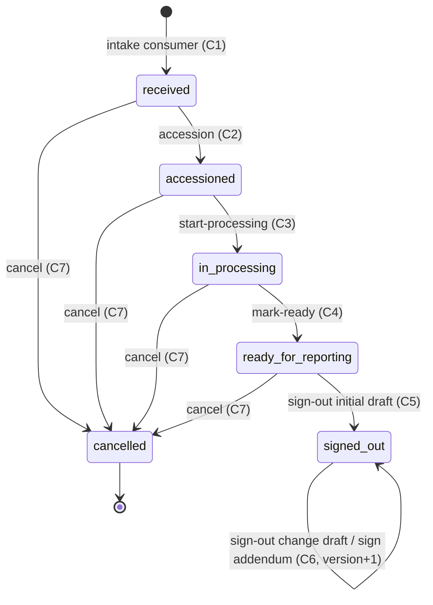

# C11 Specialty Pathology — 03 App Flow

Status: DECISION, 2026-11-06. Companion to `02-TRD.md` (operationIds §5, state table §7, algorithms §4). Screen copy and fields are in `04-UI-UX.md`.

---

## 1. End-to-end flow (histology)

```mermaid
flowchart LR
  A[C4 registers order with histology test] --> B[C5 collects + receives specimen]
  B -->|lab.specimen.status_changed.v1 to_status=received| C[C11 case 'received', part A]
  C --> D[Accession → S26-0042]
  D --> E[Gross per part + images]
  E --> F[Blocks A1..An]
  F --> G[start-processing]
  G --> H[Slides H&E → ready; special/IHC stain orders]
  H --> I[mark-ready]
  I --> J[Report draft: gross, microscopy, impression, synoptic, images, codes]
  J --> K[Sign-out (pathologist, aal2)]
  K -->|LabPort.submitModuleResult per case item| L[C5 result 'resulted']
  L --> M[C5 verify → approve]
  M -->|lab.order.ready_for_report.v1| N[C6 renders from anatomic.v_pub_report_content → release]
  K --> O[Revision before approval / Amendment after / Addendum (IHC)]
  O -->|new version via A1| L
```

Cytology: same, but gross is optional (fluids may have one), slides are made from parts (smears) or blocks (cell blocks), and slide-level assessments can be included in the report. Molecular: accession → parts → `start-processing` → molecular results (+ optional batch) → `mark-ready` → draft (interpretation) → sign-out with `kind = structured`. IHC-only case (`case_kind = ihc`, e.g. a block received from another lab for IHC — DECISION): accession → register block(s) → stain orders → slides → report.

## 2. State machines

### 2.1 Case (`anatomic.cases.status`) — 02-TRD §7



Guards and permissions: 02-TRD §7 table. Every transition writes `anatomic.case_transitions` (from, to, at, by) and increments `cases.version`. No events are emitted (02-TRD §8.1). Auto-accession (setting) performs C1 + C2 in one transaction.

### 2.2 Report draft (`anatomic.report_drafts`)

| From | To | Trigger | Guard | Side effects |
|---|---|---|---|---|
| (none) | `open` (kind `initial`) | first `saveAnatomicReportDraft` with `If-Match: "0"` | case `accessioned`/`in_processing`/`ready_for_reporting`; no initial draft yet | — |
| (none) | `open` (kind `revision`/`amendment`) | `startAnatomicCaseChange` | case `signed_out`; no open draft; reason given | prefilled from the latest `full` version; kind from C5 status (02-TRD §4.4) |
| `open` | `open` | `saveAnatomicReportDraft` | `If-Match` = draft version | version + 1 |
| `open` | `consumed` | sign-out success | §4.5.3 complete | report version n; submissions |
| `open` (change kinds) | `discarded` | `discardAnatomicCaseChange` | — | — |

At most one open draft per case (partial unique index). An `initial` draft cannot be discarded (it simply stays until sign-out or case cancellation).

### 2.3 Addendum

`draft → signed`. Create only on `signed_out` cases. Sign = C6 transition (02-TRD §4.4 "Addendum signing"). A signed addendum is immutable. Several draft addenda may coexist (e.g. two IHC panels).

### 2.4 Stain order, slide, block location, image, batch

| Object | States | Transitions |
|---|---|---|
| Stain order | `requested`, `in_progress`, `completed`, `cancelled` | requested→in_progress (`start`); requested/in_progress→completed (`complete`, creates slides `ready`); requested/in_progress→cancelled (`cancel`, reason) |
| Slide status | `pending_stain`, `ready` | pending_stain→ready (`bulk-mark-ready`); slides created by `complete` start at `ready` |
| Block/slide location | `in_lab`, `stored`, `sent_out`, `discarded` | per 02-TRD §5.2 movement guards; every movement appends `object_movements` |
| Image | `processing`, `ready`, `quarantined`; `is_active` flag | created `ready` (scan `clean`), `quarantined` (`infected`) or `processing` (`pending`/`unavailable`) from `AcceptedUpload.scanState`; processing→ready / processing→quarantined (re-scan job, 08 A17 P-19); active→inactive (`deactivate`) |
| Batch | `open`, `closed` | open→closed (`close`); members editable only when open |

## 3. Cross-chunk sequences

### 3.1 Intake from C5 (A4)

```mermaid
sequenceDiagram
  participant C5 as C5 lab (producer)
  participant WC as Worker core (fan-out)
  participant AN as C11 consumer (anatomic)
  participant FD as FrontdeskPort (C4)
  participant CT as CatalogPort (C3)
  participant DB as anatomic schema
  C5->>WC: lab.specimen.status_changed.v1 {to_status: received, order_item_ids?, aggregate.seq}
  WC->>AN: evt.anatomic.lab.specimen.status_changed.v1 (job_key event_id:anatomic)
  AN->>DB: INSERT event_inbox ON CONFLICT DO NOTHING
  alt duplicate event_id
    AN-->>WC: success (no-op)
  else new
    AN->>DB: SELECT specimen_links FOR UPDATE (seq check)
    AN->>FD: getOrderSummary(orderId)
    FD-->>AN: items (testIds, status, priority)
    loop each candidate test
      AN->>CT: getTest(testId)
      CT-->>AN: workflowType, name
    end
    AN->>DB: upsert open case (partial unique) + part + case_items + specimen_links
    opt auto_accession_on_receipt
      AN->>DB: counter UPDATE … RETURNING; case → accessioned
    end
    AN-->>WC: success (commit)
  end
```

Failure: any port error → throw → transaction (incl. inbox row) rolls back → Graphile Worker retry (10) → dead letter (02-CV §7.5).

### 3.2 Sign-out and hand-off (A1)

```mermaid
sequenceDiagram
  actor P as Pathologist (aal2)
  participant W as Staff web BFF
  participant API as C11 API
  participant ID as IdentityPort (C2)
  participant FD as FrontdeskPort (C4)
  participant LB as LabPort (C5)
  participant DB as anatomic schema
  P->>W: Sign out (attest)
  W->>API: POST /v1/anatomic/cases/{id}/sign-out (If-Match draft v, Idempotency-Key)
  API->>DB: load case (RLS) → 404 if invisible
  API->>ID: assertRole(anatomic.case.signout, centreId)  (privileged → membership re-check + aal2)
  API->>DB: BEGIN; case FOR UPDATE; draft version check; completeness
  API->>FD: getOrderSummary(orderId) — item status active?
  loop each active primary case item (port calls first)
    API->>LB: submitModuleResult({orderItemId, kind, reportPhase:'final', payloadRef{anatomic, case_item_id, v}, summaryText, flag, isCritical, idempotencyKey, amendment?})
    LB-->>API: {resultId, versionNo, status, replayed}
  end
  API->>DB: INSERT report_versions (n; version_kind decided from the outcomes — 02-TRD §4.4 step 8)
  API->>DB: INSERT item_submissions (one per target)
  API->>DB: access_log anatomic_report.sign_out
  API->>DB: case → signed_out; draft consumed; COMMIT
  API-->>W: 200 SignOutResult
  Note over LB: Later, in C5: verify (R4) → approve (R6, approver ≠ verifier) → lab.order.ready_for_report.v1
```

If `submitModuleResult` throws for any item → ROLLBACK of everything (no version, no submissions, case unchanged) → the `lab.*` problem is returned unchanged (AC-09.4).

### 3.3 C6 rendering from the published view

```mermaid
sequenceDiagram
  participant C5 as C5
  participant C6 as C6 reporting (system actor)
  participant LB as LabPort
  participant V as anatomic.v_pub_report_content
  participant ST as ctx.storage (bucket anatomic-images)
  C5->>C6: lab.order.ready_for_report.v1
  C6->>LB: getOrderResults(orderId, 'approved') → ResultView.moduleRef {anatomic, entityId, versionNo} (CR-C6-006)
  C6->>V: SELECT … WHERE tenant_id=$t AND entity_id=$e AND version_no=$v
  V-->>C6: one row (text sections, synoptic, images refs, CR-C11-001 columns)
  C6->>ST: read image bytes by (bucket, object_path); verify sha256
  C6->>C6: render anatomic section → report version
```

C11 is not called synchronously by C6; the view and bucket are the only interfaces (02-TRD §15).

### 3.4 Case detail with C5 chain status

```mermaid
sequenceDiagram
  participant W as BFF
  participant API as C11 API
  participant LB as LabPort
  participant FD as FrontdeskPort
  W->>API: GET /v1/anatomic/cases/{id}
  API->>API: load case (RLS); assertRole(anatomic.case.read, centre)
  par
    API->>LB: getOrderResults(orderId, 'all_visible')
    LB-->>API: results by orderItemId (or auth.forbidden → omit lab_status)
  and
    API->>FD: getPatientDemographics(patientId, 'lab_display') (only if caller holds frontdesk.patient.read)
  end
  API->>API: access_log anatomic_case.view
  API-->>W: CaseDetail
```

### 3.5 Amendment after approval

```mermaid
sequenceDiagram
  actor P as Pathologist
  participant API as C11 API
  participant LB as LabPort
  P->>API: POST /cases/{id}/changes {reason_code: transcription_error}
  API->>LB: getOrderResults('all_visible')
  LB-->>API: module result status approved
  API-->>P: 201 ReportDraft kind=amendment (prefilled from version n)
  P->>API: PUT /cases/{id}/report-draft (edits)
  P->>API: POST /cases/{id}/sign-out
  API->>LB: submitModuleResult({..., payloadRef.versionNo: v+1, amendment:{reasonCode, reasonText?}}) (08 R1; sent for every revision/amendment)
  LB-->>API: {status: 'approved', versionNo: n+1}  (C5 emits lab.result.amended.v1; readiness re-emitted)
  API-->>P: 200 (version_kind amendment)
```

Actor without `lab.result.amend` → C5 throws `lab.result_locked` → rollback (AC-10.3).

### 3.6 IHC on a block after sign-out, reported as addendum

```mermaid
sequenceDiagram
  actor T as Technologist
  actor P as Pathologist
  participant API as C11 API
  participant FD as FrontdeskPort
  participant LB as LabPort
  T->>API: POST /cases/{id}/stain-orders {stain_code: IHC_ER, block_id: A2}
  opt billed add-on exists on the order (C4 added it)
    T->>API: POST /stain-orders/{so}/link-addon {order_item_id}
    API->>FD: getOrderSummary — item active, same order, profile is_addon
  end
  T->>API: POST /stain-orders/{so}/complete {slide_count: 1, reagent_lot}
  P->>API: POST /cases/{id}/addenda {kind: ihc, text, stain_order_ids:[so], addon_case_item_id?}
  P->>API: POST /addenda/{a}/sign
  alt linked to add-on case item
    API->>LB: submitModuleResult(add-on item, v+1, scope addendum_only, amendment.reasonCode supplementary_report) → resulted on first submission (C5 ignores amendment while not approved)
  else not linked
    API->>LB: submitModuleResult(each primary item, v+1, full cumulative, amendment.reasonCode supplementary_report) → amendment where approved (08 R1; C6 kind addendum)
  end
```

### 3.7 Image upload

```mermaid
sequenceDiagram
  participant W as BFF
  participant API as C11 API
  participant UP as ctx.uploads (C0 pipeline)
  participant Q as Graphile Worker
  participant J as anatomic.process_image
  participant ST as ctx.files.scan / ctx.storage.read
  W->>API: POST /cases/{id}/images (multipart, Idempotency-Key)
  API->>API: case visible + assertRole(case.work) + image count < max
  API->>UP: accept({allow png/jpeg, maxBytes, reencode, scan, bucket anatomic-images, path {tenant}/{yyyy}/{mm}/{image_id}.ext})
  UP-->>API: AcceptedUpload {sha256, byteSize, mime, image{w,h}, scanState} (or payload_too_large / unsupported_media_type)
  alt scanState = clean
    API->>API: INSERT images(state ready, scan_state clean)
  else scanState = infected
    API->>API: INSERT images(state quarantined, scan_state infected)
  else scanState = pending | unavailable
    API->>API: INSERT images(state processing, scan_state); enqueue anatomic.process_image (same tx)
  end
  API-->>W: 201 {id, state}
  Q->>J: run (only for processing images; ≤ 5 attempts with backoff)
  J->>ST: storage.read(anatomic-images, object_path) → files.scan(bytes)
  ST-->>J: clean | infected | unavailable
  J->>J: UPDATE images → ready | quarantined | (unavailable: scan_attempts+1, throw → retry)
```

Scan outcome model: 08 A17 P-19 (there is no `ctx.uploads.status` method).

The web polls `GET /cases/{id}` (or the image list in it) every 3 s [CONV] while any image is `processing`, max 2 minutes, then shows "Still processing". Thumbnails load through the BFF route that streams `getAnatomicImageContent` inline (08 A17 D-67); a non-ready image returns `422 common.upload_quarantined` and shows its state chip instead.

## 4. Screen flows

Every screen follows the shell rules: **loading** = `LoadingSkeleton` (variant per screen); **empty** = `EmptyState` (copy in 04-UI-UX); **error** = `ErrorState` with `request_id` + Retry; **permission denied** = page-level `core.shell.forbidden` (BFF receives 403); **not found** = `core.shell.not_found`; **success** = toast. Mutations disable their button while `isLoading`. `409 common.version_conflict` always shows the banner "This case was changed by someone else. Reload to see the latest version." with a Reload action; unsaved text is kept in the form until reload is confirmed.

### 4.1 Worklist `/anatomic` (`staff.anatomic.worklist`, CR-C11-006)

1. Load: `listAnatomicCases(queue=to_accession)` (default tab remembered per browser session only).
2. Tabs = queues: To accession · Grossing · Bench · Reporting · Awaiting lab approval · Signed out · Cancelled · All. Queue definitions (server-side):
   - `to_accession`: status `received`.
   - `grossing`: status `accessioned` and any part without complete gross (histology/cytology with `requires_gross`).
   - `bench`: status `accessioned`/`in_processing` with slides `pending_stain` or stain orders `requested`/`in_progress`, or `signed_out` with open stain orders.
   - `reporting`: status `ready_for_reporting`, or `signed_out` with an open change draft or draft addendum.
   - `awaiting_lab`: `signed_out` cases with at least one active primary case item whose latest submission is not yet approved by C5 (`case_items.lab_approved_version_no` < latest `item_version_no`). Needs the `lab.result.approved.v1` / `lab.result.amended.v1` consumer (CR-C11-011). (CR-C11-011, accepted in 08; the list never calls C5 per row — DECISION for performance; the detail page always shows live C5 status).
3. Scan/typing in the lookup field → `lookupAnatomicObject` → navigate to the case (block/slide → case with that object highlighted). Not found → inline "No case, block or slide with this label."
4. Row action Enter → case workspace.
- Empty per tab: e.g. "Nothing to accession. New cases appear here when the lab receives a histology, cytology or molecular specimen."
- Permission: needs `anatomic.case.read`; nav entry hidden otherwise.

### 4.2 Case workspace `/anatomic/cases/{case_id}` (`staff.anatomic.case`)

Load `getAnatomicCase`. Header shows accession (or "Not accessioned"), status chip, case kind, priority, patient line (if returned), centre, received time, assigned pathologist, C5 chain status per item. Banners: `profile_missing`, `specimen_rejected`, inactive order items, open change draft, add-on items without result.

Tabs and flows:

| Tab | Flow | Calls |
|---|---|---|
| Overview | Accession dialog (status `received`): parts list with site/description, clinical history, pathologist → Save → number shown in a success toast "Accessioned as {accession_no}" | `accessionAnatomicCase` |
| | Edit details | `updateAnatomicCaseDetails` |
| | Stage buttons: "Start processing", "Mark ready for reporting" (enabled per `allowed_actions`), "Cancel case" (ConfirmDialog with reason) | `startAnatomicProcessing`, `markAnatomicCaseReady`, `cancelAnatomicCase` |
| Parts & gross | Per part: site/description edit; gross editor (text + pieces + 3 dimensions + weight + "Gross complete" switch) with text-template insertion; gross images upload | `updateAnatomicPart`, `saveAnatomicGross`, `uploadAnatomicImage`, `addAnatomicPart` |
| Blocks & slides | Add blocks (part, count); add slides (block or part, stain, count); bulk mark ready; record movement (bulk); print labels (opens labels page) | `createAnatomicBlocks`, `createAnatomicSlides`, `markAnatomicSlidesReady`, `recordAnatomicMovements` |
| | Cytology slide assessment drawer | `saveAnatomicSlideAssessment` |
| Stains | Order special/IHC stain (block picker; IHC block-only); start; complete (slide count, lot); cancel; link add-on item (picker lists unlinked add-on items of the order) | M5, M7–M10 |
| Images | Gallery (`ImageThumbnailGrid`, CR-C6-010) with kind/part/caption edit, deactivate; processing state chips | I1–I4 |
| Molecular (molecular cases only) | Results grid per assay/target; batch picker; save (full replace) | `saveAnatomicMolecularResults` |
| Report | Draft editor (gross, microscopy, impression, comment, ancillary results per completed stain order, slide assessments included, synoptic instances, images selection/order, diagnosis codes, flag, critical finding); Save (`Alt+S` [CONV, see 04-UI-UX §3]); "Insert gross from parts"; Preview (plain, read-only rendering of what the version will contain); Sign out | R1–R3 |
| | After sign-out: "Revise" / "Amend" (label from C5 status), "Add addendum"; versions list; version viewer | R4–R10 |
| History | Transitions timeline; report versions with submissions and C5 status | (from detail) |

Sign-out flow:
1. Click "Sign out" → client checks unsaved changes (forces save first).
2. Dialog lists: report kind, version number to be created, items to be submitted (test names), critical finding yes/no, attestation checkbox "I have reviewed this report and its images".
3. Confirm → `signOutAnatomicCase`.
4. `403 auth.mfa_required` → dialog shows "Signing out needs two-factor verification. Verify now" → C2 step-up route, then return to the same page (draft is saved server-side).
5. `422 anatomic.report_incomplete` → dialog closes, form `ErrorSummary` lists each missing field with links (JSON Pointer → field).
6. `409 anatomic.order_item_inactive` → banner naming the test: "The test {name} was removed from the order. Ask front desk, or cancel the case."
7. `lab.*` errors → banner with the C5 title and reference (e.g. "Result is approved and locked — use Amend").
8. Success → toast "Signed out as version {n}. Sent to lab verification."; page reloads detail; Report tab shows the version viewer.

### 4.3 Labels page `/anatomic/cases/{case_id}/labels?kind=blocks|slides&ids=…`

Load `getAnatomicLabels` → print layout (one label per object, `@page` size from C5-style label dimensions; 50 × 25 mm default [CONV, same as C5]) → user presses Print (browser). Empty → "No blocks yet" / "No slides yet". Access log written by the API call.

### 4.4 Tracking `/anatomic/tracking`

1. Scan a block/slide label → `lookupAnatomicObject` → side panel with the object, case accession, current location, history (`listAnatomicBlockMovements`/`…SlideMovements`).
2. Multi-scan mode: each scan adds the object to a basket (≤200); "Record movement" applies `recordAnatomicMovements` to the basket; per-id outcomes are shown inline (invalid_state rows highlighted with the reason "Not possible from {current status}").
3. "Sent out" tab: `listAnatomicBlocks(location_status=sent_out)`, oldest first.

### 4.5 Batches `/anatomic/batches` and `/anatomic/batches/{batch_id}`

List (open first) → create batch dialog → detail with position grid (capacity cells), add members by scanning accession numbers (lookup → case id) or picking from the molecular reporting queue; close batch (ConfirmDialog). `batch_position_taken` → the cell shows "Position used". Closed batch: read-only.

### 4.6 Configuration `/anatomic/config` (`anatomic.config.manage`)

Tabs: Settings · Stains · Test profiles · Assays · Coded lists · Synoptic templates · Text templates. Each list uses `DataTable`; edits in `Drawer` forms; privileged → aal2 step-up as in §4.2 step 4. Template editor (`/anatomic/config/templates/{template_id}`): section/field builder (add/reorder/remove in draft), live preview rendering the form exactly as the report editor will, "Publish" (ConfirmDialog: "Publishing makes this version read-only. Reports already using older versions keep them.").

## 5. Edge cases

| # | Case | Behaviour |
|---|---|---|
| E1 | Two specimens of one order received at the same moment (two consumer jobs) | open-case partial unique index; second insert does nothing and re-selects; both parts end on one case (letters by insertion order) |
| E2 | Event redelivered / out of order (`received` after `rejected` of the same specimen) | inbox dedupe; seq check — the lower-seq event is ignored |
| E3 | Specimen received for an order item that is already on a signed-out case (late extra specimen) | new case for the same order and kind (open-case index excludes signed-out); banner on both "Related case {accession}" (DECISION) |
| E4 | Order item removed at front desk after case creation | C11 does not consume `items_changed`; detail shows the item inactive (live `getOrderSummary`); sign-out blocked with `anatomic.order_item_inactive`; staff cancel the case or the item is re-added |
| E5 | Order cancelled | as E4 for every item; C5 cancels pending results (R8); case can be cancelled if never submitted |
| E6 | Concurrent edits of the draft by two pathologists | `If-Match` → second gets `409 common.version_conflict`; UI keeps their text for copy |
| E7 | Double-click on Sign out / network retry | `Idempotency-Key` (client UUIDv7 per dialog open) → replay of stored response; LabPort idempotent on `anatomic:<case_item_id>:<v>` as second guard |
| E8 | Sign-out partially fails at item 2 of 3 | single transaction → nothing persisted; C5 writes made through the port in the same tx are rolled back too (ports run in the caller's tx — 02-CV §8.1) |
| E9 | C5 verifier returns the result (R5) after sign-out | C11 detail shows `lab_status = resulted` again with "Returned by lab verification"; pathologist uses Revise → version n+1 (A1 allows a later final while not approved) |
| E10 | C5 approves while a revision draft is open | every revision/amendment submission carries `amendment: { reasonCode, reasonText? }` (02-TRD §4.4 step 6), so at sign time C5 treats the submission as an amendment without `lab.amendment_reason_required` (needs `lab.result.amend`); after the port calls C11 stores `version_kind = amendment` (step 8). With several targets of which only some are approved, the version is still stored as `amendment` |
| E11 | Template published while a draft uses the older version | draft keeps its `template_id` (version); sign-out uses it (AC-08.4); UI shows "A newer version exists" note only |
| E12 | Image still `processing` when signing out with it selected | `422 anatomic.report_incomplete` at `/image_ids/k` "Image is still processing" |
| E13 | Quarantined image | never served (`422 common.upload_quarantined`, 08 A13 P-2), cannot be selected; security alert metric |
| E14 | Block sent out for second opinion, IHC requested | stain order allowed (it is a request; 02-TRD M5 refuses only a `discarded` block) but `complete` (M8) → `anatomic.block_not_available` until `returned` |
| E15 | Accession counter row contention at year start | row lock serialises; p95 unaffected at 1 req/s scale (02-TRD §11) |
| E16 | Staff browser offline mid-edit | no offline mode (staff web is online-only); shell banner `core.shell.offline`; form state kept in memory; save retried by the user |
| E17 | Patient demographics unavailable (port error or missing permission) | lists/detail render without patient line; never fail the page |
| E18 | Cytogenetics test ordered | `workflowType = narrative` → ignored by intake (AC-01.4); handled by C6 |
| E19 | Molecular case with a target result `invalid` | stored as entered; no automatic re-test or flag (no clinical rules); pathologist decides on the report |
| E20 | Tenant changes accession pattern mid-year | new numbers follow the new pattern; counter continues per series/year; uniqueness index prevents collisions (`anatomic.accession_duplicate`) |
| E21 | Retired stain/diagnosis code on an existing report | stored display text in the version keeps rendering; pickers hide inactive codes unless already selected |
| E22 | Case cancelled while blocks exist | blocks/slides remain trackable (physical material); movements still allowed |
| E23 | Edit after sign-out | rules of 08 A17 D-66 (02-TRD §5 "Edits on a `signed_out` case"): image upload and stain orders for addenda always; gross, parts' site/description, molecular results and draft content only while a change draft is open; everything else `409 anatomic.signout_locked` |
| E24 | Second addendum on the same add-on item | new `addendum_only` version whose `addenda` holds both signed addenda (oldest first), so the first text stays on the report (02-TRD §4.7.2) |
| E25 | Out-of-order `collected` event for a specimen C11 has never seen | a `specimen_links` row with `link_kind = not_anatomic` records the seq (02-TRD §4.1); no case |
