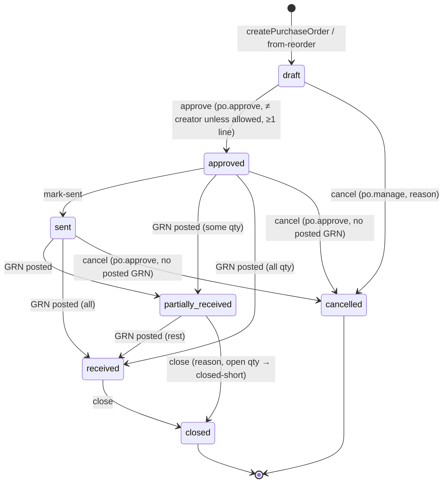
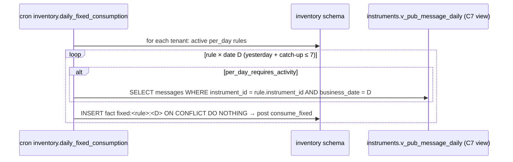

# C12 Inventory — 03 App Flow

Status: DECISION, 2026-11-06. Endpoints are numbered as in `02-TRD.md` §5 (`#n`). Screens are numbered `S1…S18` as in `04-UI-UX.md`. Acceptance criteria are cited as `AC-x.y` (`01-PRD.md` §6).

## 1. Flow inventory

| Flow | Actors | Screens | Endpoints | Cross-chunk |
|---|---|---|---|---|
| F-01 Item set-up | lab manager | S2, S3 | #1–#10 | — |
| F-02 Stores, bindings, settings | lab manager | S4, S14, S18 | #11–#16, #23–#29 | `ctx.core` branches; C7 HTTP (instrument picker) |
| F-03 Suppliers | lab manager, finance | S5 | #17–#22 | — |
| F-04 Purchase order lifecycle | lab manager, finance | S6 | #80–#89 | — |
| F-05 Goods receipt with lot capture | store keeper | S7 | #49–#55 | — |
| F-06 Issue / return / wastage / adjustment / expiry write-off | store keeper, lab manager | S8, S10 | #41–#48, #36 | — |
| F-07 Transfer | store keepers at two branches | S9 | #56–#62 | — |
| F-08 Stock count | store keeper, lab manager | S11 | #63–#68 | — |
| F-09 Bench: open/finish/discard container; manual calibration/QC log | technologist | S12 | #37–#40, #76 | — |
| F-10 Consumption rules | lab manager | S13 | #69–#74 | CatalogPort.getTest; C3 HTTP (test picker) |
| F-11 Automatic per-test consumption | system | — | — | C5 event `lab.result.verified.v1` |
| F-12 Automatic rerun consumption | system | — | — | C7 event `instruments.result.received.v1` |
| F-13 Automatic QC consumption | system | — | — | C7 event `instruments.qc.received.v1` |
| F-13a Automatic calibration consumption | system | — | — | C7 event `instruments.calibration.received.v1` (CR-C12-006, 08 R13; only drivers that classify calibrator records, B2) |
| F-14 Daily fixed consumption | system (cron) | — | — | `instruments.v_pub_message_daily` |
| F-15 Unresolved queue and resolution | lab manager | S15 | #75, #77–#79 | — |
| F-16 Alerts | all inventory users | S1, S16 | #90–#91 | — |
| F-17 Reports and export | managers, finance, owner | S17 | #92–#93, #55 | `catalog.v_pub_test_directory`, `lab.v_pub_result_daily`, `instruments.v_pub_message_daily`, `instruments.v_pub_instrument_directory` |
| F-18 Nightly integrity, reconciliation, alert scans | system (cron) | — | — | views as F-17 |

## 2. Request pipeline (every endpoint)

1. BFF → API with the user's JWT (CV §6). The core verifies it, applies the rate limit (`general`), and handles the idempotency hook (R/O per #).
2. Spec validation (unknown fields → `400`).
3. The handler loads the target object through the module repository (RLS tenant filter + explicit `tenant_id`). Not found → `404 common.not_found`.
4. Branch scope (`scope.service.assertStoreAccess`, `02-TRD.md` §5 "Scope", in this order). The visible branch set comes from `getActor()` (`centreScope.all` → all branches; else `branchIds`); lists filter on it.
   - (a) The object's store branch is not in the visible set → **404** `common.not_found`, for GET and for actions alike (the object is never shown, so the 404 is consistent). Transfers are visible when either the source or the destination branch is visible.
   - (b) Otherwise `IdentityPort.assertRole(ctx, { permission, branchId })`, where branchId = the object's store branch (transfers: the source branch for draft replace/dispatch/cancel, the destination branch for receive) → `403 auth.forbidden` / `auth.mfa_required` when the permission, the branch grant of the acting end or MFA is missing. Examples: a technologist with `inventory.item.read` on BR-1 tries `createStockAdjustment` in BR-1 → 403; a BR-1 user receives a BR-1 → BR-2 transfer → 403 (visible as its source).
5. The service opens `ctx.db.tx`. Every write and its movements, balances, projections, alerts and number allocation commit together.
6. The mapper applies the cost allowlist (`02-TRD.md` §6.3).

## 3. State machines

### 3.1 Purchase order (`inventory.purchase_orders.status`)



| # | From → To | Guard | Side effects |
|---|---|---|---|
| P1 | ∅ → draft | supplier and store active; lines 1–200; items active; packs belong to items | number allocated (`po`); totals computed (§4.2 of TRD) |
| P2 | draft → draft (replace) | `If-Match` | current lines marked removed (`removed_at`/`removed_by`, allowed only while the parent is draft) and the request lines inserted — never deleted (08 A17 D-71, `02-TRD.md` §5.11); totals recomputed over non-removed lines |
| P3 | draft → approved | permission `inventory.po.approve` (aal2); `settings.po_self_approval_allowed` or actor ≠ `created_by` → else `inventory.po_self_approval_forbidden`; ≥ 1 line | approved_at/by |
| P4 | approved → sent | channel required | sent_at/by/channel/reference |
| P5 | approved/sent/partially_received → partially_received/received | performed only by `postGoodsReceipt`; computed from Σ `received_qty_base` vs `qty_base` over non-closed lines | lines' `received_qty_base` updated |
| P6 | draft → cancelled | `po.manage`, reason code (group `po_cancel`) | cancelled_at/by |
| P7 | approved/sent → cancelled | `po.approve`; no posted GRN references the PO | — |
| P8 | partially_received → closed | reason (group `po_close`) | lines with open qty: `is_closed_short = true` |
| P9 | received → closed | — | — |

Forbidden (all return `409 inventory.po_invalid_transition`, AC-05.7):
- any edit outside draft;
- draft → sent / received;
- partially_received → cancelled;
- received → cancelled;
- closed → *;
- cancelled → *;
- approve twice.

Draft GRNs that reference a PO block nothing. When the PO is cancelled or closed, posting such a draft fails with `inventory.po_invalid_transition`.

### 3.2 Goods receipt

| # | From → To | Guard | Side effects |
|---|---|---|---|
| G1 | ∅ → draft | kind purchase: supplier required; PO (if given) in approved/sent/partially_received, same supplier, same store; `grn_without_po_allowed` when no PO | number (`grn`); line amounts computed |
| G2 | draft → draft (replace) | `If-Match` | lines replaced by soft removal + insert (D-71, as P2) |
| G3 | draft → posted | see §4.2 below | lots upserted; movements `receive`/`opening_balance`; balances; PO P5; `lots.last_receipt_*`; supplier item `last_unit_price_paisa` updated (purchase only) |
| G4 | draft → cancelled | reason text | — |

Forbidden: posted → *, cancelled → * (`inventory.document_invalid_transition`).

### 3.3 Transfer

| # | From → To | Guard | Side effects |
|---|---|---|---|
| T1 | ∅ → draft | stores differ; source branch in scope; lines | number (`transfer`); a later draft replace (#59) soft-removes lines (D-71) |
| T2 | draft → dispatched | source not locked for count; each line: lot candidate (or FEFO split for lines without a lot — the line is split into one line per lot and the draft is rewritten before dispatch, in the same transaction); stock sufficient | `transfer_out` per line; `dispatched_value_paisa` |
| T3 | dispatched → received | destination branch in scope; every line given; received ≤ dispatched; reason when less | destination `transfer_in` +r at round_half_up(r / d × V); shortfall (08 A17 D-69): at the **source**, on the same (store, item, lot) row as the `transfer_out`, `transfer_in` +(d − r) at the remaining value, then `wastage` −(d − r) at the same value, reason = line discrepancy reason (default `transit_loss`), `doc_type = 'transfer'`; the source nets −d |
| T4 | draft → cancelled | — | — |

Forbidden: dispatched → cancelled (stock is in transit and must be received, possibly as 0 with reason `transit_loss`); received → *; cancelled → *.

### 3.4 Stock count

| # | From → To | Guard | Side effects |
|---|---|---|---|
| K1 | ∅ → open | no other open count for the store (`inventory.count_already_open`) | `snapshot_at = now`; lines for every balance row with qty ≠ 0 (and scope category); `book_qty_snapshot` |
| K2 | open → open (lines) | — | counted qty / at / by recorded; new lines allowed |
| K3 | open → posted | `inventory.stock.adjust`; `uncounted_policy` | per line: `book_qty_at_count = snapshot + Σ movements (store,item,lot) with snapshot_at < occurred_at ≤ counted_at`; variance = counted − book_at_count; non-zero → `count_adjust_in/out` (reason line or `count_variance`); if a negative variance v exceeds the lot row's current quantity Q (consumption after counting, AC-19.4), post −Q on the lot row and −(v − Q) on the unlotted row (same split as `consume_*`) and raise `negative_stock`; `skip` leaves uncounted lines unchanged, `zero` counts them as 0 at post time |
| K4 | open → cancelled | — | — |

### 3.5 Opened container

`open → finished` (finish), `open → discarded` (discard: creates a `wastage` stock document with the entered remaining quantity, then links it). Forbidden: anything out of finished/discarded.

### 3.6 Consumption fact

| # | From → To | Trigger | Side effects |
|---|---|---|---|
| C1 | ∅ → posted / no_rule / unresolved | consumer, manual log, cron | §8 TRD; the row is inserted with its **final** status (rules matched and store resolved first), so no transition happens at insert; posting then updates `value_paisa_total` with the status unchanged |
| C2 | unresolved → posted | `resolveConsumptionFact` or `inventory.resolve_unresolved` | movements with the fact's original business date and occurred_at |
| C3 | unresolved → dismissed | `dismissConsumptionFact` (reason) | none |
| C4 | posted → reversed | `reverseConsumptionFact` (manual facts only, `stock.adjust`, reason) | one `consume_reversal` per original movement (same store/lot/qty magnitude, `reverses_movement_id`, value = −original value) |

Forbidden: no_rule → * (a `no_rule` fact stays; a rule added later does **not** back-deduct, DECISION: rules are not retroactive); dismissed → *; reversed → *; event-sourced posted → reversed (`inventory.fact_not_reversible`).

### 3.7 Alert

`open → acknowledged` (user), `open|acknowledged → resolved` (system only, when the condition clears; or the integrity/reconciliation scan finds it gone). A resolved alert never reopens. A new occurrence creates a new alert, because the partial unique index only covers non-resolved rows.

## 4. Flows step by step

### 4.1 F-04 Purchase order
1. S6 list → "New PO" → choose supplier (combobox #17) and receiving store (stores visible to the user, #11).
2. Add lines: item search (#1) or barcode scan (#10). The pack defaults to the supplier item pack (#21) or the item's purchase-default pack. The unit price defaults to `last_unit_price_paisa`; the tax code defaults to supplier item → item → `VAT` (C3 code, 08 A5.6); choosing "Exempt (no tax code)" sends `is_exempt: true` and no `tax_code` (08 A4.1, A17 D-70). On save the server reads the line's rate via `CatalogPort.getTaxRate({taxCode, on})` and snapshots it (`tax_rate_bp`) — not for an exempt line, which gets `tax_rate_bp = 0` and no port call; `catalog.tax_config_missing` → `422` shown on the line's Tax field (08 A2.2).
3. Save → #81 (Idempotency-Key = UUIDv7 generated when the form opens; reused on retry). The response shows server-computed totals. The UI never computes the totals it sends; it displays the server totals after save.
4. Approver opens the PO → "Approve" → #84. Step-up MFA if the session is aal1 (`auth.mfa_required` → BFF starts the C2 step-up flow, then retries with the same Idempotency-Key).
5. "Print" → print view S6-P (#89) → browser print. "Mark as sent" → #85.
6. Goods arrive → F-05 from the PO ("Receive against this PO").
7. When the remaining quantity will not come → "Close" → #87 with reason.

### 4.2 F-05 Goods receipt (posting algorithm, #53)
In one transaction:
1. Lock the GRN row (`FOR UPDATE`). Require status draft (else `inventory.document_invalid_transition`; a retry with the same Idempotency-Key replays).
2. If `count_locks_store` is on and an open count exists for the store → `inventory.store_locked_for_count`.
3. If PO-linked: lock the PO row and its lines; status must be approved/sent/partially_received. For each GRN line with `po_line_id`: `received_qty_base + line.qty_base ≤ qty_base × (1 + tolerance_bp/10000)`, else `inventory.over_receipt`.
4. For each line of a lot-tracked item: `lot_no` required; `expiry_on` required if `requires_expiry`; `expiry_on ≥ received date` (else `inventory.lot_expired`). Upsert the lot `(item, lot_no)`:
   - on conflict with a different non-null `expiry_on` → `400 common.validation_failed` at `/lines/n/expiry_on` (08 A13 P-1) ("lot exists with expiry …"; DECISION: a lot has one expiry; correction goes via #33);
   - set the line's `lot_id`.
5. Compute `capitalised_value_paisa` (TRD §4.2). Call `ledger.post` with the `receive` (or `opening_balance`) movements.
6. Update `lots.last_receipt_qty_base/value` with this line (latest wins), the PO lines' `received_qty_base`, the PO status (P5), and the supplier item's `last_unit_price_paisa` (purchase).
7. Set the GRN to posted (`posted_at/by`). Commit. Run the alert checks (below-reorder resolve) in the same transaction.

### 4.3 F-06 Manual issue (#43)
1. S8: choose store → scan/search item → enter qty (unit or pack) → optional lot.
2. Without a lot: the UI calls #36 (FEFO suggestion) and shows the proposed lots. The user may accept or pick a lot. On submit the server re-runs FEFO; it does not trust the client's split.
3. Server: lock check, validation, FEFO split, `ledger.post` (`issue`, value per §4.3 of TRD), document number (`doc`). Response = document with movements.

Wastage (#46), supplier return (#45), adjustment (#48) and expiry write-off (#47) follow the same steps with their kinds and reasons. Expiry write-off: for each requested lot × the given store, qty = full balance; the lot must be expired at today's tenant date.

### 4.4 F-07 Transfer
Draft at the source → dispatch (source) → in-transit list at both ends (status `dispatched`) → receive (destination) with per-line quantities → done. The in-transit quantity is the Σ of dispatched lines not yet received. It shows on the stock screen as "in transit to/from" (computed from transfer lines, not from balances).

### 4.5 F-08 Stock count
Open (K1) → print the count sheet (browser print of S11 in "sheet" mode, without book quantities by default — DECISION: blind count, so counters are not anchored) → enter counts (K2; scanner supported) → review variances (the server computes a preview with book_at_count for display, using the same formula as posting) → post (K3, aal2).

### 4.6 F-10 Consumption rule set-up
1. S13: choose rule kind → test (C3 HTTP search via BFF, user token, `catalog.test.read`) → analyte (from `GET` test detail via C3 HTTP) where needed → instrument (C7 HTTP list via BFF; optional "any instrument") → item → qty + unit/pack.
2. Server (#70): shape check (`05-SCHEMA.md` §2.23); `CatalogPort.getTest` validates the test and that the analyte belongs to it; pack belongs to the item; a current rule exists → `inventory.rule_conflict` with `detail` naming the rule id.
3. "Change quantity" on an existing rule → #72 supersede: in one transaction the old rule gets `effective_to = now()` and a new rule with `effective_from = now()` and `supersedes_rule_id` is created.
4. "Preview" (#74) shows what an event would deduct right now, which store would be chosen and at which resolution step, plus the estimated value.

### 4.7 F-11 Automatic per-test consumption

```mermaid
sequenceDiagram
  autonumber
  participant C5 as C5 lab (API tx)
  participant OB as core.event_log + fan-out (C0)
  participant W as Worker evt.inventory.lab.result.verified.v1
  participant IP as IdentityPort (C2)
  participant DB as inventory schema
  C5->>OB: publish lab.result.verified.v1 (same tx as R4)
  OB->>W: job (job_key event_id:inventory)
  W->>DB: INSERT event_inbox ON CONFLICT DO NOTHING
  alt duplicate
    W-->>OB: success (no-op)
  else new
    W->>IP: getTenantSettings({keys:[timezone]}) → business_date
    W->>DB: test_counts_daily.verified_result_events += 1 (every non-duplicate event, D-73)
    W->>DB: read settings (consumption_enabled_at)
    alt consumption off or verified_at < consumption_enabled_at
      W-->>OB: commit (inbox + counter only)
    else on
      loop fact (a) test:<order_item>:<test>, then fact (b) analyte:<result> if a per_analyte rule exists — independently
        W->>DB: match rules; resolve store (binding → … → default) when a rule matched
        W->>DB: INSERT consumption_facts with final status (posted|no_rule|unresolved) ON CONFLICT DO NOTHING
        alt fact existed
          Note over W,DB: nothing more for this fact
        else new fact, posted
          W->>DB: lock balances; pick in-use lot / FEFO / unlotted; INSERT stock_movements; UPDATE balances; UPSERT consumption_daily
          W->>DB: alerts (below_reorder, negative_stock, expired_lot_in_use)
          W->>DB: UPDATE fact value_paisa_total (status unchanged)
        end
      end
      W->>DB: test_counts_daily.tests_counted += 1 when fact (a) was new
      W-->>OB: commit → success
    end
  end
```

### 4.8 F-12 / F-13 Rerun and QC consumption

```mermaid
sequenceDiagram
  autonumber
  participant C7 as C7 instruments (ingest tx)
  participant OB as event_log + fan-out (C0)
  participant W as Worker evt.inventory.instruments.*
  participant CORE as ctx.core (C0)
  participant DB as inventory schema
  C7->>OB: instruments.result.received.v1 / instruments.qc.received.v1
  OB->>W: job
  W->>DB: inbox insert (dedupe)
  W->>DB: QC only: instrument_qc_daily.qc_observations += 1 (before filter and gate, D-74)
  W->>W: filter (rerun: is_rerun ∧ mapped ∧ test_id; QC: mapped ∧ analyte_id)
  alt filtered out, or consumption off / before consumption_enabled_at
    W-->>OB: success (metric events_skipped_total{reason})
  else consume
    W->>DB: match rules (per_rerun | per_qc incl. analyte-null rules)
    alt no instrument binding
      W->>CORE: centre(centre_id) → branchId
      W->>DB: default consumption store of branch
    end
    W->>DB: INSERT fact with final status (rerun:<msg>:<test> | qc:<sha256(idempotency_key)>) ON CONFLICT DO NOTHING
    W->>DB: if new and posted: post movements (as F-11); rerun_events += 1 / qc_events += 1 per distinct attributed test
    W-->>OB: commit
  end
```

### 4.9 F-14 Daily fixed consumption (cron)



`instruments.v_pub_message_daily.business_date` is computed by C7 with `AT TIME ZONE 'Asia/Kathmandu'` (08 A13 P-15: the only v1 timezone). C12 uses the same zone for D. The cron reads the view as a listed consumer (08 A17 P-21).

### 4.10 F-15 Resolution
- Binding created (#24) → enqueue `inventory.resolve_unresolved` (job_key per instrument) → the task re-runs store resolution for unresolved facts of that instrument, oldest first, and posts them (AC-17.2).
- Manual resolve (#77) of one fact to a chosen store (scope: the store's branch) → posts the movements.
- Dismiss (#78) → no movements.

### 4.11 F-17 Reports
1. S17: choose a report and parameters; the BFF calls #92.
2. The server validates the range (≤ 366 days).
3. Queries run against the projections plus the views (`02-TRD.md` §5.9). For labels, `catalog.v_pub_test_directory` and `instruments.v_pub_instrument_directory` (CR-C9-006, 08 R12d; if absent, ids are shown) are left-joined.

CSV export (#93): `IdentityPort.assertRole(inventory.report.export)` (privileged → aal2; `+ inventory.cost.read` when `cost_per_test`, P-10) → stream rows, every text cell through `neutraliseFormula` (`@lims/shared-ts/spreadsheet`, P-9) → `ctx.audit.access({ action: 'data.export', entityType: 'inventory_report', … })` (C0 02-TRD §6.9; `02-TRD.md` §5.10). `consumption_reconciliation` (screen and export) needs `centreScope.all`, else `403 auth.forbidden` [CONV, `02-TRD.md` #92].

```mermaid
sequenceDiagram
  participant U as User (S17)
  participant BFF as Next.js BFF (C0 core)
  participant API as inventory API
  participant IP as IdentityPort
  participant DB as inventory + v_pub views
  U->>BFF: Export CSV
  BFF->>API: GET /v1/inventory/reports/cost_per_test/export.csv
  API->>IP: assertRole(inventory.report.export) + assertRole(inventory.cost.read)
  IP-->>API: ok | auth.mfa_required
  API->>DB: queries (security_invoker views)
  API->>API: ctx.audit.access(data.export)
  API-->>BFF: text/csv (Content-Disposition: attachment; Cache-Control: no-store)
  BFF-->>U: download
```

### 4.12 Pickers through other chunks' HTTP APIs (UI only)

```mermaid
sequenceDiagram
  participant UI as S13 rule form
  participant BFF as BFF
  participant C3 as catalog API (C3)
  participant C7 as instruments API (C7)
  UI->>BFF: search tests "GLU"
  BFF->>C3: catalog test search (user JWT; catalog.test.read)
  UI->>BFF: list instruments
  BFF->>C7: instruments list (user JWT; instruments.* read permission per C7)
  Note over UI,C7: If the user lacks the C3/C7 read permission the picker shows "You don't have access to the test/instrument list" and the field accepts a pasted id (validated server-side by #70)
```

Exact C3/C7 operationIds are taken from their `contracts/openapi/catalog.yaml` and `instruments.yaml` at implementation time. C12 does not name them here (owned by C3/C7).

## 5. Screen states (every screen: empty / loading / error / success / permission-denied)

| Screen | Empty | Loading | Error | Success | Permission denied |
|---|---|---|---|---|---|
| S1 Home | "No alerts. Stock looks healthy." + links to set-up checklist when no items exist | `LoadingSkeleton page` | `ErrorState` with request id + Retry | alert tiles + lists | nav entry hidden; direct URL → shell 403 page (C0) |
| S2 Items | "No items yet" + "Add item" (if master.manage) | table skeleton | ErrorState | table | as S1 |
| S3 Item detail | n/a (404 → C0 not-found page) | detail skeleton | ErrorState | tabs | 404 if not visible |
| S4 Stores | "No stores. Create one store per branch first." | table | ErrorState | table | — |
| S5 Suppliers | "No suppliers yet" | table | ErrorState | table | — |
| S6 POs / editor / detail | "No purchase orders" | table / form | ErrorState; validation `ErrorSummary` | toast "PO saved" / "PO approved" | Approve button hidden without po.approve; `auth.mfa_required` → step-up dialog |
| S7 GRN | "No receipts" | form | ErrorSummary per line | toast "Receipt posted — n lots" | — |
| S8 Stock & issue | "No stock in this store" | table | ErrorState | movements shown after issue | Issue button hidden without stock.manage |
| S9 Transfers | "No transfers" | table | ErrorState | toast | Receive hidden when destination not in scope |
| S10 Wastage/adjust/expiry | — | form | ErrorSummary | toast + document link | Adjustments tab hidden without stock.adjust |
| S11 Count | "No counts" | table | ErrorState | variance review | Post hidden without stock.adjust |
| S12 Bench | "No open containers on this bench" | list | ErrorState | toast | page hidden without bench.record |
| S13 Rules | "No consumption rules. Automatic deduction does nothing until you add rules." | table | ErrorState | toast | edit hidden without master.manage |
| S14 Bindings | "No analyser is linked to a store." | table | ErrorState | toast "n waiting records will be posted" | — |
| S15 Unresolved | "Nothing waiting" | table | ErrorState | toast | resolve hidden without master.manage |
| S16 Alerts | "No open alerts" | table | ErrorState | — | — |
| S17 Reports | "No data for this period" | report skeleton | ErrorState; `inventory.range_too_large` inline at date field | table + totals | CPT tab hidden without cost.read; Reconciliation tab hidden without all centres; Export hidden without report.export |
| S18 Settings | — | form | ErrorSummary | toast | read-only without master.manage |

## 6. Edge cases

| # | Case | Behaviour |
|---|---|---|
| E1 | Same consumer event delivered twice / concurrently | inbox PK conflict → second is a no-op (CV §7.4). Two concurrent deliveries: the second waits on the inbox row lock then sees the conflict |
| E2 | Two analyte events of one test processed concurrently | both try to insert the test fact; the unique `basis_key` makes one win; the loser's `INSERT … ON CONFLICT DO NOTHING` returns no row → no test deduction for it, but its own analyte fact (b) is still evaluated (`02-TRD.md` §8.1 step 6) and its event counter is written |
| E3 | Re-verification after return (IC §10.2 R5 → R4) | new `event_id` → `verified_result_events += 1`; test fact exists → no deduction (AC-12.4) |
| E4 | Result cancelled after verification (R8) | no reversal: the reagent was used (DECISION). Reconciliation is unaffected, because the C5 view keeps counting the verification event |
| E5 | Amendment of an approved result | C12 does not consume `lab.result.amended.v1` (not a listed consumer); amendments rarely rerun; reruns arrive via F-12 if the analyser flags them |
| E6 | Event for an instrument retired in C7 | FK still valid (rows never deleted); binding may be inactive → resolution continues to step 2+ |
| E7 | Consumption with no stock at all | unlotted negative row + `negative_stock` alert (AC-12.8); a later GRN does not auto-net the unlotted row; the stock count reconciles it (count line for the unlotted row counts 0 → `count_adjust_in`; lot lines show the matching shortage). The `count_adjust_in` into the negative row clears its value per 08 A17 D-75 (first −Q units take −V), so the row ends at qty 0 and value 0 (`02-TRD.md` §4.3 step 2) |
| E8 | Rule superseded while events are queued | events evaluate rules at their occurrence time (TRD §8.3 step 4) |
| E9 | Item deactivated while rules exist | consumers still deduct (facts are facts); manual movements are refused with `inventory.item_inactive`; the S13 list flags rules of inactive items |
| E10 | Store deactivated that is a binding target | `updateInventoryStore` refuses deactivation while the store has a non-zero balance (`inventory.store_not_empty`); with zero balance and an active binding, deactivation also deactivates the bindings in the same transaction and the UI warns first |
| E11 | Concurrent issue of the last units | balance rows locked in key order; the second transaction sees insufficient stock → `inventory.insufficient_stock` |
| E12 | GRN post retried after a timeout | same Idempotency-Key → replay; a different key → status not draft → `inventory.document_invalid_transition`; no duplicate movements (AC-06.8) |
| E13 | Count open while consumption runs | variance formula uses movements up to counted_at (K3); the lock setting never blocks consumers (AC-19.4) |
| E14 | Back-dated manual entry crossing a posted count | allowed within `backdate_max_days`; the integrity rule holds; a count posted earlier is not re-opened. A back-dated movement before a posted count's snapshot changes the as-of valuation of that past date — DECISION, documented in help |
| E15 | Tenant timezone ≠ Asia/Kathmandu | cannot occur in v1: `TenantSettings.timezone` accepts only `Asia/Kathmandu` (08 A13 P-15), so C12 and the views share one zone. The banner logic stays dormant until a per-tenant timezone CR lands |
| E16 | Offline | staff web only; no offline mode (CV §2.4). A failed submit keeps the form state; resubmission reuses the Idempotency-Key until the form is reset |
| E17 | Partial failure inside a consumer (e.g. DB error after some movements) | the whole transaction rolls back including the inbox row → retried; nothing is half-posted |
| E18 | Very large count (> 200 lines per PUT) | the UI pages through lines and sends ≤ 200 per call |
| E19 | QC rule with analyte null on a 20-analyte panel | deducts 20 × qty per QC level run — intended per configuration; the S13 warning text explains it (AC-14.2) |
| E20 | Supplier invoice total differs from computed total | warning `invoice_total_mismatch_paisa` on the GRN; the posted value stays the line computation (TRD §4.2) |
| E21 | Duplicate submissions from double-click | button `isLoading` disables it; Idempotency-Key covers the network-level duplicates |
| E22 | Lot exists with a different expiry at receipt | `422` at the line (§4.2 step 4) — the user corrects the expiry or uses #33 (privileged) |
