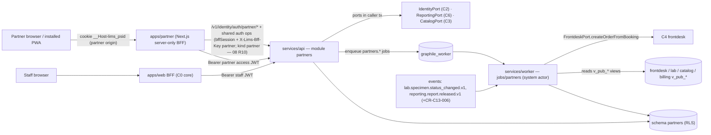

# C13 — B2B Partner Portal — 02 TRD

Status: DECISION draft, 2026-11-06. Reads with `01-PRD.md`. Names match `program/03-INTERFACE-CATALOG.md` (03) and `program/02-CONVENTIONS.md` (02-CV). Anything new is marked **(CR-C13-nnn)** and specified in §15; C13 builds as if accepted, against fakes, until merged.

---

## 1. Owned paths

| Path | Content | Basis |
|---|---|---|
| `apps/partner/**` | partner web app (Next.js App Router, server-only BFF, separate origin `partner`) incl. its auth pages, PWA manifest, service worker, help, `tests/e2e` | 01 §3 |
| `services/api/src/modules/partners/**` | API module `partners` (= Postgres schema `partners`, = `contracts/openapi/partners.yaml`) | 01 §3 module table |
| `services/worker/src/jobs/partners/**` | worker tasks, event consumers, crontab | 01 §3 module table |
| `apps/web/src/app/(staff)/partners/**`, `apps/web/src/features/partners/**` | staff screens: partners, partner users, manifest inbox, pickups, referrer mapping | 01 §3 module-table rule "web `apps/web/src/{app/(staff),features}/<m>`"; confirmed in CODEOWNERS by **CR-C13-001** |
| `docs/manual/partners/**` | user-manual pages (partner portal + staff screens) | 01 §3 `docs/manual/<module>/` |

C13 never edits `db/`, `contracts/`, `packages/*`, any `core/` folder or another module (01 §4). Its DDL (05-SCHEMA) and API (§5) are specifications C0 transcribes.

## 2. Stack and pinned libraries

| Component | Version | Source |
|---|---|---|
| Node.js | 26.x LTS, exact patch C0-pinned | 02-CV §1.1 |
| TypeScript, Next.js (App Router), Fastify | C0 pins | 02-CV §1.1; 04 S4 |
| `fastify-openapi-glue` | 4.12.0 | 04 T7 |
| Graphile Worker | 0.18.0 | 04 S10, T7 |
| PostgreSQL | 17 via `supabase/postgres:17.6.1.136` | 04 D9 |
| `openapi-typescript` / `openapi-fetch` (BFF → API calls, generated client) | 7.13.0 / 0.17.0 | 04 T7 |
| MSW / Prism (UI tests, mocks) | 3.0.3 / 5.16.0 | 04 T7 |
| UI | `@lims/ui` only (C0) | 02-CV §14 |
| B.S. dates | `@lims/shared-ts/bsdate` (wraps `@remotemerge/nepali-date-converter` 1.2.7) | 04 D13 |
| UUIDv7, CSPRNG, logger, errors, money | `@lims/shared-ts` | 02-CV §1.3, §4.9, §4.10 |
| Session token hashing (partner BFF) | `node:crypto` (SHA-256, timing-safe compare) | built-in |
| Service worker | hand-written (~80 lines), no library (Workbox etc. not pinned in 04 → not used) | DECISION |
| QR rendering for the access slip | `RenderPort.renderPdf` with template key `partners.access_slip` (08 A5.1; C6 owns the template and draws the QR from the `portalUrl` field inside its render pipeline, as it does for report QR codes). C13 adds **no** QR or PDF library. The browser `@lims/ui` `QrCode` (**CR-C13-013**) is not used for slips | 08 A5.1 |
| Browser automation for E2E | C0 pins (02-CV §11.1) | — |

**Dependencies table (02-CV §15.1):** C13 adds **no** third-party runtime dependency. Any addition adds a row here (name, exact version, licence, purpose, last release date, alternatives).

## 3. Internal architecture

### 3.1 Deployables and data flow



### 3.2 The isolation design (why requests read only `partners.*`)

1. **Partner actors cannot read other modules' tables.** C4/C5/C6 tables are centre-scoped (`__tenant_centre`, 02-CV §5.8). A partner membership has `all_centres = false` and no `membership_centres`, so `app.has_all_centres()` is false and `app.current_centre_ids()` is `{}`: every centre-scoped row is invisible to a partner actor (fail-closed). `security_invoker` views (`v_pub_*`) inherit that. This is the desired default and C13 does **not** ask other modules to open their tables to partner actors — with one exception (CR-C13-005, report file download, where C6 itself needs partner policies, as C6 02-TRD §7.1 anticipates).
2. **Therefore every partner-facing HTTP handler reads and writes only `partners.*` tables**, whose RLS uses the partner predicate (§3.3). Cross-module data the partner sees (order status, specimen timeline, report list, price list, statement) is **projected** into `partners.*` read-model tables by the C13 worker running as the module's **system actor** (`app.has_all_centres()` = true for `system`, 02-CV §5.8). This is the "C13/C16 read models" pattern of 01 §5 and 03 §6.
3. **Cross-module writes** (creating orders) run in the worker as the system actor through `FrontdeskPort.createOrderFromBooking` (03 X5: "C13 partner manifests … call the port (sync, `source` enum)"). The port call is synchronous inside the conversion job's transaction; the job is enqueued by the partner's submit (mode `on_submit`) or by the staff receipt (mode `on_receipt`).
4. **Ports called in partner requests** are only those the owners support for partner actors (non-staff actor rule, 02-CV §8.5 item 1 as rewritten by 08 A19 D-119 / 08 R8): `IdentityPort` (`getActor`, `assertRole`, `getTenantSettings` with `keys` ⊆ {`timezone`, `calendarDisplay`} only — C2 refuses other keys for partner actors with `auth.forbidden` (D-119); `provisionPartnerMembership`/`updatePartnerMembership` for a partner admin of the same partner — 08 §4.14, CR-C13-003) and the reporting reads `ReportingPort.getReleasedReports` / `openReleasedReportFile` (partner policies via CR-C13-005). Partner actors never call `SmartReportPort` (08 A2.3: the R8 allowlist entry "SmartReportPort reads" is removed for non-staff actors; `smartreport.*` has no non-staff RLS). If C13 ever shows a smart summary to partners, it comes only from the approved snapshot C6 stores on the report version, read through `ReportingPort`; C13 v1 displays none. Every other cross-module call runs in the C13 worker as the `partners` system actor after C13 has checked the partner's ownership in `partners.*`. **Access slips (08 A2.1, resolved):** R4 `issuePatientAccessSlip` only records a slip request in `partners.access_slips`; the task `partners.issue_access_slip` (§8.1) calls `ReportingPort.issuePortalLink` as the partners system actor (R8 allowlist unchanged). `access_slip_enabled` may be turned on once this is implemented.

### 3.3 Scoping predicate (normative)

Let `T = app.current_tenant_id()`, `K = app.current_actor_type()`, `P = app.current_partner_id()` (CR-C13-004).

- `app.current_partner_id()` returns the `partner_id` of the **active** `partners.partner_users` row whose `membership_id` equals the claims' `membership_id`, provided the partner's `status = 'active'` and `K = 'partner'`; otherwise `NULL`. NULL makes every partner predicate false (fail-closed).
- **Partner predicate:** row visible/writable iff `tenant_id = T AND K = 'partner' AND partner_id = P`.
- **Staff predicate (tenant-wide tables):** `tenant_id = T AND K IN ('user','system')`.
- **Staff predicate (receiving-centre tables — manifests, manifest lines, pickups):** `tenant_id = T AND K IN ('user','system') AND (app.has_all_centres() OR receiving_centre_id = ANY ((SELECT app.current_centre_ids())::uuid[]))` (cast per 08 A16.1).
- **"A partner sees an order"** iff there exists `partners.manifest_lines L` with `L.order_id = order_id`, `L.partner_id = P`, `L.tenant_id = T`. Every partner read model (`order_tracking`, `tracked_specimens`, `order_reports`) carries `partner_id` copied from the line at projection time, so the partner predicate applies row by row without joins.
- C6-side (CR-C13-005): `reporting.reports.partner_id = P` — the same id, because C4 stamps `orders.partner_id` from our `partnerId` input (CR-C4-006) and C6 snapshots it.

Application queries additionally filter `tenant_id = ctx.tenantId` and (partner handlers) `partner_id = ctx.partner.partnerId` explicitly (REQ-SEC-024).

### 3.4 API module skeleton (`services/api/src/modules/partners/`)

```
index.ts                         # ModuleManifest: name 'partners', openapi 'contracts/openapi/partners.yaml',
                                 # handlers, ports: {} (C13 owns no port), produces: [] (C13 produces no events),
                                 # systemPermissions (§9.3)
permissions.ts                   # codes checked (03 §11 + CR-C13-002)
config.ts                        # LIMS_PARTNERS_* (§11)
handlers/index.ts + one file per operationId (§5)
service/
  partner-context.service.ts     # resolves ctx.partner {partnerId, partnerUserId, role} for partner actors; 403 partners.partner_inactive
  partner.service.ts             # staff: create/update/suspend/reactivate partners; resync
  partner-user.service.ts        # invite (IdentityPort.provisionPartnerMembership), deactivate/reactivate/role (updatePartnerMembership)
  manifest.service.ts            # draft/lines/submit/withdraw/discard/print; numbering; staff receive; retry conversion
  conversion.service.ts          # buildBookingOrderInput(line) + apply port result/failure (shared by worker task)
  pickup.service.ts
  referrer.service.ts            # partner list + staff mapping
  tracking.service.ts            # projection writers + tracking-status derivation (shared by consumers/reconcile)
  report.service.ts              # list, mark-seen, download (ReportingPort), access-slip request/status/file (no port call in requests — 08 A2.1)
  access-slip.service.ts         # worker side: issuePortalLink (system actor), RenderPort 'partners.access_slip' once, store in partners-slips bucket
  catalog-projection.service.ts  # price list sync
  statement.service.ts           # statement sync + read
  dashboard.service.ts
domain/
  manifest.state.ts              # §03-APP-FLOW 2.1 table
  manifest-line.state.ts         # §03-APP-FLOW 2.2
  pickup.state.ts                # §03-APP-FLOW 2.3
  partner.state.ts               # §03-APP-FLOW 2.4
  partner-user.state.ts          # §03-APP-FLOW 2.5
  referrer-mapping.state.ts      # §03-APP-FLOW 2.6
  tracking-status.ts             # pure derivation (03-APP-FLOW §3)
  manifest-number.ts             # MF{yy}{seq:6} formatter
  line-validation.ts             # patient block, consents, orderables, limits
repository/
  partners.repo.ts  partner-users.repo.ts  manifests.repo.ts  manifest-lines.repo.ts  pickups.repo.ts
  referrers.repo.ts  tracking.repo.ts  reports.repo.ts  price-items.repo.ts  statements.repo.ts
  settings.repo.ts  counters.repo.ts
  views.repo.ts                  # ONLY place reading foreign v_pub_* views (system-actor code paths only; lint-allowed v_pub_)
mappers/  partner.dto.ts manifest.dto.ts order.dto.ts report.dto.ts pickup.dto.ts referrer.dto.ts statement.dto.ts
          (separate partner-facing and staff-facing allowlists — REQ-SEC-081)
__tests__/{unit,integration,contract,probes}/
```

Layer rules (02-CV §2.2): handlers contain no SQL; `domain/` no IO; repositories never call ports or enqueue. `views.repo.ts` functions take a `SystemCtx` branded context type and throw if `ctx.actor.type !== 'system'` (defence in depth: partner requests must never reach foreign views).

### 3.5 Worker skeleton (`services/worker/src/jobs/partners/`)

```
index.ts            # WorkerManifest { module: 'partners', tasks, subscriptions, crontab }
tasks/
  partners.convert_manifest_line.ts
  partners.sync_price_list.ts
  partners.sync_statements.ts
  partners.reconcile_orders.ts
  partners.expire_drafts.ts
  partners.redact_expired_lines.ts
  partners.enrich_report.ts
  partners.issue_access_slip.ts           # 08 A2.1
  partners.purge_access_slips.ts          # 08 A2.1; 02:50 accepted in 08 A5.3
consumers/
  lab.specimen.status_changed.v1.ts
  reporting.report.released.v1.ts
  frontdesk.order.cancelled.v1.ts        # CR-C13-006
  catalog.changed.v1.ts                  # CR-C13-006
cron.ts
__tests__/{unit,integration}/
```

### 3.6 Partner web app (`apps/partner/`)

```
apps/partner/
├── package.json                     # @lims/partner
├── next.config.ts                   # output standalone; headers (CSP nonce, REQ-SEC-089/090); no images from remote hosts
├── public/manifest.webmanifest      # PWA manifest (name "Partner portal", icons bundled, display standalone, start_url /)
├── public/sw.js                     # static-only service worker (§3.7)
├── src/core/
│   ├── session.ts                   # __Host-lims_psid cookie; server-side only (server-only import guard)
│   ├── api.ts                       # openapi-fetch client; Authorization from resolveSession; X-Request-Id, traceparent
│   ├── auth-guard.ts                # every (app) route: resolve session → redirect /auth/login | /auth/mfa | /auth/mfa/enrol
│   ├── csrf.ts                      # Origin + Sec-Fetch-Site check on every state-changing request (REQ-SEC-091)
│   ├── shell/                       # PartnerShell composed from @lims/ui PageShell, PageHeader, Tabs (mobile bottom nav via Tabs)
│   └── help/                        # HelpPanel content loader
├── src/app/(auth)/auth/{login,mfa,mfa/enrol,forgot,confirm,set-password,session-expired,logout}/page.tsx
├── src/app/(app)/                   # authenticated pages (04-UI-UX §3)
│   ├── page.tsx                     # dashboard
│   ├── manifests/ … orders/ … reports/ … pickups/ … price-list/ … statements/ … referrers/ … users/ … account/
│   └── (each segment: page.tsx, loading.tsx, error.tsx)
├── src/app/api/bff/…/route.ts       # BFF route handlers (POST/GET) proxying to /v1/partners/*; file download stream
├── src/app/offline/page.tsx         # static offline page (cached by sw)
├── src/features/<feature>/{components,server,forms,help}/
└── tests/e2e/
```

### 3.7 PWA rules (DECISION)

- `sw.js` caches **only** build-hashed static assets (`/_next/static/**`, fonts, icons) and `/offline`. It never caches HTML documents, `/api/bff/**` responses or any response without a hashed URL. Navigation requests go to the network; on failure, `/offline` is served.
- All authenticated HTML and every BFF response carry `Cache-Control: no-store`, `Pragma: no-cache` (REQ-SEC-098 spirit; PHI on shared devices).
- CSP adds `worker-src 'self'`, `manifest-src 'self'`. No push subscription, no background sync.
- Logout calls `caches.keys()` → delete all except the static cache version, and clears `sessionStorage`; the app stores nothing in `localStorage` except a UI preference `lims.partner.density` (non-PHI).

## 4. Authentication and session (partner users)

DECISION, consistent with C2 02-TRD §4/§6 (GoTrue users + server-side sessions + server-side claims resolution):

1. Partner users are **GoTrue users** with a `core.users` row in the tenant and a `core.memberships` row with `actor_type = 'partner'` (C0 05-SCHEMA: CHECK allows `partner`; C2 05-SCHEMA §2). C13 never touches `core.*` or GoTrue: memberships are created and changed by C2 through `IdentityPort.provisionPartnerMembership` / `updatePartnerMembership` (CR-C13-003), called **inside the C13 transaction** that writes `partners.partner_users` (ports run in the caller's tx — 02-CV §8.1), so the two stay consistent.
2. Sessions are C2's `identity.sessions` with a new `kind = 'partner'` (CR-C13-003). The partner BFF holds only the opaque session token in cookie `__Host-lims_psid` (`HttpOnly; Secure; SameSite=Lax; Path=/`; Max-Age = absolute timeout) [CONV name, mirrors C2 `__Host-lims_sid`]. Sign-in uses C2's `loginPartner` (`POST /v1/identity/auth/partner/login`, endpoint family `/v1/identity/auth/partner/*`); MFA challenge/enrolment, resolve, logout, recovery, invitation confirm and set-password use C2's `/v1/identity/auth/*` operations; the partner BFF authenticates every call with its own `X-Lims-Bff-Key` (partner), which binds the session kind `partner` (08 R10). The key is the file-mounted secret `LIMS_PARTNER_BFF_KEY_FILE` (08 A19 P-45; §10.1, 07-SECURITY §7). The partner BFF never calls GoTrue.
3. **Kind binding:** a session of kind `partner` resolves only for requests from the partner BFF, identified by its `X-Lims-Bff-Key` (08 R10), and `tenant_staff` sessions only from the staff BFF (key `staff_web`); a session presented through the other BFF → `401 auth.session_expired`. A staff credential on the partner login and vice versa → generic `401 auth.login_failed` (US-03.2/3).
4. **Claims** (built by C2's resolver for partner sessions): `{ "sub", "tenant_id", "membership_id", "actor_type": "partner", "aal", "lims_session_id", "session_state" }` — exactly the `DbClaims` shape (C0 02-TRD §6.4). **No `partner_id` claim**: the partner id is derived in SQL by `app.current_partner_id()` from `membership_id` (CR-C13-004), so a stale or forged claim cannot widen scope and partner suspension takes effect on the next statement.
5. **Permissions:** `IdentityPort.getActor` for actor type `partner` returns the fixed partner permission set for the membership's partner role (CR-C13-002/003): `partner_member` or `partner_admin`. Privileged partner permissions (`partners.partner_user.manage`) require `aal2` and fresh membership re-validation (03 §11 rule).
6. **MFA:** role `partner_admin` has `mfa_required: true` → C2 session state `mfa_enrolment_required` / `mfa_pending` until TOTP is verified (C2 03-APP-FLOW §3.2/3.4). Members are offered TOTP (Account page). The Account page (04-UI-UX PX-1) uses C2's self-service operations (`listOwnSessions`, `revokeOwnSession`, `listOwnMfaFactors`, `removeOwnMfaFactor`), which require `identity.self.manage`; 08 A19 D-101 adds that code to `fixed_actor_permissions.partner.partner_member` (inherited by `partner_admin`) and C2 accepts session kind `partner` on them.
7. **Timeouts:** tenant `idleTimeoutMinutes` (15–30) and `absoluteSessionHours` (≤12) apply to partner sessions as to staff (04 A8; DECISION — partner PCs at clinics are shared reception PCs like the lab's).
8. **Partner context per request:** every partner handler first calls `partnerContext.require(ctx)`: `SELECT pu.id, pu.partner_id, pu.partner_role, pu.status, p.status FROM partners.partner_users pu JOIN partners.partners p … WHERE pu.tenant_id = $1 AND pu.membership_id = $2` (under RLS — the row is visible only when `app.current_partner_id()` is non-NULL). No row → `403 partners.partner_inactive` (covers suspended partner and deactivated partner user). `pu.status = 'invited'` → same transaction sets `active`, `activated_at = now()` (first sign-in; the only `partner_users` write a non-admin partner session may make — trigger `partners.guard_partner_users`, 05-SCHEMA §8, 08 A19 D-103). Result attached as `ctx.partner` for the request (immutable).

## 5. Endpoints (`contracts/openapi/partners.yaml`, prefix `/v1/partners`)

Rules for every row (02-CV §4): JSON snake_case; `additionalProperties: false`; no `null` on the wire; cursor pagination (`limit` default 50, max 200); `If-Match` on every update/action of a versioned resource (`409 common.version_conflict`, `428 common.precondition_required`); problem+json. Security: all operations `bearerJwt`. Column **Actor**: `partner` = only actor type `partner` passes (handler checks `ctx.actor.type === 'partner'` before `assertRole`; other types → `403 auth.forbidden`); `staff` = only actor type `user` passes. Every operation may also return `400 common.validation_failed`, `401 auth.unauthenticated|auth.token_invalid|auth.token_expired|auth.session_expired`, `403 auth.forbidden`, `404 common.not_found` (object operations), `429 common.rate_limited`, `500 common.internal` — not repeated. Partner operations may also return `403 partners.partner_inactive`. **Idem**: `x-idempotency`. **Tier**: `x-rate-limit-tier` (02-CV §10.3); `general` unless stated.

### 5.1 Shared DTOs (partner-facing allowlists)

| DTO | Fields |
|---|---|
| `PartnerContext` | `partner {id, partner_code, name}`, `user {partner_user_id, display_name, partner_role (partner_admin|partner_member), mfa_enrolled}`, `tenant {display_name, calendar_display, timezone}`, `permissions[]`, `features {access_slip_enabled, conversion_mode (on_receipt|on_submit), include_default_price_list}` |
| `ManifestSummary` | `id, manifest_no, state, line_count, lines_converted, lines_failed, receiving_centre {id, name}, submitted_at?, received_at?, pickup_request_id?, created_at, version` |
| `Manifest` | `ManifestSummary` + `notes?`, `collected_on?` (A.D. date), `withdraw_reason_code?`, `lines: ManifestLine[]` |
| `ManifestLine` | `id, line_no, state, partner_sample_ref?, patient {full_name, sex, birth_on?, age_years?, phone_e164?}, consents {sms, whatsapp, email, share_with_referrer, consent_text_version}, orderables [{orderable_id, kind, code, name}], priority, referrer {id, display_name}?, collected_at?, clinical_note?, order {order_id, registration_no}?, failure {code, message_key}?, not_received_reason_code?, version` |
| `PartnerOrder` | `order_id, registration_no, manifest {id, manifest_no}, line_id, partner_sample_ref?, patient {full_name, sex, age_years?}, priority, tracking_status, referrer {display_name}?, registered_at, last_event_at, report_count, has_new_report` |
| `PartnerOrderDetail` | `PartnerOrder` + `orderables[{code,name}]`, `specimens [{specimen_id, specimen_type_code, specimen_type_display, status, collected_at?, in_transit_at?, received_at?, rejected_at?, rejection_reason_code?, rejection_reason_display?, replaces_specimen_id?}]`, `reports [PartnerReport]`, `timeline [{at, label_key, specimen_type_display?}]` |
| `PartnerReport` | `report_id, version_no, order_id, registration_no, patient {full_name}, kind (final|partial|preliminary|amended|addendum — enum `x-extensible`, 08 R1/R13), status (valid|superseded), released_at, panel_names[], is_new` |
| `PickupRequest` | `id, state, window_start, window_end, packages_count, notes?, contact_name?, contact_phone_e164?, manifests [{id, manifest_no}], scheduled_start?, scheduled_end?, assignee_text?, picked_up_at?, reject_reason_code?, cancel_reason_code?, created_at, version` |
| `PriceListItem` | `orderable_id, kind (test|panel), code, name, department_name?, unit_price {amount_paisa, currency}, source (partner|standard), price_list_version, effective_from, effective_to?` |
| `StatementMonth` | `period_month (YYYY-MM), fiscal_year_bs, invoiced, paid, credited, closing_balance (Money each), synced_at` |
| `PartnerReferrer` | `id, display_name, qualification?, registration_council?, registration_no?, is_active, mapping_state (unmapped|mapped|rejected), samples_this_month, version` |
| `PartnerUser` | `id, display_name, email_masked, partner_role, status (invited|active|deactivated), mfa_enrolled, last_login_at?, version` |

Field limits (spec `maxLength` etc.): `full_name` 1–120 (NFC), `partner_sample_ref` 1–40 `^[A-Za-z0-9_./-]+$`, `phone_e164` `^\+[1-9][0-9]{7,14}$` (A13 P-11; same as C4 `frontdesk.patients__phone__ck`), `notes` ≤500, `clinical_note` ≤300, `display_name` 1–120, `qualification` ≤120, `registration_council` ≤20, `registration_no` ≤30, `assignee_text` ≤80, `contact_name` ≤80, reason codes via `x-coded-set`. `age_years` 0–130; exactly one of `birth_on` / `age_years`. `orderables` 1–30 per line [CONV]. `birth_on` ≥ 1900-01-01 and ≤ today.

### 5.2 Partner-facing operations

| # | operationId | Method + path | Actor / permission | Request | Response | Errors (beyond common) | Idem | Tier |
|---|---|---|---|---|---|---|---|---|
| A1 | `getPartnerContext` | GET `/me` | partner / `partners.order.read` | — | `200 PartnerContext` | — | none | general |
| A2 | `getPartnerDashboard` | GET `/dashboard` | partner / `partners.order.read` | — | `200 {submitted_today, in_lab, reported_today, rejected_open, new_reports, open_pickups, outstanding?: Money, outstanding_as_of?}` | — | none | general |
| M1 | `createManifest` | POST `/manifests` | partner / `partners.manifest.submit` | `{notes?, collected_on?}` | `201 Manifest` | — | required | general |
| M2 | `listManifests` | GET `/manifests` | partner / `partners.order.read` | `state` (csv), `created_at_from/_to`, `sort` ∈ {`-created_at`, `-submitted_at`}, `cursor`, `limit` | `200 {data: ManifestSummary[], page}` | — | none | general |
| M3 | `getManifest` | GET `/manifests/{manifest_id}` | partner / `partners.order.read` | — | `200 Manifest` | — | none | general |
| M4 | `updateManifest` | PATCH `/manifests/{manifest_id}` | partner / `partners.manifest.submit` | `If-Match`; `{notes?, collected_on?, unset?[]}` | `200 Manifest` | `409 partners.manifest_not_editable` | none | general |
| M5 | `addManifestLine` | POST `/manifests/{manifest_id}/lines` | partner / `partners.manifest.submit` | `If-Match` (manifest version); `ManifestLineInput {partner_sample_ref?, patient {full_name, sex (male|female|other|unknown), birth_on? , age_years?, phone_e164?}, consents {sms, whatsapp, email, share_with_referrer}, orderable_ids[1–30], priority (routine|urgent), referrer_id?, collected_at?, clinical_note?}` | `201 ManifestLine` (+ header `ETag` manifest version) | `409 partners.manifest_not_editable`, `422 partners.orderable_not_offered`, `422 partners.manifest_invalid` (line limit; duplicate `partner_sample_ref` in manifest), `404 common.not_found` (referrer of another partner) | required | general |
| M6 | `replaceManifestLine` | PUT `/manifests/{manifest_id}/lines/{line_id}` | partner / `partners.manifest.submit` | `If-Match` (line version); `ManifestLineInput` | `200 ManifestLine` | as M5 | none | general |
| M7 | `deleteManifestLine` | DELETE `/manifests/{manifest_id}/lines/{line_id}` | partner / `partners.manifest.submit` | `If-Match` (line version) | `204` | `409 partners.manifest_not_editable` | none | general |
| M8 | `submitManifest` | POST `/manifests/{manifest_id}/submit` | partner / `partners.manifest.submit` | `If-Match`; `{}` | `200 Manifest` | `422 partners.manifest_invalid` (`errors[]`), `409 partners.manifest_invalid_transition` | required | general |
| M9 | `withdrawManifest` | POST `/manifests/{manifest_id}/withdraw` | partner / `partners.manifest.submit` | `If-Match`; `{reason_code (x-coded-set manifest_withdraw_reasons), reason_text? ≤300}` | `200 Manifest` | `409 partners.manifest_invalid_transition` | required | general |
| M10 | `discardManifest` | POST `/manifests/{manifest_id}/discard` | partner / `partners.manifest.submit` | `If-Match` | `200 Manifest` | `409 partners.manifest_invalid_transition` | none | general |
| M11 | `getManifestPrintView` | GET `/manifests/{manifest_id}/print-view` | partner / `partners.order.read` | — | `200 {manifest: Manifest, partner {name, partner_code}, receiving_centre {name, code}, printed_at}`; access log `manifest.print` | `409 partners.manifest_invalid_transition` (draft/discarded) | none | general |
| O1 | `listPartnerOrders` | GET `/orders` | partner / `partners.order.read` | `tracking_status` (csv), `manifest_id`, `referrer_id`, `registered_at_from/_to`, `has_new_report` (bool), `sort` ∈ {`-registered_at`, `-last_event_at`}, `cursor`, `limit` | `200 {data: PartnerOrder[], page}` | — | none | general |
| O2 | `searchPartnerOrders` | POST `/orders/search` | partner / `partners.order.read` | `{q (2–64; matches patient name prefix/trigram, partner_sample_ref exact, registration_no exact), limit? ≤50}` | `200 {data: PartnerOrder[]}` | — | none | general |
| O3 | `getPartnerOrder` | GET `/orders/{order_id}` | partner / `partners.order.read` | — | `200 PartnerOrderDetail` | — | none | general |
| R1 | `listPartnerReports` | GET `/reports` | partner / `partners.report.read` | `released_at_from/_to`, `is_new` (bool), `include_superseded` (bool, default false), `sort` ∈ {`-released_at`}, `cursor`, `limit` | `200 {data: PartnerReport[], page}` | — | none | general |
| R2 | `markPartnerReportsSeen` | POST `/reports/mark-seen` | partner / `partners.report.read` | `{report_versions: [{report_id, version_no}] 1–200}` | `200 {updated}` (unknown/foreign ids silently skipped — counted, never revealed) | — | optional | general |
| R3 | `downloadPartnerReport` | GET `/reports/{report_id}/versions/{version_no}/file` | partner / `partners.report.read` | — | `200 application/pdf` (`Content-Disposition: attachment; filename="report-<registration_no>-v<n>.pdf"`, `X-Content-Type-Options: nosniff`, `Cache-Control: no-store`, `Digest`-style header `X-Lims-Sha256`); access log `report.download` | `404 common.not_found` (+ access log `denied`, committed with `ctx.commitOnError()`, A19 P-42); a port `common.not_found` from `openReleasedReportFile` (its only business error, 03 §4.7 — unknown, unreleased and foreign are indistinguishable) → the same 404 + denied access log | none | `report_download` |
| R4 | `issuePatientAccessSlip` | POST `/reports/{report_id}/access-slips` | partner / `partners.report.read` | `{}` | `202 AccessSlip` = `{id, report_id, version_no, state: 'requested', created_at}` — records a slip request in `partners.access_slips` and enqueues `partners.issue_access_slip`; **never contains the link token or URL** (08 A2.1) | `403 common.feature_disabled`, `404 common.not_found` (no `valid` version of the report in `partners.order_reports` for this partner) | required (02-CV §4.5: creates a record; the response holds no secret) | general |

R4 note (08 A19 D-105): R4 is allowed even when the manifest line has no `patient_phone_e164`. The portal OTP goes to the patient's phone on file in C4, resolved by the C6 worker (08 A13 D-31); if C4 has none, redemption fails through D-31's `no_contact` path. PR-2 shows a warning for such lines (04-UI-UX). No extra data flow.
| R5 | `getPatientAccessSlip` | GET `/reports/{report_id}/access-slips/{access_slip_id}` | partner / `partners.report.read` | — | `200 AccessSlip` = `{id, report_id, version_no, state ∈ requested\|issued\|failed\|expired, link_expires_at?, failure_code?, issued_at?}` — polled by the UI (08 A2.1); never the token or URL | `404 common.not_found` | none | general |
| R6 | `downloadPatientAccessSlip` | GET `/reports/{report_id}/access-slips/{access_slip_id}/file` | partner / `partners.report.read` | — | `200 application/pdf` (`Content-Disposition: attachment; filename="access-slip-<access_slip_id>.pdf"`, `Cache-Control: no-store`, `X-Content-Type-Options: nosniff`); bytes read server-side from the `partners-slips` bucket (partner claims never touch Storage); access log `report.access_slip` on every download (accepted, 08 A5.3) | `404 common.not_found` (unknown/other partner, or state ≠ `issued` — no file exists; accepted, 08 A5.3) | none | general |
| K1 | `createPickupRequest` | POST `/pickup-requests` | partner / `partners.pickup.request` | `{manifest_ids[1–20], window_start, window_end, packages_count 1–50, notes?, contact_name?, contact_phone_e164?}` | `201 PickupRequest` | `422 partners.pickup_invalid` (window rules; manifest not `submitted`; manifest already on an open pickup) | required | general |
| K2 | `listPickupRequests` | GET `/pickup-requests` | partner / `partners.order.read` | `state` (csv), `sort` ∈ {`-created_at`, `window_start`}, cursor | `200 {data, page}` | — | none | general |
| K3 | `getPickupRequest` | GET `/pickup-requests/{pickup_request_id}` | partner / `partners.order.read` | — | `200 PickupRequest` | — | none | general |
| K4 | `cancelPickupRequest` | POST `/pickup-requests/{pickup_request_id}/cancel` | partner / `partners.pickup.request` | `If-Match`; `{reason_code (pickup_cancel_reasons)}` | `200 PickupRequest` | `409 partners.pickup_invalid_transition` | required | general |
| P1 | `listPartnerPriceList` | GET `/price-list` | partner / `partners.price_list.read` | `kind` (test|panel), `source` (partner|standard), `q` (≤64, code/name prefix — non-PHI), `sort` ∈ {`code`, `name`}, cursor | `200 {data: PriceListItem[], page, price_list_version, synced_at}` | — | none | general |
| P2 | `searchPartnerOrderables` | GET `/orderables` | partner / `partners.manifest.submit` | `q` (1–64), `limit` ≤20 | `200 {data: PriceListItem[]}` (same projection; used by the manifest line form) | — | none | general |
| S1 | `listPartnerStatements` | GET `/statements` | partner / `partners.statement.read` | `period_month_from/_to` (YYYY-MM), cursor | `200 {data: StatementMonth[], page, outstanding?: Money, outstanding_as_of?}`; access log `statement.view` | — | none | general |
| S2 | `getPartnerStatement` | GET `/statements/{period_month}` (`^[0-9]{4}-(0[1-9]|1[0-2])$`) | partner / `partners.statement.read` | — | `200 {period_month, rows: StatementMonth[] (one per fiscal_year_bs), synced_at}` | — | none | general |
| F1 | `listPartnerReferrers` | GET `/referrers` | partner / `partners.referrer.read` | `is_active`, `q` (≤64), cursor | `200 {data: PartnerReferrer[], page}` | — | none | general |
| F2 | `createPartnerReferrer` | POST `/referrers` | partner / `partners.referrer.manage` | `{display_name, qualification?, registration_council?, registration_no?}` | `201 PartnerReferrer` | `409 partners.referrer_duplicate` (same normalised name + registration no in partner) | required | general |
| F3 | `updatePartnerReferrer` | PATCH `/referrers/{referrer_id}` | partner / `partners.referrer.manage` | `If-Match`; mutable fields + `unset[]` | `200` | `409 partners.referrer_duplicate` | none | general |
| F4 | `deactivatePartnerReferrer` | POST `/referrers/{referrer_id}/deactivate` | partner / `partners.referrer.manage` | `If-Match` | `200` | — | none | general |
| F5 | `reactivatePartnerReferrer` | POST `/referrers/{referrer_id}/reactivate` | partner / `partners.referrer.manage` | `If-Match` | `200` | — | none | general |
| U1 | `listPartnerUsers` | GET `/users` | partner / `partners.partner_user.manage` (privileged) | `status`, cursor | `200 {data: PartnerUser[], page}` | `403 auth.mfa_required` | none | general |
| U2 | `invitePartnerUser` | POST `/users` | partner / `partners.partner_user.manage` | `{email ≤254, display_name, partner_role}` | `201 PartnerUser` | `409 identity.user_exists`, `403 auth.mfa_required` | required | general |
| U3 | `changePartnerUserRole` | POST `/users/{partner_user_id}/role` | partner / `partners.partner_user.manage` | `If-Match` (= `partners.partner_users.version`, 08 A19 D-100); `{partner_role}` | `200` | `409 partners.last_partner_admin`, `409 partners.self_action_forbidden` | none | general |
| U4 | `deactivatePartnerUser` | POST `/users/{partner_user_id}/deactivate` | partner / `partners.partner_user.manage` | `If-Match` (= `partner_users.version`, D-100); `{reason_code (partner_user_deactivate_reasons)}` | `200` | `409 partners.last_partner_admin`, `409 partners.self_action_forbidden` | none | general |
| U5 | `reactivatePartnerUser` | POST `/users/{partner_user_id}/reactivate` | partner / `partners.partner_user.manage` | `If-Match` (= `partner_users.version`, D-100) | `200` | — | none | general |

U3–U5 / SA10 concurrency (08 A19 D-100): the handler checks `If-Match` against `partners.partner_users.version`, locks that row `SELECT … FOR UPDATE`, calls `IdentityPort.updatePartnerMembership` **without** `expectedVersion` (C2 then applies the action to the current membership row under `SELECT … FOR UPDATE`), and stores the returned `status` on the `partner_users` row in the same transaction. C13 keeps no copy of the `core.memberships` version.
| U6 | `resendPartnerInvitation` | POST `/users/{partner_user_id}/resend-invitation` | partner / `partners.partner_user.manage` | — | `202 {}` | `409 partners.partner_user_invalid_transition` (not `invited`) | required | general |

### 5.3 Staff-facing operations (`/v1/partners/admin/...`)

| # | operationId | Method + path | Permission (staff) | Request | Response | Errors | Idem |
|---|---|---|---|---|---|---|---|
| SA1 | `listPartners` | GET `/admin/partners` | `partners.partner.read` | `status`, `q` (≤64 code/name), cursor, `sort` ∈ {`partner_code`, `-created_at`} | `200 {data: PartnerAdminSummary[], page}` (`id, partner_code, name, status, credit_party {id, party_code, name}, receiving_centre {id, code, name}, active_users, open_manifests`) | — | none |
| SA2 | `createPartner` | POST `/admin/partners` | `partners.partner.manage` (privileged) | `{partner_code ^[A-Z0-9_-]{1,20}$, name 1–160, credit_party_id, receiving_branch_id, receiving_centre_id, conversion_mode? (default from settings), contact_email?, contact_phone_e164?, address_text? ≤300}` | `201 PartnerAdmin` | `409 partners.code_duplicate`, `409 partners.credit_party_in_use`, `422 partners.credit_party_inactive`, `409 identity.centre_inactive` | required |
| SA3 | `getPartner` | GET `/admin/partners/{partner_id}` | `partners.partner.read` | — | `200 PartnerAdmin` (+ `version`, `projection_status {price_list_synced_at, statements_synced_at}`) | — | none |
| SA4 | `updatePartner` | PATCH `/admin/partners/{partner_id}` | `partners.partner.manage` | `If-Match`; mutable: `name, receiving_branch_id, receiving_centre_id, conversion_mode, contact_*, address_text, unset[]` (credit party not changeable — DECISION: create a new partner instead, statements are per credit party) | `200` | as SA2 | none |
| SA5 | `suspendPartner` | POST `/admin/partners/{partner_id}/suspend` | `partners.partner.manage` | `If-Match`; `{reason_code (partner_suspend_reasons), reason_text? ≤300}` | `200` | `409 partners.partner_invalid_transition` | none |
| SA6 | `reactivatePartner` | POST `/admin/partners/{partner_id}/reactivate` | `partners.partner.manage` | `If-Match` | `200` | `409 partners.partner_invalid_transition`, `422 partners.credit_party_inactive` | none |
| SA7 | `resyncPartnerProjections` | POST `/admin/partners/{partner_id}/resync` | `partners.partner.manage` | `{scopes: [price_list|statements|tracking] 1–3}` — `price_list` → `partners.sync_price_list` (`job_key pricelist:<partner_id>`); `statements` → `partners.sync_statements` (`statements:<partner_id>`); `tracking` → `partners.reconcile_orders` for this partner's non-terminal orders (`job_key reconcile:partner:<partner_id>`, review m#23) | `202 {}` (jobs enqueued, `job_key` dedupe) | — | optional |
| SA8 | `listPartnerUsersForPartner` | GET `/admin/partners/{partner_id}/users` | `partners.partner.read` | `status`, cursor | `200 {data: PartnerUser[], page}` | — | none |
| SA9 | `invitePartnerUserByStaff` | POST `/admin/partners/{partner_id}/users` | `partners.partner.manage` | `{email, display_name, partner_role}` | `201 PartnerUser` | `409 identity.user_exists` | required |
| SA10 | `changePartnerUserRoleByStaff` / `deactivatePartnerUserByStaff` / `reactivatePartnerUserByStaff` | POST `/admin/partner-users/{partner_user_id}/role` · `/deactivate` · `/reactivate` | `partners.partner.manage` | as U3–U5 | `200` | `409 partners.last_partner_admin` (role/deactivate; staff may override only by first promoting another admin) | none |
| SI1 | `listInboundManifests` | GET `/admin/manifests` | `partners.manifest.receive` | `state` (csv; default `submitted,partially_received`), `partner_id`, `receiving_centre_id`, `submitted_at_from/_to`, `has_failed_lines` (bool), `has_missing_samples` (bool — on_submit lines with an order but `sample_missing`; index `manifest_lines__tenant_id_receiving_centre_id__missing__p_idx`, 08 A19 D-104), `sort` ∈ {`-submitted_at`, `manifest_no`}, cursor | `200 {data: InboundManifestSummary[], page}` (`ManifestSummary` + `partner {id, partner_code, name}`) | — | none |
| SI2 | `getInboundManifest` | GET `/admin/manifests/{manifest_id}` | `partners.manifest.receive` | — | `200 InboundManifest` (`Manifest` + partner block; patient block identical to partner view — staff needs it to match tubes); access log `patient.view` with `entityType: 'manifest'` | — | none |
| SI3 | `receiveManifest` | POST `/admin/manifests/{manifest_id}/receive` | `partners.manifest.receive` | `If-Match`; `{lines: [{line_id, outcome: received|not_received, reason_code? (required iff not_received; x-coded-set line_not_received_reasons)}] 1–200}` (lines omitted stay as they are; a later call may receive the rest) | `200 InboundManifest` | `409 partners.manifest_invalid_transition`, `422 partners.manifest_invalid` (per-line `errors[]`: line id not in the manifest, or line not *pending receipt* — 03-APP-FLOW §2.1, 08 A19 D-104) | required |
| SI4 | `retryManifestLineConversion` | POST `/admin/manifest-lines/{line_id}/retry` | `partners.manifest.receive` | `If-Match` (line version); `{patient_id?}` (existing C4 patient chosen by staff; validated by C4 at conversion) | `202 ManifestLine` (state `converting`) | `409 partners.manifest_line_invalid_transition` (only `conversion_failed` or `received`-blocked lines) | required |
| SI5 | `markManifestLineNotReceived` | POST `/admin/manifest-lines/{line_id}/not-received` | `partners.manifest.receive` | `If-Match`; `{reason_code}` | `200` | `409 partners.manifest_line_invalid_transition` | none |
| SP1 | `listInboundPickups` | GET `/admin/pickup-requests` | `partners.pickup.manage` | `state` (csv; default `requested,scheduled`), `partner_id`, `receiving_centre_id`, `window_start_from/_to`, `sort` ∈ {`window_start`, `-created_at`}, cursor | `200 {data: PickupRequestAdmin[], page}` (+ partner block, partner address/contact) | — | none |
| SP2 | `schedulePickup` | POST `/admin/pickup-requests/{pickup_request_id}/schedule` | `partners.pickup.manage` | `If-Match`; `{scheduled_start, scheduled_end, assignee_text}` | `200` | `409 partners.pickup_invalid_transition`, `422 partners.pickup_invalid` | none |
| SP3 | `markPickupCollected` | POST `/admin/pickup-requests/{pickup_request_id}/picked-up` | `partners.pickup.manage` | `If-Match`; `{picked_up_at?}` (default now; ≤ now) | `200` | `409 partners.pickup_invalid_transition` | none |
| SP4 | `rejectPickup` | POST `/admin/pickup-requests/{pickup_request_id}/reject` | `partners.pickup.manage` | `If-Match`; `{reason_code (pickup_reject_reasons)}` | `200` | `409 partners.pickup_invalid_transition` | none |
| SR1 | `listReferrerMappings` | GET `/admin/referrers` | `partners.referrer.map` | `mapping_state` (default `unmapped`), `partner_id`, cursor | `200 {data: [PartnerReferrer + partner {id, name} + catalog_doctor {id, display_name}?], page}` | — | none |
| SR2 | `mapPartnerReferrer` | POST `/admin/referrers/{referrer_id}/map` | `partners.referrer.map` | `If-Match`; `{catalog_doctor_id}` | `200` | `404 common.not_found` (doctor not in tenant, via `CatalogPort.getReferrer`), `422 partners.referrer_doctor_inactive` | none |
| SR3 | `rejectPartnerReferrerMapping` / `unmapPartnerReferrer` | POST `/admin/referrers/{referrer_id}/reject-mapping` · `/unmap` | `partners.referrer.map` | `If-Match`; reject: `{reason_code (referrer_mapping_reject_reasons)}` | `200` | `409 partners.referrer_invalid_transition` | none |
| SS1 | `getPartnerSettings` / `updatePartnerSettings` | GET / PUT `/admin/settings` | read: `partners.partner.read`; update: `partners.partner.manage` | PUT `If-Match`; `PartnerSettings` (§11.2) | `200 PartnerSettings` | `422 partners.setting_out_of_range` | none |

Staff responses use staff allowlists (`mappers/*.dto.ts`): they add partner block and audit fields (`created_by`, `received_by`), never GoTrue emails in clear (only `email_masked`).

Count: 41 partner-facing operationIds (A1–A2, M1–M11, O1–O3, R1–R6, K1–K4, P1–P2, S1–S2, F1–F5, U1–U6) + 27 staff operationIds (SA10 = three ids, SR3 = two, SS1 = two). The OpenAPI file lists each with `x-permission`, `x-idempotency`, `x-rate-limit-tier`, `x-error-codes` and synthetic examples (02-CV §4.12).

### 5.4 BFF routes (partner origin, `apps/partner/src/app/api/bff/**`)

Every route is server-only, checks `Origin` = partner origin and `Sec-Fetch-Site ∈ {same-origin}` on non-GET (REQ-SEC-091), resolves the session (C2 `resolveSession` with `touch: true` for user actions, `false` for background polling — header `X-Lims-Background: 1`), then calls the API operation of the same name. File download route `GET /api/bff/reports/{report_id}/versions/{version_no}/file` streams the API body with the same headers; it never buffers more than 1 MB chunks and never writes to disk.

## 6. Ports

### 6.1 Implemented
None (C13 owns no port — 01 §5.1).

### 6.2 Consumed (signatures verbatim from 03 or the named CR)

```ts
// FrontdeskPort (C4) — 03 §4.3, + CR-C4-006
createOrderFromBooking(ctx: RequestContext, input: BookingOrderInput):   // BookingOrderInput.partnerId (08 §4.14): required iff source = 'partner_manifest'
  Promise<{ orderId: Uuidv7; registrationNo: string; status: 'pre_registered' | 'registered'; replayed: boolean }>;
// @throws frontdesk.booking_already_converted, frontdesk.consent_required, catalog.test_inactive, catalog.no_price,
//         frontdesk.patient_duplicate_suspected (+ common.*)

// ReportingPort (C6) — 03 §4.7
getReleasedReports(ctx, input: { filter: ReportsFilter; cursor?: string; limit?: number }): Promise<Page<ReleasedReportSummary>>;
issuePortalLink(ctx, input: { reportId: Uuidv7; versionNo?: number;
  channel: 'whatsapp' | 'sms' | 'email' | 'print_qr' | 'patient_app'; recipientKind: 'patient' | 'referrer' | 'centre' | 'partner' }):
  Promise<{ linkId: Uuidv7; url: string; expiresAt: IsoUtc }>;
// CR-C13-005 (additive):
openReleasedReportFile(ctx, input: { reportId: Uuidv7; versionNo: number }): Promise<ReleasedReportFile>;

// IdentityPort (C2) — 03 §4.6, + CR-C13-003 (additive)
getActor(ctx): Promise<ActorProfile>;
assertRole(ctx, requirement: { permission: PermissionCode; centreId?: Uuidv7; branchId?: Uuidv7 }): Promise<void>;
getTenantSettings<K extends TenantSettingKey>(ctx, input?: { keys?: readonly K[] }): Promise<Pick<TenantSettings, K>>;
provisionPartnerMembership(ctx, input: ProvisionPartnerMembershipInput): Promise<ProvisionPartnerMembershipResult>;
updatePartnerMembership(ctx, input: UpdatePartnerMembershipInput): Promise<{ membershipId: Uuidv7; status: 'invited' | 'active' | 'deactivated'; version: number }>;
//   08 A19 D-100: input.expectedVersion becomes optional (03 §4.6). C13 never passes it: omitted → C2 applies the action to
//   the current membership row under SELECT … FOR UPDATE; C13 serialises on its own partner_users row (§5.2 U3–U5).

// CatalogPort (C3) — 03 §4.2 + CR-C3-001; C13 as consumer via CR-C13-007
getTest(ctx, { testId, asOf?, requireActive? }): Promise<TestDefinition>;
getPanel(ctx, { panelId, asOf?, requireActive? }): Promise<PanelDefinition>;
getReferrer(ctx, { referrerId, purpose: 'display' }): Promise<ReferrerProfile>;          // CR-C3-001
getCreditParty(ctx, { creditPartyId, purpose: 'display' }): Promise<CreditPartyProfile>; // CR-C3-001
```

Who calls what, under which actor:

| Call | Caller context | Where |
|---|---|---|
| `createOrderFromBooking` | system actor (worker task `partners.convert_manifest_line`); C13 is the order creator for partner-manifest lines (08 R7) | §8.1 |
| `getReleasedReports({filter:{orderId}})` | system actor (task `partners.enrich_report`) | §7.2 |
| `openReleasedReportFile` | partner actor (R3) | 03-APP-FLOW §5.3 |
| `issuePortalLink(channel 'print_qr', recipientKind 'patient')` | **system actor** (worker task `partners.issue_access_slip`; 08 A2.1 — never in a partner request) | §8.1, 03-APP-FLOW §5.5 |
| `RenderPort.renderPdf({templateKey: 'partners.access_slip', …})` | **system actor** (worker task `partners.issue_access_slip`; 08 A5.1 — C13 is a listed RenderPort consumer) | §8.1 |
| `provisionPartnerMembership` / `updatePartnerMembership` | partner admin (U2–U5) or staff (SA9/SA10) | 03-APP-FLOW §6 |
| `getCreditParty` | staff (SA2/SA4 validation; SA1/SA3 display enrichment) | — |
| `getReferrer` | staff (SR2 validation) | — |
| `getTest` / `getPanel` | system actor (price list sync names) | §8.2 |

`BookingOrderInput` built by `conversion.service.buildBookingOrderInput(line, partner, manifest)`:

| Field | Value |
|---|---|
| `source` | `'partner_manifest'` |
| `sourceRefId` | `line.id` |
| `patient` | `line.resolved_patient_id ? { patientId } : { newPatient: { fullName, sex, birthOn?, ageYears?, phoneE164?, consents: { sms, whatsapp, email, shareWithReferrer, consentTextVersion } } }` |
| `branchId`, `centreId` | `manifest.receiving_branch_id`, `manifest.receiving_centre_id` (rule: snapshotted from the partner at create, refreshed at submit — MS3 also rewrites every line's `receiving_centre_id`; 03-APP-FLOW §2.1) |
| `referrerId` | mapped `catalog_doctor_id` of `line.referrer_id`, else omitted |
| `creditPartyId` | `partner.credit_party_id` |
| `partnerId` | `partner.id` (CR-C4-006) |
| `orderableIds` | `line.orderable_ids` |
| `priority` | `line.priority` |
| `scheduledAt` | omitted |
| `confirmImmediately` | `true` (DECISION: the lab has the sample in hand in mode `on_receipt`; in mode `on_submit` the tenant accepted that orders exist before receipt) |
| `idempotencyKey` | `` `partners:${line.id}:v${line.conversion_attempt}` `` (≤ 50 chars; matches the port-key grammar `^[A-Za-z0-9_.:-]{1,200}$`, 08 A19 P-40) |

`collection_mode` is not a port field; C4 sets `partner` for `source = partner_manifest` (confirmed through CR-C13-010).

**Partner-entered fields not sent to C4 (08 A19 D-102).** `BookingOrderInput` (03 §4.3) has no field for the line's `clinical_note` or `collected_at`, or for the manifest's `notes` and `collected_on`, and v1 adds none. These fields stay in `partners.*`; receiving staff see them on SM-2 (SI2 `InboundManifest`), and the partner form labels them "Shown to the receiving lab staff; not part of the lab order or the report" (04-UI-UX PM-2). Sending them to the lab order is CR-C13-015 candidate (06-PLAN §5).

## 7. Events

### 7.1 Produced
None (03 §3.25; envelope `producer` enum has no `partners`). Partner-facing "new" signals are read-model flags.

### 7.2 Consumed (consumer task `evt.partners.<event_type>`; inbox `partners.event_inbox`; at-least-once, unordered — 02-CV §7.4)

| Event | Handler behaviour | Idempotency / ordering |
|---|---|---|
| `lab.specimen.status_changed.v1` | 1. inbox insert (dup → return). 2. `SELECT … FROM partners.order_tracking WHERE tenant_id=$t AND order_id=$payload.order_id` — none → commit (not a partner order). 3. Upsert `partners.tracked_specimens` (`specimen_id`, `specimen_type_code`, `status = to_status`, timestamp column for `to_status` (`collected_at`, `in_transit_at`, `received_at`, `rejected_at`, …) = `changed_at`, `replaces_specimen_id`, `last_seq = aggregate.seq`) **only if** `aggregate.seq > last_seq` (stale → ignore). 4. On `rejected`: store `rejection_reason_code` — the reason is not in this event; the same transaction schedules `partners.reconcile_orders` for this order (job_key `reconcile:<order_id>`) which reads `lab.v_pub_specimen_timeline.rejection_reason_code`. 5. Recompute `order_tracking.tracking_status` (03-APP-FLOW §3) and `last_event_at`. | inbox + per-specimen `last_seq` |
| `reporting.report.released.v1` | 1. inbox. 2. Accept only if `payload.partner_id` is present **and** `'partner' ∈ audiences` **and** `order_tracking` has `order_id` with the same `partner_id` (mismatch → log `partner_id_mismatch` metric, store nothing — defence against wrong attribution). 3. Upsert `partners.order_reports (report_id, version_no)` with `kind` (incl. `addendum`; `report_kind` is `x-extensible` (02-CV §7.2 / 08 R13): an unknown value is stored as received — the column has no closed CHECK, A13 P-4 — and tracking derivation and display treat it as `amended`), `released_at`, `status = valid`, `is_new = true`; if `supersedes_version_no` set → that version `status = superseded`. 4. Enqueue `partners.enrich_report` (job_key `enrich:<report_id>:<version_no>`) which calls `ReportingPort.getReleasedReports(ctx, { filter: { orderId, includeSuperseded: true } })` (`includeSuperseded` is a `ReportsFilter` field, 03 §4.7) as system and stores `panel_names` (P3) for the matching versions. 5. Recompute tracking status. | inbox + unique `(tenant_id, report_id, version_no)` |
| `frontdesk.order.cancelled.v1` (CR-C13-006) | inbox; if `order_tracking` has the order → `tracking_status = cancelled`, line state `cancelled` | inbox; terminal state never reverts |
| `catalog.changed.v1` (CR-C13-006) | inbox; if `entity_type ∈ {price_list, credit_party, test, panel, global_reference}` **or `entity_type` is a value unknown to C13** (`x-extensible`, 03 §3.19: an unknown value invalidates the whole catalog cache) → enqueue `partners.sync_price_list` for every active partner of the tenant with `job_key = pricelist:<partner_id>` and `run_at = now() + 60 s` (debounce: Graphile Worker replaces a pending job with the same key); other known values → inbox only | inbox + job_key |

Consumer tests (02-CV §11.4): every 03 example payload; unknown extra fields ignored; duplicate `event_id`; stale `seq`; event for unknown order.

## 8. Background jobs (`services/worker/src/jobs/partners`)

All tasks run as the C13 system actor with the job's `tenant_id` (02-CV §6 worker path). `max_attempts` per 02-CV §7.5 class unless stated.

### 8.1 Tasks

| Task | Trigger | Behaviour | Idempotency | Attempts |
|---|---|---|---|---|
| `partners.convert_manifest_line` | `submitManifest` (mode `on_submit`), `receiveManifest` (mode `on_receipt`, per `received` line), `retryManifestLineConversion` | Load line `FOR UPDATE`; state must be `converting` (else no-op). Build input (§6.2); call `FrontdeskPort.createOrderFromBooking` **inside a savepoint** — `ctx.db.tx(…)` nested in the job transaction (C0 `SAVEPOINT`/`ROLLBACK TO`, C0 02-TRD §6; 08 A19 P-44). Success → release the savepoint; line `converted` (`order_id`, `registration_no`, `converted_at`), insert `order_tracking` row (`tracking_status = registered`); commit. **Business failure** (any `frontdesk.*`, `catalog.*` code, `common.validation_failed`) → roll back to the savepoint first (so nothing C4 wrote before throwing — patient row, `frontdesk.booking_links`, consent rows — is committed), then line `conversion_failed` (`failure_code`), commit, **no throw** (no retry). Test (P-44): the `FrontdeskPort` fake writes a marker row, then `failNext('createOrderFromBooking', 'frontdesk.patient_duplicate_suspected')` → after commit the marker row is absent and the line is `conversion_failed`. **Infra failure** (`common.dependency_unavailable`, `common.internal`, connection errors) → throw (retry with backoff). Final failure → dead letter (C0) and line stays `converting`; the reconcile job flags lines `converting` > 30 min [CONV] as `conversion_failed` with `failure_code = common.internal`. | `job_key = convert:<line_id>:<attempt>`; port idempotency key per attempt | 10 |
| `partners.enrich_report` | consumer above | §7.2 step 4; no released version found → retry (C6 commit race) | job_key | 10 |
| `partners.sync_price_list` | `createPartner`, `updatePartner`, `reactivatePartner`, `resyncPartnerProjections`, `catalog.changed.v1`, nightly cron | For one partner: read `catalog.v_pub_price_list_items` where `owner_kind = 'credit_party' AND owner_id = partner.credit_party_id AND effective_from ≤ now() < coalesce(effective_to, '∞')`; if `include_default_price_list`, also `owner_kind = 'default'` rows for orderables not in the partner list (`source = standard`). Classify and name each orderable (review m#21): `kind = 'test'` if `orderable_id` is a `test_id` in `catalog.v_pub_test_directory`, else `kind = 'panel'`, confirmed by `CatalogPort.getPanel` (an id that is neither is skipped and logged by id only [CONV: the projection lists only orderables C3 can name]); `code`/`name` from the directory row (tests) or `getPanel` (panels); `department_name` from `CatalogPort.getTest(ctx, { testId }).departmentName` for tests (03 §4.2 `TestDefinition.departmentName`, 08 R25; `v_pub_test_directory` has only `department_id`), NULL for panels; all port calls memoised per run. Apply fall-through to the tenant default list in code (`falls_through`, 08 A13 D-19). Replace the partner's rows in `partners.price_list_items` in one tx (delete-insert of class-E projection rows), upsert `partners.price_list_syncs (synced_at, price_list_version, row_count, last_error_code)`. | `job_key = pricelist:<partner_id>` | 10 |
| `partners.sync_statements` | hourly cron (`per_tenant`, A13 P-6), `resyncPartnerProjections` | For every partner (active or suspended): read `billing.v_pub_credit_party_statement` rows of its credit party for the last 24 months [CONV]; upsert `partners.statement_months` keyed `(tenant_id, partner_id, period_month, fiscal_year_bs)`; set `synced_at`. | `job_key = statements:<tenant_id>` / `:<partner_id>` | 10 |
| `partners.reconcile_orders` | cron every 10 min; per-order on rejection (job_key `reconcile:<order_id>`) | Scope: all non-terminal orders of the tenant, or (`job_key reconcile:partner:<partner_id>`, SA7) one partner's, or (`reconcile:<order_id>`) one order. For `order_tracking` rows not terminal (`reported`/`cancelled`) updated < 30 days ago, batch 500: (a) read `frontdesk.v_pub_order_status` → stored status `cancelled` → mark cancelled (covers CR-C13-006 not yet merged); (b) read `lab.v_pub_specimen_timeline` by `order_id` → upsert specimens whose timeline is ahead of the projection (missed events), fill `rejection_reason_code`, and take `replaces_specimen_id` from the view's column (added by 08 A19 D-106, CR-C16-022), so a replacement specimen first seen by reconcile still links to the rejected one (T4); until that view change merges, reconcile leaves `replaces_specimen_id` as the events delivered it; (c) lines `converting` > 30 min → `conversion_failed` (`common.internal`). Writes compare-and-set on `last_seq` where available; timeline rows without seq only fill NULL timestamps (never move a status backwards). | job_key | 10 |
| `partners.expire_drafts` | daily 01:40 | drafts with `updated_at < now() - draft_ttl_days` → `discarded` (+ patient fields redacted, §05-SCHEMA retention) | idempotent by state | 3 |
| `partners.issue_access_slip` | R4 (enqueued in the same tx as the slip request) | Load `partners.access_slips` row `FOR UPDATE`; state must be `requested` (else no-op). Call `ReportingPort.issuePortalLink({ reportId, versionNo, channel: 'print_qr', recipientKind: 'patient' })` as the partners system actor. Render the slip PDF **once** with `RenderPort.renderPdf(ctx, { templateKey: 'partners.access_slip', data, idempotencyKey: access_slip_id [CONV] })` (08 A5.1). `data` is exactly `{ tenantDisplayName, partnerName, patientDisplayName, orderRef, portalUrl, expiresAtLocal, issuedAtLocal }` (schema `contracts/render/partners.access_slip.schema.json`, owner C6): `tenantDisplayName` = tenant display name, `partnerName` = `partners.partners.name`, `patientDisplayName` and `orderRef` (registration no.) from `partners.manifest_lines` / `order_tracking`, `portalUrl` = the port's `url`, `expiresAtLocal` / `issuedAtLocal` = `expiresAt` / issue time formatted in the tenant timezone [CONV: format per `calendarDisplay`]. No results and no PHI beyond name and order ref. C6 draws the QR from `portalUrl`. Write `contentBase64` (decoded) to the `partners-slips` bucket (08 §4.8, A5.2) at `{tenant_id}/access-slips/{yyyy}/{mm}/{access_slip_id}.pdf`; `file_sha256` / `file_byte_size` = the result's `sha256` / `byteSize`. Update the row → `issued` (`link_id`, `link_expires_at`, `file_path`, `file_sha256`, `file_byte_size`, `issued_at`). The URL exists only in task memory; it is never written to a column, a log, a job payload or an error (08 A2.1). **Business failure** (`reporting.report_not_released`, `reporting.report_superseded`) → `failed` with `failure_code`, no retry. `reporting.template_invalid` or `common.payload_too_large` from RenderPort → `failed` with that code, no retry [CONV: as C8 `build_export`]. **Infra failure** (incl. `reporting.render_unavailable`) → throw (retry). Storage rule (review m#29): the object is write-once per successful issue; a retry that runs **before** the row is `issued` may replace (upsert) the object at the same path, and once the row is `issued` the object is never rewritten (C0 to state this rule in 08 §4.8 — handed off). `portalUrl` exists only in task memory, in the RenderPort input and inside the PDF; it is never logged or stored as text (08 A5.1). | `job_key = slip:<access_slip_id>` | 10 |
| `partners.purge_access_slips` | daily 02:50 (accepted, 08 A5.3) | `issued` slips with `link_expires_at < now()` → delete the bucket object, set `file_path`, `file_sha256`, `file_byte_size` = NULL, `expired_at = now()`, state `expired` (the link is useless after expiry; the PDF holds P2 data) | idempotent by state | 3 |
| `partners.redact_expired_lines` | daily 02:40 (`per_tenant`, A13 P-6) | (1) lines whose `created_at` is older than `TenantSettings.retentionYears` (read by the system actor via `IdentityPort.getTenantSettings`) → patient fields set to NULL, `is_redacted = true`, report `panel_names` nulled (B15 default 5 years) via the inventoried `lims_owner` DEFINER `partners.redact_lines(ctx.tenantId, now() - retentionYears)` (05-SCHEMA §8; gated by `app.maintenance = 'partners_redact_lines'`, 08 A12.2 / A19 P-41); (2) in the same job, as the system actor without a DEFINER: `DELETE FROM partners.download_counters WHERE tenant_id = $t AND expires_at < now()` under policy `download_counters__delete__tenant` (A17 P-18(c)) | idempotent | 3 |

### 8.2 Crontab (`cron.ts`, Asia/Kathmandu)

| Task | Schedule | Scope |
|---|---|---|
| `partners.sync_price_list` (all active partners) | daily 02:10 | `tenantScope: 'per_tenant'` (A13 P-6: one job per tenant from `app.cron_tenant_ids()`, `job_key '<task>:<tenant_id>:<tick>'`); the job enqueues one per-partner sync for each active partner (none → no-op) |
| `partners.sync_statements` | hourly at :23 | `per_tenant` |
| `partners.reconcile_orders` | every 10 min | `per_tenant` |
| `partners.expire_drafts` | daily 01:40 | `per_tenant` |
| `partners.redact_expired_lines` | daily 02:40 | `per_tenant` (calls the DEFINER under the job's tenant claims) |
| `partners.purge_access_slips` | daily 02:50 (accepted, 08 A5.3) | `per_tenant` (bucket object delete per A13 P-12(a)) |

## 9. Authorization details

### 9.1 Handler pattern

```ts
// handlers/getPartnerOrder.ts
export const getPartnerOrder: Handler<'getPartnerOrder'> = async (req, ctx) => {
  const pc = await ctx.services.partners.context.require(ctx);           // actor_type partner + active partner → else 403
  await ctx.ports.IdentityPort.assertRole(ctx, { permission: 'partners.order.read' });
  const detail = await ctx.services.partners.tracking.getOrder(ctx, pc, req.params.order_id); // RLS + explicit partner filter; 404
  return { status: 200, body: toPartnerOrderDetailDto(detail) };
};
```

Staff handlers on receiving-centre objects load the object first (RLS-scoped, 404) then `assertRole({ permission, centreId: manifest.receiving_centre_id })` (02-CV §10.1 BOLA rule).

### 9.2 Permission codes used (03 §11 + CR-C13-002)

| Code | Privileged | Holders |
|---|---|---|
| `partners.partner.manage` (03) | yes | tenant_admin |
| `partners.order.read`, `partners.manifest.submit`, `partners.report.read`, `partners.statement.read`, `partners.price_list.read` (03) | no | partner actors (both partner roles) |
| `partners.pickup.request`, `partners.referrer.read` (CR) | no | partner actors (both roles) |
| `partners.referrer.manage` (CR) | no | partner_admin |
| `partners.partner_user.manage` (CR) | yes | partner_admin |
| `identity.self.manage` (C2; 08 A19 D-101) | no | partner actors (both roles, via `fixed_actor_permissions.partner.partner_member`) — C2 self-service sessions/MFA factors on PX-1 |
| `partners.partner.read` (CR) | no | tenant_admin, front_desk, centre_staff, finance, lab_manager |
| `partners.manifest.receive` (CR) | no | front_desk, centre_staff, lab_technologist |
| `partners.pickup.manage` (CR) | no | front_desk, centre_staff |
| `partners.referrer.map` (CR) | no | tenant_admin, lab_manager |

### 9.3 System actor permissions (`manifest.systemPermissions`)

`['partners.manifest.receive', 'partners.partner.read']` plus whatever the real `FrontdeskPort`, `ReportingPort` and `CatalogPort` implementations assert for system callers. `createOrderFromBooking` with `source: 'partner_manifest'` is authorised for the `partners` system actor or a holder of `partners.manifest.receive` (08 R7); C6 02-TRD §7.1 names no check for `getReleasedReports`; the integration task (06-PLAN T24) runs the real implementations and, if one asserts a permission, the code is added here by CR (never `platform.*` — 03 §11).

## 10. Configuration

### 10.1 Environment (global, `LIMS_PARTNERS_*`)

| Key | Default | Notes |
|---|---|---|
| `LIMS_PARTNERS_CONVERTING_STALE_MINUTES` | 30 [CONV] | reconcile threshold |
| `LIMS_PARTNERS_RECONCILE_BATCH` | 500 [CONV] | |
| `LIMS_PARTNERS_STATEMENT_MONTHS` | 24 [CONV] | months projected |
| `LIMS_PARTNERS_DOWNLOAD_SIGNED_URL_MAX_SECONDS` | 300 [CONV] | upper bound accepted from C6 (04 A14 "minutes–hours") |
| `LIMS_ORIGIN_PARTNER` | — | C1 (03 §7) |
| `LIMS_PARTNER_BFF_API_URL` | — | internal API URL for the partner BFF |
| `LIMS_PARTNER_BFF_SESSION_CACHE_SECONDS` | 60 [CONV] | in-memory resolveSession cache, same as C2 rule for staff BFF |
| `LIMS_PARTNER_BFF_KEY_FILE` | — | **secret** (08 A19 P-45): path of the file-mounted partner BFF key (`X-Lims-Bff-Key`, kind `partner`, 08 R10) from the C1 secret store; read into partner BFF server memory only; never logged, never sent to a browser; rotation per the C1 runbook (core accepts old and new keys for one overlap window; C0 `LIMS_CORE_BFF_KEY_FILES` lists it) |

### 10.2 Tenant settings owned by C13 (`partners.settings`, one row per tenant; edited via SS1)

Lazy row (A17 P-22; review m#19): a reader that finds no row (partner requests included) uses the defaults below in code; the row is created only by SS1 or by SA2 `createPartner` in the same transaction (`INSERT … ON CONFLICT (tenant_id) DO NOTHING`); partner claims never INSERT it (05-SCHEMA §3.8).

| Setting | Type / range | Default | Why |
|---|---|---|---|
| `default_conversion_mode` | `on_receipt` \| `on_submit` | `on_receipt` | DECISION: orders exist only for samples the lab holds |
| `include_default_price_list` | bool | true | partners may order standard-rate tests |
| `require_mapped_referrer` | bool | false | US-13.4 |
| `access_slip_enabled` | bool | false | US-09 (hands a portal link to a third party; tenant opt-in). May be turned on once the 08 A2.1 worker flow is implemented |
| `max_lines_per_manifest` | 1–200 | 200 | bulk limit 02-CV §4.1 |
| `draft_ttl_days` | 1–90 | 30 [CONV] | PHI minimisation in abandoned drafts |
| `pickup_max_days_ahead` | 1–30 | 7 [CONV] | |
| `report_download_daily_cap_per_user` | 50–5000 | 500 [CONV] | REQ-SEC-100 abuse control |
| `consent_text_version` | text 1–32 | `partner-v1` | passed to C4 with each new patient (03-APP-FLOW §4.1) |
| `consent_statement` | text 1–2000 | synthetic placeholder "The patient has agreed that the lab may process their sample and contact them about the result." [CONV; tenant must review — B16] | shown on the manifest line form |

Read from `IdentityPort.getTenantSettings`: in partner requests only `timezone` and `calendarDisplay` (08 A19 D-119); by the system actor in worker tasks `retentionYears` (redaction) and `reportLinkTtlDays` (shown on the access slip). `idleTimeoutMinutes` / `absoluteSessionHours` are applied by C2 to partner sessions; partner requests do not read them through `getTenantSettings` (D-119).

## 11. Rate limits

| Surface | Tier / key | Value source |
|---|---|---|
| Partner sign-in (C2 operation `loginPartner`) | `login` tier as amended by 08 Addendum A1: per account 10/hour, ≥ 5 failures → backoff + step-up; per client IP (seen at the public edge in front of the partner BFF, never the BFF's address) **failed attempts only** — ≥ 10 failures in 10 min → that IP limited to 5 attempts/min for 30 min + security alert; successful logins never count; nginx flood guard 60 req/min/IP (burst 20) on the public partner login/recovery routes. No static-IP registration | 04 §4 as amended (08 Addendum A1) |
| R3 download | `report_download`, key `partner_user:<partner_user_id>:report:<report_id>` → 20/hour | 04 §4 value; DECISION: for partner actors the "patient-link" key is replaced by (user, report) |
| R3 daily cap | app counter `partner_download_day:<partner_user_id>` ≤ `report_download_daily_cap_per_user` | [CONV] (REQ-SEC-100) |
| everything else | `general` 10 req/s/user, burst 20 | 04 §4 |

## 12. Performance targets (04 §14 inputs; ASSUMPTIONS marked)

| Flow | Derivation | Target [CONV] |
|---|---|---|
| Event consumer `lab.specimen.status_changed.v1` | 500 patients/day/lab (04 §14) × ~2 specimens × ~10 transitions (S1–S10, 03 §10.1) ≈ 10,000 events/day/lab; N = 10 → 100,000/day; peak hour 25 % → 25,000/h ≈ 7/s. Most are non-partner (one indexed miss). | p95 ≤ 20 ms per event; sustained 20 events/s headroom |
| Manifest lines | ASSUMPTION: ≤ 30 % of patients arrive via partners → 150 lines/day/lab; N = 10 → 1,500/day; peak hour 375/h ≈ 0.1/s | conversion job p95 ≤ 400 ms (C4 port ≤ 150 ms, 03 §4.3, + our writes) |
| `receiveManifest` (200 lines) | one tx: 200 line updates + 200 enqueues | p95 ≤ 1.5 s |
| Partner page reads (lists, order detail) | ASSUMPTION: 50 partners/lab × 2 users online, dashboard poll 60 s → 100 × 10 / 60 ≈ 17 req/s across N = 10 (≈ 3–14 % of 04 §14's 120–500 req/s) | p95 ≤ 150 ms list (50 rows), ≤ 100 ms detail |
| `downloadPartnerReport` | PDFs 150 KB (04 §14, UNVERIFIED) | time-to-first-byte p95 ≤ 500 ms; full file ≤ 2 s on LAN |
| Price-list sync per partner | ≤ 2,000 orderables [ASSUMPTION] | ≤ 5 s |
| Report visible after release | consumer + enrich job | p95 ≤ 2 min (PRD §6) |

Load test (REQ-SEC-025, 05-DoD §3.5) at 1× and 10× with the seed generator; includes 100 partners/tenant and 10,000 tracked orders/partner.

## 13. Observability

Logs (02-CV §9): `module: partners`, operation/task ids, `tenant_id`, `actor_id`, `actor_type`, `partner_id` (UUID — allowed), `manifest_id`, `line_id`, `order_id`, error codes, counts. **Never logged:** patient names, phones, DOB/age, consents per person, `partner_sample_ref`, `registration_no`, `manifest_no` (lab-linked identifiers, 02-CV §9.2), panel names, portal link URLs and tokens (incl. inside the `partners.issue_access_slip` task — 08 A2.1), signed URLs, partner contact email/phone, `q` search terms.

Access-log calls (A13 P-3; every `action` is registered in 03 §13.1 / 08 §4.4 — `manifest.print`, `report.access_slip`, `statement.view` by CR-C13-012; `report.download`, `patient.view` pre-existing):

| Operation | `action` | `entityType` |
|---|---|---|
| M11 `getManifestPrintView` | `manifest.print` | `manifest` |
| R3 `downloadPartnerReport` (allowed and denied; denied committed with `ctx.commitOnError()`, A19 P-42) | `report.download` | `report_version` [CONV] |
| R6 `downloadPatientAccessSlip` | `report.access_slip` | `access_slip` [CONV] |
| S1 `listPartnerStatements` | `statement.view` | `partner_statement` [CONV] |
| SI2 `getInboundManifest` | `patient.view` | `manifest` |

Metrics:

| Metric | Labels |
|---|---|
| `lims_partners_manifests_total` | `transition` (created, submitted, withdrawn, discarded, received, partially_received) |
| `lims_partners_line_conversions_total` | `outcome` (converted, failed_business, failed_infra, replayed), `failure_code` (bounded: errors.yaml codes) |
| `lims_partners_conversion_duration_seconds` | histogram |
| `lims_partners_events_consumed_total` | `event_type`, `outcome` (applied, ignored_not_partner, stale, duplicate, mismatch) |
| `lims_partners_projection_lag_seconds` | `projection` (price_list, statements) — gauge: now − synced_at, max over partners |
| `lims_partners_report_downloads_total` | `outcome` (allowed, denied, rate_limited) |
| `lims_partners_access_slips_total` | `outcome` (requested, issued, failed, expired, downloaded) |
| `lims_partners_access_slip_issue_seconds` | histogram (request → issued; target typically < 5 s [CONV], 08 A2.1) |
| `lims_partners_pickups_total` | `transition` |
| `lims_partners_partner_inactive_rejections_total` | — |

Alerts (registered with C1; REQ-SEC-133):

| Alert | Rule [CONV thresholds] |
|---|---|
| Conversion failures | `failed_infra` > 5 in 15 min, or any line `converting` > 30 min |
| Consumer mismatch | `outcome="mismatch"` > 0 (possible wrong partner attribution) |
| Download denied spike | `denied` > 20 in 10 min for one tenant (id-guessing) |
| Download volume | any user > 80 % of daily cap |
| Projection stale | statements lag > 3 h or price list lag > 26 h |
| Dead letters | `lims_core_dead_letters_total{task=~"partners.*\|evt.partners.*"}` increase |

## 14. Test strategy

| Layer | What | Fakes |
|---|---|---|
| Unit | every state table (allowed + one forbidden per state), tracking-status derivation (every specimen/report combination in 03-APP-FLOW §3 table), line validation, manifest number formatter, BookingOrderInput builder, DTO allowlists (no extra fields), access-slip URL never in logs (logger spy), `AccessSlip` DTO has no link/token field | none |
| Integration | savepoint rule (A19 P-44): `FrontdeskPort` fake writes a marker row then `failNext(…)` → marker absent after commit, line `conversion_failed`; DEFINER/owner-policy tests with FORCE RLS on (05-SCHEMA §8 "DEFINER tests"); partner column guards (D-103); services + repos on migrated PG17 with tenant_a/tenant_b, ≥2 partners each; consumer handlers with real inbox; jobs with real queue; access slips (08 A2.1): R4 makes no ReportingPort call (fake asserts zero calls under partner claims), task calls `issuePortalLink` with system claims, R4/R5 responses and `partners.access_slips` columns never contain the fake URL/token, `core.idempotency_keys.response_body` for R4 has no URL, port business error → `failed`; RenderPort fake receives `templateKey 'partners.access_slip'` and `data` with exactly the seven A5.1 keys (no other key, no result values); `reporting.template_invalid` → `failed`, `reporting.render_unavailable` → retry; object written to `partners-slips` at `{tenant_id}/access-slips/{yyyy}/{mm}/{id}.pdf` (08 A5.1/A5.2) | `FrontdeskPort`, `ReportingPort`, `IdentityPort`, `CatalogPort` fakes (C0) incl. `failNext` for every documented error |
| Contract — HTTP | every operationId vs `partners.yaml` (request + response validation), every `x-error-codes` entry | Prism/MSW for `apps/partner` and staff feature tests |
| Contract — events | consumer handles each 03 example, unknown fields, duplicates, stale seq | — |
| Probes | every operationId: tenant A vs B ids; partner X vs Y ids (same tenant) on every partner operation incl. bulk `mark-seen` mixing X/Y ids; staff centre C1 vs C2 on receiving-centre objects; partner token on staff ops and staff token on partner ops; SQL probes on every `partners.*` table with partner, staff and system claims (07-SECURITY §6) | C0 probe generator + hand-written partner probes |
| E2E (nightly) | partner admin invite → MFA enrol → create manifest → submit → staff receive → (fake/real C4) order → status events → report released → download → statement view; pickup cycle | full compose |
| Accessibility | axe on every partner page at 320 px and 1280 px; keyboard walk-through (manual) | — |
| Load | §12 | seed generator |

## 15. Change requests raised

> Status per `program/08-CR-REGISTER.md` (2026-11-06). CR texts below are kept as history.

| CR | Status |
|---|---|
| CR-C13-001 | ACCEPTED in 08 |
| CR-C13-002 | ACCEPTED in 08 |
| CR-C13-003 | ACCEPTED-MODIFIED in 08 — Kind `partner`; binding by partner BFF key, not `X-Lims-Origin` (R10). 08 A19 D-100: `updatePartnerMembership.expectedVersion` optional, C13 omits it. 08 A19 D-101: `identity.self.manage` in the partner fixed sets (PX-1 self-service). |
| CR-C13-004 | ACCEPTED in 08 — owner policies `partner_users__select__owner_only` / `partners__select__owner_only` added (08 A10.5, A19 P-41; review #1) |
| CR-C13-005 | ACCEPTED in 08 |
| CR-C13-006 | ACCEPTED in 08 |
| CR-C13-007 | MERGED in 08 into CR-C3-001 |
| CR-C13-008 | ACCEPTED in 08 |
| CR-C13-009 | ACCEPTED in 08 |
| CR-C13-010 | ACCEPTED in 08 |
| CR-C13-011 | ACCEPTED in 08 |
| CR-C13-012 | ACCEPTED in 08 |
| CR-C13-013 | ACCEPTED in 08 — **withdrawn by C13** (review m#20): not needed after 08 A5.1 (the QR is drawn by C6 inside the slip PDF). C0 is asked to drop the `QrCode` row from 08 §4.6 unless another chunk uses it (handed off) |
| CR-C13-014 | ACCEPTED (08 A5.1 / A7.5) — RenderTemplateKey `partners.access_slip` |
| 08 Addendum A4/A5 | 08 Addendum A4/A5 applied 2026-11-06 — A5.1: slip rendered via `RenderPort` template key `partners.access_slip` (data `tenantDisplayName, partnerName, patientDisplayName, orderRef, portalUrl, expiresAtLocal, issuedAtLocal`; QR drawn by C6; no C13 QR library); render/QR OPEN items closed. A5.2: bucket `partners-slips` registered in 08 §4.8. A5.3: poll 1 s / give up 30 s, purge 02:50 at link expiry, access log on every download, R6 `404 common.not_found` with no file — accepted. A5.5: C13 has no authentication/redemption/phone-matching HMAC column (only the content digest `file_sha256`, which may stay hex text per A2.4). A4: no C13 impact. |
| Review fix pass 2026-11-06 | Review fix pass 2026-11-06 — review/C13-b2b-partner-portal.md + 08 Addendum A19 (plus A13 and A17 rules P-1…P-23 that apply to C13) applied. Main items: owner policies for both DEFINERs and `app.maintenance = 'partners_redact_lines'` (P-41, A12.2); savepoint around `createOrderFromBooking` (P-44); partner column guards (D-103); 3/4-column partner FKs; D-100 membership version; D-101 self-service; D-102 partner-only fields; D-104 on_submit receipt; D-105 slip warning; D-106 `replaces_specimen_id`; P-45 BFF key secret; P-6 `per_tenant` crons; P-18(c) download-counter purge; P-11 E.164; A16.1 cast; P-4 `report_kind`. |
| 08 Addendum A2/A3 | 08 Addendum A2/A3 applied 2026-11-06 — A2.1 access slip moved to the worker (system actor), `partners.access_slips` added, no token/link in any partner response; A2.3 partners never call SmartReportPort (snapshot via ReportingPort only). A3: no C13 impact. |

**08 Addenda applied (08 A25 P-60: one row per addendum A1–A29; final check 2026-11-06)**

| Addendum | Status for C13 |
|---|---|
| A1 | applied 2026-11-06 — addendum rows above (PRD, TRD, AF, SEC) |
| A2 | applied 2026-11-06 — A2.1, A2.3, A2.4 (PRD, TRD, AF, UI, SCH, PLAN, SEC) |
| A3 | not applicable |
| A4 | applied 2026-11-06 — addendum rows above (TRD, PLAN) |
| A5 | applied 2026-11-06 — A5.1, A5.2, A5.3, A5.5 (PRD, TRD, AF, UI, SCH, PLAN, SEC) |
| A6 | not applicable |
| A7 | applied 2026-11-06 — A7.5 (TRD) |
| A8 | not applicable |
| A9 | not applicable |
| A10 | applied 2026-11-06 — A10.5 (TRD, SCH, PLAN, SEC) |
| A11 | applied 2026-11-06 — A11.2 (PRD, PLAN) |
| A12 | applied 2026-11-06 — A12.2, A12.7 (TRD, SCH, PLAN, SEC) |
| A13 | applied 2026-11-06 — P-1, P-3, P-4, P-6, P-11, P-12, D-19, D-31 (PRD, TRD, AF, UI, SCH, PLAN) |
| A14 | not applicable |
| A15 | not applicable |
| A16 | applied 2026-11-06 — A16.1 (TRD, SCH) |
| A17 | applied 2026-11-06 — P-16, P-18, P-22, P-23 (TRD, SCH, PLAN, SEC) |
| A18 | not applicable |
| A19 | applied 2026-11-06 — P-40, P-41, P-42, P-44, P-45, D-100, D-101, D-102, D-103, D-104, D-105, D-106, D-109, D-119 (PRD, TRD, AF, UI, SCH, PLAN, SEC) |
| A20 | not applicable |
| A21 | not applicable |
| A22 | not applicable (A22.2 changes 02-CV §8.5 only; C13's partner-admin port writes are unchanged) |
| A23 | not applicable |
| A24 | not applicable |
| A25 | not applicable (D-206 confirms C13 AF's browser-set `X-Lims-Background`; the change is C1/C2's) |
| A26 | not applicable |
| A27 | not applicable |
| A28 | not applicable |
| A29 | not applicable |


Each follows `program/04-CHANGE-REQUESTS.md`; C13 builds as if accepted, against fakes.

```
Title: CR-C13-001: CODEOWNERS for C13 staff-web segment, worker jobs and manual
From chunk: C13            To owner: C0-0A
Type: shared-lib (path allocation)   Blocking? yes — T16–T20 (staff screens)
Problem: 01 §2 lists C13 deployables as "api partners, apps/partner"; the staff intake screens (US-01, US-06, US-10,
  US-13) need apps/web/src/app/(staff)/partners/** and apps/web/src/features/partners/**, which the 01 §3 module→owner
  rule already assigns to the `partners` module owner.
Proposed change: CODEOWNERS entries for those two paths, services/worker/src/jobs/partners/**, docs/manual/partners/** → C13.
Backward compatible? yes   Security impact: none (staff shell rules apply)
Alternatives: put staff screens in apps/partner (rejected: staff must not authenticate on the partner origin).
```

```
Title: CR-C13-002: Permission codes and partner roles in contracts/permissions.yaml
From chunk: C13            To owner: C0-0C (C2 must agree)
Type: api   Blocking? yes — T03 (authz), T07
Problem: 03 §11 gives one fixed partner set; PRD US-02/US-10/US-13 need an admin/member split, pickup and referrer
  permissions, and staff intake permissions.
Proposed change:
  permissions:
  - { code: partners.partner.read,        privileged: false, roles: [tenant_admin, front_desk, centre_staff, finance, lab_manager], phase: 2 }
  - { code: partners.manifest.receive,    privileged: false, roles: [front_desk, centre_staff, lab_technologist], phase: 2 }
  - { code: partners.pickup.manage,       privileged: false, roles: [front_desk, centre_staff], phase: 2 }
  - { code: partners.referrer.map,        privileged: false, roles: [tenant_admin, lab_manager], phase: 2 }
  - { code: partners.pickup.request,      privileged: false, roles: [], phase: 2 }   # partner actors
  - { code: partners.referrer.read,       privileged: false, roles: [], phase: 2 }   # partner actors
  - { code: partners.referrer.manage,     privileged: false, roles: [], phase: 2 }   # partner_admin only
  - { code: partners.partner_user.manage, privileged: true,  roles: [], phase: 2 }   # partner_admin only
  partner_roles:          # new block; fixed, not tenant-editable
  - { code: partner_member, mfa_required: false }
  - { code: partner_admin,  mfa_required: true }
  fixed_actor_permissions.partner becomes a map by partner role:
    partner_member: [partners.order.read, partners.manifest.submit, partners.report.read, partners.statement.read,
                     partners.price_list.read, partners.pickup.request, partners.referrer.read]
    partner_admin:  [<partner_member set>, partners.referrer.manage, partners.partner_user.manage]
  CI rule: a partner-only code (roles: []) may never be granted to a tenant role; staff codes never to partner roles.
Backward compatible? yes (the existing five codes stay in both sets)
Tenant/security impact: partner_user.manage privileged → aal2 + membership re-validation (03 §11); partner admin MFA (04 A4 extended).
Tests: IdentityPort contract cases added: partner_member lacks partner_user.manage; partner_admin at aal1 → mfa_required;
  staff role cannot be granted partners.order.read.
```

```
Title: CR-C13-003: Partner sessions, partner login and partner membership provisioning (identity)
From chunk: C13            To owner: C2 (+ C0-0C for IdentityPort and identity.yaml; C0-0B for identity DDL)
Type: port + api + schema   Blocking? yes — T05, T06, T11
Problem: US-02/US-03 need partner users to sign in on the partner origin with MFA for partner admins; C2's sessions
  support kinds tenant_staff|platform only (C2 05-SCHEMA identity.sessions kind CHECK), the claims resolver emits
  actor_type 'user' only, and no port creates partner memberships. C13 may not write core.* or call GoTrue.
Proposed change:
 (a) identity.sessions.kind CHECK adds 'partner'; kind_shape: tenant_id + membership_id NOT NULL for 'partner'.
 (b) identity.yaml: new operation loginPartner POST /v1/identity/auth/partner/login (same request/response/errors/tier
     as loginStaff; x-public "pre-authentication; reachable only from the partner BFF network"); it accepts only
     memberships with actor_type 'partner' and creates kind 'partner'. loginStaff rejects partner memberships with the
     generic auth.login_failed. All other /auth/* operations (mfa verify/enrol, resolve, logout, password recover,
     token confirm, password set) accept a session of either kind; resolveSession requires header X-Lims-Origin
     (staff_web | partner) to equal the session's kind binding, else 401 auth.session_expired.
 (c) app.identity_resolve_session + claims builder: for kind 'partner' emit
     { sub, tenant_id, membership_id, actor_type: 'partner', aal, lims_session_id, session_state }.
 (d) Invitations/recovery for partner memberships use redirect origin LIMS_ORIGIN_PARTNER + '/auth/confirm'
     (GoTrue redirect allow-list must include the partner origin — UNVERIFIED for the pinned GoTrue; C2 T1 mapping).
 (e) IdentityPort V1 additive methods (run in caller tx; caller must hold partners.partner.manage (staff) or
     partners.partner_user.manage (partner admin of the same partner — C2 trusts the C13 assertion only for the
     partner id argument it receives from C13's service, never from HTTP input)):
     provisionPartnerMembership(ctx, input: { email: string; displayName: string;
        partnerRole: 'partner_admin' | 'partner_member' }): Promise<{ membershipId: Uuidv7; userId: Uuid;
        invitationId: Uuidv7; status: 'invited' }>
        @throws identity.user_exists (email has a staff or partner membership in any tenant), identity.tenant_suspended
     updatePartnerMembership(ctx, input: { membershipId: Uuidv7; action: 'deactivate' | 'reactivate' | 'set_role' |
        'resend_invitation'; partnerRole?: 'partner_admin' | 'partner_member'; reasonCode?: Code; expectedVersion?: number }):   // optional per 08 A19 D-100
        Promise<{ membershipId: Uuidv7; status: 'invited' | 'active' | 'deactivated'; version: number }>
        @throws common.version_conflict, identity.membership_inactive; revokes sessions on deactivate/role change
        (job identity.gotrue_signout) — live on next request (C2 02-TRD §4.5).
     Both refuse memberships whose actor_type is not 'partner' (common.not_found).
 (f) getActor for actor_type 'partner': permissions = fixed_actor_permissions.partner[<partner role>] (CR-C13-002),
     centreScope { all: false, centreIds: [] }, mfa from claims; roles = [<partner role>].
Backward compatible? yes (additive)
Security: new pre-auth surface on the partner network only (nginx per-IP login limit — C1); MFA for partner_admin;
  origin binding prevents cross-portal session use; REQ-SEC-062/064/065/067/068/073/076.
Alternatives: separate identity store for partners (rejected: duplicates C2 controls); partner_id claim (rejected:
  CR-C13-004 derives it in SQL, no stale-claim risk).
Tests: C2 contract cases: partner login on staff op → login_failed; staff session resolved with X-Lims-Origin partner →
  session_expired; partner_admin without TOTP → mfa_enrolment_required; deactivate → next request 403/401.
```

```
Title: CR-C13-004: RLS helper app.current_partner_id()
From chunk: C13            To owner: C0-0B
Type: schema   Blocking? yes — T02 (DDL)
Proposed change:
  CREATE FUNCTION app.current_partner_id() RETURNS uuid
  LANGUAGE sql STABLE SECURITY DEFINER SET search_path = '' AS $$
    SELECT CASE WHEN app.current_actor_type() = 'partner' THEN (
      SELECT pu.partner_id FROM partners.partner_users pu
      JOIN partners.partners p ON p.tenant_id = pu.tenant_id AND p.id = pu.partner_id
      WHERE pu.tenant_id = app.current_tenant_id()
        AND pu.membership_id = nullif(app.current_claims() ->> 'membership_id', '')::uuid
        AND pu.status IN ('invited','active') AND p.status = 'active') END
  $$;
  Owned by lims_owner; EXECUTE to lims_app; inventoried per 04 D7 (search_path '', schema-qualified, no caller-supplied
  arguments). 'invited' is accepted because C2's resolver already refuses any membership that is not active
  (C2 02-TRD §6.2); C13 flips its mirror invited → active on the user's first partner request (03-APP-FLOW §6.2).
  'deactivated' always yields NULL.
Backward compatible? yes   Security: DEFINER + owner_only SELECT policies (08 A10.5) avoid policy recursion (42P17,
  REQ-SEC-021): partner_users__select__owner_only TO lims_owner USING (tenant_id = (SELECT app.current_tenant_id())
  AND membership_id = nullif(app.current_claims() ->> 'membership_id','')::uuid) and partners__select__owner_only
  TO lims_owner USING (tenant_id = (SELECT app.current_tenant_id())) — without them FORCE RLS makes the helper always
  NULL (05-SCHEMA §8; review #1; 08 A19 P-41). Fail-closed NULL for every non-partner actor.
Tests (run with FORCE RLS on, 08 A10.5 CI): helper returns NULL for user/system/portal/patient/device claims; NULL for
  suspended partner; NULL for deactivated partner user; correct id otherwise; cross-tenant membership id → NULL.
```

```
Title: CR-C13-005: ReportingPort.openReleasedReportFile + partner-actor RLS on reporting tables
From chunk: C13            To owner: C0-0C (port), C0-0B (policies), C6 must agree (implements)
Type: port + schema   Blocking? yes — T13 (download); fake until merged
Problem: US-08 requires partners to download released PDFs. ReportingPort has only getReleasedReports and
  issuePortalLink; the portal link path needs an OTP to a patient destination, which is wrong for an authenticated B2B
  user. C6 02-TRD §7.1 expects C13 to define partner claim shapes for partner RLS.
Proposed change (additive, ReportingPortV1):
  export interface ReleasedReportFile { readonly reportVersionId: Uuidv7; readonly reportId: Uuidv7; readonly versionNo: number;
    readonly status: 'valid' | 'superseded'; readonly contentType: 'application/pdf'; readonly byteSize: number;
    readonly sha256: string; readonly signedUrl: string; readonly expiresAt: IsoUtc }
  /** Released or superseded versions only. Partner actors: reports.partner_id = app.current_partner_id(); patient actors
   *  (C16, later) their own patient ids. signedUrl is internal (Storage), TTL ≤ 300 s, never logged or returned to browsers.
   *  @throws common.not_found (unknown, unreleased, other tenant/partner — indistinguishable) */
  openReleasedReportFile(ctx: RequestContext, input: { reportId: Uuidv7; versionNo: number }): Promise<ReleasedReportFile>;
  Partner policies (C6 tables read by this method and by getReleasedReports): SELECT ... TO lims_app USING
    (tenant_id = (SELECT app.current_tenant_id()) AND (SELECT app.current_actor_type()) = 'partner'
     AND partner_id = (SELECT app.current_partner_id()) [AND status IN ('released','superseded') on report_versions
     via the parent report]). Storage read for the object path is performed by the C6 implementation with its own
     credentials (C0 storage adapter, CR-C4-005), not by the partner's claims (04 D3 UNVERIFIED for claims in Storage).
Backward compatible? yes   Security: new partner read path to PHI (REQ-SEC-034/035/096); access logged by caller (C13).
Fake: returns a synthetic PDF from packages/test-fixtures and a fake URL; contract cases: (1) unreleased → not_found;
  (2) other partner → not_found; (3) superseded returns status superseded; (4) sha256 matches bytes; (5) other tenant → not_found.
```

```
Title: CR-C13-006: C13 consumes frontdesk.order.cancelled.v1 and catalog.changed.v1
From chunk: C13            To owner: C0-0C (C4, C3 as producers agree)
Type: event (consumer list only)   Blocking? no — reconcile and nightly jobs cover the gap
Problem: US-07.7 (lab-side cancellation) and US-11.3 (new price list version) would otherwise wait for polling.
Proposed: add C13 to the consumer lists in 03 §3.3 and §3.19 / §3.25 and 01 §5.1. No payload change. P1/P0 events.
```

```
Title: CR-C13-007: C13 as CatalogPort consumer
From chunk: C13            To owner: C0-0C (C3 agrees)
Type: port (consumer list)   Blocking? no — fake
Problem: panel names for price-list items (catalog.v_pub_test_directory covers tests only) and server-side validation of
  doctor/credit-party ids (SR2, SA2) need CatalogPort; 03 §4.2 does not list C13.
Proposed: add C13 to CatalogPort consumers for getTest, getPanel, getReferrer and getCreditParty (the last two per CR-C3-001).
```

```
Title: CR-C13-008: routes.yaml entries for C13 staff screens
From chunk: C13            To owner: C0-0C
Type: api (routes)   Blocking? yes — T16 (nav manifest build check)
Proposed:
  - { id: staff.partners.list,      origin: staff_web, path: /partners,                          owner: C13, permission: partners.partner.read }
  - { id: staff.partners.partner,   origin: staff_web, path: /partners/{partner_id},             owner: C13, permission: partners.partner.read }
  - { id: staff.partners.inbox,     origin: staff_web, path: /partners/manifests,                owner: C13, permission: partners.manifest.receive }
  - { id: staff.partners.manifest,  origin: staff_web, path: /partners/manifests/{manifest_id},  owner: C13, permission: partners.manifest.receive }
  - { id: staff.partners.pickups,   origin: staff_web, path: /partners/pickups,                  owner: C13, permission: partners.pickup.manage }
  - { id: staff.partners.referrers, origin: staff_web, path: /partners/referrers,                owner: C13, permission: partners.referrer.map }
  - { id: staff.partners.settings,  origin: staff_web, path: /partners/settings,                 owner: C13, permission: partners.partner.manage }
  The four partner-origin routes in 03 §7 stay unchanged.
```

```
Title: CR-C13-009: partners error codes
From chunk: C13            To owner: C0-0C
Type: api   Blocking? no
Proposed (owner C13):
- { code: partners.manifest_not_editable,          http: 409, title: "Manifest can no longer be edited", meaning: "Lines are read-only after submit" }
- { code: partners.manifest_invalid_transition,    http: 409, title: "Manifest cannot move to the requested state", meaning: "03-APP-FLOW §2.1" }
- { code: partners.manifest_line_invalid_transition, http: 409, title: "Manifest line cannot move to the requested state", meaning: "03-APP-FLOW §2.2" }
- { code: partners.orderable_not_offered,          http: 422, title: "Test not offered to this partner", meaning: "Not in the partner price-list projection" }
- { code: partners.pickup_invalid,                 http: 422, title: "Pickup request invalid", meaning: "Window or manifest rules" }
- { code: partners.pickup_invalid_transition,      http: 409, title: "Pickup cannot move to the requested state", meaning: "03-APP-FLOW §2.3" }
- { code: partners.partner_invalid_transition,     http: 409, title: "Partner cannot move to the requested state", meaning: "" }
- { code: partners.partner_user_invalid_transition, http: 409, title: "Partner user cannot move to the requested state", meaning: "" }
- { code: partners.last_partner_admin,             http: 409, title: "Cannot remove the last partner admin", meaning: "" }
- { code: partners.self_action_forbidden,          http: 409, title: "You cannot change your own access", meaning: "" }
- { code: partners.code_duplicate,                 http: 409, title: "Partner code already used", meaning: "" }
- { code: partners.credit_party_in_use,            http: 409, title: "Credit party already linked to a partner", meaning: "" }
- { code: partners.credit_party_inactive,          http: 422, title: "Credit party inactive", meaning: "" }
- { code: partners.referrer_duplicate,             http: 409, title: "Referrer already exists", meaning: "" }
- { code: partners.referrer_not_mapped,            http: 422, title: "Referrer not yet linked by the lab", meaning: "require_mapped_referrer" }
- { code: partners.referrer_doctor_inactive,       http: 422, title: "Doctor record inactive", meaning: "" }
- { code: partners.referrer_invalid_transition,    http: 409, title: "Referrer mapping cannot change", meaning: "" }
- { code: partners.setting_out_of_range,           http: 422, title: "Setting out of allowed range", meaning: "02-TRD §10.2" }
Existing (03 §8): partners.manifest_invalid (422), partners.partner_inactive (403).
```

```
Title: CR-C13-010: Agreement on CR-C4-006 and collection_mode for partner manifests
From chunk: C13            To owner: C0-0C (C4)
Type: port   Blocking? no (C4's fake)
C13 agrees to CR-C4-006 (BookingOrderInput.partnerId?, required when source = 'partner_manifest') and asks C4 to
  (a) set orders.collection_mode = 'partner' for source 'partner_manifest'; (b) validate that creditPartyId is the
  credit party the partner was created with is NOT C4's job — C13 guarantees it; (c) keep partner_id immutable on the order.
```

```
Title: CR-C13-011: Actor-type guard on tenant-only RLS policies (defence in depth)
From chunk: C13            To owner: C0-0B (security sign-off)
Type: schema   Blocking? no
Problem: tenant-only policies (__tenant variant, e.g. catalog tables) admit every actor type with the tenant claim,
  including partner/portal/patient actors. Today only IdentityPort authz stops a partner token from reading, e.g.,
  other partners' credit-party contacts through a catalog endpoint.
Proposed: helper app.is_staff_or_system() := app.current_actor_type() IN ('user','system','device'); C0 adds it to every
  __tenant policy of tables not intentionally readable by partner/portal/patient actors (default: all). Tables that
  need such access get an explicit actor-specific policy (as partners.* and CR-C13-005 do).
Backward compatible? yes for staff/system; tests: probes with partner claims on every tenant-only table → 0 rows.
```

```
Title: CR-C13-012: access-log action codes
From chunk: C13            To owner: C0-0B (audit.g_cs_access_actions seed)
Proposed codes: manifest.print, report.access_slip, statement.view. (report.download, report.view, patient.view exist.)
```

```
Title: CR-C13-013: @lims/ui QrCode component
From chunk: C13            To owner: C0-0D
Type: ui-kit   Blocking? no (US-09 is off by default)
Props: { value: string; sizePx: 96–256; label: string /* accessible name */; level?: 'M' | 'Q' }. Renders inline SVG
  locally (no network, 04 §11); value never logged; story with a synthetic value. Library choice and licence by C0.
```
