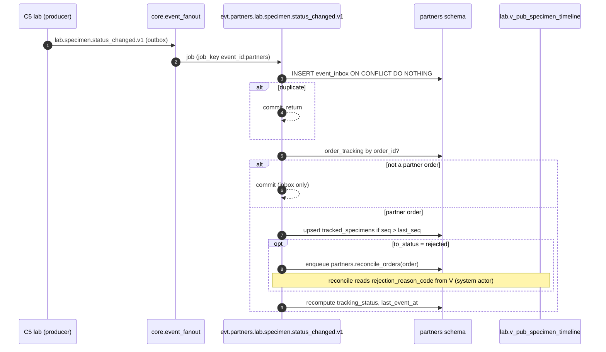
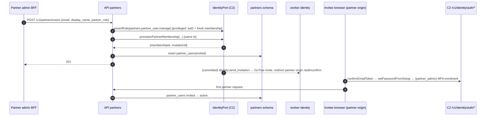

# C13 — B2B Partner Portal — 03 App Flow

Status: DECISION draft, 2026-11-06. Operation ids refer to `02-TRD.md` §5; screens to `04-UI-UX.md`. Every state machine below is implemented as a pure table in `services/api/src/modules/partners/domain/*.state.ts` and unit-tested per transition (02-CV §11.4).

---

## 1. Flow and screen index

| # | Flow | Actor | Screens (04-UI-UX) | Operations |
|---|---|---|---|---|
| F1 | Partner sign-in, MFA, recovery, invitation accept | partner user | PA-1…PA-6 | C2 `/v1/identity/auth/partner/*` + `/v1/identity/auth/*` via partner BFF key (CR-C13-003, 08 R10) |
| F2 | Partner context + dashboard | partner | PH-1 | A1, A2 |
| F3 | Manifest create/edit/submit/withdraw/discard/print | partner | PM-1…PM-4 | M1–M11, P2, F1 |
| F4 | Lab receipt and conversion | staff + worker | SM-1, SM-2 | SI1–SI5; task `partners.convert_manifest_line` |
| F5 | Tracking | partner | PO-1, PO-2 | O1–O3; consumers |
| F6 | Reports: list, versions, download, access slip | partner | PR-1, PR-2, PR-3 | R1–R6 |
| F7 | Pickup requests | partner + staff | PK-1, PK-2, SK-1 | K1–K4, SP1–SP4 |
| F8 | Price list | partner | PP-1 | P1; task `partners.sync_price_list` |
| F9 | Statements | partner | PS-1, PS-2 | S1, S2; task `partners.sync_statements` |
| F10 | Referrers + mapping | partner admin + staff | PF-1, SF-1 | F1–F5, SR1–SR3 |
| F11 | Partner users | partner admin + staff | PU-1, SP-3 | U1–U6, SA8–SA10 |
| F12 | Partner accounts + settings | staff | SP-1, SP-2, SS-1 | SA1–SA7, SS1 |

## 2. State machines

### 2.1 Manifest (`partners.manifests.state`)

| # | From | To | Operation / trigger | Guard | Side effects |
|---|---|---|---|---|---|
| MS1 | (none) | `draft` | M1 `createManifest` | partner active | allocate `manifest_no` (§4.1); snapshot `receiving_branch_id`, `receiving_centre_id`, `conversion_mode` from partner |
| MS2 | `draft` | `draft` | M4/M5/M6/M7 | `If-Match` | `version + 1` |
| MS3 | `draft` | `submitted` | M8 `submitManifest` | ≥1 line; every line passes `line-validation`; line count ≤ `max_lines_per_manifest`; partner active; receiving centre active (`ctx.core` centres) | manifest row first: `submitted_at`, `submitted_by`; `conversion_mode`, `receiving_branch_id`, `receiving_centre_id` re-snapshotted from the partner (rule: snapshot at create, refresh at submit — review m#18); then lines `draft → submitted` (or `→ converting` in mode `on_submit`, LS2b) with `receiving_centre_id` set to the manifest's refreshed value; mode `on_submit`: enqueue one `partners.convert_manifest_line` per line |
| MS4 | `draft` | `discarded` | M10, or job `partners.expire_drafts` | — | lines `draft → discarded`; patient fields redacted (05-SCHEMA §6) |
| MS5 | `submitted` | `withdrawn` | M9 `withdrawManifest` | mode `on_receipt` only (in `on_submit` lines are `converting` from MS3, so withdraw is unavailable — 08 A19 D-104); no line in `converting`/`converted`; manifest not on a `picked_up` pickup | lines `submitted → withdrawn`; open pickups referencing only this manifest → `cancelled` (reason `manifest_withdrawn`) and their link rows `is_open = false`; else the manifest is **detached** from the pickup = its `pickup_request_manifests` link row gets `is_open = false` (rows are never deleted; K3/SP1 and the `PickupRequest` DTO list only `is_open` links of non-terminal pickups) |
| MS6 | `submitted` | `partially_received` | SI3 `receiveManifest` | ≥1 line still *pending receipt* (definition below) after applying the request | per line LS3/LS4 (on_receipt) or receipt flags (on_submit) |
| MS7 | `submitted` / `partially_received` | `received` | SI3, SI5 | no line remains *pending receipt* | `received_at`, `received_by` |
| MS8 | `partially_received` | `partially_received` | SI3/SI5 | some lines still *pending receipt* | — |

Forbidden (unit-tested, `409 partners.manifest_invalid_transition`): `submitted → draft`, `received → *`, `withdrawn → *`, `discarded → *`, `draft → withdrawn`, any withdraw once a line is `converting`/`converted`. Line edits on non-draft manifests → `409 partners.manifest_not_editable`.

**Pending receipt (08 A19 D-104).** A line is *pending receipt* iff (mode `on_receipt`: `state = 'submitted'`) or (mode `on_submit`: `sample_received_at IS NULL AND NOT sample_missing AND state IN ('converting','converted','conversion_failed')`). MS6 = some pending lines remain; MS7 = none remain. SI3 returns a per-line error only for a line that is not pending.

Mode `on_submit`: lines go `converting` at MS3 and the manifest still records physical receipt through SI3: outcome `received` only sets `sample_received_at`, `received_by` (no state change); outcome `not_received` sets `sample_missing = true` and `not_received_reason_code`. A `converted` line with `sample_missing` is the staff task "Order exists but sample missing — cancel or recollect in Front desk" (C13 cannot cancel C4 orders): it is the SM-1 filter `has_missing_samples` (SI1 parameter), backed by index `manifest_lines__tenant_id_receiving_centre_id__missing__p_idx`; there is no task table. Withdraw (MS5) is unavailable in this mode.

### 2.2 Manifest line (`partners.manifest_lines.state`)

| # | From | To | Trigger | Guard | Side effects |
|---|---|---|---|---|---|
| LS1 | (none) | `draft` | M5 | manifest `draft` | — |
| LS1d | `draft` | (deleted) | M7 | manifest `draft` | row deleted (draft only — 02-CV §4.1 DELETE rule) |
| LS2 | `draft` | `submitted` | MS3, mode `on_receipt` | — | — |
| LS2b | `draft` | `converting` | MS3, mode `on_submit` | — | `conversion_attempt = 1`; job enqueued |
| LS3 | `submitted` | `converting` | SI3 outcome `received` | manifest `submitted`/`partially_received` | `sample_received_at`, `received_by`; `conversion_attempt = 1`; job enqueued (`job_key convert:<line_id>:1`) |
| LS4 | `submitted` | `not_received` | SI3 outcome `not_received` / SI5 | reason code | `not_received_reason_code` |
| LS5 | `converting` | `converted` | job success | port returns `orderId` | `order_id`, `registration_no`, `converted_at`; insert `order_tracking` (`registered`) |
| LS6 | `converting` | `conversion_failed` | job business failure; reconcile timeout | — | `failure_code`; staff attention list |
| LS7 | `conversion_failed` | `converting` | SI4 retry; SR2 mapping (lines failed with `partners.referrer_not_mapped`) | `If-Match` | `conversion_attempt + 1`; optional `resolved_patient_id`; job enqueued |
| LS8 | `conversion_failed` | `not_received` | SI5 | reason | — |
| LS9 | `converted` | `cancelled` | consumer `frontdesk.order.cancelled.v1` / reconcile | — | `order_tracking.tracking_status = cancelled` |
| LS10 | `submitted` | `withdrawn` | MS5 | — | — |
| LS11 | `draft` | `discarded` | MS4 | — | redaction |

Forbidden: `converted → converting` (`409 partners.manifest_line_invalid_transition`), any transition out of `cancelled`, `withdrawn`, `discarded`, `not_received` (except none). A retry of a `converted` line → 409.

### 2.3 Pickup request (`partners.pickup_requests.state`)

| From | To | Trigger | Guard | Side effects |
|---|---|---|---|---|
| (none) | `requested` | K1 | every manifest `submitted`/`partially_received`, same partner, not on another open pickup; `window_start < window_end`; `window_start ≥ now() - 1 h`; `window_end ≤ now() + pickup_max_days_ahead` | link rows `pickup_request_manifests` |
| `requested` | `scheduled` | SP2 | `scheduled_start < scheduled_end` | — |
| `scheduled` | `scheduled` | SP2 (reschedule) | same | — |
| `requested`/`scheduled` | `picked_up` | SP3 | `picked_up_at ≤ now()` | manifests' `in_transit_at` set |
| `requested`/`scheduled` | `cancelled` | K4 (partner), MS5 (manifest withdrawn) | — | — |
| `requested`/`scheduled` | `rejected` | SP4 (staff) | reason code | — |

Forbidden: anything out of `picked_up`, `cancelled`, `rejected` (`409 partners.pickup_invalid_transition`).

### 2.4 Partner (`partners.partners.status`)

| From | To | Trigger | Side effects |
|---|---|---|---|
| (none) | `active` | SA2 | enqueue `partners.sync_price_list`, `partners.sync_statements` |
| `active` | `suspended` | SA5 | from the next statement on, `app.current_partner_id()` returns NULL for its users → `403 partners.partner_inactive`; open pickups stay (staff decide); no data deleted |
| `suspended` | `active` | SA6 | credit party must be active (`CatalogPort.getCreditParty`) else `422 partners.credit_party_inactive`; enqueue syncs |

### 2.5 Partner user (`partners.partner_users.status`, mirror of the C2 membership)

| From | To | Trigger | Port call (same tx) |
|---|---|---|---|
| (none) | `invited` | U2 / SA9 | `IdentityPort.provisionPartnerMembership` |
| `invited` | `active` | first partner request of that user (02-TRD §4.8) | — |
| `invited`/`active` | `deactivated` | U4 / SA10 | `updatePartnerMembership({action:'deactivate'})` |
| `deactivated` | `active` or `invited` (the `status` returned by C2) | U5 / SA10 | `updatePartnerMembership({action:'reactivate'})` |
| `invited`/`active` | same, role changed | U3 / SA10 | `updatePartnerMembership({action:'set_role'})` |
| `invited` | `invited` | U6 resend | `updatePartnerMembership({action:'resend_invitation'})` |

Concurrency (08 A19 D-100): U3–U5/SA10 take `If-Match` = `partner_users.version`, lock that row `FOR UPDATE`, call the port without `expectedVersion`, and store the returned `status`. Partner-claim writes are also checked by trigger `partners.guard_partner_users` (caller must be an active `partner_admin`, except the own first-sign-in flip; D-103).

Guards: last active-or-invited `partner_admin` of a partner cannot be deactivated or demoted (`409 partners.last_partner_admin`); a partner admin cannot deactivate or demote themself (`409 partners.self_action_forbidden`).

### 2.6 Partner referrer mapping (`partners.partner_referrers.mapping_state`)

| From | To | Trigger | Side effects |
|---|---|---|---|
| (none) | `unmapped` | F2 | — |
| `unmapped` | `mapped` | SR2 | `catalog_doctor_id`, `mapped_by/at`; enqueue retry for lines `conversion_failed` with `failure_code = partners.referrer_not_mapped` and this referrer (LS7) |
| `unmapped` | `rejected` | SR3 reject | reason code shown to the partner admin ("Please check the name") |
| `mapped` | `unmapped` | SR3 unmap | future conversions omit `referrerId` (or fail if `require_mapped_referrer`) |
| `rejected` | `unmapped` | F3 (partner edits name/registration no) | — |

`is_active` (F4/F5) is independent; inactive referrers cannot be chosen on new lines (`422 partners.manifest_invalid`, `errors[].path = /referrer_id`) but stay on existing lines.

## 3. Tracking-status derivation (`domain/tracking-status.ts`, pure)

Inputs: line state; set of tracked specimens (status, `replaces_specimen_id`); set of valid report versions (kind). Output `tracking_status` for `order_tracking` (orders only exist from LS5 on). First matching rule wins:

| # | Rule | `tracking_status` | Partner label |
|---|---|---|---|
| T1 | line `cancelled` | `cancelled` | "Cancelled by lab" |
| T2 | a `valid` report version with kind `final`, `amended` or `addendum` (08 R1; an unknown future kind is treated as `amended`, 02-CV §7.2) exists | `reported` | "Report ready" |
| T3 | a `valid` report with kind `partial` or `preliminary` exists | `partially_reported` | "Partly reported" |
| T4 | any specimen `rejected` or `recollection_ordered` whose replacement (a specimen with `replaces_specimen_id` = it) is absent or not yet ≥ `received` | `action_needed` | "New sample needed" |
| T5 | any specimen in `received`, `aliquoted`, `in_process`, `resulted`, `verified`, `approved`, `reported`, `stored` | `in_lab` | "In lab" |
| T6 | any specimen `collected` or `in_transit` | `in_transit` | "On the way to lab" |
| T7 | otherwise (order exists; specimens `ordered` or none yet) | `registered` | "Registered" |

Line-level labels before an order exists (manifest screens): `draft` "Draft", `submitted` "Waiting for lab", `converting` "Registering", `conversion_failed` "Lab is checking this sample", `not_received` "Not received", `withdrawn` "Withdrawn", `discarded` "Discarded". Partners never see `failure_code` values (staff only); they see the neutral label above (DECISION: failure codes like `frontdesk.patient_duplicate_suspected` hint at other patients' existence).

Unit tests cover every rule and the precedence (e.g. T2 beats T4; rejected specimen with a received replacement → T5).

## 4. Flows (step by step)

### 4.1 F3 Manifest

**createManifest (M1)**
1. `partnerContext.require` (02-TRD §4.8); `assertRole(partners.manifest.submit)`.
2. Tx: lock counter row `partners.manifest_counters (tenant_id, partner_id, yy)` with `INSERT … ON CONFLICT DO UPDATE SET last_seq = last_seq + 1 RETURNING last_seq` (`yy` = A.D. two-digit year in tenant timezone); format `MF{yy}{seq:6}` (03 §9.3; not gapless — gaps allowed, not a fiscal number).
3. Insert manifest (`draft`, receiving branch/centre snapshot). 201.

**addManifestLine (M5)**
1. Context + `assertRole`; load manifest by id under RLS (404); state `draft` else 409 `manifest_not_editable`; `If-Match` = manifest version.
2. Validate (`line-validation.ts`): exactly one of `birth_on`/`age_years`; `orderable_ids` unique, 1–30, each present in `partners.price_list_items` of this partner (`source partner` or, if `include_default_price_list`, `standard`) → else `422 partners.orderable_not_offered` with `errors[]` per id; `referrer_id` (if given) is an active referrer of this partner (404 otherwise); `partner_sample_ref` unique within the manifest; line count < limit.
3. `consent_text_version`: C4 owns consent texts but exposes no current version to other modules. DECISION: C13 keeps `partners.settings.consent_text_version` (≤ 32 chars, default `partner-v1`) and `partners.settings.consent_statement` (≤ 2,000 chars, the text the partner user confirms), both staff-maintained in SS1; the line stores the version and C13 passes it to C4. Exposing C4's consent text version is a CR candidate (06-PLAN §5).
4. Insert line `draft` (`line_no` = max + 1), manifest `version + 1`. 201 with new manifest ETag.

**submitManifest (M8)** — see sequence §5.1. Errors are collected for all lines and returned together in `errors[]` (`/lines/<n>/…` pointers).

**withdrawManifest (M9)**: lock manifest `FOR UPDATE`; verify no line `converting`/`converted` (race with a staff receipt: the staff receipt also locks the manifest row first, so the two serialise; whichever commits first wins, the other gets `409`).

**Print view (M11)**: returns JSON; the BFF renders `/manifests/{id}/print` as a print-optimised page (A4 portrait, browser print). Access log `manifest.print`, entity `manifest`.

### 4.2 F4 Lab receipt and conversion — sequence §5.2

Staff opens SM-1 (inbox, filtered to their centres by RLS), opens a manifest (SM-2), ticks lines as the tubes are matched (scan of the partner sample reference into a `BarcodeInput` with pattern `^[A-Za-z0-9_./-]{1,40}$` highlights the line), sets `not_received` with reason for missing tubes, presses **Confirm receipt** → SI3.

SI3 algorithm (one transaction):
1. Load manifest `FOR UPDATE` (RLS: receiving centre in staff scope, else 404); `assertRole(partners.manifest.receive, centreId = receiving_centre_id)`; `If-Match`.
2. Partner must be `active` (a suspended partner's submitted manifest can still be received: DECISION **yes** — the samples are physically in the lab; conversion uses the credit party regardless; staff see a warning banner).
3. For each request line: must belong to the manifest and be *pending receipt* (§2.1, D-104) — else per-line `errors[]`, whole request rejected 422. Mode on_receipt: LS3/LS4. Mode on_submit: receipt flags only (`sample_received_at`/`received_by`, or `sample_missing` + reason).
4. Apply LS3/LS4 (on_receipt) or the flags (on_submit); enqueue jobs (on_receipt only) via `app.enqueue_job('partners.convert_manifest_line', {tenant_id, line_id, attempt}, 'convert:<line_id>:<attempt>')`.
5. Recompute manifest state (MS6/MS7). Commit. 200.

Conversion task (`partners.convert_manifest_line`):
1. Tx as system actor; `SELECT … FROM partners.manifest_lines WHERE tenant_id=$t AND id=$line FOR UPDATE`; state ≠ `converting` or `conversion_attempt ≠ payload.attempt` → return (stale/duplicate job).
2. If `require_mapped_referrer` and the line's referrer is unmapped → LS6 with `partners.referrer_not_mapped`; commit; return.
3. Build `BookingOrderInput` (02-TRD §6.2); call `FrontdeskPort.createOrderFromBooking` inside a savepoint (`ctx.db.tx(…)` nested in this tx — C0 `SAVEPOINT`/`ROLLBACK TO`; 08 A19 P-44).
4. Success → release the savepoint; LS5; insert `partners.order_tracking (tenant_id, order_id, partner_id, line_id, manifest_id, tracking_status 'registered', registered_at = now())`; commit.
5. `LimsError` with a business code → **roll back to the savepoint** (discarding everything C4 wrote before it threw), then LS6 (`failure_code`); commit without throwing.
6. Other errors → rollback; throw (Graphile retry). On the last attempt the C0 wrapper dead-letters; reconcile marks the line failed after 30 min.

Atomicity note: on success the C4 write and the C13 line update commit in the same transaction (02-CV §8.1), so "order created but line not marked" cannot happen; a crash after commit and before job completion only causes a duplicate job run, which is a no-op at step 1. On a business error the savepoint rollback guarantees that no partial C4 write (patient row, `frontdesk.booking_links`, consent rows) is committed with the `conversion_failed` line (P-44 test: fake writes a marker row, then `failNext` → marker absent after commit).

Retry (SI4): staff may pass `patient_id` (picked through C4's `POST /v1/frontdesk/patients/search` in the staff BFF). C13 stores it as `resolved_patient_id`; the next attempt sends `patient: { patientId }`. A new attempt uses a new port idempotency key (`…:v<n>`); C4's `frontdesk.booking_already_converted` cannot occur because the failed attempt's C4 writes were rolled back to the savepoint before the failure was committed (step 5). If C4 nevertheless answers `booking_already_converted` (e.g. a previous attempt committed in C4 under a different key — impossible by construction, kept as a guard), the line → `conversion_failed` with that code and an alert fires.

### 4.3 F5 Tracking — sequence §5.3

Partner lists (O1) read `partners.order_tracking` joined to `partners.manifest_lines` (both partner-scoped). Detail (O3) adds `partners.tracked_specimens` and `partners.order_reports`.

Display text for codes (DECISION): no published view gives specimen-type or rejection-reason display names (03 §6 has none), so v1 shows the code humanised by a pure function (`EDTA_WB` → "EDTA WB", `haemolysed` → "Haemolysed": underscores → spaces, first letter upper-case, known abbreviations kept upper-case). A `catalog.v_pub_specimen_type` / `lab.v_pub_rejection_reason` label view is a CR candidate (06-PLAN §5).

Polling: partner pages refresh lists every 60 s [CONV] when visible (`document.visibilityState`), with `X-Lims-Background: 1` so they do not extend the idle timeout.

### 4.4 F6 Reports — sequences §5.4, §5.5

R1 reads `partners.order_reports` (+ line patient name) for the partner. R2 sets `is_new = false` for the listed (report, version) pairs of this partner; ids of other partners are skipped silently (count returned = rows updated).

### 4.5 F7 Pickups

K1: validate guards (§2.3) in one tx with `SELECT … FOR UPDATE` on the referenced manifests (prevents two open pickups for one manifest). Staff SK-1 lists `requested`/`scheduled` for their centres (receiving centre of the pickup = receiving centre of its manifests; K1 requires all manifests to share one receiving centre, else `422 partners.pickup_invalid`).

### 4.6 F8/F9 Projections — sequence §5.7

`partners.sync_price_list`: delete-and-insert inside one transaction, so a reader sees either the old or the new list. `listPartnerPriceList` returns `synced_at`; the UI shows "Prices updated <time>".

`partners.sync_statements`: upsert by key; months no longer present in the view (should not happen — billing data is immutable) are kept and flagged `is_stale = true`.

### 4.7 F10 Referrers

F2 normalises `display_name` (NFC, trim, collapse spaces) and checks duplicates on `(partner_id, lower(normalised name), coalesce(registration_no,''))` → `409 partners.referrer_duplicate`. SR2 validates `catalog_doctor_id` with `CatalogPort.getReferrer({referrerId, purpose:'display'})` (staff context): not found → 404; inactive → `422 partners.referrer_doctor_inactive`; a merged doctor resolves to `canonicalReferrerId` (CR-C3-001) and C13 stores the canonical id.

`samples_this_month` = count of `manifest_lines` with this referrer and state `converted`, `converted_at` in the current A.D. month (tenant timezone) — computed on read with index `(tenant_id, partner_id, referrer_id, converted_at)`.

### 4.8 F11 Partner users — sequence §5.6

U2: context; `assertRole(partners.partner_user.manage)` (privileged → aal2 + membership re-validation by C2); tx: call `provisionPartnerMembership` (C2 inserts `core.users` if needed, `core.memberships(actor_type 'partner')`, role, invitation, enqueues `identity.send_invitation`) → insert `partners.partner_users (membership_id, partner_id = ctx.partner.partnerId, partner_role, status 'invited')`. Any port error rolls back both.

### 4.9 F12 Partner accounts

SA2: `assertRole(partners.partner.manage)`; validate credit party via `CatalogPort.getCreditParty` (404 / inactive 422); receiving branch and centre via `ctx.core` (exist, active, centre belongs to branch — `identity.centre_inactive` 409 if inactive); unique `partner_code`, unique `credit_party_id` per tenant; insert; enqueue syncs.

### 4.10 F1 Partner sign-in (C2-owned operations, partner BFF pages)

1. `/auth/login` form → BFF `POST` → C2 `loginPartner` (`/v1/identity/auth/partner/login`, CR-C13-003) authenticated with the partner BFF's `X-Lims-Bff-Key`, which binds session kind `partner` (08 R10); the BFF forwards the client IP for the per-IP failure counter (08 Addendum A1). Success → `{session_token, session}`; BFF sets `__Host-lims_psid`; redirect by `session.state`: `active` → `/`; `mfa_pending` → `/auth/mfa`; `mfa_enrolment_required` → `/auth/mfa/enrol`; `password_setup` → `/auth/set-password`.
2. Every authenticated page: BFF `resolveSession(touch)` → access JWT (cached ≤ 60 s in memory) → API calls.
3. Errors: `401 auth.login_failed` → "Email or password is incorrect."; `401 auth.step_up_required` → "Too many attempts. Wait {n} minutes and try again." (C2 backoff); `403 auth.account_locked` → "Your account is locked. Contact your organisation's administrator."; `403 identity.tenant_suspended` → "This lab's service is not available. Contact the lab."; `403 partners.partner_inactive` (first API call) → full-page message "Your organisation's access is paused. Contact the lab."

## 5. Sequence diagrams (every cross-chunk interaction)

### 5.1 Submit manifest (mode `on_submit` shown; `on_receipt` stops after commit)

```mermaid
sequenceDiagram
  autonumber
  participant B as Partner browser
  participant BFF as apps/partner BFF
  participant API as API partners
  participant ID as IdentityPort (C2)
  participant DB as partners schema
  participant Q as graphile_worker
  B->>BFF: POST /api/bff/manifests/{id}/submit (If-Match, Idempotency-Key)
  BFF->>API: POST /v1/partners/manifests/{id}/submit (Bearer partner JWT)
  API->>DB: partner context (current_partner_id) — 403 if inactive
  API->>ID: assertRole(partners.manifest.submit)
  API->>DB: SELECT manifest FOR UPDATE (RLS partner) ; validate lines
  alt invalid
    API-->>BFF: 422 partners.manifest_invalid (errors[])
  else valid
    API->>DB: manifest submitted; lines converting (on_submit) or submitted
    API->>Q: app.enqueue_job(partners.convert_manifest_line) × lines (on_submit)
    API-->>BFF: 200 Manifest
  end
```

### 5.2 Receive and convert (mode `on_receipt`)

```mermaid
sequenceDiagram
  autonumber
  participant S as Staff BFF (apps/web)
  participant API as API partners
  participant ID as IdentityPort (C2)
  participant DB as partners schema
  participant Q as graphile_worker
  participant W as worker partners (system)
  participant FD as FrontdeskPort (C4)
  S->>API: POST /v1/partners/admin/manifests/{id}/receive
  API->>DB: SELECT manifest FOR UPDATE (RLS staff + receiving centre)
  API->>ID: assertRole(partners.manifest.receive, centreId)
  API->>DB: lines received→converting / not_received; manifest state
  API->>Q: enqueue convert job per received line
  API-->>S: 200
  Q->>W: partners.convert_manifest_line {line_id, attempt}
  W->>DB: SELECT line FOR UPDATE (state converting, attempt matches)
  W->>FD: createOrderFromBooking(source partner_manifest, partnerId, creditPartyId, confirmImmediately true, key partners:<line>:v<n>)
  Note over FD: C4 creates patient/order/items, credit charge;<br/>emits frontdesk.order.created.v1 (same tx)
  alt success
    FD-->>W: {orderId, registrationNo, status registered, replayed}
    W->>DB: line converted; insert order_tracking(registered)
  else business error (e.g. frontdesk.patient_duplicate_suspected)
    FD-->>W: LimsError(code)
    W->>W: ROLLBACK TO SAVEPOINT (P-44)
    W->>DB: line conversion_failed(code)
  else infra error
    FD-->>W: throw → rollback → Graphile retry
  end
```

### 5.3 Specimen status → tracking



### 5.4 Report released → list → download

```mermaid
sequenceDiagram
  autonumber
  participant C6 as C6 reporting
  participant W as worker partners
  participant RP as ReportingPort (C6)
  participant DB as partners schema
  participant B as Partner BFF
  participant API as API partners
  participant AU as audit.access_log (ctx.audit)
  C6->>W: reporting.report.released.v1 (partner_id, audiences ∋ partner)
  W->>DB: inbox; check order_tracking.partner_id = payload.partner_id
  W->>DB: upsert order_reports(report_id, version_no, valid, is_new); supersede older
  W->>W: enqueue partners.enrich_report
  W->>RP: getReleasedReports({filter:{orderId, includeSuperseded: true}}) [system]
  RP-->>W: summaries (panelNames)
  W->>DB: store panel_names
  B->>API: GET /v1/partners/reports/{rid}/versions/{v}/file (partner JWT)
  API->>DB: order_reports row for (rid, v) under partner RLS
  alt not found
    API->>AU: access(report.download, denied); commitOnError
    API-->>B: 404 common.not_found
  else found
    API->>RP: openReleasedReportFile({reportId, versionNo}) [partner claims; C6 partner RLS — CR-C13-005]
    RP-->>API: {signedUrl (internal), sha256, byteSize}
    API->>API: fetch bytes from internal Storage URL, verify sha256 while streaming
    API->>AU: access(report.download, allowed)
    API-->>B: 200 application/pdf (attachment, no-store)
  end
```

SHA-256 verification while streaming: the API streams to the client and computes the hash; on mismatch at the end it aborts the response (connection reset), logs `report_hash_mismatch` (ids only) and increments an alert metric. The BFF passes the abort through, so the browser shows a failed download rather than a corrupt file.

### 5.5 Patient access slip (08 A2.1)

```mermaid
sequenceDiagram
  participant B as Partner BFF / browser
  participant API as API partners (partner actor)
  participant ID as IdentityPort
  participant DB as partners.* (RLS)
  participant Q as Graphile queue
  participant W as Worker partners.issue_access_slip (partners system actor)
  participant RP as ReportingPort (C6)
  participant RN as RenderPort (C6)
  participant ST as partners-slips bucket (server-side ctx.storage)
  participant AU as audit
  B->>API: POST /v1/partners/reports/{rid}/access-slips (Idempotency-Key)
  API->>ID: assertRole(partners.report.read)
  API->>DB: settings.access_slip_enabled
  alt disabled
    API-->>B: 403 common.feature_disabled
  else enabled
    API->>DB: order_reports valid version (partner RLS) else 404
    API->>DB: INSERT access_slips (state requested)
    API->>Q: enqueue partners.issue_access_slip (job_key slip:<id>, same tx)
    API-->>B: 202 {id, state: requested}  (no token, no link)
  end
  Q->>W: run
  W->>DB: access_slips FOR UPDATE (state requested)
  W->>RP: issuePortalLink({reportId, versionNo, channel: print_qr, recipientKind: patient})
  alt business error (report_not_released / report_superseded)
    RP-->>W: throw
    W->>DB: state failed, failure_code
  else ok
    RP-->>W: {linkId, url, expiresAt}
    W->>RN: renderPdf({templateKey: partners.access_slip, data: {tenantDisplayName, partnerName, patientDisplayName, orderRef, portalUrl, expiresAtLocal, issuedAtLocal}, idempotencyKey: slip id})
    Note over W,RN: C6 draws the QR from portalUrl; url only in memory and in the PDF (08 A5.1)
    alt rendered
      RN-->>W: {contentBase64, sha256, byteSize, pageCount}
      W->>ST: put partners-slips {tenant_id}/access-slips/{yyyy}/{mm}/{id}.pdf
      W->>DB: state issued, link_id, link_expires_at, file_path, file_sha256, file_byte_size
    else template_invalid / payload_too_large
      RN-->>W: throw
      W->>DB: state failed, failure_code
    else render_unavailable
      RN-->>W: throw (task retried)
    end
  end
  loop poll (typically < 5 s [CONV]; every 1 s, up to 30 s — accepted, 08 A5.3)
    B->>API: GET …/access-slips/{id}
    API-->>B: 200 {state, link_expires_at?, failure_code?}
  end
  B->>API: GET …/access-slips/{id}/file (state issued)
  API->>ST: read object (server-side)
  API->>AU: access(report.access_slip, allowed, detail {access_slip_id, link_id})
  API-->>B: 200 application/pdf (Cache-Control no-store)
```

The plaintext link token/URL is never stored in any column, job payload, log or HTTP response; it exists only in the worker task's memory and inside the rendered PDF (08 A2.1). R4 is idempotent (`x-idempotency: required`) because its response no longer carries a secret. The slip is rendered by `RenderPort` template `partners.access_slip` (08 A5.1, 02-TRD §8.1) and stored in the `partners-slips` bucket (08 A5.2).

### 5.6 Invite partner user and first sign-in



### 5.7 Projections (price list, statements)

```mermaid
sequenceDiagram
  participant CR as cron / catalog.changed.v1 / SA*
  participant W as worker partners (system)
  participant CV as catalog.v_pub_price_list_items · v_pub_test_directory
  participant CP as CatalogPort (C3)
  participant BV as billing.v_pub_credit_party_statement
  participant DB as partners schema
  CR->>W: partners.sync_price_list(partner)
  W->>CV: SELECT rows for owner credit_party (+ default) effective now
  W->>CP: getPanel(panelId) for panel names (memoised)
  W->>DB: replace price_list_items(partner); upsert price_list_syncs
  CR->>W: partners.sync_statements(tenant)
  W->>BV: SELECT by credit_party_id (last 24 months)
  W->>DB: upsert statement_months; synced_at
```

## 6. Screen states (every screen)

| Screen | Empty | Loading | Error | Success | Permission denied |
|---|---|---|---|---|---|
| PH-1 Dashboard | tiles 0 + `EmptyState` "Create your first manifest" (action → PM-2) | `LoadingSkeleton variant=page` | `ErrorState` + retry + request id | tiles | n/a (any partner user) |
| PM-1 Manifests list | "No manifests yet." + New manifest | `table` skeleton | ErrorState | DataTable / cards | — |
| PM-2 Manifest editor | "Add the first sample" | `form` skeleton | field errors via `Form problem`; 409 → `Banner warning` "This manifest changed. Reload to see the latest version." with Reload | toast "Saved" / after submit → PM-3 with toast "Manifest submitted" | members without submit permission never reach it (all partner roles have it) |
| PM-3 Manifest detail | — | `detail` skeleton | ErrorState | read-only detail, actions per state | — |
| PM-4 Print view | — | — | ErrorState | print layout | — |
| PO-1 Orders list | "No samples registered yet." | table skeleton | ErrorState | list | — |
| PO-2 Order detail | specimens "The lab has not labelled this sample yet." | detail skeleton | 404 → "We couldn't find that sample." | timeline | — |
| PR-1 Reports | "No reports released yet." | table skeleton | ErrorState | list with "New" badges | — |
| PR-3 Report versions | — | `detail` skeleton | 404 → "This report is no longer available." | version list | — |
| PR-2 Download / slip | — | button `isLoading`; slip `requested` → spinner while polling R5 (08 A2.1) | toast danger "Download failed. Try again." / 429 "Download limit reached. Try again in {n} minutes." | file saved / slip page | feature off → button hidden |
| PK-1/PK-2 Pickups | "No pickup requests." | skeletons | ErrorState / 422 field errors | list / detail | — |
| PP-1 Price list | "No prices are set up for your organisation yet. Contact the lab." | table skeleton | ErrorState | list + "Prices updated {time}" | — |
| PS-1/PS-2 Statements | "No billing activity yet." | skeleton | ErrorState | rows + outstanding | — |
| PF-1 Referrers | "Add the doctors who send you patients." (admin) / "No referring doctors added yet." (member) | skeleton | ErrorState | list | member: add/edit buttons hidden; direct API → 403 toast "You don't have access to do that." |
| PU-1 Users | — (at least the admin) | skeleton | ErrorState | list | members: nav item hidden; URL → page-level "Only your organisation's administrator can manage users." |
| Staff SP-1/SP-2/SM-1/SM-2/SK-1/SF-1/SS-1 | per 04-UI-UX §4 copy | `loading.tsx` skeletons | `error.tsx` ErrorState with request id | — | shell `core.shell.forbidden` |
| Any partner page while partner suspended | — | — | full-page `ErrorState` "Your organisation's access is paused. Contact the lab." | — | — |
| Any page, session ended | redirect `/auth/login?reason=session` with `Banner info` "You were signed out because your session ended." | | | | |

## 7. Edge cases

| Case | Handling |
|---|---|
| Two partner users edit the same draft | `If-Match` on manifest/line; loser gets `409 common.version_conflict` → banner + reload |
| Double click on Submit / network retry | `Idempotency-Key` (BFF generates one per user action and reuses it on retry); replay returns the same body |
| Submit while a line is invalid | all errors returned at once; nothing changes |
| Staff receives while the partner withdraws | both lock the manifest row; serialised; second gets 409 |
| Same line received twice (two staff tabs) | second request: line no longer *pending receipt* → 422 per-line error; no second job |
| Conversion job delivered twice | step-1 guard (`state`/`attempt`) + C4 idempotency key → one order |
| Worker down for hours | lines stay `converting`; when the worker returns, queued jobs run first (they were enqueued before the reconcile cron fires again); the reconcile rule "`converting` > 30 min → `conversion_failed` (`common.internal`)" can therefore race a job that is about to run — the job's step-1 guard sees `conversion_failed` and exits, and staff retry (SI4) with a new attempt. Risk accepted (06-PLAN R5); threshold configurable |
| Status event before C13 stored the order mapping | impossible for partner orders: `order_tracking` is inserted in the same tx as the C4 call that emits `order.created`, and specimens are created later by C5 |
| Status events out of order | `last_seq` per specimen; stale ignored; reconcile fills gaps without moving status backwards |
| Recollection (new specimen with `replaces_specimen_id`) | new tracked specimen row; T4/T5 rules. A replacement first seen by reconcile (missed event) gets `replaces_specimen_id` from `lab.v_pub_specimen_timeline` (column added by 08 A19 D-106) |
| Amended report | new version row `valid`, previous `superseded`; tracking stays `reported`; "New" badge on the new version |
| Report released for a partner order without `partner` audience (C6 staff chose not to) | not shown to the partner (DECISION: C6's audience decision is authoritative) |
| `reporting.report.released.v1` with `partner_id` that does not match our mapping | ignored + `mismatch` metric + alert |
| Partner suspended mid-session | next request 403 `partners.partner_inactive`; BFF shows the paused page; session stays until logout/timeout |
| Partner user deactivated mid-session | C2 resolver rejects on next request (401/403); C13 helper returns NULL anyway |
| Price list changed between line entry and conversion | C4 prices at conversion (REQ-SEC-046); line keeps the orderable ids only; statement shows the real charge |
| Orderable deactivated in C3 after submit | conversion fails `catalog.test_inactive` → staff edits? Staff cannot edit partner lines (DECISION: lines are the partner's record); staff marks `not_received` with reason `test_not_available` and calls the partner, or registers the sample at the front desk |
| Duplicate patient suspected | staff resolves with SI4 + `patient_id` |
| Offline partner device | PWA shows `/offline`; drafts are server-side only, so unsaved form input is lost on reload — the form warns on navigation away with unsaved changes (`beforeunload`) |
| Partial failure inside `receiveManifest` | single transaction; any per-line error rejects the whole request (422) so staff fix and resend |
| Credit party later deactivated in C3 | conversions fail per C4 (`catalog.*`/`billing.*` code) → `conversion_failed`; staff fix the credit party; SA6 guard prevents reactivating a partner with an inactive credit party |
| Statement view lags | `synced_at` displayed; outstanding labelled "as of {time}" |
| Very large partner (10,000+ orders) | cursor pagination; indexes per 05-SCHEMA; search capped at 50 |
| Clock: `collected_at` in the future | `400 common.validation_failed` with pointer `/collected_at` (A13 P-1; ≤ now + 5 min [CONV] skew) |
