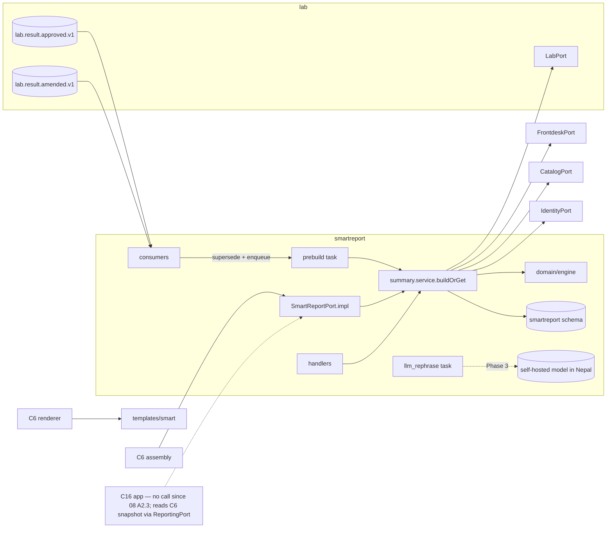

# C14 Smart Report — 02 Technical Requirements (TRD)

Status: DECISION, 2026-11-06. Read `01-PRD.md` first. Table, operationId, permission, error-code, job and config names in this file are binding for the C14 build. This file is also the specification C0 transcribes into `contracts/openapi/smartreport.yaml`, `contracts/permissions.yaml`, `contracts/errors.yaml` and `contracts/ports/SmartReportPort.ts`. Items needing a contract change are marked **(CR-C14-00n)** and written out in §15.

Short references: 02-CV = `program/02-CONVENTIONS.md`; 03-IC = `program/03-INTERFACE-CATALOG.md`; 01-CM = `program/01-CHUNK-MAP.md`; C6-TRD = `chunks/C6-reporting-delivery/02-TRD.md`; R01 = `research/01-features-workflow.md`.

---

## 1. Owned paths (01-CM §3)

| Path | Content |
|---|---|
| `services/api/src/modules/smartreport/**` | API module: manifest, handlers, services, domain (rules engine), repositories, `SmartReportPort` implementation, mappers, LLM interface + validator, starter-library seed file, tests |
| `services/worker/src/jobs/smartreport/**` | worker manifest: two event consumers, `smartreport.prebuild_summary`, `smartreport.llm_rephrase` (Phase 3) |
| `services/renderer/templates/smart/**` | `SmartSectionRenderer` implementation (C6-TRD §5.3) — pure functions, no IO |
| `apps/web/src/app/(staff)/smartreport/**` | staff route segment |
| `apps/web/src/features/smartreport/**` | components, BFF server functions, `nav.manifest.ts`, help content |
| `docs/manual/smartreport/**` | user-manual pages |

C14 never edits `db/`, `contracts/`, `packages/*`, any `core/`, or other modules' paths (including the rest of `services/renderer/`). Everything needed there is in §15.

## 2. Stack and pinned libraries

Only versions fixed in 04 / 02-CV are stated as versions. Everything else is **C0 pins**.

| Component | Version / rule | Source |
|---|---|---|
| Node.js | 26.x LTS, exact patch pinned by C0 | 02-CV §1.1 |
| Fastify + `fastify-openapi-glue` **4.12.0** | via C0 core; C14 supplies handlers only | 04 T7; 02-CV §2.2 |
| Graphile Worker **0.18.0** | via C0 worker core | 04 S10, T7 |
| PostgreSQL 17 (`supabase/postgres:17.6.1.136`) | — | 04 D9 |
| Next.js (staff feature) | C0 pins | 02-CV §1.1 |
| React server rendering for the smart fragment | same `react-dom/server` and React version C0 pins for the renderer (C6-TRD §2 "one template language") | C6-TRD §2 |
| B.S. dates in the fragment | `@remotemerge/nepali-date-converter` **1.2.7** via `@lims/shared-ts/bsdate` only | 04 D13 |
| Decimal handling | **no library**: `domain/fixed.ts` converts `DecimalString` (≤ 6 fraction digits, 03-IC §2.1 pattern) to `bigint` micro-units (× 10^6). All score arithmetic is integer | DECISION |
| Text normalisation | built-in `String.prototype.normalize('NFC')` | 02-CV §13 |
| Unicode text diff (Phase 3 review) | **C0 pins** if CR-C14-008 needs a library; none chosen here | — |
| LLM client | **none chosen** (model and serving software BLOCKED — founder, B11). Only the `LlmRephraser` interface (§4.11) and `DisabledRephraser` ship | 04 R8, §11 |

No new runtime dependency is required for the rules engine. Any dependency added later goes into §16 with the 02-CV §15.1 row.

## 3. Internal architecture

### 3.1 Module skeleton (02-CV §2.2)

```
services/api/src/modules/smartreport/
├── index.ts                         # ModuleManifest: name 'smartreport', openapi, handlers, ports { SmartReportPort }, produces: [],
│                                    #   systemPermissions: ['lab.result.read','frontdesk.order.read'] (C0 02-TRD ModuleManifest; used by the worker too)
├── permissions.ts                   # smartreport.summary.read, .summary.approve (CR), .template.manage (CR), .template.approve; lab.result.read (preview)
├── config.ts                        # LIMS_SMARTREPORT_* (§10)
├── handlers/index.ts + <operationId>.ts   # 35 operations (§5: #1–#34 + #35 from the 08 A19 P-43 split)
├── service/
│   ├── library.service.ts           # create/clone/edit/validate/submit/approve/return
│   ├── summary.service.ts           # buildOrGet (single entry for port, staff, prebuild), approve, reject, supersede
│   ├── preview.service.ts           # preview (no writes)
│   └── llm.service.ts               # Phase 3: request rephrase, apply overlay
├── domain/
│   ├── fixed.ts                     # DecimalString ⇄ bigint micro-units; half-up division
│   ├── band.ts                      # per-result band status + direction (§4.2)
│   ├── groups.ts                    # tile status (§4.3)
│   ├── score.ts                     # formula hs-1 (§4.4)
│   ├── deranged.ts                  # deranged entries + rule resolution (§4.5)
│   ├── advice.ts                    # advice selection (§4.6)
│   ├── followups.ts                 # follow-up selection (§4.7)
│   ├── trends.ts                    # trend points + direction (§4.8)
│   ├── placeholders.ts              # allowed placeholders per kind, fill (§4.9)
│   ├── wording.ts                   # deny-term + digit + link scans (§9.4, §9.5)
│   ├── library.validate.ts          # validation rules V1–V14 (§9.4)
│   ├── library.state.ts             # library state table (03-APP-FLOW §1.1)
│   ├── summary.state.ts             # summary state table (03-APP-FLOW §1.2)
│   └── engine.ts                    # buildContent(inputs, library) → SummaryContent  (pure, deterministic)
├── repository/
│   ├── library.repo.ts  blocks.repo.ts  rules.repo.ts  mappings.repo.ts  groups.repo.ts  denyTerms.repo.ts
│   ├── summaries.repo.ts  bindings.repo.ts  reviews.repo.ts  llmRuns.repo.ts  codedSets.repo.ts
├── ports/SmartReportPort.impl.ts
├── llm/
│   ├── LlmRephraser.ts              # interface (§4.11)
│   ├── DisabledRephraser.ts         # default: throws, never calls the network
│   ├── prompt.v1.ts                 # versioned instruction text (§4.11)
│   ├── validator.ts                 # output validator (§4.12)
│   └── function-words.en.ts         # bundled allowlist for the novelty check (§4.12)
├── seed/starter-library.v1.json     # starter draft content (§9.3), synthetic, English only
├── mappers/library.dto.ts  summary.dto.ts  port.mapper.ts
└── __tests__/{unit,integration,contract,probes}/
```

```
services/worker/src/jobs/smartreport/
├── index.ts                                   # WorkerManifest (subscriptions, tasks, crontab: [])
├── consumers/lab.result.approved.v1.ts
├── consumers/lab.result.amended.v1.ts
├── tasks/prebuild_summary.ts                  # smartreport.prebuild_summary
├── tasks/llm_rephrase.ts                      # smartreport.llm_rephrase (Phase 3)
└── __tests__/{unit,integration}/
```

```
services/renderer/templates/smart/
├── index.ts                    # export const smartSectionRenderer: SmartSectionRenderer
├── render.tsx                  # React server component tree → static markup
├── labels.en.ts                # fixed copy (04-UI-UX §4.3)
├── format.ts                   # dates via @lims/shared-ts/bsdate; DecimalString printed verbatim
└── __tests__/                  # snapshot + sanitiser-compatibility + "no draft" tests
```

Layer rules (02-CV §2.2) apply. `domain/engine.ts` takes plain inputs (results, catalog analyte info, history, library snapshot) and returns content; it performs no IO, reads no clock (timestamps are passed in), and is the only place that builds summary content. Port, staff build, prebuild and preview all call it.

### 3.2 Data flow



## 4. Domain design (the rules engine)

### 4.1 Inputs

| Input | Source | Notes |
|---|---|---|
| Order header | `FrontdeskPort.getOrderSummary({orderId})` | `patientId`, `centreId`, `registrationNo` (display only, never stored in content), `status` |
| Approved results | `LabPort.getOrderResults({orderId, scope: 'approved'})` | `approvedSetHash`, `items[].results[]` (`ResultView`) |
| Analyte info | `CatalogPort.getTest({testId, asOf: result.approvedAt})` per distinct `testId` | `analytes[].name`, `printName` (CR-C3-001), `sortOrder`, `decimals`, `resultType` |
| Follow-up test info | `CatalogPort.getTest({testId: rule.suggested_test_id, requireActive: true})` | `code`, `name`; `catalog.test_inactive` → suggestion skipped |
| History | `LabPort.getAnalyteHistory` (CR-C14-002) | absent method or `common.internal` → trends empty |
| Feature flags | `IdentityPort.getTenantSettings({keys: ['featureFlags']})` (CR-C2-008) | `smart_report` (CR-C14-005), `smart_report_llm` |
| Library | active `approved` library version + its blocks, rules, mappings, group settings | read in the same transaction |

**Eligible result** = a `ResultView` in the approved scope whose `analyteId` has a mapping row in the library version, whose `resultType` (catalog) is `numeric`, `ordinal` or `coded`, and that has either a `flag` or a `referenceRangeSnapshot`. Text, narrative, attachment and module results are never eligible (DECISION: their meaning is not reducible to a band). When several eligible results share an analyte, the one with the latest `approvedAt` is used (ties: greatest `resultId`); the others are ignored and counted in `ignored_duplicate_count`.

`min_mapped_results` (library parameter, default 3 [CONV], 1–50): fewer eligible results → `smartreport.no_eligible_results`.

### 4.2 Band status and direction per eligible result

`BandStatus` and directions are those of 03-IC §4.10. C14 never recomputes a flag; the C5 flag is the authority (04 R1: C5 evaluates ranges).

| `ResultView.flag` | Status | Direction |
|---|---|---|
| `HH` | `critical` | `high` |
| `LL` | `critical` | `low` |
| `H` | `out_of_range` | `high` |
| `L` | `out_of_range` | `low` |
| `A` | `out_of_range` | `abnormal` |
| `N`, or absent with a range snapshot | `in_range`, or `borderline` per the rule below | `low`/`high` for borderline |

Borderline (only when the result is `in_range`, `valueNumeric` is present, the snapshot has numeric `low` and/or `high`, and `b > 0`, where `b` = mapping `borderline_fraction_bp` if set, else the library's `borderline_fraction_bp`, default **0 = off** — DECISION: no clinical margin is invented; the pathologist sets it):

| Snapshot | margin `m` (micro-units, half-up) | Borderline when |
|---|---|---|
| `low` and `high`, `low < high` | `(high − low) × b / 10000` | `v < low + m` → direction `low`; else `v > high − m` → direction `high` |
| only `high` | `|high| × b / 10000` | `v > high − m` → `high` |
| only `low` | `|low| × b / 10000` | `v < low + m` → `low` |
| text only | — | never |

Comparisons are on `bigint` micro-units (`domain/fixed.ts`). `v` = `valueNumeric`.

### 4.3 Organ-group tiles (`panels`)

- Group codes come from the global coded set `smartreport.g_cs_organ_groups` (05-SCHEMA §3.1). The mapping analyte → group is tenant library data (`smartreport.analyte_groups`, FK to `catalog.analytes`). One group per analyte per library version (DECISION).
- A tile exists only for a group with `is_shown = true` (group settings) and ≥ 1 eligible member. No tile for an unmeasured group (no "No Data" padding — DECISION, PRD §4 row 2c).
- Tile status = worst member status: `critical` > `out_of_range` > `borderline` > `in_range` (R01 §5.2).
- `panels[]` order: group `sort_order`, then `group_code`. `resultIds` order: catalog `sortOrder`, then `resultId`.
- `panelCode` = group code. `displayName` = group setting `display_en` or `display_ne` per library `language` (CR-C14-001).

### 4.4 Health score — formula `hs-1` (DECISION, non-diagnostic)

Published so that the patient and the pathologist can recompute it (R01 §5.2 "publish the formula"). The CrelioHealth sample (score out of 100, "Fair", "4 of 7 health areas in range") is prior art for the *shape* only; its formula is not published (R01 §5.1) and is not copied.

Library parameters (all integers; defaults are DECISION values that the approving pathologist accepts or changes):

| Parameter | Default | Range | Meaning |
|---|---|---|---|
| `score_enabled` | true | bool | false → `healthScore` omitted |
| `credit_in_range_bp` | 10000 | 0–10000 | credit for an in-range member |
| `credit_borderline_bp` | 5000 | 0–10000 | credit for a borderline member |
| `credit_out_of_range_bp` | 0 | 0–10000 | credit for an out-of-range member |
| `credit_critical_bp` | 0 | 0–10000 | credit for a critical member |
| (constraint) | — | in ≥ borderline ≥ out ≥ critical | CHECK in DB |
| group `score_weight` | 1 | 0–10 | 0 = tile shown, group not scored |
| analyte mapping `include_in_score` | true | bool | false = shown in tile/deranged, not scored |
| `min_groups_scored` | 2 | 1–20 | fewer scored groups → `healthScore` omitted |
| `band_good_min` | 80 | 1–100 | value ≥ → `good` |
| `band_fair_min` | 60 | 0–99, < good | value ≥ → `fair`, else `needs_attention` |
| `critical_forces_needs_attention` | true | bool | any critical scored member → `needs_attention` |

Algorithm:
1. Scored members of group g = eligible members with `include_in_score = true`, in groups with `is_shown = true` and `score_weight > 0`. `n_g` = count. Groups with `n_g = 0` are not scored.
2. `sub_g` (bp) = `round_half_up( Σ credit(member) / n_g )`.
3. `panelsScored` = number of scored groups. If `panelsScored < min_groups_scored` → omit `healthScore`.
4. `value` = `round_half_up( Σ_g (w_g × sub_g) / (100 × Σ_g w_g) )` → integer 0–100.
5. `band`: if `critical_forces_needs_attention` and any scored member is `critical` → `needs_attention`; else `value ≥ band_good_min` → `good`; `value ≥ band_fair_min` → `fair`; else `needs_attention`.
6. `formulaVersion = "hs-1"`. A future formula gets a new code (`hs-2`) and a new DB CHECK value; old summaries keep theirs.

`round_half_up(p / q)` for non-negative integers = `(2p + q) div (2q)`.

### 4.5 Deranged-parameter entries

- Every eligible result with status `borderline`, `out_of_range` or `critical` gives one entry `{ resultId, analyteId, direction, severity = status, templateBlockId, text, analyteName }`.
- Rule resolution among rules with `rule_kind = deranged` of the library version, matching when: (`trigger_kind = analyte` and `analyte_id` = entry analyte) or (`group` and `group_code` = entry group) or (`any`); and `direction` ∈ {entry direction, `any`}; and `min_severity` ≤ entry severity (order `borderline` < `out_of_range` < `critical`). Most specific wins: analyte > group > any; then lowest `priority`; then smallest `rule_id`. The library must hold generic `any` rules for `low`, `high`, `abnormal` (validation V3), so every entry resolves.
- `text` = the block text in the library language with placeholders filled (§4.9).
- Order: severity (critical, out_of_range, borderline), then group `sort_order`, then catalog `sortOrder`, then `resultId`.

### 4.6 Advice blocks

- Candidate rules: `rule_kind = advice` with triggers: `analyte` (matches a deranged entry of that analyte, direction, `min_severity`), `group` (matches a tile whose status ≥ `min_severity` and, if `direction ≠ any`, has a deranged entry in that direction), `any` (matches if any deranged entry satisfies direction and `min_severity`), `all_in_range` (matches only when there are zero deranged entries).
- Each matched rule has a trigger severity (the max severity of the matching entries; `in_range` for `all_in_range`).
- De-duplicate by `block_id`, keeping the highest trigger severity and lowest priority. Order: trigger severity desc, `priority` asc, `block_key` asc. Cap at `advice_max_blocks` (default 5 [CONV], 0–10).
- Output `{ templateBlockId, text }`.

### 4.7 Suggested follow-up tests

- Candidate rules: `rule_kind = followup`, triggers `analyte`, `group` or `any` (never `all_in_range` — DB CHECK; PRD AC-05.3), matching as in §4.6.
- Each rule carries `suggested_test_id` and `interval_days` (1–730, required, **no default anywhere** — DECISION: intervals are tenant-authored clinical data, R01 §5.2 "lab medical director owns the table").
- At build, `CatalogPort.getTest({testId, requireActive: true})`, called inside `ctx.db.tx(…)` (savepoint, 08 A19 P-44); `catalog.test_inactive` or `common.not_found` → skip + metric `lims_smartreport_followup_skipped_total{reason}`.
- De-duplicate by `suggested_test_id` keeping the smallest `interval_days` (then lowest priority). Order: trigger severity desc, `interval_days` asc, `priority` asc. Cap `followup_max` (default 3 [CONV], 0–5).
- Output `{ ruleId, suggestedTestCode: test.code, suggestedTestName: test.name (CR-C14-001), intervalDays, text }`. No price, no booking link, no phone (PRD AC-12.4).

### 4.8 Trends

Library parameters: `trend_enabled` (default true), `trend_max_points` (default 4 [CONV], 2–6 — CrelioHealth's sample showed up to 4 visits for one analyte, R01 §5.1, used only as a hint), `trend_lookback_days` (default 730 [CONV], 30–3650, same default as C5 `history_days`), `trend_stable_bp` (default 1000 = 10 % [CONV, pathologist-approved parameter], 0–5000), `trends_max` (default 6 [CONV], 0–12).

1. Candidate analytes: eligible results whose mapping has `trend_enabled = true`, with `valueNumeric` and a numeric range snapshot.
2. One call `LabPort.getAnalyteHistory({ patientId, analyteIds, before: <min approvedAt of candidates>, since: before − trend_lookback_days, limitPerAnalyte: trend_max_points − 1, excludeOrderId: orderId, includeLegacy: false })` (CR-C14-002 as accepted in 08 §4.14; `includeLegacy` stays false — legacy C18 history is DEFERRED, B4). The call runs inside `ctx.db.tx(…)` (savepoint, 08 A19 P-44). If the method is missing (fake without it) or throws, `trends = []` and `lims_smartreport_trend_unavailable_total` increments.
3. For each candidate: keep history points with `source = 'lis'` (the only source returned while `includeLegacy` is false), `unitCode` equal to the current result's `unitCode` and a `valueNumeric`; take the newest `trend_max_points − 1`; append the current result; order oldest → newest. Fewer than 2 points → no trend.
4. Direction between the previous point `p` and the current value `c`, using the **current** result's range snapshot for both (DECISION, so the comparison uses one ruler):
   - distance `d(v)` = 0 if `low ≤ v ≤ high` (missing side = unbounded); `low − v` if below; `v − high` if above.
   - if `|c − p| × 10000 ≤ |p| × trend_stable_bp` (with `p = 0`: `c = 0`) → `stable`;
   - else if `d(c) < d(p)` → `improved`; `d(c) > d(p)` → `worsened`; else → `stable`.
5. Order: analytes with a deranged entry first (same order as §4.5), then catalog `sortOrder`. Cap `trends_max`.
6. Output `{ analyteId, analyteName, unitCode, direction, pointResultIds, points: [{resultId, approvedAt, valueNumeric}] }` (CR-C14-001).

### 4.9 Placeholders

Syntax `{name}` with `name` ∈ `[a-z_]+`. Allowed per block kind (validation V4):

| Kind | Allowed placeholders |
|---|---|
| `deranged` | `analyte_name`, `value`, `unit`, `ref_range`, `group_name` |
| `advice` | `group_name` (group trigger), `analyte_name` (analyte trigger) |
| `followup` | `test_name`, `interval_days`, `group_name`, `analyte_name` (per trigger) |
| `disclaimer`, `score_explanation` | none |

Fill values: `analyte_name` = catalog `printName ?? name`; `value` = `valueNumeric ?? valueText ?? ordinalCode` (verbatim); `unit` = `unitCode` verbatim; `ref_range` = snapshot `text`, else `"<low> – <high>"`, else `"< <high>"`, else `"> <low>"` (same rule as C6-TRD §4.4); `group_name` = group display name; `test_name` = catalog test `name`; `interval_days` = the rule's integer (the only digits that can appear in follow-up text). A placeholder whose value is unavailable for the trigger (e.g. `analyte_name` on a group-triggered advice) is a validation error (V4), so it never occurs at build.

### 4.10 Determinism, caching and pinning

- Summary identity = `(tenant_id, order_id, approved_set_hash, library_version_id)` (unique index). `approved_set_hash` is taken verbatim from `LabPort.getOrderResults(...).approvedSetHash` (03-IC §4.5: SHA-256 of sorted `result_id:version_no`).
- `input_result_versions` = every `result_id:version_no` of `getOrderResults({scope: 'approved'})`, i.e. exactly the set hashed into `approved_set_hash`, sorted ascending — **not** only the eligible or mapped results (05-SCHEMA §2.8). A late `lab.result.approved.v1` for an unmapped result that is already in the hashed set therefore never supersedes (AC-15.3). Bound 1–2,000 elements [CONV] (DB CHECK); a larger approved set is mapped to `smartreport.no_eligible_results` with log reason `too_many_results` (03-APP-FLOW E19).
- `content` is produced by `domain/engine.ts` from inputs whose order is canonicalised (sorted by id), so the same inputs give byte-identical JSON. `content_sha256` = SHA-256 of the canonical JSON (keys sorted, no whitespace).
- **Pinning (DECISION):** a live summary keeps the library version it was built with. A newly approved library applies to approved sets that have no summary yet. A staff user can rebuild with the current library (`mode: rebuild_with_active_library`), which supersedes the old one (`superseded_reason = library_rebuild`).
- **Live summary** = status in (`draft`, `approved`, `rejected`). At most one live summary per order (partial unique index).
- Concurrency: every build path takes `pg_advisory_xact_lock(hashtextextended('smartreport:' || tenant_id || ':' || order_id, 0))` in the caller's transaction before reading/writing summaries of that order. Inserts use `ON CONFLICT DO NOTHING` and re-read.

### 4.11 LLM fluency layer (Phase 3, interface only until the founder decides)

```ts
// services/api/src/modules/smartreport/llm/LlmRephraser.ts
export interface LlmRephraseItem { readonly itemRef: string;        // 'deranged:<resultId>' | 'advice:<blockId>' | 'followup:<ruleId>'
                                   readonly templateText: string }  // approved block text, placeholders NOT filled
export interface LlmRephraseInput { readonly language: 'en' | 'ne'; readonly promptTemplateVersion: 'p1'; readonly items: readonly LlmRephraseItem[] /* ≤ 30 */ }
export interface LlmRephraseOutput { readonly items: readonly { readonly itemRef: string; readonly text: string }[];
                                     readonly modelRef: string /* configured label, LIMS_SMARTREPORT_LLM_MODEL_REF */ }
export interface LlmRephraser {
  rephrase(input: LlmRephraseInput, opts: { readonly timeoutMs: number; readonly signal: AbortSignal }): Promise<LlmRephraseOutput>;
}
```

- Registered implementation chosen by `LIMS_SMARTREPORT_LLM_ADAPTER`: `disabled` (default; throws `LimsError('smartreport.feature_disabled')` without any network IO) or an adapter name added when the founder approves a model and serving software. **No adapter, wire protocol, model or model version is specified here (BLOCKED/DECISION pending founder).**
- Input never contains filled placeholders, patient values, names, registration numbers or analyte values. It contains only approved template text that the patient's findings selected — the selection itself is health-linked, so runs are stored as P3 (05-SCHEMA) and the endpoint must be self-hosted in Nepal (04 R8, §11).
- `prompt.v1.ts` holds the instruction text (versioned `p1`): rephrase each item for readability in the given language; keep every `{placeholder}` token exactly; add no facts, numbers, names, medicines, products, links or advice; return one text per `itemRef`. Changing it creates `p2`.
- Only the worker task `smartreport.llm_rephrase` calls the rephraser (no external call in a request handler — 02-CV §7.3).

### 4.12 LLM output validator (`llm/validator.ts`)

Per item, all must pass; otherwise the item keeps the template text and the failure codes are stored on the run:

| # | Check | Failure code |
|---|---|---|
| L1 | Multiset of `{placeholder}` tokens equals the input's | `placeholder_mismatch` |
| L2 | No digit (`0–9`, `०–९`) | `digit_added` |
| L3 | No global/tenant deny term (§9.5 normalisation) | `deny_term` |
| L4 | No URL, e-mail or phone shape (same regexes as V8) | `contact_or_link` |
| L5 | Script: `en` output has no Devanagari letters; `ne` output has ≥ 1 Devanagari letter | `wrong_script` |
| L6 | Length between 50 % and 150 % of input length [CONV] | `length_out_of_bounds` |
| L7 | **Novelty:** every output word (NFC, case-folded, letters only, length ≥ 4) appears in the item's input text or in the bundled function-word list (`function-words.en.ts`; for `ne`, input words only) [DECISION, conservative] | `novel_word` |
| L8 | Exactly one output per input `itemRef`; no extra items | `item_mismatch` |

The pathologist sees a side-by-side diff (template vs LLM text, CR-C14-008) and decides at approval (`use_llm_text`). Failing items are shown as "kept original".

## 5. Endpoints (`contracts/openapi/smartreport.yaml`, prefix `/v1/smartreport`)

All operations: `tags: [smartreport]`, `security: [bearerJwt]` (BFF forwards), `x-rate-limit-tier: general` (10 req/s/user, burst 20 — 04 §4), problem+json errors (02-CV §4.6), `additionalProperties: false` everywhere. "Idem": R = `Idempotency-Key` required, O = optional, – = none. "If-Match": required where marked ✓ (`428 common.precondition_required` if missing, `409 common.version_conflict` if stale). Common codes on every operation (not repeated): `common.validation_failed`, `common.not_found`, `auth.unauthenticated`, `auth.forbidden`, `common.rate_limited`, `common.internal`. Privileged permissions add `auth.mfa_required`.

| # | Method + path | operationId | Permission | Idem | If-Match | Extra error codes |
|---|---|---|---|---|---|---|
| 1 | GET `/library-versions` | `listSmartLibraryVersions` | `smartreport.template.manage` (CR) | – | | `common.invalid_cursor` |
| 2 | POST `/library-versions` | `createSmartLibraryVersion` | `smartreport.template.manage` | R | | `smartreport.library_invalid_transition` (CR) |
| 3 | GET `/library-versions/{library_version_id}` | `getSmartLibraryVersion` | `smartreport.template.manage` | – | | |
| 4 | PATCH `/library-versions/{library_version_id}` | `updateSmartLibraryVersion` | `smartreport.template.manage` | O | ✓ | `smartreport.library_invalid_transition` |
| 5 | GET `/library-versions/{library_version_id}/blocks` | `listSmartTemplateBlocks` | `smartreport.template.manage` | – | | |
| 6 | POST `/library-versions/{library_version_id}/blocks` | `createSmartTemplateBlock` | `smartreport.template.manage` | R | | `smartreport.library_invalid_transition`, `smartreport.library_invalid` (CR; duplicate `block_key`) |
| 7 | PUT `/library-versions/{library_version_id}/blocks/{block_id}` | `replaceSmartTemplateBlock` | `smartreport.template.manage` | O | ✓ | `smartreport.library_invalid_transition`, `smartreport.library_invalid` |
| 8 | DELETE `/library-versions/{library_version_id}/blocks/{block_id}` | `deleteSmartTemplateBlock` (deactivates: `is_active = false`, 08 A17 P-18(a)) | `smartreport.template.manage` | – | ✓ | `smartreport.library_invalid_transition`, `smartreport.library_invalid` (referenced by an active rule) |
| 9 | GET `/library-versions/{library_version_id}/rules` | `listSmartRules` | `smartreport.template.manage` | – | | |
| 10 | POST `/library-versions/{library_version_id}/rules` | `createSmartRule` | `smartreport.template.manage` | R | | `smartreport.library_invalid_transition`, `smartreport.library_invalid` |
| 11 | PUT `/library-versions/{library_version_id}/rules/{rule_id}` | `replaceSmartRule` | `smartreport.template.manage` | O | ✓ | same as 10 |
| 12 | DELETE `/library-versions/{library_version_id}/rules/{rule_id}` | `deleteSmartRule` (deactivates, P-18(a)) | `smartreport.template.manage` | – | ✓ | `smartreport.library_invalid_transition` |
| 13 | GET `/library-versions/{library_version_id}/analyte-groups` | `listSmartAnalyteGroups` | `smartreport.template.manage` | – | | |
| 14 | PUT `/library-versions/{library_version_id}/analyte-groups/{analyte_id}` | `putSmartAnalyteGroup` | `smartreport.template.manage` | O | ✓ when the row exists | `smartreport.library_invalid_transition` |
| 15 | DELETE `/library-versions/{library_version_id}/analyte-groups/{analyte_id}` | `deleteSmartAnalyteGroup` (deactivates the active mapping, P-18(a)) | `smartreport.template.manage` | – | ✓ | `smartreport.library_invalid_transition` |
| 16 | GET `/library-versions/{library_version_id}/groups` | `listSmartGroupSettings` | `smartreport.template.manage` | – | | |
| 17 | PUT `/library-versions/{library_version_id}/groups/{group_code}` | `putSmartGroupSetting` | `smartreport.template.manage` | O | ✓ | `smartreport.library_invalid_transition` |
| 18 | POST `/library-versions/{library_version_id}/validate` | `validateSmartLibraryVersion` | `smartreport.template.manage` | – | | — (report in body) |
| 19 | POST `/library-versions/{library_version_id}/submit` | `submitSmartLibraryVersion` | `smartreport.template.manage` | O | ✓ | `smartreport.library_invalid`, `smartreport.library_invalid_transition` |
| 20 | POST `/library-versions/{library_version_id}/approve` | `approveSmartLibraryVersion` | `smartreport.template.approve` (privileged) | O | ✓ | `smartreport.library_invalid_transition`, `auth.mfa_required` |
| 21 | POST `/library-versions/{library_version_id}/return` | `returnSmartLibraryVersion` | `smartreport.template.approve` | O | ✓ | `smartreport.library_invalid_transition`, `auth.mfa_required` |
| 22 | POST `/library-versions/{library_version_id}/preview` | `previewSmartLibraryVersion` | `smartreport.template.manage` + `lab.result.read` when `order_id` given (handler `assertRole` with the order's centre, 08 A13 P-10) | – | | `smartreport.no_eligible_results` |
| 23 | GET `/wording-deny-terms` | `listSmartDenyTerms` | `smartreport.template.manage` | – | | |
| 24 | POST `/wording-deny-terms` | `createSmartDenyTerm` | `smartreport.template.manage` | R | | |
| 25 | POST `/wording-deny-terms/{term_id}/deactivate` | `deactivateSmartDenyTerm` | `smartreport.template.manage` | O | ✓ | `common.immutable_record` (global term ids are not addressable → `common.not_found`) |
| 26 | GET `/coded-sets/{set_code}` | `getSmartCodedSet` | `smartreport.summary.read` | – | | — (`set_code` enum `summary_reject_reasons`; 08 A19 P-43) |
| 27 | GET `/summaries` | `listSmartSummaries` | `smartreport.summary.read` | – | | `common.invalid_cursor` |
| 28 | GET `/summaries/{summary_id}` | `getSmartSummary` | `smartreport.summary.read` | – | | |
| 29 | GET `/orders/{order_id}/summary` | `getCurrentSmartSummary` | `smartreport.summary.read` | – | | (`common.not_found` when no live summary) |
| 30 | POST `/orders/{order_id}/summaries` | `buildSmartSummary` | `smartreport.summary.approve` (CR, privileged) | R | | `smartreport.feature_disabled`, `smartreport.template_not_approved`, `smartreport.no_eligible_results` |
| 31 | POST `/summaries/{summary_id}/approve` | `approveSmartSummary` | `smartreport.summary.approve` | O | ✓ | `smartreport.summary_invalid_transition` (CR), `smartreport.summary_superseded` (CR) |
| 32 | POST `/summaries/{summary_id}/reject` | `rejectSmartSummary` | `smartreport.summary.approve` | O | ✓ | `smartreport.summary_invalid_transition` |
| 33 | POST `/summaries/{summary_id}/llm-rephrase` | `requestSmartLlmRephrase` (Phase 3) | `smartreport.summary.approve` | R | ✓ | `smartreport.feature_disabled`, `smartreport.summary_invalid_transition` |
| 34 | GET `/summaries/{summary_id}/llm-runs` | `listSmartLlmRuns` (Phase 3) | `smartreport.summary.approve` | – | | |
| 35 | GET `/library/coded-sets/{set_code}` [CONV path] | `getSmartLibraryCodedSet` | `smartreport.template.manage` | – | | — (`set_code` enum `organ_groups`; 08 A19 P-43: one floor per operation, library authors such as `lab_manager` hold only `template.manage`) |

Every `x-permission` is one code (08 A19 P-43). Object-level authorisation (02-CV §10.1): handlers load the target through the RLS-scoped repository first (not visible → `404 common.not_found`), then `IdentityPort.assertRole(ctx, { permission, centreId })` with the summary's `centre_id` for summary operations. Library objects are tenant-wide (no centre). Library list/read operations (#1, #3, #5, #9, #13, #16, #23) and the engine, validation, clone and content hash use **active** rows only (`is_active = true`); a removed block, rule or mapping is deactivated, never deleted (08 A17 P-18(a), 02-CV §5.2). A rule's `block_id` must reference an active block of the same version (`400 common.validation_failed`, pointer `/block_id`). PUT #14 on an analyte whose mapping was removed inserts a new active row.

### 5.1 Request/response schemas (field lists; all snake_case; maxima are [CONV] unless cited)

**`LibraryParams`** (all optional on PATCH; full on GET): `score_enabled` bool · `credit_in_range_bp`, `credit_borderline_bp`, `credit_out_of_range_bp`, `credit_critical_bp` int 0–10000 · `min_groups_scored` 1–20 · `band_good_min` 1–100 · `band_fair_min` 0–99 · `critical_forces_needs_attention` bool · `borderline_fraction_bp` 0–2500 · `min_mapped_results` 1–50 · `trend_enabled` bool · `trend_max_points` 2–6 · `trend_lookback_days` 30–3650 · `trend_stable_bp` 0–5000 · `trends_max` 0–12 · `advice_max_blocks` 0–10 · `followup_max` 0–5.

| Operation | Request body | Response |
|---|---|---|
| 1 | query: `status` (comma list of `draft,in_review,approved,retired`), `limit` 1–200 (default 50), `cursor`, `sort` ∈ `-version_no` | `{ data: LibraryVersionSummary[], page }` — `LibraryVersionSummary = { id, version_no, status, language, approved_at?, approved_by_membership_id?, approved_by_display_name?, updated_at, version }` (`*_display_name` from `ctx.core.memberships.list`, batched and memoised per request — 08 A17 P-17) |
| 2 | `{ source: 'starter' | 'clone_active' | 'clone_version', source_version_id?: uuid (required iff clone_version), change_summary?: string ≤500 }` | `201 LibraryVersion` |
| 3 | — | `LibraryVersion = { id, version_no, status, language: 'en'|'ne', formula_version: 'hs-1', params: LibraryParams, source_version_id?, change_summary?, content_sha256?, submitted_at?, submitted_by_membership_id?, approved_at?, approved_by_membership_id?, approved_by_display_name? (P-17), approval_note?, returned_at?, return_comment?, retired_at?, counts: { blocks, rules, analyte_groups, groups_shown }, version, created_at, updated_at }` |
| 4 | `{ language?, change_summary?, params?: LibraryParams }` | `200 LibraryVersion` |
| 5 | query `kind?` | `{ data: TemplateBlock[] }` (≤ 500, unpaginated) — `TemplateBlock = { id, block_key, kind, text_en?, text_ne?, note?, placeholders: string[], version, updated_at }` |
| 6 / 7 | `{ block_key: ^[a-z][a-z0-9_.]{2,79}$, kind: 'deranged'|'advice'|'followup'|'disclaimer'|'score_explanation', text_en?: ≤600, text_ne?: ≤600, note?: ≤500 }` (on PUT `block_key` and `kind` are immutable → `smartreport.library_invalid`) | `201/200 TemplateBlock` |
| 9 | query `rule_kind?` | `{ data: Rule[] }` (≤ 1,000) |
| 10 / 11 | `Rule` input: `{ rule_kind: 'deranged'|'advice'|'followup', trigger_kind: 'analyte'|'group'|'any'|'all_in_range', analyte_id?: uuid, group_code?: Code, direction: 'low'|'high'|'abnormal'|'any', min_severity?: 'borderline'|'out_of_range'|'critical', priority?: 1–999 (default 100), block_id: uuid, suggested_test_id?: uuid, interval_days?: 1–730 }` — combination rules = DB CHECKs (05-SCHEMA §3.7) mirrored in the handler with `errors[]` paths | `201/200 Rule` (= input + `id`, `version`) |
| 13 | — | `{ data: AnalyteGroup[] }` — `{ analyte_id, group_code, include_in_score, trend_enabled, borderline_fraction_bp?, trend_stable_bp?, sort_order, version }` |
| 14 | `{ group_code, include_in_score?: bool (default true), trend_enabled?: bool (default false), borderline_fraction_bp?: 0–2500, trend_stable_bp?: 0–5000, sort_order?: 0–9999 }` | `200 AnalyteGroup` (201 when created) |
| 16 | — | `{ data: GroupSetting[] }` — `{ group_code, display_en, display_ne?, score_weight, sort_order, is_shown, version }` |
| 17 | `{ display_en: 1–60, display_ne?: ≤60, score_weight: 0–10, sort_order: 0–9999, is_shown: bool }` | `200 GroupSetting` |
| 18 | `{}` | `{ valid: bool, issues: [{ code, severity: 'error'|'warning', path?, block_key?, rule_id?, analyte_id?, detail: ≤200 }] }` |
| 19 | `{}` | `200 LibraryVersion` (`in_review`) |
| 20 | `{ attestation: true, note?: ≤500 }` (`attestation` must be `true`: "I have reviewed every text in this library") | `200 LibraryVersion` (`approved`) |
| 21 | `{ comment: 1–1000 }` | `200 LibraryVersion` (`draft`) |
| 22 | `{ order_id?: uuid } | { fixture_code: 'synthetic_basic' | 'synthetic_all_in_range' | 'synthetic_critical' }` (exactly one) | `200 SmartSummaryView` with `id` absent, `status: 'preview'`, `unmapped_result_count`, `ignored_duplicate_count` |
| 23 | query `include_global?: bool` | `{ data: [{ id?, term, language: 'en'|'ne'|'any', scope: 'global'|'tenant', reason?, is_active, version? }] }` |
| 24 | `{ term: 2–60, language: 'en'|'ne'|'any', reason?: ≤200 }` | `201` term |
| 25 | `{}` | `200` term |
| 26, 35 | — | `{ set_code, items: [{ code, display, sort_order, is_active }] }` |
| 27 | query `status` (comma list of `draft,approved,rejected,superseded`; default `draft`), `centre_id?`, `built_at_from?`, `built_at_to?`, `has_critical?` bool, `limit` 1–200 (default 50), `cursor`, `sort` ∈ `built_at`, `-built_at` (default `built_at`, oldest first) | `{ data: SmartSummaryListItem[], page }` — `{ id, order_id, centre_id, status, built_at, health_score_band?, deranged_count, critical_count, registration_no, patient_display_name? (CR-C5-003), version }` |
| 28 / 29 | — | `SmartSummaryView` (below) |
| 30 | `{ mode: 'current' | 'rebuild_with_active_library' }` | `201` (built) or `200` (existing) `SmartSummaryView` |
| 31 | `{ attestation: true, use_llm_text?: bool (default false) }` | `200 SmartSummaryView` |
| 32 | `{ reason_code: Code (x-coded-set: smartreport.summary_reject_reasons), comment?: ≤500 (required when reason_code = other) }` | `200 SmartSummaryView` |
| 33 | `{}` | `202 { summary_id, requested_at }` |
| 34 | — | `{ data: [{ id, status, prompt_template_version, model_ref, items: [{ item_ref, template_text, output_text?, passed, failure_codes[] }], latency_ms?, created_at }] }` |

**`SmartSummaryView`** = `{ id, order_id, centre_id, status: 'draft'|'approved'|'rejected'|'superseded'|'preview', library_version_id, template_library_version, formula_version, language, built_at, report_version_nos: int[], approved_at?, approved_by_membership_id?, approved_by_display_name?, rejected_at?, rejected_by_display_name?, reject_reason_code?, reject_comment?, superseded_at?, superseded_reason?, superseded_by_summary_id?, health_score?: { value, band, formula_version, panels_scored, explanation_text? }, panels: [{ panel_code, display_name, status, result_ids[] }], deranged: [{ result_id, analyte_id, analyte_name, direction, severity, template_block_id, text, llm_text? }], advice: [{ template_block_id, text, llm_text? }], follow_ups: [{ rule_id, suggested_test_code, suggested_test_name, interval_days, text, llm_text? }], trends: [{ analyte_id, analyte_name, unit_code?, direction, point_result_ids[], points: [{ result_id, approved_at, value_numeric }] }], disclaimer_block_id, disclaimer_text, counts: { deranged, critical, unmapped_results, ignored_duplicates }, llm: { enabled, use_llm_text, last_run_id? }, registration_no, patient_display_name?, review_inputs?: [{ result_id, analyte_id, analyte_name, value_text, unit_code?, flag?, ref_range_text?, band_status, group_code? }], reviews: [{ action: 'approved'|'rejected'|'superseded'|'llm_rephrase_requested', actor_display_name?, reason_code?, at }], version }`.

`reviews[]` (08 A22.1; SR-02 history): every `summary_reviews` row of the summary, oldest first — `action`, `actor_display_name` (from `actor_membership_id` via `ctx.core.memberships.list`, batched and memoised per request as for the other `*_display_name` fields — 08 A17 P-17; absent when `actor_membership_id` is NULL, i.e. system supersede), `reason_code`, `at` = `created_at`. `comment` is not included [CONV: A22.1 lists four fields]. Index `summary_reviews__tenant_id_summary_id_created_at__idx`; read under the existing `summary_reviews__select__tenant_centre` policy. No new endpoint: carried by every response that returns `SmartSummaryView` (#28, #29 and the #30–#32 write responses); `[]` for a preview (#22, no `id`).

Field allowlist (REQ-SEC-081; mapper `summary.dto.ts`): `review_inputs` and `llm_text` only when the actor holds `smartreport.summary.approve` (checked with `IdentityPort.getActor().permissions`). `front_desk` gets everything else. `registration_no` comes from `FrontdeskPort.getOrderSummary` at read time (never stored).

## 6. State machines

Library version and summary state tables are in `03-APP-FLOW.md` §1 and implemented in `domain/library.state.ts` / `domain/summary.state.ts`. DB CHECKs and triggers enforce the same transitions (05-SCHEMA §4).

## 7. Ports

### 7.1 Implemented: `SmartReportPort` (03-IC §4.10, signature verbatim; display fields per CR-C14-001; semantics per CR-C14-006)

```ts
buildSummary(ctx: RequestContext, input: { orderId: Uuidv7; version: number }): Promise<SmartSummary>;  // `version` = report version number
```

File `services/api/src/modules/smartreport/ports/SmartReportPort.impl.ts`. Runs in `ctx.tx` only; never opens a transaction (02-CV §8.1). Algorithm:

1. `input.version` must be an integer ≥ 1, else `common.validation_failed`.
2. `IdentityPort.getTenantSettings(ctx, {keys: ['featureFlags']})`; `featureFlags.smart_report !== true` → throw `smartreport.feature_disabled`.
3. `FrontdeskPort.getOrderSummary(ctx, {orderId})` (not visible → `common.not_found` propagates).
4. `LabPort.getOrderResults(ctx, {orderId, scope: 'approved'})`. No result in any item → `smartreport.no_eligible_results`.
5. Advisory lock (§4.10). Load the live summary of the order.
6. **Non-staff actors** (`patient`, `portal`, `partner`): not callers of this port (08 A2.3; 03-IC §4.10 "staff/system actors only"). The former read-only path (CR-C14-006 (a)) is removed; `smartreport.*` has no non-staff RLS policies, so such claims see no rows (fail-closed). non-staff readers (patient C16, portal C6, partner C13) receive smart-summary content only from the approved `SmartSummary` JSON snapshot C6 stores on every report version assembled with an approved summary — at first assembly or at Regenerate (reason `smart_summary_added`), 08 A4.4 — via `ReportingPort` / portal reads (08 A2.3).
7. **Building actors** (`system`, `user`):
   a. Live summary with the same hash → (go to 8).
   b. Live summary with a different hash → mark it `superseded` (`results_changed`); after the 7c insert, set its `superseded_by_summary_id` (one UPDATE, NULL → id; the guarded `superseded → superseded` transition of 05-SCHEMA §9, 08 A19 D-107). If 7c ends without a successor (`template_not_approved` / `no_eligible_results`), the field stays NULL.
   c. Active approved library? none → `smartreport.template_not_approved`. Count eligible results (§4.1); below `min_mapped_results` → `smartreport.no_eligible_results`. Run the engine; insert the summary `draft`.
8. Insert `summary_report_bindings (summary_id, report_version_no = input.version)` `ON CONFLICT DO NOTHING`.
9. Map to `SmartSummary`: `status` = `approved` if `approved`, else `draft` (also for `rejected` — CR-C14-006). `smartreport.summary_not_ready` is **never thrown by `buildSummary`** (08 A19 D-111): a summary that is not yet approved is returned as `status: 'draft'`, and C6 prints only `approved`; `reportVersionNo = input.version`; `templateLibraryVersion` = decimal string of the library `version_no` (e.g. `"4"`); texts from the LLM overlay only when `status = approved` and `use_llm_text = true`; `approvedByMembershipId`/`approvedAt` when approved.

Performance: ≤ 300 ms p95 (03-IC §4.10) — budget in §11. Cached path (live summary exists) ≤ 120 ms.

Phase stub replacement (08 A17 P-20): the first PR that creates `services/api/src/modules/smartreport/` (T01) removes `SmartReportPort` from C0 `phase-stubs.ts` in a paired C0-0D PR and registers C14's own implementation, which returns exactly the stub result (`smartreport.feature_disabled`) until T13 replaces `buildSummary` and adds its full contract cases.

Contract suite: 03-IC §4.10 cases 1–6 unchanged, plus C14-added cases (owners may add — 02-CV §8.4): (7) amendment changes `approvedSetHash` → new `summaryId`, old one never returned; (8)–(9) withdrawn by 08 A2.3 (non-staff actors no longer call this port); (10) rejected → `status: 'draft'`; (11) `healthScore` omitted when `panelsScored < min_groups_scored`; (12) property test: no `text` contains a digit except digits that came from `value`, `ref_range` or `interval_days` placeholders; (13) `followUps[].intervalDays` equal the rule data; (14) every `trends[].pointResultIds` element belongs to the same patient (fake history).

### 7.2 Consumed ports

| Port | Method | Used in | Error handling |
|---|---|---|---|
| `IdentityPort` (C2) | `assertRole` (every handler), `getActor` (field allowlist), `getTenantSettings({keys: ['featureFlags','calendarDisplay','timezone']})` | handlers, port, tasks | `auth.*` propagate |
| `FrontdeskPort` (C4) | `getOrderSummary`; `getPatientDemographicsBatch({purpose: 'lab_display'})` for the queue (existing purpose, CR-C5-003; names only for callers holding `lab.worklist.read`/`lab.status_board.read`, else omitted). C14 is a declared FrontdeskPort consumer by **CR-C14-009** (08 A19 D-110 / P-46) | port, handlers 27–29, prebuild | `common.not_found` propagates |
| `LabPort` (C5) | `getOrderResults({scope: 'approved'})` (build, approve re-check), `getOrderResults({scope: 'all_visible'})` (prebuild completeness; system actor holds `lab.result.read`), `getAnalyteHistory` (CR-C14-002; `includeLegacy: false`; points carry `source`) | service, prebuild | history errors → trends empty; other errors propagate |
| `CatalogPort` (C3) | `getTest({testId, asOf})`, `getTest({testId, requireActive: true})` | engine inputs, validation V6 | `catalog.test_inactive` → follow-up skipped / validation issue |

Error propagation (08 A17 P-23): a port code that C14 does not handle (e.g. `common.not_found` from FrontdeskPort, `catalog.*` from CatalogPort on analyte reads) is rethrown as the original `LimsError`, never re-constructed. A port error that C14 catches and then continues past (`catalog.test_inactive`/`common.not_found` on follow-up tests, any `getAnalyteHistory` error) comes from a call made inside `ctx.db.tx(…)` (savepoint), so nothing the port wrote before the error is committed (08 A19 P-44); each such path has the P-44 marker-row test (§14).

## 8. Events

### 8.1 Produced

None (03-IC §3.25 lists no `smartreport.*` event). A `smartreport.summary.approved.v1` event is a foreseen CR (06 §5), not raised.

### 8.2 Consumed (task `evt.smartreport.<event_type>`; inbox `smartreport.event_inbox`, 02-CV §7.4)

| Event | Handler (one transaction, system actor) | Idempotency / ordering |
|---|---|---|
| `lab.result.approved.v1` (03-IC §3.10) | 1. Inbox insert; duplicate → return. 2. Advisory lock for `payload.order_id`. 3. Live summary of the order: if it exists and its `input_result_versions` (the whole hashed approved set, §4.10 — not only mapped results) does not contain `"<result_id>:<result_version_no>"` → `superseded` (`results_changed`, `superseded_by_summary_id` stays NULL until a successor is built), write `summary_reviews` action `superseded`. 4. If `featureFlags.smart_report` and an approved library exist and `LIMS_SMARTREPORT_PREBUILD_ENABLED` → `app.enqueue_job('smartreport.prebuild_summary', {order_id}, job_key 'smartreport:prebuild:<order_id>', run_at now + LIMS_SMARTREPORT_PREBUILD_DELAY_SECONDS)`. | dedupe on `event_id`. Late event for a result already in the summary → no change (PRD AC-15.3). |
| `lab.result.amended.v1` (03-IC §3.11) | Same as above, but supersede when the live summary contains `result_id` with a version `< new_version_no`. | dedupe on `event_id`; stale (summary already has ≥ `new_version_no`) → no change |

Both consumers call no external system. They never build a summary themselves (building needs several port calls; it is done by the debounced task).

## 9. Jobs, seeds, validation

### 9.1 Tasks

| Task | Trigger | Behaviour | Retries |
|---|---|---|---|
| `smartreport.prebuild_summary` `{order_id}` | consumers (debounced by `job_key`; replacement semantics of `job_key` in Graphile Worker 0.18.0 are verified by C0 — the task is idempotent either way) | flag off / no approved library → done. `LabPort.getOrderResults({scope: 'all_visible'})`: any non-cancelled result not `approved` → done (order not complete; a later approval re-enqueues). Else `summary.service.buildOrGet(mode: 'prebuild')` (no binding row) inside `ctx.db.tx(…)` (savepoint, 08 A19 P-44). `no_eligible_results` / `template_not_approved` → the savepoint is rolled back, then done (the consumer has already superseded any stale summary). | 10 (02-CV §7.5 consumer class), dead-letter per C0 |
| `smartreport.llm_rephrase` `{summary_id, requested_by_membership_id}` (Phase 3) | endpoint 33 | flags on? summary still `draft` and current? Build items (§4.11) → `LlmRephraser.rephrase` (timeout `LIMS_SMARTREPORT_LLM_TIMEOUT_MS`) → validator (§4.12) → in one transaction insert `llm_runs` row and set `summaries.llm_overlay` (only passed items) if the summary is still `draft` with the same version. Circuit breaker: 5 consecutive failures → open 10 min [CONV]. | 3 [CONV]; final failure → run row `failed` |

No cron jobs. No purge job (summaries are class C; retention per B15 default handled by the platform archive policy, not deletion).

### 9.2 Worker manifest

```ts
export const manifest: WorkerManifest = {
  module: 'smartreport',
  tasks: { 'smartreport.prebuild_summary': prebuildSummary, 'smartreport.llm_rephrase': llmRephrase },
  subscriptions: { 'lab.result.approved.v1': onResultApproved, 'lab.result.amended.v1': onResultAmended },  // 03-IC §3.10/§3.11 list C14
  crontab: [],
};  // systemPermissions are declared once, in the API ModuleManifest (§3.1; C0 02-TRD WorkerManifest has no such field)
```

### 9.3 Starter library (`seed/starter-library.v1.json`, synthetic, English, `draft` only)

Loaded by `createSmartLibraryVersion({source: 'starter'})`. Every text is a **draft for the tenant pathologist to edit and approve** (B14 default). Contents:

| Item | Content |
|---|---|
| Group settings | one per active `g_cs_organ_groups` code, `display_en` = global English display, `score_weight` 1, `is_shown` true |
| Block `deranged.generic.high` | "{analyte_name} is above the reference range of this laboratory." |
| Block `deranged.generic.low` | "{analyte_name} is below the reference range of this laboratory." |
| Block `deranged.generic.abnormal` | "{analyte_name} is reported as abnormal by this laboratory." |
| Rules | deranged `any`/`high`, `any`/`low`, `any`/`abnormal`, `min_severity = borderline`, priority 900 → the three blocks |
| Block `advice.all_in_range` + rule `all_in_range` | "All results included in this summary are within the reference ranges of this laboratory." |
| Block `disclaimer.main` | "This summary does not replace the full laboratory report or your doctor's advice. Reference ranges are those of this laboratory." |
| Block `score.explanation` | "The health score shows how many of your measured results are within the reference range, averaged across the body systems tested. It does not tell you whether you have a disease." (08 A19 D-108: `diagnos` stays an unremovable global deny term, so authored text must avoid the word; the fixed notice N1 and the label "Health score (not a diagnosis)" are renderer copy, not library text, and are not scanned) |
| Analyte mappings, follow-up rules | none (tenant catalogue specific; intervals are tenant data) |

Unit test (08 A19 D-108): the starter library passes V1–V13 with no error; V14 `no_mappings` is the only expected error.

### 9.4 Library validation rules (`validateSmartLibraryVersion`, also run at submit)

| # | Rule | Issue code | Severity |
|---|---|---|---|
| V1 | exactly one `disclaimer` block, non-empty in the library language | `disclaimer_missing` / `disclaimer_duplicate` | error |
| V2 | `score_enabled` ⇒ exactly one `score_explanation` block | `score_explanation_missing` | error |
| V3 | deranged rules with `trigger_kind = any` exist for directions `low`, `high`, `abnormal` (or `any`) with `min_severity = borderline` | `generic_deranged_missing` | error |
| V4 | every placeholder in every text is allowed for the block kind and resolvable for every rule trigger that uses the block (§4.9) | `placeholder_unknown` / `placeholder_unresolvable` | error |
| V5 | no digits (`0–9`, `०–९`) in any text | `digits_not_allowed` | error |
| V6 | follow-up rules: test visible and active (`CatalogPort.getTest` with `requireActive`) | `followup_test_inactive` | error |
| V7 | deny terms (global + tenant active, §9.5) absent from every text | `deny_term` | error |
| V8 | no `http`, `www.`, e-mail shape `\S+@\S+`, phone shape `\+?[0-9०-९][0-9०-९ -]{6,}` (V5 already forbids digits; kept for clarity) | `contact_or_link_not_allowed` | error |
| V9 | language: `en` ⇒ every used block has `text_en` without Devanagari letters; `ne` ⇒ every used block has `text_ne` with ≥ 1 Devanagari letter (U+0900–U+097F) | `language_text_missing` / `wrong_script` | error |
| V10 | rule references a block of the same kind (also DB FK, §3.7 of 05-SCHEMA) | `block_kind_mismatch` | error |
| V11 | at most 500 blocks, 1,000 rules, 2,000 mappings per version [CONV] | `library_too_large` | error |
| V12 | blocks not referenced by any rule (except disclaimer/score explanation) | `block_unused` | warning |
| V13 | analyte mappings whose catalog analyte is inactive | `analyte_inactive` | warning |
| V14 | no analyte mapping at all | `no_mappings` | error |

`submitSmartLibraryVersion` fails with `422 smartreport.library_invalid` and the error issues in `errors[]` (`path` = JSON Pointer to the offending object, `code` = `common.field_invalid`, `message` = issue code + detail).

### 9.5 Wording deny-list

Normalisation before matching (texts and terms): NFC → remove U+200B, U+200C, U+200D, U+FEFF → Unicode case fold (`toLocaleLowerCase('und')`). Latin terms match on word start (`(^|[^a-z])term`), Devanagari terms match as substrings.

Global seed (`smartreport.g_cs_wording_deny_terms`, DECISION list; tenants can add, never remove): `diagnos`, `cure`, `guarantee`, `buy`, `order now`, `discount`, `offer`, `supplement`, `capsule`, `tablet`, `dose`, `prescri`, `medicine`, `herbal`, `ayurved`, `price`, `rs.`, `npr`, `call us`, `hotline`, `whatsapp`, `http`, `www.`. Rationale: no diagnosis claims, no product/medicine promotion (04 R8), no prices or contact/booking hooks (PRD §4 rows 7–8). No Nepali seed terms are provided (no verified translations); tenants add them.

### 9.6 Golden vectors (`__tests__/unit/score.vectors.json`, synthetic)

| ID | Groups (member statuses) | Params | Expected |
|---|---|---|---|
| G-01 | blood_counts (in, in, out), liver (in, borderline), kidney (in) | defaults, `borderline_fraction_bp` 500 | subs 6667 / 7500 / 10000; value **81**; band `good`; panelsScored 3 |
| G-02 | G-01 + kidney member `critical` → kidney (in, critical) | defaults | kidney sub 5000; value = round((6667+7500+5000)/300) = **64**; band `needs_attention` (critical forces) |
| G-03 | liver (in, in) only | defaults | `healthScore` omitted (1 < 2) |
| G-04 | blood_counts (out, out), glucose (out) | defaults | value **0**; band `needs_attention` |
| G-05 | blood_counts (in ×3) weight 2, liver (out) weight 1 | defaults | (2×10000 + 0)/300 = 66.67 → **67**; band `fair` |
| G-06 | half-up boundary: one group sub 8050, one 8049 | defaults | (8050+8049)/200 = 80.495 → **80**; band `good` |

Borderline vectors B-01…B-06 (two-sided, high-only, low-only, `b = 0`, value exactly on `low + m`, negative limits) and trend vectors T-01…T-06 (improved, worsened, stable by threshold, stable both in range, `p = 0`, unit mismatch) are written in the same file with the formulas of §4.2 and §4.8.

## 10. Configuration

| Key | Scope | Type / range | Default | Notes |
|---|---|---|---|---|
| `featureFlags.smart_report` | tenant (C2) | bool | false | CR-C14-005; settable by tenant admin |
| `featureFlags.smart_report_llm` | tenant (C2, platform-settable, founder approval) | bool | false | existing C2 registry row (C2 05-SCHEMA §4.8 seed, B11) |
| Library parameters | tenant, per library version | §4.4, §4.8, §5.1 | §4 defaults | part of the approved content |
| `LIMS_SMARTREPORT_PREBUILD_ENABLED` | global env | bool | true | |
| `LIMS_SMARTREPORT_PREBUILD_DELAY_SECONDS` | global env | 30–3600 | 120 [CONV] | debounce after the last approval |
| `LIMS_SMARTREPORT_LLM_ADAPTER` | global env | `disabled` \| adapter name | `disabled` | adapter BLOCKED (founder) |
| `LIMS_SMARTREPORT_LLM_ENDPOINT` | global env | https URL | unset | must be a Nepal-hosted internal endpoint (04 R8, §11) |
| `LIMS_SMARTREPORT_LLM_ALLOWED_HOSTS` | global env | comma list of host names | empty | endpoint host must be listed, else LLM client refuses to start |
| `LIMS_SMARTREPORT_LLM_TIMEOUT_MS` | global env | 1000–60000 | 20000 [CONV] | |
| `LIMS_SMARTREPORT_LLM_MAX_CONCURRENCY` | global env | 1–8 | 1 [CONV] | per worker process |
| `LIMS_SMARTREPORT_LLM_MODEL_REF` | global env | string ≤ 100 | unset | label recorded on runs; BLOCKED value |
| `LIMS_SMARTREPORT_LLM_CREDENTIAL` | secret store (C1) | secret | unset | only if the chosen server needs one (REQ-SEC-128) |

## 11. Performance targets (derived from 04 §14)

| Quantity | Arithmetic (04 §14 ASSUMPTIONS) | Target |
|---|---|---|
| Summaries/day | 500 patients/day/lab (04 §14) ≈ ≤ 500 orders/visits → ≤ 500 summaries/lab/day; 04's 5,000 "billable orders"/day/lab are order items (10 per patient) [ASSUMPTION]; N = 10 → 5,000 summaries/day | design for 5,000/day |
| Peak build rate | 25 % in peak hour → 1,250/h ≈ **0.35/s** (prebuild + C6 calls; C6 calls are mostly cache hits) | trivial for one worker |
| Event consumption | result rows 15,000–25,000/day/lab → approved events ≈ same; N = 10 → ≤ 250,000/day; peak 62,500/h ≈ **17/s** | consumer ≤ 20 ms p95 (one indexed read + optional update + enqueue) |
| `buildSummary` new build | getOrderSummary 15 ms + getOrderResults 80 ms (03-IC §4.3, §4.5 budgets) + getTest × k (warm cache; k ≤ 40 distinct tests, ≤ 2 ms each = 80 ms) + getAnalyteHistory ≤ 40 ms (CR-C14-002 budget) + engine ≤ 10 ms + writes ≤ 15 ms = **240 ms** | p95 ≤ 300 ms (03-IC §4.10) |
| `buildSummary` cached | 15 + 80 + 10 = 105 ms | p95 ≤ 120 ms |
| Queue list (endpoint 27) | index `summaries__tenant_id_status_built_at__idx`; page 50 | p95 ≤ 200 ms |
| Review workload | ≤ 500 drafts/lab/day at full adoption; `min_mapped_results` (default 3) keeps single-test orders out | metric `lims_smartreport_drafts_pending`; risk R1 in 06 |
| Storage | content JSON ≈ 5–10 KB/summary (ASSUMPTION — measure) × 500/day ≈ ≤ 5 MB/lab/day ≈ ≤ 1.8 GB/lab/year | within 04 §14 DB headroom (DB ≈ 9 GB/year/lab) — measure in load test |

## 12. Observability

Logs (02-CV §9.1 fields + `summary_id`, `order_id`, `library_version_id`, `outcome`, `duration_ms`, `error_code`). **Never** logged: block text, filled text, LLM input/output, values, analyte names linked to an order, registration numbers, patient names (02-CV §9.2 "smart-report text").

| Metric | Type | Labels |
|---|---|---|
| `lims_smartreport_builds_total` | counter | `path` (port, staff, prebuild, preview), `outcome` (built, cached, not_ready, no_eligible, not_approved, disabled, error) |
| `lims_smartreport_build_duration_seconds` | histogram | `path`, `cached` |
| `lims_smartreport_supersede_total` | counter | `reason` |
| `lims_smartreport_drafts_pending` | gauge | `tenant_id` |
| `lims_smartreport_draft_age_seconds` | histogram (observed at approval) | — |
| `lims_smartreport_reviews_total` | counter | `action` (approved, rejected) |
| `lims_smartreport_library_transitions_total` | counter | `to_status` |
| `lims_smartreport_followup_skipped_total` | counter | `reason` |
| `lims_smartreport_trend_unavailable_total` | counter | — |
| `lims_smartreport_llm_runs_total` / `_llm_items_total` | counter | `outcome` / `outcome`, `failure_code` |
| `lims_smartreport_llm_calls_while_disabled_total` | counter | — (must stay 0) |
| `lims_smartreport_drafts_oldest_age_seconds` [CONV] | gauge | `tenant_id` |
| `lims_smartreport_llm_circuit_open` [CONV] | gauge (0/1) | — |
| `lims_smartreport_llm_endpoint_refused_total` [CONV] | counter | — |

#### Alert rules for C1 (08 A13 P-14)

C14 keeps the rule file in its own path, `services/worker/src/jobs/smartreport/ops/smartreport.rules.yml` [CONV], and C1 wires it through **CR-C14-010** (§15). Routes are C1's receivers (C1 02-TRD §11.3: `page` → `oncall-email`, `warn` → `ops-digest-email`); C1 adds `team` and `runbook_url`. Thresholds are [CONV] (unchanged from the earlier prose list). Two metrics are added for the rules: `lims_smartreport_drafts_oldest_age_seconds` (gauge, label `tenant_id`) and `lims_smartreport_llm_circuit_open` (gauge 0/1) [CONV]; `lims_smartreport_llm_endpoint_refused_total` (counter) is incremented on the startup refusal.

| Alert | expr | for | severity | route |
|---|---|---|---|---|
| `SmartBuildErrors` | `sum(rate(lims_smartreport_builds_total{outcome="error"}[15m])) / sum(rate(lims_smartreport_builds_total[15m])) > 0.05` | 15m | warn | `ops-digest-email` |
| `SmartDraftsStale` | `max by (tenant_id) (lims_smartreport_drafts_oldest_age_seconds) > 86400` | 10m | warn | `ops-digest-email` |
| `SmartLlmCallWhileDisabled` | `increase(lims_smartreport_llm_calls_while_disabled_total[5m]) > 0` | 0m | page | `oncall-email` |
| `SmartLlmEndpointNotAllowed` | `increase(lims_smartreport_llm_endpoint_refused_total[5m]) > 0` | 0m | page | `oncall-email` |
| `SmartLlmFailing` | `max(lims_smartreport_llm_circuit_open) == 1` | 0m | warn | `ops-digest-email` |
| `SmartConsumerLag` | `sum(lims_queue_depth{task=~"evt\\.smartreport\\..*"}) > 1000` | 10m | warn | `ops-digest-email` |

CI jobs for C0-0A (P-14): none.

Why no nightly integrity job (DECISION): the "never show a summary built on superseded results" invariant does not depend on consumer timeliness. Every port call and every approval recomputes the approved-set hash from `LabPort` (§7.1 steps 4–7; 03-APP-FLOW §2.4), so a lagging consumer can delay the queue update but cannot cause a stale summary to be served. The integration suite proves this with the consumer switched off (PRD AC-15.4).

## 13. Error codes used

From 03-IC §8: `smartreport.no_eligible_results`, `smartreport.template_not_approved`, `smartreport.validator_failed` (recorded on LLM runs; never thrown to C6/C16), `smartreport.feature_disabled`; common/auth codes per §5. New (CR-C14-004): `smartreport.library_invalid`, `smartreport.library_invalid_transition`, `smartreport.summary_invalid_transition`, `smartreport.summary_superseded`, `smartreport.summary_not_ready` (registered, but **never thrown by `buildSummary`** and not used by any C14 operation — 08 A19 D-111; same treatment as 08 A7.2).

Access-log calls (08 A13 P-3; every action is registered in 03-IC §13.1):

| Operation | `action` | `entityType` |
|---|---|---|
| #28 `getSmartSummary`, #29 `getCurrentSmartSummary` | `smart_summary.view` | `smart_summary` |
| #22 `previewSmartLibraryVersion` with `order_id` | `smart_summary.view` | `smart_summary_preview` |

## 14. Test strategy

| Layer | Scope | Fakes / tools |
|---|---|---|
| Unit | `domain/*`: band table, borderline B-vectors, score G-vectors, rule resolution precedence, advice/follow-up dedupe & caps, trend T-vectors, placeholders, deny-term normalisation (case, NFC, zero-width), digit/link scans, validator V1–V14, starter library passes V1–V13 (only V14 `no_mappings` expected — 08 A19 D-108), LLM validator L1–L8, state tables (every allowed + one forbidden transition each) | none |
| Integration | services + repositories + RLS on migrated PG 17 with `tenant_a`/`tenant_b`; library lifecycle incl. immutability triggers and deactivation of removed children; build/caching/pinning; supersede chain (`superseded_by_summary_id` set once — 08 A19 D-107); supersede via both consumers (duplicate delivery, late event incl. an unmapped result already in the hashed set, stale amendment); advisory-lock concurrency (two parallel builds → one row); P-44 savepoint paths (fake writes a marker, then `failNext` → marker absent after commit); S3 supersede survives the `409` (`ctx.commitOnError()`, 08 A19 P-42 pattern) | fakes: LabPort (+ history extension), FrontdeskPort, CatalogPort, IdentityPort |
| Contract — port | `runSmartReportPortContract` cases 1–7 and 10–14 (§7.1; 8–9 withdrawn by 08 A2.3) on the real impl | other ports faked |
| Contract — HTTP | every operation request/response validated against `smartreport.yaml`; one test per `x-error-codes` entry | fastify-openapi-glue validation |
| Final sweep (08 A22.1) | `getSmartSummary` / `getCurrentSmartSummary` of an approved-then-superseded summary return `reviews[]` = [approved (actor display name set), superseded (no actor)] oldest first; a rejected summary's item has `reason_code`; no item has `comment`; actor names come from one batched `ctx.core.memberships.list` call per request (spy); preview #22 returns `reviews: []`; response validates against `smartreport.yaml` | C0 core fake (memberships), real DB |
| Contract — events | consumers handle the 03-IC example payloads, unknown extra fields, duplicates | ajv |
| Probes | cross-tenant + cross-centre for all 35 operations and every tenant table of 05-SCHEMA §2; device/patient/portal/partner claims → 0 rows (07-SECURITY §5) | C0 probe generator |
| Renderer | snapshot of the fragment for fixtures (approved, Devanagari, no score, no trends); escaping; "draft → empty"; output passes C6's sanitiser profile unchanged | C6 sanitiser profile imported as test fixture |
| Web | component tests with MSW for every screen state (04-UI-UX); keyboard flows; axe | MSW 3.0.3 |
| E2E (nightly) | approve library → results approved → prebuild draft → pathologist approves → C6 Regenerate → PDF contains smart section; amendment → summary superseded → C6 amended version without smart section until re-approved | compose stack |
| Log scan | planted synthetic PHI and block text never appear in logs | C0 log-scan test |

## 15. Change requests raised

> Status per `program/08-CR-REGISTER.md` (2026-11-06). CR texts below are kept as history.

| CR | Status |
|---|---|
| CR-C14-001 | ACCEPTED in 08 |
| CR-C14-002 | ACCEPTED-MODIFIED in 08 — + `includeLegacy` (default false) and point `source` for C18 (§4.14). |
| CR-C14-003 | ACCEPTED in 08 |
| CR-C14-004 | ACCEPTED in 08 |
| CR-C14-005 | ACCEPTED in 08 |
| CR-C14-006 | ACCEPTED in 08 — (a) withdrawn by 08 A2.3; (c) superseded by 08 A19 D-111 (`summary_not_ready` is not in the `@throws` of `buildSummary`) |
| CR-C14-007 | ACCEPTED in 08 |
| CR-C14-008 | ACCEPTED in 08 |
| 08 Addendum A2/A3 | 08 Addendum A2/A3 applied 2026-11-06 — A2.3: `smartreport.*` staff/system-only, no non-staff RLS; CR-C14-006 (a) read-only path for patient/portal/partner withdrawn; contract cases 8–9 withdrawn; non-staff readers get the C6 report-version snapshot via ReportingPort. A3: no C14 impact. |
| CR-C14-009 | RAISED 2026-11-06 — registered by 08 A19 D-110 [CONV id]: C14 as FrontdeskPort consumer (03-IC §4.3, 01-CM §5.1/§6); text below |
| CR-C14-010 | RAISED 2026-11-06 (08 A13 P-14) — C1 wires `services/worker/src/jobs/smartreport/ops/smartreport.rules.yml` (§12 "Alert rules for C1"); awaiting 08 register row |
| Review fix pass | Review fix pass 2026-11-06 — review/C14-smart-report.md + 08 Addendum A19 (plus A13 and A17 rules P-1…P-23 that apply to you) applied (A19: P-43, P-44, P-46, D-107, D-108, D-109, D-110, D-111, A19.1; A17: P-17, P-18(a), P-20, P-23, A17.4/A16.1; A13: P-3, P-10, P-14). |
| Final sweep 2026-11-06 — second touch applied | 08 A22.1: staff `SmartSummaryView` (#28/#29, also returned by #30–#32) carries `reviews[]` (action, actor display name, reason code, at) from `summary_reviews`; no new endpoint (02-TRD §5.1, §14; PRD AC-14.7; 04-UI-UX SR-02 History; 05-SCHEMA §2.10 note; 07-SECURITY §2; plan T15/T19). No SQL change. |

**08 Addenda applied (08 A25 P-60: one row per addendum A1–A29; final check 2026-11-06)**

| Addendum | Status for C14 |
|---|---|
| A1 | not applicable |
| A2 | applied 2026-11-06 — A2.3, A2.8 (PRD, TRD, AF, UI, SCH, PLAN, SEC) |
| A3 | not applicable |
| A4 | applied 2026-11-06 — A4.4, A4.6, A4.7 (PRD, TRD, AF, UI, SCH, PLAN, SEC) |
| A5 | not applicable |
| A6 | not applicable |
| A7 | applied 2026-11-06 — A7.2 (TRD) |
| A8 | not applicable |
| A9 | not applicable |
| A10 | not applicable |
| A11 | not applicable |
| A12 | not applicable |
| A13 | applied 2026-11-06 — P-1, P-3, P-10, P-14 (TRD, PLAN) |
| A14 | not applicable |
| A15 | not applicable |
| A16 | applied 2026-11-06 — A16.1 (TRD, SCH, SEC) |
| A17 | applied 2026-11-06 — P-16, P-17, P-18, P-20, P-23, A17.4 (PRD, TRD, AF, UI, SCH, PLAN, SEC) |
| A18 | not applicable |
| A19 | applied 2026-11-06 — P-42, P-43, P-44, P-46, D-107, D-108, D-109, D-110, D-111, A19.1 (PRD, TRD, AF, UI, SCH, PLAN, SEC) |
| A20 | not applicable |
| A21 | not applicable |
| A22 | applied 2026-11-06 — A22.1 (PRD, TRD, UI, SCH, PLAN, SEC) |
| A23 | not applicable |
| A24 | not applicable |
| A25 | not applicable |
| A26 | not applicable (A26.3 changes 03-IC / 01-CM only) |
| A27 | not applicable |
| A28 | not applicable |
| A29 | not applicable |


### CR-C14-001 — SmartSummary additive display fields
```
Title: CR-C14-001: SmartSummary optional display fields for renderer and app
From chunk: C14            To owner: C0-0C (C14 implements; consumers C6, C16 acknowledge)
Type: port
Blocking? yes for C14-T22 (renderer fragment) and C16 display; C14 builds the fields behind the flag
  `// CR-C14-001` meanwhile
Problem: the renderer receives only the SmartSummary payload (C6-TRD §5.3) and calls no port. The 03-IC shape
  carries ids only (panelCode, analyteId, templateBlockId, disclaimerBlockId, pointResultIds), so tile names,
  analyte names, test names, trend values and the disclaimer text cannot be printed (PRD US-09.5, US-13.1, US-16).
Proposed change (exact; all new fields optional, SMART_REPORT_PORT_VERSION stays 1):
  export interface SmartSummary {
    /* existing fields unchanged */
    readonly language?: 'en' | 'ne';
    readonly builtAt?: IsoUtc;
    readonly healthScore?: { /* existing */ readonly explanationText?: string };
    readonly panels: readonly { /* existing */ readonly displayName?: string }[];
    readonly deranged: readonly { /* existing */ readonly analyteName?: string }[];
    readonly followUps: readonly { /* existing */ readonly suggestedTestName?: string }[];
    readonly trends: readonly { /* existing */ readonly analyteName?: string; readonly unitCode?: Code;
      readonly points?: readonly { readonly resultId: Uuidv7; readonly approvedAt: IsoUtc; readonly valueNumeric: DecimalString }[] }[];
    readonly disclaimerText?: string;
  }
Backward compatible? yes (optional fields only).
Tenant/security impact: no new PHI class (summary is already P3); values in trends.points are approved results of
  the same patient (REQ-SEC-081: the port is called only by C6 system actor and the patient's own C16 session).
Alternatives considered: renderer calling C14 (renderer has no ports by design, C6-TRD §4.3); C6 enriching the
  payload (would duplicate C14 logic in C6).
Tests that will prove it: renderer snapshot tests; port contract case asserting every display field is present
  when the corresponding id is present.
```

### CR-C14-002 — `LabPort.getAnalyteHistory`
```
Title: CR-C14-002: LabPort.getAnalyteHistory for smart-report trends
From chunk: C14            To owner: C0-0C (port) + C5 (implements)
Type: port
Blocking? no (trends = [] until merged; PRD AC-13.5)
Problem: PRD US-13 (trends across visits, 00 C7 / wishlist 3 "graphs"). LabPort has only per-order reads; C5's
  history is HTTP-only (C5 02-TRD #25/#26), and modules must use ports in-process (02-CV §8.1).
Proposed change (exact):
  getAnalyteHistory(ctx: RequestContext, input: {
    patientId: Uuidv7; analyteIds: readonly Uuidv7[] /* 1..100 */; before: IsoUtc; since?: IsoUtc;
    limitPerAnalyte: number /* 1..10 */; excludeOrderId?: Uuidv7 }): Promise<{
    series: readonly { analyteId: Uuidv7; points: readonly { resultId: Uuidv7; orderId: Uuidv7; versionNo: number;
      approvedAt: IsoUtc; valueNumeric?: DecimalString; unitCode?: Code; flag?: 'N'|'L'|'H'|'LL'|'HH'|'A' }[] }[] }>;
  Semantics: approved results only, latest version per result, approvedAt in [since, before), newest first,
  RLS-scoped; unknown/invisible patient → empty series (no existence oracle). Performance ≤ 40 ms for 50 analytes
  (C5 index results__tenant_id_history__p_idx). Fake: seeded history for one synthetic patient incl. a unit change.
Backward compatible? yes (new method).
Tenant/security impact: P3 read; no new public surface; callers C14 only (system/user actors).
Alternatives considered: storing history in C14 from events (events carry no values — 03-IC §3.10; would copy
  clinical data into a second schema).
Tests that will prove it: C5 contract cases (other patient's results never returned; other tenant → empty;
  amended result returns only latest version; limit honoured).
```

### CR-C14-003 — Permissions
```
Title: CR-C14-003: smartreport permission codes
From chunk: C14            To owner: C0-0C (contracts/permissions.yaml)
Type: api
Blocking? no (fake IdentityPort accepts configured codes)
Proposed entries:
  - { code: smartreport.template.manage, privileged: false, roles: [pathologist, lab_manager], phase: 2 }
  - { code: smartreport.summary.approve, privileged: true,  roles: [pathologist], phase: 2 }   # per-summary approval (03-IC §4.10 invariant)
Also: ctx.audit.access entity types `smart_summary`, `smart_summary_preview`, `smart_library_version` if C0 keeps a
  closed entity-type list.
Tenant/security impact: privileged → aal2 (04 A4).
```

### CR-C14-004 — Error codes
```
Title: CR-C14-004: smartreport error codes
From chunk: C14            To owner: C0-0C (contracts/errors.yaml)
Type: api
- { code: smartreport.library_invalid,            http: 422, owner: C14, title: "Template library invalid", meaning: "Validation rules V1–V14 failed; details in errors[]" }
- { code: smartreport.library_invalid_transition, http: 409, owner: C14, title: "Template library cannot change state", meaning: "Edit outside draft, second open draft, or illegal transition" }
- { code: smartreport.summary_invalid_transition, http: 409, owner: C14, title: "Summary cannot change state", meaning: "Approve/reject outside draft" }
- { code: smartreport.summary_superseded,         http: 409, owner: C14, title: "Summary built on superseded results", meaning: "Approved results changed after the summary was built" }
- { code: smartreport.summary_not_ready,          http: 409, owner: C14, title: "Smart summary not available yet", meaning: "No approved summary for the current results (patient/portal/partner callers)" }  [meaning narrowed by 08 A4.6 — see 03-IC §8; never thrown by buildSummary — 08 A19 D-111]
Backward compatible? yes.
```

### CR-C14-005 — Feature flag `smart_report`
```
Title: CR-C14-005: register tenant feature flag smart_report
From chunk: C14            To owner: C2 (registry content) + C0-0B (seed migration)
Type: schema (seed row)
Blocking? no (fake IdentityPort returns configurable featureFlags)
Problem: C6-TRD §10.3 and C14 read featureFlags.smart_report, but identity.g_feature_flags seeds only
  smart_report_llm (C2 05-SCHEMA §4.8/§10.1).
Proposed: INSERT INTO identity.g_feature_flags (code, description, scope, settable_by, requires_founder_approval,
  default_enabled, blocker_ref) VALUES ('smart_report','Rules-based smart report summaries (pathologist-approved)',
  'tenant','tenant',false,false,'B14');
Backward compatible? yes.
Security: no foreign touchpoint; enabling does not bypass library/summary approval.
```

### CR-C14-006 — SmartReportPort semantics clarifications
```
Title: CR-C14-006: SmartReportPort actor rules, status mapping, new @throws
From chunk: C14            To owner: C0-0C (JSDoc + contract suite + fake/stub); consumers C6, C16 acknowledge
Type: port (semantics, additive)
Problem: 03-IC §4.10 does not say what happens when C16 (patient actor) calls buildSummary before approval, or how
  an internally rejected summary maps to status 'draft'|'approved'.
Proposed: (a) [WITHDRAWN by 08 A2.3 — non-staff actors no longer call the port] actor.type ∈ {patient, portal, partner} → read-only: returns the approved summary for the current
  approved set or throws smartreport.summary_not_ready (CR-C14-004); never writes. (b) Internal 'rejected' →
  status 'draft'. (c) [SUPERSEDED by 08 A19 D-111 — not in @throws; the port returns status 'draft'] @throws adds
  smartreport.summary_not_ready. (d) contract cases 7–14 (02-TRD §7.1; 8–9 withdrawn by 08 A2.3).
  (e) Fake gains the same behaviours.
Backward compatible? yes (narrows behaviour for actor types that have no caller yet).
```

### CR-C14-007 — `smart-*` classes in the shared print stylesheet
```
Title: CR-C14-007: print stylesheet classes for the smart section
From chunk: C14            To owner: C6 (services/renderer shared print stylesheet)
Type: bug/feature request to another chunk (path owned by C6)
Blocking? no for logic; yes for final visual sign-off of C14-T22
Problem: C6-TRD §5.3 allows only classes from the shared print stylesheet in the smart fragment.
Proposed: C6 adds rules for: smart-section, smart-title, smart-notice, smart-score, smart-score-value,
  smart-score-band, smart-tiles, smart-tile, smart-tile-name, smart-tile-status, smart-status-in_range,
  smart-status-borderline, smart-status-out_of_range, smart-status-critical, smart-subtitle, smart-list,
  smart-trends, smart-disclaimer, smart-meta (layout in 04-UI-UX §4.2). Status must not rely on colour alone
  (text word always printed — 02-CV §14).
```

### CR-C14-008 — UI kit `TextDiff` (Phase 3)
```
Title: CR-C14-008: @lims/ui TextDiff component
From chunk: C14            To owner: C0-0D
Type: ui-kit
Blocking? no (Phase 3 only; until then the review screen shows the two texts one above the other)
Proposed props: interface TextDiffProps { before: string; after: string; beforeLabel: string; afterLabel: string;
  granularity?: 'word' /* default */ | 'char'; lang?: 'en' | 'ne' }  — word-level diff, insertions/deletions marked
  by text + underline/strike (not colour alone), Devanagari-safe (grapheme-aware splitting), accessible summary
  "n words changed".
```

### CR-C14-009 — C14 as a FrontdeskPort consumer (08 A19 D-110 / P-46)
```
Title: CR-C14-009: add C14 to the FrontdeskPort consumer list
From chunk: C14            To owner: C0-0C (03-IC §4.3 heading, 01-CM §5.1 and §6 matrix) + C4 (fake, contract suite)
Type: port (consumer registration, additive)
Blocking? yes for T12/T15 against the real C4 (fake meanwhile)
Problem: C14 calls FrontdeskPort.getOrderSummary (port, prebuild, handlers 27–29) and
  getPatientDemographicsBatch (queue names) and holds FKs to frontdesk.orders / frontdesk.patients, but was not a
  listed consumer (review C14 #4).
Proposed (as decided in 08 A19 D-110): 03-IC §4.3 / 01-CM §5.1 consumers += C14; 01-CM §6 row C14 gets `p` under
  C4. Purpose: the existing `lab_display` (no new purpose); callers without lab.worklist.read / lab.status_board.read
  get names omitted. C4 fake and contract suite add C14 as caller.
Backward compatible? yes.
```

### CR-C14-010 — Smart-report alert rules (08 A13 P-14)
```
Title: CR-C14-010: wire smartreport alert rules into C1 Prometheus
From chunk: C14            To owner: C1
Type: infra
Blocking? no (alerts only)
Proposed: C1 includes services/worker/src/jobs/smartreport/ops/smartreport.rules.yml (the six rules of 02-TRD §12
  "Alert rules for C1", thresholds verbatim) in its rule set, adding team and runbook_url
  (infra/runbooks/smartreport.md#<alert>).
Backward compatible? yes.
```

## 16. Dependencies table (02-CV §15.1)

Empty at design time (no new dependency). Rows are added by the task that adds one.
