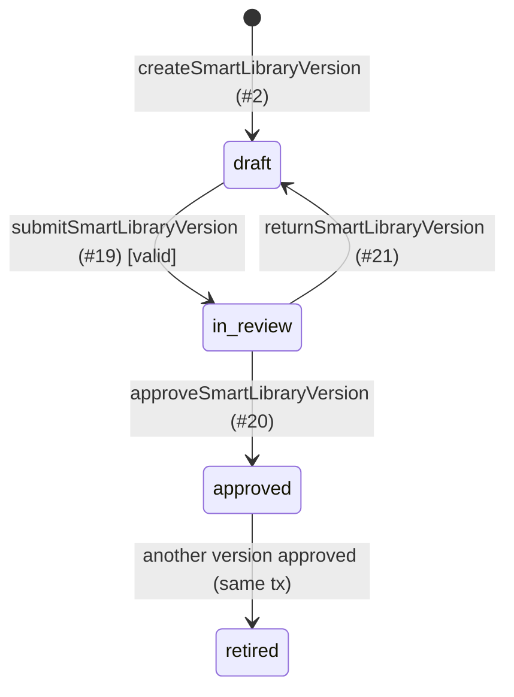
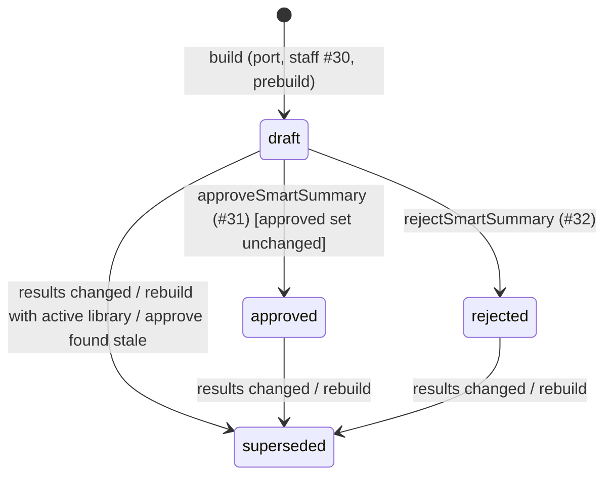
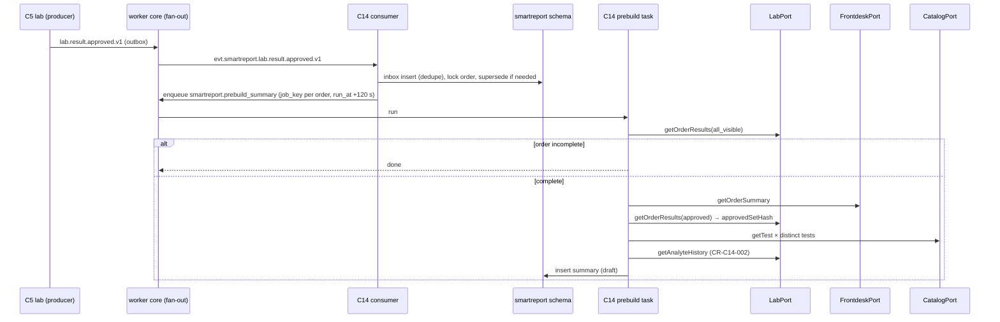
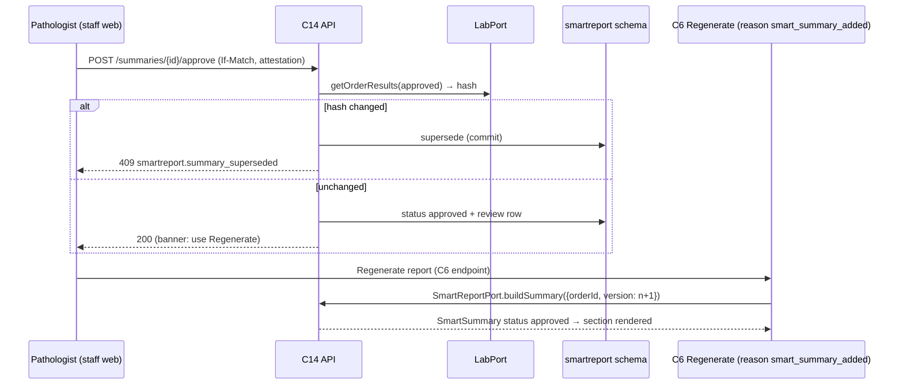
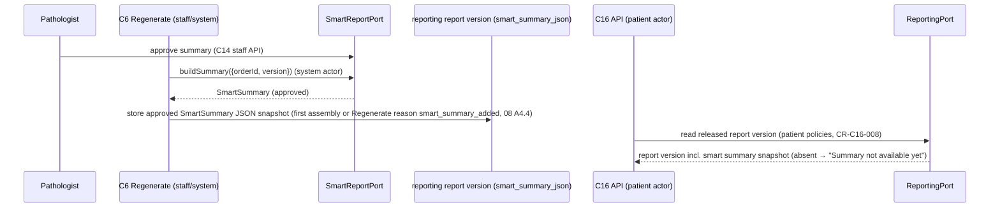

# C14 Smart Report — 03 App Flow

Status: DECISION, 2026-11-06. Read `01-PRD.md` and `02-TRD.md` first. Operation numbers (#n) refer to 02-TRD §5. Error codes marked (CR) come from CR-C14-004.

---

## 1. State machines

### 1.1 Library version (`smartreport.library_versions.status`)



| # | From | To | Trigger | Guard | Side effects | Events |
|---|---|---|---|---|---|---|
| L1 | (none) | `draft` | #2 | no other version in `draft`/`in_review` (partial unique index) else `409 smartreport.library_invalid_transition` (CR) | copy content from starter / active / chosen version; `version_no = max + 1` under advisory lock `smartreport:library:<tenant>` | — |
| L2 | `draft` | `draft` | #4, #6–#8, #10–#12, #14, #15, #17 | status `draft`; `If-Match` | row writes; removals (#8, #12, #15) set `is_active = false`, never DELETE (08 A17 P-18(a)); parent `updated_at`, `version + 1` (any child change bumps the parent version so a submit always sees a fresh `If-Match`) | — |
| L3 | `draft` | `in_review` | #19 | validation V1–V14 has no error; `If-Match` | `content_sha256` = SHA-256 of canonical library JSON; `submitted_at/by`; `library_reviews` `submitted` | — |
| L4 | `in_review` | `draft` | #21 | `smartreport.template.approve` (privileged, aal2); `If-Match` | `returned_at/by`, `return_comment`; `library_reviews` `returned` | — |
| L5 | `in_review` | `approved` | #20 | `smartreport.template.approve`; `attestation = true`; recomputed `content_sha256` equals stored; `If-Match` | previous `approved` → `retired` (`retired_at`), then this → `approved` (`approved_at`, `approved_by_membership_id`, `approval_note`); `library_reviews` `approved` + `retired` | — |
| L6 | `approved` | `retired` | L5 of another version | — | — | — |

Forbidden (→ `409 smartreport.library_invalid_transition`): any edit outside `draft`; `draft → approved`; `retired → *`; `approved → draft`. The DB trigger rejects content changes outside `draft` with `immutable_row` (05-SCHEMA §4), mapped to `409 common.immutable_record` if the service check was bypassed.

Approver may be the author (DECISION: small labs may have a single pathologist; B14 names one owner). The approver identity is always recorded.

### 1.2 Summary (`smartreport.summaries.status`)



| # | From | To | Trigger | Guard | Side effects |
|---|---|---|---|---|---|
| S1 | (none) | `draft` | build (02-TRD §7.1 step 7c; #30; prebuild) | feature on; approved library; ≥ `min_mapped_results` eligible; no live summary with the same hash | content, hash, `input_result_versions`, counts; binding row when called with a report version |
| S2 | `draft` | `approved` | #31 | `smartreport.summary.approve` (privileged); `attestation = true`; `If-Match`; `LabPort.getOrderResults(approved).approvedSetHash` = stored hash | `approved_at/by`; `use_llm_text`; `summary_reviews` `approved` |
| S3 | `draft` | `superseded` | #31 when the hash differs | — | `superseded_reason = results_changed`; then `409 smartreport.summary_superseded` (CR) — the supersede commits (handler uses `ctx.commitOnError()` pattern of C0 02-TRD so the state change survives the error response; integration test asserts the row is `superseded` after the 409) |
| S4 | `draft` | `rejected` | #32 | `smartreport.summary.approve`; reason code; `If-Match` | `rejected_at/by`, reason; `summary_reviews` `rejected` |
| S5 | `draft`/`approved`/`rejected` | `superseded` | consumer (02-TRD §8.2), build with a new hash (§7.1 7b), #30 `rebuild_with_active_library` | — | `superseded_at`, `superseded_reason ∈ {results_changed, library_rebuild}`; `superseded_by_summary_id` stays NULL here (the successor does not exist yet: the live partial unique index requires the old row to leave live status first) |
| S6 | `superseded` | `superseded` | same transaction, right after the successor insert (§7.1 7c; #30 rebuild) | `OLD.superseded_by_summary_id IS NULL`; no other column changes except `updated_at`/`updated_by`/`version` (DB trigger, 08 A19 D-107) | one UPDATE sets `superseded_by_summary_id` NULL → successor id; a supersede without a successor (consumer; build that ends in `no_eligible_results`/`template_not_approved`) leaves it NULL |

Forbidden (→ `409 smartreport.summary_invalid_transition`, CR): approve/reject outside `draft`; any transition out of `superseded` other than S6; a second S6 on the same row; `rejected → approved`. Content columns are immutable from insert (05-SCHEMA §4); `llm_overlay` may change only while `draft`.

Port status mapping (CR-C14-006): `approved` → `approved`; `draft` and `rejected` → `draft`; `superseded` summaries are never returned. `smartreport.summary_not_ready` is never thrown by the port (08 A19 D-111).

---

## 2. API flows

### 2.1 Library authoring (pathologist / lab_manager, staff web → BFF → API)

1. **Create** (#2): `assertRole(template.manage)` → advisory lock → check no open version → copy source → insert all rows in one transaction → `201`.
2. **Edit** (#4, #6–#17): load version (RLS; other tenant → 404) → status must be `draft` → validate body (spec + combination rules; a rule's `block_id` must be an active block of the same version) → NFC-normalise texts → write (removals #8/#12/#15 deactivate the row; a block still referenced by an active rule → `422 smartreport.library_invalid`) → bump parent version → return DTO. Server-side placeholder extraction fills `placeholders[]`. Reads, validation, clone and the content hash use active rows only.
3. **Validate** (#18): read the whole version; run V1–V14 (02-TRD §9.4) including `CatalogPort.getTest` per distinct follow-up test → report (no writes).
4. **Submit** (#19): `If-Match` → validate (errors → `422 smartreport.library_invalid`, issues in `errors[]`) → L3.
5. **Approve** (#20): `assertRole(template.approve)` (privileged; aal2 re-validated by IdentityPort) → `If-Match` → recompute content hash; mismatch → `409 smartreport.library_invalid_transition` → L5 in one transaction → `200`.
6. **Return** (#21): L4.

### 2.2 Event consumers (worker, system actor)

`evt.smartreport.lab.result.approved.v1` / `…amended.v1` — exactly as 02-TRD §8.2. Steps: inbox → advisory lock → supersede decision from `input_result_versions` → enqueue prebuild (debounced). No port call except `IdentityPort.getTenantSettings` (feature flag) and a library-exists check.

### 2.3 Prebuild task

1. Flag off or no approved library → finish.
2. `LabPort.getOrderResults({scope: 'all_visible'})`; if any non-cancelled result is not `approved` → finish (incomplete order).
3. `buildOrGet(mode: 'prebuild')` = 02-TRD §7.1 steps 3–7 without a binding row.
4. `smartreport.no_eligible_results` / `template_not_approved` → finish successfully (expected outcomes, counted in `lims_smartreport_builds_total{outcome}`).

### 2.4 `SmartReportPort.buildSummary` (staff/system actors only — 08 A2.3)

See 02-TRD §7.1 for the algorithm. Decision summary:

| Situation | Building actor (system/user) |
|---|---|
| Flag off | throw `feature_disabled` |
| No approved results | throw `no_eligible_results` |
| Live summary, same hash, `approved` | return `approved` + binding |
| Live summary, same hash, `draft`/`rejected` | return `draft` + binding |
| Live summary, different hash | supersede, build new `draft` + binding |
| No live summary, no approved library | throw `template_not_approved` |
| No live summary, < `min_mapped_results` eligible | throw `no_eligible_results` |
| No live summary, eligible | build `draft` + binding |

Patient/portal/partner actors are not callers (08 A2.3); the former read-only column is withdrawn. They read the approved snapshot C6 stores on the report version, via `ReportingPort` / portal reads.

### 2.5 Staff build / rebuild (#30)

`assertRole(summary.approve, centreId = order centre)` → `mode = current`: same as building-actor path (no binding row) → `201` if built, `200` if existing. `mode = rebuild_with_active_library`: if the live summary's library is the active one → `200` existing (no-op); else supersede (`library_rebuild`) and build with the active library → `201`. Idempotency-Key required.

### 2.6 Review (#28, #31, #32)

1. Pathologist opens the queue (#27) → selects a draft → detail (#28): DTO incl. `review_inputs` (values from `LabPort.getOrderResults({scope: 'approved'})`), `ctx.audit.access({action: 'smart_summary.view', entityType: 'smart_summary', entityId, outcome: 'success'})` (08 §4.4).
2. Approve (#31): S2 or S3. Reject (#32): S4.
3. After approval the UI shows the banner "Approved. The PDF report will include this summary the next time it is generated. Use Regenerate on the report screen to add it now." with an "Open order results" link to route `staff.lab.order_results` (`/lab/orders/{order_id}/results`, 03-IC §7) by `order_id`, shown only to holders of `lab.result.read` [CONV choice between the two order routes] — C14 stores no report id and is not a ReportingPort consumer, so it does not link to `staff.reporting.report` (review C14 #12). DECISION aligns with C6 E23 (no automatic new version).

### 2.7 Preview (#22)

`assertRole(template.manage)`; with `order_id` also `assertRole(lab.result.read, centreId)`; run the engine against the **draft** (or any) version in memory; no insert, no binding; access log action `smart_summary.view` with entityType `smart_summary_preview`. Fixture codes use `packages/test-fixtures` synthetic results.

### 2.8 Deny terms (#23–#25)

Create inserts a tenant row (NFC, case-folded copy stored for matching). Deactivate sets `is_active = false`. Global rows are read-only and listed with `scope: 'global'`.

### 2.9 LLM rephrase (Phase 3)

1. #33: flags `smart_report` and `smart_report_llm` on (else `403 smartreport.feature_disabled`); summary `draft` (else `409 summary_invalid_transition`); `summary_reviews` action `llm_rephrase_requested`; enqueue `smartreport.llm_rephrase` (job key `smartreport:llm:<summary_id>`) → `202`.
2. Task: re-check flags and status; build items from content (template text before placeholder filling); call `LlmRephraser`; validate (02-TRD §4.12); in one tx insert `llm_runs` and set `llm_overlay` = `{ run_id, items: { itemRef → text } }` for passed items if the summary is still the same version and `draft`; else store the run only.
3. Reviewer sees the diff, approves with `use_llm_text` true/false.

### 2.10 Rendering (C6 renderer, no IO)

C6 assembly stores the approved `SmartSummary` in the report snapshot (C6-TRD §4.3 `smart`). At render, C6 calls `smartSectionRenderer.renderSections({summary, calendarDisplay, timezone})`; C14 returns an HTML fragment (04-UI-UX §4); C6 sanitises and inserts it.

---

## 3. Sequence diagrams (cross-chunk)

### 3.1 Results approved → draft ready for review



### 3.2 C6 assembly calls the port

```mermaid
sequenceDiagram
  participant C6 as C6 assembly (system actor, tx)
  participant SR as SmartReportPort (C14)
  participant IP as IdentityPort
  participant FP as FrontdeskPort
  participant LP as LabPort
  participant DB as smartreport schema
  C6->>SR: buildSummary({orderId, version: n})
  SR->>IP: getTenantSettings(featureFlags)
  alt smart_report off
    SR-->>C6: throw smartreport.feature_disabled → C6 omits section
  end
  SR->>FP: getOrderSummary
  SR->>LP: getOrderResults(approved)
  SR->>DB: advisory lock; live summary?
  alt same hash exists
    SR->>DB: insert binding (n)
    SR-->>C6: SmartSummary (status approved or draft)
  else none / different hash
    SR->>DB: supersede old; build draft; insert binding
    SR-->>C6: SmartSummary (status draft) → C6 omits section (only approved is printed)
  end
```

### 3.3 Pathologist approves → report regenerated (C6, manual)



### 3.4 Amendment end to end

```mermaid
sequenceDiagram
  participant C5 as C5 (amend HGB v2)
  participant CON as C14 consumer
  participant C6 as C6 (amended version)
  participant SR as SmartReportPort
  C5->>CON: lab.result.amended.v1
  CON->>CON: live summary contains HGB v1 → superseded (results_changed); enqueue prebuild
  C5->>C6: lab.order.ready_for_report.v1 (contains_amendment)
  C6->>SR: buildSummary({orderId, version: 2})
  SR-->>C6: new draft (old one never returned) → section omitted in amended version
  Note over CON,SR: if C6 calls before the consumer ran, buildSummary itself sees the new hash and supersedes (AC-15.4)
```

### 3.5 Patient app read (C16) — via C6 snapshot (08 A2.3)



C16 never calls `SmartReportPort`; `smartreport.*` has no patient RLS policies.

### 3.6 LLM rephrase (Phase 3)

```mermaid
sequenceDiagram
  participant P as Pathologist
  participant API as C14 API
  participant T as llm_rephrase task
  participant M as self-hosted model (Nepal; adapter BLOCKED)
  P->>API: POST /summaries/{id}/llm-rephrase
  API->>API: flags on? draft? → enqueue
  API-->>P: 202
  T->>M: items (approved template text, placeholders unfilled)
  M-->>T: rephrased items
  T->>T: validator L1–L8 (failed items keep template text)
  T->>API: insert llm_runs; set llm_overlay (if still draft)
  P->>API: approve {use_llm_text: true|false}
```

---

## 4. Screen states (staff web; screens in 04-UI-UX)

| Screen | Empty | Loading | Error | Success | Permission denied |
|---|---|---|---|---|---|
| SR-01 Review queue | "No summaries waiting for review." (+ hint when feature off: banner "Smart report is switched off for this lab." with link for tenant admins) | `LoadingSkeleton table` | `ErrorState` with request id + Retry | table; toast after approve/reject when returning from SR-02 | `403` page from shell ("You don't have access to smart summaries.") |
| SR-02 Summary review | n/a (404 → "Summary not found or not visible") | `LoadingSkeleton detail` | `ErrorState`; `409 summary_superseded` → Banner "Results changed after this summary was built. A new summary will be prepared." + link to queue | approved/rejected banners; superseded read-only view with link to successor | review actions hidden without `summary.approve`; page denied without `summary.read` |
| SR-03 Library versions | "No library yet. Start from the starter draft." + button (needs `template.manage`) | skeleton table | ErrorState | list | denied page |
| SR-04 Library editor | per tab: "No blocks yet", "No rules yet", "No analytes mapped yet — summaries need at least {min} mapped results" | skeleton form | field errors via `Form problem`; `409 library_invalid_transition` → Banner "This version is no longer a draft." + reload | toast "Saved" | read-only view for non-draft; denied page without `template.manage` |
| SR-05 Library review/approve | n/a | skeleton | ErrorState; `409` → Banner + reload | Banner "Approved — this version is now active." | approve/return buttons hidden without `template.approve`; `auth.mfa_required` → shell step-up flow |
| SR-06 Wording terms | "No lab-specific terms. Global terms always apply." | skeleton | ErrorState | toast | denied page |
| Preview dialog | `no_eligible_results` → "Not enough mapped results in this order to build a summary." | Spinner | ErrorState | rendered preview | button hidden without permission |

---

## 5. Edge cases

| # | Case | Behaviour |
|---|---|---|
| E1 | Two C6 assembly transactions call `buildSummary` for the same order concurrently | advisory lock serialises; second sees the first's row; one summary, two binding rows |
| E2 | Consumer and port race on an amendment | both supersede idempotently (UPDATE … WHERE status IN live); successor built once (lock) |
| E3 | Duplicate event delivery | inbox no-op |
| E4 | Approved event delivered after the summary that already includes it | no change (AC-15.3) |
| E5 | Pathologist approves while a newer result is approved concurrently | approval tx re-reads the hash after taking the advisory lock; consumer also takes it → either approval commits first and the consumer supersedes, or the consumer commits first and approval returns `summary_superseded` |
| E6 | Library approved while drafts exist | drafts keep their pinned version; rebuild per summary if wanted (#30) |
| E7 | Follow-up test deactivated after approval | skipped at build (AC-12.2); validation warning for the next draft |
| E8 | Catalogue analyte deactivated | still readable (03-IC §4.2 invariant); mapping still applies; validation warning V13 |
| E9 | Result unit changed between visits | earlier points with a different unit are excluded from the trend (AC-13.4) |
| E10 | Patient merge in C4 | history follows `patient_id` only (C5 PRD Q3); trends may be shorter — no special handling |
| E11 | C6 transaction rolls back after `buildSummary` wrote a draft | the draft and binding roll back too (port runs in the caller's tx); the next assembly rebuilds |
| E12 | Duplicate submission of #2/#30/#33 | `Idempotency-Key` replay (02-CV §4.5) |
| E13 | Stale `If-Match` on edit/approve | `409 common.version_conflict`; UI reloads and shows the newer version |
| E14 | Feature switched off while drafts exist | port throws `feature_disabled`; queue still readable; approvals still allowed (switch back on later) |
| E15 | Order cancelled | C5 forbids cancelling orders with approved results (03-IC §10.4); summaries exist only for approved results, so nothing to do |
| E16 | LLM endpoint down | task retries (3), then run `failed`; summary stays reviewable with template text |
| E17 | LLM overlay arrives after approval | overlay not applied (status no longer `draft`); run stored for audit |
| E18 | Offline | staff web only; no offline mode; BFF errors shown as ErrorState |
| E19 | Very large order (> 200 results) | engine handles any size up to 2,000 approved result versions [CONV] (`summaries__inputs__ck`, 05-SCHEMA §2.8); a larger approved set → `smartreport.no_eligible_results` with log reason `too_many_results` (no insert, no CHECK violation). Lists are bounded by caps except `deranged` (all listed — DECISION: hiding a deranged result would mislead) |
| E20 | Devanagari library but C6 renderer font missing | C6 bundles Noto Sans Devanagari (04 S14); C14 renderer test asserts `lang="ne"` markup only |
