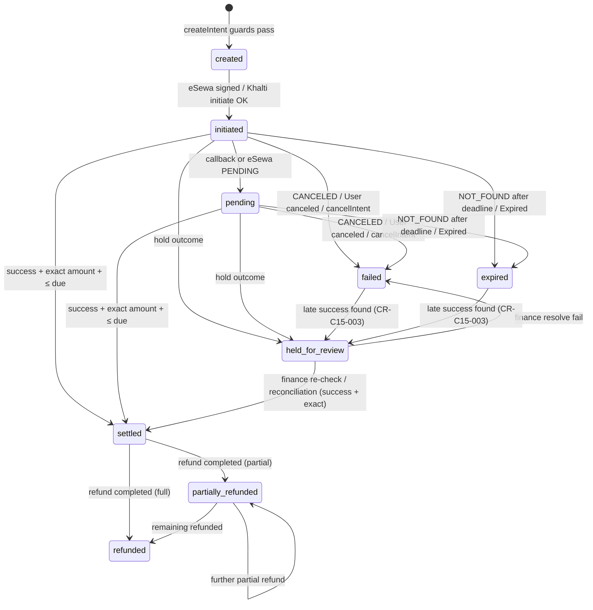
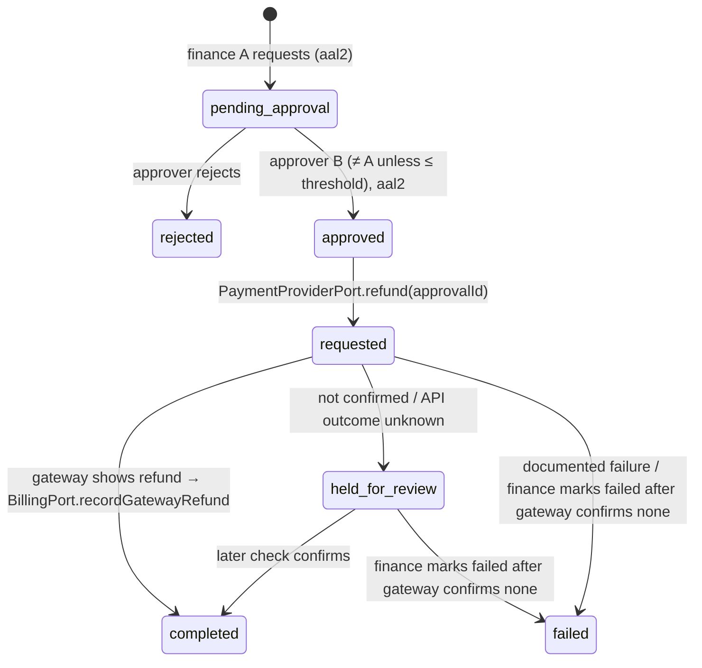
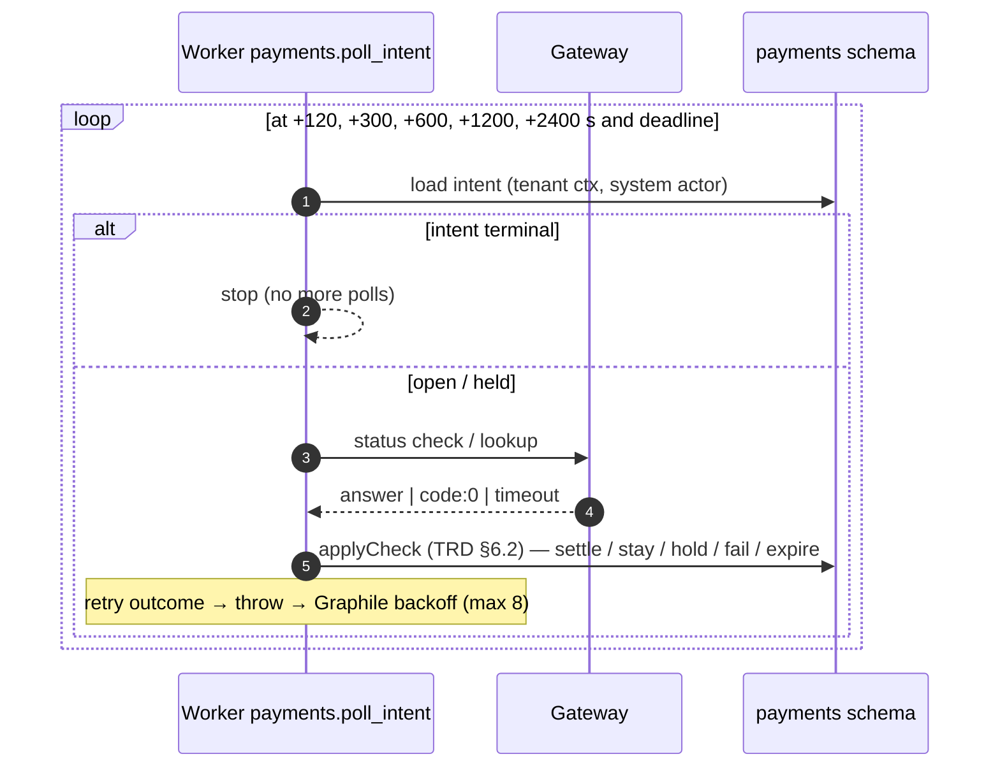

# C15 — Payment Gateways — 03 App Flow

Status: DECISION draft, 2026-11-06. Algorithms are in `02-TRD.md` §6–§7 (referenced as TRD §x); this file gives the step order, the state machines, the cross-chunk sequences, screen states and edge cases. Mermaid diagrams use synthetic ids.

## 1. State machines

### 1.1 Payment intent (03-IC §10.6 + CR-C15-003)



Guards and side effects: TRD §4.1 (I1–I14). Every transition writes a `payments.intent_transitions` row (cause, actor type, reason). Only `→ settled` calls `BillingPort.recordGatewayPayment` and publishes `payments.intent.settled.v1`, in one transaction.

### 1.2 Refund



### 1.3 Reconciliation run and finding

Run `running → completed | failed`. Finding `open → resolved` (resolution code required; `other` needs a note).

## 2. Flows

### 2.1 F-01 Front-desk eSewa checkout (C4 owns the UI and endpoint)

```mermaid
sequenceDiagram
  autonumber
  participant UI as C4 Pay-by-QR dialog
  participant BL as C4 billing API (B12)
  participant PP as C15 PaymentProviderPort
  participant FD as FrontdeskPort (C4)
  participant BP as BillingPort (C4)
  participant DB as payments schema
  UI->>BL: POST /v1/billing/orders/{order}/payment-intents {gateway:"esewa"} + Idempotency-Key
  BL->>PP: createIntent({orderId, gateway, idempotencyKey, returnUrl:LIMS_FRONTDESK_PAYMENT_RESULT_URL, cancelUrl:LIMS_FRONTDESK_PAYMENT_RESULT_URL})
  PP->>DB: lookup idempotency key (replay?)
  PP->>FD: getOrderSummary(orderId) → centre, status
  PP->>BP: getOrderBalance(orderId) → balanceDue 225000
  PP->>DB: INSERT intent created (ON CONFLICT DO NOTHING)
  PP->>PP: sign total_amount,transaction_uuid,product_code (HMAC-SHA256, Base64)
  PP->>DB: UPDATE → initiated; enqueue poll jobs (+120…+2400 s, deadline)
  PP-->>BL: {intentId, amount, action:{form_post, url, fields, launchUrl}, expiresAt}
  BL-->>UI: action (C4 shows a QR of launchUrl + "Open on this PC" opening launchUrl in a new window; never posts fields)
```

Steps (TRD §6.1): validation → replay check → fonepay block → merchant account → order status → balance → gateway amount rule → insert → sign → initiated → schedule polls → return.
Return-URL rule (08 A19 D-113, CR-C15-016 to C4): C4 passes `returnUrl = cancelUrl = ${LIMS_FRONTDESK_PAYMENT_RESULT_URL}` (C4 config, set by C1 to `<LIMS_PAYMENTS_PUBLIC_BASE_URL>/v1/payments/result`) because the patient's phone (which scanned the QR) is not logged in to staff web. The callback appends `intent_id` and `outcome`; P34 accepts `intent_id` as an optional ignored parameter, so the page renders (TRD §5.2). For `form_post` C4 shows a QR of `action.launchUrl` and an "Open on this PC" button that opens `launchUrl` in a new window; C4 never posts `fields` itself. C4 B12 lists `payments.amount_not_supported` and `payments.return_url_not_allowed` in its `x-error-codes` (propagated unchanged).

### 2.2 F-02 Patient pays on the eSewa page and comes back

```mermaid
sequenceDiagram
  autonumber
  participant B as Patient browser
  participant API as C15 public routes
  participant ES as eSewa
  participant DB as payments schema
  participant BP as BillingPort (C4)
  participant OB as core.event_log (outbox)
  B->>API: GET /v1/payments/launch/{token}
  API-->>B: 200 HTML form (no JS, Referrer-Policy no-referrer)
  B->>ES: POST form (signed fields)
  ES-->>B: 302 → success_url ?data=<Base64> (param name UNVERIFIED)
  B->>API: GET /v1/payments/callbacks/esewa/{token}/success?data=…
  API->>API: resolver: sha256(token) → tenant, intent (DEFINER)
  API->>DB: INSERT callbacks (redacted, signature_valid)
  API->>DB: initiated → pending
  API->>ES: GET status?product_code&total_amount&transaction_uuid
  ES-->>API: {"status":"COMPLETE","totalAmount":2250.0,"refId":"SYNREF01"}
  API->>DB: SELECT … FOR UPDATE; re-check open
  API->>BP: getOrderBalance (225000 ≥ 225000)
  API->>DB: UPDATE → settled WHERE status open AND version=v
  API->>BP: recordGatewayPayment(intent, order, esewa, txnRef, 225000, verifiedAt)
  BP-->>API: {ledgerEntryId, duplicate:false, balance}
  API->>OB: publish payments.intent.settled.v1
  API-->>B: 303 → returnUrl?intent_id=…&outcome=settled
```

Failure branch: eSewa sends the browser to `failure_url` → P32 → same check; `CANCELED` → `failed` → 303 to `cancelUrl?…&outcome=failed`; `NOT_FOUND` before the deadline → stays `pending` → `outcome=pending`.

### 2.3 F-03 Khalti checkout and return

```mermaid
sequenceDiagram
  autonumber
  participant C as Caller (C4 / C16 / C6)
  participant PP as C15 PaymentProviderPort
  participant KH as Khalti
  participant B as Patient browser
  participant API as C15 public route
  C->>PP: createIntent({gateway:"khalti", …})
  PP->>KH: POST /api/v2/epayment/initiate/ (Authorization: Key …) {return_url, website_url, amount:225000, purchase_order_id:<intent>, purchase_order_name}
  KH-->>PP: {pidx, payment_url, expires_at, expires_in}
  PP-->>C: {action:{redirect, url:payment_url}, expiresAt}
  B->>KH: open payment_url, pay
  KH-->>B: redirect return_url ?pidx&status=Completed&transaction_id&…&mobile
  B->>API: GET /v1/payments/callbacks/khalti/{token}?…
  API->>API: record callback (mobile dropped); compare pidx/purchase_order_id with stored
  API->>KH: POST /api/v2/epayment/lookup/ {pidx: <stored>}
  KH-->>API: 200 {"status":"Completed","total_amount":225000,"transaction_id":"SYNTXN01","refunded":false}
  API->>API: settle (as F-02 steps 10–14)
  API-->>B: 303 → returnUrl?intent_id&outcome=settled
```

Body `status` decides; HTTP 400 with `User canceled` → `failed`, `Expired` → `expired`. Initiate failure → the caller's request fails with `503 payments.gateway_not_available` and nothing is stored.

### 2.4 F-04 Patient app (C16) hosted redirect (worker / system-actor flow — 08 R8)

```mermaid
sequenceDiagram
  autonumber
  participant APP as Patient app (C16)
  participant ENG as C16 API module (patient actor)
  participant W as C16 worker (engagement system actor)
  participant PP as C15 PaymentProviderPort
  participant SB as System browser
  participant GW as eSewa / Khalti
  participant API as C15 public routes
  APP->>ENG: "Pay due"
  ENG->>ENG: check order ownership in engagement tables; INSERT payment_requests; enqueue engagement.create_payment_intent
  ENG-->>APP: payment_request_id (status pending)
  W->>PP: createIntent({orderId, gateway, idempotencyKey, returnUrl:"<PORTAL>/app/payments/<payment_request_id>/done", cancelUrl:"<PORTAL>/app/payments/<payment_request_id>/done"})
  PP-->>W: action (form_post+launchUrl | redirect)
  W->>W: UPDATE payment_requests (ready, action — no secrets; signed fields only)
  APP->>ENG: status? → ENG reads payment_requests only
  ENG-->>APP: ready + launchUrl or redirect url
  APP->>SB: open URL (external browser / custom tab)
  SB->>GW: pay
  GW-->>SB: redirect to C15 callback
  SB->>API: callback → verify server-side → 303 app link ?intent_id&outcome
  SB-->>APP: OS opens app link
  APP->>ENG: status? → ENG reads payment_requests; if ready and last checked ≥ 3 s ago, enqueue engagement.refresh_payment_request (job_key per request)
  W->>PP: getIntent({intentId}) (system actor) → UPDATE payment_requests
  ENG-->>APP: settled → show "Paid" (server state only — REQ-SEC-059)
```

Rules for C16: C16 checks the patient's ownership, then calls the port from its worker as system actor; patient (and portal) actors never call `PaymentProviderPort` or `BillingPort` (08 R8). Never render "Paid" from the `outcome` query parameter or a gateway SDK result; the app polls C16's `payment_requests` status every 3 s for up to 60 s [CONV] (C16 refreshes it through `getIntent` in its worker), then shows "We are confirming your payment"; the order's due stays the source of truth. The app never sees merchant secrets (the eSewa form fields contain only the signature, 04 P3) — REQ-SEC-107.

### 2.5 F-05 Web-portal dues payment (C6 worker / system-actor flow — 08 A11.1, CR-C15-010 ACCEPT-MODIFIED)

```mermaid
sequenceDiagram
  autonumber
  participant PB as Patient browser (portal, report link)
  participant RP as C6 portal API (portal actor)
  participant RW as C6 worker (reporting system actor)
  participant BP as BillingPort (C4)
  participant PP as C15 PaymentProviderPort
  participant GW as eSewa / Khalti
  participant API as C15 public routes
  PB->>RP: "Pay due" (link token + OTP session)
  RP->>RP: INSERT reporting.portal_payment_requests; enqueue C6 job (Idempotency-Key required, 02-CV §4.5)
  RW->>BP: getOrderBalance(orderId) (amount shown by C6; never sent to C15)
  RW->>PP: createIntent({orderId, gateway, idempotencyKey, returnUrl:"<PORTAL>/r/payments/<portal_payment_request_id>/done", cancelUrl: same})
  PP-->>RW: action (form_post+launchUrl | redirect)
  RW->>RW: UPDATE portal_payment_requests (ready, action)
  PB->>RP: status? → RP reads portal_payment_requests only
  PB->>GW: open launchUrl / redirect url, pay
  GW-->>PB: redirect to C15 callback
  PB->>API: callback → verify server-side → settle (recordGatewayPayment in the settle tx) → 303 portal.payment_done ?intent_id&outcome
  PB->>RP: done page → C6 refreshes its row through RW → getIntent({intentId})
  RP-->>PB: "Paid" only when getIntent reports settled (REQ-SEC-059)
```

Rules (same pattern as F-04): the portal actor never calls `PaymentProviderPort` or `BillingPort` (08 R8); the C6 worker calls `createIntent`/`getIntent` only. The amount C15 charges is its own `BillingPort.getOrderBalance` read at `createIntent` (TRD §6.1 step 6). Ledger entry as for every gateway payment: C15 calls `BillingPort.recordGatewayPayment` inside its settle transaction (03-IC X3, canonical); C4's `payments.intent.settled.v1` consumer is the idempotent safety net (08 A19 D-115, replacing A11.1 bullet 4). The return/cancel URL is route `portal.payment_done` (owner C6) and is admitted by the default allowlist entry `${LIMS_ORIGIN_PORTAL}/`. Before C15 ships, the C0 phase stub reports gateways unavailable and the portal shows the balance and "pay at the counter or in the app" with no payment button (08 A11.1). C6 specifies its own table, job and screens.

### 2.6 F-06 Polling, final check and sweep



Sweep (`*/15`): open intents past the deadline without a check in the last 15 min → enqueue a poll now; gauge `lims_payments_open_intents_past_deadline`.

### 2.7 F-07 Finance resolves a held intent (staff web `/payments/review`)

1. Finance opens the queue (P1 `status=held_for_review`, sorted oldest first).
2. Opens an intent (P2) → sees hold reason, gateway checks, callbacks.
3. "Re-check" (P3) → `applyCheck` (min interval applies: within 10 s of the last gateway check → `429 common.rate_limited`, UI toast) → may settle immediately.
4. "Resolve" (P4, `If-Match`):
   - `settle` → forced check must be success + exact amount (+ ≤ due) → `settled` (I8) with ledger + event; else `409 payments.intent_not_verifiable`.
   - `record_exceeding_due` (only `hold_reason = exceeds_due`) → forced check success + exact → `recordGatewayPayment(…, allowExceedsDue:true)` (CR-C15-002) → C4 opens a finance review item → `settled`.
   - `fail` (reason required) → only when the latest check is not success → `failed`.
5. Access-log entry `ctx.audit.access({action: 'payment_intent.resolve', entityType: 'payment_intent', entityId, outcome})` (08 §4.4; 08 A19 D-112).

### 2.8 F-08 Daily reconciliation

```mermaid
sequenceDiagram
  autonumber
  participant CR as Cron 20:40 UTC (per tenant)
  participant W as payments.reconcile_tenant
  participant GW as Gateways
  participant BP as BillingPort (C4)
  participant DB as payments schema
  CR->>W: enqueue (tenant)
  W->>DB: stalled run (running, no update for 2 h)? → failed (stalled)
  W->>DB: INSERT run running (one running per tenant; business_date = Kathmandu date − 1)
  W->>W: enqueue payments.reconcile_batch (phase intents)
  loop each batch job (≤ 50 candidates, own transaction; candidates relative to run.started_at)
    loop each candidate (concurrency 2), inside ctx.db.tx savepoint
      W->>GW: check
      W->>DB: applyCheck (reconciliation mode)
      alt settled intent
        W->>BP: recordGatewayPayment (idempotent)
        BP-->>W: duplicate:true (expected) | duplicate:false → ledger_entry_missing (ledger_repaired) | billing.payment_exceeds_due → ledger_entry_missing (none, no retry)
      end
      W->>DB: finding rows per TRD §6.7 (refund not visible → unconfirmed_run_count + 1; finding at 2)
    end
    W->>DB: add batch counts to run; enqueue next batch (then phase refunds)
  end
  W->>DB: last batch → run completed + counts; metric last_success
```

### 2.9 F-09 Refund (manual mode — default)

```mermaid
sequenceDiagram
  autonumber
  participant FA as Finance A
  participant FB as Finance B
  participant API as C15 staff API
  participant BP as BillingPort (C4)
  participant GW as Gateway merchant dashboard / status API
  FA->>API: POST /v1/payments/intents/{id}/refunds {refund_amount_paisa, reason_code} (aal2)
  API->>BP: getOrderBalance → refundable = max(0, −balanceDue)
  API-->>FA: 201 pending_approval
  FB->>API: POST /v1/payments/refunds/{rid}/approve (aal2, If-Match)
  API->>API: PaymentProviderPort.refund(approvalId = rid) → requested (manual)
  FB->>GW: refunds in the gateway merchant dashboard (outside the system)
  FB->>API: POST /v1/payments/refunds/{rid}/confirm-manual {gateway_refund_reference, refunded_on}
  API->>GW: status check / lookup
  alt gateway shows FULL_REFUND/PARTIAL_REFUND or Refunded/Partially Refunded
    API->>BP: recordGatewayRefund (CR-C15-002), same tx
    API-->>FB: completed; intent refunded / partially_refunded
  else not visible yet
    API-->>FB: held_for_review (daily re-check)
  end
```

API mode (Khalti only, tenant flag, UNVERIFIED API): after approval `payments.execute_refund` (1 attempt) → lookup first (skip if already refunded) → POST refund → `payments.check_refund` → same confirmation as above.

Re-check (P7b, `payments.intent.resolve`): finance re-runs the refund check in-request (min interval 10 s → `429 common.rate_limited`); confirmed → `completed` + `recordGatewayRefund`; else `held_for_review`.

Mark failed (P11b, `payments.refund.approve`, aal2, If-Match): allowed from `requested`/`held_for_review`; C15 checks the gateway first (read-only). Gateway shows a refund → `409 payments.refund_not_allowed` (nothing written; use Re-check). No refund → `failed` with a `refund_fail_reasons` code and note; no ledger row; a new refund request for the intent is possible.

### 2.10 F-10 Static-QR worksheet (Fonepay interim, B8)

1. Finance selects business date (+ optional centre) → P18 preview shows system entries and total for method `fonepay_qr` (from `billing.v_pub_payment_collection`).
2. Enters the bank-statement total and reference; note required if the difference ≠ 0.
3. P19 stores the worksheet; status `matched` or `accepted_with_difference`. Individual entries are matched in C4's ledger list (C4 B11, filter `method_code = fonepay_qr`); corrections are C4 reversals.

### 2.11 F-11 Merchant account setup

1. Tenant admin (aal2) opens `/payments/settings` → P20 list (6 slots: 3 gateways × 2 environments; only the deployment's environment is editable).
2. Enters product code (eSewa) or website URL (Khalti) and the secret (write-only `SecretField`) → P21 → encrypted (TRD §6.9) → response shows `secret.is_set`, fingerprint.
3. "Test connection" → P22 → outcome text (§04-UI-UX §2.6).
4. Toggle "Enabled" → P21 (requires secret set and, for production, `environment = production`).

### 2.12 F-12 Cancel an open intent (C4 dialog "Cancel payment" or finance screen)

P5 / `cancelIntent` → forced check → paid → `settled` (UI says "Payment was already received"); otherwise `failed (abandoned)`; final check job at the deadline stays queued. From C4's dialog the staff BFF calls C15 P5 and P24b `listPaymentCancelReasons` directly (`payments.intent.create`, held by `front_desk`; 08 A19 D-113); there is no C4 cancel endpoint.

## 3. Screen states (staff web)

| Screen | Empty | Loading | Error | Success | Permission denied |
|---|---|---|---|---|---|
| Review queue `/payments/review` | "No payments need review." | `LoadingSkeleton variant=table` | `ErrorState` with request id + Retry | table rows | nav entry hidden; direct URL → 403 page "You don't have access to payment review." |
| Intent detail `/payments/intents/{id}` | n/a (404 → "Payment not found") | `variant=detail` | `ErrorState` | detail + timeline; toast after actions | 403 page; actions hidden without `payments.intent.resolve` |
| Refunds `/payments/refunds` | "No refunds yet." | table skeleton | ErrorState | table | 403 page; Approve hidden without `payments.refund.approve`; own requests show "Needs a second approver" |
| Reconciliation `/payments/reconciliation` | "No reconciliation runs yet. The first run happens tonight." | table skeleton | ErrorState | runs + findings tabs | 403 page |
| Static QR `/payments/static-qr` | "No worksheets yet." | form skeleton | ErrorState | list + form | 403 page |
| Settings `/payments/settings` | slots shown "Not configured" | form skeleton | ErrorState | slots | read-only view with `merchant_config.read`; 403 without |

Step-up: any privileged action at `aal1` → `403 auth.mfa_required` → shell shows C2's step-up prompt, then the action is retried by the user.

## 4. Public pages

| Page | States |
|---|---|
| Launch (P30) | intent open → form with button; intent settled → 303 result `settled`; failed/expired → result `failed`; held → result `pending`; unknown token → result `unknown` |
| Result (P34) | four outcomes, static text (TRD §7.5) |

## 5. Edge cases

| Case | Behaviour |
|---|---|
| Double-click "Pay by QR" (same Idempotency-Key) | C0 HTTP idempotency replays C4's response; port replay returns same intent (`replayed: true`) |
| Two staff start payments for the same order (different keys) | second gets `409 payments.intent_open_exists` (partial unique index; concurrent inserts → one wins, other `ON CONFLICT` → re-read → error) |
| Patient switches from Khalti to eSewa | operator cancels (F-12) then creates a new intent |
| Callback replayed 10× / callback + poll + recheck concurrently | first `FOR UPDATE` holder applies; others see terminal status; conditional `UPDATE … WHERE status IN open AND version = v`; BillingPort idempotent on `(gateway, gateway_txn_ref)` → one ledger row |
| Callback arrives after the final check expired the intent | recorded as `payments.callback_stale`; check still runs; success → `held_for_review (late_payment_found)` |
| Gateway down (`code: 0`, 5xx, timeout) during callback | status unchanged; poll enqueued; browser sees `pending` |
| Gateway says success but amount differs | `held_for_review (amount_mismatch)`, page alert, no ledger write |
| Cash part payment recorded while the patient is paying by wallet | verified amount > new due → `held_for_review (exceeds_due)`; finance "Record anyway" → C4 review item (refund or keep as advance) |
| Order cancelled + invoice credited while an intent is open | at settle, balance ≤ 0 → `exceeds_due` hold; finance records and refunds per C4 flow |
| BillingPort throws during settle (e.g. C4 `billing.amount_mismatch` on its `payment_intent_refs`) | whole unit rolled back; callback → SAVEPOINT rollback + poll enqueued; job retries; after 8 attempts → dead letter + alert (no partial settle possible) |
| Merchant account disabled while intents are open | `verify` still checks with the stored credentials until terminal (row kept, `is_enabled=false` only blocks new intents); deleting is impossible (no DELETE grant) |
| KEK rotated | old key id kept in the KEK file until rewrap finished; decrypt uses the row's `secret_kek_id` |
| Worker down for hours | intents stay open; sweep and reconciliation catch up; open-past-deadline gauge alerts |
| eSewa appends unknown query params | strict validation → 400 to the browser (UNVERIFIED risk, TRD §5.2); polling settles; PG-T21 fixes the spec before go-live |
| Token leaked (QR photographed) | holder can only open the launch page (pays the same order) or trigger verification; no data returned |
| Offline staff PC | C4 UI shows API unreachable; patient's payment still verified by callback/poll on the server |
| Duplicate refund request | partial unique index (one in flight) → `409 payments.refund_not_allowed`; same key replay → same refund |
| Refund approved but gateway refund never done | stays `requested` → sweep → `check_refund` → `held_for_review` (`refund_not_visible`); each daily run increments `unconfirmed_run_count`, finding `refund_unconfirmed` at 2; finance confirms with the provider and uses P11b "Mark failed", which frees the in-flight slot |
| Throttled callback / launch hit | `payments.callbacks` row with `outcome_code = rate_limited`; no gateway call; redirect by stored status |
| Reconciliation batch job dead-lettered | run stays `running`; next cron tick marks it `failed` (`stalled`) after 2 h without progress and starts a new run; 26 h alert |
| Fonepay chosen anywhere | `503 payments.gateway_not_available` |
