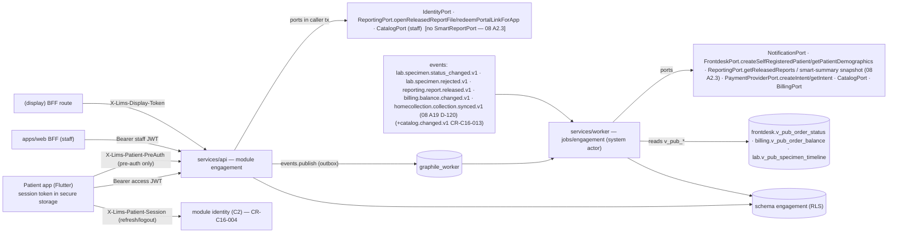

# C16 — Patient Engagement — 02 TRD

Status: DECISION draft, 2026-11-06. Reads with `01-PRD.md`. Names match `program/03-INTERFACE-CATALOG.md` (03-IC) and `program/02-CONVENTIONS.md` (02-CV). Anything new is marked **(CR-C16-nnn)** and specified in §15; C16 builds as if accepted, against fakes, until merged.

## 1. Owned paths

| Path | Content | Source |
|---|---|---|
| `apps/patient_app/**` | Flutter patient app (package `patient_app`) | 01 §3 |
| `services/api/src/modules/engagement/**` | API module `engagement` | 01 §3 module table |
| `services/worker/src/jobs/engagement/**` | consumers, tasks, cron | 01 §3 module table |
| `apps/web/src/app/(staff)/engagement/**`, `apps/web/src/features/engagement/**` | staff screens | 01 §3 module table |
| `apps/web/src/app/(display)/layout.tsx`, `apps/web/src/app/(display)/queue-display/**` | `(display)` group layout (no staff shell; CSP as the shell, 01 §3 "`(display)/**` → C16 incl. its layout.tsx") + queue display page + its BFF route | **CR-C16-001** (mirrors CR-C2-001 route-group allocation) |
| `docs/manual/engagement/**` | user manual + in-app help sources | 01 §3 |

C16 never edits `db/`, `contracts/`, `packages/*`, any `core/`, or another module (CM §4). The `engagement` DDL, `contracts/openapi/engagement.yaml`, event schemas and helpers are written by C0 from `05-SCHEMA.md` and this file.

## 2. Stack and libraries

### 2.1 Pinned by 04 / 02-CV (do not change)

| Component | Version / rule | Source |
|---|---|---|
| Node.js | 26.x LTS, exact patch by C0 | 02-CV §1.1 |
| Fastify + `fastify-openapi-glue` | Fastify [PIN-C0]; glue **4.12.0** | 04 T7 |
| Graphile Worker | **0.18.0** | 04 S10, T7 |
| PostgreSQL | 17 (`supabase/postgres:17.6.1.136`); UUIDv7 in app code | 04 D9 |
| OpenAPI | 3.0.3 ∩ 3.1 subset | X10; 02-CV §4.12 |
| TS client | `openapi-typescript` 7.13.0, `openapi-fetch` 0.17.0 (staff web through BFF) | 04 T7 |
| Dart client | openapi-generator `dart-dio` (v7.27.0 listed; 3.1 completeness UNVERIFIED) → `lims_api_client` | 04 S19, T8 |
| Mocks | Prism 5.16.0, MSW 3.0.3 | 04 T7 |
| Flutter / Dart SDK | [PIN-C0] | 02-CV §1.1 |
| Flutter state management | Riverpod (`flutter_riverpod`), C0 pins; binding for C16 | C0-TRD §2.2; 02-CV §2.5 |
| Token storage | `flutter_secure_storage` (version [PIN-C0]) | 04 A15; REQ-SEC-102 |
| B.S. dates (Dart) | `nepali_utils` 3.0.8 via `lims_shared/bsdate` only; date picker inside `LimsDatePicker` (`nepali_date_picker` 8.0.0) | 04 D13 |
| B.S. dates (TS) | `@remotemerge/nepali-date-converter` 1.2.7 via `@lims/shared-ts/bsdate` only | 04 D13 |
| UI | `@lims/ui` (web), `lims_ui` (Flutter) only | 02-CV §14 |

### 2.2 Not pinned in 04/02 → C0 pins (CR-C16-017)

The patient app needs these capabilities. No package or version is fixed here; C0 pins each in `packages/ui-flutter` (or approves a C16 pubspec entry) after checking licence (02-CV §15.2), maintenance and that it makes **no runtime call to a foreign service** (02-CV §15.1, 04 §11). Package names, if mentioned anywhere in C16 code reviews, are candidates only (UNVERIFIED).

| Capability | Used for | Constraint |
|---|---|---|
| Router with deep links | `contracts/routes.yaml` `patient_app.*` routes, payment return link | must support Android App Links / iOS universal links |
| Open URL in system browser / custom tab | C15 hosted payment page | no in-app WebView for payments (gateway page must be the real browser) |
| Local authentication (biometric / device PIN) | app lock (REQ-SEC-110) | device-local only |
| PDF rendering from file | in-app report viewer | offline, no cloud rendering |
| QR rendering | membership card | offline |
| Screenshot/recents protection | `LimsSecureScreen` (C0 kit) | already a C0 hook |

Banned for C16 (02-CV §15.3, 04 §11): any push SDK (Firebase Messaging, APNs wrappers) until B11 is approved; analytics, crash-reporting or attribution SDKs; gateway mobile SDKs (C15-PRD §4.2); Supabase client SDKs in the app (the app talks only to our API; GoTrue is not reachable from the internet — CR-C2-012).

### 2.3 Distribution (D-STORE)

| Item | Decision |
|---|---|
| Platforms | **Android first** (internal test track, then production), **iOS second**, same codebase. DECISION reason: one platform at a time halves store-review and device-matrix work; no market-share figure is claimed (none verified). |
| Flavours | one app flavour per tenant: `tenant_code`, display name, icon, colours (accent per CR-C0-009), API base URL and portal origin per environment (dev/staging/prod) compiled in `lib/main_<env>.dart` + flavour config. No secrets in the binary (REQ-SEC-107). |
| Build | `--obfuscate --split-debug-info` for release (REQ-SEC-112); symbol files stored in the C1 secret/artefact store, never in the repo |
| Store accounts, listings, privacy/data-safety forms, signing keys custody | client-owned store accounts, listings and signing keys (founder decision 2026-11-06, research/04 §13); keys held in the C1 secret store. Until the client's accounts are in place: internal distribution only. Store-policy content requirements are UNVERIFIED and must be checked at submission time. |
| App links | Android Digital Asset Links and iOS associated-domains files are served on the portal origin (path prefix `/app`, 03-IC §7) by C6 — **CR-C16-010**. File content follows the platform documentation at implementation time (UNVERIFIED here). |

## 3. Internal architecture

### 3.1 Data flow



### 3.2 API module skeleton (`services/api/src/modules/engagement/`)

```
index.ts                       # ModuleManifest: name 'engagement', openapi 'contracts/openapi/engagement.yaml',
                               #   handlers, ports: {} (C16 owns no port), produces: ['engagement.booking.confirmed.v1',
                               #   'engagement.booking.cancelled.v1'], systemPermissions (§9.3),
                               #   authResolvers: { patientPreAuth, queueDisplayToken }   (CR-C16-005)
permissions.ts                 # codes checked (§9.2)
config.ts                      # LIMS_ENGAGEMENT_* env (§10.1), boot checks
auth/
  preauth.resolver.ts          # AuthResolver 'patientPreAuth' (CR-C16-005)
  display.resolver.ts          # AuthResolver 'queueDisplayToken' (CR-C16-005)
handlers/
  index.ts                     # operationId → handler (every operationId in engagement.yaml)
  <operationId>.ts             # one per operation (§5)
service/
  auth.service.ts              # OTP issue/verify, account find-or-create, session open via IdentityPort
  account.service.ts           # me, opt-out, deletion
  link.service.ts              # link codes, redemption (code / report link), suspension, revoke, limits
  selfreg.service.ts           # self-registration requests + completion
  projection.service.ts        # read-model upserts shared by consumers, backfill, reconcile
  report.service.ts            # list/download/smart summary access checks
  booking.service.ts           # create/cancel/reschedule/check-in/no-show/complete + event publishing
  slot.service.ts              # availability computation, occupancy reservation
  bookable.service.ts          # bookable catalogue sync
  payment.service.ts           # payment requests (+ worker create intent)
  notification.service.ts      # in-app inbox
  queue.service.ts             # queues, counters, tokens, board, displays
  reminder.service.ts          # reminders scheduling and dispatch
  membership.service.ts        # plans, enrolment, card lookup
  enquiry.service.ts
  settings.service.ts
domain/
  booking.state.ts  queueToken.state.ts  link.state.ts  reminder.state.ts  enquiry.state.ts  paymentRequest.state.ts
  stage.ts                     # specimen/order → patient stage mapping (§4.5), pure
  slots.ts                     # slot generation math (pure; tenant timezone injected)
  linkCode.ts                  # code alphabet, normalisation, check
  otp.ts                       # 6-digit generation via @lims/shared-ts/crypto, HMAC, constant-time compare
  phone.ts                     # E.164 checks, allowed prefixes, masking
repository/
  accounts.repo.ts otp.repo.ts links.repo.ts linkCodes.repo.ts consents.repo.ts selfreg.repo.ts addresses.repo.ts
  bookable.repo.ts slots.repo.ts occupancy.repo.ts bookings.repo.ts projections.repo.ts notifications.repo.ts
  payments.repo.ts queue.repo.ts displays.repo.ts reminders.repo.ts memberships.repo.ts enquiries.repo.ts
  settings.repo.ts counters.repo.ts codedsets.repo.ts
  views.repo.ts                # ONLY reads of other schemas' v_pub_* views (02-CV §5.13 grep rule)
events/publish.ts              # typed publishers for the two engagement events
mappers/                       # DTO allowlists per actor (patient vs staff vs display) — REQ-SEC-081
__tests__/{unit,integration,contract,probes}/
```

Layer rules are 02-CV §2.2. All patient-facing handlers check `ctx.actor.type === 'patient'` before `assertRole` (other actor types → `403 auth.forbidden`); staff handlers require `user`; the board handler requires `device` with `device_kind = queue_display` (C13-TRD §5 pattern).

### 3.3 Worker skeleton (`services/worker/src/jobs/engagement/`)

```
index.ts            # WorkerManifest: tasks, subscriptions (§7.2), crontab (§8.2)
consumers/
  lab.specimen.status_changed.v1.ts   lab.specimen.rejected.v1.ts
  reporting.report.released.v1.ts     billing.balance.changed.v1.ts
  catalog.changed.v1.ts               # CR-C16-013 (inactive until the consumer list includes C16)
  homecollection.collection.synced.v1.ts   # 08 A19 D-120 (home-collection booking completion)
tasks/
  send_login_otp.ts  create_self_patient.ts  backfill_link.ts  fetch_smart_summary.ts
  create_payment_intent.ts  refresh_payment_request.ts  send_booking_message.ts  send_reminder.ts
  sync_bookable_items.ts  sync_booking_centres.ts
cron.ts
__tests__/{unit,integration}/
```

Business logic lives in the API module's `service/` and is imported through the module manifest (02-CV §2.3).

### 3.4 Staff web feature (`apps/web/src/{app/(staff)/engagement,features/engagement}/`)

```
app/(staff)/engagement/
  bookings/page.tsx  bookings/[booking_id]/page.tsx  bookings/new/page.tsx
  slots/page.tsx  slots/blackouts/page.tsx  bookable-items/page.tsx
  queue/page.tsx  queue/setup/page.tsx  queue/displays/page.tsx
  app-access/[patient_id]/page.tsx
  reminders/page.tsx  memberships/page.tsx  memberships/plans/page.tsx
  enquiries/page.tsx  enquiries/[enquiry_id]/page.tsx  settings/page.tsx
  (each with loading.tsx / error.tsx — 02-CV §2.4)
app/(display)/layout.tsx                     # group layout: no staff shell, no session middleware, CSP as shell (CR-C16-001)
app/(display)/queue-display/page.tsx         # CR-C16-001; no staff shell, no session
app/(display)/queue-display/api/board/route.ts   # server-only; reads __Secure-lims_qdisp cookie
features/engagement/
  nav.manifest.ts  server/*.server.ts  components/  hooks/  forms/  help/  __tests__/
```

### 3.5 Flutter app skeleton (`apps/patient_app/`, 02-CV §2.5)

```
pubspec.yaml                    # lims_shared, lims_api_client, lims_ui (workspace); C0-pinned deps only (§2.2)
analysis_options.yaml           # includes package:lims_shared/analysis_options.yaml
lib/
  main_dev.dart main_staging.dart main_prod.dart   # flavour + env config; no secrets (REQ-SEC-107)
  app/            router.dart (routes.yaml ids), theme.dart (LimsTheme), app_lock_gate.dart
  core/
    session/      session_store.dart (flutter_secure_storage: key 'lims.patient.session_token' only)
                  session_controller.dart (Riverpod; access JWT in memory; refresh single-flight)
    api/          api_client_factory.dart (lims_api_client; interceptors: auth, app-version headers,
                  request id UUIDv7, 401 refresh-once, 426 → update screen, no response caching)
    connectivity/ connectivity_banner.dart
    lifecycle/    background_timer.dart (5-min app-lock rule), secure_temp_files.dart (PDF temp cleanup)
  features/
    auth/         data/ domain/ presentation/ (phone, otp, consent)
    profiles/     data/ domain/ presentation/ (list, redeem code, from report link, self-registration)
    orders/       data/ domain/ presentation/ (list, detail + stage timeline, polling controller)
    reports/      data/ domain/ presentation/ (list, PDF viewer, smart summary)
    bookings/     data/ domain/ presentation/ (wizard, list, detail, addresses)
    payments/     data/ domain/ presentation/ (pay due, waiting, result)
    notifications/ membership/ enquiries/ settings/ (account, opt-out, app lock, logout, delete account)
test/ integration_test/
```

Rules: no local database; no HTTP cache; Riverpod state is cleared on logout; the only on-disk artefacts are the secure-storage session token and transient PDF files (deleted on viewer close and on logout); `enableSuggestions:false`, `autocorrect:false` on phone/OTP/code fields (REQ-SEC-111); every PHI screen is wrapped in `LimsSecureScreen` (REQ-SEC-109).

## 4. Core designs

### 4.1 Patient authentication and sessions (D-AUTH)

**Why custom OTP and not GoTrue phone OTP:** (1) CM §5.1: `NotificationPort` is "one outbound messaging gateway; nobody else talks to providers" — GoTrue would need its own SMS provider credentials; (2) 04 A9 values must hold and GoTrue's OTP defaults are UNVERIFIED (04 A9); (3) per-tenant sender IDs, consent handling and the delivery log live in C6. **Why sessions still go through C2/GoTrue:** 02-CV §6 (08 R10) binds patient-app users to "GoTrue users with sessions of kind `patient`"; the app holds an opaque LIMS session token, never a GoTrue refresh token, and C2 already resolves claims server-side from `identity.sessions` (C2-TRD §4–§6). C2 extends that to a `patient` session kind (CR-C16-004).

Flow (sequence in 03-APP-FLOW §2):

| Step | Detail |
|---|---|
| 1 Request | `requestPatientOtp` (security `patientPreAuth`, credential `t.<tenant_code>`; `x-idempotency: none`, 08 A13 P-8 (E2): rows are superseded and bounded by the `otp_request` tier). Validate `phone_e164` `^\+[1-9][0-9]{7,14}$` and prefix ∈ `settings.allowed_phone_prefixes`. Rate limits: `otp_request` key `p:<phone_e164>` (3/hour, 04 §4) and tenant daily cap `otp_daily_cap` (row `(tenant_id, 'otp_day:<yyyymmdd>')` of `engagement.number_counters`, `<yyyymmdd>` = tenant business date (P-15), matching `number_counters__key__ck`; DECISION so the cap is durable). Generate `code` = 6 digits uniform (rejection sampling over CSPRNG bytes, `@lims/shared-ts/crypto`), `challenge_token` = 32 random bytes base64url (43 chars; ≥128-bit per 04 A10 floor). Store `token_sha256`, `code_hmac = HMAC-SHA256(key of LIMS_ENGAGEMENT_OTP_HMAC_KEY_FILE, challenge_id ‖ ':' ‖ code)` and `phone_hmac` (§4.3 formula) as raw 32-byte `Buffer`s into `bytea` columns (`octet_length = 32`, 08 A5.5) — never hex strings; `code_ciphertext` = AES-256-GCM with the newest key of `LIMS_ENGAGEMENT_OTP_ENC_KEYS_FILE` (aad = challenge_id), its key id stored in `code_key_id`; `expires_at = now + LIMS_ENGAGEMENT_OTP_TTL_SECONDS` (default 300, max 600 — 04 A9). Enqueue `engagement.send_login_otp {challenge_id}` (job_key `otp:<challenge_id>`). Return `202`. Earlier challenges are **not** touched here (no PRE policy admits them; supersession is step 2 — review C16 #8). |
| 2 Send | Task (system actor): first mark earlier `pending`/`sent` challenges of the same `phone_hmac` + `app_instance_id` (tenant) `superseded` (05-SCHEMA §5.3; served by `otp_challenges__tenant_id_phone_hmac_created_at__idx`); then load the challenge (status `pending`, not expired), decrypt the code with the key named by `code_key_id`, `NotificationPort.sendSms({recipient:{kind:'phone_otp', phoneE164}, templateCode:'engagement.login_otp', purpose:'otp', params:{otp_code, lab_name, minutes}, idempotencyKey:'otp:<challenge_id>', related:undefined})`, then set `code_ciphertext = NULL`, `status = 'sent'`, `send_delivery_id`, and write `ctx.audit.access({action:'auth.otp_sent', entityType:'otp_challenge', entityId: challenge_id, outcome:'success'})` (code in the C0 seed). `common.rate_limited` from C6 → status `failed` (the app's resend timer shows the generic message). |
| 3 Verify | `verifyPatientOtp` (credential `c.<tenant_code>.<challenge_token>`; the resolver puts `otp_token_sha256` in claims). Tier `otp_verify` key `o:<challenge_id>` (5 per OTP, 04 §4). In one transaction: `SELECT … FOR UPDATE` the challenge; reject if status ∉ {pending, sent} or expired → `401 auth.otp_invalid` (no write); `attempts + 1`; constant-time compare of HMAC (`crypto.timingSafeEqual` of the recomputed 32-byte `Buffer` with the stored `bytea` `code_hmac`, 08 A5.5). **Mismatch:** if attempts = 5 set status `failed`; write `ctx.audit.access({action:'auth.otp_failure', entityType:'otp_challenge', entityId, outcome:'denied'})`; call `ctx.commitOnError()` (08 A19 P-42; this path has written only `attempts`/`status` and the access-log row) and return `401 auth.otp_attempts_exhausted` (attempts = 5) or `401 auth.otp_invalid`. **Match:** status `verified`; find the account by `(tenant, phone_e164)` (status ≠ deleted) or insert one with `id = challenge_id` [CONV: a deterministic id for the retry window, so a retry after a rolled-back verify reuses the same `accountId` and C2's "idempotent per accountId" provisioning creates no orphan GoTrue user — review C16 m#35] (RLS WITH CHECK requires the verified challenge's phone, 05-SCHEMA §5); if `membership_id` is null → `IdentityPort.provisionPatientMembership({accountId})` (CR-C16-004) and store `membership_id`, `user_id`; `IdentityPort.openPatientSession({membershipId, appInstanceId, appPlatform})` → `{sessionToken, accessToken, accessExpiresAt, sessionExpiresAt}`; set challenge `consumed_at`, account `last_login_at`, `last_app_*`; if links are `suspended (dormant)` they stay suspended (§4.3.5). Return `200` (`Cache-Control: no-store`). **Port error after a match:** `500 common.internal`; the transaction rolls back (challenge status and attempts unchanged, no account row); the user may retry the same code within TTL (review C16 #9; same rule in §6.2 and 03-APP-FLOW §2.1). |
| 4 Use | The app sends `Authorization: Bearer <access JWT>`. C0 verifies the JWT (04 A7), C2's claims resolver maps the session to claims `{sub, tenant_id, membership_id, actor_type:'patient', aal:'aal1', lims_session_id, session_state:'active'}` (CR-C16-004). |
| 5 Refresh | App calls C2 `resolvePatientSession` (POST `/v1/identity/auth/patient/session/resolve`; kind binding by this endpoint family, 08 R10) with header `X-Lims-Patient-Session: <session_token>` when the access JWT expires within 120 s or on `401 auth.token_expired` — single-flight (one refresh in flight; others await it). The session token rotates on every refresh (the app replaces the stored token); a reused old token revokes the session (C2 reuse detection, 08 R10). |
| 6 Logout / delete | C2 `logoutPatientSession`; account deletion calls `IdentityPort.revokePatientSessions({membershipId, reason})`. |

Session lifetimes for kind `patient` (requested in CR-C16-004, DECISION): idle **14 days**, absolute **30 days**; access JWT ≤ 1 h (04 A5); opaque session-token rotation with reuse detection in C2; GoTrue refresh tokens stay server-side in C2 (08 R10). Rationale: patients open the app rarely; a monthly OTP limits the window of a lost phone; the app lock (step 7) protects PHI between unlocks. 04 A8 (15–30 min idle) is a staff rule and is not applied to patients.

App lock (step 7, client only): when the app returns from background after > 5 min [CONV, same value as 04 A16] and the user opens a PHI screen, require device biometric/PIN via the local-auth capability (§2.2). If the device reports no device credential, the app deletes the session token and requires OTP sign-in (REQ-SEC-110).

### 4.2 Pre-auth context (CR-C16-005)

Pre-auth operations need a tenant before any credential exists. The tenant comes from the app flavour's public `tenant_code`, used only as a **routing selector**; no data is readable in this context except the caller's own OTP challenge.

| Credential (`X-Lims-Patient-PreAuth`) | Resolver output (`AuthResolver.resolve`) | Allowed operations |
|---|---|---|
| `t.<tenant_code>` (tenant code `^[a-z][a-z0-9_]{2,31}$`, = C0 `tenants__tenant_code__ck`) | C0 `app.core_resolve_tenant_code(code)` (08 A19 D-121) → `(tenant_id, status)`; accepted only when `status = 'active'`, else undefined (→ `401 auth.unauthenticated`); actor `{type:'patient', id:<fresh uuidv7>}`; `extraClaims {patient_stage:'pre_auth'}` | `getPatientAppConfig`, `requestPatientOtp` |
| `c.<tenant_code>.<challenge_token>` (split on `.`: neither part contains one) | `app.engagement_resolve_preauth(code, sha256(token))` (05-SCHEMA §6.3: GUC `app.pre_engagement_otp_token_sha256`, then `app.pre_tenant_id`, both reset before return) → `(tenant_id, challenge_id)` when the challenge exists, is not expired+24 h and its active tenant has that code, else undefined; actor `{type:'patient', id:challenge_id}`; `extraClaims {patient_stage:'pre_auth', otp_token_sha256}` | `verifyPatientOtp` |

Claims built by C0 (`DbClaims` + extra keys): `{sub, tenant_id, actor_type:'patient', patient_stage:'pre_auth', otp_token_sha256?}` (`otp_token_sha256` = lowercase hex of the 32-byte hash; policies compare `decode(…, 'hex')` with the `bytea` column, 08 R24) — no `membership_id`, so every patient predicate (`app.engagement_account_id()` is NULL) is false, and all centre-scoped tables of other modules are invisible (02-CV §5.8 fail-closed). `IdentityPort.getActor` returns the permission set `[engagement.auth.challenge]` for `patient_stage = pre_auth` (CR-C16-004).

### 4.3 Linking (D-LINK) — algorithms

Constants (keys from §10.1 `_FILE` secrets): code alphabet Crockford base32 without `I L O U` (32 symbols) [CONV]; 10 symbols = 50 bits, shown as `XXXXX-XXXXX`; normalisation: uppercase, remove `-`/spaces, map `O→0`, `I/L→1`. `code_hmac = HMAC-SHA256(key of LIMS_ENGAGEMENT_LINK_HMAC_KEY_FILE, tenant_id ‖ ':' ‖ normalised)`; `phone_hmac = HMAC-SHA256(key of LIMS_ENGAGEMENT_PHONE_HMAC_KEY_FILE, tenant_id ‖ ':' ‖ phone_e164)`. Storage (08 R24 as scoped by A2.4 and widened by A5.5): every HMAC compared for authentication, redemption or phone matching is the raw 32-byte digest in `bytea` (`octet_length = 32`), passed as a `Buffer` parameter — never a hex string: `otp_challenges.code_hmac`, `otp_challenges.phone_hmac`, `accounts.phone_hmac`, `link_codes.code_hmac`, `link_codes.bound_phone_hmac`, `link_codes.record_phone_hmac` and its copy `account_patient_links.record_phone_hmac_at_link`. Comparisons are `bytea = bytea`; the DEFINER compares `bound_phone_hmac = accounts.phone_hmac` with no `decode(…,'hex')`.

Why 50 bits is enough (DECISION): a code is useless without the bound phone's OTP; redemption is limited to 5 failures per account per hour (§11); codes live ≤ `link_code_ttl_hours` (default 72, max 168) and are single-use. A ≥128-bit token (04 A10) is for links that work alone; this code never does.

**4.3.1 Issue (`issueLinkCode`, staff)**
1. `assertRole(engagement.link.issue)`; tenant `app_enabled`; patient exists for the staff actor: `FrontdeskPort.getPatientDemographics({patientId, purpose:'patient_app_link'})` (CR-C16-007) → `{fullName, sex, birthOn?, phoneE164?, status}`; `status ≠ active` → `400 common.validation_failed` (`/patient_id`, "Patient record is merged or anonymised").
2. Bound phone: `bind_phone = 'record'` → `phoneE164` from step 1 (absent → `400 common.validation_failed` `/bind_phone`); `'other'` → `phone_e164` from the body (guardian/caregiver), prefix-checked.
3. Limits: active links of the patient < `max_accounts_per_patient`; at most 3 unexpired `issued` codes per patient [CONV] (older ones auto-revoked `superseded`).
4. Insert `link_consents` (append-only) `{patient_id, source:'desk', relationship, consented_by, consent_text_version = settings.app_consent_text_version, recorded_by = membership}`; insert `link_codes` with `code_hmac`, `bound_phone_hmac`, `record_phone_hmac` (HMAC of the record phone, if any), `sex_snapshot` (= `sex` from step 1; review C16 #16), `identity_check_method`, `expires_at`; `ctx.audit.access({action:'link_code.issue', entityType:'patient', entityId, outcome})` (CR-C16-019 as renamed in 08 §4.4).
5. Return the plaintext code once (`Cache-Control: no-store`); the staff screen prints a slip (code, expiry, lab name; **no patient name**).

**4.3.2 Redeem code (`redeemLinkCode`, patient)**
1. `assertRole(engagement.link.redeem)`; rate limit failures (`ctx.rateLimit.consume('general', …)` is not enough → dedicated counter in `number_counters` key `linkfail:<account_id>:<yyyymmddhh>`; ≥ `LIMS_ENGAGEMENT_LINK_REDEEM_FAILURES_PER_HOUR` (5) → `429 common.rate_limited`).
2. `SELECT * FROM app.engagement_redeem_link_code($1::bytea)` with `$1` = the 32-byte `code_hmac` `Buffer` (DEFINER, 05-SCHEMA §6.1; signature `(p_code_hmac bytea)` per 08 A2.4; patient actors have no policy on `link_codes`): in one call it redeems the row with `status='issued' AND expires_at > now() AND bound_phone_hmac = <phone_hmac (bytea) of app.engagement_account_id()>` (bytea = bytea, 08 A5.5) and, when the account already has an **active or suspended** link to that patient, updates that link to `status='active'`, clears `suspend_reason`/`suspended_at`, sets `visible_from = NULL`, `method='link_code'`, `link_code_id`, `consent_id`, `record_phone_hmac_at_link = record_phone_hmac` and `sex_snapshot` (review C16 #13; the patient column guard of 05-SCHEMA §4 blocks these changes outside the DEFINER, #14). It returns `(link_code_id, patient_id, relationship, consent_id, display_name_snapshot, record_phone_hmac, sex_snapshot, existing_link_id, existing_link_was_suspended)`. **No row** (unknown, expired, used, other phone — indistinguishable): increment the `linkfail:` counter, call `ctx.commitOnError()` (08 A19 P-42; the counter is the only write of this request) and return `422 engagement.link_code_invalid`. The redemption is inside the request transaction, so a later failure (step 4) rolls it back.
3. `existing_link_id` present → enqueue `engagement.backfill_link {link_id}`; access-log `app_link.redeem`; return `200 Profile`.
4. Limits: account active links < `max_profiles_per_account`; patient active links < `max_accounts_per_patient` → else `409 engagement.link_limit_reached`. This path does **not** call `ctx.commitOnError()`, so the code redemption of step 2 rolls back (P-42).
5. Relationship: the code's `relationship`, except that `self` becomes `other` when the account already has an active or suspended `self` link (`account_patient_links__tenant_id_account_self__p_uq`; review C16 #12) — the user can change it later with `updateMyProfile`. Insert link `{method:'link_code', relationship, link_code_id, consent_id, status:'active', visible_from:NULL, record_phone_hmac_at_link = record_phone_hmac, display_name = display_name_snapshot, sex_snapshot}`; enqueue `engagement.backfill_link {link_id}`; access-log `app_link.redeem` (08 §4.4).
6. Return `201 Profile`.

**4.3.3 Redeem report link (`redeemReportLink`, patient)**
1. Parse `link_url`: must be `LIMS_ORIGIN_PORTAL + '/r/' + <token>` with token `^[A-Za-z0-9_-]{22,64}$`, else `400 common.validation_failed`.
2. `ReportingPort.redeemPortalLinkForApp({linkToken, phoneE164: account.phone_e164})` (CR-C16-008) → `{patientId, reportId, versionNo, releasedAt}`; C6 checks token valid/unexpired/unrevoked, `recipient_kind = patient`, channel ∈ {sms, whatsapp}, destination equals the phone; any failure → `reporting.link_invalid` → mapped to `422 engagement.link_code_invalid` (identical to §4.3.2). C16 makes no write before this call and none after the failure; C6's impl itself calls `ctx.commitOnError()` on failure so its `portal_links.redeem_failures` increment survives the `422` (08 A19 P-42; C6 02-TRD §7.1).
3. `SELECT * FROM app.engagement_apply_report_link($patientId, $releasedAt)` (DEFINER, 05-SCHEMA §6.1): an existing **active** link → `visible_from = least(visible_from, releasedAt)` unless already NULL; an existing **suspended** link → reactivated (`status='active'`, suspension cleared, `visible_from = releasedAt`, `record_phone_hmac_at_link = account.phone_hmac`; method unchanged) — review C16 #13. A row returned → enqueue backfill, access-log `app_link.redeem`, `200 Profile`.
4. No existing link → limits as §4.3.2 step 4, then insert link `{method:'report_link', relationship: 'other' when the account already has an active or suspended `self` link, else 'self' (review C16 #12; changeable later via `updateMyProfile`), visible_from: releasedAt, record_phone_hmac_at_link: account.phone_hmac}`; `display_name` and `sex_snapshot` from `FrontdeskPort.getPatientDemographics({purpose:'patient_app_link'})` in the backfill task (system; review C16 #16), refreshed by `reconcile_links`.
5. Enqueue backfill; access-log `app_link.redeem` (08 §4.4); `201 Profile`.

**4.3.4 Self-registration (`createSelfRegistration`, patient)**
1. `assertRole(engagement.self.manage)`; `settings.app_consent_text_version` set (else `403 common.feature_disabled`) and equals the request's version (else `400 common.validation_failed`).
2. `relationship ∈ {self, child}`; `self` allowed once per account (an existing active `self` link → `409 engagement.link_limit_reached`); `child` requires `birth_on` or `age_years` with age < `minor_age_years`.
3. Insert `self_registrations` (status `queued`) + `link_consents {source:'app', consented_by: self ? 'patient' : 'guardian', recorded_by_account_id}`; enqueue `engagement.create_self_patient` (job_key `selfreg:<id>`).
4. Task (system): `FrontdeskPort.createSelfRegisteredPatient({fullName, sex, birthOn?, ageYears?, phoneE164: account phone, consents:{processing:true, sms:<form>, whatsapp:<form>, email:false, shareWithReferrer:false, consentTextVersion:'app-'+version}, idempotencyKey:'selfreg:<id>'})` → `{patientId, patientCode, duplicateSuspected}`; insert link `{method:'self_registered', relationship: the request's (`self` is refused in step 2 when a `self` link exists), visible_from: now, record_phone_hmac_at_link: account.phone_hmac, display_name: fullName, sex_snapshot: sex}`; self-registration `created`; personal fields of the request row are nulled 30 days after the terminal state (system UPDATE in `engagement.purge_ephemeral`). Errors after 10 attempts → `failed` + `failure_code`.

**4.3.5 Suspension and revocation**

| Trigger (detected by) | Link change |
|---|---|
| Patient record phone HMAC (32-byte `Buffer`) ≠ `record_phone_hmac_at_link` (`bytea`; 08 A5.5) (nightly `engagement.reconcile_links`, via `FrontdeskPort.getPatientDemographics({purpose:'patient_app_link'})` as system; skipped when `record_phone_hmac_at_link` is NULL) | `suspended`, `suspend_reason='phone_mismatch'` |
| Demographics `status = merged` / `anonymised` (same job; also at backfill) | `suspended`, `patient_merged` / `patient_anonymised` |
| Account `last_login_at < now − dormant_after_days` (same job) | all links `suspended`, `dormant` |
| Patient removes profile | `revoked`, `revoked_by_kind='account'` |
| Staff revoke | `revoked`, `revoked_by_kind='staff'`, `revoked_reason_code` |
| Account deleted | all `revoked`, `revoked_by_kind='account'` |

A suspended link is reactivated **only** by a new successful proof for the same patient (code or report link redeemed after `suspended_at`), and only inside `app.engagement_redeem_link_code` / `app.engagement_apply_report_link` (05-SCHEMA §6.1) or by the system actor; a patient-actor UPDATE outside them may change only `relationship` and revoke (column guard, 05-SCHEMA §4). The reactivation re-applies the proof's `visible_from` rule (code → NULL; report link → `releasedAt`) and refreshes `record_phone_hmac_at_link`. Suspended and revoked links make every read of that patient's data `404`.

### 4.4 Read models (D-PROJ)

Patient handlers read only `engagement.*`. The system actor maintains, **only for patient ids with an active or suspended link**:

| Read model | Fed by | Fields used from source |
|---|---|---|
| `patient_orders` | `lab.specimen.status_changed.v1` (first sight of an order), backfill, reconcile: `frontdesk.v_pub_order_status`; `billing.balance.changed.v1` + `billing.v_pub_order_balance` | order_id, patient_id, centre_id, branch_id, source, source_ref_id, status, registered_at; invoiced/paid/balance_due, balance_version, release_basis |
| `patient_order_specimens` | `lab.specimen.status_changed.v1`, `lab.specimen.rejected.v1`, backfill/reconcile `lab.v_pub_specimen_timeline` (03-IC §6.3 lists C16 as consumer) | specimen_id, order_id, specimen_type_code, status, seq (`aggregate.seq`; from the view: `specimen_version`), collected_at, received_at, rejected_at, rejection_reason_code (staff-only, never sent to the app), recollection_required, replaces_specimen_id |
| `patient_reports` | `reporting.report.released.v1`; backfill `ReportingPort.getReleasedReports({filter:{patientId}, includeSuperseded:true})` | report_id, version_no, order_id, patient_id, kind, released_at, supersedes_version_no, status, panelNames, smartSummaryAvailable |
| `smart_summaries` | task `engagement.fetch_smart_summary` (C6 report-version snapshot via `ReportingPort`, 08 A2.3) | approved `SmartSummary` JSON snapshot |

Consumer algorithm (02-CV §7.4): inbox insert → if `patient_id` has no active/suspended link → commit (no-op) → upsert with `aggregate.seq` guard (specimens: `status_seq`; balances: `balance_version`; reports: (report_id, version_no) natural key) → recompute order stage (§4.5) → create notifications (§4.9) → commit.

Visibility filter at read time (and in RLS, 05-SCHEMA §5): order visible iff `visible_at ≥ link.visible_from` (or `visible_from` NULL), where `visible_at` = `registered_at`, or for `pre_registered` booking orders the booking's `slot_start`; report visible iff `released_at ≥ visible_from`. Orders with `source = partner_manifest` are not projected unless `show_partner_orders`. Orders with status `pre_registered` are projected (booking-origin) and shown as stage `registered`.

Timeline view columns (08 A19 D-106, CR-C16-022 to C5): the backfill sets `status_seq = specimen_version` and `replaces_specimen_id` from the view's additive columns. Until that view change merges, the backfill writes `status_seq = 0` (so any later event wins; `patient_order_specimens__seq__ck` allows 0), derives `recollection_required` from `status = 'recollection_ordered'` and leaves `replaces_specimen_id` NULL.

Backfill (`engagement.backfill_link {link_id}`): page `frontdesk.v_pub_order_status WHERE tenant_id=$t AND patient_id=$p ORDER BY registered_at DESC, order_id` (limit 200 per page, max 1,000 orders [CONV]), then the timeline and balance views per order (batched `order_id = ANY($ids)`), then `getReleasedReports` (pages of 200). Idempotent upserts. Reconcile (nightly, `engagement.reconcile_links`) repeats this for orders updated in the last 30 days, fixes drift (`lims_engagement_projection_drift_total`), refreshes `display_name`/`sex_snapshot` of links from `getPatientDemographics` (system), and deletes the projection rows of a patient whose last link is revoked (03-APP-FLOW §3.4). Cancelled orders: listed with stage `cancelled` for 30 days after the cancellation is projected, then hidden from E20 (read-time filter on `order_status = 'cancelled' AND updated_at < now() − 30 days`) [CONV, 03-APP-FLOW §11].

### 4.5 Patient stage mapping (`domain/stage.ts`, pure)

Specimen stage from `status` (03-IC §10.1): `ordered` → `registered`; `collected`, `in_transit` → `sample_collected`; `received`, `aliquoted`, `in_process`, `resulted`, `verified`, `approved`, `reported`, `stored` → `in_lab`; `rejected` → `recollection_needed` when the rejection had `recollection_required`, else `in_lab`; `recollection_ordered` → `recollection_needed`; `discarded` → ignored for the order stage.

Order stage (in priority order): `cancelled` (order status cancelled) → `report_ready` (≥ 1 visible `valid` report of kind `final`, `amended` or `addendum`) → `partial_report` (only `partial`/`preliminary` reports; a report of an unknown kind counts as neither and leaves the order at `in_lab` — `report_kind` is `x-extensible`, 03-IC §3.17, 08 A13 P-4; such reports are still listed in E22) → `recollection_needed` (any specimen) → `in_lab` (any) → `sample_collected` (any) → `registered`. `payment_due` is a flag (not a stage): `balance_due_paisa > 0 AND release_basis = 'due_outstanding'`. Labels shown: "Registered", "Sample collected", "In the lab", "Partial report", "Report ready", "New sample needed", "Cancelled"; the result of approval is never shown before release (a held report shows "Report being prepared" + "Payment due" when flagged).

### 4.6 Live status: polling, not Realtime (D-RT)

04 S5 allows Supabase Realtime for Flutter apps on private channels. C16 does **not** use it in v1:
1. 04 D3: whether self-hosted Realtime populates `request.jwt.claims` like the API is UNVERIFIED; C0 SP-4 must prove it first.
2. Our tenant/actor claims are resolved **server-side** from `identity.sessions` (C2-TRD §4.5), not carried in the GoTrue JWT; Realtime's `realtime.messages` policies would see a JWT without `tenant_id`/`membership_id` (the GoTrue hook path is not used — 08 R10).
3. Load is small (§12): polling every 30 s on foreground status screens costs ≤ 17 req/s at N = 10.
Polling contract: `GET /me/orders/{order_id}` returns `ETag` = `"<order version>.<max specimen seq>.<report count>"`; the app sends `If-None-Match`; unchanged → `304`. Realtime is a CR candidate (06 §4) once SP-4 passes and claims are available to Realtime.

### 4.7 Payments (D-PAY)

Patient actors never call `PaymentProviderPort` or `BillingPort` (08 R8, 02-CV §8.5): C15's `createIntent` reads C4 tables through FrontdeskPort/BillingPort, which are invisible to patient actors, so every port call is made by the **worker as the engagement system actor** after C16 has checked the patient's ownership in its own tables (same pattern as C13-TRD §3.2.3):

1. `createPaymentRequest(order_id, {gateway})` (patient, Idempotency-Key required): order must be in the caller's visible projections (`404` otherwise); `gateway ∈ settings.app_gateways`; open request for the order (`queued`/`ready`) → return it (`200`, idempotent by order); insert `payment_requests` `queued`; enqueue `engagement.create_payment_intent {payment_request_id}` (job_key `pay:<id>`); `202`.
2. Task (system): `PaymentProviderPort.createIntent({orderId, gateway, idempotencyKey: 'eng:' + payment_request_id, returnUrl: PORTAL + '/app/payments/' + id + '/done', cancelUrl: same})` → store `intent_id`, `amount_paisa`, `action` (`redirect.url` or `form_post.launchUrl`; the eSewa fields are not stored — the launch page carries them), `expires_at`; status `ready`. Errors (`payments.*`) → `failed` + `failure_code`.
3. `getPaymentRequest` (patient) reads `payment_requests` only; when the request is `ready` and was last checked ≥ 3 s ago it enqueues `engagement.refresh_payment_request` (job_key per request), which calls `PaymentProviderPort.getIntent` as the engagement system actor and updates the row (08 R8): `settled` → `completed`; `failed`/`expired` → `expired`; `held_for_review` → `ready` with `review: true` ("We are confirming your payment"). Return URL path stays `/app/payments/{payment_request_id}/done`. The app never trusts the return URL's `outcome` (REQ-SEC-059).
4. `action` is a secret-bearing URL (it contains C15's callback token): returned only to the owning account, never logged, removed from the row when the request leaves `ready` (`action_json = NULL`).

### 4.8 Bookings and slots (D-BOOK)

**Slot generation (`domain/slots.ts`):** for each active template of (centre, kind) effective on a local date: for t = start_local; t + slot_minutes ≤ end_local; t += slot_minutes → slot [t, t+slot_minutes) in the tenant timezone (`IdentityPort.getTenantSettings(['timezone'])`, default `Asia/Kathmandu`), converted to UTC. In patient context `getTenantSettings` is called only with keys ⊆ {`timezone`, `calendarDisplay`} (02-CV §8.5 item 1, 08 A19 D-119). Exclude slots overlapping a blackout of the centre (kind NULL = all kinds). Window: `slot_start ≥ now + booking_min_lead_minutes` and `slot_start < start of local day (today + booking_horizon_days)`. Remaining = `capacity − booked` from `slot_occupancy` (absent row = template capacity). Overlapping templates of the same (centre, kind) are rejected on save, so a slot belongs to exactly one template.

**Create (one transaction):**
1. Actor checks (patient: `engagement.booking.create`, profile = active link of the account; staff: `engagement.booking.manage` with `centreId`); `bookings_enabled`; the centre must be an active `engagement.booking_centres` row (patient and staff paths read only this projection for centre data; no `ctx.core` call in patient context — 08 A19 D-119); kind `home_collection` → centre = `settings.home_collection_centre_id` and `home_address_id` required and owned by the account (staff: belongs to the patient).
2. Validate slot is generated by the algorithm above (else `422 engagement.slot_outside_window`); orderables: every id is an active `bookable_items` row allowing the kind, count ≤ `max_orderables_per_booking`, sex restriction matches the patient's sex (patient: the link's `sex_snapshot`; staff: `getPatientDemographics`) → else `422 engagement.orderable_not_bookable`. A NULL `sex_snapshot` means the restriction is **not enforced** for that profile; the app shows "Suitability is confirmed at the lab" on restricted items (review C16 #16).
3. Limits (REQ-SEC-100): future confirmed bookings of the patient < `max_active_bookings_per_profile`; bookings created today by the account < `max_bookings_created_per_account_day` → else `429 engagement.booking_limit_reached`.
4. Reserve: `INSERT INTO slot_occupancy … ON CONFLICT (tenant_id, centre_id, booking_kind, slot_start) DO NOTHING`; then `UPDATE slot_occupancy SET booked = booked + 1, version = version + 1 WHERE … AND booked < capacity RETURNING id` → no row → `409 engagement.slot_unavailable`.
5. `booking_no` from `number_counters` (`booking_no`, A.D. year; `BK{yy}{seq:6}`, 03-IC §9.3); insert booking `confirmed`, items (with indicative price snapshot), transition row.
6. `events.publish('engagement.booking.confirmed.v1', {aggregate:{type:'booking', id, seq: version}, idempotencyKey: '<booking_id>:confirmed', payload})` — payload per 03-IC §3.22 (`branch_id` = `booking_centres.branch_id` of the booking's centre; also stored in `bookings.branch_id`).
7. Enqueue `engagement.send_booking_message {booking_id, kind:'confirmation'}`; schedule the booking reminder row (§4.11).

**Cancel:** guard `status ∈ {confirmed, checked_in}`; patient: now ≤ `slot_start − booking_cancel_cutoff_minutes` and status `confirmed` (else `409 engagement.booking_not_cancellable`); `booked − 1` on the occupancy row; status `cancelled`; publish `engagement.booking.cancelled.v1` (idempotency `<booking_id>:cancelled`; `order_id` if known; `home_visit_id` is not known to C16 and is omitted); cancel pending booking reminders. **Reschedule** = cancel + create in one transaction with one Idempotency-Key.

**No-show does not decrement occupancy** (the slot is past; review C16 m#33).

**Completion / no-show of `centre_visit` bookings (cron `engagement.reconcile_bookings`, every 10 min; 08 A19 D-120: both jobs act on `booking_kind = 'centre_visit'` only):** for `centre_visit` bookings `confirmed`/`checked_in` with `slot_start` in [now − 7 days, now + 1 day]: read `frontdesk.v_pub_order_status WHERE source='engagement_booking' AND source_ref_id = ANY($booking_ids)`: store `order_id`; order `registered`/`in_progress`/`completed` → booking `completed`; order `cancelled` → booking `cancelled` (reason `lab_unavailable`, by `system`, **no event** — C4 already cancelled the order; DECISION to avoid an echo). No-show (`engagement.mark_no_shows`, every 15 min; `centre_visit` only): `auto_no_show` and `slot_end + no_show_grace_minutes < now` and order still `pre_registered` (or no order seen) → cancel with reason `no_show`, by `system`, publish the event.

**Completion of `home_collection` bookings (08 A19 D-120):** C17 creates their orders (`source = 'home_collection'`, 08 R7), so the order view never finds them. Consumer `homecollection.collection.synced.v1`: when the payload carries `booking_id` (optional, present iff the visit has `kind = 'booking'`), the booking (if `confirmed`/`checked_in`) becomes `completed` by `system` with `order_id` = payload `order_id`, transition row, **no event**; later synced events for the same booking are no-ops. A `home_collection` booking is never auto-no-showed; staff cancel it manually (`cancelBooking`, S4).

**Check-in (staff):** `confirmed → checked_in`, optional queue token in the same transaction (§4.10).

### 4.9 Notifications (D-PUSH)

`engagement.notifications` rows (P1) are created by the system actor; the app reads its inbox via `listMyNotifications`. Kinds and triggers:

| Kind | Trigger | Route id |
|---|---|---|
| `report_ready` | `reporting.report.released.v1` for a visible report | `patient_app.report` |
| `sample_recollection` | `lab.specimen.rejected.v1` with `recollection_required` | `patient_app.order` |
| `booking_confirmed` / `booking_cancelled` | booking create / cancel (any actor) | `patient_app.booking` |
| `booking_reminder` | reminder dispatch | `patient_app.booking` |
| `payment_completed` | payment request → `completed` | `patient_app.order` |
| `follow_up_reminder` | reminder dispatch | none (opens the notification detail only; there is no patient reminders list — review C16 m#33) |
| `enquiry_reply` | staff reply | none (opens enquiry) |
| `profile_paused` | link suspended | none (opens profiles) |

One row per (account, kind, entity) — unique key prevents duplicates on event redelivery. No text is stored; the app renders message keys `patient_app.notification.<kind>` with the profile's display name from its own profile list. Rows expire after 180 days [CONV].

**Push** is not built (B11): FCM/APNs carry notification metadata through Google/Apple servers (REQ-SEC-106) and need a foreign SDK (02-CV §15.3). If the founder approves B11 later, the design is: same rows, a push task sending only `{kind, route_id}` with generic text "You have an update from {lab}" — CR candidate CR-C16-020.

Out-of-app channels are C6's: report-ready links (C6 already sends them on release — C16 sends nothing extra), booking confirmation/reminder and follow-up reminder SMS via `NotificationPort` from C16 tasks.

### 4.10 Queue tokens and display (D-QDISP)

- Per centre: `queue_definitions` (code, display name, token prefix 1–2 letters `^[A-Z]{1,2}$`), `queue_counters` (display name, e.g. "Counter 2").
- Issue: business date = local date in tenant timezone; `queue_day_counters` row `(tenant_id, queue_id, business_date)` `UPDATE … SET last_seq = last_seq + 1 RETURNING last_seq` (row created with `ON CONFLICT DO NOTHING` first) → label `prefix || '-' || lpad(seq, 3)` (≥ 1000 → 4 digits). Gaps are allowed (not fiscal). Token has no patient data; optional `booking_id`.
- Call next: `SELECT … FROM queue_tokens WHERE tenant_id=$t AND queue_id=$q AND business_date=$d AND status='waiting' ORDER BY priority DESC, issued_at, id FOR UPDATE SKIP LOCKED LIMIT 1` → `called` with `counter_id`, `call_count = 1`; increments `queue_definitions.board_version` (also the board ETag). Concurrent "call next" at two counters never pick the same token.
- State machine in 03-APP-FLOW §4.3. Priority values `normal` | `priority` (staff marks elderly/disabled/urgent) [CONV].
- Board (`getQueueBoard`, display actor): for the display's centre (and its `queue_ids` filter): tokens `called`/`serving` called within the last 30 min [CONV], newest first, max `queue_display_history_count` (default 5), plus waiting counts per queue; `centre_display_name` from `engagement.booking_centres` (DISP policy); `ETag` = max board_version across the queues; `304` when unchanged. Response is P0 (labels only).
- Display pairing (`pairQueueDisplay`, staff `engagement.queue.manage`, called by the staff BFF on the TV PC): creates `queue_displays` row with `token_sha256` of a fresh 32-byte token; the BFF sets cookie `__Secure-lims_qdisp` (`HttpOnly; Secure; SameSite=Strict; Path=/queue-display; Max-Age=31536000`, no `Domain`) [CONV: `__Secure-` prefix because browsers reject a `__Host-` cookie whose `Path` is not `/`, and `Path=/queue-display` keeps the cookie off every staff-web path — review C16 #3, triage least privilege] and never returns the token to the browser. The `(display)` page's server route sends `X-Lims-Display-Token` to the API; the `queueDisplayToken` resolver (CR-C16-005) maps it via `app.engagement_resolve_display(sha256)` (05-SCHEMA §6.3: GUC `app.pre_engagement_display_token_sha256`, reset before return) to claims `{sub: display_id, tenant_id, centre_id, actor_type:'device', device_kind:'queue_display'}`. `IdentityPort.getActor` returns `[engagement.queue.board_read]` for that device kind (CR-C16-004). Revocation sets `status='revoked'` → resolver returns undefined → `401`.

### 4.11 Reminders

| Kind | Created by | `due_at` | Message (template, params) |
|---|---|---|---|
| `custom` | staff (`createReminder`) with `reason_code` ∈ `cs_reminder_reasons` | staff-chosen, ≥ now + 1 h | `engagement.follow_up_reminder` `{lab_name, datetime}` (datetime = due date) |
| `follow_up` | system from an approved smart summary when `auto_follow_up_reminders`, or staff from a suggestion | `released_at + intervalDays − follow_up_reminder_lead_days` | same template |
| `booking` | system at booking create when `slot_start − now > booking_reminder_hours_before` | `slot_start − booking_reminder_hours_before` | `engagement.booking_reminder` `{lab_name, datetime, booking_no}` |

Dispatch cron (`engagement.dispatch_due_reminders`, every 5 min): `status='scheduled' AND due_at ≤ now` (batch 500, `FOR UPDATE SKIP LOCKED`) → enqueue `engagement.send_reminder {reminder_id}` (job_key `rem:<id>`). Task: `reminders_enabled`, account opt-out (`accounts.reminders_opt_out` for any account linked to the patient → `suppressed`, `opted_out`) → else `NotificationPort.sendSms({recipient:{kind:'patient', patientId}, templateCode, purpose: kind='booking' ? 'booking_reminder' : 'follow_up_reminder', params, idempotencyKey:'rem:<id>', related: booking ? {entityType:'booking', entityId} : undefined})` → `sent` (status `queued` from the port) or `suppressed` (with the port's suppression status as `failure_code`); in-app notification for each active linked account. Purpose for booking reminders: `booking_reminder` (`NotificationPurpose` value added by 08 R13; CR-C16-009 as modified).

### 4.12 Membership (minimal)

Plans map to a C3 price list (glossary "Price list": "Membership/loyalty pricing … modelled as a price-list variant"). Validation of `price_list_id` (08 A24.1, CR-C16-023): M1b calls `CatalogPort.getPriceListStatus(ctx, { priceListId })` in the staff request (C3 implements); the list is accepted only when `isActive = true` and `status = 'published'` [CONV: the port-based equivalent of the former "has rows in `catalog.v_pub_price_list_items`" check; `published` is in C3's price-list version status set, which wins over the A24.1 signature if they differ]; `common.not_found`, `isActive = false` or any other status → `400 common.validation_failed`. No request handler reads a `v_pub_*` view (08 R25 / A17 P-21); the earlier `catalog.v_pub_price_list_items` read (CR-C16-013) is withdrawn. Enrolment by staff; `card_no` from `number_counters` (`card_no`, `MB{yy}{seq:6}` [CONV]); `card_token` = 26 Crockford-base32 characters from a CSPRNG (130 bits ≥ the 128-bit floor of 04 A11, "server-stored lookup"); uppercase alphanumerics only so that keyboard-wedge 2D scanners and `BarcodeInput` (which uppercases input, C0-UI §2.4) read it unchanged. C16 never applies prices: C4 calls `EngagementPort.getActiveMembership` (CR-C16-014, 08 R25; phase stub until C16 ships) and passes the plan's price list to `CatalogPort.priceFor` as `context.priceListId` (C4 decision).

### 4.13 Enquiries

Thread = `enquiries` + append-only `enquiry_messages`. Patient creates (category from `cs_enquiry_categories`), both sides reply; staff close. Staff scope: tenant-wide for users with `engagement.enquiry.read` (enquiries have no centre) [DECISION]. Bodies are P3 (patients may type health details) — never logged, never in notifications.

### 4.14 Account deletion

`deleteMyAccount` (patient, `If-Match`): revoke sessions (`IdentityPort.revokePatientSessions`), C2 deactivates the membership (same CR), links → `revoked`, payment requests open → `expired`, addresses → `is_active=false`, account `status='deleted'`, `phone_e164 = NULL`, `phone_hmac = NULL`, `deleted_at`; `ctx.audit.access({action:'patient_account.delete', entityType:'patient_account', entityId: account_id, outcome:'success'})` (08 §4.4; review C16 m#25). Bookings stay (they are lab records); future booking reminders stay (SMS to the patient's lab record, consent-gated). Enquiry threads stay readable by staff.

## 5. Endpoints (`contracts/openapi/engagement.yaml`, prefix `/v1/engagement`)

Rules for every row (02-CV §4): JSON snake_case; `additionalProperties: false`; no `null` on the wire; cursor pagination (`limit` default 50, max 200); `If-Match` on every update/action of a versioned resource (`409 common.version_conflict`, `428 common.precondition_required`); problem+json. Every operation may also return `400 common.validation_failed`, `401 auth.unauthenticated|auth.token_invalid|auth.token_expired|auth.session_expired`, `403 auth.forbidden`, `404 common.not_found` (object ops), `426 engagement.app_version_unsupported` (patient ops), `429 common.rate_limited`, `500 common.internal` — not repeated. "Idem" = `x-idempotency`. "Tier" = `x-rate-limit-tier`. Security: `pre` = `patientPreAuth` (CR-C16-005), `bearer` = `bearerJwt`, `disp` = `queueDisplayToken` (CR-C16-005). Actor: P = patient, S = staff user, D = display device. Patient operations require headers `X-Lims-App-Version` (`^[0-9]{1,3}\.[0-9]{1,3}\.[0-9]{1,4}$`) and `X-Lims-App-Platform` (`android`|`ios`); PHI responses carry `Cache-Control: no-store`.

### 5.1 Shared DTOs (patient allowlists; staff variants add the fields in brackets)

Every `centre_display_name` (PatientOrder, Booking, QueueBoard) and the `BookingCentre` fields are read from `engagement.booking_centres` (08 A19 D-119); patient and display handlers never call `ctx.core`.

| DTO | Fields |
|---|---|
| `Account` | `id, phone_masked (e.g. "+99X•••••42"), status, reminders_opt_out, last_login_at?, created_at, version` |
| `Profile` | `profile_id (= link id), display_name (≤120), relationship (self|child|parent|spouse|sibling|other), method (link_code|report_link|self_registered), status (active|pending), history_from? (= visible_from), patient_code?` [staff `AppLink`: + `link_id, account_phone_masked, patient_id, suspend_reason?, revoked_at?, revoked_reason_code?`] |
| `SelfRegistration` | `id, relationship, status (queued|created|failed), failure_code?, profile_id?` |
| `PatientOrder` | `order_id, profile_id, registered_at, stage, payment_due (bool), balance_due? (Money), specimen_count, report_count, centre_display_name?, booking_id?` |
| `PatientOrderDetail` | `PatientOrder` + `specimens[] {specimen_ref (1..n), stage, collected_at?, received_at?}` + `reports[] PatientReport` + `etag` |
| `PatientReport` | `report_id, version_no, order_id, profile_id, kind (final|partial|preliminary|amended|addendum; `x-extensible` — an unknown value is passed through and the app labels it "Report"), status (valid|superseded), released_at, panel_names[] (≤20 × ≤120), smart_summary_available, supersedes_version_no?` |
| `SmartSummaryView` | `report_id, version_no, approved_at, health_score? {value 0–100, band}, panels[] {panel_code, display_name?, status}, deranged[] {direction, severity, text}, advice[] {text}, follow_ups[] {interval_days, text}, trends[] {direction}, disclaimer_text?` (texts ≤ 2000 each; ids and analyte ids are **not** exposed to the app) |
| `BookableItem` | `orderable_id, kind (test|panel), code, display_name, indicative_price? Money, booking_kinds[], sex_restriction?` |
| `BookingCentre` | `centre_id, display_name, address_text?, booking_kinds[]` (from `engagement.booking_centres` + active `slot_templates`; 08 A19 D-119) |
| `Slot` | `slot_start, slot_end, remaining (int, capped at 9), booking_kind, centre_id` |
| `Booking` | `id, booking_no, profile_id?, booking_kind, centre_id, centre_display_name, slot_start, slot_end, status, items[] {orderable_id, display_name, indicative_price?}, home_address_id?, cancellable_until?, cancel_reason_code?, created_via, version` [staff: + `patient_id, account_present (bool), order_id?, queue_token_id?, checked_in_at?, cancelled_by_kind?`] |
| `Address` | `id, profile_id, label (home|work|other), address_text (≤300), landmark? (≤120), municipality? (≤80), ward_no? (1–99), district? (≤60), latitude? (−90…90, 6 dp as DecimalString), longitude? (−180…180), contact_phone_e164?, version` |
| `PaymentRequest` | `id, order_id, gateway (esewa|khalti), status (queued|ready|completed|failed|expired), review (bool), amount? Money, action? {kind: redirect|form_post, url}, failure_code?, expires_at?` |
| `Notification` | `id, kind, entity_type?, entity_id?, profile_id?, route_id?, created_at, read_at?` |
| `MembershipCard` | `membership_id, profile_id, plan_display_name, card_no, card_token, valid_from, valid_to, status` |
| `Enquiry` | `id, category_code, subject, status, profile_id?, last_message_at, messages[] {author_kind (patient|staff), body, created_at}, version` |
| `QueueToken` | `id, queue_id, token_label, status, priority, counter_id?, issued_at, called_at?, call_count, booking_id?, version` |
| `QueueBoard` | `centre_display_name, board_version, generated_at, now_calling[] {token_label, counter_display_name, queue_display_name, called_at}, waiting[] {queue_display_name, waiting_count}` |
| `Reminder` | `id, patient_id, kind, reason_code?, source, due_at, status, sent_at?, failure_code?, version` |

### 5.2 Patient pre-auth

| # | operationId | Method + path | Sec / actor | Permission | Request | Response | Errors (beyond common) | Idem | Tier |
|---|---|---|---|---|---|---|---|---|---|
| E1 | `getPatientAppConfig` | GET `/app/config` | pre / P(pre_auth) | `engagement.auth.challenge` | — | `200 AppConfig {features {app, bookings, home_collection, payments, membership, enquiries, smart_report}, min_app_version {android, ios}, consent {text_version?, text?}, gateways[], allowed_phone_prefixes[], support_phone?, calendar_display (AD|BS|AD_BS|BS_AD), timezone, order_poll_seconds}` | — (`lab_display_name` is not returned: the lab name comes from the app flavour, §2.3 [CONV], because `branding` is not a key patient actors may read — 08 A19 D-119; `calendar_display`/`timezone` via `getTenantSettings(['calendarDisplay','timezone'])`) | none | general |
| E2 | `requestPatientOtp` | POST `/auth/otp-challenges` | pre / P(pre_auth) | `engagement.auth.challenge` | `phone_e164`, `app_instance_id` (uuid), `app_platform` | `202 {challenge_token (43), expires_at, resend_after_seconds (60), code_length (6)}` | `403 common.feature_disabled` (app off) | none (08 A13 P-8 E2) | otp_request |
| E3 | `verifyPatientOtp` | POST `/auth/otp-challenges/verify` | pre (c.…) / P(pre_auth) | `engagement.auth.challenge` | `code` `^[0-9]{6}$` | `200 {session_token (43), access_token (≤4096), access_expires_at, session_expires_at, account: Account}` | `401 auth.otp_invalid`, `401 auth.otp_attempts_exhausted` (CR-C16-003) | none (P-8 E1/E2: body holds the session token) | otp_verify |

### 5.3 Patient (bearer, actor `patient`)

| # | operationId | Method + path | Permission | Request | Response | Errors | Idem | Tier |
|---|---|---|---|---|---|---|---|---|
| E10 | `getMyAccount` | GET `/me` | `engagement.self.read` | — | `Account` | — | none | general |
| E11 | `updateMyAccount` | PATCH `/me` | `engagement.self.manage` | `reminders_opt_out` (bool); If-Match | `Account` | — | optional | general |
| E12 | `deleteMyAccount` | POST `/me/delete` | `engagement.self.manage` | `confirm: true`; If-Match | `204` | — | required | general |
| E13 | `listMyProfiles` | GET `/me/profiles` | `engagement.self.read` | — | `{data: Profile[] (≤10), pending: SelfRegistration[], paused_count (int)}` (suspended links are counted, never listed) | — | none | general |
| E14 | `redeemLinkCode` | POST `/me/profiles/redeem-code` | `engagement.link.redeem` | `code` (string 10–13, `^[0-9A-Za-z -]+$`) | `201 Profile` / `200 Profile` (already linked) | `422 engagement.link_code_invalid`, `409 engagement.link_limit_reached` | required | general |
| E15 | `redeemReportLink` | POST `/me/profiles/redeem-report-link` | `engagement.link.redeem` | `link_url` (≤2000) | `201`/`200 Profile` | same as E14 | required | general |
| E16 | `createSelfRegistration` | POST `/me/profiles/self-registrations` | `engagement.self.manage` | `relationship (self|child)`, `full_name` (1–200), `sex` (male|female|other|unknown), `birth_on?` xor `age_years?` (0–150), `sms_consent`, `whatsapp_consent` (bool), `consent_text_version` (≤32) | `202 SelfRegistration` | `409 engagement.link_limit_reached`, `403 common.feature_disabled` | required | general |
| E17 | `getSelfRegistration` | GET `/me/profiles/self-registrations/{self_registration_id}` | `engagement.self.read` | — | `SelfRegistration` | — | none | general |
| E18 | `updateMyProfile` | PATCH `/me/profiles/{profile_id}` | `engagement.self.manage` | `relationship`; If-Match | `Profile` | — | optional | general |
| E19 | `removeMyProfile` | POST `/me/profiles/{profile_id}/remove` | `engagement.self.manage` | If-Match | `204` | — | none | general |
| E20 | `listMyOrders` | GET `/me/orders` | `engagement.self.read` | `profile_id?`, `stage?`, `cursor`, `limit`; sort `-registered_at` | page of `PatientOrder` | — | none | general |
| E21 | `getMyOrder` | GET `/me/orders/{order_id}` | `engagement.self.read` | `If-None-Match?` | `200 PatientOrderDetail` + `ETag` / `304` | — | none | general |
| E22 | `listMyReports` | GET `/me/reports` | `reporting.portal.view` | `profile_id?`, `order_id?`, `include_superseded?`, `cursor`, `limit`; sort `-released_at` | page of `PatientReport` | — | none | general |
| E23 | `downloadMyReport` | GET `/me/reports/{report_id}/versions/{version_no}/file` | `reporting.portal.download` | — | `200 application/pdf` (stream), `Content-Disposition: attachment; filename="report-<version_no>.pdf"` | `503 common.dependency_unavailable` (storage) | none | report_download (key `l:<link_id>`) |
| E24 | `getMySmartSummary` | GET `/me/reports/{report_id}/versions/{version_no}/smart-summary` | `reporting.portal.view` | — | `SmartSummaryView` | `404 common.not_found` (none approved) | none | general |
| E30 | `listMyBookableItems` | GET `/me/bookable-items` | `engagement.self.read` | `booking_kind`, `query?` (≤40), `cursor`, `limit` | page of `BookableItem` | `403 common.feature_disabled` | none | general |
| E31 | `listMyBookingCentres` | GET `/me/booking-centres` | `engagement.self.read` | `booking_kind` | `{data: BookingCentre[]}` (reads only `engagement.booking_centres`, D-119) | same | none | general |
| E32 | `listMyAvailableSlots` | GET `/me/slots` | `engagement.booking.create` | `booking_kind`, `centre_id?` (required for centre_visit), `date_from` (IsoDate), `date_to` (≤ from + 7 d) | `{data: Slot[] (≤ 500)}` | `422 engagement.slot_outside_window` | none | general |
| E33 | `createMyBooking` | POST `/me/bookings` | `engagement.booking.create` | `profile_id`, `booking_kind`, `centre_id?`, `slot_start`, `orderable_ids[1..50]` (service enforces `max_orderables_per_booking`), `home_address_id?`, `replaces_booking_id?` (reschedule; If-Match of that booking in `replaces_booking_version`) | `201 Booking` | `409 engagement.slot_unavailable`, `422 engagement.slot_outside_window`, `422 engagement.orderable_not_bookable`, `422 engagement.address_required`, `429 engagement.booking_limit_reached`, `409 engagement.booking_not_cancellable` (reschedule), `403 common.feature_disabled` | required | general |
| E34 | `listMyBookings` | GET `/me/bookings` | `engagement.self.read` | `status?`, `cursor`, `limit`; sort `-slot_start` | page of `Booking` | — | none | general |
| E35 | `getMyBooking` | GET `/me/bookings/{booking_id}` | `engagement.self.read` | — | `Booking` | — | none | general |
| E36 | `cancelMyBooking` | POST `/me/bookings/{booking_id}/cancel` | `engagement.booking.cancel` | If-Match | `Booking` | `409 engagement.booking_not_cancellable`, `409 engagement.booking_invalid_transition` | required | general |
| E37 | `listMyAddresses` | GET `/me/addresses` | `engagement.self.read` | `profile_id?` | `{data: Address[] (≤10)}` | — | none | general |
| E38 | `createMyAddress` | POST `/me/addresses` | `engagement.self.manage` | `Address` minus `id/version` | `201 Address` | `409 engagement.link_limit_reached` (> 10 per account [CONV]) | required (P-8) | general |
| E39 | `updateMyAddress` | PUT `/me/addresses/{address_id}` | `engagement.self.manage` | same; If-Match | `Address` | — | optional | general |
| E40 | `deactivateMyAddress` | POST `/me/addresses/{address_id}/deactivate` | `engagement.self.manage` | If-Match | `204` | — | none | general |
| E41 | `createPaymentRequest` | POST `/me/orders/{order_id}/payment-requests` | `engagement.payment.create` | `gateway` | `202 PaymentRequest` (`200` existing open one) | `403 common.feature_disabled`, `400 common.validation_failed` (gateway not offered) | required | general |
| E42 | `getPaymentRequest` | GET `/me/payment-requests/{payment_request_id}` | `engagement.payment.create` | — | `PaymentRequest` | — | none | general |
| E45 | `listMyNotifications` | GET `/me/notifications` | `engagement.self.read` | `unread_only?`, `cursor`, `limit` | page of `Notification` | — | none | general |
| E46 | `markMyNotificationsRead` | POST `/me/notifications/bulk-mark-read` | `engagement.self.manage` | `ids[1..200]` | `{results: [{id, outcome: updated|not_found}]}` | — | optional | general |
| E47 | `listMyMemberships` | GET `/me/memberships` | `engagement.self.read` | — | `{data: MembershipCard[]}` | — | none | general |
| E48 | `listMyEnquiries` | GET `/me/enquiries` | `engagement.self.read` | `cursor`, `limit` | page of `Enquiry` (messages omitted) | — | none | general |
| E49 | `createMyEnquiry` | POST `/me/enquiries` | `engagement.enquiry.create` | `category_code`, `subject` (1–120), `message` (1–2000), `profile_id?` | `201 Enquiry` | `403 common.feature_disabled`; more than 5 open enquiries per account [CONV] → `409 engagement.enquiry_invalid_transition` | required | general |
| E50 | `getMyEnquiry` | GET `/me/enquiries/{enquiry_id}` | `engagement.self.read` | — | `Enquiry` | — | none | general |
| E51 | `replyMyEnquiry` | POST `/me/enquiries/{enquiry_id}/messages` | `engagement.enquiry.create` | `message` (1–2000); If-Match | `Enquiry` | `409 engagement.enquiry_invalid_transition` | required | general |

### 5.4 Staff (bearer, actor `user`)

| # | operationId | Method + path | Permission | Request | Response | Errors | Idem | Tier |
|---|---|---|---|---|---|---|---|---|
| S1 | `listBookings` | GET `/bookings` | `engagement.booking.read` | `centre_id?`, `booking_kind?`, `status?` (csv), `slot_start_from`, `slot_start_to` (≤ 31 d range), `cursor`, `limit`; sort `slot_start`, `-slot_start` | page of `Booking` (staff) | — | none | general |
| S2 | `getBooking` | GET `/bookings/{booking_id}` | `engagement.booking.read` (+ centre) | — | `Booking` + `transitions[] {from, to, reason_code?, actor_type, occurred_at}` | — | none | general |
| S3 | `createBookingForPatient` | POST `/bookings` | `engagement.booking.manage` (+ centre) | `patient_id`, `booking_kind`, `centre_id?`, `slot_start`, `orderable_ids[1..50]` (service enforces `max_orderables_per_booking`), `home_address? {Address fields}` (staff-entered, stored with `account_id` NULL) | `201 Booking` | as E33 | required | general |
| S4 | `cancelBooking` | POST `/bookings/{booking_id}/cancel` | `engagement.booking.cancel` (+ centre) | `reason_code` (cs_booking_cancel_reasons); If-Match | `Booking` | `409 engagement.booking_invalid_transition` | required | general |
| S5 | `checkInBooking` | POST `/bookings/{booking_id}/check-in` | `engagement.booking.manage` (+ centre) | `issue_token (bool)`, `queue_id?`, `priority?`; If-Match | `{booking: Booking, token?: QueueToken}` | `409 engagement.booking_invalid_transition`, `409 engagement.queue_closed` | required | general |
| S6 | `getSlotAvailability` | GET `/slots` | `engagement.booking.read` (+ centre) | `centre_id`, `booking_kind`, `date_from`, `date_to` (≤ 14 d) | `{data: [Slot + {capacity, booked, overbooked}]}` | — | none | general |
| S7 | `listSlotTemplates` | GET `/slot-templates` | `engagement.slot.manage` | `centre_id?`, `is_active?` | `{data: SlotTemplate[]}` | — | none | general |
| S8 | `createSlotTemplate` | POST `/slot-templates` | `engagement.slot.manage` (+ centre) | `SlotTemplate {centre_id, booking_kind, weekdays[1..7 unique 1–7], start_local "HH:MM", end_local, slot_minutes (5–240), capacity (1–100), effective_from, effective_to?}` | `201 SlotTemplate` | `400 common.validation_failed` (overlap) | required (P-8) | general |
| S9 | `updateSlotTemplate` | PUT `/slot-templates/{template_id}` | same | same; If-Match | `SlotTemplate` + `affected {overbooked_slots}` | same | optional | general |
| S10 | `deactivateSlotTemplate` | POST `/slot-templates/{template_id}/deactivate` | same | If-Match | `SlotTemplate` + `affected {future_bookings}` | — | none | general |
| S11 | `listSlotBlackouts` / `createSlotBlackout` / `deactivateSlotBlackout` | GET/POST `/slot-blackouts`, POST `/slot-blackouts/{blackout_id}/deactivate` | `engagement.slot.manage` (+ centre) | `centre_id, booking_kind?, starts_at, ends_at (≤ 31 d), reason_code (holiday|maintenance|other), note? (≤200)` | `SlotBlackout` + `affected {future_bookings}` | — | required on create (P-8) | general |
| S12 | `listBookableItems` | GET `/bookable-items` | `engagement.bookable_item.manage` | `is_active?`, `query?`, `cursor`, `limit` | page of `BookableItem` + `{is_active, synced_at, price_source}` | — | none | general |
| S13 | `upsertBookableItem` | PUT `/bookable-items/{orderable_id}` | `engagement.bookable_item.manage` | `orderable_kind`, `booking_kinds[1..2]`, `sort_order` (0–9999), `is_active`; If-Match (absent = create) | `BookableItem` | `409 catalog.test_inactive` (propagated), `404 common.not_found` | required (P-8; upsert creates state) | general |
| S14 | `syncBookableItems` | POST `/bookable-items/sync` | `engagement.bookable_item.manage` | — | `202 {}` (enqueues sync) | — | optional | general |
| Q1a | `listQueues` | GET `/queues` | `engagement.queue.operate` (+ centre) | `centre_id`, `is_active?` | `{data: Queue[]}` (console) | — | none | general |
| Q1b | `listQueueDefinitions` | GET `/queue-setup/queues` | `engagement.queue.manage` (+ centre) | `centre_id?`, `is_active?` | `{data: Queue[]}` (setup W7) | — | none | general |
| Q1c | `createQueue` / `updateQueue` | POST `/queues`, PUT `/queues/{queue_id}` | `engagement.queue.manage` (+ centre) | `centre_id, code (^[a-z0-9_]{1,32}$), display_name (≤60), token_prefix, sort_order, is_active`; If-Match (update) | `Queue` | duplicate code in centre → `400 common.validation_failed` (`/code`) | required (create) / optional (update) | general |
| Q2a | `listCounters` | GET `/queue-counters` | `engagement.queue.operate` (+ centre) | `centre_id` | `{data: QueueCounter[]}` (console) | — | none | general |
| Q2b | `listCounterDefinitions` | GET `/queue-setup/counters` | `engagement.queue.manage` (+ centre) | `centre_id?`, `is_active?` | `{data: QueueCounter[]}` (setup W7) | — | none | general |
| Q2c | `createCounter` / `updateCounter` | POST `/queue-counters`, PUT `/queue-counters/{counter_id}` | `engagement.queue.manage` (+ centre) | `centre_id, display_name (≤40), sort_order, is_active`; If-Match (update) | `QueueCounter` | — | required (create) / optional (update) | general |
| Q3 | `issueQueueToken` | POST `/queue-tokens` | `engagement.queue.operate` (+ centre) | `queue_id`, `priority?`, `booking_id?` | `201 QueueToken` | `409 engagement.queue_closed` (queue inactive) | required | general |
| Q4 | `listQueueTokens` | GET `/queue-tokens` | `engagement.queue.operate` (+ centre) | `centre_id`, `queue_id?`, `status?`, `business_date?` (default today), `cursor`, `limit`; sort `issued_at` | page of `QueueToken` | — | none | general |
| Q5 | `callNextQueueToken` | POST `/queues/{queue_id}/call-next` | `engagement.queue.operate` | `counter_id` | `200 QueueToken` / `204` (queue empty) | — | optional | general |
| Q6 | `recallQueueToken`, `startServingQueueToken`, `completeQueueToken`, `skipQueueToken`, `cancelQueueToken` | POST `/queue-tokens/{token_id}/{recall|serve|complete|skip|cancel}` | `engagement.queue.operate` | If-Match; `counter_id?` (serve) | `QueueToken` | `409 engagement.queue_token_invalid_transition` | optional | general |
| Q7 | `transferQueueToken` | POST `/queue-tokens/{token_id}/transfer` | `engagement.queue.operate` | `to_queue_id`; If-Match | `{from: QueueToken, to: QueueToken}` | same; `409 engagement.queue_closed` | required | general |
| Q8 | `listQueueDisplays` / `pairQueueDisplay` / `revokeQueueDisplay` | GET/POST `/queue-displays`, POST `/queue-displays/{display_id}/revoke` | `engagement.queue.manage` (+ centre) | pair: `centre_id, display_name (≤40), queue_ids[1..10]` | pair: `201 {display: QueueDisplay, display_token (43)}` — token consumed by the BFF only | — | none (pair: 08 A13 P-8 E1 — the 201 body holds `display_token`, so it is never stored for replay; a double submit creates a second pairing that staff revoke in W7 [CONV: no versioned parent row exists]) | general |
| Q9 | `getQueueBoard` | GET `/queue-board` | disp / D: `engagement.queue.board_read` | `If-None-Match?` | `200 QueueBoard` + `ETag` / `304` | — | none | general |
| L1 | `issueLinkCode` | POST `/link-codes` | `engagement.link.issue` | `patient_id`, `relationship`, `consented_by (patient|guardian)`, `identity_check_method (photo_id|guardian_photo_id|known_patient)`, `bind_phone (record|other)`, `phone_e164?` (iff other) | `201 {link_code_id, code, expires_at, bound_phone_masked}` (no-store) | `400 common.validation_failed`, `409 engagement.link_limit_reached`, `403 common.feature_disabled` | none (P-8 E1 — the 201 body holds the plaintext code; a double submit issues a second code, bounded by the 3-unexpired-codes rule of §4.3.1 [CONV: no versioned parent row exists]) | general |
| L2 | `revokeLinkCode` | POST `/link-codes/{link_code_id}/revoke` | `engagement.link.revoke` | If-Match | `204` | — | none | general |
| L3 | `listPatientAppLinks` | GET `/patients/{patient_id}/app-links` | `engagement.link.read` | — | `{data: AppLink[], codes: [{link_code_id, status, expires_at, issued_at}]}` | — | none | general |
| L4 | `revokeAppLink` | POST `/app-links/{link_id}/revoke` | `engagement.link.revoke` | `reason_code (patient_request|suspected_misuse|staff_error|other)`; If-Match | `AppLink` | — | none | general |
| R1 | `listReminders` | GET `/reminders` | `engagement.reminder.read` | `patient_id?`, `status?`, `due_from`, `due_to` (≤ 92 d), `cursor`, `limit` | page of `Reminder` | — | none | general |
| R2 | `createReminder` | POST `/reminders` | `engagement.reminder.manage` | `patient_id`, `reason_code`, `due_at`, `source_ref_id?` (follow-up from a smart summary) | `201 Reminder` | `400 common.validation_failed` | required | general |
| R3 | `cancelReminder` | POST `/reminders/{reminder_id}/cancel` | `engagement.reminder.manage` | If-Match | `Reminder` | `409 engagement.reminder_invalid_transition` | none | general |
| R4 | `listFollowUpSuggestions` | GET `/patients/{patient_id}/follow-up-suggestions` | `engagement.reminder.read` | — | `{data: [{report_id, version_no, released_at, interval_days, due_on, has_reminder}]}` (no test codes/text: P1) | — | none | general |
| M1a | `listMembershipPlans` | GET `/membership-plans` | `engagement.membership.read` | `is_active?` | `{data: MembershipPlan[]}` | — | none | general |
| M1b | `createMembershipPlan` / `updateMembershipPlan` | POST `/membership-plans`, PUT `/membership-plans/{plan_id}` | `engagement.membership_plan.manage` (privileged, aal2) | `code (^[A-Z0-9_]{2,20}$), display_name (≤60), description? (≤300), price_list_id, validity_days (30–1095), is_active`; If-Match (update) | `MembershipPlan` | `400 common.validation_failed` (price list unknown, inactive or not published per `CatalogPort.getPriceListStatus` — 08 A24.1, §4.12) | required (create) / optional (update) | general |
| M2 | `enrolMembership` | POST `/memberships` | `engagement.membership.enrol` | `patient_id`, `plan_id`, `valid_from` (IsoDate, today…+30 d) | `201 Membership` | `409 engagement.membership_overlap`, `409 engagement.plan_inactive` | required | general |
| M3 | `listPatientMemberships` | GET `/patients/{patient_id}/memberships` | `engagement.membership.read` | — | `{data: Membership[]}` | — | none | general |
| M4 | `lookupMembershipCard` | POST `/memberships/lookup` | `engagement.membership.read` | `card_token` xor `card_no` | `Membership` | — | none | general |
| M5 | `cancelMembership` | POST `/memberships/{membership_id}/cancel` | `engagement.membership.enrol` | `reason_code (patient_request|staff_error|other)`; If-Match | `Membership` | — | none | general |
| N1 | `listEnquiries` | GET `/enquiries` | `engagement.enquiry.read` | `status?`, `category_code?`, `cursor`, `limit`; sort `-last_message_at` | page of `Enquiry` (no messages) | — | none | general |
| N2 | `getEnquiry` | GET `/enquiries/{enquiry_id}` | `engagement.enquiry.read` | — | `Enquiry` + `patient_id?` | — | none | general |
| N3 | `replyEnquiry` | POST `/enquiries/{enquiry_id}/messages` | `engagement.enquiry.respond` | `message (1–2000)`; If-Match | `Enquiry` | `409 engagement.enquiry_invalid_transition` | required | general |
| N4 | `closeEnquiry` | POST `/enquiries/{enquiry_id}/close` | `engagement.enquiry.respond` | If-Match | `Enquiry` | same | none | general |
| T1 | `getEngagementSettings` | GET `/settings` | `engagement.booking.read` (one floor, 08 A19 P-43; settings are P0 and every role that edits them also holds it) | — | `EngagementSettings` (05-SCHEMA §2.1 columns) | — | none | general |
| T2 | `updateEngagementSettings` | PUT `/settings` | `engagement.settings.manage` (privileged, aal2) | all writable columns; If-Match | `EngagementSettings` | `422 engagement.setting_out_of_range` | optional | general |
| T3a | `listEngagementCodedSet` | GET `/coded-sets/{set_name}` (`booking_cancel_reasons|reminder_reasons|enquiry_categories`) | `engagement.booking.read` | — | `{data: [{code, display, sort_order}]}` | — | none | general |
| T3b | `listMyCodedSet` | GET `/me/coded-sets/{set_name}` (`booking_cancel_reasons|enquiry_categories`) | patient `engagement.self.read` | — | `{data: [{code, display, sort_order}]}` | — | none | general |

One permission floor per operation (08 A19 P-43); conditions such as "(+ centre)" are checked in the handler (P-10). `If-Match` + 409 on concurrent staff edits; all `{…_id}` path ids are UUIDv7; no human number (booking_no, card_no, token label) is ever a path parameter (02-CV §4.1).

### 5.5 Endpoints implemented by others for C16 (by CR)

| Owner | Operation | Purpose |
|---|---|---|
| C2 (CR-C16-004) | `resolvePatientSession` POST `/v1/identity/auth/patient/session/resolve` (header `X-Lims-Patient-Session`; `x-public: "session token authenticates"`; tier general + per-IP nginx 120/min (08 R6, CR-C16-018 as modified)) → `{session_token (rotated; reuse of the old one revokes the session — 08 R10), access_token, access_expires_at, session_expires_at}` | refresh |
| C2 (CR-C16-004) | `logoutPatientSession` POST `/v1/identity/auth/patient/session/logout` (same header; path per 08 R10 / apply plan §8.2) → `204` | logout |

## 6. Ports

### 6.1 Implemented — `EngagementPort` (08 R11/R25, §4.14; CR-C17-005)
File `services/api/src/modules/engagement/ports/EngagementPort.impl.ts`; consumers C4, C17. Until C16 ships, C0's phase stub serves it (`getActiveMembership` → `undefined`; `getHomeAddress` → `common.not_found`; 08 R9). Stub replacement (08 A17 P-20): the first C16 PR that creates `services/api/src/modules/engagement/` (T-01) removes `EngagementPort` from `phase-stubs.ts` in a paired C0-0D PR and registers C16's own implementation, which returns exactly the stub results for every method not yet built and passes the `phase1Stub` contract subset; T-EP1 then replaces both methods and adds contract cases 1–3.

```ts
export const ENGAGEMENT_PORT_VERSION = 1 as const;
export interface EngagementPortV1 {
  /** System actors, or staff holding homecollection.visit.assign / homecollection.visit.read (C17 checks the assignment). P2.
   *  Callers write access_log 'home_visit.view'. @throws common.not_found */
  getHomeAddress(ctx: RequestContext, input: { homeAddressId: Uuidv7; purpose: 'home_visit' }):
    Promise<{ addressText: string; landmark?: string; latitude?: DecimalString; longitude?: DecimalString }>;
  /** Registration (C4, frontdesk.registration.create holders). Returns undefined when no active membership. */
  getActiveMembership(ctx: RequestContext, input: { patientId: Uuidv7; at?: IsoUtc }):
    Promise<{ membershipId: Uuidv7; planCode: Code; planName: string; priceListId?: Uuidv7; validTo: IsoUtc } | undefined>;
}
```
Reads `engagement.addresses` (by `homeAddressId`, STAFF RLS) and `engagement.patient_memberships` + `membership_plans` (status `active`, `valid_from ≤ at < valid_to`) in the caller's transaction. Contract cases: (1) other tenant → not_found / undefined; (2) device/patient actor → `auth.forbidden`; (3) expired membership → undefined.

### 6.2 Consumed (signatures verbatim from 03-IC or the named CR)

```ts
// IdentityPort (C2) — 03-IC §4.6, + CR-C16-004 (additive)
assertRole(ctx, requirement: { permission: PermissionCode; centreId?: Uuidv7; branchId?: Uuidv7 }): Promise<void>;
getActor(ctx): Promise<ActorProfile>;
getTenantSettings<K extends TenantSettingKey>(ctx, input?: { keys?: readonly K[] }): Promise<Pick<TenantSettings, K>>;
provisionPatientMembership(ctx, input: { accountId: Uuidv7 }): Promise<{ membershipId: Uuidv7; userId: Uuid }>;            // CR-C16-004
openPatientSession(ctx, input: { membershipId: Uuidv7; appInstanceId: Uuidv7; appPlatform: 'android' | 'ios' }):
  Promise<{ sessionToken: string; accessToken: string; accessExpiresAt: IsoUtc; sessionExpiresAt: IsoUtc }>;            // CR-C16-004
revokePatientSessions(ctx, input: { membershipId: Uuidv7; reason: 'account_deleted' | 'staff_revoked' | 'logout_all';
  deactivateMembership: boolean }): Promise<{ revokedSessions: number }>;                                                   // CR-C16-004

// FrontdeskPort (C4) — 03-IC §4.3, + CR-C16-007 (additive)
getPatientDemographics(ctx, input: { patientId: Uuidv7; purpose: DemographicsPurpose /* + 'patient_app_link' */ }): Promise<PatientDemographics /* + status */>;
createSelfRegisteredPatient(ctx, input: { fullName: string; sex: Sex; birthOn?: IsoDate; ageYears?: number; phoneE164: string;
  consents: PatientDemographics['consents']; idempotencyKey: string }):
  Promise<{ patientId: Uuidv7; patientCode: string; duplicateSuspected: boolean; replayed: boolean }>;                   // CR-C16-007

// ReportingPort (C6) — 03-IC §4.7, + CR-C13-005 (extended to patients by CR-C16-008), + CR-C16-008
getReleasedReports(ctx, input: { filter: ReportsFilter; cursor?: string; limit?: number }): Promise<Page<ReleasedReportSummary>>;
openReleasedReportFile(ctx, input: { reportId: Uuidv7; versionNo: number }): Promise<ReleasedReportFile>;
redeemPortalLinkForApp(ctx, input: { linkToken: string; phoneE164: string }):
  Promise<{ patientId: Uuidv7; reportId: Uuidv7; versionNo: number; releasedAt: IsoUtc }>;   // @throws reporting.link_invalid — CR-C16-008

// NotificationPort (C6) — 03-IC §4.8 (templates by CR-C16-009)
sendSms(ctx, input: SendBase): Promise<SendResult>;

// CatalogPort (C3) — 03-IC §4.2
getTest(ctx, { testId, asOf?, requireActive? }): Promise<TestDefinition>;
getPanel(ctx, { panelId, asOf?, requireActive? }): Promise<PanelDefinition>;
priceFor(ctx, input: PriceQuery): Promise<PriceQuote>;
getPriceListStatus(ctx, input: { priceListId: Uuidv7 }):           // 08 A24.1 (CR-C16-023); @throws common.not_found
  Promise<{ priceListId: Uuidv7; isActive: boolean; status: 'draft' | 'published' | 'superseded' | 'retired' }>;   // status set follows C3's (A24.1)

// BillingPort (C4) — 03-IC §4.4
getOrderBalance(ctx, input: { orderId: Uuidv7 }): Promise<OrderBalance>;

// SmartReportPort (C14) — NOT consumed by C16 (08 A2.3: smartreport.* is staff/system-only; patient readers use the C6 snapshot).
// The smart tab reads the approved SmartSummary snapshot C6 stores on the report version, via ReportingPort (03-IC §4.7;
// currently ReleasedReportFile.smartSummary?: SmartSummary — placement [CONV] in 03). SmartSummary type: 03-IC §4.10 + CR-C14-001.

// PaymentProviderPort (C15) — 03-IC §4.9 + CR-C15-001
createIntent(ctx, input: { orderId: Uuidv7; gateway: Gateway; idempotencyKey: string; returnUrl: string; cancelUrl: string }):
  Promise<{ intentId: Uuidv7; gateway: Gateway; amount: Money; action: IntentAction; expiresAt?: IsoUtc; replayed: boolean }>;
getIntent(ctx, input: { intentId: Uuidv7 }): Promise<{ intentId: Uuidv7; orderId: Uuidv7; gateway: Gateway; status: IntentStatus;
  amount: Money; refundedAmount: Money; expiresAt?: IsoUtc; settledAt?: IsoUtc; action?: IntentAction }>;
```

| Call | Caller context | Where | Error handling |
|---|---|---|---|
| `assertRole` | every handler | handlers | propagate `auth.*` |
| `getTenantSettings` | system / staff: any keys needed (`timezone`, `channels`, `branding` for `lab_name`, `retentionYears`); patient (incl. pre-auth): keys ⊆ {`timezone`, `calendarDisplay`} only (02-CV §8.5 item 1, 08 A19 D-119 — C2 refuses other keys with `auth.forbidden`) | slots, E1 config, reminders, SMS params | defaults per C2-TRD §7.3 |
| `provisionPatientMembership`, `openPatientSession` | patient pre-auth (verify) | `auth.service` | any error → `500 common.internal`; the transaction rolls back (challenge status and attempts unchanged); the user may retry the same code within TTL; the new account's id is the challenge id (§4.1 step 3), so C2's per-`accountId` idempotency reuses any GoTrue user created before the rollback |
| `revokePatientSessions` | patient (delete) / staff (revoke all links of an account — not exposed v1) | `account.service` | propagate |
| `getPatientDemographics('patient_app_link')` | staff (issue code; `sex` → `link_codes.sex_snapshot`) / system (backfill, reconcile: `display_name`, `sex_snapshot`, status, phone check) | `link.service` | `common.not_found` → `404` |
| `createSelfRegisteredPatient` | system | task | `frontdesk.consent_required` → `failed`; others retried |
| `getReleasedReports({filter:{patientId}})` | system | backfill/reconcile | retried |
| `openReleasedReportFile` | patient | `downloadMyReport` | `common.not_found` → `404`; storage errors → `503 common.dependency_unavailable` |
| `redeemPortalLinkForApp` | patient | `redeemReportLink` | `reporting.link_invalid` → `422 engagement.link_code_invalid` |
| `sendSms` | system | OTP, booking, reminder tasks | suppressed statuses recorded; template errors → dead letter (programming error) |
| `getTest`/`getPanel`/`priceFor` | staff (upsert) / system (sync) | `bookable.service` | `catalog.no_price` → item without price |
| `getPriceListStatus` (08 A24.1, CR-C16-023) | staff | `membership.service` (M1b create/update) | `common.not_found`, `isActive = false` or `status ≠ 'published'` → `400 common.validation_failed`; other errors propagate |
| `getOrderBalance` | system | reconcile (balance drift check) | retried |
| `openReleasedReportFile` → `smartSummary` (snapshot, 08 A2.3) | system | `fetch_smart_summary` | snapshot absent or not `approved` → no row, no retry; `common.not_found` → no row, no retry; storage/infra errors → retried |
| `createIntent` | system | `create_payment_intent` | `payments.*` → request `failed` |
| `getIntent` | system | `refresh_payment_request` (enqueued by `getPaymentRequest`, 08 R8) | `common.not_found` → request `expired` |

## 7. Events

### 7.1 Produced

| Event | Exact trigger | Idempotency key | Aggregate |
|---|---|---|---|
| `engagement.booking.confirmed.v1` | commit of `createMyBooking` / `createBookingForPatient` (incl. the new booking of a reschedule) — the transaction in which a booking row is inserted with status `confirmed` | `<booking_id>:confirmed` | `booking`, seq = booking `version` (1) |
| `engagement.booking.cancelled.v1` | commit of a transition `confirmed`/`checked_in` → `cancelled` by patient (`cancelMyBooking`, reschedule), staff (`cancelBooking`) or system (`mark_no_shows`). **Not** emitted when the reconcile job cancels a booking because C4 already cancelled its order (§4.8) | `<booking_id>:cancelled` | `booking`, seq = version after cancel |

Payload mapping (03-IC §3.22/§3.24): `patient_id` = link's `patient_id` (frontdesk patient id — the "mechanism in C16 PRD" is D-LINK); `branch_id` from `engagement.booking_centres` (08 A19 D-119); `orderable_ids` = booking items; `home_address_id` for home collection; `referrer_id` omitted (app bookings have no referrer); `confirmed_at` = transaction time. Cancel: `reason_code` from `cs_booking_cancel_reasons`, `cancelled_by_kind` ∈ {patient, staff, system}, `order_id` when stored, `slot_start`.

Order owner per booking type: 08 R7 — home-collection orders are created by C17 at assignment; C4's consumer ignores `home_collection` bookings.

### 7.2 Consumed (task `evt.engagement.<event_type>`; inbox `engagement.event_inbox`; at-least-once, unordered — 02-CV §7.4)

| Event | Handler behaviour | Idempotency |
|---|---|---|
| `lab.specimen.status_changed.v1` | if `patient_id` linked (active/suspended): ensure `patient_orders` row (fetch `frontdesk.v_pub_order_status` by `order_id` when missing; skip partner orders unless enabled); upsert specimen where `aggregate.seq > status_seq`; recompute stage | inbox + seq |
| `lab.specimen.rejected.v1` | if linked: set `rejected_at`, `rejection_reason_code`, `recollection_required`; stage recompute; notification `sample_recollection` (once per specimen) | inbox + unique notification key |
| `reporting.report.released.v1` | if linked and `'patient' ∈ audiences`: upsert `patient_reports` (new version `valid`; `supersedes_version_no` → old row `superseded`); fetch `panel_names`/`smart_summary_available` with `getReleasedReports({filter:{orderId}})`; stage recompute; notification `report_ready` (visible links only); if smart available and `smart_report_in_app` → enqueue `engagement.fetch_smart_summary` (reads the C6 snapshot via `ReportingPort`, 08 A2.3) | inbox + natural key |
| `billing.balance.changed.v1` | if the order is projected: update balances where `balance_version` greater | inbox + version |
| `homecollection.collection.synced.v1` (08 A19 D-120; consumer list += C16 in 03-IC §3.23) | if `booking_id` present and the `home_collection` booking is `confirmed`/`checked_in`: booking → `completed` (system), `order_id` stored, transition row, no event (§4.8); absent `booking_id` or other status → no-op | inbox |
| `catalog.changed.v1` (CR-C16-013) | `entity_type ∈ {test, panel, price_list, global_reference}` → enqueue `engagement.sync_bookable_items` with job_key `bookable:<tenant_id>` and `run_at = now + 60 s` (debounce); `entity_type` is `x-extensible` (08 A13 P-4): an unknown value also enqueues the sync (safe default); other known values are ignored | inbox + job_key |

## 8. Background jobs

### 8.1 Tasks (`max_attempts` per 02-CV §7.5)

| Task | Enqueued by | Behaviour | job_key | max_attempts |
|---|---|---|---|---|
| `engagement.send_login_otp` | `requestPatientOtp` | §4.1 step 2 | `otp:<challenge_id>` | 3 [CONV — an OTP older than its TTL is useless; after 3 failures the challenge is `failed`] |
| `engagement.create_self_patient` | `createSelfRegistration` | §4.3.4 | `selfreg:<id>` | 10 |
| `engagement.backfill_link` | link created/reactivated | §4.4 | `backfill:<link_id>` | 10 |
| `engagement.fetch_smart_summary` | report released | §US-EN-09: read the approved snapshot via `ReportingPort` (system actor), store a copy in `smart_summaries`; never calls `SmartReportPort` (08 A2.3) | `smart:<report_id>:<version_no>` (version numbers are per report; review C16 m#31) | 5 |
| `engagement.create_payment_intent` | `createPaymentRequest` | §4.7 | `pay:<payment_request_id>` | 3 (payment errors are terminal; network handled inside C15) |
| `engagement.refresh_payment_request` | `getPaymentRequest` (request `ready`, last checked ≥ 3 s ago) | §4.7 step 3: `getIntent` as system actor, update row | `payref:<payment_request_id>` | 3 |
| `engagement.send_booking_message` | booking create/cancel | `NotificationPort.sendSms` template `engagement.booking_confirmation` (purpose `booking_confirmation`) / `engagement.booking_cancelled` (purpose `booking_cancelled`, 08 R13), recipient patient; in-app notification | `bmsg:<booking_id>:<kind>` | 8 |
| `engagement.send_reminder` | dispatcher | §4.11 | `rem:<reminder_id>` | 8 |
| `engagement.sync_bookable_items` | cron, manual, catalog event | for every bookable item: `getTest/getPanel` (inactive → `is_active=false`), `priceFor` tenant default; updates snapshot | `bookable:<tenant_id>` | 5 |
| `engagement.sync_booking_centres` | cron (nightly), slot-template save (S8/S9/S10) | system actor: `ctx.core.centres.list` (+ `ctx.core.centre` for branch/address) → upsert `engagement.booking_centres` (`synced_at`); centres missing or inactive in core → `is_active = false` (08 A19 D-119) | `bcentres:<tenant_id>` | 5 |

### 8.2 Crontab (`cron.ts`, times Asia/Kathmandu; every row `tenantScope: 'per_tenant'` — one job per tenant with `core.tenants.status IN ('active','suspended')`, payload `{tenant_id}`, run under that tenant's claims for the engagement system actor; 08 A13 P-6)

| Task | Schedule | Behaviour |
|---|---|---|
| `engagement.dispatch_due_reminders` | every 5 min | §4.11 |
| `engagement.schedule_follow_ups` | hourly :12 | for approved summaries fetched in the last 2 h with follow-ups and `auto_follow_up_reminders` → insert reminders (unique on `(kind, source_ref_id)`; `source_ref_id` = summary id, one per follow-up index) |
| `engagement.mark_no_shows` | every 15 min | §4.8 (`centre_visit` only; 08 A19 D-120) |
| `engagement.reconcile_bookings` | every 10 min | §4.8 (`centre_visit` only; `home_collection` completion comes from `homecollection.collection.synced.v1`) |
| `engagement.reconcile_links` | daily 02:20 | §4.3.5 checks for all links active/suspended; refresh `display_name`/`sex_snapshot`; projections drift repair for orders updated in the last 30 days; delete projection rows of patients whose last link is revoked (§4.4) |
| `engagement.sync_bookable_items_nightly` | daily 01:40 | enqueue `engagement.sync_bookable_items` |
| `engagement.sync_booking_centres_nightly` | daily 01:50 | enqueue `engagement.sync_booking_centres` |
| `engagement.expire_memberships` | daily 00:20 | `valid_to < today` → `expired` |
| `engagement.close_queue_day` | daily 23:50 | waiting/called/serving tokens of the business day → `expired` |
| `engagement.expire_payment_requests` | every 10 min | `ready` past `expires_at` + 30 min → `expired`, action scrubbed |
| `engagement.purge_ephemeral` | hourly :37 | system actor, class-E retention deletes under the `__delete__tenant` policies (08 A17 P-18(c); no DEFINER): `otp_challenges` expired + 24 h; `link_codes` expired + 90 days [CONV] not referenced by a link; `notifications` past `expires_at`; `number_counters` rate keys past `expires_at`; system UPDATE redacting `self_registrations` personal fields 30 days after terminal; enquiry auto-close (`open`/`answered` with `last_message_at` < now − 30 days → `closed`, 03-APP-FLOW §4.5); then `SELECT engagement.purge_payment_requests()` (DEFINER, 05-SCHEMA §6.4: terminal + 90 days) |
| `engagement.purge_queue` | daily 03:10 | `SELECT engagement.purge_queue()` (DEFINER, 05-SCHEMA §6.4: tokens and day counters older than 1 year) |

`engagement.purge_by_retention` (tenant `retentionYears`) is not scheduled in v1: B15 is open and the function is not specified (05-SCHEMA §6.4); rows are kept.

## 9. Authorization details

### 9.1 Handler pattern

```ts
// handlers/getMyOrder.ts
export const getMyOrder: Handler<'getMyOrder'> = async (req, ctx) => {
  if (ctx.actor.type !== 'patient') throw new LimsError('auth.forbidden');
  await ctx.ports.IdentityPort.assertRole(ctx, { permission: 'engagement.self.read' });
  appVersionGuard(req.headers, await settings(ctx));                       // 426 engagement.app_version_unsupported
  const order = await ctx.services.engagement.orders.getVisible(ctx, req.params.order_id); // RLS + visible_from; 404 if not visible
  const etag = order.etag;
  if (req.headers['if-none-match'] === etag) return { status: 304, headers: { ETag: etag } };
  return { status: 200, body: toPatientOrderDetailDto(order), headers: { ETag: etag, 'Cache-Control': 'no-store' } };
};
```

Staff handlers on centre-scoped objects load the object first (RLS), then `assertRole({permission, centreId: obj.centre_id})` (02-CV §10.1). Patient handlers never take a `patient_id` from input; they take `profile_id` and resolve it against the caller's links (RLS policy + explicit `account_id = $account` filter, REQ-SEC-024).

### 9.2 Permission codes used (03-IC §11 + CR-C16-002)

| Code | Privileged | Default roles / actor | Status |
|---|---|---|---|
| `engagement.booking.read` | no | front_desk, **+centre_staff, tenant_admin, lab_manager** | exists; roles extended (CR) |
| `engagement.booking.manage` | no | front_desk, **+centre_staff** | exists; roles extended |
| `engagement.booking.cancel` | no | front_desk; patient | exists |
| `engagement.booking.create` | no | patient | exists |
| `engagement.self.read` | no | patient | exists |
| `reporting.portal.view`, `reporting.portal.download` | no | patient | exist |
| `engagement.self.manage`, `engagement.link.redeem`, `engagement.payment.create`, `engagement.enquiry.create` | no | patient | new |
| `engagement.auth.challenge` | no | patient (pre_auth stage only) | new |
| `engagement.queue.board_read` | no | device kind `queue_display` only | new |
| `engagement.slot.manage`, `engagement.bookable_item.manage` | no | tenant_admin, lab_manager | new |
| `engagement.queue.operate` | no | front_desk, centre_staff | new |
| `engagement.queue.manage` | no | tenant_admin, lab_manager | new |
| `engagement.link.issue` | no | front_desk, centre_staff | new |
| `engagement.link.read` | no | front_desk, centre_staff, tenant_admin | new |
| `engagement.link.revoke` | no | front_desk, tenant_admin | new |
| `engagement.reminder.read` | no | front_desk, tenant_admin | new |
| `engagement.reminder.manage` | no | front_desk | new |
| `engagement.membership.read` | no | front_desk, finance, tenant_admin | new |
| `engagement.membership.enrol` | no | front_desk | new |
| `engagement.membership_plan.manage` | **yes** | tenant_admin, finance | new |
| `engagement.enquiry.read`, `engagement.enquiry.respond` | no | front_desk | new |
| `engagement.settings.manage` | **yes** | tenant_admin | new |

`engagement.link.issue` is not privileged (front-desk staff are not MFA roles, 04 A4) — compensated by in-person ID attestation, consent capture, access logging, phone binding and the volume alert (07-SECURITY §3).

### 9.3 System actor permissions (`manifest.systemPermissions`)

`engagement.self.read`, `engagement.booking.manage`, `engagement.booking.cancel`, `engagement.reminder.manage`, `engagement.link.read`, `engagement.link.revoke` (suspensions), `engagement.bookable_item.manage`, `engagement.membership.enrol` (expiry). Ports called by the system actor authorise by actor type per their owners (C4 `patient_app_link`/self-registration — CR-C16-007; C6 `getReleasedReports` for system — C6-TRD §7.1).

### 9.4 Access-log calls (08 A13 P-3; every code is in 03-IC §13.1 / the C0 seed)

| Operation / task | `action` | `entityType` | Notes |
|---|---|---|---|
| task `send_login_otp` | `auth.otp_sent` | `otp_challenge` | after `sendSms` |
| E3 `verifyPatientOtp` (code mismatch) | `auth.otp_failure` | `otp_challenge` | `outcome: 'denied'`; persisted with `ctx.commitOnError()` (P-42) |
| L1 `issueLinkCode` | `link_code.issue` | `patient` | |
| E14 `redeemLinkCode`, E15 `redeemReportLink` (success) | `app_link.redeem` | `app_link` | |
| L4 `revokeAppLink` | `app_link.revoke` | `app_link` | |
| E23 `downloadMyReport` | `report.download` | `report` | only when the stream completed (03-APP-FLOW §5.2) |
| E24 `getMySmartSummary` | `smart_summary.view` | `report` | |
| M4 `lookupMembershipCard` | `patient_membership.lookup` | `patient_membership` | |
| E12 `deleteMyAccount` | `patient_account.delete` | `patient_account` | |

## 10. Configuration

### 10.1 Environment (global, `LIMS_ENGAGEMENT_*`)

| Key | Default | Rule |
|---|---|---|
| `LIMS_ENGAGEMENT_OTP_TTL_SECONDS` | 300 | boot fails if > 600 (04 A9) or < 120 |
| `LIMS_ENGAGEMENT_OTP_MAX_ATTEMPTS` | 5 | boot fails if ≠ 5 (04 A9) |
| `LIMS_ENGAGEMENT_OTP_LENGTH` | 6 | boot fails if < 6 (04 A9) |
| `LIMS_ENGAGEMENT_OTP_HMAC_KEY_FILE` | — (required) | secret store (REQ-SEC-128) |
| `LIMS_ENGAGEMENT_OTP_ENC_KEYS_FILE` | — (required) | JSON `{key_id: base64 32 bytes}`; newest encrypts |
| `LIMS_ENGAGEMENT_LINK_HMAC_KEY_FILE` | — (required) | |
| `LIMS_ENGAGEMENT_PHONE_HMAC_KEY_FILE` | — (required) | rotation = re-HMAC job (06 T-OPS) |
| `LIMS_ENGAGEMENT_LINK_REDEEM_FAILURES_PER_HOUR` | 5 [CONV] | 1–10 |
| `LIMS_ENGAGEMENT_ORDER_POLL_SECONDS` | 30 [CONV] | returned in app config; 15–120 |
| `LIMS_ENGAGEMENT_DISPLAY_POLL_SECONDS` | 5 [CONV] | 3–30 |
| `LIMS_ENGAGEMENT_BACKFILL_MAX_ORDERS` | 1000 [CONV] | |
| `LIMS_ENGAGEMENT_PROJECTION_RECONCILE_DAYS` | 30 [CONV] | |
| `LIMS_ORIGIN_PORTAL` | from C1 | used to validate report links and build return URLs |

### 10.2 Tenant settings (`engagement.settings`, one row per tenant; edited via T2)

Full column list with ranges in 05-SCHEMA §2.1. Read from `IdentityPort.getTenantSettings`: system/staff `timezone`, `channels`, `branding` (SMS `lab_name`), `retentionYears`; patient and pre-auth contexts only `timezone` and `calendarDisplay` (08 A19 D-119). Settings, `number_counters` and `queue_day_counters` rows are created lazily on first use with `INSERT … ON CONFLICT DO NOTHING`; a read that finds no settings row uses the defaults (08 A17 P-22). All C16 feature switches default **off** (`app_enabled`, `bookings_enabled`, `queue_enabled`, `reminders_enabled`, `memberships_enabled`, `enquiries_enabled`, `smart_report_in_app`), so deploying the module changes nothing for a tenant until an admin enables it.

## 11. Rate limits

| Surface | Limit | Mechanism | Source |
|---|---|---|---|
| OTP request | 3/hour/phone | tier `otp_request` key `p:<phone>` | 04 §4 |
| OTP challenge + verify per IP | edge flood guard 60 r/m/IP, burst 20 (nginx, C1; CR-C16-018 as modified) [CONV] | nginx | 08 A19 D-122: shared carrier NAT is normal in Nepal (same reasoning as A1); the binding limits are `otp_request` 3/hour/phone and `otp_verify` 5/OTP (04 §4) |
| OTP request per tenant | `otp_daily_cap` (default 2,000/day) | durable counter | DECISION (SMS-pumping cost guard) |
| OTP verify | 5 per OTP | tier `otp_verify` key `o:<challenge_id>` + DB attempts column | 04 §4, A9 |
| Link redemption failures | 5/hour/account | DB counter | DECISION (§4.3) |
| Report download | 20/hour/link | tier `report_download` key `l:<link_id>` | 04 §4 |
| Bookings | `max_bookings_created_per_account_day`, `max_active_bookings_per_profile` | DB | REQ-SEC-100 |
| Everything else | 10 req/s/user, burst 20 | tier `general` | 04 §4 |
| Patient session resolve/refresh | general + nginx 120/min/IP (DoS guard; carrier-grade NAT) | C2/C1 (CR-C16-004/018) | 08 R6 (patient limits unchanged by 08 Addendum A1) |

## 12. Performance targets (04 §14 inputs; ASSUMPTIONS marked)

Inputs (04 §14): 500 patients/day/lab; N = 10 labs; peak hour = 25 % of daily volume; 20 centres per lab.

| Flow | Arithmetic | Target [CONV] |
|---|---|---|
| App status polling | ASSUMPTION 40 % of patients use the app → 200 users/day/lab → 2,000/day at N=10; peak hour 25 % → 500 sessions/hour; worst case all 500 concurrently on a status screen polling every 30 s → 500/30 ≈ **17 req/s**; mostly `304` | `getMyOrder` p95 ≤ 40 ms (≤ 10 ms for `304`) |
| Other app calls | ~15 calls/session × 500 sessions/hour = 7,500/hour ≈ **2.1 req/s** | list endpoints p95 ≤ 80 ms for 50 rows |
| Queue displays | ASSUMPTION 1 display per centre → 20/lab → 200 at N=10; poll 5 s → **40 req/s**, ≥ 90 % `304` | `getQueueBoard` p95 ≤ 20 ms; `304` path ≤ 5 ms (one indexed read of `board_version`) |
| Queue operations | ≤ 500 tokens/day/lab × ~4 actions = 2,000/day/lab; peak 25 % → 500/hour ≈ 0.14/s/lab | p95 ≤ 50 ms |
| Bookings | ASSUMPTION ≤ 20 % of patients book → 100/day/lab → 1,000/day at N=10; peak 250/hour ≈ 0.07/s | `createMyBooking` p95 ≤ 150 ms; `listMyAvailableSlots` (7 days × ≤ 3 templates) p95 ≤ 100 ms |
| Event consumers | `lab.specimen.status_changed.v1` ≈ 9,000/day/lab (C0-TRD §10.1: 500 × 3 × 6); only linked patients do work (≤ 40 %) → ≤ 3,600 upserts/day/lab; N=10 peak hour 25 % → 9,000/hour ≈ **2.5/s** | consumer p95 ≤ 30 ms; lag p95 ≤ 60 s (M-3) |
| OTP | logins ≈ users/30 days + new users; ASSUMPTION ≤ 150 OTP/day/lab | verify p95 ≤ 250 ms (includes C2 session creation) |
| Report download | ≤ 1 per released report per user; PDF size 150 KB UNVERIFIED (04 §14) | time-to-first-byte p95 ≤ 500 ms |

Total added load at N = 10 ≈ 60 req/s worst case (mostly conditional GETs), within the 60–120 req/s sustained / ~500 req/s burst envelope of 04 §14.

## 13. Observability

Logs: one line per request/job (02-CV §9.1). Never logged: phone numbers (only `phone_masked` in DTOs, never in logs), OTP codes, challenge/session/display tokens, link codes, card tokens, report link URLs, payment action URLs, names, addresses, enquiry bodies, panel names, smart-summary text (02-CV §9.2). The module adds denylist keys `code`, `challenge_token`, `session_token`, `display_token`, `card_token`, `link_url`, `action`, `message`, `address_text`, `full_name`.

| Metric | Type | Labels |
|---|---|---|
| `lims_engagement_otp_requests_total` | counter | `outcome` (queued, rate_limited, cap_reached, prefix_denied) |
| `lims_engagement_otp_verifications_total` | counter | `outcome` (verified, invalid, exhausted, expired) |
| `lims_engagement_link_events_total` | counter | `method`, `outcome` (issued, redeemed, invalid, limit, suspended, revoked) |
| `lims_engagement_projection_lag_seconds` | histogram | `event_type` |
| `lims_engagement_projection_drift_total` | counter | `table` |
| `lims_engagement_bookings_total` | counter | `kind`, `outcome` (confirmed, cancelled, no_show, completed, slot_unavailable, limit) |
| `lims_engagement_slot_conflicts_total` | counter | — |
| `lims_engagement_queue_tokens_total` | counter | `event` (issued, called, completed, skipped, transferred, expired) |
| `lims_engagement_queue_wait_seconds` | histogram | — (issue → called) |
| `lims_engagement_displays_stale` | gauge | — (paired displays not seen for > 2 min) |
| `lims_engagement_payment_requests_total` | counter | `gateway`, `outcome` |
| `lims_engagement_reminders_total` | counter | `kind`, `outcome` |
| `lims_engagement_report_downloads_total` | counter | `outcome` |

Alerts (rules shipped to C1, REQ-SEC-133). Rule file in C16's own path `services/worker/src/jobs/engagement/alerts/engagement.rules.yml`; C1 wires it through one CR (08 A13 P-14). Every rule routes to the tenant-ops channel of C1's alert routing; `for` is 15 min unless the condition states a window [CONV]:

| Alert | Condition | Severity |
|---|---|---|
| `EngagementOtpVerifyFailureSpike` | `invalid+exhausted` / all > 50 % over 15 min with ≥ 50 attempts (tenant) | high |
| `EngagementOtpDailyCapReached` | cap hit (tenant) | high (SMS pumping) |
| `EngagementLinkRedeemFailures` | > 20 invalid redemptions/hour in a tenant | high |
| `EngagementLinkIssueVolume` | one membership issues > 50 codes/business day (access-log query job) | medium (insider) |
| `EngagementProjectionLag` | lag p95 > 5 min for 15 min | medium |
| `EngagementDisplayStale` | `displays_stale` > 0 for 10 min during 07:00–19:00 | low |
| `EngagementPaymentFailures` | failed requests > 20 % over 1 h with ≥ 10 | medium |
| Dead letters of `engagement.*` | any | medium (02-CV §7.5) |

## 14. Test strategy

| Layer | Scope | Fakes / tools |
|---|---|---|
| Unit (TS) | `domain/*` state machines (every allowed transition + one forbidden per state), `stage.ts` (every specimen status), `slots.ts` (timezone, boundaries, blackouts, horizon/lead), `otp.ts` (uniformity of digits via chi-square smoke test, constant-time compare used), `linkCode.ts` (normalisation table), `phone.ts`, mappers (allowlists per actor) | — |
| Integration (API+DB) | services against a migrated DB with seed tenants; RLS with patient claims (account A vs B), pre-auth claims, display claims, staff centre scopes; concurrency: 20 parallel bookings for the last place, 20 parallel `issueQueueToken`, two parallel `callNext`; 08 A2.4/A5.5: `otp_challenges.code_hmac`/`phone_hmac`, `accounts.phone_hmac`, `link_codes.code_hmac`/`bound_phone_hmac`/`record_phone_hmac` and `account_patient_links.record_phone_hmac_at_link` reject 31/33-byte values and 64-char hex text (`23514`), `app.engagement_redeem_link_code(bytea)` redeems with the 32-byte digest and matches `accounts.phone_hmac` bytea = bytea (no `decode`), OTP verify matches the stored `bytea` `code_hmac`; 08 A19 P-42: after a `401` on an OTP mismatch the incremented `attempts` (and `failed` at 5) and the `auth.otp_failure` row persist, and after a `422 engagement.link_code_invalid` the `linkfail:` counter persists, while a `409 engagement.link_limit_reached` after redemption leaves the code `issued`; a C2 port error after a match leaves the challenge unchanged; `addendum` and an unknown `report_kind` are stored (stage `report_ready` / `in_lab`); a code with `self` for an account that has a `self` link creates an `other` link; redeeming a code or report link for a suspended link reactivates it through the DEFINER; 05-SCHEMA §6.6 FORCE-RLS tests 1–6; `homecollection.collection.synced.v1` with `booking_id` completes the home booking, `mark_no_shows` never cancels a `home_collection` booking; 08 A2.3: `fetch_smart_summary` stores only an approved ReportingPort snapshot and makes zero `SmartReportPort` calls | `@lims/fakes`: IdentityPort (+CR methods), FrontdeskPort (+CR), ReportingPort (+CR), NotificationPort, CatalogPort, BillingPort, SmartReportPort, PaymentProviderPort |
| Contract — HTTP | every operation's request/response validation, every `x-error-codes` entry, Prism mock for the Flutter app | fastify-openapi-glue validation; Prism 5.16.0 |
| Contract — ports | consumer-side: recorded fake calls match signatures; real implementations covered by owners' suites | packages/fakes contract-tests |
| Final sweep (08 A24.1, A19 P-42) | M1b with the CatalogPort fake: `getPriceListStatus` returns `common.not_found`, `isActive: false`, or `status` `draft`/`superseded`/`retired` → `400 common.validation_failed`; `isActive: true, status: 'published'` → plan created; the handler issues no query on any `catalog.*` view (SQL spy). `redeemReportLink` with a wrong phone against the real C6 impl → `422 engagement.link_code_invalid` and C6's `redeem_failures` increment present after the request; no C16 row written | CatalogPort fake; C6 ReportingPort (real, FORCE RLS) |
| Contract — events | producer: both payloads validate; idempotency keys; consumer: 03-IC examples, unknown extra fields, duplicate delivery, stale seq, cancel-before-confirm irrelevant to C16 | ajv |
| Probes | §07-SECURITY §6 (cross-tenant, cross-account, cross-centre, cross-actor, pre-auth) | C0 probe generator + hand-written |
| Worker | consumers + tasks + cron with fake clock | worker integration harness |
| Flutter unit/widget | session controller (single-flight refresh, wipe on 401), app-lock timer, stage rendering, booking wizard validation, payment polling (never "Paid" without `completed`), notification rendering from kinds, B.S./A.D. display per `calendarDisplay` (golden table) | `flutter test`; generated client against MSW-like Dart fakes |
| Flutter integration | sign-in → link code → orders → report → logout against Prism mock and staging | `integration_test` |
| Security (mobile) | device-dump test (no tokens outside secure storage), screenshot block on PHI screens (Android), no push/analytics SDK in dependency tree, release build obfuscated, no TLS bypass (grep) | manual + CI scripts |
| E2E (nightly) | staff issues code → app redeems → C5 fake events → report released → download | compose stack |

## 15. Change requests raised

> Status per `program/08-CR-REGISTER.md` (2026-11-06). CR texts below are kept as history.

| CR | Status |
|---|---|
| CR-C16-001 | ACCEPTED in 08 |
| CR-C16-002 | ACCEPTED in 08 |
| CR-C16-003 | ACCEPTED in 08 |
| CR-C16-004 | ACCEPTED-MODIFIED in 08 — Binding by endpoint family (`/v1/identity/auth/patient/*`), not a header; lifetimes 14 d idle / 30 d absolute = DECISION (R10). |
| CR-C16-005 | ACCEPTED-MODIFIED in 08 — Token-hash params `bytea` (R24). |
| CR-C16-006 | ACCEPTED-MODIFIED in 08 — Token hashes `bytea`; `v_pub_booking_address` dropped (R25). |
| CR-C16-007 | ACCEPTED in 08 |
| CR-C16-008 | ACCEPTED in 08 |
| CR-C16-009 | ACCEPTED-MODIFIED in 08 — New purposes `booking_cancelled`, `booking_reminder` (R13). |
| CR-C16-010 | ACCEPTED in 08 |
| CR-C16-011 | ACCEPTED-MODIFIED in 08 — `display.queue` → `staff.engagement.queue_display`; fallback id `portal.app_fallback`. |
| CR-C16-012 | ACCEPTED-MODIFIED in 08 — Keep `v_pub_booking_daily`, `v_pub_queue_daily` (C8); address and membership via EngagementPort (R25). |
| CR-C16-013 | ACCEPTED in 08 |
| CR-C16-014 | ACCEPTED-MODIFIED in 08 — Via `EngagementPort.getActiveMembership` (stubbed until C16 ships). |
| CR-C16-015 | MERGED in 08 into CR-C14-001 |
| CR-C16-016 | ACCEPTED in 08 |
| CR-C16-017 | ACCEPTED in 08 |
| CR-C16-018 | ACCEPTED-MODIFIED in 08 — Per-IP limits stay coarse DoS guards (carrier CGNAT); session resolve 120/min/IP; 04 §4 identity limits enforced in app (R6). |
| CR-C16-019 | ACCEPTED-MODIFIED in 08 — Renamed to 2 segments (§4.4). |
| CR-C16-020 | DEFERRED in 08 — Needs founder B11 first (F-05). |
| CR-C16-021 | DEFERRED in 08 — Out of v1 scope (C16 01-PRD §4.2). |
| CR-C16-022 | ACCEPTED in 08 A19 D-106 [CONV id] — C5 appends `replaces_specimen_id` and `specimen_version` to `lab.v_pub_specimen_timeline`; C16 backfill uses them (§4.4). |
| CR-C16-023 | ACCEPTED in 08 A24.1 — new additive `CatalogPort.getPriceListStatus` (C3 implements, C16 consumer) for M1b plan validation (§4.12); replaces the `catalog.v_pub_price_list_items` read of CR-C16-013 (the `catalog.changed.v1` half of CR-C16-013 is unchanged). |
| Review fix pass 2026-11-06 | Review fix pass 2026-11-06 — review/C16-patient-engagement.md + 08 Addendum A19 (plus A13 and A17 rules P-1…P-23 that apply to you) applied: D-119 (`booking_centres`, patient key filter), D-120 (home-collection completion), D-121 (owner policies, C0 tenant-code resolver, `app.pre_engagement_*` GUCs; A21.4), D-122, D-123, D-124, D-106, P-41…P-43, P-46; A13 P-1, P-3, P-4, P-6, P-8, P-14, P-15; A16.1 cast; A17 P-16, P-18, P-20; A21.5 withdrawn by A22.0 (port keys unchanged). |
| Final sweep 2026-11-06 — second touch applied | 08 A24.1 / CR-C16-023: M1b validates `price_list_id` with `CatalogPort.getPriceListStatus` (accept `isActive && status = 'published'` [CONV]); the `catalog.v_pub_price_list_items` read is withdrawn (§4.12, §5 M1b, §7 ports listing and call table, §3 diagram; PRD US-EN-17.1, §9 dependency table, §5 G-MEMB; APP-FLOW §9; 05-SCHEMA `membership_plans.price_list_id` comment; plan T-M1; tests §14 row "Final sweep"). Lead note on non-standard policy scope names: documented, not renamed (05-SCHEMA §5.3 note — renaming is not trivial). 08 A19 P-42 consistency: §4.3.3 step 2 now states that C6's impl commits its failure counter. No SQL change. |
| 08 Addendum A4/A5 | 08 Addendum A4/A5 applied 2026-11-06 — A5.5: `otp_challenges.code_hmac`, `otp_challenges.phone_hmac`, `accounts.phone_hmac`, `link_codes.record_phone_hmac` (and its copy `account_patient_links.record_phone_hmac_at_link`, same phone-matching rule) → `bytea` `octet_length = 32`; `decode(…,'hex')` removed from `app.engagement_redeem_link_code`. A5.7 (C16 not a SmartReportPort consumer) already true since A2.3. Other A4/A5 items: no C16 impact. |
| 08 Addendum A2/A3 | 08 Addendum A2/A3 applied 2026-11-06 — A2.3: smart tab and follow-ups read the C6 report-version snapshot via `ReportingPort`, C16 no longer calls `SmartReportPort`; A2.4: `link_codes.code_hmac` / `bound_phone_hmac` `bytea` (`octet_length = 32`), `app.engagement_redeem_link_code(bytea)`. A2.7: views `engagement.v_pub_booking_daily` / `v_pub_queue_daily` stay (C16 owns them); C8 not a consumer for now. A3: no C16 impact. |

**08 Addenda applied (08 A25 P-60: one row per addendum A1–A29; final check 2026-11-06)**

| Addendum | Status for C16 |
|---|---|
| A1 | applied 2026-11-06 — addendum rows above (TRD) |
| A2 | applied 2026-11-06 — A2.3, A2.4, A2.7, A2.8 (PRD, TRD, AF, UI, SCH, PLAN, SEC) |
| A3 | applied 2026-11-06 — A3.1 (AF) |
| A4 | applied 2026-11-06 — addendum rows above (TRD, PLAN) |
| A5 | applied 2026-11-06 — A5.5, A5.7 (TRD, AF, SCH, PLAN, SEC) |
| A6 | not applicable |
| A7 | applied 2026-11-06 — A7.6: `account_patient_links.record_phone_hmac_at_link` bytea(32) and `decode(<claim>,'hex')` in pre-auth policies (SCH) |
| A8 | not applicable |
| A9 | not applicable |
| A10 | applied 2026-11-06 — A10.5 (SCH, SEC) |
| A11 | applied 2026-11-06 — A11.2 (PRD, PLAN) |
| A12 | applied 2026-11-06 — A12.1, A12.2, A12.7 (SCH) |
| A13 | applied 2026-11-06 — P-1, P-2, P-3, P-4, P-5, P-6, P-7, P-8, P-10, P-14, P-15 (PRD, TRD, SCH, PLAN) |
| A14 | not applicable |
| A15 | not applicable |
| A16 | applied 2026-11-06 — A16.1 (TRD, SCH) |
| A17 | applied 2026-11-06 — P-16, P-18, P-20, P-21, P-22, P-23 (TRD, SCH, PLAN) |
| A18 | not applicable |
| A19 | applied 2026-11-06 — P-41, P-42, P-43, P-46, D-106, D-109, D-119, D-120, D-121, D-122, D-123, D-124, A19.1 (PRD, TRD, AF, UI, SCH, PLAN, SEC) |
| A20 | not applicable |
| A21 | applied 2026-11-06 — A21.4, A21.5 (TRD, SCH) |
| A22 | applied 2026-11-06 — A22.0 (TRD) |
| A23 | not applicable |
| A24 | applied 2026-11-06 — A24.1 (PRD, TRD, AF, SCH, PLAN) |
| A25 | not applicable (D-206 confirms C16 UI's browser-set `X-Lims-Background`; D-218 keeps C16 on the fake resolver — no C16 change) |
| A26 | not applicable (A26.3 changes 03-IC / 01-CM only) |
| A27 | not applicable |
| A28 | not applicable |
| A29 | not applicable |
| A31 | applied 2026-11-06 — A31.2: full DDL + RLS (§5.2 `cs_*` row: S ANY_T, I/U STAFF) and S I U grants for `engagement.cs_reminder_reasons` and `engagement.cs_enquiry_categories` (05-SCHEMA §3, §5.3). A31.1, A31.3, A31.4: not applicable |


Each follows `program/04-CHANGE-REQUESTS.md`; C16 builds as if accepted, against fakes.

```
Title: CR-C16-001: Path ownership for C16 (staff segment, worker, display route group, manual)
From chunk: C16            To owner: C0-0A (CODEOWNERS) + C0-0D (route group)
Type: shared-lib (path allocation)   Blocking? yes — queue display task (T-Q5)
Problem: 01 §3 assigns apps/web/src/{app/(staff),features}/engagement and jobs/engagement by the module rule;
  the queue display must render without a staff session or staff shell (US-EN-22) — a staff session on a public
  TV is a security risk (07-SECURITY T-D1).
Proposed change: CODEOWNERS: apps/patient_app/**, services/api/src/modules/engagement/**,
  services/worker/src/jobs/engagement/**, apps/web/src/app/(staff)/engagement/**, apps/web/src/features/engagement/**,
  apps/web/src/app/(display)/queue-display/** , docs/manual/engagement/** → C16. C0 web core: the (display) group is
  excluded from the staff session middleware and shell; CSP as shell; no nav entries.
Backward compatible? yes   Security: new unauthenticated page (no data without the display cookie).
Alternatives: display inside apps/portal (rejected: C6 owns it; different origin cookies); staff session in display
  mode (rejected: idle timeouts 15–30 min, 04 A8, and the shared screen could navigate to staff screens).
```

```
Title: CR-C16-002: Permission codes for engagement (contracts/permissions.yaml)
From chunk: C16            To owner: C0-0C (C2 must agree)
Type: api   Blocking? yes — T-01 (authz)
Proposed change:
  permissions (new):
  - { code: engagement.auth.challenge,        privileged: false, roles: [], phase: 3 }   # patient pre_auth stage only
  - { code: engagement.self.manage,           privileged: false, roles: [], phase: 3 }   # patient
  - { code: engagement.link.redeem,           privileged: false, roles: [], phase: 3 }   # patient
  - { code: engagement.payment.create,        privileged: false, roles: [], phase: 3 }   # patient
  - { code: engagement.enquiry.create,        privileged: false, roles: [], phase: 3 }   # patient
  - { code: engagement.queue.board_read,      privileged: false, roles: [], phase: 2 }   # device kind queue_display
  - { code: engagement.slot.manage,           privileged: false, roles: [tenant_admin, lab_manager], phase: 3 }
  - { code: engagement.bookable_item.manage,  privileged: false, roles: [tenant_admin, lab_manager], phase: 3 }
  - { code: engagement.queue.operate,         privileged: false, roles: [front_desk, centre_staff], phase: 2 }
  - { code: engagement.queue.manage,          privileged: false, roles: [tenant_admin, lab_manager], phase: 2 }
  - { code: engagement.link.issue,            privileged: false, roles: [front_desk, centre_staff], phase: 3 }
  - { code: engagement.link.read,             privileged: false, roles: [front_desk, centre_staff, tenant_admin], phase: 3 }
  - { code: engagement.link.revoke,           privileged: false, roles: [front_desk, tenant_admin], phase: 3 }
  - { code: engagement.reminder.read,         privileged: false, roles: [front_desk, tenant_admin], phase: 2 }
  - { code: engagement.reminder.manage,       privileged: false, roles: [front_desk], phase: 2 }
  - { code: engagement.membership.read,       privileged: false, roles: [front_desk, finance, tenant_admin], phase: 3 }
  - { code: engagement.membership.enrol,      privileged: false, roles: [front_desk], phase: 3 }
  - { code: engagement.membership_plan.manage, privileged: true, roles: [tenant_admin, finance], phase: 3 }
  - { code: engagement.enquiry.read,          privileged: false, roles: [front_desk], phase: 3 }
  - { code: engagement.enquiry.respond,       privileged: false, roles: [front_desk], phase: 3 }
  - { code: engagement.settings.manage,       privileged: true,  roles: [tenant_admin], phase: 2 }
  roles changed: engagement.booking.read += [centre_staff, tenant_admin, lab_manager]; engagement.booking.manage += [centre_staff]
  fixed_actor_permissions.patient += [engagement.self.manage, engagement.link.redeem, engagement.payment.create,
                                      engagement.enquiry.create]
  fixed_actor_permissions.patient_pre_auth (new key) = [engagement.auth.challenge]
  fixed_actor_permissions.device becomes a map by device_kind:
     bridge_agent (default when the claim is absent): the existing four instruments.ingest.* codes
     queue_display: [engagement.queue.board_read]
Backward compatible? yes (device without device_kind keeps today's set)
Security: patient-only codes never grantable to tenant roles (CI rule as CR-C13-002).
```

```
Title: CR-C16-003: Error codes for engagement + co-emission of OTP codes
From chunk: C16            To owner: C0-0C (C6 agrees for auth.otp_*)
Type: api   Blocking? no
Proposed change (owner C16):
- { code: engagement.link_code_invalid,   http: 422, title: "Code not valid", meaning: "Unknown, expired, used, wrong phone, or report link not valid — identical response" }
- { code: engagement.link_limit_reached,  http: 409, title: "Profile limit reached", meaning: "Per-account or per-patient link limit; self profile exists; address limit" }
- { code: engagement.booking_invalid_transition, http: 409, title: "Booking cannot move to the requested state", meaning: "03-APP-FLOW §4.1" }
- { code: engagement.slot_outside_window, http: 422, title: "Slot not bookable", meaning: "Past, inside lead time, beyond horizon, or not a generated slot" }
- { code: engagement.orderable_not_bookable, http: 422, title: "Test not available for booking", meaning: "Not in the bookable catalogue for this kind, or sex restriction" }
- { code: engagement.address_required,    http: 422, title: "Address required", meaning: "Home collection needs an address" }
- { code: engagement.queue_closed,        http: 409, title: "Queue not open", meaning: "Queue inactive or queue feature off" }
- { code: engagement.queue_token_invalid_transition, http: 409, title: "Token cannot move to the requested state", meaning: "03-APP-FLOW §4.3" }
- { code: engagement.membership_overlap,  http: 409, title: "Membership already active", meaning: "One active membership per patient" }
- { code: engagement.plan_inactive,       http: 409, title: "Membership plan inactive", meaning: "" }
- { code: engagement.reminder_invalid_transition, http: 409, title: "Reminder cannot change", meaning: "Already sent/cancelled" }
- { code: engagement.enquiry_invalid_transition,  http: 409, title: "Enquiry cannot change", meaning: "Closed, or open-enquiry limit" }
- { code: engagement.setting_out_of_range, http: 422, title: "Setting out of allowed range", meaning: "05-SCHEMA §2.1" }
Existing kept: engagement.slot_unavailable, engagement.booking_limit_reached, engagement.booking_not_cancellable,
  engagement.app_version_unsupported.
Co-emission: allow module engagement to emit auth.otp_invalid and auth.otp_attempts_exhausted (owner C6, 03-IC §8)
  with identical meaning (04 A9). CI owner-grep rule gets an allowlist entry. Alternative rejected: duplicate
  engagement.otp_* codes with the same meaning (two codes for one fact).
```

```
Title: CR-C16-004: Patient sessions, patient memberships and device-kind actors (identity)
From chunk: C16            To owner: C2 (+ C0-0C IdentityPort/identity.yaml, C0-0B identity DDL)
Type: port + api + schema   Blocking? yes — T-A3 (sign-in), T-Q5 (display authz)
Problem: US-EN-01/02 need GoTrue-backed patient sessions (02-CV §6) with no BFF; C2 sessions support
  tenant_staff|platform (and partner by CR-C13-003); the resolver emits actor_type user only; GoTrue is reachable only
  from the API network (CR-C2-012) and identity /auth/* only from BFF networks; C16 may not write core.* or call GoTrue.
Proposed change:
 (a) identity.sessions.kind adds 'patient' (tenant_id + membership_id NOT NULL); bound to header origin
     X-Lims-Origin: patient_app (resolve rejects other origins → 401 auth.session_expired).
 (b) Lifetimes for kind patient: idle 14 days, absolute 30 days (C2 config keys
     LIMS_IDENTITY_PATIENT_IDLE_DAYS=14 / _ABSOLUTE_DAYS=30; ranges 1–30 / 1–90).
 (c) Claims for kind patient: { sub, tenant_id, membership_id, actor_type: 'patient', aal: 'aal1', lims_session_id,
     session_state: 'active' }. No patient_id/account_id claim (derived in SQL by CR-C16-006 helpers).
 (d) IdentityPort V1 additive methods (run in caller tx):
     provisionPatientMembership(ctx, { accountId }) → { membershipId, userId }
        creates the GoTrue user + core.users (display_name 'Patient app user') + core.memberships(actor_type 'patient',
        all_centres false, no centres). Requirement: no phone number or real e-mail stored in GoTrue, and GoTrue never
        sends SMS/e-mail for these users. Mechanism (e.g. a server-held random credential used with the existing
        signInWithPassword gateway method) is C2's choice in its T1 GoTrue mapping (UNVERIFIED for the pinned version).
        Allowed only when ctx claims are patient + patient_stage pre_auth; idempotent per accountId (C16 uses the challenge id as
        a new account's id, so a retry after a rolled-back verify reuses it — note for C2, review C16 m#35).
     openPatientSession(ctx, { membershipId, appInstanceId, appPlatform }) → { sessionToken, accessToken,
        accessExpiresAt, sessionExpiresAt }   (same caller restriction; membership must be actor_type patient, active)
     revokePatientSessions(ctx, { membershipId, reason, deactivateMembership }) → { revokedSessions }
        caller: patient whose claims membership_id = membershipId, or system actor of module engagement.
 (e) identity.yaml public operations: resolvePatientSession, logoutPatientSession (02-TRD §5.5), reachable from the
     public network (C1 CR-C16-018), rate limits per §11.
 (f) getActor: actor_type 'patient' → permissions = fixed_actor_permissions.patient (CR-C16-002), centreScope
     { all:false, centreIds:[] }; claims patient_stage 'pre_auth' → [engagement.auth.challenge];
     actor_type 'device' with claims device_kind 'queue_display' → [engagement.queue.board_read], centreScope
     { all:false, centreIds:[claims.centre_id] }.
Backward compatible? yes (additive)
Security: new public endpoints authenticated by 256-bit session tokens (SHA-256 stored, C2 §4.2); REQ-SEC-065/066/067/102.
Tests: C2 contract cases: patient session resolve with staff origin → 401; revoked → 401; pre_auth claims cannot call
  openPatientSession for a membership of another account (C16 passes only the verified account's membership);
  device kind queue_display cannot get instruments.ingest.submit.
```

```
Title: CR-C16-005: Auth resolvers patientPreAuth and queueDisplayToken from module engagement
From chunk: C16            To owner: C0-0D (+ C0-0B DEFINER functions, C0-0C securitySchemes)
Type: api + schema   Blocking? yes — T-A2, T-Q5
Proposed change:
 (a) ModuleManifest.authResolvers accepts patientPreAuth and queueDisplayToken from module 'engagement' only
     (today: deviceToken→instruments, portalSession→reporting). AuthResolver result actor type union adds 'patient';
     extraClaims allowed keys: patient_stage, otp_token_sha256, device_kind.
 (b) _common.yaml securitySchemes: patientPreAuth (apiKey, header X-Lims-Patient-PreAuth),
     queueDisplayToken (apiKey, header X-Lims-Display-Token).
 (c) DEFINER (inventoried, SET search_path = '', schema-qualified):
     app.engagement_resolve_tenant_code(p_code text) RETURNS uuid           -- active tenant only  [superseded: C0 app.core_resolve_tenant_code, 08 A19 D-121]
     app.engagement_resolve_preauth(p_code text, p_token_sha256 text) RETURNS TABLE(tenant_id uuid, challenge_id uuid)
     app.engagement_resolve_display(p_token_sha256 text) RETURNS TABLE(tenant_id uuid, centre_id uuid, display_id uuid)
     (SQL in 05-SCHEMA §6; since 08 A19 D-121 the two engagement resolvers take bytea, are plpgsql and bind owner policies to app.pre_engagement_* GUCs.)
Security: pre-auth context has no membership → all patient/staff predicates false; probes in 07-SECURITY §6.
```

```
Title: CR-C16-006: engagement DDL, RLS and helper functions
From chunk: C16            To owner: C0-0B
Type: schema   Blocking? yes — every DB task
Proposed change: 05-SCHEMA.md in full (tables, policies, triggers, views, seeds) incl. helpers
  app.engagement_account_id(), app.engagement_patient_ids(), app.engagement_patient_visible(uuid, timestamptz),
  app.engagement_redeem_link_code(bytea) [08 A2.4; was (text)], app.engagement_code_redeemed_by_me(uuid, uuid), app.engagement_preauth_stage(); exception to the tenant-leading index rule
  (as CR-C2-017) for queue_displays(token_sha256), used only by the pre-tenant display resolver.
```

```
Title: CR-C16-007: FrontdeskPort additions for the patient app
From chunk: C16            To owner: C4 (+ C0-0C)
Type: port   Blocking? yes — T-L1 (link codes), T-L4 (self-registration); fakes until merged
Proposed change (additive, FrontdeskPortV1):
 (a) DemographicsPurpose += 'patient_app_link' → fields fullName, sex, birthOn?, phoneE164?, status. Allowed for staff
     holding engagement.link.issue and for the engagement system actor.
 (b) PatientDemographics += status: 'active' | 'merged' | 'anonymised' (all purposes).
 (c) createSelfRegisteredPatient(ctx, { fullName, sex, birthOn?, ageYears?, phoneE164, consents, idempotencyKey })
     → { patientId, patientCode, duplicateSuspected, replayed }
     Always creates a NEW patient (never returns an existing id), source 'self_service', consents recorded with
     consentTextVersion as given (prefix 'app-'; no comparison with the desk consent version), dedupe candidates
     flagged for front-desk merge review (C4's own work item). Caller: engagement system actor only.
     @throws frontdesk.consent_required (processing false)
Backward compatible? yes   Security: no existing record is ever exposed through self-registration (D-LINK).
Tests: replay same key → same patientId; a record matching name/phone/birth year still yields a new id with
  duplicateSuspected true; purpose patient_app_link refused for a role without engagement.link.issue (auth.forbidden).
```

```
Title: CR-C16-008: ReportingPort for patient actors + report-link redemption
From chunk: C16            To owner: C6 (+ C0-0C port, C0-0B policies)
Type: port + schema   Blocking? yes — T-R2 (download), T-L3 (report-link linking)
Problem: C6-TRD §7.1 states patient actors need actor-specific policies requested by C16; CR-C13-005 adds
  openReleasedReportFile and already names "patient actors (C16, later) their own patient ids".
Proposed change:
 (a) openReleasedReportFile supports actor_type 'patient': C6 SELECT policies on reports/report_versions add
     (tenant_id = T AND actor_type = 'patient' AND patient_id = ANY ((SELECT app.engagement_patient_ids())::uuid[])));   -- ::uuid[] per 08 A16.1
     C16 additionally checks visible_from before calling. Storage read stays C6's server credential.
 (b) New method (additive):
     redeemPortalLinkForApp(ctx, { linkToken: string; phoneE164: string })
       → { patientId: Uuidv7; reportId: Uuidv7; versionNo: number; releasedAt: IsoUtc }
     Succeeds only if the link is valid (unexpired, unrevoked), recipient_kind 'patient', channel sms|whatsapp, and the
     link's destination (destination_sha256 or the delivery's destination) equals phoneE164. Does not consume, extend or
     reveal the link. Caller: patient actor. @throws reporting.link_invalid (identical for every failure).
     Rate limit inside C6: otp_verify-style 5 failures per token.
Backward compatible? yes   Security: REQ-SEC-094 (links remain OTP-gated at the portal; this path needs the OTP-verified
  phone of the account instead).
Tests: wrong phone → link_invalid; expired → link_invalid; referrer link → link_invalid; success does not change the link.
```

```
Title: CR-C16-009: Message templates for engagement (reporting.g_message_templates seeds)
From chunk: C16            To owner: C6 (+ C0-0B seed migration)
Type: schema (seed)   Blocking? no (fake template registry)
Proposed templates (channel sms; purpose; declared params):
  engagement.login_otp            otp                  {otp_code, lab_name, minutes}
  engagement.booking_confirmation booking_confirmation {lab_name, datetime, short_text(booking_no)}
  engagement.booking_cancelled    booking_confirmation {lab_name, datetime, short_text(booking_no)}
  engagement.booking_reminder     booking_confirmation {lab_name, datetime, short_text(booking_no)}
  engagement.follow_up_reminder   follow_up_reminder   {lab_name, datetime}
Note: NotificationPurpose has no booking_cancelled/booking_reminder value; C16 uses booking_confirmation. If C6 prefers
  new purposes, that is an additive enum change in 03-IC §4.8.
English texts (tenants may override via C6 M2): "{lab_name}: your code is {otp_code}. It expires in {minutes} minutes.
  Do not share it." / "{lab_name}: booking {booking_no} confirmed for {datetime}." / "...cancelled." /
  "{lab_name}: reminder of your booking {booking_no} at {datetime}." / "{lab_name}: it is time for your follow-up test
  by {datetime}. Visit or book in the app." (no test names — 04 R6; REQ-SEC-070).
```

```
Title: CR-C16-010: Portal support for the patient app (app links, fallback pages)
From chunk: C16            To owner: C6 (+ C1 for headers/caching)
Type: api   Blocking? no (payments work with system browser + manual return)
Proposed: apps/portal serves the Android Digital Asset Links and iOS associated-domains files (content per platform
  docs; app ids and certificate fingerprints supplied per tenant flavour by config), and fallback pages for
  /app/payments/{payment_request_id}/done ("Return to the app to see your payment status" — no data) and the
  patient_app.* routes ("Open the app" / portal link-required page per routes.yaml fallback). No PHI on these pages.
```

```
Title: CR-C16-011: routes.yaml additions
From chunk: C16            To owner: C0-0C
Type: api (routes)   Blocking? yes — staff nav build
Proposed:
  - { id: staff.engagement.bookings,   origin: staff_web, path: /engagement/bookings,               owner: C16, permission: engagement.booking.read }
  - { id: staff.engagement.slots,      origin: staff_web, path: /engagement/slots,                  owner: C16, permission: engagement.slot.manage }
  - { id: staff.engagement.bookable,   origin: staff_web, path: /engagement/bookable-items,         owner: C16, permission: engagement.bookable_item.manage }
  - { id: staff.engagement.queue,      origin: staff_web, path: /engagement/queue,                  owner: C16, permission: engagement.queue.operate }
  - { id: staff.engagement.queue_setup, origin: staff_web, path: /engagement/queue/setup,           owner: C16, permission: engagement.queue.manage }
  - { id: staff.engagement.app_access, origin: staff_web, path: /engagement/app-access/{patient_id}, owner: C16, permission: engagement.link.read }
  - { id: staff.engagement.reminders,  origin: staff_web, path: /engagement/reminders,              owner: C16, permission: engagement.reminder.read }
  - { id: staff.engagement.memberships, origin: staff_web, path: /engagement/memberships,           owner: C16, permission: engagement.membership.read }
  - { id: staff.engagement.enquiries,  origin: staff_web, path: /engagement/enquiries,              owner: C16, permission: engagement.enquiry.read }
  - { id: staff.engagement.settings,   origin: staff_web, path: /engagement/settings,               owner: C16, permission: engagement.settings.manage }
  - { id: display.queue,               origin: staff_web, path: /queue-display,                     owner: C16, auth: display_token }
  - { id: patient_app.payment_done,    origin: patient_app, path: /payments/{payment_request_id}/done, owner: C16, auth: patient, fallback: portal_app_fallback }
  (staff.engagement.booking already exists.)
```

```
Title: CR-C16-012: Published views engagement.v_pub_* and their consumers
From chunk: C16            To owner: C0-0B (DDL), C0-0C (consumer lists); C17, C4, C8 agree
Type: schema   Blocking? no
Proposed (05-SCHEMA §7): engagement.v_pub_booking_address (C17), engagement.v_pub_patient_membership (C4),
  engagement.v_pub_booking_daily and engagement.v_pub_queue_daily (C8, if C8 wants B2C stats — 00 §3 item 11).
```

```
Title: CR-C16-013: C16 consumes catalog.changed.v1 and reads catalog.v_pub_price_list_items
From chunk: C16            To owner: C0-0C (C3 agrees)
Type: event (consumer list) + view grant use   Blocking? no — nightly sync covers the gap
Proposed: add C16 to consumers of catalog.changed.v1 (03-IC §3.19/§3.25, 01 §5.1) and of catalog.v_pub_price_list_items
  (03-IC §6.6) for membership-plan validation.
```

```
Title: CR-C16-014: C4 uses engagement.v_pub_patient_membership at registration
From chunk: C16            To owner: C4
Type: api/ui (C4 page)   Blocking? no — without it memberships are display-only
Proposed: on patient selection C4 reads the view; if an active membership exists, it shows "Member: <plan>" and
  pre-selects the plan's price_list_id as CatalogPort.priceFor context.priceListId (explicit list wins — 03-IC §4.2
  precedence). C4 decides UI and override rules.
```

```
Title: CR-C16-015: SmartSummary additive display fields
From chunk: C16            To owner: C14 (+ C0-0C)
Type: port   Blocking? no (app shows panel_code and the tenant default disclaimer meanwhile)
Proposed: panels[].displayName?: string; disclaimerText?: string (pathologist-approved template text, like other text fields).
```

```
Title: CR-C16-016: UI-kit components (lims_ui Flutter + @lims/ui web)
From chunk: C16            To owner: C0-0D
Type: ui-kit   Blocking? no (screens built with existing primitives first where marked in 04-UI-UX §9)
Proposed: Flutter: LimsPhoneField, LimsOtpField, LimsCodeField (grouped XXXXX-XXXXX), LimsStageTimeline,
  LimsSlotPicker, LimsSegmentedControl, LimsBottomNav, LimsCard, LimsQrCode, LimsPdfViewer, LimsProfileSwitcher,
  LimsAppLockGate. Web: QueueBoard (full-screen, large type), TokenSlip (printable), WeekdayTimeRangeEditor.
  Props in 04-UI-UX §9.
```

```
Title: CR-C16-017: Flutter dependency pins for the patient app
From chunk: C16            To owner: C0-0D
Type: shared-lib   Blocking? yes — T-A1 (app skeleton) for router; others per feature task
Proposed: C0 pins packages for the capabilities in 02-TRD §2.2 (router with app links, external browser launch,
  local auth, PDF render, QR render), each checked for licence (02-CV §15.2) and no foreign runtime calls.
```

```
Title: CR-C16-018: Infra rules for engagement
From chunk: C16            To owner: C1
Type: infra   Blocking? no (staging only)
Proposed: expose /v1/engagement/* and /v1/identity/auth/patient/* on the public API origin (TLS per 04 I5);
  nginx limit_req 5/min/IP on POST /v1/engagement/auth/otp-challenges and .../verify [superseded by 08 A19 D-122: 60 r/m/IP, burst 20], 30/min/IP on
  /v1/identity/auth/patient/session/resolve; strip X-Lims-Patient-PreAuth, X-Lims-Patient-Session and
  X-Lims-Display-Token from access logs; Cache-Control no-store passthrough; no foreign CDN (04 I7).
```

```
Title: CR-C16-019: Access-log action codes
From chunk: C16            To owner: C0-0B (audit.g_cs_access_actions seed)
Proposed: engagement.link_code.issue, engagement.link.redeem, engagement.link.revoke, smart_summary.view,
  membership.lookup, engagement.account.delete. (report.download, report.view exist.)
```

Candidates recorded, **not** raised now: CR-C16-020 push notifications (needs founder approval of B11 first; then a push task with generic text only); CR-C16-021 coupon redemption at C4 registration (needs C4 agreement; out of v1 scope per 01-PRD §4.2); Realtime private channels for status (after C0 SP-4 and claims availability).
