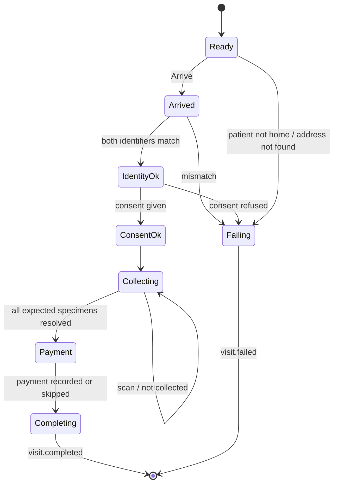
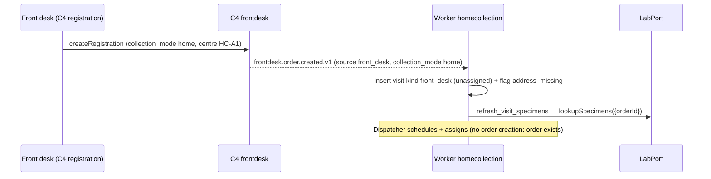

# C17 Home Collection — 03 App Flow

Status: DECISION draft, 2026-11-06. State machines here are the only ones C17 implements; specimen/order/invoice machines belong to C5/C4 (03-IC §10) and are only referenced.

## 1. State machines

### 1.1 Visit (`homecollection.visits.status`)

States: `unassigned`, `assigned`, `in_progress`, `completed`, `failed`, `cancelled`. Closed = `completed | failed | cancelled` (no transition out; any action → `409 homecollection.visit_closed`).

| # | From | To | Trigger | Guard | Side effects | Events |
|---|---|---|---|---|---|---|
| V1 | (none) | `unassigned` | `engagement.booking.confirmed.v1` (home_collection) | not cancelled earlier (`booking_refs`); unique booking | address via EngagementPort (CR-C17-005) or flag `address_missing`; `booking_refs` confirmed | — |
| V2 | (none) | `unassigned` | `frontdesk.order.created.v1` (`collection_mode=home`, `source=front_desk`) | unique order for kind front_desk | flag `address_missing`; enqueue specimen refresh | — |
| V3 | (none) | `unassigned` | `lab.specimen.rejected.v1` (`recollection_required`) | unique per rejected specimen; parent order not cancelled | kind `recollection`, copy address; flag `recollection_required` | — |
| V4 | (none) | `unassigned` | H7 `createHomeRevisit` | parent `failed`, or `completed` with `outcome=partial` | kind `revisit`, copy address/order | — |
| V5 | `unassigned` | `assigned` | H3 assign | address + window set (`visit_incomplete`); phlebotomist eligible (`phlebotomist_not_eligible`); route below `max_visits_per_route` and the phlebotomist's active visits on `route_date` below `LIMS_HOMECOLLECTION_SNAPSHOT_MAX_VISITS` (60) across routes, else `400 common.validation_failed` pointer `/phlebotomist_membership_id` (08 A19 D-131) | booking visit without order → `FrontdeskPort.createOrderFromBooking(confirmImmediately:true)` in the same tx; route upsert, `visit_assignments` row, route version++; specimen refresh (LabPort); optional SMS | none from C17 (C4 emits `frontdesk.order.created.v1`) |
| V6 | `assigned` | `assigned` | H3 reassign (other phlebotomist or date) | as V5 | new assignment row; old + new route version++ | — |
| V7 | `assigned` | `unassigned` | H4 unassign; cron missed sweep | no applied mutation for the visit; the sweep additionally skips any visit whose route has `last_snapshot_at` on its `route_date` (tenant business date) — such a visit only gets flag `missed` and stays `assigned` until the dispatcher acts (08 A19 D-126) | old route version++; sweep adds flag `missed` and a `visit_assignments` row `missed` | — |
| V8 | `assigned` | `in_progress` | first applied `visit.arrived`, `visit.identity_checked`, `visit.consent_recorded` or `specimen.collected` | §4 guards | `arrived_at` (corrected) | — |
| V9 | `in_progress` | `completed` | applied `visit.completed` | ≥ 1 applied collection → `outcome` = mutation outcome; 0 applied collections → `outcome=none` | `completed_at` | — |
| V10 | `assigned`, `in_progress` | `failed` | applied `visit.failed` | — | reason; flag `identity_mismatch` when reason = `identity_mismatch` | — |
| V11 | `unassigned`, `assigned` | `cancelled` | H6 cancel; `engagement.booking.cancelled.v1` | none | `assigned` with `order_id` → flag `order_cancel_required`; route version++; `route_id`, `route_date`, `route_sequence` are kept (history; the route's active set excludes cancelled visits — review m#39); event cancel → `status_reason_code = 'booking_cancelled'`, engagement `reason_code` in `status_reason_text` (review m#32) | — |
| V12 | `in_progress`, `completed` | (unchanged) | booking cancelled / H6 cancel attempt | — | H6 → `409 homecollection.mutation_superseded`; event → flag `cancel_requested_after_start` | — |

Forbidden (unit-tested): `cancelled → assigned`, `completed → in_progress`, `failed → assigned` (use V4), `in_progress → unassigned` (`409 homecollection.mutation_superseded`), `unassigned → in_progress` (no such transition; D-126 keeps pulled visits `assigned` instead).

Every committed change to a visit with `route_id` set bumps that route's `version` in the same transaction (TRD §4.1, review #10).

`collection.synced` emission is tied to collections/payments (§1.2), not to visit transitions.

### 1.2 Collection (`homecollection.collections.status`)

| # | From | To | Trigger | Guard / effect | Events |
|---|---|---|---|---|---|
| C1 | (none) | `applied` | push `specimen.collected` passes all guards (§4) | unique applied per `(tenant, specimen_id)` | `homecollection.collection.synced.v1` (batch) |
| C2 | (none) | `held` | push guard fails with a held code | flag `held_collection` (or `collected_after_cancel` when the visit is cancelled) | — |
| C3 | `held` | `applied` | H9 apply | order not cancelled (`getOrderSummary`), specimen `ordered` and barcode equal (`lookupSpecimens({orderId})`), no other applied collection for the specimen; hold code ≠ `barcode_mismatch` | `homecollection.collection.synced.v1` (collections only) |
| C4 | `held` | `discarded` | H9 discard | reason required | — |

Forbidden: `applied → *`, `discarded → *` (`409 homecollection.collection_not_held`).

### 1.3 Handover (`homecollection.handovers.status`)

| From | To | Trigger | Guard |
|---|---|---|---|
| (none) | `pending` | push `handover.recorded` | ≥ 1 item included (else mutation `rejected`, `common.validation_failed`) |
| (none) | `confirmed` | push `handover.recorded` when `handover_confirmation_required = false` | `received_by_membership_id` stays empty; `received_at = handed_over_at` |
| `pending` | `confirmed` | H15, all items `received` | actor scope covers `to_centre_id` |
| `pending` | `discrepancy` | H15, ≥ 1 item `missing` | H15 enqueues `homecollection.flag_handover_discrepancy`; the worker (system actor) opens flag `handover_discrepancy` on each affected visit (08 A19 D-125) |

### 1.4 Device (`homecollection.devices.status`)

`active → signed_off` (A5 success) · `active → wipe_requested` (H17) · `wipe_requested → wiped` (A4 `wipe_completed`) · `wipe_requested → signed_off` is not allowed (A5 on a `wipe_requested` device answers `409 homecollection.unsynced_changes` until the wipe is acknowledged). `signed_off` and `wiped` are **terminal**: the app regenerates its device id after sign-off or wipe (05-SCHEMA B.3), so the next login registers a new row (A1).

### 1.5 Mutation outcome (`homecollection.mutations.outcome`, set at insert)

`applied | duplicate | held | rejected`. `duplicate` is never stored as a new row (the existing row answers); it exists only in the push response.

### 1.6 Device-side visit flow (`visit_flow.state.dart`)


Rules: Collect is reachable only from `ConsentOk`. "Resolved" = collected or marked not-collected. Payment is skippable only if balance due (snapshot) is 0 or the phlebotomist confirms "Patient will pay at centre" (no mutation written). A visit stub with `status = cancelled` disables all steps and shows "Cancelled — do not visit".

## 2. Staff web flows

### 2.1 Dispatch board `/homecollection/dispatch` (`staff.homecollection.dispatch`, CR-C17-009)

1. Server component loads `listHomeRoutes(route_date)` + `listHomeVisits(route_date, status=unassigned,assigned,in_progress, limit 200)` + `listHomeVisits(unassigned_only, no window)`.
2. Polls every 30 s [CONV] (BFF) while the tab is visible.
3. Actions per row: Schedule (dialog → H5 with `Idempotency-Key`), Assign (dialog → H12 list, options with `route_full: true` disabled → H3 with `Idempotency-Key` UUIDv7 generated on dialog open, If-Match visit version), Unassign (H4), Cancel (H6), Print labels (link `staff.lab.order_labels`), Open detail.
4. Lane actions: Move up/down (local reorder) → Save order (H11, If-Match route version).
5. Version conflict → Banner "This visit changed while you were editing. Reload to see the latest." with Reload.

States: loading `LoadingSkeleton variant=page`; empty date "No home visits for {date}." with link to C4 registration help; error `ErrorState` with request id; permission denied: nav entry hidden; direct URL → shell 403 page; success toasts per action.

### 2.2 Visit detail `/homecollection/visits/{visit_id}`

Loads H2 (one access-log row `home_visit.view`, purpose `visit_detail`). Sections: header (status chip, kind, window, phlebotomist), patient & address (only for `visit.assign` holders; the phone is shown only after "Show", which calls H21 `revealHomeVisitPhone` and logs purpose `phone_reveal` — review #18), specimens table, collections (with review buttons for `held`), payments, flags (resolve), timeline (transitions + assignments), device ack time. Actions as §2.1 plus Create revisit (H7) and Review (H9 dialog: Apply / Discard with reason). 404 → shell not-found copy (`core.shell.not_found`). Phlebotomist-only actor opening another visit → 403 page "This visit isn't assigned to you."

### 2.3 Handovers `/homecollection/handovers`

1. List H13 `status=pending`, `to_centre_id` = working centre (TopBar selector) by default.
2. Open → H14 (barcode and specimen type come from `handover_items`; the receiver needs no membership in the home-collection centre — D-125) → scan each tube (`BarcodeInput`, scanner or keyboard); matching item ticks "Received"; unknown barcode → inline error "This tube is not in this handover"; duplicate scan ignored.
3. Confirm: if all ticked → H15 all `received`; else ConfirmDialog "Mark {n} tubes as missing?" → H15 with `received:false` for unticked.
4. Empty: "No handovers waiting at this centre."

### 2.4 Devices `/homecollection/devices`

H16 table; row action "Wipe on next connection" → ConfirmDialog with reason → H17. Copy explains: "The phone uploads any pending changes, then erases all home-collection data. To block the phone immediately, also revoke the user's sessions in Admin → Users." (link `staff.admin.user`).

### 2.5 Settings `/homecollection/settings`

H18 → form → H19 (If-Match). Validation per TRD §11.2. `second_identifier = birth_date` disabled with hint until CR-C17-003 ships, and "SMS to patient on scheduling" disabled until CR-C17-014 ships (server returns `400 common.validation_failed` for both — D-129). Payment-method codes are chosen from C4's six seed codes only (D-128).

## 3. App flows (phlebo_app)

| Screen | Entry | Data | Empty | Loading | Error | Success |
|---|---|---|---|---|---|---|
| Login | first run / session end | — | — | button spinner | "Email or password is incorrect." (`auth.login_failed`); "Too many attempts. Try again later." (`auth.step_up_required`/`common.rate_limited`); offline: "You need a connection to sign in."; other user while the outbox has unsent rows: "This phone has unsent changes from another user. Ask that user to sign in, or the lab admin to wipe it." (review #12) | → device registration → Route |
| Screen-lock gate (04 A16) | resume > 300 s, cold start with session | OS prompt (plugin pinned by CR-C17-010 — hard precondition of any release, no fallback, 08 A19 D-127) | — | — | 5 failures → session end | → previous screen |
| Route (today) `phlebo_app.route` | after login / home | cache.db visits ordered by sequence | "No visits assigned for today. Pull down to refresh." | first pull: `LimsLoading`; later: cached list + `LimsSyncStatus` | pull failed: `LimsOfflineBanner` "Offline — showing data from hh:mm"; cache purged: "Your list was cleared for security. Connect to download it again." | list |
| Visit `phlebo_app.visit` | tap row | visit, specimens, balance | — | — | visit missing locally (purged/unassigned with pending items) → "This visit is no longer on your list. Pending changes will still upload."; `specimens_stale` → "Tubes unavailable — refresh before collecting" and Collect disabled (review #2) | — |
| Arrive / Identity / Consent / Collect / Payment / Outcome | stepper from Visit | §1.6 | — | — | per step copy in 04-UI-UX | mutation written locally, Snackbar "Saved on phone" (+ "Uploaded" when acked) |
| Handover | Route menu | applied + locally-collected specimens not handed over | "No tubes to hand over." | — | — | mutation written |
| Outbox | Route menu / sync chip | outbox rows | "Everything is uploaded." | — | per row outcome text | — |
| Settings/About | menu | device id (last 8), app version, last sync, Sign out | — | — | Sign out blocked text (US-13) | → Login |

## 4. Push guards per mutation type (server-wins rules)

Evaluated in `device_seq` order inside the batch; "applied earlier" includes mutations applied in this batch. `A` = mutation author (device membership). `asg(t)` = assignee of the visit at corrected time `t` (from `visit_assignments`). Unknown/invisible `visit_id` → `rejected`, `common.not_found`; such a mutation is **not stored** in `mutations` (TRD §6.3 step 4.3).

| Type | Order of checks → outcome |
|---|---|
| `visit.arrived` | visit closed → `rejected` `visit_closed` · `A ≠ asg(t)` and `A ≠` current assignee → `rejected` `visit_not_assigned` · else `applied` (V8 if `assigned`; GPS row if `ok`) |
| `visit.identity_checked` | closed → `rejected` `visit_closed` · not assigned (as above) → `rejected` · else `applied`; any `mismatch` → visit stays, device must send `visit.failed` |
| `visit.consent_recorded` | as identity; `consent_text_version` ≠ current setting → still `applied` (fact), version stored |
| `specimen.collected` | (1) visit `cancelled` → `held` `mutation_superseded` + flag `collected_after_cancel`; visit `completed`/`failed` → `held` `mutation_superseded` · (2) `A ≠ asg(t)` → `held` `visit_not_assigned` · (3) unless **both** an applied `identity_checked` with both `matches` **and** an applied `consent_recorded` with `given: true` by `A` for this visit precede it in `device_seq` → `held` `mutation_superseded` (review m#29) · (4) specimen not in `lookupSpecimens({orderId})` → `rejected` `common.not_found` · (5) specimen status ≠ `ordered` or `isActive = false` → `held` `mutation_superseded` · (6) `scanned_barcode ≠ barcode` → `held` `barcode_mismatch` · (7) an `applied` collection already exists for the specimen → `held` `mutation_superseded` · else `applied` (V8 if `assigned`) |
| `specimen.not_collected` | closed/not assigned as `visit.arrived` → `rejected` · else `applied`; flag `specimen_not_collected` |
| `payment.captured` | visit has no `order_id` or `order_id ≠ payload.order_id` → `rejected` `common.validation_failed` · `A` never assigned to the visit → `rejected` `visit_not_assigned` + flag `payment_rejected` (finance must enter it manually in C4) · method not in `payment_methods` or reference missing when required → `rejected` `common.validation_failed` · else `applied` (**even when the visit is cancelled/closed**, D-PAY) |
| `visit.completed` | visit already closed → `rejected` `visit_closed` · not assigned → `rejected` · else `applied` (V9) |
| `visit.failed` | as completed (V10) |
| `handover.recorded` | each specimen: applied collection by `A` and not in another handover → `included`, else per-item skip; 0 included → `rejected` `common.validation_failed`; included collections from more than one centre → `rejected` `common.validation_failed` (the mutation's `centre_id` is that one centre — review #7); `to_centre_id` not an active centre of the tenant → `rejected` `common.validation_failed`; each included item stores `barcode` and `specimen_type_code` from the batch's `lookupSpecimens({orderId})` result (D-125) |

Held and rejected mutations are **kept** in `homecollection.mutations` with their payload (append-only), so nothing a phlebotomist captured is lost. Exception (review #7): a mutation rejected with `common.not_found` for its visit is not stored in `mutations` (no visit row to reference); it is listed in `sync_batches.unresolved_mutations` (ids, type, seq) and evaluated again on resend; the device keeps it as `rejected` in its outbox, so it is still not lost.

## 5. Sequence diagrams (cross-chunk)

### 5.1 Booking → visit → assignment → order → labels

```mermaid
sequenceDiagram
  participant C16 as C16 engagement
  participant W as Worker homecollection
  participant EP as EngagementPort (C16, CR-C17-005)
  participant D as Dispatcher (staff web BFF)
  participant API as API homecollection
  participant FP as FrontdeskPort (C4)
  participant C5 as C5 lab worker
  participant LP as LabPort (C5, CR-C17-002)
  C16-->>W: engagement.booking.confirmed.v1 (home_collection)
  W->>W: inbox insert; booking_refs check
  W->>EP: getHomeAddress(home_address_id)
  EP-->>W: address (or error → flag address_missing)
  W->>W: insert visit (unassigned)
  D->>API: scheduleHomeVisit (window, address) If-Match
  D->>API: assignHomeVisit {phlebotomist, route_date} Idempotency-Key, If-Match
  API->>FP: createOrderFromBooking(source home_collection, sourceRefId visit_id, confirmImmediately true, key visit:order)
  FP-->>API: {orderId, registrationNo, status registered}
  Note over FP: C4 emits frontdesk.order.created.v1 (source home_collection)
  API->>API: visit assigned, route version++ (same tx), commit
  FP-->>C5: frontdesk.order.created.v1 → specimens ordered + barcodes
  C5-->>W: lab.specimen.status_changed.v1 (absent → ordered)
  W->>W: visit_specimens upsert, route version++
  D->>D: "Print labels" → staff.lab.order_labels (C5 page) → labels on tubes before departure
```

### 5.2 Staff-dispatch path (phone request)



### 5.3 Pull (app)

```mermaid
sequenceDiagram
  participant App as phlebo_app
  participant C2 as C2 mobile sessions (CR-C17-004)
  participant API as API homecollection
  participant FP as FrontdeskPort
  participant BP as BillingPort
  participant LP as LabPort
  App->>App: access JWT expires < 60 s?
  App->>C2: refreshMobileSession(session_token) (kind staff_mobile — 08 R10)
  C2-->>App: rotated session_token + access JWT (store session token first)
  App->>API: pushSyncMutations (if pending) — see 5.4
  App->>API: getSyncSnapshot(device_id, cursor)
  API->>API: device binding, version check, routes of today
  alt cursor unchanged
    API->>BP: getOrderBalance × visits
    API-->>App: {unchanged:true, balances, device_command}
  else changed
    API->>FP: getPatientDemographicsBatch(home_visit) (one call)
    loop each active visit
      API->>LP: lookupSpecimens({orderId, statuses:[ordered]}) (every changed snapshot; error → specimens_stale)
      API->>BP: getOrderBalance(order)
    end
    API->>API: access_log home_visit.view entries
    API-->>App: snapshot
    App->>App: replace cache.db in one transaction
  end
  App->>API: ackSync(cursor, max_device_seq_acked)
```

### 5.4 Push → C4 ledger, C5 specimens

```mermaid
sequenceDiagram
  participant App as phlebo_app
  participant API as API homecollection
  participant LP as LabPort
  participant OB as core.event_log / outbox
  participant C4 as C4 billing worker
  participant C5 as C5 lab worker
  App->>API: pushSyncMutations (batch_id = Idempotency-Key)
  API->>API: tx: corrected times; lookupSpecimens per order
  loop mutations in device_seq order
    API->>API: select by client_mutation_id → duplicate | new
    API->>API: guards §4 → applied | held | rejected
    API->>API: insert mutation with outcome; effects
  end
  API->>API: insert sync_batches row (final counts)
  API->>OB: events.publish homecollection.collection.synced.v1 (per visit)
  API-->>App: results[] (+ server_time)
  App->>App: mark outbox rows terminal; new clock anchor
  OB-->>C4: synced.v1 → recordPayment(home_collection, key client_mutation_id)
  OB-->>C5: synced.v1 → specimen ordered → collected → in_transit
  C5-->>API: lab.specimen.status_changed.v1 (consumed → read model)
```

### 5.5 Visit cancelled server-side while collected offline

```mermaid
sequenceDiagram
  participant C16 as C16
  participant W as Worker homecollection
  participant App as phlebo_app (offline)
  participant API as API homecollection
  participant D as Dispatcher
  C16-->>W: engagement.booking.cancelled.v1
  W->>W: visit assigned → cancelled; flag order_cancel_required
  App->>App: (offline) identity, consent, collect ×2, cash payment
  App->>API: push (later)
  API->>API: collections → held (mutation_superseded); payment → applied
  API->>API: flag collected_after_cancel
  API-->>App: results (held ×2, applied ×1)
  API-->>API: synced.v1 with payments only → C4 ledger (C4 finance review if exceeds due)
  D->>API: reviewHeldCollection apply|discard
  alt order active and specimens ordered
    API-->>API: synced.v1 with the collections → C5
  else
    D->>D: discard (specimen destroyed); front desk cancels order / credit note in C4
  end
```

### 5.6 Rejection → recollection revisit

```mermaid
sequenceDiagram
  participant C5 as C5 lab
  participant W as Worker homecollection
  participant D as Dispatcher
  C5-->>W: lab.specimen.rejected.v1 (recollection_required, home_visit_id V1)
  W->>W: insert visit kind recollection (parent V1), flag recollection_required
  C5-->>W: lab.specimen.status_changed.v1 (new specimen absent → ordered, replaces old)
  W->>W: visit_specimens upsert
  D->>D: schedule + assign revisit; print new label (new barcode)
```

### 5.7 Handover

```mermaid
sequenceDiagram
  participant App as phlebo_app
  participant API as API homecollection
  participant CS as Centre staff (web)
  participant W as Worker homecollection
  App->>API: push handover.recorded {handover_id, to_centre_id, specimen_ids}
  API->>API: handover pending + items (included/skipped)
  CS->>API: listHandovers(to_centre_id) / getHandover
  CS->>CS: scan tubes
  CS->>API: confirmHandover(items received/missing) If-Match, Idempotency-Key
  API->>API: confirmed | discrepancy; enqueue flag_handover_discrepancy
  API-->>W: homecollection.flag_handover_discrepancy
  W->>W: open handover_discrepancy flags (system actor)
```

### 5.8 Lost / stolen phone

```mermaid
sequenceDiagram
  participant Admin as Tenant admin
  participant C2 as C2 identity
  participant D as Lab manager
  participant API as API homecollection
  participant Phone as Phone
  Admin->>C2: revokeUserSessions(phlebotomist)
  D->>API: requestDeviceWipe(device_id)
  Phone->>C2: refresh → 401 auth.session_expired
  Phone->>Phone: destroy cache.db + key (names/phones/addresses gone); outbox stays encrypted
  alt legitimate user recovers phone and logs in
    Phone->>API: push pending → pull → device_command wipe
    Phone->>Phone: destroy outbox.db + keys
    Phone->>API: ackSync(wipe_completed)
  else never returns
    Note over Phone: offline purge timer also destroys cache.db; outbox unreadable without Keystore key
    D->>D: visits with no upload stay in_progress/assigned; tubes that arrive are collected in C5 web (runbook)
  end
```

## 6. Edge cases

| # | Case | Handling |
|---|---|---|
| E1 | Same batch retried after timeout | HTTP idempotency replay (same `batch_id` key); if the first request is still running → `409 common.idempotency_in_progress`, device retries after `Retry-After` |
| E2 | Mutation resent in a new batch (device lost the response) | per-mutation `duplicate` with the stored outcome; no second event (event key includes mutation ids; C4/C5 also dedupe on `client_mutation_id`) |
| E3 | App killed between writing a mutation and pushing | outbox row persisted before the UI confirms (drift transaction commit first) |
| E4 | App killed during snapshot replace | replace happens in one SQLite transaction; on failure the old cache stays |
| E5 | Device clock wrong by days | anchor correction; if no anchor (first use offline is impossible — login needs network → an anchor exists) |
| E6 | Phone rebooted offline | boot id changes → `offset` correction from the last anchor; flagged `clock_source=offset` |
| E7 | Two phlebotomists collect the same specimen (reassignment race) | first applied wins (unique partial index); second `held` |
| E8 | Order cancelled in C4 after assignment | C17 not a consumer of `frontdesk.order.cancelled.v1` (03-IC §3.3) → C5 deactivates specimens; push guard (5) holds collections; board shows specimens inactive after refresh; dispatcher cancels the visit |
| E9 | Order items changed after labels printed | C5 creates/removes specimens; snapshot after refresh shows new expected tubes; board flags none — dispatcher reprints labels (help text) |
| E10 | Dispatcher cancels while phlebotomist is at the door (online) | V11 if still `assigned` → next pull shows stub "Cancelled"; mutations already sent → normal guards |
| E11 | Push and dispatcher action concurrently | row lock on visit; dispatcher may get `409 common.version_conflict` → reload |
| E12 | `LabPort` unavailable during push | `503 common.dependency_unavailable`, nothing committed, device retries with the same key |
| E13 | C4 `createOrderFromBooking` slow/failing at assign | assign fails atomically with C4's error; dispatcher retries (same Idempotency-Key → C4 replay-safe via `<visit_id>:order`) |
| E14 | Snapshot over 60 visits | cannot happen: H3 refuses an assignment that would take the phlebotomist past `LIMS_HOMECOLLECTION_SNAPSHOT_MAX_VISITS` (60) active visits on that `route_date` across all routes (`400 common.validation_failed`, pointer `/phlebotomist_membership_id`); the snapshot never truncates (08 A19 D-131) |
| E15 | Route date rollover at midnight while offline | device purges yesterday's read-only data at local date change; pending mutations upload later. The 00:20 sweep leaves a visit whose route was pulled on its `route_date` in `assigned` (flag `missed` only, D-126), so collections captured yesterday are applied with corrected times through the normal guards (test: offline upload on day +1 for a pulled route applies cleanly) |
| E16 | Device registered to user A, user B logs in | normal case: A signed off (logout blocked otherwise), the app generated a new device id at A's sign-off, so B's A1 creates a new device row; A's row stays `signed_off`. If A's outbox still has unsent rows (e.g. after a revoke), B's login is refused on the phone (outbox owner binding, TRD §7.4); if the outbox is empty but the device id is still bound to A, A1 answers `409 homecollection.device_not_registered` and the app resets the outbox and device id before B signs in again (review #12) |
| E17 | Payment captured but visit failed | payment `applied` (fact); C4 records; balance shows it |
| E18 | Handover to a centre the phlebotomist is not a member of | allowed (the row's `centre_id` is the visit centre; visibility for the receiver via the `to_centre_id` policies on `handovers` / `handover_items`). The receiver never reads the visit tables: barcodes and specimen types are on `handover_items`, and discrepancy flags are written by the worker task (08 A19 D-125) |
| E19 | Duplicate scan of the same tube | device: "Already collected"; server: E7 rule |
| E20 | Unknown fields in event payloads | consumers ignore unknown fields (02-CV §7.2) |
