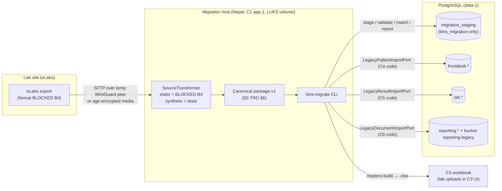

# C18 Legacy Data Migration — 03 APP FLOW

Status: DRAFT, 2026-11-06. C18 has no screens; its "screens" are CLI commands (04-UI-UX). Ports and tables named here are defined in 02-TRD §5 and 05-SCHEMA. Everything left of the canonical package is BLOCKED B4.

## 1. Pipeline overview



C18 code writes only `migration_staging`; the arrows into `frontdesk`/`lab`/`reporting` are owner code executed in-process through ports (02-TRD §4.2).

## 2. Run state machine (`migration_staging.runs.status`; `domain/run.state.ts`)

| # | From | To | Command | Guard | Side effects |
|---|---|---|---|---|---|
| T1 | (none) | `created` | `run create` | tenant resolved by `app.core_resolve_tenant_code` with `status = 'active'` (D-134); `--kind delta` requires `--parent` in `signed_off` or `verified`; no other run of the tenant in `loading`/`voiding` | runs row (`source_system` = `--source`); host dir created (0700) |
| T2 | `created` | `staging` | `stage` | package verified (US-01); manifest tenant = run tenant; `extract_kind` = run kind; manifest `source_system` = `runs.source_system` (else `mig.package.source_mismatch`) | run_files rows |
| T3 | `staging` | `staged` | `stage` (completes) | every file `staged`, counts = manifest | — |
| T4 | `staged` / `validation_failed` | `validating` | `validate` | — | issues cleared for the run, recomputed |
| T5 | `validating` | `validated` | (auto) | 0 errors on non-excluded rows; 0 pending pairs (G3) | match pairs created/kept |
| T6 | `validating` | `validation_failed` | (auto) | otherwise | — |
| T7 | `validated` | `dry_running` | `dryrun` | **G1**: runtime Legacy ports are real (not fakes) in prod; tenant ≠ suspended | — |
| T8 | `dry_running` | `dry_run_passed` | (auto) | 0 owner rejections, invariant ok (02-TRD §10.2), new `target_possible` pairs = 0 | `reports` row `dry_run` |
| T9 | `dry_running` | `dry_run_failed` | (auto) | otherwise (incl. new `target_possible` pairs → they become `pending`) | `reports` row `dry_run` |
| T10 | `dry_run_failed` | `validating` | `validate` | — | — |
| T11 | `dry_run_passed` | `approved_for_load` | `approve` | **G2**: approver ≠ creator/stager; sample verdicts present for `--sample` size, 0 fail; window open (DB login works) | `approvals` row (`signoffs.kind = 'load_approval'`) |
| T12 | `approved_for_load` / `load_failed` / `loading` (stale) | `loading` | `load` | batches planned (first `load`) or exist; no other process holds the run's advisory lock (§8 E1) | batches planned (first time) |
| T13 | `loading` | `loaded` | (auto) | all batches `committed` | — |
| T14 | `loading` | `load_failed` | (auto) | a batch `failed` | — |
| T15 | `loaded` / `verify_failed` | `verifying` | `verify-load` | — | — |
| T16 | `verifying` | `verified` | (auto) | owner summaries = staging digests; docs: 0 `pending_scan` older than limit | `reports` row `post_load` |
| T17 | `verifying` | `verify_failed` | (auto) | otherwise | `reports` row `post_load` |
| T18 | `verified` | `signed_off` | `signoff` | **G5**: 0 open blockers or each has a lab decision; lab membership valid `tenant_admin` | `signoffs` row `lab_signoff`; `purge_not_before = now + N days` |
| T19 | `loaded` / `load_failed` / `verify_failed` / `verified` | `voiding` | `void` | not signed off; a `void request` (operator A, `run_events.kind = 'void_request'`) followed by a `signoffs` row `void_approval` written by `void approve` from operator B's own Unix account (B ≠ A, both mapped in `LIMS_MIGRATION_OPERATOR_MAP`) — 08 A19 D-133 | — |
| T20 | `voiding` | `voided` / `voided_partial` | (auto) | all batches voided / some `notVoidable` | `reports` row `void` |
| T21 | `signed_off` / `voided` / `voided_partial` / `abandoned` | `purged` | `purge` | `now ≥ purge_not_before`, or a `signoffs` row `early_purge_approval` written by `purge approve-early` (operator B ≠ requester A of `purge request-early`, D-133); no open child delta run (G6) | E-class rows deleted; host dir shredded |
| T22 | `created`…`approved_for_load` | `abandoned` | `run abandon` | — | — |
| G4 | `validated` / `dry_run_passed` / `approved_for_load` | `staged` | `crosswalk import`, `match decide` | any change to inputs | approval (if any) invalidated |

Forbidden examples (must exit 2 `mig.run.invalid_transition`): `load` on `validated`; `approve` on `dry_run_failed`; `void` on `signed_off`; `stage` on `loaded`; any command except `report`/`status` on `purged`.

No domain events are produced (02-TRD §5.3). Each transition writes `run_events` (05-SCHEMA §4).

## 3. Command flows

### 3.1 `package verify <dir>` (no DB)
1. Host guard (02-TRD §14): host name allowed, `<dir>` under `LIMS_MIGRATION_ROOT`, volume marker present → else exit 2 `mig.host.not_allowed`.
2. Parse `manifest.json` against the schema; `format_version` supported.
3. Verify `SHA256SUMS` lists every file and each hash matches; every manifest file entry matches.
4. For each CSV: UTF-8 check, header check, count rows (streaming).
5. For `documents.csv`: each `file_path` exists under `documents/`, no path traversal.
6. Print summary; exit 0. Nothing is written anywhere.

### 3.2 `run create --tenant <code> --source <name> --kind full|delta [--parent <run_id>] [--rehearsal]`
1. Boot runtime (CR-C18-005) → resolve the code with C0's `app.core_resolve_tenant_code(code)` before any tenant transaction (08 A19 D-121/D-134); no row → exit 2 `mig.run.tenant_unknown`; `status ≠ 'active'` → exit 2 `mig.run.tenant_not_active`. The resolved `tenant_id` opens `runtime.tx`. `--source` must match `^[a-z][a-z0-9_]{1,31}$` (`runs__source__ck`). Every later run-addressed command repeats this resolution from its own `--tenant` and then looks up the run by `run_id` or `run_code` inside that tenant only.
2. T1 guard; insert `runs` (`run_code` = `MR-<tenant_code>-<yyyymmdd>-<n>` [CONV], human handle used in prompts).
3. `run_events('run_create')`.

### 3.3 `stage <run_id> <dir>`
1. Re-run 3.1 checks (the package may have changed since). Manifest `tenant_code`, `extract_kind` must match the run.
2. T2; for each file in staging order (02-TRD §7.3): `run_files` row (`state staging`), stream rows → chunks of 1,000 → insert → update `rows_staged` → commit.
3. Documents: hash each PDF, record `host_relpath` (P2, never logged).
4. All files done → T3. Interrupted → resumes (02-TRD §7.5).

### 3.4 `crosswalk export|import <run_id> --kind <kind>`
- **export**: distinct legacy codes of the kind in the run (with counts and display names), left-joined with existing `crosswalk_entries` of the tenant → CSV in `<run dir>/crosswalk/<kind>.csv` (P0 for centre/doctor/analyte/unit/sex/flag/status/document_kind/ordinal; doctor display names are master data).
- **import**: parse CSV; validate every target: centre ids via `ctx.core.centres` / `ctx.core.centre` (active, tenant; C0 02-TRD §6.8); analyte/test ids via `CatalogPort.getTest` (exists in tenant; analyte belongs to test); unit codes via the analyte's unit or catalog unit list; doctor/credit party targets are **codes** (reported only in v1); all rows valid → upsert `crosswalk_entries` in one transaction; any invalid → nothing applied (PRD AC-03.2). G4 reset if the run was past `staged`.

### 3.5 `validate <run_id>`
1. T4. Delete the run's `issues`, recompute (02-TRD §8): set-based SQL per rule over `stg_*` joined with `crosswalk_entries`; TS rules for normalisation (name/phone) write `name_norm`, `phone_e164_norm` columns.
2. Match classification (02-TRD §9): compute `strong`/`possible` pairs from `name_norm` + birth/phone; insert new pairs `pending`; keep decided pairs whose two rows still exist with unchanged `source_row_sha256`, else reset to `pending`. Prior-run identity (M0) and `mig.ref.patient_unknown` look up the run's ancestor chain (`parent_run_id`) in `verified`/`signed_off` and any `signed_off` run of the tenant (02-TRD §8).
3. Exclusions (not final, deleted in source, cascades) set `status = 'excluded'`.
4. T5 or T6; print issue counts by rule code.

### 3.6 `match list|decide <run_id>`
- **list** prints pending pairs (masked unless `--reveal`, 04-UI-UX §4.6).
- **decide** `--pair <id> --action merge|keep_separate|link|create_new [--target <patient_id>] --by <membership_id> --form-ref <text>` or `--class <class> --action <a> --by <membership_id> --form-ref <text>`; validates the membership (active, unlocked `tenant_admin` of the tenant, via `ctx.core.membership({membershipId})` — roleCodes, isActive, lockedAt); stores `--form-ref` (the paper sign-off form reference on which the lab lead recorded the decision; required, ≤ 120) on every decided pair (08 A19 D-133); writes decisions; G4.

### 3.7 `dryrun <run_id> [--sample N]`
1. T7 (G1). Resolve merge groups (02-TRD §9.4). Plan **dry-run batches** in memory (same planner as load, ids not persisted).
2. For each batch: `runtime.tx(tenant, fn, { rollback: true })` calling the owner port with `dryRun: true` (sequence §4.2); outcomes accumulated; after rollback, outcomes stored in `stg_* .dry_run_outcome` in a separate small transaction.
3. Patients first; result batches in a dry run use **placeholder patient ids** returned by the patient dry run (owners return `targetId` for `created` rows even in dry run; the ids do not exist after rollback). Therefore the dry run of results and documents runs **inside the same rolled-back transaction as the patient batch they depend on** for patients loaded in this run: the planner groups, per dry-run transaction, ≤ 200 patients with all their results and documents' metadata [DECISION; keeps FK checks real]. Results of patients already loaded by a prior run use the real ids.
4. New `target_possible` pairs from C4 (`duplicate_candidates`) → stored `pending` → T9.
5. Report (02-TRD §10.1), sample selection if `--sample` (default `LIMS_MIGRATION_SAMPLE_SIZE`), T8/T9.

### 3.8 `sample review <run_id>`
Shows each sampled patient (legacy rows vs port rows) one by one; prompts `pass` / `fail` + optional reason code; records verdicts. Required before `approve` (G2).

### 3.9 `approve <run_id>`
T11 (G2): run from the approver's own Unix account; the mapped operator (`LIMS_MIGRATION_OPERATOR_MAP`) `≠ runs.created_by` and `≠ runs.staged_by`; typed confirmation of `run_code`; insert `signoffs(kind='load_approval')`.

### 3.10 `load <run_id>`
1. T12: take `pg_try_advisory_lock` on the run (key derived from run id) inside a dedicated session — fails → exit 2 `mig.run.locked`.
2. First call: persist the batch plan (`batches` rows, `planned`). Later calls: reuse.
3. Execute batches by `seq` with concurrency and rate caps (02-TRD §11.2, §15); each batch per §4.1; progress line every 5 s.
4. All committed → T13; any failed → T14 (exit 1, prints the batch seq and error code).

### 3.11 `verify-load <run_id>`
For each committed batch: owner `getBatchSummary` → compare `rowCount`, `digestSha256` with staging; documents: states. Write `post_load` report; T16/T17. Then the operator and lab lead open the sampled patients in the staff web (manual step recorded with `sample confirm-ui --pair …` [CONV]).

### 3.12 `signoff <run_id> --lab-membership <id> --reference <text>`
G5; membership checked via `ctx.core.membership` (active, unlocked `tenant_admin`); `--reference` (the signed paper form number) is required (08 A19 D-133); record; T18. The lab signs the paper form `docs/manual/migration/signoff-form.md` (rendered to PDF by the lab) and keeps it; the reference number is stored.

### 3.13 `void request <run_id> --reason <code>` (operator A) → `void approve <run_id>` (operator B) → `void <run_id>`
`void request` writes `run_events` `void_request` with the reason code. `void approve` is run by B from B's own Unix account; the mapped operator must differ from A (else exit 2 `mig.approval.same_operator`); typed `run_code`; writes `signoffs(kind='void_approval', decision_payload = {request_event_id, reason_code})`. `void` then checks a `void_approval` for the latest request exists (else exit 2 `mig.void.not_approved`) and runs T19/T20 (§7, §4.4). 08 A19 D-133.
### 3.14 `purge request-early <run_id> --reason <code>` (A) → `purge approve-early <run_id>` (B) → `purge <run_id>`
Early purge only: `request-early` writes `run_events` `purge_early_request`; `approve-early` by B ≠ A from B's own Unix account writes `signoffs(kind='early_purge_approval')`. `purge` → §8 E10; it checks `now ≥ purge_not_before` or that row (no free-text `--approval`); deletes E-class rows (05-SCHEMA §4 classes), then overwrites and deletes `<run dir>` (package, crosswalk CSVs, samples, finance lists).
### 3.15 `masters build <run_id> --kind catalog_master|price_list|referrers|credit_parties [--price-list-legacy-code <c> --price-list-id <uuid> --price-list-code <code>]`
Reads `stg_masters`; writes the workbook in C3's template (C3 02-TRD §8.2; `_meta.template_version = 1`; for price lists `price_list_id`/`price_list_code` from the options, which the lab copies from C3's empty template, `base_version_no = 0`, `tenant_catalog_revision` blank [CONV, C3 to confirm], prices converted paisa → `unit_price_npr`; for credit parties sheet `CreditParties` per 02-TRD §6.4) to `<run dir>/masters/`; every text cell through `neutraliseFormula` (08 A13 P-9); prints the C3 screen to use. Never calls C3.
### 3.16 `finance list <run_id>`
Writes `<run dir>/finance/dues.csv`, `credit_balances.csv`, `invoice_refs.csv` for the lab's finance contact to read on the host (or printed on paper by the operator on site) — never emailed (04 S20 relay is link-only, no PHI).

## 4. Sequence diagrams (cross-chunk)

### 4.1 Load one patient batch

```mermaid
sequenceDiagram
  autonumber
  participant CLI as lims-migrate (C18)
  participant RT as Tool runtime (C0, CR-C18-005)
  participant DB as Postgres (lims_migration)
  participant FP as LegacyPatientImportPort (C4 code)
  participant IP as IdentityPort (C2 code)
  CLI->>RT: tx(tenant_a, fn)
  RT->>DB: BEGIN; set_config('request.jwt.claims', {sub: migration actor, tenant_id, actor_type: system}, true); set_config(app.request_id = batch_id)
  RT->>FP: importPatients(ctx, {runId, batchId, dryRun:false, contentSha256, rows[≤200]})
  FP->>IP: assertRole(ctx, {permission: frontdesk.patient.import_legacy})
  IP-->>FP: ok (systemPermissions of 'migration')
  FP->>DB: SELECT frontdesk.legacy_import_batches WHERE (tenant_id, id = batchId)
  alt batch exists, same hash
    FP-->>CLI: stored outcomes, replayed: true
  else new batch
    FP->>DB: per row: normalise, dedupe check, INSERT patients / patient_legacy_refs / patient_consents(source legacy_import)
    FP->>DB: INSERT legacy_import_batches (digest, outcomes)
    FP-->>CLI: outcomes
  end
  CLI->>DB: UPDATE migration_staging.stg_patients SET status, target_patient_id, batch_id; UPDATE batches SET committed
  RT->>DB: COMMIT (owner rows + staging status atomically)
```

### 4.2 Dry run (rolled back)

```mermaid
sequenceDiagram
  autonumber
  participant CLI as lims-migrate
  participant RT as Tool runtime
  participant FP as LegacyPatientImportPort (C4)
  participant LP as LegacyResultImportPort (C5)
  participant DP as LegacyDocumentImportPort (C6)
  participant DB as Postgres
  CLI->>RT: tx(tenant, fn, {rollback: true})
  RT->>FP: importPatients(dryRun: true, ≤200 patients)
  FP-->>RT: outcomes (created ids exist only in this tx)
  RT->>LP: importResults(dryRun: true, results of those patients, batches of ≤200)
  LP-->>RT: outcomes
  RT->>DP: importDocument(dryRun: true) per document — metadata + magic bytes + sha256 only, no storage write
  DP-->>RT: outcomes
  RT->>DB: ROLLBACK
  CLI->>DB: (new tx) store dry_run_outcome per staging row; COMMIT
```

### 4.3 Document import and C6 scan pipeline

```mermaid
sequenceDiagram
  autonumber
  participant CLI as lims-migrate
  participant DP as LegacyDocumentImportPort (C6)
  participant ST as ctx.storage (C0) bucket reporting-legacy
  participant W as C6 worker (scan → qpdf sanitise)
  CLI->>DP: importDocument(ctx, {batchId = per document, bytesBase64, sha256})
  DP->>DP: assertRole(reporting.legacy_document.import); check size ≤ 15 MB, %PDF- magic, sha256
  DP->>ST: put-if-absent {tenant_id}/quarantine/{yyyy}/{mm}/{document_id}.bin
  DP->>DP: INSERT reporting.legacy_documents(state pending_scan); enqueue C6 scan job (transactional)
  DP-->>CLI: accepted (created, targetId)
  W->>ST: scan; sanitise → {tenant_id}/legacy/{yyyy}/{mm}/{document_id}.pdf
  W->>W: state ready | quarantined | rejected
  CLI->>DP: getBatchSummary(batchId) during verify-load → states
```

Note: the storage `put` is not transactional. If the DB transaction then rolls back (or a retry re-sends the document), an orphan quarantine object remains. C6 has no orphan sweep today; CR-C18-004 requests a new C6 job `reporting.sweep_legacy_orphans` (daily [CONV]) that deletes `reporting-legacy/{tenant_id}/quarantine/**` objects older than 24 h with no `legacy_documents` row, with contract case (11) (02-TRD §19, CR-C18-004).

### 4.4 Void

```mermaid
sequenceDiagram
  autonumber
  participant CLI as lims-migrate
  participant DP as LegacyDocumentImportPort
  participant LP as LegacyResultImportPort
  participant FP as LegacyPatientImportPort
  CLI->>CLI: guard: not signed off; void_approval by operator B ≠ requester A (D-133)
  loop documents (reverse seq)
    CLI->>DP: voidBatch(batchId, reasonCode)
  end
  loop result batches (reverse seq)
    CLI->>LP: voidBatch(batchId, reasonCode)
  end
  loop patient batches (reverse seq)
    CLI->>FP: voidBatch(batchId, reasonCode)
    FP-->>CLI: voided n, notVoidable [{patientId, in_use}]
  end
  CLI->>CLI: run voided | voided_partial; report 'void'
```

### 4.5 Masters through C3 (no runtime call)

```mermaid
sequenceDiagram
  participant CLI as lims-migrate (host)
  participant OP as Operator + lab lab_manager (on site)
  participant C3 as C3 import UI/API (staff web)
  CLI->>CLI: masters build → catalog_master.xlsx (C3 template)
  OP->>OP: review workbook on the host session; corrections done in canonical masters or by the lab in C3 later
  Note over OP,C3: The workbook contains no patient data (P0 master data; doctors' phones = personal data of doctors, P2) — it may be moved to the lab's staff PC for upload over the staff web, the same way C3's own exports are handled
  OP->>C3: upload via C3 import screen (C3 US-16/17: validate → commit)
  C3-->>OP: committed; catalog.changed.v1 (C3's own event)
  CLI->>CLI: crosswalk export --kind analyte (now pre-filled by code match)
```

## 5. Per-command states (CLI equivalent of empty / loading / error / success / permission-denied)

| Command | Empty | Loading | Error | Success | Permission denied |
|---|---|---|---|---|---|
| `package verify` | package has only required files → "0 rows" lines, still exit 0 | per-file progress `hashing patients.csv 45%` | exit 2 with `mig.*` code + file + line | summary table | host guard → exit 2 `mig.host.not_allowed` |
| `stage` | manifest lists 0 rows for an optional file → file recorded with 0 | progress per file, rows/s | exit 1 (DB) / 2 (input); resumable message "re-run `stage` to resume at file N" | counts table = manifest | DB login refused (window closed) → exit 2 `mig.db.login_refused` + runbook anchor |
| `crosswalk export` | no codes of that kind → empty CSV with header + message "nothing to map" | — | exit 2 | path of CSV + counts | as above |
| `validate` | 0 rows → validated trivially (warning `mig.run.empty`) | rule-by-rule progress | exit 1 on SQL error | counts by severity/rule | as above |
| `match list` | "No pending pairs" | — | — | table | `--reveal` without TTY → refused |
| `dryrun` / `load` | 0 loadable rows → "nothing to load", run moves to `dry_run_passed` / `loaded` with all-zero counts | progress bar line, ETA | exit 1 + batch seq + code; exit 2 on guard | summary + report id | runtime `auth.forbidden` from owner port (system permission missing) → exit 1 `mig.runtime.permission_missing` |
| `verify-load` | no batches → verified | per batch | mismatch table (batch seq, expected vs actual counts, digest prefixes) | ok | — |
| `signoff` | — | — | blockers list | signed off + purge date | membership not `tenant_admin` → exit 2 `mig.signoff.signatory_invalid` |
| `void` / `void approve` | no committed batches → `voided` | per batch | partial → list | report | approver = requester → exit 2 `mig.approval.same_operator`; no approval → exit 2 `mig.void.not_approved` |
| `purge` | already purged → exit 0 "nothing to purge" | rows deleted per table | refused (too early / child open) | counts deleted, files shredded | — |

## 6. Cut-over runbook (`tools/migration/runbooks/cutover.md`)

Times relative to go-live day **D** (the lab's first working day on the LIMS). Durations [CONV]; adjust per lab.

### 6.1 Preconditions (go/no-go list, checked at D−14 and again at D−1)
1. B4 answered; `sources/elabs` transformer built and tested on the client's sample; Wave-1 owners merged CR-C18-002/003/004; C1 completed CR-C18-006.
2. Tenant provisioned in C2; branches/centres created in C2 (from `masters/centres.csv` by hand); staff accounts and roles created; MFA enrolled for privileged roles.
3. Catalog loaded through C3 (`catalog_master`), price lists through C3 (`price_list`), referrers through C3 (`referrers`), credit parties through C3 (`credit_parties`, CR-C18-008 accepted; workbook from `masters build --kind credit_parties`; parties without a valid legacy code are auto-coded by C3 and mapped in the `credit_party` crosswalk); signed by the lab's `lab_manager`/`finance`.
4. IRD: the lab's permission to use the LIMS billing (04 L3 Annex 3) is in place or the lab's decision on billing go-live is recorded; the auditor's answer on historical invoices/dues (B6/B7) is recorded or the default "not loaded" accepted in writing. **Option for the auditor, not a requirement:** cutting over at the start of a fiscal year (Shrawan 1, 04 L16) avoids two softwares issuing invoices in one fiscal year.
5. Rehearsal (§6.2) passed within the last 14 days.
6. Founder approval of the migration window; C1 window opened (`migration-window.yml -e action=open`).

### 6.2 Rehearsal (D−21 … D−14)
1. Full extract from eLabs (data as of R0) → transfer → transform → `package verify`.
2. `run create --kind full --rehearsal` → stage → crosswalk (all kinds) → validate → match decisions with the lab lead → dryrun `--sample 50` → `sample review`.
3. **A rehearsal never loads.** It ends at `dry_run_passed` and is `abandoned` + purged. Reason: a rehearsal load into production would leave voided rows behind; production data must not go to lower environments (REQ-SEC-136), so there is no non-production target. Timings of each stage are recorded to size the real runs.

### 6.3 Historical load (D−10 … D−2), eLabs still in use
1. New full extract (data as of H0). Run R1 `--kind full`: stage → validate → decisions (re-used where rows unchanged) → dryrun + sample → approve (second operator) → `load` in night slices (02-TRD §15: results ≤ 1,000 rows/s at night, ≤ 200 by day; documents in nightly slices) → `verify-load`.
2. R1 stays `verified` (not signed off) so it can still be voided; LIMS is not yet used by the lab for patients.

### 6.4 Freeze and delta (D−1 evening → D morning), target ≤ 4 h [CONV]
| Step | Time | Who | Action | Abort criterion |
|---|---|---|---|---|
| F0 | D−1 18:00 | lab | stop new registrations and result entry in eLabs (freeze); finish/print pending reports in eLabs | — |
| F1 | 18:30 | lab IT | final extract (data as of F0) — delta if eLabs supports it (B4 unknown), else full | extract fails → postpone go-live |
| F2 | 19:00 | operator | transfer, transform, verify; run R2 `--kind delta --parent R1`; stage; validate; decisions on new pairs | > 2 h behind plan → no-go |
| F3 | 20:00 | operator + 2nd | dryrun + sample (≥ 10 patients from the delta [CONV]); approve; load; verify-load | owner rejection not explainable → no-go |
| F4 | 21:30 | lab lead + operator | UI spot checks: search by legacy code, history/trend, legacy PDFs for sampled patients | any fail → no-go |
| F5 | 22:00 | lab lead | **go/no-go**: go → `signoff` R2 then R1 (R1 sign-off is the lab's acceptance of the history) | — |
| F6 | D 07:00 | lab | start on the LIMS; eLabs stays **read-only** (no new data) as archive and fallback | — |

Results that were pending in eLabs at F0 (registered, not finalised): the lab re-registers those patients' outstanding tests in the LIMS on D or completes them in eLabs before F0 (lab's choice, recorded in the runbook) — C18 does not migrate in-flight work (DECISION: unfinished workflow cannot be represented in legacy tables).

### 6.5 After go-live
- D+1…D+30: corrections are owner-side (C4 patient edit, C5 history shows legacy values as recorded). R1/R2 signed off → `purge` after 30 days [CONV]; C1 alert if not purged.
- C1 closes the migration window (role NOLOGIN, temporary WireGuard peer removed, SFTP chroot disabled).
- eLabs kept read-only for at least the tenant's `retentionYears` (default 5, B15) or as the lab decides with counsel — C18 does not decommission eLabs.

## 7. Rollback plan (`tools/migration/runbooks/rollback.md`)

| Level | Situation | Action | Data outcome |
|---|---|---|---|
| R0 | Problem found before any load (rehearsal, dry run) | fix transformer/crosswalk/decisions; re-validate; or `run abandon` | nothing in owner tables |
| R1 | After `load`, before go-live (F5 no-go or verify failure) | `void request` / `void approve` / `void` R2 then R1 (second operator approves each); lab continues on eLabs (unfreeze); new go-live date | legacy refs/results/documents voided (hidden; rows retained, class C-legacy never deleted); patients created by the runs deactivated (no orders exist yet) |
| R2 | After go-live, migrated data found wrong for a subset | targeted: a corrective delta run (e.g. higher `legacy_version_no` from a fixed transformer) — only before sign-off of that run; after sign-off the lab corrects via owner screens; C18 cannot void signed-off runs (PRD AC-11.3) | new data created in the LIMS stays; invoices issued by the LIMS are never touched (04 L5) |
| R2b | After go-live, the lab decides to stop using the LIMS | operational fallback to eLabs (lab decision); C18 `void` only if the run is not yet signed off and within the owners' void window; patients with LIMS orders stay (`notVoidable in_use`); LIMS invoices remain valid fiscal records | — |
| R3 | Wrong tenant loaded or PHI exposure | security incident (C1 IR runbook, REQ-SEC-134): stop, close window, assess; owner-run purge of the affected legacy rows requires founder approval and an owner-written `lims_owner` purge function (CR candidate, 06 §5) — voiding alone does not remove PHI | — |

## 8. Edge cases

| # | Case | Behaviour |
|---|---|---|
| E1 | Two operators run `load` on the same run | advisory lock; second gets `mig.run.locked` |
| E2 | Two runs of the same tenant loading at once | T1/T12 guard: at most one run per tenant in `loading`/`voiding` |
| E3 | Process killed mid-batch | owner tx rolled back or committed atomically with staging; resume re-sends same `batchId` → `replayed` if it had committed (PRD AC-07.3) |
| E4 | DB failover during load (C1 DR) | batch retries (02-TRD §11.4); idempotency covers a commit whose ack was lost |
| E5 | Package modified after staging | `stage` re-verifies; changed sha256 vs `run_files` → exit 2 `mig.package.changed_since_stage` |
| E6 | Crosswalk changed after dry run | G4 → back to `staged`; approval invalidated |
| E7 | Analyte deactivated in catalog between dry run and load | owner port may still accept (deactivated entities remain readable — 03-IC §4.2 invariant); C5 decides; reported if rejected |
| E8 | A legacy patient is anonymised in the LIMS before a delta | C4 returns `already_imported`; changed fields not applied; a `link` to an anonymised patient → `rejected anonymised_target` |
| E9 | Front desk registers a returning patient on D before searching legacy codes and creates a duplicate | C4's normal dedupe (C4 US-FD-02) catches it against the migrated row; migration does not create it |
| E10 | Purge requested while a delta child run is open | refused `mig.purge.child_open` |
| E11 | Same document bytes under two legacy keys | both imported (two rows, same sha256); reported as `info mig.doc.same_bytes` |
| E12 | Documents still `pending_scan` at verify | verify fails after the limit; re-run `verify-load` later; C6 scan backlog is C6/C1's alert |
| E13 | eLabs export has no stable keys | transformer must build deterministic composite keys (02-TRD §6.3.10); if impossible → delta loads cannot be idempotent → full reload only before go-live, no delta (decided after B4) |
| E14 | Timestamps in eLabs are local without zone | `source_timezone` in manifest (likely `Asia/Kathmandu`, UNVERIFIED until B4) |
| E15 | Very large single patient (> 10 legacy refs after merges) | `mig.match.group_too_large` → manual decision to split |
| E16 | Tenant suspended in C2 during load | runtime tx fails on tenant check (C2/C0 behaviour) → load stops, resumable after reactivation |
| E17 | Owner port returns more outcomes than rows or unknown `rowRef` | CLI treats as contract violation: abort, exit 1 `mig.runtime.contract_violation` |
