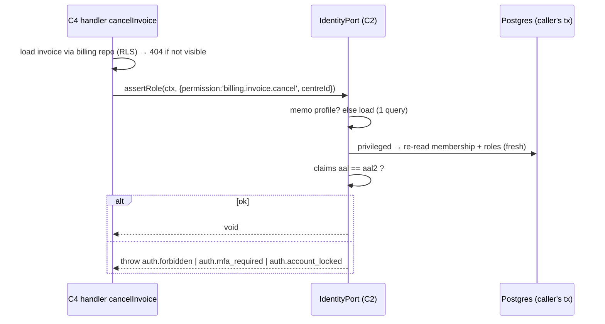

# C2 — Identity, Access & Administration — 03 App Flow

Status: DECISION draft, 2026-11-05. Endpoint names = operationIds in `02-TRD.md` §5. Error codes from 03 §8 or CR-C2-007.

## 1. Flow and screen index

| # | Flow | Screens (04-UI-UX id) | Endpoints |
|---|---|---|---|
| F1 | Login + MFA challenge | AU-1, AU-2 | `loginStaff`, `verifyMfaChallenge` |
| F2 | MFA enrolment (forced / voluntary) | AU-3, ME-2 | `startMfaEnrolment`, `completeMfaEnrolment` |
| F3 | Per-request session resolution, refresh, idle | (all pages) | `resolveSession` |
| F4 | Logout, session expired | AU-6, AU-7 | `logoutSession` |
| F5 | Forgot password / invitation landing / set password | AU-4, AU-5 | `requestPasswordRecovery`, `confirmEmailToken`, `setPasswordFromSetup` |
| F6 | My account | ME-1..ME-3 | `getMe`, `changeOwnPassword`, `listOwnSessions`, `revokeOwnSession`, `listOwnMfaFactors`, `removeOwnMfaFactor` |
| F7 | Users | AD-1..AD-3 | §5.3 |
| F8 | Roles | AD-4, AD-5 | §5.4 |
| F9 | Branches / centres | AD-6, AD-7 | §5.5 |
| F10 | Settings, branding, flags, IRD status | AD-8 | §5.6 |
| F11 | Sessions (tenant) | AD-9 | §5.7 |
| F12 | Audit / access / auth events / exports | AD-10..AD-13 | §5.9 |
| F13 | Support access (tenant side) | AD-14 | §5.8 |
| F14 | Access review | AD-15 | §5.9 |
| F15 | Platform: tenants + provisioning + lifecycle | PL-1..PL-3 | §5.10 |
| F16 | Platform: IRD Annex tracker | PL-4 | §5.10 |
| F17 | Platform: support sessions | PL-5 | §5.10 |
| F18 | Platform: dead letters | PL-6 | §5.10 |
| F19 | Platform: staff, sessions, auth events, bootstrap | PL-7, PL-8 | §5.10 |
| F20 | IdentityPort calls by other modules | — | port |

## 2. State machines

All state tables live in `services/api/src/modules/identity/domain/*.state.ts` (pure). Each transition has a unit test; one forbidden transition per state is tested (02-CV §11.4).

### 2.1 Session (`identity.sessions.state`)

| # | From | To | Trigger / guard | Side effects | Auth event |
|---|---|---|---|---|---|
| SS1 | (none) | `password_setup` | `confirmEmailToken` succeeded | cookie set; session TTL 15 min [CONV] (`absolute_expires_at = now()+15m`) | `invite_link_opened` / `recovery_link_opened` |
| SS2 | (none) | `mfa_pending` | `loginStaff` password ok, user has verified TOTP | — | `login_password_ok` |
| SS3 | (none) | `mfa_enrolment_required` | password ok, MFA required (any role `mfa_required`, or platform staff), no verified factor | — | `login_password_ok` |
| SS4 | (none) | `active` | password ok, MFA not required and no verified factor | `last_login_at` updated (for tenant staff the value shown in the admin UI is `core.memberships.last_login_at`; `core.users.last_login_at` is internal — 08 A6.3) | `login_succeeded` |
| SS5 | `mfa_pending` | `active` | valid TOTP; `aal = aal2` | `last_login_at` | `mfa_verified`, `login_succeeded` |
| SS6 | `mfa_pending` | `revoked` (`mfa_failed`) | 5th invalid TOTP | sign-out job; every failure write is committed with `ctx.commitOnError()` (08 A19 P-42) | `mfa_challenge_failed` ×5, `session_revoked` |
| SS7 | `mfa_enrolment_required` | `active` | enrolment verified; `aal2` | mirror factor `verified` | `mfa_enrolled`, `login_succeeded` |
| SS8 | `password_setup` | `mfa_enrolment_required` / `active` | password set; MFA rule as SS3/SS4 (a user who already has a verified factor → `mfa_pending`) | other sessions of the user revoked (`password_change`); failure counter cleared | `password_reset_completed` or `invite_accepted` |
| SS9 | any non-terminal | `revoked` | logout, admin/self revoke, lock, deactivate, tenant suspend/terminate, password change, role/centre change, MFA reset, refresh failure, support binding revoked (support part only, see §8) | sign-out job; BFF cache entry ignored on next resolve | `session_revoked` (reason) |
| SS10 | any non-terminal | `expired` | resolve/claims check finds `now() ≥ idle_expires_at` or `≥ absolute_expires_at` | lazily written on first detection | `session_expired_idle` / `_absolute` |

Terminal: `revoked`, `expired`. Forbidden examples: `active → mfa_pending`, `revoked → active`, `expired → active`, `password_setup → active` without password set.

Timeout fields: `idle_expires_at = last_seen_at + idle_timeout_minutes`; `absolute_expires_at = created_at + absolute_session_hours` (tenant setting at session creation; platform: config §11). A settings change applies to sessions created after the change, except **lowering** a value, which re-clamps existing sessions on their next resolve (DECISION: security changes apply immediately).

### 2.2 Membership (`core.memberships.status`; lock = `locked_at IS NOT NULL`, orthogonal)

Columns are C0's (05-SCHEMA §3.1 mirror, 08 Addendum A3.4). C2 changes lifecycle state by writing `status` ∈ {`invited`, `active`, `deactivated`} (plus the timestamp/actor columns named in the side effects); `is_active` is generated (`status = 'active'`) and never written. Lock is orthogonal to status: a membership in any status is locked exactly when `locked_at IS NOT NULL` (there is no `is_locked` column); rows M1–M6 change `status`, rows L1–L2 change only the lock columns.

| # | From | To | Trigger | Guard | Side effects |
|---|---|---|---|---|---|
| M1 | (none) | `invited` | `inviteUser`, `provisionTenant`, `inviteTenantAdmin` | roles exist & active; centres active | invitation row; `identity.send_invitation` job; `invited_at` |
| M2 | `invited` | `active` | `setPasswordFromSetup` from an invite link | invitation `sent`, not expired | invitation `accepted`; `accepted_at` |
| M3 | `invited` | `deactivated` | `deactivateUser` | not last admin | invitation `revoked`; `deactivated_at/by/reason_code` |
| M4 | `active` | `deactivated` | `deactivateUser` | not self; not last holder of `identity.role.manage` | all sessions revoked; sign-out job; `deactivated_at/by/reason_code` |
| M5 | `deactivated` | `active` | `reactivateUser` | user had accepted before (`accepted_at` set) | sets `status = 'active'`; clears `deactivated_at`, `deactivated_by`, `deactivation_reason_code` to NULL (history stays in `audit.audit_log`; 08 A6.3) |
| M6 | `deactivated` | `invited` | `reactivateUser` when never accepted | — | new invitation; clears `deactivated_at`, `deactivated_by`, `deactivation_reason_code` to NULL (08 A8.2) |
| L1 | `locked_at IS NULL` | `locked_at IS NOT NULL` | `lockUser` | not self; not last admin | sessions revoked; sign-out job; sets `locked_at`, `locked_by`, `lock_reason_code`, `lock_reason_text` |
| L2 | `locked_at IS NOT NULL` | `locked_at IS NULL` | `unlockUser` | — | failure counter cleared; `locked_at`, `locked_by` set to NULL |

"Last admin" = after the change, zero memberships of the tenant with `status = 'active'` and `locked_at IS NULL` would hold `identity.role.manage` through an active role → `409 identity.last_admin_protected`.

### 2.3 Tenant (`core.tenants.status`)

| # | From | To | Trigger | Guard | Side effects |
|---|---|---|---|---|---|
| T1 | (none) | `provisioning` | `provisionTenant` | code unique | provisioning bundle §9.1 |
| T2 | `provisioning` | `active` | `activateTenant` | ≥1 accepted active `tenant_admin`-role membership, ≥1 active branch, ≥1 active centre → else `identity.tenant_not_ready` | `activated_at` |
| T3 | `active` | `suspended` | `suspendTenant` (reason) | — | `suspended_at`; `reason_text` stored in `core.tenants.status_reason` (08 A6.3); revoke all tenant-staff sessions (job fan-out per user); support sessions `read_only` still possible |
| T4 | `suspended` | `active` | `reactivateTenant` | — | — |
| T5 | `provisioning`/`suspended` | `offboarded` | `terminateTenant` (confirm_code = code) | — | `offboarded_at`; `reason_text` stored in `core.tenants.status_reason` (08 A6.3); revoke all sessions; all memberships set to `status = 'deactivated'` (never `is_active`, generated — 08 A3.4), each with `deactivated_at = now()`, `deactivated_by` = the id of the platform staff user who performed it (the human actor — claims `sub` of the platform request, never the identity system actor of `withTenantScope`; 08 A9.5), `deactivation_reason_code = 'other'` (reason text in `core.tenants.status_reason`; 08 A8.3); data retained per retention settings (B15) |

Forbidden: `offboarded → *`, `active → provisioning`, `provisioning → suspended`.

Status values are C0's `core.tenants.status` CHECK set (`provisioning`, `active`, `suspended`, `offboarded`; 05-SCHEMA §3.1 mirror, 08 Addendum A3.3); C2's earlier names `onboarding` / `terminated` map to `provisioning` / `offboarded`, and the end-state timestamp is `offboarded_at` (08 Addendum A3.4). Operation names (`terminateTenant`, UI "Terminate") are unchanged.

### 2.4 Support session (`identity.support_sessions.status`)

| # | From | To | Trigger | Guard | Side effects |
|---|---|---|---|---|---|
| SP1 | (none) | `active` | `openSupportSession`, tenant `support_access_mode = notify` | platform role allows scope; tenant not `offboarded`; `admin` scope needs tenant `provisioning` or `active` (onboarding happens while `provisioning`) | binds to caller's platform session (`identity.sessions.support_session_id`); `expires_at = now()+duration`; access-log `support_session.open` (entity `support_session`) in the target tenant and an in-app notice to tenant admins, both under `withTenantScope` (08 R10 item 4 as extended by 08 A25 D-214) |
| SP2 | (none) | `requested` | same, mode `approval_required` | same | notice to tenant admins |
| SP3 | `requested` | `approved` | `approveSupportSession` (tenant admin, aal2) | — | — |
| SP4 | `requested` | `denied` | `denySupportSession` | — | — |
| SP5 | `requested` | `expired` | cron, > 24 h [CONV] | — | — |
| SP6 | `approved` | `active` | `activateSupportSession` | caller = requester; within 60 min of approval [CONV] | bind; `expires_at = now()+duration`; access-log `support_session.activate` via `withTenantScope` (D-214) |
| SP7 | `approved` | `expired` | cron, not activated in 60 min | — | — |
| SP8 | `active` | `ended` | `endSupportSession` / platform logout | — | unbind; access-log `support_session.close` via `withTenantScope` (D-214) |
| SP9 | `active` | `expired` | `expires_at` reached (resolver + cron) | — | unbind |
| SP10 | `approved`/`active` | `revoked` | `revokeSupportSession` (tenant admin) | — | unbind |

One `active` support session per platform session at a time; opening a second ends the first (`ended`).

### 2.5 IRD Annex record (`identity.ird_annex_records.status`) — tracking only (04 L3/L4)

| # | From | To | Guard (field requirements) |
|---|---|---|---|
| IR1 | (none) | `not_started` | created at provisioning (annex_2, annex_3, annex_7) or by `createPlatformIrdAnnex` (annex_1) |
| IR2 | `not_started` | `in_preparation` | — |
| IR3 | `in_preparation` | `submitted` | `submitted_on` required (date ≤ today) |
| IR4 | `submitted` | `completed` | `completed_on` (≥ `submitted_on`) and `reference_no` required |
| IR5 | `submitted` | `rejected` | `note` required |
| IR6 | `rejected` | `in_preparation` | — |
| IR7 | `completed` | `superseded` | `transitionIrdAnnex` with `to_status = superseded` creates the successor record of the same annex and tenant (`not_started`, `supersedes_id` = this record) in the same transaction [CONV] (e.g. new software listing, renewed contract) |
| IR8 | `in_preparation` | `not_started` | — (undo) |

Forbidden (→ `409 identity.annex_invalid_transition`): `not_started → submitted|completed`, `completed → in_preparation`, any transition out of `superseded`.
Meaning per annex (labels only; source 04 L3/L4): annex_1 = software listing on manufacturer self-certification (platform-level, cl.3(ख)); annex_2 = approval letter issued by the LIMS provider to the user (cl.3(ग)); annex_3 = the lab's application to its tax office for permission (cl.4); annex_7 = tripartite contract the LIMS provider / DC operator / lab filed with IRD (cl.7(ख)). Template/checklist content: BLOCKED B6.
`annex_readiness = complete` ⇔ tenant's current annex_2, annex_3, annex_7 records are `completed` and the platform annex_1 record referenced by `tenant_settings.ird_annex_1_record_id` (default: latest completed) is `completed`. Tenant claims read that one platform row through `ird_annex_records__select__tenant_platform_ref` (08 A25 D-216); no other platform row is visible to them.

### 2.6 Invitation (`identity.invitations.status`)

`pending → sent` (job ok) · `pending|sent → failed` (job exhausted; admin can resend) · `sent → sent` (resend: new link, `attempt_no+1`) · `sent → accepted` · `sent → expired` (cron) · `pending|sent → revoked` (deactivate). Terminal: `accepted`, `expired`, `revoked`; resend from `expired`/`failed` creates `sent` again (new attempt).

### 2.7 Audit export (`identity.audit_exports.status`)

`queued → building → ready → expired`; `building → failed`; `queued → failed` (validation at build time, e.g. tenant suspended). `ready` downloads decrement `downloads_remaining`; at 0 → `expired` (object deleted).

### 2.8 Dead letter (`core.dead_letters.state`, C0 table; C2 actions)

`open → replayed` (`replayDeadLetter`) · `open → discarded` (`discardDeadLetter`, reason). `resolved_by`, `resolved_at` set; `version` + 1. Discard passes `reason_text` as `reasonText` to `ctx.core.deadLetters.discard({ deadLetterId, expectedVersion, reasonText })`, which stores it in `resolution_note` (08 A8.4). Replay passes the optional `reason_text` (1–500) as `reasonText` to `ctx.core.deadLetters.replay({ deadLetterId, expectedVersion, reasonText? })`, stored in `resolution_note` (NULL when omitted; 08 A9.3). C2 changes dead letters only through `ctx.core.deadLetters` (08 A8.6). Both pass the request's If-Match as `expectedVersion` to `ctx.core.deadLetters.replay/discard` (C0 02-TRD §6.8); a mismatch → `409 common.version_conflict` (08 A6.4). Forbidden: any change from `replayed`/`discarded`.

## 3. Authentication flows

### 3.1 Login (F1) — sequence

```mermaid
sequenceDiagram
  autonumber
  participant B as Browser
  participant W as BFF (apps/web; C0 core + C2 auth pages)
  participant N as nginx (C1)
  participant A as API core (C0)
  participant I as identity module (C2)
  participant G as GoTrue (internal)
  participant D as Postgres
  B->>N: POST /auth/login (public staff_web route)
  N->>N: limit_req zone=login 60/min/IP burst 20 — flood guard only (08 Addendum A1); set X-Forwarded-For = client IP
  N->>W: forward (server action: email, password)
  W->>W: Origin/Sec-Fetch-Site check (REQ-SEC-091)
  W->>A: POST /v1/identity/auth/login (app_net, BFF network only) + X-Lims-Bff-Key (staff_web) + X-Forwarded-For as received from nginx
  A->>A: valid BFF key → app.client_ip = X-Forwarded-For (08 A25 P-61) → ctx.clientIp
  A->>I: handler loginStaff in ctx.db.identityAuthTx (claims: identity system actor, no tenant_id — 08 A25 D-212); session kind tenant_staff / platform bound by the BFF key
  I->>I: per-IP throttle check f:<ctx.clientIp> (active only after ≥ 10 failures/10 min from that IP → 5 attempts/min for 30 min)
  I->>I: ctx.rateLimit.consume(a:<hmac(email)>) 10/h; failure window check
  alt IP throttled beyond 5/min, or account rate exceeded
    I->>D: auth event login_rate_limited (tenant-less, app.identity_record_auth_event); ctx.commitOnError()
    I-->>W: 429 common.rate_limited
  else failures ≥ 5 in account window (step-up state)
    I-->>W: 401 auth.step_up_required (password NOT checked)
  else
    I->>G: signInWithPassword
    alt invalid
      I->>D: no tenant bound: insert identity.auth_events(login_failed, email_hmac) via DEFINER app.identity_record_auth_event
      I->>I: increment f:<ctx.clientIp>; on reaching 10 within 10 min → set throttle 30 min, auth event login_ip_throttled (same DEFINER), enqueue identity.notify_ip_throttle (admin notices in targeted tenants, D-217), alert the LIMS provider on-call
      I->>I: ctx.commitOnError() (08 A19 P-42) — no other write
      I-->>W: 401 auth.login_failed (constant-time padding)
    else ok (tokens, sub, session_id)
      I->>D: app.identity_login_context(sub) (DEFINER)
      Note over I: platform staff? membership? tenant status? lock? MFA rule? factors?
      alt locked / inactive / suspended / IP denied
        I->>D: tenant known → tx.bindTenant(tenant_id), auth event (auth_events__insert__tenant); no tenant (platform staff, IP denied) → auth event via app.identity_record_auth_event; enqueue identity.gotrue_signout; ctx.commitOnError()
        I-->>W: 403 code
      else
        I->>D: tenant staff: tx.bindTenant(tenant_id) → insert identity.sessions (sessions__insert__tenant; state SS2/SS3/SS4, token_sha256, enc tokens), auth event, memberships.last_login_at; platform staff (no tenant to bind, 08 A28.1): app.identity_platform_auth_write_session_insert + _staff_login (DEFINERs, app.pre_user_id-gated)
        I-->>W: 200 { session_token, session }
      end
    end
  end
  W->>B: Set-Cookie __Host-lims_sid; redirect by state (/ , /auth/mfa, /auth/mfa/enrol)
```

Rules:
1. Email normalised: trim, NFC, lowercase; HMAC-SHA-256 with `LIMS_IDENTITY_EMAIL_HMAC_KEY` for counters and events.
2. Constant-response padding: failure responses are delayed to a floor of 400 ms from request start [CONV] so unknown-account and wrong-password timings match (AC-A1.2).
3. The password is never logged, never stored, never echoed; the request body is excluded from error logs (C0 logger denylist includes `password`).
4. One staff user = memberships in exactly one tenant (02-CV §6; enforced by the partial global unique index `memberships__user_id__p_uq`, 08 R27). `app.identity_login_context` counts only memberships with `status = 'active'` and `actor_type = 'user'` (08 A6.6); deactivated (and invited) memberships never count. If that count is >1 → treat as data error: `401 auth.login_failed` + alert `identity_multi_membership`. The membership it reports is the `actor_type = 'user'` membership with `status = 'active'` (at most one); if none is active, the most recently updated one (`ORDER BY updated_at DESC LIMIT 1`), so the login error reflects that membership's state (e.g. `403 identity.membership_inactive` for `deactivated`) — 08 A8.1. A user deactivated in tenant A and active in tenant B logs into B.
5. Per-client-IP limiting counts **failed** attempts only (08 Addendum A1); a successful login never increments `f:<client_ip>`, so 60 staff behind one lab NAT can sign in within a minute. The client IP is `ctx.clientIp` (= `app.client_ip`, set by C0 from `X-Forwarded-For` only with a valid BFF key or from a peer in `LIMS_CORE_TRUSTED_PROXY_CIDRS`, i.e. nginx — 08 A25 P-61), never a header parsed by C2 and never the BFF's or nginx's address (08 R6 placement rule). The same throttle applies to `loginPartner` (partner BFF key) and `openMobileSession`; patient OTP limits are C16's.

### 3.2 MFA challenge (F1 cont.)
1. AU-2 posts `verifyMfaChallenge {code}` (BFF forwards cookie).
2. Identity loads the session by `token_sha256` (`app.identity_session_by_token`, DEFINER), requires state `mfa_pending`, decrypts the access token, calls `mfaChallengeAndVerify` with the user's single verified factor (multiple verified factors: use the most recently verified [CONV]).
3. The handler runs in `identityAuthTx`; after the session lookup it calls `tx.bindTenant(session.tenant_id)` (tenant kinds; 08 A25 D-212), so the writes below pass `sessions__update__tenant` / `auth_events__insert__tenant`. Ok → store new tokens (aal2), state `active` (SS5). Fail → `mfa_failed_attempts+1`, account failure counter +1, auth event `mfa_challenge_failed`, `ctx.commitOnError()` (P-42), `401 auth.mfa_invalid`; at 5 → SS6.

### 3.3 Backoff and step-up algorithm (04 §4: "≥5 failures → exponential backoff + step-up")

State per account key `k = hmac(email)` in the C0 rate-limit store (Redis ephemeral, fallback UNLOGGED table — 04 S11):
- `fails(k)` = failures in sliding 60-minute window (login + MFA failures).
- Hourly cap: >10 attempts/hour/account → `429 common.rate_limited`, `Retry-After` = seconds until the oldest attempt leaves the window (04 §4 "10/hour/account").
- If `fails(k) ≥ 5`:
  - **Backoff**: next attempt allowed after `min(30 s × 2^(fails−5), 900 s)` from the last failure [CONV]; earlier → `429 common.rate_limited` with `Retry-After`.
  - **Step-up**: any attempt after the backoff returns `401 auth.step_up_required` **without checking the password** (no oracle). Exit paths: (a) the window decays below 5; (b) password reset via email (F5) clears `fails(k)`; (c) tenant admin `unlockUser` (clears counter; available even if not locked).
- Successful login clears `fails(k)`.
- Rationale: CAPTCHA services are foreign touchpoints (B11); email-based reset is the available second channel. DoS risk (attacker forcing a victim into step-up) is accepted, alerted (credential-stuffing alert) and bounded by the 60-minute window.

### 3.4 MFA enrolment (F2)
1. `startMfaEnrolment` (state `mfa_enrolment_required` or `active`). Removes any `unverified` factor of the user first (GoTrue + mirror), calls `mfaEnrollTotp`, stores mirror row `unverified`; returns otpauth URI, base32 secret and optional QR SVG (rendered by the page as ``, never inlined as markup — 07-SECURITY).
2. User scans, enters code → `completeMfaEnrolment`: `mfaChallengeAndVerify`; ok → mirror `verified`, session `aal2`/`active` (SS7); a platform staff enrolment also writes `platform_events` `platform_mfa_enrolled` (the NULL-tenant factor row gets no `audit_log` row, 08 A25 D-215). Fail → `mfa_failed_attempts+1` + auth event, `ctx.commitOnError()` (P-42), `401 auth.mfa_invalid`; 5 failures → enrolment session revoked. Both enrolment operations run in `identityAuthTx` + `bindTenant` like §3.2.
3. The secret is shown once; navigating away discards it (new enrolment restarts).

### 3.5 Per-request resolution, refresh, idle (F3)

```mermaid
sequenceDiagram
  autonumber
  participant B as Browser
  participant W as BFF core (C0)
  participant I as identity (C2)
  participant A as API core (C0)
  participant M as any module (e.g. lab, C5)
  participant G as GoTrue
  B->>W: GET /lab/worklists/... (cookie)
  W->>W: cache hit for sha256(token)? (≤60 s)
  alt miss or touch due or access JWT near expiry
    W->>I: POST /v1/identity/auth/session/resolve {touch} (cookie fwd)
    I->>I: load session FOR UPDATE; check state/idle/absolute
    opt access JWT expires < 120 s
      I->>G: refresh(refresh_token)
      I->>I: store rotated tokens (same tx)
    end
    I-->>W: { access_token, session }
  end
  W->>A: GET /v1/lab/... Authorization: Bearer <JWT>
  A->>A: verify JWT (alg/exp/aud/iss, 04 A7)
  A->>I: claimsResolver.resolve(sub, session_id)
  I-->>A: claims JSON (or rejected code)
  A->>M: handler (tx with set_config('request.jwt.claims', …, true))
  M->>I: IdentityPort.assertRole(ctx, {permission, centreId})
  I-->>M: ok / LimsError
  M-->>W: response
  W-->>B: page
```

Rules:
1. Touch: `touch=true` and `now() − last_seen_at ≥ 60 s` → `last_seen_at = now()`, `idle_expires_at = now() + idle`. Background requests use `touch=false`: the browser sets `X-Lims-Background: 1` through the `@lims/ui` polling/SSE helpers and the BFF maps it to `touch: false` (08 A25 D-206; nginx passes the header through on BFF origins). `resolveSession` runs in `identityAuthTx`; after `app.identity_session_by_token` it calls `tx.bindTenant(session.tenant_id)` for tenant kinds (D-212).
2. Expiry detection is lazy and idempotent: the first resolver/resolve that sees an expired session writes SS10 (UPDATE … WHERE state NOT IN ('revoked','expired')).
3. Refresh failure `reused`/`revoked`/`invalid` → SS9 with reason `refresh_failed`; alert counter.
4. GoTrue unavailable during refresh but access JWT still valid → return current token (no refresh); JWT already expired → `503 common.dependency_unavailable`; BFF shows the "service temporarily unavailable" page (not a logout).

### 3.5a Partner, patient and staff-mobile sessions (08 R10)

| Kind | Open | Refresh / resolve | Binding check | Notes |
|---|---|---|---|---|
| `partner` | `loginPartner` from the partner BFF (`X-Lims-Bff-Key` = partner); same password/MFA/backoff/per-IP-failure rules as §3.1 | `resolveSession` with the partner key | partner key only; a staff credential on partner login → `401 auth.login_failed`; a partner session on a staff-key request → `401 auth.session_expired` | memberships provisioned by `IdentityPort.provisionPartnerMembership` (C13) |
| `patient` | `IdentityPort.openPatientSession` called by C16 in the patient `pre_auth` context after OTP; returns an opaque 256-bit session token + access JWT (≤ 1 h) | app → `resolvePatientSession` / refresh in the `/v1/identity/auth/patient/*` family with `X-Lims-Patient-Session` | endpoint family only | idle 14 d / absolute 30 d (tenant-configurable 1–30 / 1–90 d); app lock `LimsAppLockGate`; `aal1`; revoked by `revokePatientSessions` |
| `staff_mobile` | `openMobileSession` (email + password + MFA rules of the membership); only memberships holding `homecollection.sync.upload` | `refreshMobileSession` with the session token | endpoint family `/v1/identity/mobile/*` only | no idle timeout (04 A16 local re-auth), absolute ≤ 12 h; offline uploads refresh first (04 A7) |

For `patient` and `staff_mobile` the session token rotates on every refresh: in the same transaction as the GoTrue refresh (row-locked as §3.5) the current `token_sha256` moves to `previous_token_sha256` (one previous token kept) and the new hash becomes `token_sha256` (CR-C2-018, 08 Addendum A3.1). Lookup is through `app.identity_session_by_token`, which matches either column; a token matching `previous_token_sha256` (`token_reused = true`) revokes the session (`revoke_reason = 'token_reuse'`, auth event `session_token_reused`), the handler calls `ctx.commitOnError()` so the revoke survives (08 A19 P-42), and the request gets `401 auth.session_expired`. The patient kind is blocked until C2 T1 confirms the GoTrue paths (02-TRD §8; 08 A25 D-218). GoTrue refresh tokens stay server-side, encrypted. No client header (such as an origin header) is used to choose the kind.

### 3.6 Logout and session expired (F4)
- Logout: BFF `logoutSession` → session `revoked` (`logout`) → job `identity.gotrue_signout` (`local` scope with stored access token) → BFF clears cookie (`Max-Age=0`) and its cache → `/auth/login?logged_out=1`.
- Session expired: BFF receives `401 auth.session_expired` from resolve or from any API call → clears cookie → `/auth/session-expired` (AU-7) with a "Log in again" button; the originally requested path is kept in a server-side `next` parameter validated against `routes.yaml` patterns (no open redirect).

### 3.7 Forgot password, invitation, set password (F5)

```mermaid
sequenceDiagram
  autonumber
  participant B as Browser
  participant W as BFF
  participant I as identity (C2)
  participant Q as worker (jobs/identity)
  participant G as GoTrue
  participant R as Email relay (04 S20)
  B->>W: POST /auth/forgot {email}
  W->>I: requestPasswordRecovery
  I->>I: rate checks; app.identity_login_context(by email via GoTrue admin lookup in job, not here)
  I->>Q: enqueue identity.send_recovery {email_norm} (always, job decides)
  I-->>W: 202 (constant)
  Q->>G: adminFindUser(email) → active & not locked & tenant active? else stop silently
  Q->>G: sendRecovery(email, /auth/confirm)
  G->>R: SMTP (link-only template)
  R-->>B: email with {staff_web}/auth/confirm?token_hash=…&type=recovery
  B->>W: GET /auth/confirm?token_hash=…&type=recovery
  W->>W: Referrer-Policy: no-referrer; strip query via server redirect after POST
  W->>I: confirmEmailToken {token_hash, type}
  I->>G: verifyEmailToken
  I->>I: create session state password_setup (SS1)
  I-->>W: { session_token }
  W->>B: Set-Cookie; 303 → /auth/set-password (clean URL)
  B->>W: POST new password
  W->>I: setPasswordFromSetup
  I->>I: policy (12 chars, ≤72 bytes, breached list)
  I->>G: adminUpdatePassword
  I->>I: revoke other sessions; clear fails(k); SS8
  I-->>W: SessionState (→ MFA steps if required)
```

Notes:
- `adminFindUser` is listed in `GoTrueGateway` mapping work (T1); if unavailable, the job uses `core.users` by normalised email through the DEFINER login context function. Either way the HTTP response never differs.
- 1-hour validity (04 A12): GoTrue's recovery/invite link TTL configurable to ≤ 60 min is a C2 T1 verification and a **release precondition** (08 A25 D-219, A25.2); there is no LIMS-side fallback. If T1 refutes it, a CR adds `identity.recovery_requests` (class E) before release.
- Transactions (08 A25 D-212): `requestPasswordRecovery` runs in `identityAuthTx` without a tenant (enqueue of the platform task `identity.send_recovery`, tenant-less auth event `password_reset_requested`); `confirmEmailToken` resolves the membership with `app.identity_login_context(sub)` and calls `tx.bindTenant` before inserting the `password_setup` session; `setPasswordFromSetup` binds the session's tenant before updating `identity.invitations`, `core.memberships` (M2) and the session.
- Invite links follow the same path with `type=invite`; on success the invitation becomes `accepted` and membership `active` (M2) after the password is set.
- Unknown/used/expired tokens → identical `400 auth.reset_token_invalid` (recovery) or `400 auth.invite_invalid` (invite) bodies.

## 4. Tenant administration flows

### 4.1 Common handler pattern (all §5.3–5.9 operations)
1. C0 core verifies JWT, resolver builds claims, opens tx.
2. Handler loads the target object through the identity repository under RLS (other tenant → `404 common.not_found`).
3. `IdentityPort.assertRole(ctx, { permission })` (centre-scoped admins: for centre objects pass `centreId`).
4. Service validates, writes with `WHERE version = $ifMatch` (else `409 common.version_conflict`), C0 audit trigger records old/new, service calls `ctx.audit.access(...)` for access-event types (02-TRD §9), enqueues jobs.
5. Mapper returns the allowlisted DTO.

### 4.2 Invite user (AD-2)
1. Validate body; `role_ids` all active in tenant (`identity.role_unknown`); centres active (`identity.centre_inactive`).
2. `GoTrueGateway.adminCreateUser(email, emailConfirm=false)`: `exists` → if a `core.users` row with that id exists (any tenant — checked by DEFINER `app.identity_user_exists(user_id)` returning boolean only) → `409 identity.user_exists` with generic text "This email cannot be invited"; else reuse the orphan GoTrue user (created by an earlier rolled-back attempt). This also applies to a person deactivated at another lab: re-inviting them with the same e-mail is **not** allowed in v1 (client question C-07, 08 §5.2; 08 A25 D-220; 01-PRD §11 Q5).
3. In tx: `core.users` (id = GoTrue user id; `email_hmac` = HMAC-SHA-256 of the normalised e-mail with `LIMS_IDENTITY_EMAIL_HMAC_KEY`, written on create and on every e-mail change — 08 A25 D-217), `core.memberships` (`status = 'invited'`, M1), `core.membership_roles`, `core.membership_centres`/`membership_branches`, `identity.invitations` (`pending`, `expires_at = now()+72h`), enqueue `identity.send_invitation`.
4. Residual oracle (accepted, documented in 07-SECURITY A-6): a tenant admin can learn that an email has an account somewhere; bounded by `general` rate tier and alert on > 20 `user_exists` per tenant per day [CONV].
5. Replay: `Idempotency-Key` required (02-CV §4.5); GoTrue step is idempotent by email.

### 4.3 Roles (AD-4/5)
- Create/update: codes must be `assignable` (not `platform.*`, not actor-only, must exist in the registry). `mfa_required` stored = submitted flag OR any privileged code (AC-B2.1).
- Default roles (`core.roles.is_system_default`; API field `is_default`) are editable but not deactivatable (`409 common.version_conflict` with detail "default role").
- Any change to a role's permission set → revoke sessions of every member (SS9 `role_change`) via job fan-out in batches of 200 (DECISION: consistent with REQ-SEC-065; claims are live anyway).
- Last-admin check runs on: removing `identity.role.manage` from a role, `setUserRoles`, `lockUser`, `deactivateUser`, `deactivateRole`.

### 4.4 Centre scope (AD-3 tab)
- `all_centres=true` ignores `centre_ids` (stored empty) and implies all branches. `all_centres=false` requires ≥1 active centre. `branch_ids` optional: explicit grants stored in `core.membership_branches` (08 R3), used only by `assertRole({branchId})` for P0/P1 data (e.g. C12 stores); never derived from centres and never used by RLS. Centre/branch scope only for `actor_type = 'user'` memberships.
- Effect is immediate on next request (claims live) and sessions are revoked (as role change).

### 4.5 Lock / unlock / deactivate / reactivate / MFA reset — per §2.2 and US-B4/B5. MFA reset: `identity.remove_mfa_factors` job + revoke sessions; mirror rows `removed` immediately (the job retries GoTrue deletion; until it succeeds, the resolver treats the user as "no verified factor" because the mirror decides MFA state — DECISION: mirror is authoritative for our state machine, GoTrue for code verification).

### 4.6 Signature upload (AD-3 tab)
1. Multipart → `ctx.uploads.accept` (PNG/JPEG, ≤1 MB, re-encode, scan) → object `{tenant_id}/signatures/{membership_id}/{asset_id}.png` in bucket `identity-assets` (08 R26).
2. Insert `identity.branding_assets(kind='signature', membership_id)`; set `core.memberships.signature_image_ref` = that asset's `object_path` (C0 column, 05-SCHEMA §3.1 mirror, 08 Addendum A3.3); previous asset row `is_active=false` (kept for re-render).

## 5. Branches and centres (F9)
- Codes unique per tenant (`identity.code_duplicate`); code immutable after create [DECISION: printed on reports and used in migrated data — 00 §4 `C000000002`].
- A centre belongs to exactly one processing branch; `kind=home_collection` allowed many times (00 §4 shows a home-collection pseudo-centre).
- Deactivate branch with active centres → `409 identity.centre_inactive` (detail "branch has active centres").
- Deactivating a centre does not change memberships; `assertRole` still passes for that centre id (historic records remain accessible), but new assignments are rejected (`identity.centre_inactive`).

## 6. Settings (F10)

### 6.1 Update
1. `PATCH /settings` with If-Match; each field validated (05-SCHEMA §4.6 ranges; `identity.setting_out_of_range` with JSON pointer in `errors[]`).
2. Numbering patterns validated by `domain/numbering-pattern.ts`:
   - tokens allowed: `{prefix}` (literal from `numbering_prefix` column), `{branch}`, `{centre}`, `{yy}`, `{fy}`, `{fyl}`, `{seq:N}` with 1 ≤ N ≤ 12; other characters `[A-Z0-9/-]`; exactly one `{seq:N}`; max rendered length 30 (barcode: `[A-Z0-9]` only, ≤ 20 — 03 §9.3).
   - required tokens: invoice + credit note + receipt → `{fy}` or `{fyl}`; registration → `{branch}`.
   - invoice/credit-note pattern change when `billing_live_on` is set → stored in `pending_*` with `pending_effective_fy_bs` = next B.S. fiscal year (`bsdate`); applied by the `per_tenant` cron `identity.apply_pending_numbering` (08 A13 P-6).
   - `timezone`: only `Asia/Kathmandu` in v1 (08 A13 P-15); any other value → `422 identity.setting_out_of_range` at `/timezone`.
3. Commit; process cache invalidated; other instances pick up within 30 s.
4. Access-log `settings.change` with the list of changed keys (no values).

### 6.2 Branding asset upload — as §4.6 with kinds `logo`, `letterhead_header`, `letterhead_footer`, ≤2 MB, ≤4000×4000; `tenant_settings.<kind>_asset_id` updated; old asset kept. Scan outcome (08 A17 P-19): `clean` → `scan_state = 'clean'`; `infected` → `422 common.upload_quarantined`, nothing stored as active; `pending`/`unavailable` → row stored with `scan_state = 'pending'` and job `identity.rescan_upload` enqueued; until `clean`, `getBrandingAssetContent` and `IdentityPort.readBrandingAsset` return `422 common.upload_quarantined`. The same applies to signature uploads (§4.6).

### 6.3 Feature flags
- `setTenantFeatureFlag`: only flags with `settable_by='tenant'` (e.g. `referral_incentive_report` — B13). Platform-only flags → `403 auth.forbidden`.
- `setFeatureFlagAsPlatform`: any flag; enabling one with `requires_founder_approval` needs `approval_ref`; stored with `updated_by`, `updated_at` (the audit trigger records the change).
- Seed registry (05-SCHEMA §4.8): `whatsapp_pdf_attachment` (B11), `smart_report_llm` (B11), `breached_password_online_check` (B11, platform scope — not implemented; flag exists so the decision is visible), `referral_incentive_report` (B13).

## 7. Audit, access log, exports (F12)

### 7.1 List / detail
1. Date range required, span ≤ 31 days; missing → `400 common.validation_failed`; span too large → same with pointer `/occurred_at_to`.
2. Query under tenant claims (RLS on `audit.*`, CR-C2-010) + explicit `tenant_id = $1` (REQ-SEC-024), keyset on `(occurred_at, id)`.
3. Actor display names resolved for `user` actors via `core.memberships` (same tenant only); unknown → "Unknown actor".
4. Detail writes access-log `audit_entry.view` before returning values (if the access-log write fails, the request fails — DECISION: no unlogged PHI view).

### 7.2 Export

```mermaid
sequenceDiagram
  autonumber
  participant B as Browser
  participant W as BFF
  participant I as identity (C2)
  participant Q as worker identity.build_audit_export
  participant S as Storage (identity-exports bucket)
  B->>W: Create export (filters)
  W->>I: createAuditExport (Idempotency-Key)
  I->>I: assertRole(audit.log.export) → privileged: membership re-check + aal2; caller's membership all_centres = true else 403 auth.forbidden [CONV]
  I->>I: quota user/day, tenant/day; span ≤31 d; COUNT estimate ≤ 500k (EXPLAIN-free count with LIMIT 500001)
  I->>I: tx: insert identity.audit_exports(queued); ctx.audit.access(data.export); in-app notice rows for other admins; enqueue job
  I-->>W: 202 { export_id }
  Q->>Q: tx per batch under tenant claims (system actor of identity, tenant_id)
  Q->>S: write CSV object (metadata columns only)
  Q->>I: status ready, sha256, row_count, expires_at
  B->>W: Download
  W->>I: downloadAuditExport (requester only; downloads_remaining > 0)
  I->>S: stream object
  I->>I: ctx.audit.access(audit_export.download); decrement
  I-->>W: text/csv attachment
```

CSV columns per source (no old/new values — DECISION, insider-export risk): audit_log: `audit_id, occurred_at_utc, occurred_at_local, table, action, row_id, actor_type, actor_id, membership_id, actor_display_name, centre_id, request_id, support_session_id, changed_columns`; access_log: `access_id, occurred_at_utc, occurred_at_local, event_type, entity_type, entity_id, actor_type, actor_id, membership_id, actor_display_name, centre_id, request_id, support_session_id`; auth_events: `event_id, occurred_at_utc, occurred_at_local, event_type, membership_id, actor_display_name, reason_code, client_ip, user_agent_family`. Local time column uses tenant timezone and calendar display (A.D. or B.S. per setting).

## 8. Support access (F13, F17)

```mermaid
sequenceDiagram
  autonumber
  participant P as Platform staff browser
  participant W as BFF
  participant I as identity (C2)
  participant T as Tenant admin browser
  participant M as tenant module handler
  P->>W: Open support session (tenant, scope, reason, ticket, minutes)
  W->>I: openSupportSession (Idempotency-Key)
  I->>I: PlatformAuthz(platform.support_session.open), aal2, IP allowlist
  alt tenant mode = notify
    I->>I: insert support_sessions(active); bind to platform session; withTenantScope (08 R10 item 4 as extended by 08 A25 D-214): access-log support_session.open + notice
  else approval_required
    I->>I: insert(requested); withTenantScope (D-214): notice
    T->>I: approveSupportSession (tenant admin, aal2)
    P->>I: activateSupportSession
  end
  P->>W: navigate /admin/... (staff shell shows SUPPORT banner)
  W->>I: resolveSession → claims scope=support, tenant_id=target
  W->>M: tenant API call
  M->>I: assertRole → allowed only if permission ∈ support allowlist (02-TRD §7.4)
  P->>I: endSupportSession (or expiry)
```

Rules: every audit row written during a support session carries `support_session_id` (from claims, CR-C2-010); tenant admins see active support sessions in AD-14 and the shell banner (CR-C2-009); platform `admin` scope is for `platform_superadmin` only.

## 9. Platform flows

### 9.1 Provision tenant (F15)
1. `PlatformAuthz.assertPlatform(ctx, 'platform.tenant.manage')` (aal2, IP allowlist).
2. Validate body; `code` unique (`identity.code_duplicate`).
3. One tx:
   a. platform claims: insert `core.tenants` (`provisioning`).
   b. `ctx.db.withTenantScope(tx, newTenantId, …)`: insert first branch, first centre, the default roles of `contracts/permissions.yaml` `roles:` (currently 10) + `core.role_permissions` from it (generated constant), `identity.tenant_settings` (defaults 05-SCHEMA §4.6 + body values), `identity.feature_flags` (registry defaults), `identity.ird_annex_records` for annex_2, annex_3, annex_7 (`not_started`), first admin (GoTrue create user before the tx as §4.2 step 2; then `core.users` with `email_hmac` (D-217), membership `invited` with `tenant_admin`, all_centres), `identity.invitations`, enqueue `identity.send_invitation`, access-log `tenant.lifecycle_change` (entity `tenant`). `timezone` must be `Asia/Kathmandu` (P-15).
4. Idempotent replay by key (stored with `tenant_id` NULL in C0's platform idempotency store, 08 A25 D-213); partial failure rolls back everything except the GoTrue user (orphan reused on retry).

### 9.2 Lifecycle (activate/suspend/reactivate/terminate) — §2.3; suspension fan-out: job `identity.gotrue_signout` per user (batched 200/job) + immediate effect via resolver.

### 9.3 Dead letters (F18)

```mermaid
sequenceDiagram
  participant P as Platform superadmin
  participant I as identity (C2)
  participant D as C0 core (ctx.core.deadLetters → core.dead_letters)
  participant Q as Graphile Worker (C0 core)
  P->>I: replayDeadLetter(id, If-Match, reason_text?)
  I->>I: PlatformAuthz(platform.dead_letter.manage)
  I->>D: ctx.core.deadLetters.replay({ deadLetterId: id, expectedVersion: If-Match, reasonText: reason_text? }) (C0 core, 08 A6.4, A9.3)
  D->>D: SELECT … FOR UPDATE (platform policy) ; state must be open ; version = expectedVersion
  D->>Q: app.enqueue_job(task_identifier, job_payload, job_key per C0 02-TRD §7.4)
  D->>D: UPDATE state='replayed', resolved_by, resolved_at, resolution_note = reasonText (NULL if omitted), version = version + 1
  I-->>P: 200 (or 409 common.version_conflict on a version mismatch or a non-open row)
  P->>I: discardDeadLetter(id, If-Match, reason_text)
  I->>I: PlatformAuthz(platform.dead_letter.manage)
  I->>D: ctx.core.deadLetters.discard({ deadLetterId: id, expectedVersion: If-Match, reasonText: reason_text }) (08 A6.4, A8.4)
  D->>D: UPDATE state='discarded', resolved_by, resolved_at, resolution_note = reasonText, version = version + 1 WHERE version = expectedVersion AND state = 'open'
  I-->>P: 200 (or 409 common.version_conflict)
```

C2 has no SQL of its own on `core.dead_letters`; list, detail, replay and discard all go through `ctx.core.deadLetters` (08 A8.6): `listDeadLetters` → `ctx.core.deadLetters.list({ state, platformRows, tenantId, taskIdentifier, deadAtFrom, deadAtTo, cursor, limit })` (08 A9.2, A10.2; query `platform_rows`, default false; `platform_rows=true` with `tenant_id` → `400 common.validation_failed`), `getDeadLetter` → `ctx.core.deadLetters.get({ deadLetterId })`, which throws `common.not_found` → `404` (08 A9.1). List and detail responses are `DeadLetterRow` (C0 02-TRD §6.8) and include `version` for If-Match; `job_payload` is never returned (08 A8.5). The sequence above shows the tenant-row path. For a platform-task row (`tenant_id IS NULL`), C0 core runs `app.dl_resolve(..., 'replayed', ...)`. That function applies the same version and `open` guard, updates the row and returns the stored `job_payload` to core only. Core strips it and enqueues it in the same transaction (C0 02-TRD §7.4; 08 A10.1). `replay` returns `void` to C2. The `__platform` policies admit only tenant rows (08 A10.4).
`getDeadLetter` writes an access-log `dead_letter.view` (entity `dead_letter`) in the dead letter's tenant via `withTenantScope` (`getDeadLetter` is on the 08 R10 item 4 list as extended by 08 A25 D-214), or a `platform_events` row `dead_letter_viewed` when `tenant_id` is NULL.

### 9.4 Bootstrap first platform superadmin (F19)
Runbook (C1 executes once per environment): `pnpm --filter @lims/api identity:bootstrap-platform-admin --email <ops email>` → CLI creates the GoTrue user, then calls `app.identity_bootstrap_platform_admin(p_staff_id, p_user_id, p_email, p_display_name, p_event_id)` (DEFINER; `p_staff_id` and `p_event_id` are UUIDv7 generated by the CLI, 05-SCHEMA §6), which inserts `identity.platform_staff` **only if zero active `platform_superadmin` rows exist**, else raises `P0001 'bootstrap_closed'`. The user then uses "forgot password" and must enrol TOTP on first login (SS3).

## 10. IdentityPort usage by other chunks (F20)


Worker jobs call the same port with system actors (CR-C2-013); C6/C4 call `getTenantSettings` for numbering, letterhead, channels, TTLs.

## 11. Screen states (every screen)

| Screen | Loading | Empty | Error | Success | Permission denied |
|---|---|---|---|---|---|
| AU-1 Login | button spinner, fields disabled | — | inline banner per code (copy in 04 §4) | redirect | n/a |
| AU-2 MFA | spinner | — | "Code not accepted" + attempts left (not exact count after 3 — show "a few") [CONV] | redirect | n/a |
| AU-3 Enrol | QR skeleton | — | retry button | success panel → continue | n/a |
| AU-4/5 Forgot / set password | spinner | — | policy errors inline | "Check your email" (always) / redirect | n/a |
| AD-1 Users | table skeleton (10 rows) | "No users match these filters" + Clear filters | `ErrorState` with request id | — | shell 403 page "You don't have access to Users (identity.user.read)" |
| AD-2 Invite | submit spinner | — | field errors; `identity.user_exists` banner | toast "Invitation sent to …" + go to user | 403 page |
| AD-3 User detail | skeleton | — | `ErrorState`; 404 → "User not found" | toasts per action | actions hidden when permission missing; direct call → 403 toast |
| AD-4/5 Roles | skeleton | "No custom roles yet" | ErrorState | toast | 403 page |
| AD-6/7 Branches/centres | skeleton | "Add your first collection centre" | ErrorState | toast | 403 page |
| AD-8 Settings | skeleton per tab | — | field errors; version conflict dialog "Settings were changed by someone else — reload" | toast "Saved. Other screens update within 30 seconds." | 403 page |
| AD-9 Sessions | skeleton | "No active sessions" | ErrorState | toast | 403 page |
| AD-10..12 Audit/access/auth | skeleton | "No entries in this period" | ErrorState; range error inline | — | 403 page |
| AD-13 Exports | skeleton | "No exports" | job `failed` row with code | `ready` row with Download | 403 page; MFA-required → step-up prompt to log in again with MFA |
| AD-14 Support | skeleton | "The LIMS provider has not accessed your lab" | ErrorState | toast | 403 page |
| AD-15 Access review | skeleton | — | ErrorState | toast | 403 page |
| PL-* | skeleton | per list "No … yet" | ErrorState | toast | `(platform)` layout shows "Platform access only" for non-platform sessions (CR-C2-009) |

## 12. Edge cases

| Case | Behaviour |
|---|---|
| Two admins edit the same user/settings | If-Match → `409 common.version_conflict`; UI reload dialog |
| Double-click invite | same `Idempotency-Key` from the form instance → replay |
| BFF instances resolve the same session concurrently during refresh | row lock; second sees new token; one GoTrue refresh |
| GoTrue down at login | `503 common.dependency_unavailable`; existing sessions keep working until access JWT expiry; then 503 page (not logout) |
| GoTrue down at revoke | revoke is effective immediately via resolver; sign-out job retries |
| Redis (rate-limit cache) lost | counters (per-account and per-IP failure) reset (04 S11 accepted); nginx 60/min/IP flood guard still applies; `login` tier fails closed while the backend is down (C0 02-TRD §6.7) |
| User's role changed while on a page | next request: sessions revoked → session-expired page |
| Tenant suspended while users active | next request `403 identity.tenant_suspended` → BFF shows "Your lab's access is suspended. Contact your administrator." |
| Settings change on instance A, read on instance B | ≤ 30 s stale |
| Lowering idle timeout | existing sessions re-clamped on next resolve |
| Clock skew between API and DB | all time comparisons in SQL use DB `now()`; JWT exp checked by C0 with no grace (04 A7) |
| Platform staff opens support session then logs out | support session `ended` |
| Support session expires mid-request chain | next request → `403 identity.support_session_required`; banner disappears |
| Export requested, user locked before build | job checks requester membership active & unlocked (`status = 'active'` and `locked_at IS NULL`); else `failed` (`auth.account_locked`) |
| Export download after role removal | `403 auth.forbidden` (permission re-checked) |
| Invitation email bounced | GoTrue/relay bounce visibility UNVERIFIED; admin sees `sent`; can resend or re-invite with corrected email after deactivating |
| Membership row exists but GoTrue user deleted out-of-band | login fails generically; platform auth-event `login_failed`; ops runbook |
| Breached list not loaded | password checks skip the breach step, emit `lims_identity_breached_list_loaded 0` alert; production readiness check (C1) fails until loaded |
| Offline | staff web has no offline mode; BFF shows connectivity error page; no queued writes |
| Duplicate submissions of MFA code | each counts as an attempt; second identical valid code within the TOTP step may be rejected by GoTrue (replay protection UNVERIFIED) → user retries with next code |
