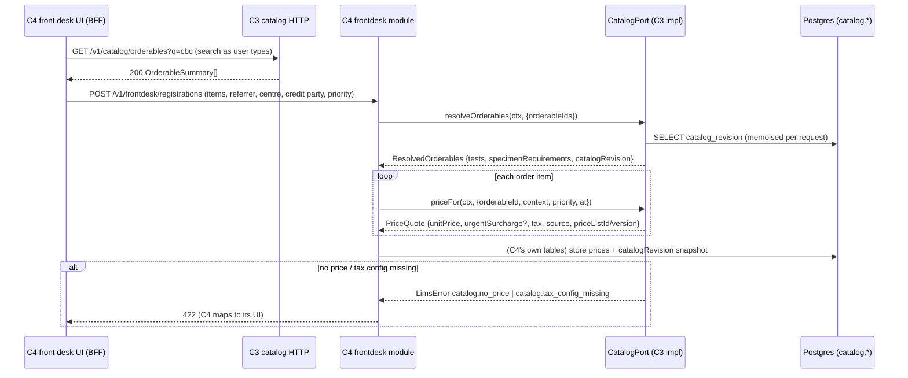
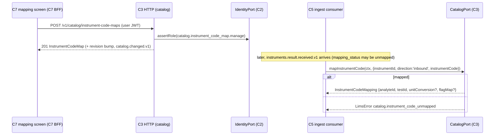
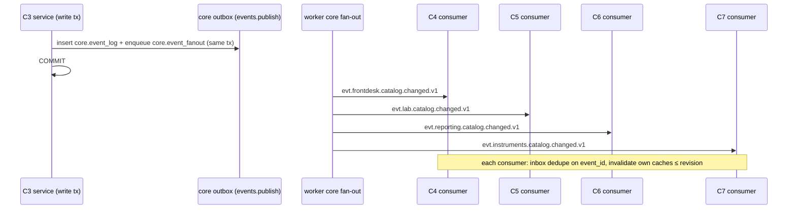
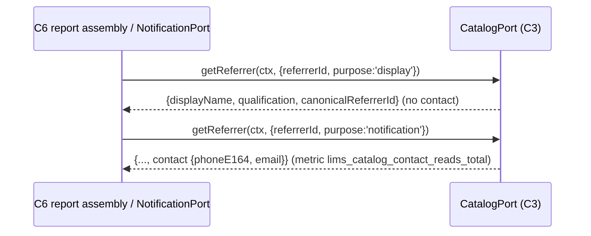

# C3 Catalog & Pricing — 03 Application Flow

Status: DECISION draft, 2026-11-05. Endpoint numbers (#n) refer to `02-TRD.md` §5.2. Screen ids (SCR-nn) refer to `04-UI-UX.md`.

---

## 1. Flow inventory

| Flow | Actors | Screens / endpoints | Cross-chunk |
|---|---|---|---|
| F-01 Master data CRUD (departments, specimen types, containers, methods, units, value sets) | lab_manager | SCR-02…SCR-05; #5–#22 | event → C4/C5/C6/C7 |
| F-02 Create test + analytes | lab_manager | SCR-06/07; #24, #27, #29 | event |
| F-03 Analyte version draft → publish (bundle with range/critical sets) | lab_manager, pathologist | SCR-07/08; #32–#35, #38–#43 | event; C5 reads via port |
| F-04 Reference-range / critical-limit set draft → publish / retire | lab_manager (draft), pathologist or lab_manager (publish, privileged) | SCR-08; #37–#51 | event |
| F-05 Formula authoring + validation | lab_manager | SCR-07 formula panel; #36 | shared formula lib (CR-C3-002) |
| F-06 Panels and packages | lab_manager | SCR-09; #52–#56 | event |
| F-07 Comment codes | lab_manager | SCR-10; #57–#59 | C5 via `resolveCommentCodes` |
| F-08 TAT targets | lab_manager | SCR-06 tab; #28 | C5/C8/C9 read via port/test detail |
| F-09 Doctor quick-add from registration | front_desk (C4 screen) | #62 via C4 BFF | **C4 UI → C3 HTTP** |
| F-10 Doctor back-office: verify, edit, merge | tenant_admin, lab_manager | SCR-11; #60–#66 | event; C6/C8 |
| F-11 Credit parties | finance, tenant_admin | SCR-12; #67–#70 | C4 via port |
| F-12 Price list version edit → publish | finance, tenant_admin | SCR-13/14; #71–#81 | event; C4 via `priceFor`; C13 via view |
| F-13 Price simulator | finance, front_desk | SCR-15; #82 | — |
| F-14 Surcharge rules and tax rules | finance | SCR-16/17; #83–#91 | C4 via `priceFor` |
| F-15 Excel import (price list / catalog master / referrers) | finance, lab_manager, tenant_admin | SCR-18/19; #96–#103 | worker jobs |
| F-16 Excel export | same | SCR-18; #104–#107 | worker job |
| F-17 Instrument code maps | lab_manager in **C7's** screens | #92–#95 | **C7 UI → C3 HTTP**; C5/C7 via `mapInstrumentCode` |
| F-18 Port reads by consumers | system (C4, C5, C6, C7, C9…) | `CatalogPort` | in-process |
| F-18a Tax-rate lookup by code (08 A2.2) | C12 (purchase side) | `CatalogPort.getTaxRate` | in-process; reads C3 tax-rule data (§4.5a) |
| F-19 Revision bump + `catalog.changed.v1` | system | every write | outbox → C4/C5/C6/C7 |
| F-20 Global reference release fan-out | system (cron) | `catalog.global_release_fanout` | event per tenant |
| F-21 Catalog health report | lab_manager, finance | SCR-01; #4 | — |

## 2. State machines

### 2.1 Versioned clinical/pricing objects

Applies to `catalog.analyte_versions`, `catalog.reference_range_sets`, `catalog.critical_limit_sets`, `catalog.price_list_versions` (one table each, same `status` column and rules). Pure table in `domain/versioning.state.ts`.

```mermaid
stateDiagram-v2
    [*] --> draft: create draft (copy of latest or empty)
    draft --> draft: edit (draft only)
    draft --> discarded: discard
    draft --> published: publish(effective_from ≥ now − tolerance, change_reason)
    published --> superseded: successor published (effective_to := successor.effective_from)
    published --> retired: retire (ranges/critical only; effective_to := effective_at)
    superseded --> [*]
    retired --> [*]
    discarded --> [*]
```



| # | From → To | Guard | Side effects | Event |
|---|---|---|---|---|
| V1 | ∅ → draft | no other draft for the same parent (`analyte_id` / `price_list_id`) — partial unique index; else `409 common.version_conflict` | `version_no = max + 1`; copy content from `copy_from` (default latest published) | none (drafts invisible to consumers) |
| V2 | draft → draft | `If-Match` | content replaced | none |
| V3 | draft → discarded | — | status only | none |
| V4 | draft → published | content valid (02-TRD §7.1–7.6 rules); `effective_from` ≥ now − 300 s and > `effective_from` of the latest published/superseded/**retired** sibling, and ≥ that sibling's `effective_to` when it is retired (no window overlaps a retired set's window); for analyte versions changing `unit_code`/`method_id`: a matching range set in the same request or `allow_without_ranges`; permissions (analyte versions: `catalog.reference_range.publish` + `catalog.test.manage`, 08 A13 D-18; range/critical: `catalog.reference_range.publish`; price lists: `catalog.price_list.manage`) | lock parent row `FOR UPDATE`; analyte versions: insert `formula_dependencies` **before** the `UPDATE` to `published` (child rows are writable only while the parent is draft, 05-SCHEMA §10.2); previous open-ended published sibling gets `effective_to = effective_from` and `status = superseded` in the same transaction (see note); `published_at/by`; bump revision (stamps `orderables.revision` of the owning test, 02-TRD §3) | `catalog.changed.v1` (`versioned`) |
| V5 | published → superseded | automatic in the publishing transaction of the successor | `effective_to` set | (covered by V4's event) |
| V6 | published → retired | ranges/critical sets only; `change_reason`; `effective_at` ≥ now − tolerance | `effective_to = effective_at`; no successor → port returns `no_reference_range` / `undefined` after that instant | `catalog.changed.v1` (`versioned`) |
| — | forbidden | published/superseded/retired/discarded → draft; any content change on non-draft (`409 catalog.version_in_use`; DB trigger → `common.immutable_record`); retire of analyte version or price-list version (use a new version / deactivate the list) | | |

Note on scheduled versions: a version published with a future `effective_from` is `published` immediately (status is about immutability, not effectiveness). Its predecessor gets `effective_to` and `status = superseded` in the same transaction even though it stays effective until `effective_to` [CONV — simpler; effectiveness is always computed from the window, never from status]. Consumers and the port never use `status` to choose a version; they use the effective window.

### 2.2 Import (`catalog.imports.status`) — `domain/import.state.ts`

```mermaid
stateDiagram-v2
    [*] --> uploaded: createImport (API)
    uploaded --> scanning: validate job starts
    scanning --> quarantined: scan = infected
    scanning --> validating: scan clean (unavailable → retry, then quarantined; dev without scanner only: continue)
    validating --> invalid: ≥1 error (file or row)
    validating --> validated: 0 errors
    validated --> committing: commitImport (API)
    committing --> committed: commit job tx ok
    committing --> commit_failed: re-validation found errors / job exhausted retries
    validated --> discarded: discardImport
    invalid --> discarded: discardImport
    validated --> expired: expires_at passed (cron)
    invalid --> expired: expires_at passed (cron)
    uploaded --> failed: validate job exhausted retries
    scanning --> failed
    validating --> failed
```



| Transition | Who | Guard | Side effects |
|---|---|---|---|
| ∅ → uploaded | API `createImport` | permission per kind; size ≤ 15 MB; `.xlsx` + ZIP magic; < 2 active imports in tenant; dedupe (same tenant/kind/target/sha256 — not `base_version_no`, which is unknown before parsing — non-terminal-failed, not expired → return existing) | `catalog.files` row (upload, `expires_at = created_at + 168 h + 30 d`), import row, enqueue `catalog.import_validate` |
| uploaded → scanning → validating → validated/invalid | worker | status check at task start (duplicate job = no-op) | `base_version_no` from `_meta`; issues rows (`expires_at` = upload file `expires_at`); report file; `summary`; import `expires_at = now + 168 h`; upload/report file `expires_at` = import `expires_at` + 30 d |
| validated → committing | API `commitImport` | `If-Match`; not expired; stale-base rule; `catalog.reference_range.publish` when a catalog_master commit creates/publishes analyte versions, range or critical sets (08 A13 D-18) | stores commit params (`effective_from`, `change_reason`, `publish`, `accept_stale_base`, `replace_draft`) on the row; enqueue `catalog.import_commit` |
| committing → committed | worker | single transaction re-validates + applies; open drafts of the targets discarded first only when `replace_draft` | price_list: one `price_list` / `versioned` event; catalog_master / referrers / credit_parties: **one** revision bump + one `catalog_import` event (08 A13 D-21); writes carry `committed_by` as actor and `source_import_id`; `result_price_list_version_id` |
| committing → commit_failed | worker | new errors at re-validation, an open draft of a target without `replace_draft` (issue `file.draft_exists`), or final attempt failed | issues appended; **nothing** applied |
| validated/invalid → discarded | API | `If-Match` | none |
| → expired | cron | `expires_at < now` | none (files purged later) |
| → failed / quarantined / commit_failed | worker final-attempt handler | mapping (02-TRD §10): `scanning` with last error `scan_unavailable` → `quarantined`; `committing` → `commit_failed`; `uploaded`/`scanning`/`validating` otherwise → `failed` | `last_error_code` |

Terminal: `committed`, `commit_failed`, `invalid`*, `quarantined`, `discarded`, `expired`, `failed` (*`invalid` can still go to `discarded`/`expired`). A failed import is retried by uploading again (new import).

### 2.3 Export (`catalog.exports.status`)

`queued → building → ready → expired`; `queued`/`building → failed` (final-attempt handler, 02-TRD §10). Only `ready` files download (`409 common.version_conflict` with `detail: "file_not_ready"` otherwise — 08 A13 D-20). Exports are listed by #107 `listExports`.

### 2.4 Doctor

| From | To | Trigger | Guard |
|---|---|---|---|
| ∅ | unverified (`is_verified=false`) | quick-add (`source=quick_add`) or import with `is_verified=N` | — |
| ∅ | verified | back-office create / import with Y | — |
| unverified | verified | `verifyDoctor` | not merged |
| any active | merged (`is_active=false`, `merged_into_id`) | `mergeDoctor` | target active, not merged, ≠ self; in the same tx every doctor already merged into the source is re-pointed to the target (chains flattened to one hop — 05-SCHEMA §5.5) |
| active | inactive (and back) | PATCH `is_active` | not merged (a merged doctor cannot be reactivated [CONV]) |

Price-list assignment of a merged doctor is removed in the merge transaction; if the survivor has none, the merged doctor's list is re-assigned to the survivor [CONV].

### 2.5 Master rows (`is_active`)

Deactivation is allowed at any time; it never cascades. Effects: inactive orderables are excluded from search and rejected by `resolveOrderables` (`catalog.test_inactive`); inactive price lists are skipped in precedence; inactive comment codes are reported as `unknown`; inactive code maps are ignored; inactive departments/specimen types/methods remain readable for existing versions but cannot be newly referenced (`400 common.validation_failed`).

## 3. Step-by-step flows

### F-02 Create a test with analytes (e.g. CBC)
1. SCR-06 "New test": user enters code `CBC`, name, department, workflow `standard`, specimen requirement EDTA_WB/EDTA tube (preferred). `POST /tests` (#24) → test + orderable row, revision bump (`test`, `created`).
2. SCR-07 "Add analyte": code `HB`, name, sub-heading "RBC parameters", sort order, initial version {numeric, unit `g_dl`, decimals 1, method}. `POST /tests/{id}/analytes` (#29) → analyte + draft v1 (no event for the draft; the analyte create itself bumps `analyte`, `created`).
3. Repeat for every analyte; calculated ones (e.g. `MENTZER`, `NLR`) get a formula; the formula panel calls #36 live (debounced 400 ms [CONV]).
4. SCR-08 "Reference ranges" for HB: create draft set (#38), edit bands (#40).
5. Publish: SCR-07 "Publish version" dialog → #34 with `reference_range_set_id` (and `critical_limit_set_id`) → one transaction publishes all three with the same `effective_from`; three revision bumps (`analyte`, `reference_range`, `critical_limit`), three events. Publishing the analyte version itself needs `catalog.reference_range.publish` (privileged) + `catalog.test.manage` (08 A13 D-18). User without either sees the publish button disabled with reason text; API returns `403 auth.forbidden`; without aal2 `403 auth.mfa_required` → UI routes to the shell's step-up flow (C2).

### F-04 Change a reference range only
1. SCR-08: "New version" → #38 with `copy_from_set_id` = current → draft.
2. Edit bands → #40 (server validates shape; overlaps are reported on publish).
3. "Preview" panel → #51 with test age/sex values → shows which band matches.
4. Publish → #41 with `change_reason` → old set superseded at `effective_from`; event `reference_range` `versioned`.
5. C5 picks it up on the next request (revision changed → cache key changed).

### F-09 Doctor quick-add from the registration page (C4 owns the screen)
1. C4's BFF calls `POST /v1/catalog/doctors` (#62) with `quick_add: true`, `Idempotency-Key` from the form instance.
2. C3 normalises name (trim, collapse spaces, NFC — 02-CV §13) and phone; looks up active doctors with equal normalised name **and** phone → `possible_duplicate_of`.
3. Inserts doctor (`is_verified=false`, `source=quick_add`, auto code via `code_counters` row lock), bumps revision (`doctor`, `created`), returns `201`.
4. C4's screen offers "Use existing Dr …" when `possible_duplicate_of` is non-empty; the choice is C4's.

### F-12 Price list edit and publish
1. SCR-13: finance opens list → "Edit prices" → #76 creates draft v(n+1) copied from latest published.
2. Grid edits batch into #78 (≤200 rows per call; the grid saves every 200 changed rows or on "Save" [CONV]); removals #79.
3. "Compare with current" → client-side diff over #77 pages of both versions (≤5,000 items [ASSUMPTION]; UI pages through).
4. "Publish" dialog: effective date/time (default now; picker shows A.D. + B.S. per tenant calendar setting — 02-CV §13), change reason → #80 (privileged → aal2). Event `price_list` `versioned`.
5. Registrations after `effective_from` get the new price; existing order items keep their stored price (06-GLOSSARY Price list — C4 behaviour).

### F-15 Excel price-list import (end to end)
1. SCR-18 "Import" → choose kind `price_list` and the target list → "Download current as Excel" (= export, F-16) or "Download blank template" (#96).
2. User edits in Excel, returns, uploads (#97) → `201` import `uploaded`; UI polls #99 every 2 s [CONV] (BFF polling — 02-CV §2.4) until a non-transient status.
3. Worker validates (02-TRD §8.3) → `validated` or `invalid`.
4. SCR-19 shows summary tiles (rows, added, changed, removed, unchanged, errors, warnings), issue table (#100, filter by severity), "Download annotated report" (#101).
5. `invalid` → user fixes the file and uploads again (new import). `validated` → "Commit" dialog: effective from, change reason, "publish now" (default on), checkbox "I understand the list changed since export" shown only when `file.stale_base` warning exists, switch "Replace open drafts" (`replace_draft`, default off) → #102 (`202`, `committing`).
6. Worker commits (single tx) → `committed`; UI shows link to the new version. On `commit_failed`, issues list shows the new errors (e.g. `file.draft_exists`: upload again and commit with "Replace open drafts", or publish/discard the draft first).

### F-16 Export
1. SCR-18 or SCR-13 "Export to Excel" → #104 → `202 queued`.
2. UI polls #105 every 2 s; on `ready` shows "Download" → #106 (attachment, streamed via BFF). Access-log entry per download.

### F-17 Instrument code maps (data for C7)
1. C7's mapping screen (C7-owned UI) calls C7's BFF, which calls C3 `GET /v1/catalog/instrument-code-maps?instrument_id=` (#92) and `POST`/`PATCH`/bulk-upsert (#93–#95) with the user's session; `catalog.instrument_code_map.manage` is privileged (aal2, 08 A13 D-18).
2. C3 validates `analyte_id ∈ test_id`, both in tenant; uniqueness of active inbound code per instrument and active outbound map per (instrument, analyte); bumps revision (`instrument_code_map`).
3. C5's ingest consumer and C7's host-query path call `CatalogPort.mapInstrumentCode` in-process.

### F-19 Revision bump (every write)
1. Service performs the domain write(s) in `ctx.db.tx`.
2. `bumpRevision(tx, {entityType, entityId, changeKind, effectiveFrom})`: `UPDATE catalog.catalog_state SET catalog_revision = catalog_revision + 1, updated_at = now() WHERE tenant_id = $1 RETURNING catalog_revision, catalog_root_id` (row created lazily by `INSERT … ON CONFLICT DO NOTHING` first, `catalog_root_id` = new UUIDv7).
3. Stamps `orderables.revision = <new>` (the only `revision` column): for a bump whose entity is a test, panel, analyte, analyte version, range/critical set, TAT target or specimen requirement, on the owning test's (or the panel's own) orderable row; panels containing a changed test are not re-stamped (02-TRD §3). Import commits of kind catalog_master / referrers / credit_parties bump once and stamp every touched orderable with that revision (08 A13 D-21).
4. `events.publish(tx, 'catalog.changed.v1', …)` (02-TRD §9.1).
5. Commit. Rollback → no revision, no event.

### F-20 Global reference fan-out
1. A C0 seed migration that changes `catalog.g_*` rows also increments `catalog.g_reference_release.release_no` (requirement on C0, stated in 05-SCHEMA §8).
2. Cron task `tenantScope: 'per_tenant'` (08 A13 P-6): the worker core enqueues one job per active/suspended tenant and runs it under that tenant's claims; the job, in one transaction: if `release_no > global_release_seen` → bump revision (`global_reference`) + set seen.

## 4. Cross-chunk sequence diagrams

### 4.1 C4 registration: resolve + price (in-process port)



### 4.2 C5 result evaluation

```mermaid
sequenceDiagram
    participant C5 as C5 lab module (API or worker consumer)
    participant CP as CatalogPort (C3)
    C5->>CP: getTest(ctx, {testId, asOf: result time})
    CP-->>C5: TestDefinition (analytes: unit, decimals, method, formula, valueSet)
    C5->>CP: referenceRangeFor(ctx, {analyteId, sex, ageDays?, birthOn?, specimenTypeCode, at})
    Note over CP: ageDays absent = age unknown (08 A17.1): only bands with no age bound can match; birthOn ignored
    alt range found
        CP-->>C5: ReferenceRangeMatch {referenceRangeId, version, low/high/text, kind, normalCodes}
    else none
        CP-->>C5: LimsError catalog.no_reference_range
    end
    C5->>CP: criticalLimitsFor(ctx, same query)
    CP-->>C5: CriticalLimitsMatch | undefined
    C5->>CP: resolveCommentCodes(ctx, {codes, departmentId})
    CP-->>C5: {resolved[], unknown[]}
    Note over C5: C5 snapshots range id+version, evaluates formulas with @lims/shared-ts/formula
```

### 4.3 C7 mapping UI → C3 HTTP, and ingest → mapInstrumentCode



### 4.4 Cache invalidation via `catalog.changed.v1`



C3's own port cache does not depend on these events (key includes the current revision, 02-TRD §6.3).

### 4.5 C6 / NotificationPort referrer lookup



### 4.5a C12 purchase-side tax rate (`getTaxRate`, 08 Addendum A2.2; signature per A4.1)

```mermaid
sequenceDiagram
    participant C12 as C12 inventory (GRN / PO costing)
    participant CP as CatalogPort (C3)
    participant ID as IdentityPort (C2)
    C12->>CP: getTaxRate(ctx, {taxCode, on: 'YYYY-MM-DD'})
    CP->>ID: getTenantSettings(['timezone']) (cached)
    CP->>CP: VAT → g_tax_types; other code → cs_tax_types version effective at 00:00 of `on` (tenant tz) [CONV]
    alt VAT (g_tax_types, no versioned history)
        CP-->>C12: {taxCode: 'VAT', ratePercentBasisPoints, kind: 'vat', effectiveFrom: null}
    else other code, version found
        CP-->>C12: {taxCode, ratePercentBasisPoints, kind: 'other', effectiveFrom}
    else unknown / inactive / no version / rate NULL
        CP-->>C12: throws catalog.tax_config_missing
    end
```

C12 stores only the tax code and its own treatment (`vat_in_cost`); it never stores the rate (08 R18, A2.2). Exempt purchase lines carry no tax code and never call `getTaxRate`; there is no `'exempt'` kind (08 A4.1).

### 4.5b C16 membership-plan validation (`getPriceListStatus`, 08 Addendum A24.1, CR-C16-023)

```mermaid
sequenceDiagram
    participant C16 as C16 engagement (staff M1b create/update membership plan)
    participant CP as CatalogPort (C3)
    C16->>CP: getPriceListStatus(ctx, {priceListId})
    alt list of the caller's tenant
        CP->>CP: is_active from price_lists; status from its versions (02-TRD §7.4a) [CONV]
        CP-->>C16: {priceListId, isActive, status: 'draft' | 'published' | 'discarded'}
    else unknown id / other tenant
        CP-->>C16: throws common.not_found
    end
```

The request handler calls the port; it never reads `catalog.v_pub_*` views (08 R25 / A17 P-21). What C16 accepts (for example only `isActive && status = 'published'`) is C16's rule.

### 4.6 Import upload → worker → commit

```mermaid
sequenceDiagram
    participant B as Browser (SCR-18)
    participant BFF as Next.js BFF (C3 features/catalog/server)
    participant API as C3 HTTP
    participant Q as Graphile Worker
    participant J as catalog.import_* tasks
    B->>BFF: multipart upload (same origin, cookie session)
    BFF->>API: POST /v1/catalog/imports (Bearer JWT, Idempotency-Key)
    API->>API: size/ext/magic/dedupe; insert files+imports; enqueue validate (same tx)
    API-->>BFF: 201 Import(uploaded)
    loop poll 2 s
        B->>BFF: GET import
        BFF->>API: GET /v1/catalog/imports/{id}
    end
    Q->>J: catalog.import_validate
    J->>J: scan hook → ZipInspector → XlsxReader (timeout) → validate → report file
    J-->>Q: done (validated | invalid)
    B->>BFF: Commit
    BFF->>API: POST /imports/{id}/commit (If-Match, Idempotency-Key)
    API-->>BFF: 202 committing (+ enqueue commit)
    Q->>J: catalog.import_commit (one tx: re-validate, apply via services, revisions, events)
```

## 5. Screen states (every screen)

Generic rules [CONV]: **loading** = `LoadingSkeleton` rows matching the final layout (no spinners longer than 300 ms without skeleton); **error** = inline `Banner` (kind error) with the problem `title` + "Reference: <request_id>" and a Retry button; never raw `detail` from 5xx; **permission denied** (403 `auth.forbidden`) = full-page `EmptyState` "You don't have access to this part of the catalog" + nav link back; `auth.mfa_required` = shell step-up prompt (C2) then automatic retry; **404** = `EmptyState` "This item was not found" (same for other-tenant ids); **success** = toast via `useToast` (03-IC §13.2, 08 R22) with the action ("Price list version 4 published") and the new state rendered.

| Screen | Empty state copy | Loading | Error specifics | Success | Permission-denied behaviour |
|---|---|---|---|---|---|
| SCR-01 Catalog home + health report | "No catalog yet. Import the starter workbook or create your first department." + buttons | skeleton tiles | health report failure shows tiles as "—" with retry | tiles with counts; each count links to filtered list | tiles hidden for areas without permission |
| SCR-02 Departments | "No departments yet." + "New department" | table skeleton | `catalog.code_duplicate` inline on code field | row appears, toast | read-only table without create/edit buttons when only `catalog.test.read` |
| SCR-03 Specimen types & containers | "No specimen types yet." | same | same | same | same |
| SCR-04 Methods | "No methods yet." | same | same | same | same |
| SCR-05 Units & value sets | "Only global units are available. Add a lab-specific unit if needed." | same | `catalog.version_in_use` on value-set code removal → banner "This value set is used by a published analyte version; values can be added or hidden, not removed or re-ordered." | | read-only |
| SCR-06 Tests list / test detail | "No tests match your filters." / "No tests yet." | skeleton | — | — | read-only detail |
| SCR-07 Analyte editor + version publish | "This test has no analytes yet." | skeleton | `catalog.formula_invalid` under the formula field with the cycle path; `catalog.version_in_use` → banner + "Create new version" button | toast "HB version 2 published, effective 06/11/2026 00:00" | publish button disabled with tooltip naming the missing permission |
| SCR-08 Ranges / critical limits | "No reference ranges. Results for this analyte will show no range and C5 will ask for manual review." | skeleton | overlap errors highlight both band rows | toast | publish disabled without `catalog.reference_range.publish` |
| SCR-09 Panels & packages | "No panels yet." | skeleton | `catalog.panel_cycle` banner "This would make the panel contain itself (P1 → P2 → P1)." | toast | read-only |
| SCR-10 Comment codes | "No comment codes for this department." | skeleton | duplicate code inline | toast | read-only |
| SCR-11 Doctors (list, verify queue, detail, merge) | "No doctors yet." / verify queue: "No doctors waiting for verification." | skeleton | merge validation errors inline | toast "Merged into DR00012" | contact fields hidden without `catalog.referrer.manage` |
| SCR-12 Credit parties | "No credit parties or affiliations yet." | skeleton | duplicate code inline | toast | read-only |
| SCR-13 Price lists | "Only the default price list exists." / "No price list yet — create the default list first." | skeleton | second default → banner | toast | read-only for `catalog.price_list.read` |
| SCR-14 Price list version editor | "This version has no prices. Add rows or import from Excel." | grid skeleton | per-row `error_code` shown in the row; `catalog.version_in_use` → "This version is already published." | toast per save batch | read-only grid |
| SCR-15 Price simulator | "Pick orderables and a context to see the price." | inline spinner ≤ 300 ms | per-item `catalog.no_price` / `catalog.tax_config_missing` shown in the row | quote table | hidden without `catalog.price_list.read` |
| SCR-16 Surcharge rules | "No urgent surcharge rules. Urgent tests are charged at the normal price." | skeleton | overlap banner | toast | read-only |
| SCR-17 Tax rules & types | "No tax rules. Prices cannot be quoted until a tenant default rule exists." + auditor disclaimer | skeleton | rate missing banner | toast | read-only |
| SCR-18 Imports & exports list | "No imports yet." / exports table: "No exports yet." | skeleton | 413/415 banners with the limits; 429 "Two imports are already running; try again shortly."; download `409` with `detail: file_not_ready` → "Still preparing — try again shortly" (08 A13 D-20) | upload → navigates to SCR-19 | kinds the user cannot manage are not offered |
| SCR-19 Import detail | — (always has a row) | status stepper with live polling | `quarantined`: red banner "This file was blocked by the security scan. It was not read." ; `invalid`: issue table; `commit_failed`: banner + new issues | `committed`: green banner + link to the new version | commit button disabled without permission |

## 6. Edge cases

| # | Case | Handling |
|---|---|---|
| E1 | Two users publish versions of the same analyte/price list at once | parent row `SELECT … FOR UPDATE`; second publish sees the first's `effective_from` → if its own `effective_from` ≤ that → `400 common.validation_failed` (`/effective_from` "must be later than the current version"); `If-Match` on the draft also protects |
| E2 | Two drafts created concurrently | partial unique index → one gets `409 common.version_conflict` |
| E3 | Concurrent writes across different entities in one tenant | serialised on `catalog_state` row lock (short); revisions strictly increasing, no gaps |
| E4 | Port call during a long import commit | port reads use MVCC snapshot of the caller's transaction; they see the old revision until the import commits (no blocking: readers don't take the `catalog_state` lock) |
| E5 | Duplicate `createImport` submission (double click) | `Idempotency-Key` replay; and file-hash dedupe returns the same import |
| E6 | Duplicate `commitImport` with a new key | state is `committing`/`committed` → `409 catalog.import_not_committable` |
| E7 | Worker crash during validate | job retried; status check restarts from `uploaded`/`scanning`/`validating`; issues for the import are deleted and rewritten in the task's transaction |
| E8 | Worker crash during commit | single transaction → nothing applied; retry runs again; after 3 attempts → `commit_failed` |
| E9 | Catalog changed between validate and commit | commit re-validates inside its transaction; new errors → `commit_failed`, nothing applied |
| E10 | Price list deactivated while a validated import targets it | commit re-validation → `file.meta_mismatch` error → `commit_failed` |
| E11 | Effective_from in the future then another version published before it takes effect | allowed only with a later `effective_from` (V4 guard); the scheduled version keeps its window `[F1, F2)` |
| E12 | Formula input analyte deactivated | existing published formulas keep working (C5 gets inputs from results); new versions referencing it fail validation; health report lists it under `unmapped_formula_inputs` |
| E13 | Referrer merged after orders were placed | orders keep the old id; port returns `canonicalReferrerId`; price precedence uses the canonical doctor's list |
| E14 | Range query exactly at `effective_from` of a new set | new set (`effective_from ≤ at`) |
| E15 | `asOf` before the analyte's first published version | analyte omitted from `getTest` output (consumer treats as not existing at that time) |
| E16 | Offline | staff web requires connectivity; no offline mode for catalog screens; port calls are in-process |
| E17 | BFF retry of a PATCH after timeout | `If-Match` makes the retry fail with `version_conflict` if the first succeeded → UI reloads and shows the saved state |
| E18 | Very large bulk upsert (> 200 rows) | `400 common.validation_failed` (`maxItems`); UI batches |
| E19 | Excel cell holds a formula (`=A1*2`) | the importer reads the cell's value as provided by the library; behaviour for formula cells is UNVERIFIED (02-TRD §2.2) → template instructions say "paste values only"; a value that is not a valid number/text per column rule → row error |
| E20 | Excel numeric cell shows 900 but stores 899.9999999 | converted via decimal string with tolerance 1e-6 then must have ≤ 2 decimals → accepted as 900.00 [CONV] |
| E21 | Global release fan-out while a tenant is suspended | still bumps revision (harmless); C2 suspension does not block data jobs [CONV] |
| E22 | Deleting a tenant's last default price list | impossible: deactivate rejected for the default list (#74) |
| E23 | Code map for an instrument id that C7 later deletes | map stays (no FK across R3 boundary); C7 deactivates maps through #94 when retiring an instrument (C7 responsibility, noted at interface) |
| E24 | Sex-restricted package ordered for the other sex | C3 only reports `sexRestriction`; C4 enforces at registration |
| E25 | Partial failure inside bulk upsert | per-row outcomes; rows are applied in one transaction **except** rows with validation errors, which are skipped [CONV]; revision bumps once for the version (draft → no bump, see 02-TRD §9.1) |
| E26 | Patient age unknown (`RangeQuery.ageDays` absent, 08 A17.1) | only bands/limits whose `age_low` and `age_high` are both absent can match; none → `catalog.no_reference_range` / `undefined`; C5 then marks the result `range_unavailable_age_unknown` and never auto-verifies it (C5's rule) |
| E27 | Lab-built or C18-built price-list workbook with a blank or missing `_meta.tenant_catalog_revision` | accepted: the validator does not read `price_list_code`, `tenant_catalog_revision` or `exported_at` (02-TRD §8.2; C18 hand-off confirmed) |

Final sweep 2026-11-06 — second touch applied (§4.2 age unknown; §4.5b `getPriceListStatus`; E26, E27).
