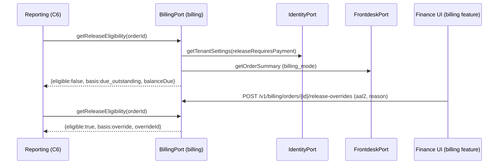
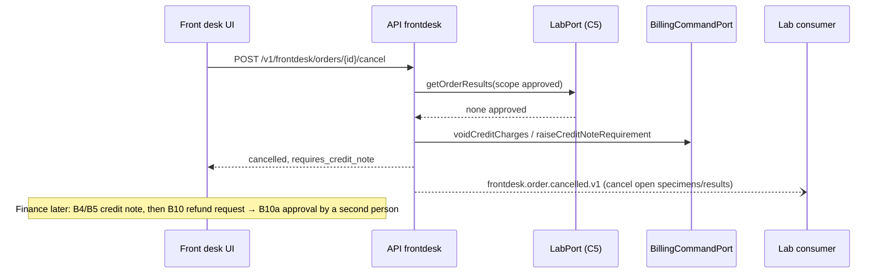

# C4 Front Desk & Billing — 03 APP FLOW

Status: DECISION draft, 2026-11-05. Endpoint ids (F#, B#) refer to `02-TRD.md` §5; table names to `05-SCHEMA.md`. State machines realise 03-IC §10.4/§10.5 exactly and add C4-internal machines.

## 1. State machines

### 1.1 Order (`frontdesk.orders.status`) — 03-IC §10.4
| # | From | To | Trigger | Guards | Side effects | Events |
|---|---|---|---|---|---|---|
| O1 | (none) | `pre_registered` | `createOrderFromBooking(confirmImmediately:false)` / `engagement.booking.confirmed.v1` with `booking_kind = centre_visit` (home_collection bookings create no order here — 08 R7) | patient exists or created with consent; orderables active; booking link not converted/cancelled | items with price snapshots; `booking_links` row `converted` | — |
| O2 | (none) | `registered` | F9 `createRegistration`; port with `confirmImmediately:true` (C17 home collection at assignment; C13 partner manifest — 08 R7) | §2.3 registration guards | items, discounts, invoice (cash) or credit charges (credit), payments, SMS, `order_balances` row | `frontdesk.order.created.v1` (+ billing events) |
| O3 | `pre_registered` | `registered` | F12 `confirmPreRegisteredOrder` | fresh quote fingerprint equals request; patient consent present | as O2 | `frontdesk.order.created.v1` |
| O4 | `registered` | `in_progress` (derived) | `LabPort.getOrderItemProcessingState`: any active item `in_progress` or `reported` (08 A13 D-5) | — | none stored | — |
| O5 | `registered`/`in_progress` | `completed` (derived) | `LabPort.getOrderItemProcessingState`: every active item `reported` or `cancelled` and ≥ 1 `reported` (D-5; an item whose only specimen was rejected without recollection is `cancelled`) | — | none stored | — |
| O6 | `pre_registered` | `cancelled` | F14 or `engagement.booking.cancelled.v1` | not already cancelled | items → `cancelled` | `frontdesk.order.cancelled.v1` (`requires_credit_note:false`) |
| O7 | `registered`/`in_progress` | `cancelled` | F14 | `LabPort.getOrderResults({scope:'approved'})` returns no results; not already cancelled | items → `cancelled`; `BillingCommandPort.voidCreditCharges`; `raiseCreditNoteRequirement` → `requires_credit_note` | `frontdesk.order.cancelled.v1` |
Forbidden (unit-tested): `cancelled → *` (`frontdesk.order_already_cancelled`), `registered → pre_registered`, cancel with approved results (`frontdesk.order_cancel_not_allowed`).
Item changes (`registered`/`in_progress`): add → supplementary invoice (cash) or new credit charges (credit); remove → item `removed` + credit note task (if invoiced) or charge void (credit). Removal guard: `LabPort.getOrderItemProcessingState({orderId})` → the item must be `removable` (CR-C4-003, accepted in 08).

### 1.2 Invoice (`billing.invoices.status`) — 03-IC §10.5
| From | To | Trigger | Guards | Side effects | Events |
|---|---|---|---|---|---|
| (none) | `issued` | `issueOrderInvoice` (registration, confirmation, supplementary), B21 periodic | fingerprint match; counter allocation (TRD §12); every line carries its tax rates from `CatalogPort.priceFor` (C3; else `catalog.tax_config_missing`) | lines, `order_balances` (+version), activity `invoice_issued`, CBMS job (or `not_required`) | `billing.invoice.issued.v1`, `billing.balance.changed.v1` (order invoices) |
| `issued` | `cancelled` | B4 | `billing.invoice.cancel` + aal2; reason (`requires_text` codes need text) | credit note `cancellation` for `net − credited_total`; `is_active=false`; tasks for the invoice resolved; activity; CBMS jobs for `invoice_cancellation` + `credit_note` | `billing.invoice.cancelled.v1`, `billing.balance.changed.v1` |
Lifecycle columns (not states): `print_count` (+1 per print), `credited_total_paisa` (increases with partial credit notes), `cbms_state` (§1.6).

### 1.3 Discount approval (`frontdesk.discount_approvals.status`)
| From | To | Trigger | Guards |
|---|---|---|---|
| (none) | `pending` | F15 | computed discount > self-limit and ≤ absolute max; reason given |
| `pending` | `approved` | F18 | approver holds `frontdesk.discount.approve` (privileged ⇒ aal2), approver ≠ requester, not expired, approver covers `centre_id` |
| `pending` | `rejected` | F19 | as F18; note required |
| `pending`/`approved` | `expired` | `frontdesk.discount_approval_expire` cron or lazily on read when `now ≥ expires_at` | — |
| `approved` | `consumed` | F9/F12 with `discount_approval_id` | server-recomputed `base_fingerprint` equals the approval's, same patient ref, same `centre_id`, same discounts JSON |
Terminal: `rejected`, `expired`, `consumed`.

### 1.4 TRF scan (`frontdesk.trf_attachments.scan_state`)
`pending → clean` (`ctx.files.scan` → `clean`, PDF sanitised) · `pending → quarantined` (`infected` or sanitise failure; terminal) · `pending → failed` (`unavailable` after 5 attempts) · `failed → pending` (re-scan by re-upload or retry). Content (F21a) only in `clean`. UI `FileUpload.scanState`: pending→`pending`, clean→`clean`, quarantined→`infected`, failed→`unavailable`.

### 1.5 Cash session
`open` (auto-created on the first manual payment or manual refund pay-out by a user at a centre when none open) `→ closed` (B17 by the same user). One open session per (membership, centre). B22 credit-party payments and `home_collection` payments carry `cash_session_id = NULL`: they appear in daily cash only, not in shift close (review C4 #47).

### 1.6 CBMS state (lifecycle columns `invoices.cbms_state`, `invoices.cbms_cancel_state` for the `invoice_cancellation` document — NULL until cancelled — and `credit_notes.cbms_state`)
`not_required` (tenant has no real-time duty) `→ pending` (manual bulk submission enabled later) · `pending → synced` (live client `accepted`) · `pending → failed_permanent` (`rejected_permanent`; finance review) · `failed_permanent → pending` (B31 retry). `stub_recorded` and `retryable_error` keep `pending`.

### 1.7 Credit charge
`uninvoiced → invoiced` (B21) · `uninvoiced → voided` (order cancelled / item removed before billing). After `invoiced`, corrections only by partial credit note on the periodic invoice: cancelling the order or removing the item opens a `credit_note_tasks` row on that periodic invoice (`invoice_id` = charge.invoice_id, `invoice_line_ids` = charge.invoice_line_id; review C4 #37).

### 1.8 Export job
`queued → running → ready → expired` · `running → failed`.

### 1.9 Order flag / credit-note task / finance review item
`open → resolved` (terminal).

### 1.10 Refund request (`billing.refund_requests.status`; 08 A13 D-24)
| From | To | Trigger | Guards |
|---|---|---|---|
| (none) | `pending` | B10 | `billing.refund.request` + aal2; amount ≤ refundable; manual method |
| `pending` | `approved` | B10a | `billing.refund.approve` + aal2; approver ≠ requester (`billing.refund_self_approval_forbidden`); amount ≤ refundable (re-checked); writes the refund ledger row |
| `pending` | `rejected` | B10b | `billing.refund.approve` + aal2; note required |
Terminal: `approved`, `rejected`.

## 2. Flows

### 2.1 Patient search (F1)
1. UI debounces 250 ms [CONV]; `mode=auto` classifies the query: all digits ≥ 10 (or starting `+`) → phone (normalised to E.164 with +977 default); matches `patientCodePattern` prefix → code; matches registration pattern → registration_no; else name (requires ≥ `patient_search_min_chars`).
2. Handler: `assertRole(frontdesk.patient.read)`; validate; repo query with explicit `tenant_id = $1` (REQ-SEC-024): name → `SELECT set_config('pg_trgm.similarity_threshold', '0.3', true)` (transaction-local; bare `SET` is banned, 02-CV §5.10) then `WHERE tenant_id = $1 AND anonymised_at IS NULL AND name_search % $q ORDER BY similarity(name_search, $q) DESC, last_visit_at DESC LIMIT 20` [CONV threshold] — the `%` operator and the `anonymised_at IS NULL` predicate let `patients__tenant_id_name_search__trgm_idx` serve the query; phone/code/reg no → exact.
3. `ctx.audit.access({action: 'patient.search', entityType: 'patient', outcome, detail: {mode, result_count}})` — no query text (08 §4.4).
4. Mapper returns `PatientSummary` (masked phone).
States: empty query → hint; loading → skeleton rows; zero results → "No patient found — press Alt+N to register a new patient"; error → inline banner with `request_id`; 403 → "You do not have access to patient search".

### 2.2 Quote (F8) — server-authoritative pricing
1. `assertRole(frontdesk.registration.create)`; resolve centre via `ctx.core` (must be in actor's centre scope → else `404 common.not_found`).
2. `CatalogPort.resolveOrderables({orderableIds})` → tests, departments, catalog revision. Inactive → `catalog.test_inactive`.
3. For each orderable: `CatalogPort.priceFor({orderableId, context:{creditPartyId?, referrerId?, centreId}, priority, at: now})` → unit price, surcharge, tax flags. Missing → `catalog.no_price`.
4. Build `PricedLineInput[]` (department = common department of member tests or absent; urgent surcharge only if priority urgent and quote has `urgentSurcharge`).
5. `BillingCommandPort.computeQuote({lines, discounts})` → computed lines, totals, fingerprint.
6. Discount evaluation (frontdesk domain): `percent_of_gross = discount / gross`; within limit iff `≤ discount_self_limit_bp` AND `≤ discount_self_limit_paisa` (when limit_paisa > 0; 0 means percent-only) → `approval_required=false`; above `discount_absolute_max_bp` → `frontdesk.discount_exceeds_limit`.
7. Return `Quote`. No writes, no events.

### 2.3 Registration (F9) — one transaction
Pre-transaction (handler): idempotency hook (C0) → `assertRole(frontdesk.registration.create)`; if `billing_mode = cash` → also `assertRole(billing.invoice.issue, {centreId})`.
Inside `ctx.db.tx` (order of statements matters for the counter lock window):
1. **Patient**: existing → load (RLS; `404` if not visible; anonymised → `common.validation_failed`). New → normalise; dedupe query (same tenant, `name_search` equal after normalisation, `|birth year diff| ≤ 1`, same phone when given) → candidates and no `duplicate_override` → `409 frontdesk.patient_duplicate_suspected` (body lists candidates); consents `processing=false` → `422 frontdesk.consent_required`; allocate `patient_code` (`number_counters` UPDATE … RETURNING); insert patient (`source = front_desk`, `registered_centre_id` = request centre) + consent row.
2. **Referrer**: `require_referrer` and none → `422 frontdesk.referrer_required`; referrer given → `CatalogPort.getReferrer` [CR-C4-002] active check.
3. **Re-quote** (§2.2 steps 2–6) inside the tx; if `fingerprint ≠ request.quote_fingerprint` → `409 common.version_conflict` with `detail: "Prices changed"` and the fresh quote in the problem extension `quote` [CONV].
3a. **Credit** (after the re-quote, so `totals.net` is known — review C4 #36): `BillingCommandPort.assertCreditAllowed({creditPartyId, additional: totals.net})`, which also refuses a party C3 reports inactive or with `allowsCredit = false` (`409 billing.credit_party_locked`).
4. **Discount authority**: within limit → OK; above → `discount_approval_id` required: load (`FOR UPDATE`), status `approved`, not expired, the server-recomputed `base_fingerprint` (same lines, `discounts: []`) equals the approval's `base_fingerprint`, patient ref equal (`patient_id` or `draft_hash` of the normalised new-patient draft), `centre_id` equal, discounts JSON equal → mark `consumed`; else `403 frontdesk.discount_approval_required`.
5. **Order**: allocate `registration_no` (per branch counter); insert order (`registered`, `registered_at = now`, age snapshot, `is_first_order_of_patient`), items, discounts (`approval_mode`, approver), link `trf_attachment_ids` (must be same tenant/centre, `order_id IS NULL`, uploaded by same user within TTL, any scan state).
6. **Billing** (via `BillingCommandPort`, same tx):
   - cash: `issueOrderInvoice({…, purpose:'registration', expectedFingerprint})` → invoice (counter allocated **inside**, last); then for each `payments[]`: `recordPayment({captureKind:'manual', idempotencyKey: '<order_id>:reg:<i>'})` (receipt numbers only for payments after the first print, so registration payments carry `receipt_no = NULL` [DECISION: the invoice is the receipt]).
     Overpayment → `422 billing.payment_exceeds_due` (whole tx rolls back, counter included).
   - credit: `recordCreditCharges(...)` (upserts `billing.credit_accounts` from `CatalogPort.getCreditParty({purpose:'billing'})` on the party's first credit order); payments not allowed (`400 common.validation_failed`, path `/payments`).
7. **Notification**: if consent + settings + `channels.smsEnabled`: `NotificationPort.sendSms({recipient:{kind:'patient', patientId}, templateCode:'frontdesk.registration_confirmation', purpose:'registration_confirmation', params:{lab_name, registered_time_hhmm}, idempotencyKey:'<order_id>:registration_sms', related:{entityType:'order', entityId}})`. Port errors are caught → `not_attempted` (logged with code), never roll back.
8. **Event**: `frontdesk.order.created.v1` (idempotency `<order_id>:created`).
9. Commit → response `RegistrationResult` (201). Idempotency hook stores the response.
Retry (08 A13 D-25): on `billing.counter_busy` (lock timeout or detail `fiscal_year_rollover`) or SQLSTATE `40P01`, `registration.service` rolls back and runs steps 1–9 once more in a new transaction (same request, same idempotency record); a second failure is returned.
Post-commit (UI): open print view (B3) → on success show "Printed"; if `label_autoprint` → call C5 #14a `requestOrderLabelPrint` (readiness only) with retry on `409 common.version_conflict` every 1 s up to 10 s (specimens are created asynchronously by C5's consumer); after `200`, open route `staff.lab.order_labels` (via `@lims/shared-ts/routes`) in a print frame — the C5 page records the print and calls `window.print()`; panel text "Labels ready — printing" or C5's error (08 A13 D-4).

### 2.4 Confirm pre-registered order (F12)
Load order `FOR UPDATE` (status must be `pre_registered`, else `409 common.immutable_record`; If-Match version). Re-quote current prices for the stored orderables; mismatch with request fingerprint → `409 common.version_conflict` + fresh quote. If prices differ from the stored item snapshots, the old items become `removed` (reason `repriced`) and new items are inserted (the order has never been invoiced, so no fiscal impact). Then steps 4–9 of §2.3 with `status: pre_registered → registered`.

### 2.5 Change items (F13)
1. Load order (If-Match); status `registered` (stored) else `409 frontdesk.order_not_editable` (`pre_registered` uses F12 `items_override: {items:[{orderable_id, priority?}]}`, which replaces the stored items; cancelled → `frontdesk.order_already_cancelled`).
2. Removals: `LabPort.getOrderItemProcessingState({orderId})`; any removed item with `removable = false` → `409 frontdesk.order_not_editable`. Items → `removed`.
3. Additions: the UI first calls F8b `quoteOrderItemsChange` with exactly the `add` list (pricing context = the stored order's centre, referrer, credit party); F13 re-quotes the same added lines in the tx and its `quote_fingerprint` must equal F8b's, else `409 common.version_conflict` with the fresh quote.
4. Billing: cash → `issueOrderInvoice({purpose:'supplementary'})` for additions; `raiseCreditNoteRequirement({orderItemIds: removed, cause:'item_removed'})` for removed invoiced lines. Credit → `recordCreditCharges` / `voidCreditCharges`.
5. `items_version += 1`; event `frontdesk.order.items_changed.v1` with `added`/`removed` (never both empty).

### 2.6 Cancel order (F14)
Guards §1.1 O6/O7; `LabPort.getOrderResults({orderId, scope:'approved'})` → any result → `409 frontdesk.order_cancel_not_allowed`. Then items `cancelled`, `voidCreditCharges`, `raiseCreditNoteRequirement({cause:'order_cancelled'})` — covering the order's own invoices and any `alreadyInvoiced` credit charges (task on the periodic invoice) → `requires_credit_note = required`, event `frontdesk.order.cancelled.v1`. Payments are **not** refunded automatically: the UI shows "Paid NPR x — finance must issue credit note and refund" and the billing worklist lists the task.

### 2.7 Discount approval (F15–F19)
1. Operator: quote shows `approval_required` → button "Request approval (Alt+A)" → F15 with the quote's `base_fingerprint` and the discounts; UI polls F17 every 3 s [CONV] up to `expires_at`.
2. Approver: inbox page `/frontdesk/discount-approvals` polls F16 every 10 s [CONV] (no push channel in staff web beyond SSE/polling — 04 S4); detail shows patient code (not full name), centre, gross, discount, %, reason, requester; Approve (`A`) / Reject (`R`, note required).
3. On approve: operator's poll sees `approved` → "Approved by <display_name>" → submit F9 with `discount_approval_id`.

### 2.8 TRF upload (F20/F21)
1. Client: drag/drop or file picker; client-side pre-check type/size (UX only).
2. API: `ctx.uploads.accept(file, {allow:['image/jpeg','image/png','application/pdf'], maxBytes:15728640, bucket:'frontdesk-trf', objectPath:'{tenant_id}/q/{yyyy}/{mm}/{id}', images:{reencode:true, stripMetadata:true}, scan:'required'})` (08 §4.13; CR-C4-005 merged into CR-C2-011): streams with 15 MB cap (413), sniffs magic bytes and extension (415 on mismatch), re-encodes images and strips EXIF/GPS (08 R12b), computes SHA-256, random name; returns `scanState: 'pending'`; row `pending`; enqueue `frontdesk.trf_scan` (outbox).
3. Worker: `ctx.files.scan` (mandatory in staging/production) → `clean`: PDFs through qpdf sanitise in sandbox, object moved to `{tenant_id}/{yyyy}/{mm}/{id}` → `clean`; `infected` → stays under `{tenant_id}/q/…`, `quarantined`, metric + alert threshold; `unavailable` → retry, after the last attempt `failed` (object stays in quarantine).
4. Preview: F21a `GET …/trf-attachments/{attachment_id}/content` streams the object through the core download helper and the BFF (`Content-Disposition: attachment`, `nosniff`, `no-store`); `access_log` row `trf.view` on every call; not `clean` → `422 common.upload_quarantined`. No Storage URL is ever returned (08 A13 P-2).

### 2.9 Payments after registration (B8) and receipts
1. `assertRole(billing.payment.record, {centreId: order.centre_id})`; order billing must exist: cash order without invoice → `409 billing.order_not_invoiced`; credit order → `400 common.validation_failed` ("Credit orders are paid by the credit party").
2. `amount_received_paisa ≤ balance_due` else `422 billing.payment_exceeds_due`; method requires reference → reference required; reference matching 13–19 digit run → `400` (REQ-SEC-056: no card numbers).
3. Cash session: find open (membership, centre) or create.
4. Lock the order's `order_balances` row (`FOR UPDATE`), then allocate the `RC` receipt number (if `receipt_no_enabled`; pattern `TenantSettings.numbering.receiptNoPattern`) — counter lock (same mechanism, series `RC`; lock order TRD §12).
5. Insert ledger row; balance recompute (+version); `billing.balance.changed.v1` (`payment_recorded`); activity `payment_recorded`.
6. UI prints receipt client-side in `PrintFrame` (non-fiscal; no server-side receipt render/print endpoint, so access-log code `receipt.print` is registered, unused in v1 — 08 A2.9, A4.5) with the `branding` block (TenantSettings.branding, 08 §4.12): receipt no, B.S./A.D. dates, invoice no(s), amount, method, balance after.

### 2.10 Print invoice (B3)
1. `assertRole(billing.invoice.reprint, {centreId})` (NULL centre → finance only).
2. `UPDATE billing.invoices SET print_count = print_count + 1, last_printed_at = now(), version = version + 1 WHERE tenant_id=$1 AND id=$2 RETURNING print_count` (row lock — concurrent prints get distinct numbers). Branding images: `IdentityPort.readBrandingAsset` (any user actor of the tenant, kinds logo/letterhead only — 08 A13 D-26), embedded in the print payload.
3. Insert `print_log (print_no = print_count, is_copy = print_count > 1)`; activity `invoice_printed`; `access_log` `invoice.print`. B6 `printCreditNote` (same task BL-T09) writes `print_log.document_kind = 'credit_note'` and `access_log` `credit_note.print`; `receipt.print` (accepted by 08 Addendum A2.9) is registered, unused in v1: C4 has no server-side receipt render/print endpoint, and none is added for logging only (08 A4.5; 02-TRD §5).
4. Return `InvoicePrint`: `copy_mark = "Copy of Original / प्रतिलिपि"` when `print_no > 1`; cancelled → `cancelled_banner`.
5. Web renders `PrintFrame` with the invoice template and calls `window.print()`. A failed physical print does not roll back the count (by design: the next print is a copy — glossary "Copy of original").

### 2.11 Cancel invoice (B4) and partial credit note (B5)
B4 in one tx: load invoice `FOR UPDATE` (If-Match); `status = cancelled` → `409 billing.invoice_already_cancelled`; reason rules; lock `order_balances`; compute credit = remaining per line (`net − Σ credited`), allocate `CN` number (counter last), insert credit note (`cancellation`) + lines, update invoice lifecycle columns (incl. `cbms_cancel_state` = `pending` or `not_required`), resolve open tasks of the invoice, recompute balance, events, CBMS jobs (`invoice_cancellation` → `cbms_cancel_*`, `credit_note`).
B5: lines with optional amounts (default remaining); component split proportional with largest-remainder rounding (domain golden-tested); `credited_total_paisa += net`; `kind = partial`; resolves listed tasks; balance event `credit_note_issued`.
Refund is a separate two-person step (B10 request → B10a approve).

### 2.12 Reversal (B9) and refund (B10 → B10a/B10b)
B9: original must be `entry_kind = payment`, not yet reversed (unique index), same tenant; insert reversal `amount = −original` copying the original's `capture_kind`, `method_code`, `gateway`, `gateway_txn_ref`, `intent_id`, `collected_by_membership_id`, `order_id`/`invoice_id`/`credit_party_id`, `branch_id`, `centre_id`; `cash_session_id` = original's if still open, else the reverser's open session at that centre, else NULL; `approved_by_membership_id` = finance actor; reason required; balance event `payment_reversed` (TRD §6.5; review C4 #17).
B10 `requestRefund` (`billing.refund.request`, aal2): refundable = `paid − (invoiced − credited)` for the order (i.e. overpaid amount); `refund_amount_paisa ≤ refundable` else `409 billing.ledger_reversal_invalid`; gateway-captured money: if C15 is live, B10 is refused for gateway methods with `common.feature_disabled` and the UI routes to C15's refund flow (`PaymentProviderPort.refund` is C15's domain with its own two-person approval; C15 records the refund back as a ledger row through `BillingPort.recordGatewayRefund`, `collected_by_membership_id = NULL` — CR-C15-002, 08 R8) [DECISION: Phase 1 refunds are cash/manual only]; insert `billing.refund_requests` row `pending`; activity `refund_requested`. No money moves.
B10a `approveRefund` (`billing.refund.approve`, aal2, If-Match): approver ≠ requester → `403 billing.refund_self_approval_forbidden` (08 R15 / A13 D-24); status `pending` else `409 common.immutable_record`; lock `order_balances`, re-check refundable (`409 billing.ledger_reversal_invalid`); insert ledger `refund` row (negative; `capture_kind = manual`; `refund_request_id`; `collected_by` = `approved_by` = approver; approver's open cash session at the order's centre); request → `approved` + `ledger_entry_id`; balance event `payment_reversed`; activity `refund_recorded`.
B10b `rejectRefund`: note required; request → `rejected`; activity `refund_rejected`.

### 2.13 Hold-till-paid check (BillingPort, called by C6)
See TRD §6.2 algorithm. Override (B14): finance/tenant_admin at aal2 with reason → `release_overrides` row → eligibility `override`. Overrides never expire unless `expires_at` given [CONV].

### 2.14 Credit-party monthly bill (B21)
1. `assertRole(billing.credit_party.manage)` (+aal2). Load `credit_accounts` row (created by `recordCreditCharges` from `CatalogPort.getCreditParty({purpose:'billing'})` on the party's first credit order). Request `branch_id` must be an active branch of the tenant (else `400 common.validation_failed`, path `/branch_id`).
2. Select `credit_charges` for party + `period_month` with `status = uninvoiced` `FOR UPDATE`; none → `409 billing.credit_period_already_billed`.
3. Build lines (one per charge; `line_kind = credit_charge`, name = `"<code> — <patient_display_name>"` [CONV]); taxes computed by `computeQuote` from each charge's `vat_treatment`/`other_tax_code` with the rates C3 returns for that orderable at issue time (`CatalogPort.priceFor(...).tax`; C3 is the only owner of tax rates — 08 R18; the charge keeps its own price).
4. Allocate INV number last (series `INV`, or `INV:<branch_code>` of the request branch under branch scope); insert invoice (`purpose = periodic_credit`, `centre_id NULL`, `branch_id` = request branch), lines; charges → `invoiced`; activity; CBMS job. Event `billing.invoice.issued.v1` with `credit_party_id`, `is_periodic_credit_bill: true`, `branch_id`, and **without** `order_id` and `centre_id` (03-IC §3.4 `if/then/else`; 08 A13 D-1). No balance event (no order).
5. Statement (B23) from `v_pub_credit_party_statement` logic.

### 2.15 Shift close (B17) and daily cash (B18)
Close: own open session only (`auth.forbidden` otherwise); `expected` per method = Σ ledger amounts in session; `counted` from body; `variance = counted_cash − expected_cash` (cash method); activity `cash_session_closed`. Later payments open a new session. Daily cash: grouped like `v_pub_payment_collection` for the business date (tenant tz), plus session list with variances.

### 2.16 Registers, audit trail, exports (B24–B29)
On-screen registers are paged queries. Exports: B28 validates range (≤ `LIMS_BILLING_EXPORT_MAX_ROWS`, and ≤ `LIMS_BILLING_EXPORT_PDF_MAX_ROWS` for `pdf`, estimated by count query; > → `422 billing.export_too_large`), inserts job, enqueues `billing.export_render`; UI polls B29 every 2 s; when `ready`, the browser downloads through B29a `GET /v1/billing/exports/{export_id}/content` (core streaming helper via the BFF; attachment, `nosniff`, `no-store`; no Storage URL — 08 A13 P-2); `access_log` `data.export` (entityType `billing_export`) at create (`detail.stage = create`) and on every download (`detail.stage = download`); XLSX via `write-excel-file` 4.1.1 with every text cell through `neutraliseFormula` (P-9); PDF files are rendered by `RenderPort.renderPdf` in the worker as the billing system actor and stored by C4 in `billing-exports` (08 R12c); activity rows.

### 2.17 CBMS (worker)
See TRD §9. Finance screen B30 shows per-document state and attempts; B31 re-queues `failed_permanent`.

### 2.18 Anonymise patient (F7)
`assertRole(frontdesk.patient.anonymise)` (aal2); last order `registered_at + retentionYears < now` else `409 frontdesk.retention_not_elapsed`; open orders (not completed/cancelled) block → `409 frontdesk.order_not_editable`. Replace name/name_search/phone/email/address/birth_on with NULL (`full_name` NULL allowed by CHECK after anonymisation), insert consent row all false (`source = anonymisation`), set `anonymised_*`; TRF attachments of the patient: storage objects deleted with `ctx.storage.delete` — allowed because retention has elapsed (08 A13 P-12 c / D-27 b; crypto-shred per REQ-SEC-139 is a C0/C1 capability); metadata rows kept with `is_active = false`. Billing snapshots unchanged (fiscal record). `access_log` `patient.anonymise` with `detail.changed_fields` (names only). `audit.audit_log` never received the demographic values: the `frontdesk.patients` audit trigger excludes `full_name, name_search, birth_on, phone_e164, email, address_text` (08 A13 D-27 a; 05-SCHEMA §3).

## 3. Cross-chunk sequence diagrams

### 3.1 Walk-in registration (cash)
```mermaid
sequenceDiagram
  autonumber
  participant UI as Web (frontdesk feature, BFF)
  participant FD as API frontdesk
  participant CAT as CatalogPort (C3)
  participant BL as BillingCommandPort (billing)
  participant NP as NotificationPort (C6)
  participant OB as core outbox
  participant W as Worker
  participant C5 as Lab (C5)
  UI->>FD: POST /v1/frontdesk/registrations/quote
  FD->>CAT: resolveOrderables, priceFor×n
  FD->>BL: computeQuote
  FD-->>UI: Quote (fingerprint)
  UI->>FD: POST /v1/frontdesk/registrations (Idempotency-Key)
  activate FD
  FD->>CAT: resolveOrderables, priceFor×n (re-quote in tx)
  FD->>BL: computeQuote (fingerprint check)
  FD->>FD: patient, order, items, discounts
  FD->>BL: issueOrderInvoice (counter allocated last)
  BL->>OB: billing.invoice.issued.v1, billing.balance.changed.v1, cbms job
  FD->>BL: recordPayment(s)
  BL->>OB: billing.balance.changed.v1
  FD->>NP: sendSms(registration_confirmation)
  NP->>OB: delivery job
  FD->>OB: frontdesk.order.created.v1
  FD-->>UI: 201 RegistrationResult
  deactivate FD
  OB->>W: fan-out
  W->>C5: evt.lab.frontdesk.order.created.v1 (specimens + barcodes)
  UI->>FD: (billing) POST /v1/billing/invoices/{id}/print
  UI->>C5: requestOrderLabelPrint (readiness, CR-C4-010), retry on 409 until specimens exist
  UI->>C5: open staff.lab.order_labels in print frame (page prints; 08 A13 D-4)
```

### 3.2 Hold-till-paid and override


### 3.3 Gateway payment (Phase 1.5, X3)
```mermaid
sequenceDiagram
  participant UI as Registration page
  participant BL as API billing
  participant PP as PaymentProviderPort (C15)
  participant W as Worker (billing)
  UI->>BL: POST /v1/billing/orders/{id}/payment-intents {gateway}
  BL->>PP: createIntent(orderId, gateway, idempotencyKey, returnUrl = cancelUrl = LIMS_FRONTDESK_PAYMENT_RESULT_URL)
  PP-->>BL: {intentId, amount, action}
  BL->>BL: insert payment_intent_refs
  BL-->>UI: action (redirect → QR of url; form_post → QR of launchUrl + "Open on this PC"; C4 never posts fields)
  opt staff cancels
    UI->>PP: via staff BFF: P24b listPaymentCancelReasons, then P5 cancelPaymentIntent {reason_code} (no C4 endpoint)
  end
  Note over PP: C15 verifies server-to-server; in its settle tx (system actor, or staff request) calls BillingPort.recordGatewayPayment — never in a patient/portal context (08 R8)
  PP->>BL: recordGatewayPayment (same tx as settle) → ledger row (collected_by NULL), balance event
  PP-->>W: payments.intent.settled.v1
  W->>BL: consumer: ledger row exists → no-op
  UI->>BL: poll GET /v1/billing/orders/{id} (3 s) → balance 0
```

Return URL and dialog (08 A19 D-113, CR-C15-016): B12 always passes `returnUrl = cancelUrl = ${LIMS_FRONTDESK_PAYMENT_RESULT_URL}` (C15's static result page; the patient's phone is not signed in to staff web). C15 errors `payments.amount_not_supported` and `payments.return_url_not_allowed` propagate unchanged from B12. Cancel is C15's operation, called through the staff BFF (`payments.intent.create`, held by `front_desk`).

### 3.4 Rejection → recollection notice
```mermaid
sequenceDiagram
  participant C5 as Lab (C5)
  participant W as Worker frontdesk consumer
  participant NP as NotificationPort (C6)
  C5-->>W: lab.specimen.rejected.v1 (recollection_required:true)
  W->>W: inbox insert (dedupe) → order_flags upsert recollection_required
  W->>NP: sendSms(recollection_request, params lab_name + centre_phone, key <specimen_id>:recollection_sms)
  C5-->>W: lab.specimen.status_changed.v1 (to_status recollection_ordered, same specimen_id)
  W->>W: inbox insert → same order_flags upsert (unique index dedupes; 08 A13 D-6)
  Note over W: Front-desk worklist shows flag; staff calls patient; new barcode is C5's (S12)
```

### 3.5 Booking (C16) and home collection (C17)
```mermaid
sequenceDiagram
  participant C16 as Engagement (C16)
  participant C17 as Home collection (C17)
  participant FW as Worker frontdesk
  participant BW as Worker billing
  participant FD as FrontdeskPort
  C16-->>FW: engagement.booking.confirmed.v1
  FW->>FW: centre_visit → createFromBooking(confirmImmediately:false) → pre_registered; home_collection → inbox only (08 R7)
  C16-->>FW: engagement.booking.cancelled.v1
  FW->>FW: centre_visit: pre_registered → cancelled (+ frontdesk.order.cancelled.v1) | registered → flag
  FW->>FW: home_collection: booking_links(source home_collection, source_ref_id = home_visit_id) registered → flag booking_cancelled_after_registration
  C17->>FD: createOrderFromBooking(source home_collection, sourceRefId visit_id, confirmImmediately:true) at assignment (dispatcher or system)
  FD-->>C17: {orderId, registrationNo, status:registered}
  C17-->>BW: homecollection.collection.synced.v1 (payments[])
  BW->>BW: recordPayment(home_collection, key=client_mutation_id); exceedsDue → finance_review_items; method inactive for tenant → still recorded + finance_review_items home_payment_method_inactive (never dead-letter, 08 A19 D-128); booking_id ignored (D-120)
```

### 3.6 Order cancel → lab + billing


### 3.7 CBMS sync
```mermaid
sequenceDiagram
  participant BL as billing (issue tx)
  participant W as Worker billing.cbms_sync
  participant CC as CbmsClient (stub|live)
  BL->>W: enqueue {document_kind, document_id} (outbox)
  W->>CC: submit(document, idempotencyKey)
  CC-->>W: stub_recorded | accepted | retryable_error | rejected_permanent
  W->>W: insert cbms_submissions; update cbms_state (stub: stays pending)
  Note over W: retryable → Graphile retry (≤10), then sweep every 15 min
```

### 3.8 Catalog change
`catalog.changed.v1` → frontdesk consumer invalidates per-tenant orderable metadata cache entries ≤ revision. Quotes always call `priceFor` live, so a stale quote fingerprint is detected at submit (§2.3 step 3).

## 4. Screen states (every screen)

| Screen (route) | Empty | Loading | Error | Success | Permission denied |
|---|---|---|---|---|---|
| Registration `/frontdesk/registrations/new` | blank form, focus on patient search | field-level spinners; quote panel skeleton | inline field errors (`errors[]` paths); top banner for 409/422/503 with action ("Refresh prices", "Request approval", "Retry") | success panel: registration no, invoice no, paid/due, SMS status, label status, buttons Print again (copy), New registration (Ctrl+Shift+N) | full-page "You need registration permission" + help link |
| Order `/frontdesk/orders/{order_id}` | n/a | skeleton | `404` → "Order not found" (also for other-centre) | detail tabs | as above |
| Patient `/frontdesk/patients/{patient_id}` | "No visits yet" | skeleton | 404 | demographics + visits | — |
| Front-desk worklist `/frontdesk/worklist` | "Nothing pending" | rows skeleton | banner | flags, pre-registered arrivals | — |
| Discount approvals `/frontdesk/discount-approvals` | "No pending approvals" | — | — | approve/reject toast | "Approvals require approver role and MFA" (403 / `auth.mfa_required` → link to MFA step-up per C2) |
| Invoice `/billing/invoices/{invoice_id}` | n/a | skeleton | 404 | detail, print history, credit notes, CBMS state | — |
| Invoices list `/billing/invoices` | "No invoices for this filter" | — | banner | table | — |
| Dues `/billing/dues` | "No dues" | | | | |
| Daily cash `/billing/daily-cash` | "No collections on this date" | | | | `billing.cash_report.read` missing |
| Credit party `/billing/credit-parties/{credit_party_id}` | "No charges this month" | | | bill generated toast | |
| Registers `/billing/registers` | "No rows" | | `billing.export_too_large` → "Narrow the date range" | export ready → download | export needs MFA |
| Audit trail `/billing/audit-trail` | | | | | aal2 required |
| CBMS `/billing/cbms` | "Nothing pending" | | | | |
| Finance worklist `/billing/worklist` (credit-note tasks + review items) | "Nothing pending" | | | | |
| Settings `/frontdesk/settings`, `/billing/settings` | | | `common.version_conflict` → reload | saved toast | |

## 5. Edge cases

| Case | Behaviour |
|---|---|
| Double-click / network retry on Save | same `Idempotency-Key` (UI generates one UUIDv7 per draft, regenerated only after success or explicit edit) → replay; different body same key → `422 common.idempotency_key_reused` → UI regenerates key and resubmits after user confirmation |
| Request still running | `409 common.idempotency_in_progress` → UI waits `Retry-After` and polls replay |
| Counter lock timeout | the registration service already retried once (D-25); if `503 billing.counter_busy` still arrives, the UI auto-retries once after 1 s with the same key (safe: both attempts rolled back), then shows "Billing busy, retry" |
| FY rollover mid-transaction | allocation throws `billing.counter_busy` (detail `fiscal_year_rollover`); the registration service retries its whole transaction once, which then allocates in the new FY (TRD §12; 08 A13 D-25); invisible to user |
| Price list changed between quote and save | `409 common.version_conflict` + fresh quote; UI highlights changed lines; operator confirms |
| Approval expires while waiting | poll sees `expired` → UI "Approval expired, request again" |
| Approver approves after operator edited items | fingerprint mismatch at submit → `403 frontdesk.discount_approval_required` |
| Two operators register the same new patient simultaneously | both pass dedupe (no row yet); both created. Mitigation: F26 `listPossibleDuplicatePatients` (worklist tab "Possible duplicates created today" — query, no table) [CONV]; merge deferred |
| Payment recorded twice by two cashiers on the same order | each with its own idempotency key; second exceeds due → `422 billing.payment_exceeds_due` (balance computed under `order_balances` row lock `FOR UPDATE`) |
| Concurrent print | row lock on invoice update → print_no 2 and 3, both copies |
| Cancel invoice while a payment is being recorded | B4 locks invoice → `order_balances` → `CN` counter; B8 locks `order_balances` → `RC` counter — `order_balances` is always taken before an `RC` counter, and `INV`/`CN` counters last (TRD §12 lock order); a remaining deadlock (40P01) → the owning service retries its transaction once |
| Partial failure: SMS provider down | registration succeeds; delivery retried by C6 worker; UI shows "SMS queued" |
| Label print fails | UI shows C5 error; "Print labels" button retries; registration unaffected |
| CBMS down for days | documents stay `pending`; sweep retries; alert after threshold; invoicing continues (non-issuance is itself fined — 04 L5) |
| Offline front desk (no network) | no offline mode in v1 [DECISION]: fiscal numbering must be server-allocated; UI shows "Offline — cannot register"; the unsent draft stays only in page memory (never in `localStorage`/`sessionStorage`, because it contains PHI) and is lost on reload [DECISION, REQ-SEC-098 spirit] |
| Event duplicates / reordering | inbox dedupe; booking cancel-before-confirm via `booking_links.last_seq` |
| Home-collection payment for an order without invoice | `recordPayment` home_collection on cash order without invoice cannot happen when C17 uses `confirmImmediately:true`; if it does (pre_registered), payment is recorded with `invoice_id NULL`, `cash_session_id NULL` and a finance review item opens (exceeds due since invoiced = 0) |
| Gateway payment for a cancelled order | recorded (money moved); balance negative → finance review via refund flow |
| Home-collection payment on a method the lab has deactivated (08 A19 D-128) | the `collection.synced` consumer records it anyway (money collected) and raises `finance_review_items` kind `home_payment_method_inactive` in the same transaction; it never throws, so the event is never dead-lettered for this |
| `collection.synced` payload carries `booking_id` (08 A19 D-120) | tolerated and ignored by C4 (optional field, P-5) |
| Centre-scoped user opens other-centre order link | `404 common.not_found` (identical to missing) |
| Tenant without `consent_text_version` configured | registration of new patients blocked with `400 common.validation_failed` ("Consent text not configured"; 08 A13 P-1) — onboarding checklist item |
| Abbreviated invoice | disabled by default; when enabled and `net ≤ ird.abbreviatedInvoiceLimitPaisa` and no buyer PAN → `abbreviated_tax_invoice`; template shows tax-inclusive total only. Format per VAT Rules schedules UNVERIFIED (04 L10, B6) → feature stays off until the auditor confirms |

Final sweep 2026-11-06 — second touch applied (§3.3 D-113 return URL, dialog, cancel; §3.5 D-128/D-120; §5 two edge cases).
