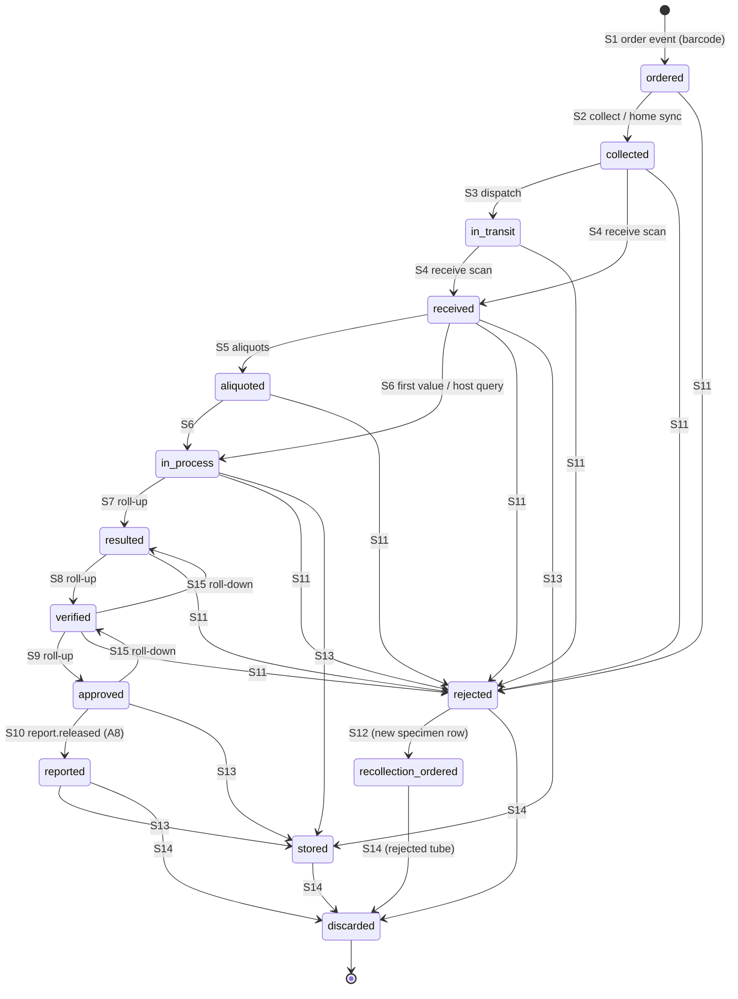
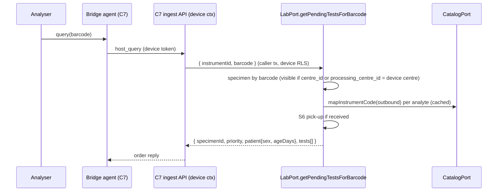

# C5 Lab Workflow — 03 App Flow

Status: DECISION, 2026-11-05. State machines equal 03-IC §10.1/§10.2 (binding X8: `resulted/verified/approved/reported` are specimen **roll-up** states derived from results; results have their own machine). Endpoint operationIds refer to `02-TRD.md` §5.

---

## 1. State machines

### 1.1 Specimen (`lab.specimens.status`)



S13 is allowed from every state `received`…`reported` (03-IC §10.1); the diagram shows representative arrows. `approved → verified` (S15) happens only if an approved result were un-approved, which the result machine forbids — it is listed for completeness of 03-IC S15 ("`resulted`/`verified` roll-ups → lower roll-up") and is unreachable in practice.

| # | From → To | Trigger (operationId / consumer) | Guards (03-IC + 02-TRD §3.3) | Side effects | Events |
|---|---|---|---|---|---|
| S1 | ∅ → ordered | `evt.lab.frontdesk.order.created.v1`, `…items_changed.v1`, S5/S12 creation | barcode allocated; requirement has non-excluded test | `ordered_at`; results R1 | status_changed (no `from_status`) |
| S2 | ordered → collected | `collectSpecimen`, `bulkCollectSpecimens`, `evt.lab.homecollection.collection.synced.v1` | `is_active` | `collected_at`, `collected_by_membership_id` / `collected_via_visit_id`, transition row | status_changed |
| S3 | collected → in_transit | `bulkDispatchSpecimens`, home sync | `is_active` | `in_transit_at` | status_changed |
| S4 | collected/in_transit → received | `receiveSpecimen`, `bulkReceiveSpecimens`, ingest auto-receive (from `collected`/`in_transit` only) | processing centre in scope; `is_active` | `received_at`, `processing_centre_id`, `processing_branch_id` (branch via `ctx.core` centre lookup), copied in the same tx to the specimen's `order_tests` (+ `received_at`; status → `in_process`) and `results`, and to the order's existing-material order tests/results that have none yet (08 A13 D-13); enqueue `lab.reapply_exceptions_for_specimen` | status_changed |
| S5 | received → aliquoted | `createAliquots` | ≥1 aliquot, tests belong to parent | child specimens (status `received`, `parent_specimen_id`, new barcodes, `processing_centre_id`/`processing_branch_id` copied from the parent — 08 A13 D-13); results re-pointed | status_changed (parent) + one per aliquot (∅ → received) |
| S6 | received/aliquoted → in_process | roll-up after first value; `getPendingTestsForBarcode` | — | `in_process_at` | status_changed |
| S7 | in_process → resulted | roll-up | all non-cancelled results ≥ resulted | `first_resulted_at` (if empty) | status_changed |
| S8 | resulted → verified | roll-up | all ≥ verified | `first_verified_at` | status_changed |
| S9 | verified → approved | roll-up | all approved | `all_approved_at` | status_changed |
| S10 | approved → reported | `evt.lab.reporting.report.released.v1` | release covers specimen (02-TRD §7.2) | `reported_at` | status_changed |
| S11 | pre-approved → rejected | `rejectSpecimen` | reason code active | `rejected_at`, reason, comment; non-approved results R8 (`cancel_reason = 'specimen_rejected'`); without recollection the specimen's order tests become `cancelled` (`specimen_rejected`) and leave readiness (08 A13 D-5) | status_changed + `lab.specimen.rejected.v1` |
| S12 | rejected → recollection_ordered | `rejectSpecimen` (recollection true) / `requestRecollection` | one recollection only; late recollection needs ≥1 order test cancelled with `specimen_rejected` | new specimen (S1) with `replaces_specimen_id` and the old processing centre/branch (D-13); order tests re-pointed (late: re-opened); **new** pending result rows (R1) — old rows stay `cancelled` (08 A13 D-12) | status_changed (old) + status_changed (new ∅ → ordered); C4 consumes the old specimen's `→ recollection_ordered` (D-6) |
| S13 | received…reported → stored | `storeSpecimen` | location | `stored_at`, `storage_location` | status_changed |
| S14 | stored/reported/rejected/recollection_ordered → discarded | `discardSpecimen` | reason | `discarded_at` | status_changed |
| S15 | roll-down | roll-up after R5 | — | — | status_changed |

Forbidden (unit-tested, `409 lab.specimen_invalid_transition`): `received → collected`, `approved → rejected`, any transition out of `discarded`, `rejected → received` (03-IC §10.1), plus `ordered → received` (must be collected first — DECISION; walk-in collection is one click before receive), `reported → rejected`.

Non-state flag: `is_active = false` (order cancelled / all tests removed before receipt). Inactive specimens accept no transition except S13/S14 if already received.

### 1.2 Result (`lab.results.status`)

```mermaid
stateDiagram-v2
  [*] --> pending: R1 order event
  pending --> resulted: R2 value (instrument/manual/formula/module)
  resulted --> resulted: R3 re-entry / rerun
  resulted --> verified: R4 verify (manual; auto in Phase 2)
  verified --> resulted: R5 return (reason) / input_changed
  verified --> approved: R6 approve (pathologist, ≠ verifier)
  approved --> approved: R7 amend (version+1)
  pending --> cancelled: R8
  resulted --> cancelled: R8
  verified --> cancelled: R8
  cancelled --> [*]
```



| # | Transition | Trigger | Permission | Guards | Side effects | Events |
|---|---|---|---|---|---|---|
| R1 | ∅ → pending | order consumers, recollection (new rows for the re-pointed order tests — 08 A13 D-12), not on aliquot (results are re-pointed, no new row) | system | — | — | — |
| R2 | pending → resulted | `bulkEnterResults`, ingest pipeline, formula evaluator, `submitModuleResult` | `lab.result.enter` / system | value valid; calculated only by evaluator | observation row; range snapshot; flags; delta; critical; dependents; hold check; roll-up | `lab.critical_value.detected.v1` if critical |
| R3 | resulted → resulted | same | same | not verified | same as R2; previous value kept in `result_observations` + audit | critical only if newly critical value |
| R4 | resulted → verified | `verifyResult`, `bulkVerifyResults`, auto hook (Phase 2) | `lab.result.verify` / system | not `on_hold`; required acknowledgements | `lab.verifications` row | `lab.result.verified.v1` |
| R5 | verified → resulted | `returnResult`; system cascade `input_changed`; system A1 resubmission `module_resubmitted` (then R3 in the same tx — 08 A13 D-7) | `lab.result.verify` / system | reason | verification row kind `returned`; roll-down | — |
| R6 | verified → approved | `approveResult`, `bulkApproveResults` | `lab.result.approve` (privileged) | not on hold; approver ≠ verifier; critical ack rule | `lab.approvals` row; `result_versions` v1; lock; readiness | `lab.result.approved.v1`; maybe `lab.order.ready_for_report.v1` |
| R7 | approved → approved (v+1) | `amendResult`; formula cascade; `submitModuleResult` on approved | `lab.result.amend` (privileged) | reason; value differs | `result_versions` v(n+1), previous `superseded_at`; dependents amended; critical check | `lab.result.amended.v1`; `lab.order.ready_for_report.v1` (`contains_amendment: true`) |
| R8 | pending/resulted/verified → cancelled | item removed, order cancelled, specimen rejected | system | — | `cancel_reason` | — |

Forbidden: value change on `approved` except R7 (`lab.result_locked`), `pending → verified`, `cancelled → *` (`lab.result_invalid_transition`).

Flags (not states): `on_hold` (blocks R4/R6 with `lab.result_on_hold`), `qc_review_required` (display only).

### 1.3 Ingest exception (`lab.ingest_exceptions.status`) — internal

`open → resolved` (assign/reapply/port re-match/auto task applies; a `unit_mismatch` exception also resolves when its result is verified with `unit_mismatch` acknowledged — resolution `assigned`) · `open → discarded` (`discardIngestException`) · `resolved`/`discarded` terminal. Re-apply that still fails keeps `open` and updates `last_attempt_at`, `attempts`, `reason`.

### 1.3a Critical event (`lab.critical_value_log.status`) — internal

`open` (detection) → `notified` (first notification with `outcome = reached` and `read_back_confirmed`; sets `first_confirmed_notification_at`) → `closed` (result approved R6 or cancelled R8; from `open` or `notified`). An event detected on an amendment (R7) closes at its first confirmed notification [CONV]. Value replaced before verification → `value_changed_after_detection = true`, status unchanged. Detail: 02-TRD §5.5.

### 1.4 QC hold (`lab.qc_holds.status`) — internal

`active → released` (`releaseQcHold`). Phase 1: never created except by tests or a C9 event.

### 1.5 Status board projection (not a state machine; derived on read)

| Board status | Rule (per order, lab view) |
|---|---|
| `waiting` | no active specimen collected |
| `collected` | ≥1 specimen collected/in_transit, none received |
| `in_lab` | ≥1 received, not all lab items approved |
| `ready` | all non-excluded items approved, no release recorded after the latest approval/amendment |
| `printed` | `lab.report_releases` has a release at or after the latest approval/amendment (`partial` → "Printed (partial)"; `preliminary` → "Printed (preliminary)") |
| badge `Sample rejected` | ≥1 specimen `rejected` whose recollection is not yet `received` |

## 2. Cross-chunk sequences

### 2.1 Order → specimens → labels (C4 → C5)

```mermaid
sequenceDiagram
  participant FD as C4 Registration page
  participant C4 as C4 frontdesk API
  participant W as Worker (lab consumer)
  participant Cat as CatalogPort (C3)
  participant Fd as FrontdeskPort (C4)
  participant Id as IdentityPort (C2)
  participant Web as C5 label page (BFF)
  participant API as C5 lab API
  FD->>C4: POST registration (commit)
  C4-->>W: frontdesk.order.created.v1 (outbox fan-out)
  W->>Fd: getOrderSummary / getPatientDemographics(result_evaluation)
  W->>Cat: resolveOrderables(asOf registered_at)
  W->>Id: getTenantSettings(numbering)
  W->>W: insert lab.orders, order_tests, specimens (barcodes), results; emit status_changed (S1)
  FD->>API: POST /v1/lab/orders/{order_id}/label-prints (CR-C4-010; readiness only, no key; 409 until specimens exist → C4 retries every 1 s ≤ 10 s; 200 then)
  FD->>Web: if frontdesk.label_autoprint: open /lab/orders/{order_id}/labels in a print frame (route CR-C5-007)
  opt page opened before the specimens exist
    loop every 1 s up to LIMS_LAB_LABEL_WAIT_SECONDS
      Web->>API: POST /v1/lab/orders/{order_id}/label-prints (readiness)
    end
  end
  Web->>API: POST /v1/lab/specimens/labels {order_id}
  API->>Fd: getPatientDemographics(label_print)
  API-->>Web: labels[], size, label_copies_default (+ label_print_count, access_log specimen_label.print per specimen)
  Web->>Web: render @lims/ui BarcodeSymbol (Code 128 SVG), window.print()
```
08 A13 D-4: `requestOrderLabelPrint` writes nothing; `printSpecimenLabels` is the only counter/access-log point; the page calls neither `getLabOrder` nor `getLabSettings`. In the panel C4 shows "Labels ready — printing".

### 2.2 Home collection sync (C17 → C5)

```mermaid
sequenceDiagram
  participant C17 as C17 homecollection
  participant W as lab consumer
  C17-->>W: homecollection.collection.synced.v1 {collections[]}
  W->>W: inbox dedupe; per collection: lock specimen
  alt specimen ordered
    W->>W: S2 collected (device time clamped) + S3 in_transit
    W-->>W: emit 2× lab.specimen.status_changed.v1
  else other state
    W->>W: log outcome skipped (no error)
  end
```

### 2.3 Instrument result — bulk path (C7 → C5)

```mermaid
sequenceDiagram
  participant C7 as C7 ingest
  participant W as lab consumer
  participant Cat as CatalogPort
  participant Q as QualityPort (fake Phase 1)
  C7-->>W: instruments.result.received.v1
  W->>W: inbox; ingest_log result_key (dup → stop)
  opt unmapped
    W->>Cat: mapInstrumentCode(inbound)
  end
  W->>W: find specimen by barcode; decision table (02-TRD §4.5)
  alt matched
    W->>Cat: referenceRangeFor / criticalLimitsFor
    W->>W: R2/R3, delta, formula dependents, hold check, roll-up
    opt critical
      W-->>W: emit lab.critical_value.detected.v1
    end
    opt LIMS_LAB_AUTOVERIFY_HOOK_ENABLED (Phase 2)
      W->>Q: canAutoVerify(resultContext)
    end
  else unmatched / rejected_state
    W->>W: upsert lab.ingest_exceptions (open)
  end
```

### 2.4 Host query (C7 → LabPort)


Errors: unknown barcode → `lab.specimen_not_found`; rejected/discarded/not received (per setting) → `lab.specimen_not_receivable`.

### 2.5 Re-match / replay (C7 UI → LabPort.ingestInstrumentResult)

C7 handler (user with `instruments.message.rematch`) → `LabPort.ingestInstrumentResult` in the user's ctx → same pipeline → outcome; matching open exception closed in the same tx. Returns `rejected_state` (never throws) for approved targets.

### 2.6 Verify → approve → ready → release → reported (C5 ↔ C6)

```mermaid
sequenceDiagram
  participant T as Technologist (web)
  participant P as Pathologist (web)
  participant API as lab API
  participant C6 as C6 reporting
  T->>API: POST results/bulk-verify
  API-->>C6: lab.result.verified.v1 (C8, C9, C12 consumers)
  P->>API: POST results/bulk-approve (aal2)
  API->>API: R6, result_versions v1, roll-up S9, readiness
  API-->>C6: lab.result.approved.v1 + lab.order.ready_for_report.v1
  C6->>C6: render, release rules (BillingPort)
  C6-->>API: reporting.report.released.v1 (lab consumer)
  API->>API: report_releases upsert; S10 approved → reported; board "Printed"
```

### 2.7 Critical value (C5 → C6)

```mermaid
sequenceDiagram
  participant S as Save (any origin)
  participant L as lab service
  participant C6 as C6 (NotificationPort dispatch)
  participant T as Technologist
  S->>L: value saved
  L->>L: criticalLimitsFor → HH; insert critical_value_log
  L-->>C6: lab.critical_value.detected.v1 (no value)
  T->>L: GET /lab/critical-values/{id} (value shown, access_log)
  T->>L: POST …/notifications (phone call, read-back)
  Note over L: approval allowed only after reached + read-back (setting default on)
```

### 2.8 Rejection → recollection (C5 → C4, C16, C17)

```mermaid
sequenceDiagram
  participant T as Technologist
  participant API as lab API
  participant C4 as C4 (contact patient, reprint)
  participant C17 as C17 (revisit)
  T->>API: POST specimens/{id}/reject {reason, recollection_required: true}
  API->>API: S11, results R8, S12, new specimen S1 (new barcode), new results R1
  API-->>C4: lab.specimen.rejected.v1 (+ status_changed ×3)
  API-->>C17: lab.specimen.rejected.v1 (home_visit_id if collected via visit)
  C4->>API: opens /lab/orders/{order_id}/labels to print the new label
  Note over T,C4: Late recollection (reject without recollection, then requestRecollection): no second rejected event;<br/>C4 consumes status_changed with to_status = recollection_ordered and upserts its recollection flag (08 A13 D-6)
```

### 2.9 QC failure hold (C9 → C5; Phase 2)

`quality.qc_run.rejected.v1` → consumer → `holdResultsSince` (idempotent on `qc_run_id`) → results `on_hold` / `qc_review_required`; new matching results arrive `held` while hold active → lab manager/pathologist `releaseQcHold` (CR-C5-004).

### 2.10 Module result (C10/C11 → LabPort.submitModuleResult, A1)

Module calls in its tx → C5 validates workflow type, idempotency key, version ordering → `results` origin `module`, payload ref and summary on the row (no `result_versions` row before approval; output `versionNo` = `results.current_version_no` — 08 A13 D-7) → R2/R3 (on a `verified` result: system R5 `module_resubmitted` then R3, same tx — D-7; or R7 if approved and actor holds `lab.result.amend`; then `amendment.reasonCode` is required — `lab.amendment_reason_required` — and checked against the R1 guards: `module_phase_progression` only for a micro final replacing an approved preliminary, `module_preliminary_update` only for a micro preliminary replacing an approved preliminary (08 A17 D-61; C10 sends it automatically), `supplementary_report` only from anatomic, else `lab.module_result_invalid`; the code is carried in `lab.result.amended.v1` so C6 labels the report `amended`/`addendum`/`final` per 08 R1) → normal verify/approve → readiness. `isCritical` → critical log + event (`abnormal`).

## 3. Screen flows

Every screen: **loading** = skeleton rows; **empty** = EmptyState with copy in 04-UI-UX; **error** = ErrorState with `request_id` and Retry; **permission denied** = page-level "You don't have access to this screen." (403 from BFF); **success** = Toast for actions. Concrete copy in 04-UI-UX.

### 3.1 Label page `/lab/orders/{order_id}/labels`
1. Readiness: `requestOrderLabelPrint` (#14a; no state written). `409 common.version_conflict` (specimens not created yet) → "Preparing labels…", poll every 1 s up to `LIMS_LAB_LABEL_WAIT_SECONDS`; timeout → error with Retry. `200` → the specimen list (barcode, `ready`/`inactive`).
2. `printSpecimenLabels` (#14) for the order's `ready` specimens with default copies → render → call `window.print()` once after fonts/SVG are ready (always — 08 A13 D-4; C4 decides whether to open the page).
3. Reprint: the user may untick specimens and choose copies (default `label_copies_default` from the #14 response), then "Print labels" → #14 again (counted again, E16).
4. Optional "Mark collected" (walk-in) → `bulkCollectSpecimens` for selected `ordered` specimens.
The page never calls `getLabOrder` or `getLabSettings` (08 A13 D-4).
Errors: per-id `lab.specimen_inactive` → label shown greyed "Not printable (cancelled)".

### 3.2 Collect & dispatch `/lab/collect`
Tabs "Collect" and "Dispatch". Scan or search by registration no (BFF POSTs `lookupSpecimenByBarcode` with `{barcode}` or `{registration_no}` in the body — never in a URL; front desk and phlebotomists hold `lab.specimen.read`, 08 A13 D-4). Collect: list `ordered` specimens of the order, select, Collect. Dispatch: scan collected specimens into a batch list; "Dispatch n specimens" → `bulkDispatchSpecimens`.

### 3.3 Receive `/lab/receive`
1. Choose receiving location (centres in scope; remembered per workstation in localStorage — non-PHI).
2. Scan → `lookupSpecimenByBarcode` → card (patient display, tests, priority, warnings: unverified collection barcode, inactive, rejected).
3. Accept (Enter) → `receiveSpecimen`; or Reject (R) → reason dialog → `rejectSpecimen`.
4. Auto-accept toggle: scan → immediate receive; outcomes listed in a session log (last 50 [CONV]).
5. Aliquot (A) on a received specimen → aliquot dialog.

### 3.4 Worklist `/lab/worklists/{department_id}` (and `/lab/worklists` picker)
Filters: department (path), instrument (names from C7 `GET /v1/instruments/instruments` via the BFF, `IdText` on 403 — 08 A13 D-14), priority, status, processing centre. Rows sorted urgent first. Actions: open order result grid; select rows → Create worksheet; Verify selected (if permitted).

### 3.5 Pending list `/lab/pending`
Filters as API #19; "Over target only". Export is C8's.

### 3.6 Worksheet `/lab/worksheets/{worksheet_id}`
Print view (`@media print`). Header: title, department, instrument, created by/at, row count. Rows snapshot.

### 3.7 Result entry grid `/lab/orders/{order_id}/results`
1. Load `listOrderResults` (+ `lab_display` demographics) → grid grouped by test → analyte rows.
2. Edit values; short-code expansion in comment cell; history side panel on focus (`getResultHistory`); F3 trend (`getAnalyteTrend`).
3. Ctrl+S → `bulkEnterResults` with per-row versions → merge returned rows + `recomputed` rows; per-row errors inline.
4. Ctrl+Enter → save then verify the focused test's rows (`bulkVerifyResults`) with acknowledgements prompted for flagged rows.
5. Approve mode (pathologist): same grid read-only values, Approve selected (`bulkApproveResults`), Return (reason), Amend (approved rows → amendment dialog).

### 3.8 Verification and approval queues `/lab/verification`, `/lab/approval`
`listVerificationQueue(stage)`; bulk select; flagged rows require per-row acknowledgement before bulk verify; approval enforces aal2 (BFF triggers step-up when `auth.mfa_required`).

### 3.9 Critical values `/lab/critical-values` and `/lab/critical-values/{critical_event_id}`
List open first, age since detection. Detail: value, limits, patient display, referrer name (`referrer_display_name` in the `getCriticalValue` response, resolved server-side — no C3 call from the BFF), notifications list, "Log notification" form.

### 3.10 Ingest exceptions `/lab/ingest-exceptions` (+ `/{exception_id}`)
List by reason; detail shows raw code, value, unit, flags, instrument (display name from C7 `GET /v1/instruments/instruments` via the BFF; `IdText` on 403 — 08 A13 D-14), received time; actions Assign (search result by barcode or registration no via `lookupSpecimenByBarcode` body forms), Re-apply, Discard.

### 3.11 Status board `/lab/status-board`
Date range (default today), centre filter, status chips, auto-refresh every 30 s by polling (04 S4; SSE optional later) [CONV].

### 3.12 QC `/lab/qc`
List captured QC; "Add QC result" form (centre = a centre in the user's scope, instrument picked from the C7 instrument list — 08 A13 D-14). No pass/fail column.

### 3.13 Settings `/lab/settings`
Tabs: General (lab settings), Delta rules, Reason codes, QC holds.

### 3.14 Specimen detail `/lab/specimens/{specimen_id}`
Timeline of transitions (who/when), tests, results summary (if `lab.result.read`), actions per state (store, discard — also for a `recollection_ordered` tube, 08 A13 D-15 — reject, recollect, aliquot).

## 4. Edge cases

| # | Case | Handling |
|---|---|---|
| E1 | Same event delivered twice | inbox `ON CONFLICT DO NOTHING` → no-op (02-CV §7.4) |
| E2 | `items_changed` before `order.created` processed | build order via `getOrderSummary` + `getPatientDemographics(result_evaluation)` with `collection_mode` NULL (filled by `order.created`); later `created` sees order exists with seq ≥ → specimens already created; no duplicates (unique `(tenant_id, creation_key)` on specimens, key `<order_id>:<specimen_type_code>:<container_code|->` for order-created specimens [DECISION]) |
| E3 | `order.cancelled` before `created` | record `lab.orders.lab_status = 'cancelled'` (row built as in E2); `created` then creates nothing |
| E4 | Two technologists receive the same specimen | row lock; second gets `409 lab.specimen_invalid_transition` (already received) — UI shows "Already received by <name> at <time>" |
| E5 | Concurrent grid saves | per-row `version`; loser row `common.version_conflict` |
| E6 | Double-click on Approve | `If-Match` + state guard; second → `lab.result_invalid_transition`; bulk endpoints require `Idempotency-Key` → replay |
| E7 | Network drop during bulk save | client retries with the same `Idempotency-Key` → replayed response (02-CV §4.5) |
| E8 | Instrument rerun after verification | exception `result_already_verified`; technologist returns (R5) then re-applies |
| E9 | Instrument rerun after approval | `rejected_state`, exception `result_locked`; pathologist may amend |
| E10 | Instrument result for an aliquot barcode | aliquot is a specimen with its own barcode → matched normally |
| E11 | Old barcode of a rejected specimen scanned on an analyser | resolves to the rejected specimen → `rejected_state` (01 §2.1: old barcode never resolves to the new specimen) |
| E12 | Catalog changes reference range mid-day | new saves use `asOf` = collected time; stored snapshots unchanged |
| E13 | Formula input amended after approval | dependent amended in same tx (AC-09.5) |
| E14 | Partial failure inside consumer (port timeout) | tx rolls back incl. inbox row → retry (≤10) → dead letter + alert |
| E15 | Device clock skew on home collection | `collected_at` clamped to `synced_at`; device time kept in `collected_at_device` |
| E16 | Label printer offline | browser print dialog error is outside the app; print count is recorded at `printSpecimenLabels` (before printing). DECISION: count = "label data issued"; reprint is allowed and counted again |
| E17 | Offline web | staff web is online-only; BFF errors show ErrorState; no local queue (offline is C17's) |
| E18 | Order with only narrative/outsourced items | no results; readiness never emitted by C5; board shows "In lab" until C6 releases → "Printed" |
| E19 | Rejection without recollection | results cancelled; the specimen's order tests become `cancelled` (`specimen_rejected`) and leave readiness, so the order can complete without them; `getOrderItemProcessingState` reports the item `removable: true`, `processingStatus: 'cancelled'` when it has no other received specimen (08 A13 D-5); pending list shows "Rejected — no recollection" |
| E20 | QC hold arrives for already-approved results | `qc_review_required = true` only; never changes approved values |
| E21 | Critical value on an instrument result while specimen auto-received | event emitted normally; centre_id = order's collection centre |
| E22 | Amendment while report release in progress | new readiness event (different hash); C6 renders new version |
| E23 | Patient with no birth date and no age | 08 A17.1 (CR-C5-012 accepted): C5 calls `referenceRangeFor` and `criticalLimitsFor` without `ageDays`; C3 matches only bands with no age bound. Found → flag and critical check run normally. Either missing → result marked `range_unavailable_age_unknown`, never auto-verified, and the grid and verification screen show "Age unknown — reference range and critical check not applied" (02-TRD §4.3 step 2). When the birth date is known, `birthOn` is passed with `ageDays` |
| E24 | Barcode counter overflow (seq beyond N digits) | `lab.barcode_pattern_invalid`, alert; admin changes pattern |
| E25 | User loses centre scope mid-session | next call 404 (RLS) — UI shows "No longer visible" |

Final sweep 2026-11-06 — second touch applied (§2.10 D-61 guard; E23 per 08 A17.1).
