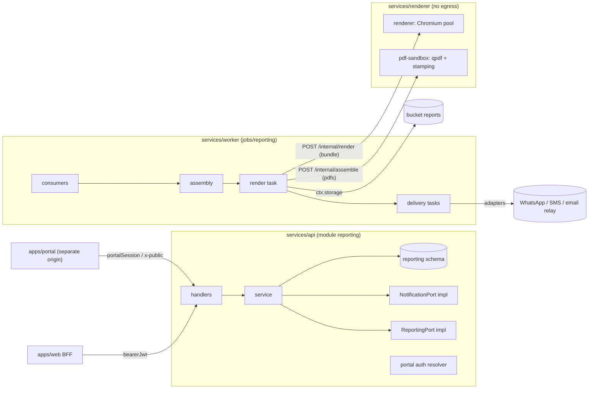

# C6 Reporting & Delivery — 02 Technical Requirements (TRD)

Status: DECISION, 2026-11-06. Read `01-PRD.md` first. Names of tables, operationIds, permissions, error codes, events and jobs in this file are binding for the C6 build. This file is also the specification C0 transcribes into `contracts/openapi/reporting.yaml`, `contracts/permissions.yaml`, `contracts/errors.yaml` and `contracts/routes.yaml`. Items that need a contract change are marked **(CR-C6-0nn)** and specified in §16.

Short references: 02-CV = `program/02-CONVENTIONS.md`; 03-IC = `program/03-INTERFACE-CATALOG.md`; 01-CM = `program/01-CHUNK-MAP.md`; C0-TRD = `chunks/C0-foundation-contracts/02-TRD.md`.

---

## 1. Owned paths (01-CM §3)

| Path | Content |
|---|---|
| `services/api/src/modules/reporting/**` | API module `reporting`: handlers, services, domain, repositories, ports `ReportingPort` + `NotificationPort`, provider adapters, portal auth resolver |
| `services/worker/src/jobs/reporting/**` | worker manifest: event consumers, tasks, cron |
| `services/renderer/**` **except** `services/renderer/templates/smart/**` (C14), `templates/billing/**` (C4) and `templates/analytics/**` (C8) (01-CM §3 as amended by 08 R14/R12c) | renderer service (Chromium pool), report templates, shared print stylesheet, PDF sandbox service (qpdf + stamping), fonts, Dockerfiles |
| `apps/portal/**` | patient portal + public QR verify (Next.js, separate origin) |
| `apps/web/src/app/(staff)/reporting/**` | staff route segment |
| `apps/web/src/features/reporting/**` | staff components, BFF server functions, nav manifest, help |
| `docs/manual/reporting/**` | user manual pages |

C6 never edits `db/`, `contracts/`, `packages/*`, any `core/`, or another module. Everything needed there is in §16.

## 2. Stack and pinned libraries

Only versions fixed in 04/02-CV are stated as versions. Everything else is **C0 pins** (02-CV [PIN-C0]) or is added by C6 under the dependency rules of 02-CV §15.1, with the row filled in when the task adds it (§15).

| Component | Version / rule | Source |
|---|---|---|
| Node.js | 26.x LTS, exact patch pinned by C0 | 02-CV §1.1 |
| Fastify + `fastify-openapi-glue` 4.12.0 | via C0 core; C6 supplies handlers only | 04 T7; 02-CV §2.2 |
| Graphile Worker | 0.18.0 via C0 worker core | 04 S10, T7 |
| PostgreSQL | 17 (`supabase/postgres:17.6.1.136`) | 04 D9 |
| Next.js (`apps/portal`, `apps/web` feature) | C0 pins; App Router; server-only BFF pattern | 02-CV §1.1; 04 S4 |
| Playwright (Chromium) | **C0 pins** (02-CV §1.1 "Playwright version [PIN-C0]/C6"); one version for E2E and renderer | 04 S14 |
| qpdf | **12.4.2** | 04 S15, T7 |
| PDF stamping | **`@cantoo/pdf-lib` 2.11.1** — DECISION: C6 picks this fork (02-CV §1.1 says pick one). `@pdfme/pdf-lib` is not used. Upstream `pdf-lib` is banned (02-CV §15.3) | 04 S15 |
| Fonts | Noto Sans Devanagari (OFL-1.1) + a Latin Noto Sans family + Noto Sans Mono, bundled in the renderer image; exact font files/versions C0 pins | 04 S14; 02-CV §13, §15.2 |
| HTML generation in the renderer | React server rendering to static markup (`react-dom/server`); React version C0 pins (same as Next.js) | DECISION (one template language, 03 §5.1) |
| HTML sanitiser (narrative rich text) | DOMPurify, server-side, version C0 pins | 02-CV §10.2; REQ-SEC-088 |
| QR code encoder | **C0 pins** (MIT/Apache licence, no network, pure JS) | not in 04 |
| SMTP client (email relay adapter) | **C0 pins** | not in 04 |
| Image re-encode (narrative images, attachment images) | via C0 upload pipeline `ctx.uploads` (CR-C2-011); in the sandbox the decoder library is **C0 pins** | 02-CV §10.2 |
| Malware scan | ClamAV-class scanner reached through `ctx.uploads` (C0 dev profile; C1 prod) | REQ-SEC-084; C0 plan "ClamAV-class scanner service in dev stack" |
| B.S. dates | `@remotemerge/nepali-date-converter` 1.2.7 via `@lims/shared-ts/bsdate` only | 04 D13 |
| Typst | fallback documented, **not built** | 04 S14 |

## 3. Internal architecture

### 3.1 Deployables and data flow



Rules:
- The **renderer** and the **pdf-sandbox** are separate containers built from `services/renderer`. They hold **no** database credentials, **no** storage credentials and **no** provider secrets. Their only network path is inbound from the worker on the private network. Outbound egress is denied at the container network level (CR-C6-013 to C1). This is defence in depth on top of request blocking inside Chromium (REQ-SEC-086, 04 S14).
- Only the **worker** talks to the renderer and the sandbox. API handlers never render synchronously (REQ-ARCH-050).
- Only `services/api/src/modules/reporting/delivery/adapters/**` code talks to messaging providers, and it runs only inside worker tasks (02-CV §7.3: no external side effect in a request handler; 01-CM §5.1 NotificationPort is the only gateway).

### 3.2 API module skeleton (`services/api/src/modules/reporting/`)

```
index.ts                         # ModuleManifest: name 'reporting', openapi contracts/openapi/reporting.yaml, handlers,
                                 #   ports { ReportingPort, NotificationPort, RenderPort (08 R12c) }, produces [released, delivery.status_changed],
                                 #   authResolvers.portalSession (CR-C6-001), systemPermissions
permissions.ts                   # codes used (03-IC §11 + CR-C6-003)
config.ts                        # LIMS_REPORTING_* (§10)
handlers/<operationId>.ts        # one per operationId in §6
service/
  reports.service.ts             # shells, readiness, assembly scheduling, regeneration
  assembly.service.ts            # builds ReportDocument snapshot (§4.3) from ports
  versions.service.ts            # version lifecycle (03-IC §10.3 + discarded), QR token issue
  release.service.ts             # eligibility, release, supersede, bulk release, audiences
  print.service.ts               # print jobs (letterhead / plain), bulk print
  outsourced.service.ts          # input files: upload, scan state, confirm, withdraw
  narrative.service.ts           # narrative drafts, images, sign, amend; templates
  templates.service.ts           # report templates (draft/publish/preview)
  portal.service.ts              # link issue/revoke, OTP challenges, sessions, portal report view, link reissue,
                                 #   portal dues-payment requests (PP1/PP2, 08 A11.1)
  verify.service.ts              # QR verify (public)
  delivery.service.ts            # NotificationPort core: consent, templates, deliveries, fallback, callbacks
  settings.service.ts            # reporting.settings, centre contacts, staff assignments, referrer prefs
domain/
  report.ts  report.state.ts     # report shell states (open|cancelled)
  version.ts version.state.ts    # 03-IC §10.3 + discarded (CR-C6-005)
  readiness.ts                   # item requirement model + fingerprint (§4.2)
  document.ts                    # ReportDocument types + builders (pure)
  flags.ts                       # flag → label/bold mapping (§4.4)
  narrative.ts narrative.state.ts
  delivery.ts delivery.state.ts  # 03-IC §3.18 statuses
  otp.ts                         # code generation (CSPRNG via @lims/shared-ts/crypto), HMAC compare
  tokens.ts                      # 128-bit token generation + sha256 hashing (§4.7)
  templates.ts                   # template config JSON Schema + validation
  messages.ts                    # message template param validation, rendering, PHI guard
repository/
  reports.repo.ts versions.repo.ts orderItems.repo.ts qr.repo.ts links.repo.ts otp.repo.ts sessions.repo.ts
  deliveries.repo.ts attempts.repo.ts providerEvents.repo.ts inputFiles.repo.ts narrative.repo.ts
  templates.repo.ts messageTemplates.repo.ts channelAccounts.repo.ts settings.repo.ts prints.repo.ts
  views.repo.ts                  # reads ONLY micro.v_pub_report_content, anatomic.v_pub_report_content (02-CV §5.13);
                                 #   department names and partner id come from ports, not views (08 R25)
ports/
  ReportingPort.impl.ts
  NotificationPort.impl.ts
  RenderPort.impl.ts             # renderPdf for C4/C8 worker tasks (§7.4; 08 R12c); system actors only
delivery/
  transport.ts                   # Transport interfaces (§5.4)
  adapters/recording.ts          # non-prod + tests (records to reporting.delivery_attempts only)
  adapters/whatsapp.cloud.ts     # UNVERIFIED wire details — implemented only after C6-T27
  adapters/sms.sparrow.ts        # UNVERIFIED — C6-T28
  adapters/sms.aakash.ts         # UNVERIFIED — C6-T28
  adapters/email.smtp-relay.ts   # SMTP submission to the configured relay (protocol-level)
auth/
  portal.resolver.ts             # AuthResolver for portalSession (CR-C6-001)
renderer-client/
  render.client.ts sandbox.client.ts   # internal HTTP clients (worker only)
mappers/*.dto.ts                 # per-role field allowlists (REQ-SEC-081)
events/publish.ts                # typed publishers for the two produced events
__tests__/{unit,integration,contract,probes}/
```

Layer rules are those of 02-CV §2.2. In addition:
- `domain/document.ts` is pure: it receives already-fetched port outputs and returns the `ReportDocument`. It can therefore be unit-tested against golden snapshots.
- `delivery/adapters/*` are imported only by worker task code (lint rule in the module's ESLint override: importing `delivery/adapters` from `handlers/` fails).

### 3.3 Worker skeleton (`services/worker/src/jobs/reporting/`)

```
index.ts                         # WorkerManifest (§9)
consumers/frontdesk.order.created.v1.ts
consumers/frontdesk.order.items_changed.v1.ts
consumers/frontdesk.order.cancelled.v1.ts
consumers/billing.balance.changed.v1.ts
consumers/lab.specimen.status_changed.v1.ts
consumers/lab.result.approved.v1.ts
consumers/lab.result.amended.v1.ts
consumers/lab.order.ready_for_report.v1.ts
consumers/lab.critical_value.detected.v1.ts
consumers/catalog.changed.v1.ts
tasks/assemble_report.ts  tasks/render_report_version.ts  tasks/release_if_eligible.ts
tasks/dispatch_release_deliveries.ts  tasks/send_delivery.ts  tasks/check_whatsapp_fallback.ts
tasks/apply_provider_events.ts  tasks/send_portal_otp.ts  tasks/process_input_file.ts
tasks/render_print.ts  tasks/build_bulk_print.ts  tasks/render_template_preview.ts
tasks/reissue_portal_link.ts                                    # P5 (review fix #14)
tasks/create_portal_payment_intent.ts  tasks/refresh_portal_payment_request.ts   # PP1/PP2 (08 A11.1; ships with C15)
cron.ts                          # sweep_assembly, sweep_held_releases, sweep_stuck_renders, purge_ephemeral,
                                 #   expire_portal_payment_requests — all tenantScope 'per_tenant' (08 A13 P-6)
```

### 3.4 Renderer service skeleton (`services/renderer/`)

```
package.json                     # @lims/renderer
Dockerfile.renderer              # Chromium (Playwright-managed), fonts in fontconfig, non-root, read-only rootfs (REQ-SEC-130)
Dockerfile.sandbox               # qpdf 12.4.2 + Node + @cantoo/pdf-lib 2.11.1, non-root, read-only rootfs, tmpfs /work
fonts/                           # bundled font files (licences alongside)
src/
  server.ts                      # renderer HTTP server: POST /internal/render, GET /internal/health, GET /internal/metrics
  pool.ts                        # 1 browser, N contexts, recycle, timeouts (§5.1)
  render.ts                      # render(templateId, data, assets) → PDF (REQ-ARCH-045 interface)
  guard.ts                       # request interception: allow only data: URLs; count blocked requests
  templates/
    contract.ts                  # TemplateModule, DataTemplateModule, SmartSectionRenderer interfaces (§5.3)
    registry.ts                  # templateId → module; loads ../../templates/smart/index.ts (C14), ../../templates/billing/index.ts (C4)
                                 #   and ../../templates/analytics/index.ts (C8) if present, plus ./access-slip (RenderPort keys, §7.4)
    access-slip/                 # 'partners.access_slip' DataTemplateModule (C6-owned; 08 A5.1) — inside src/ like the other
                                 #   C6 templates (review fix #33); only the C4/C8/C14 directories sit outside src/ (owned elsewhere)
    print.css                    # shared print stylesheet incl. smart-* classes (CR-C14-007)
    lab/                         # 'lab-report' template (Metro Labs layout, 04-UI-UX §3)
    narrative/                   # 'narrative-report' template
    print-plain/                 # wrapper: same templates with letterhead=false
    preview-sample.ts            # synthetic sample ReportDocument for template preview (AC-13.1)
  sandbox/
    server.ts                    # pdf-sandbox HTTP server: POST /internal/sanitize, POST /internal/assemble, GET /internal/health
    qpdf.ts                      # spawns qpdf with argument arrays (no shell), timeouts, size caps
    stamp.ts                     # page numbers "Page N Of M" + NOT RELEASED/plain markers via @cantoo/pdf-lib
templates/smart/                 # OWNED BY C14 — C6 never creates or edits files here
templates/billing/               # OWNED BY C4 — billing.invoice, billing.credit_note, billing.register (08 R12c)
templates/analytics/             # OWNED BY C8 — analytics.report (08 R12c)
__tests__/
```

### 3.5 Portal app skeleton (`apps/portal/`)

```
src/app/
  layout.tsx                     # security headers via middleware; no third-party assets
  r/[token]/page.tsx             # link landing → "Send code"
  r/[token]/code/page.tsx        # OTP entry
  r/[token]/report/page.tsx      # report summary + download (session required)
  r/[token]/download/route.ts    # streams PDF from API (attachment)
  r/[token]/reissue/route.ts     # POST re-issue request
  r/[token]/pay/route.ts         # POST (form) → PP1; Idempotency-Key = hidden form nonce (08 A11.1; ships with C15)
  r/[token]/payments/[portal_payment_request_id]/page.tsx   # payment status before the gateway (meta refresh, no client JS)
  r/payments/[portal_payment_request_id]/done/page.tsx      # route portal.payment_done: gateway return/cancel page (08 A11.1);
                                 #   static segment 'payments' wins over r/[token] (a 22-char token never equals 'payments')
  v/[token]/page.tsx             # QR verify result (server-rendered; no client JS needed)
  app/payments/[payment_request_id]/done/page.tsx   # patient-app fallback page, no data (CR-C16-010; route fallback portal.app_fallback;
                                 #   content inputs from C15 flow F-04 / C16)
  app/reports/[report_id]/page.tsx   # fallback portal.report_link_required for patient_app.report: "Open the link the lab sent
                                 #   you" (no data; review fix #31)
  app/[...slug]/page.tsx         # "Open the app" fallback for other patient_app.* routes (portal.app_fallback), no PHI
  (errors)/…                     # invalid link, rate limited, generic error
public/.well-known/              # Android Digital Asset Links + iOS associated-domains files for BOTH the patient app (`/app`,
                                 #   CR-C16-010) and the phlebotomy app (`/phlebo`, 03-IC §7 phlebo_app — 08 A13 D-38); app ids and
                                 #   certificate fingerprints from config — content inputs from C16 (patient app) and C17 (phlebo
                                 #   app), supplied by the client, which owns the store accounts and signing keys (founder decision
                                 #   2026-11-06, research/04 §13)
src/server/
  api.ts                         # server-only API client; sends tokens in the X-Lims-Portal-Credential header, never in API URLs
  session.ts                     # portal session cookie __Host-lims_portal (HttpOnly, Secure, SameSite=Lax, Path=/)
src/middleware.ts                # CSP nonce, Referrer-Policy no-referrer, Cache-Control no-store on /r and /v, HSTS
src/features/portal/…            # components from @lims/ui only
```

### 3.6 Staff web feature (`apps/web/src/features/reporting/`)

`nav.manifest.ts` entries: Reports (`reporting.report.read`), Narrative reports (`reporting.narrative.write`), Outsourced (`reporting.outsourced.attach`), Deliveries (`reporting.delivery.read`), Templates (`reporting.template.manage`), Messages & channels (`reporting.message_template.manage`), Reporting settings (`reporting.settings.manage`). Server functions `server/<operationId>.server.ts` per endpoint used. Screens in `04-UI-UX.md`.

Pages per registered route (03-IC §7): `apps/web/src/app/(staff)/reporting/page.tsx` (worklist, incl. the Critical alerts panel — R18), `reporting/reports/[report_id]/page.tsx`, `reporting/deliveries/page.tsx` + `reporting/deliveries/[delivery_id]/page.tsx` (route `staff.reporting.delivery`: the drawer content as a full page, for deep links — review fix #31), `reporting/narratives/[narrative_id]/page.tsx`, `reporting/outsourced/page.tsx`, `reporting/templates/[template_id]/page.tsx`, `reporting/settings/page.tsx`, `reporting/messages/page.tsx`.

---

## 4. Domain design

### 4.1 Report families and items

- One **report** per (order, family). `family ∈ {laboratory, narrative}`. With tenant setting `narrative_report_mode = separate` (default [CONV]), narrative items go to the `narrative` report. With `combined`, everything goes to `laboratory`. (03-IC §9.1 "one per order × kind".)
- One `report_order_items` row per active order item, with three requirement flags:

| Item type (from catalog `workflowType` of its tests + item `outsourced` flag) | requires_lab | requires_narrative | requires_outsourced |
|---|---|---|---|
| all tests `standard`/`attachment`/`microbiology`/`anatomic`/`molecular`, not outsourced | true | false | false |
| all tests `narrative` | false | true (one narrative per narrative test) | false |
| item `outsourced = true` or any test `workflowType = outsourced` | false | false | true |
| mixed narrative + other tests in one panel | true | true (narrative tests only) | false |

This matches C5's rule that it creates no results for narrative tests and none for outsourced items (C5 PRD Q1). C5's readiness event therefore never covers them, and C6 tracks them itself.

### 4.2 Readiness and fingerprint

- `lab_ready`: the item id is in the `order_item_ids` of the latest `lab.order.ready_for_report.v1` (by `aggregate.seq`) for the order. C6 stores the latest `approved_set_hash`, `completeness` and `contains_amendment` on the report row.
- `narrative_ready`: every narrative of the item has a `signed` current version.
- `outsourced_ready`: the item has exactly one `confirmed` input file.
- Item ready = every required flag is true. A report is **complete** when every active item is ready. It is **partial** when ≥ 1 item is ready and the rest are not.
- **Fingerprint** = SHA-256 hex of the sorted lines `<order_item_id>|lab:<approved_set_hash>|nar:<narrative_version_ids sorted>|out:<input_file_id>` over the ready items, plus `|demog:<regeneration_counter>`. A new version is assembled only when the fingerprint differs from the latest non-discarded version's fingerprint, **and** either the report is complete or tenant `partialReleaseAllowed = true` (IdentityPort).

### 4.3 Assembly → frozen snapshot (`ReportDocument`)

Assembly runs in the worker as the `reporting` system actor (task `reporting.assemble_report`). It reads everything through ports and views, then freezes the result as JSON in `report_versions.content_snapshot`. Rendering and every later re-render (plain print) use **only** the snapshot plus referenced immutable assets. So a released PDF can be reproduced, and no port is called during rendering.

```ts
// services/api/src/modules/reporting/domain/document.ts (types; JSON in snapshot uses these camelCase keys, schemaVersion 1)
export interface ReportDocument {
  schemaVersion: 1;
  family: 'laboratory' | 'narrative';
  reportKind: 'final' | 'partial' | 'preliminary' | 'amended' | 'addendum';      // 'addendum' per 08 R1
  statusLabel: 'Final' | 'Partial' | 'Preliminary' | 'Amended' | 'Addendum';   // header "Report Status"
  lab: { displayName: string; legalName: string; addressText?: string; contactStrip: string[] /* ≤4 lines */;
         logoAssetRef?: AssetRef; headerAssetRef?: AssetRef; footerAssetRef?: AssetRef };
  header: {
    patientName: string; ageGender: string;                       // "43 Years/MALE" format (00 §4)
    regNo: string; barcodeNos: string[] /* ≤3 then "+n" */;
    sampleCollectedAt?: IsoUtc; sampleReceivedAt?: IsoUtc; registeredAt: IsoUtc; reportedAt: IsoUtc;
    referredBy: string;                                           // referrer displayName or "SELF" (00 §4)
    collectedAtCentre: { code: string; name: string; addressText?: string };   // "Sample Collected At"
  };
  calendarDisplay: 'AD' | 'BS' | 'AD_BS' | 'BS_AD'; timezone: string;
  sections: Section[];                                            // ordered for print
  amendmentNotes: { analyteOrSection: string; previousVersionNo: number; reasonCode: string; reasonText?: string; amendedAt: IsoUtc }[];
  signatories: Signatory[];                                       // footer (max per template)
  disclaimers: string[];                                          // template lines (≤5)
  qr: { verifyUrl: string };                                      // portal /v/{token}; token only in this field
  outsourcedAttachments: { inputFileId: Uuidv7; externalLabName: string; testName: string; pageCount: number; sha256: string }[];
  instrumentPdfAttachments: { analyteName: string; objectRef: AssetRef; sha256: string; sanitizedSha256: string }[];   // sanitised at assembly (08 A13 P-13)
  smart?: { summaryId: Uuidv7; templateLibraryVersion: string; payload: unknown /* SmartSummary as returned, approved only */ };
}
export type AssetRef = { source: 'branding' | 'signature' | 'narrative_image' | 'instrument_attachment' | 'module_image'; id: string; sha256: string; mimeType: 'image/png' | 'image/jpeg' | 'application/pdf' };
export interface Signatory { membershipId: Uuidv7; displayName: string; displayTitle?: string; registrationNo?: string; signatureAssetRef?: AssetRef; role: 'approver' | 'nominated' | 'narrative_signer' }
export type Section =
  | { kind: 'department'; departmentId: Uuidv7; departmentName: string; approvedBy: string[]; blocks: Block[] }
  | { kind: 'narrative'; narrativeVersionId: Uuidv7; testName: string; templateKind: string;
      sections: { heading: string; html: string /* sanitised */ }[]; images: { ref: AssetRef; caption?: string }[]; signedBy: Signatory }
  | { kind: 'micro'; orderItemId: Uuidv7; testName: string; phase: 'preliminary' | 'final'; content: unknown /* row of micro.v_pub_report_content */ }
  | { kind: 'anatomic'; orderItemId: Uuidv7; testName: string; content: unknown /* row of anatomic.v_pub_report_content */ }
  | { kind: 'outsourced_index'; items: { testName: string; externalLabName: string }[] };
export interface Block {                                          // package → panel → sub-heading (00 §4)
  packageName?: string;                                           // PanelDefinition panelKind 'package'
  panelName: string;                                              // clinical panel or the test name
  subgroups: { subheading?: string; lines: AnalyteLine[] }[];     // AnalyteDefinition.reportSubheading
  specimenLine?: string;                                          // TestDefinition.specimenReportLabel (CR-C3-001) else specimen type code
  comments: string[];
}
export interface AnalyteLine {
  analyteId: Uuidv7; resultId: Uuidv7; versionNo: number;
  name: string;                                                   // printName ?? name
  valueText: string;                                              // formatted with catalog decimals
  flagLabel?: 'High' | 'Low' | 'Critical High' | 'Critical Low' | 'Abnormal';
  valueBold: boolean;
  refRangeText?: string; unitText?: string;
  methodLine?: string;                                            // "METHOD : <methodName>"
  comment?: string;
  images: { ref: AssetRef }[];                                    // instrument image attachments
}
```

Sources (all inside the assembly transaction, system actor):

| Snapshot field | Source |
|---|---|
| results, flags, ranges, methods, comments, attachments, approvers, amendment info | `LabPort.getOrderResults({orderId, scope: 'approved'})` → only the result ids of the items being included |
| analyte names/print names, decimals, units, sub-headings, department, specimen label, workflow | `CatalogPort.getTest({testId, asOf: approvedAt})` (deactivated tests stay readable — 03-IC §4.2) |
| package and panel names, grouping | `FrontdeskPort.getOrderSummary` items (`orderableId`, `orderableKind`) + `CatalogPort.getPanel` |
| department display names | `CatalogPort.getTest` → `TestDefinition.departmentName` (CR-C6-012 as modified by 08 R25; published views are for reporting reads only) |
| patient name, sex, age | `FrontdeskPort.getPatientDemographics({purpose: 'report_render'})` |
| masked name for QR and portal | `FrontdeskPort.getPatientDemographics({purpose: 'portal_display'})` (stored on `qr_tokens`/`portal_links`, not in the PDF) |
| registration no., registered at, referrer id, centre id, source, partner id | `FrontdeskPort.getOrderSummary` (`OrderSummary.partnerId`, 08 R25) |
| barcodes, collected/received times | `LabPort.getOrderResults` `specimens[]` (+ `barcode`, CR-C6-006) |
| referrer name | `CatalogPort.getReferrer({purpose: 'display'})` (CR-C3-001); absent → "SELF" |
| centre code/name/address | `ctx.core.centre` |
| lab name, address, contact strip, logo/letterhead refs | `IdentityPort.getTenantSettings(['branding', 'calendarDisplay', 'timezone'])` (CR-C2-008) |
| signatories | `IdentityPort.getSignatories` (CR-C6-007) for approver / nominated / narrative-signer membership ids |
| micro / anatomic content | `micro.v_pub_report_content` / `anatomic.v_pub_report_content` by `ResultView.moduleRef` (CR-C6-006) |
| smart section | `SmartReportPort.buildSummary({orderId, version: versionNo})` only if tenant feature on; only `status = 'approved'` is included; `smartreport.*` errors → section omitted, log + metric. The call runs inside `ctx.db.tx(…)` (SAVEPOINT, 08 A19 P-44): the assembler catches `smartreport.*` and then commits the version, so anything the port wrote before throwing is rolled back to the savepoint first; the catch block runs after that rollback. Until C14 ships, production resolves SmartReportPort to the phase stub (throws `smartreport.feature_disabled`; 02-CV §8.2, 08 R9). **Reader snapshot (08 Addendum A2.3/A2.8/A4.4):** every version assembled with an `approved` summary — at first assembly and at Regenerate (R9, reason `smart_summary_added`) alike — the assembler (reporting system actor) also writes the returned `SmartSummary` JSON to `report_versions.smart_summary_json`, `summaryId` to `smart_summary_id` and `templateLibraryVersion` to `smart_summary_version` [CONV mapping] on the inserted version row (all three or none, 05-SCHEMA §2.3). A draft summary, an omitted smart section or a `smartreport.*` error → all three NULL. This is the **only** source of smart-summary content for portal, partner (C13) and patient (C16) readers; they never call `SmartReportPort`. |
| narrative sections | C6 tables (signed versions) |
| outsourced files | C6 tables (confirmed files) |
| instrument PDFs / images, anatomic images (other modules' buckets) | **08 A13 P-13:** `ctx.storage.read` of `instruments-attachments` / `anatomic-images` only for a `(bucket, objectPath)` pair received in the same flow from the owner's port output or published view (`ResultView.attachments` from `LabPort.getOrderResults`, `anatomic.v_pub_report_content`); paths are never constructed; no writes. Every instrument PDF passes the sandbox `POST /internal/sanitize` at assembly (like outsourced PDFs at intake) and the snapshot records both `sha256` and `sanitizedSha256`; the render task merges only the sanitised bytes (review fix #38) |

Report-row snapshots (review fix #6): assembly also refreshes `reports.patient_display_name` (from the `report_render` demographics it already reads) and `reports.referrer_name` (from `getReferrer` display); `registration_no` and `centre_code` are set once by the shell consumer (`registrationNo` is immutable in C4; `centre_id` is immutable — 08 A13 D-36). Each inserted `report_versions` row copies `patient_id` and `partner_id` from its report (05-SCHEMA §2.3; used by the patient/partner RLS policies, review fix #12).

### 4.4 Flag and value formatting (00 §4)

| `ResultView.flag` | `flagLabel` | `valueBold` |
|---|---|---|
| `N` or absent | — | false |
| `H` | High | true |
| `L` | Low | true |
| `HH` | `High` (or `Critical High` when tenant setting `print_critical_label = true`) | true |
| `LL` | `Low` (or `Critical Low`) | true |
| `A` | Abnormal | true |

The tag prints to the **left** of the value (00 §4). Numeric values print with the analyte's `decimals` (catalog), from `valueNumeric` (DecimalString, no float conversion). Ordinal and text values print as `valueText`/ordinal display. `refRangeText` = snapshot `text` if present, else `low – high`, else `< high` / `> low`. Values are never computed in C6.

### 4.5 Version kind

Rule of 08 R1 (CR-C10-002 as modified; rule 0 added by 08 A13 D-33). First match wins, evaluated over the sections of the version being rendered:
0. `amended` — the version is produced by Regenerate (R9) after an earlier version of this report was released, **except** reason `smart_summary_added`, which takes its kind from rules 1–4. The regeneration reason (display of `regeneration_reason_code`, plus `regeneration_reason_text` when present) is added to `amendmentNotes` as one entry with `analyteOrSection = "Report details"` [CONV label], so the printed "AMENDED REPORT" box names it.
1. `amended` — any section (lab result with `versionNo > 1`, narrative amendment, module section) whose latest amendment reason is **not** in {`module_phase_progression`, `module_preliminary_update`, `supplementary_report`} (exclusion set per 08 A17 D-61), and an earlier version of this report was released. Amendment reasons come from `ResultView` amendment info (C5 coded set `lab.g_cs_amendment_reasons` / `lab.cs_amendment_reasons`); a narrative amendment (N5, `narrative_amend_reasons`) always counts here.
2. `addendum` — else any section whose latest amendment reason is `supplementary_report` (anatomic addendum, C11). Print label **"Addendum"**.
3. `preliminary` — else any micro section with `phase = preliminary`. This includes a micro preliminary that replaces an approved preliminary (C5 amendment reason `module_preliminary_update`, 08 A17 D-61): the new version is labelled `preliminary` (status label "Preliminary"), never "Amended".
4. `final` / `partial` — otherwise per completeness (`partial` if the report is not complete, else `final`).

A micro final that replaces an approved preliminary (reason `module_phase_progression`) therefore prints as `final`, not "Amended"; a second micro preliminary over an approved preliminary (reason `module_preliminary_update`, D-61) prints as `preliminary`. `addendum` is also the value of `ReleasedReportSummary.kind`, `reporting.report.released.v1.report_kind` (enum `x-extensible: true`, 08 R13) and `reporting.v_pub_report_release.report_kind`.

### 4.6 Release rules

1. Only the **latest** non-discarded version of a report can be released (`reporting.version_not_latest`, CR-C6-004). It must be `rendered` (`reporting.release_not_ready`).
2. Eligibility comes **only** from `BillingPort.getReleaseEligibility({orderId})` (03-IC §4.4). Eligible bases: `paid_in_full`, `zero_balance`, `credit_party`, `override`, `policy_not_enforced`. Not eligible (`due_outstanding`, `no_invoice`) → `409 reporting.release_blocked_due`. The problem body adds the extension member `release_basis` and `balance_due_paisa` (not PHI; 02-CV §4.6 permits detail).
3. Overrides are created by C4 (`createReleaseOverride`, permission `billing.release.override`). C6 never writes billing data.
4. On release, in one transaction: the version becomes `released` (release fields set); the previously released version becomes `superseded`; the report row (`released_version_no`, `first_released_at`, `final_released_at`, `version + 1`) is updated; `reporting.report.released.v1` is published; `reporting.dispatch_release_deliveries` is enqueued; `access_log` gets `report.release` (CR-C6-008) for user actors.
5. **Auto-release** (setting `auto_release = when_eligible`, default [CONV]): after render, and on every `billing.balance.changed.v1` hint and every held-sweep, the worker re-evaluates the latest rendered version and releases it as the system actor when eligible.
6. **Audiences** (event field): `patient` always; `referrer` if the order has a referrer **and** patient consent `shareWithReferrer`; `centre` always (the centre's staff see it in staff web, 00 D4); `partner` if the order's `source = partner_manifest`. If the caller passes `audiences`, they must be a subset of the computed set (else `400 common.validation_failed`). `print_only` is set alone when the caller passes `suppress_notifications: true`.
7. Bulk release applies rules 1–6 per id, in its own savepoint per id (`ctx.db.tx`), and returns per-id outcomes.
8. **Dues link under hold-till-paid (08 Addendum A21.1).** When `release_if_eligible` (or a held-sweep) finds the latest rendered version held with basis `due_outstanding` and `settings.dues_link_enabled`, it creates — once per held version — a `dues_reminder` delivery to the patient through the internal delivery service: template `reporting.dues_due`, channel by `patient_mobile_channel_order` (whatsapp/sms only; same consent rules), params `lab_name`, `amount_text` (`"NPR " + balance` formatted from the `getReleaseEligibility` `balanceDue`, e.g. `NPR 500.00`), deferred link `{report_id, version_no: <held version>, channel, recipient_kind: 'patient', purpose: 'dues'}`, idempotency key `<report_version_id>:dues:<channel>`. The send task issues a `portal_links` row with `purpose = 'dues'`. The dues link uses the same OTP flow (P1/P2); its session sees only the dues page (P7, PP1/PP2) — never report content (RLS claim `portal_link_purpose = 'report'` on `report_versions`/`qr_tokens`; P3/P4 → `404 common.not_found`). When the gateway payment settles (C15 records the ledger entry with `BillingPort.recordGatewayPayment` in its settle transaction; C4's `payments.intent.settled.v1` consumer is the idempotent safety net — 08 A19 D-115) and the resulting `billing.balance.changed.v1` makes the order eligible, the version is released by rule 5 and the normal `report_ready` dispatch runs as today; in the release transaction every unrevoked dues link of the report is revoked (`revoke_reason_code = 'dues_settled'`). Before C15 is live the dues page shows "pay at the counter" (A11.1 last bullet; `portal_payment_gateways = []`).

### 4.7 Tokens

| Token | Bits | Encoding | Stored | TTL / revocation | Source |
|---|---|---|---|---|---|
| QR verify | 128 (16 bytes CSPRNG) | base64url, 22 chars | `sha256(token)` as 32-byte `bytea` in `qr_tokens.token_sha256` (08 R24) | none; revocable by `reporting.token.revoke` | 04 A11; REQ-SEC-093 |
| Report link | 128 | base64url, 22 chars | `sha256` `bytea` (32 bytes) in `portal_links.token_sha256` | `reportLinkTtlDays` (30–90, tenant) ; revocable | 04 A10; REQ-SEC-094 |
| Portal session | 256 [CONV] | base64url | `sha256` `bytea` (32 bytes) in `portal_sessions.token_sha256` | idle 15 min, absolute 60 min [CONV] | — |
| OTP | 6 digits, CSPRNG uniform 000000–999999 | — | HMAC-SHA256(key=`LIMS_REPORTING_OTP_HMAC_KEY_FILE`, msg=`challenge_id:code`) | ≤ 10 min (600 s); 5 attempts; ≤ 3 sends/destination/hour | 04 A9; REQ-SEC-069 |
| Provider callback | 256 [CONV] | base64url, in callback URL path | `sha256` `bytea` (32 bytes) in `channel_accounts.callback_token_sha256` | rotated by `reporting.channel.manage` | — |

Generation only through `@lims/shared-ts/crypto` (02-CV §1.3). Every stored token hash (and `destination_sha256`) is the raw 32-byte SHA-256 as `bytea` with `CHECK (octet_length(...) = 32)`; DEFINER lookups take `bytea` (08 R24, 02-CV §3). Comparisons of HMACs use constant-time compare. Token values never appear in logs, metrics, events, error details or API URLs (02-CV §9.2; 03-IC §7). The portal puts link tokens in `/r/{token}` (routes.yaml), and nginx and the portal exclude these paths from access logs (CR-C6-013).

### 4.8 Delivery model

- Statuses (03-IC §3.18): `queued → sent → delivered → read`; any non-terminal → `failed`; `failed → queued` on retry; `suppressed` terminal at creation. `read` only from WhatsApp status callbacks.
- Patient channel choice for `report_ready`: the first entry of `patient_mobile_channel_order` (default `[whatsapp, sms]`) for which the tenant channel is enabled (`TenantSettings.channels`), a phone exists, and the patient consents. Email is sent **in addition** when `patient_email_enabled`, the email channel is enabled, an email exists and email consent is true.
- Referrer: channels from `referrer_channels` (default `[sms]` [CONV]), minus `referrer_preferences.disabled_channels`; contact from `CatalogPort.getReferrer({purpose: 'notification'})`.
- Centre: only if `centre_delivery_enabled`; C6's own release dispatch creates **one delivery per active `centre_contacts` row of the channel**, idempotency key suffixed `:<centre_contact_id>`, `recipient_id = centre_contact_id` (review fix #30). An external NotificationPort call with `{kind: 'centre', centreId}` (no contact id in the port type) uses the oldest active contact of that channel (`created_at`, then `id`) [CONV].
- Print (AC-12.1, review fix #5): a print is recorded as a delivery with `channel = 'print'`, `purpose = 'report_ready'`, `template_code` NULL, created directly in `sent`, idempotency key `<print_job_id>:print` (05-SCHEMA §2.8).
- Each delivery that carries a report link gets **its own** link (channel-bound, 04 A9 "bound to report link + channel"). The send task issues the link at send time, so the plaintext URL exists only in memory for the duration of the provider call. A retry issues a fresh link and revokes the previous unsent one (reason `superseded_attempt`).
- **Consent is checked twice**: at `NotificationPort` call (returns `suppressed_*`) and again in the send task (consent withdrawn → `suppressed`).
- **Fallback** (REQ-ARCH-085): a WhatsApp delivery that is `failed`, or still `queued`/`sent` (not `delivered`) at `sent_at + whatsapp_fallback_minutes`, **or `suppressed` by the send-task re-check with `failure_code IN ('channel_disabled','no_consent')`** (review fix #19; 03-APP-FLOW E25), creates one SMS delivery with `fallback_of_delivery_id`, if SMS is enabled and consented (the suppressed case creates it immediately). There is at most one fallback per delivery (unique index).

---

## 5. Renderer, sandbox and provider contracts (internal)

### 5.1 Renderer service

| Parameter | Value | Source |
|---|---|---|
| Browsers | 1 Chromium browser per container | 04 S14; REQ-ARCH-043 |
| Contexts | `LIMS_RENDERER_CONTEXTS` default 4 (range 2–4) | 04 S14 "2–4 contexts" |
| Recycle | restart the browser after `LIMS_RENDERER_RECYCLE_AFTER` = 200 renders [CONV, inside 03 §5.1 "~100–500"] or when RSS > 85 % of the container limit | 03 §5.1 |
| Memory cap | container limit 1.5 GB (C1 sets) | 03 §5.1 "~1–1.5 GB" |
| Render timeout | `LIMS_RENDERER_TIMEOUT_MS` 30,000 [CONV] per job | 04 S14 "timeout" |
| Page limit | 60 rendered pages per job [CONV]; larger → `422` to the worker → version `render_failed` with code `reporting.template_invalid` | — |
| JavaScript | disabled in every context (Playwright context option `javaScriptEnabled: false`); templates are static HTML | REQ-SEC-086 |
| Network | every request intercepted; only `data:` URLs pass; all other requests aborted and counted | REQ-SEC-086 |
| Fonts | system fonts installed in the image only; templates name the bundled families; no `@font-face` URLs | 04 S14 |
| Auth | `Authorization: Bearer <LIMS_RENDERER_TOKEN_FILE contents>` from the worker; constant-time compare | [CONV] |
| Metrics | `GET /internal/metrics` (same bearer token) serves the `lims_renderer_*` series of §12. Prometheus does not reach `render_net`; the worker that calls the renderer reads this endpoint over `render_net` each time its own `/metrics` is scraped and re-exports the renderer series under its own `/metrics` (08 A27.3). If the read fails the renderer series are absent from that scrape; liveness is `lims_ops_container_health` (C1), not these series | 08 A27.3 |

```
POST /internal/render
Request (application/json, ≤ 20 MB [CONV]):
{ "template_id": "lab-report" | "narrative-report" | "template-preview",
  "template_version_config": { ...report_template_versions.config... },
  "variant": "letterhead" | "plain",
  "watermark_override": "NOT RELEASED"?,          // drafts printed by release-capable staff (AC-12.3)
  "document": { ...ReportDocument... },
  "assets": { "<sha256>": { "mime_type": "image/png" | "image/jpeg", "base64": "..." } } }
Response 200 application/pdf (body = PDF bytes), headers X-Page-Count, X-Render-Ms
Errors: 400 bad bundle · 408 timeout · 422 page limit / template error · 503 pool saturated (worker retries)

Second request shape — RenderPort data templates (review fix #13; §7.4):
{ "template_id": RenderTemplateKey,            // 'billing.invoice' | 'billing.credit_note' | 'billing.register' | 'analytics.report' | 'partners.access_slip'
  "data": { ... },                              // already validated against contracts/render/<key>.schema.json by RenderPort
  "assets": { "<sha256>": { "mime_type": "image/png" | "image/jpeg", "base64": "..." } } }   // no document / variant / config
The server picks the shape by template_id: report ids → TemplateModule; RenderTemplateKey values → DataTemplateModule.
```

`render(templateId, data)` (REQ-ARCH-045) is the only public function of `src/render.ts`. A Typst engine could implement the same function later (04 S14).

**Spike C6-T05 (first renderer task)** fixes, with tests against the pinned Playwright/Chromium, how the repeated page header (patient block) and footer (signatories, QR, disclaimers, contact strip) are produced. The candidates are Playwright `page.pdf` header/footer templates, `thead`/`tfoot` repetition, or fixed-position elements. The acceptance tests AC-03.2/03.5 are the gate, not the technique. "Page N Of M" is **not** produced by Chromium. The sandbox stamps it after merging (§5.2), so outsourced pages are counted.

### 5.2 PDF sandbox (04 R7, S15; REQ-SEC-087)

Container properties (C1 enforces, CR-C6-013): no network egress; no secrets except its inbound auth token (read from `LIMS_RENDER_SANDBOX_TOKEN_FILE` [CONV, 08 A27.3]; the worker presents it as `Authorization: Bearer`, constant-time compare, like the renderer); non-root; read-only root FS; `tmpfs` work dir wiped per job; CPU and memory limits (1 vCPU, 512 MB [CONV]); per-call wall-clock timeout 60 s [CONV]; per-process qpdf timeout 30 s [CONV]. The sandbox never calls Chromium.

```
POST /internal/sanitize   (multipart: file ≤ 15 MB)
  → 200 { "ok": true, "page_count": n, "sha256": "...", "pdf_base64": "..." }   // sanitised file
  → 422 { "ok": false, "reason": "encrypted" | "malformed" | "too_many_pages" | "timeout" | "not_pdf" }
POST /internal/assemble   (application/json)
  { "parts": [ { "kind": "main" | "outsourced" | "instrument_pdf", "pdf_base64": "...", "sha256": "..." } ],   // order = print order
    "stamp": { "page_label_format": "Page {n} Of {m}", "position": "footer_right", "font_size_pt": 8,
               "markers": { "plain": false, "not_released": false } } }
  → 200 application/pdf + X-Page-Count
```

Sanitise profile (qpdf 12.4.2): (1) magic-byte check `%PDF-`; (2) structural check; (3) reject encrypted files; (4) rewrite the whole file (no incremental updates kept) and linearise; (5) page count ≤ 200 [CONV]. The exact qpdf command-line options for each step are taken from the qpdf 12.4.2 manual in task C6-T12 and recorded in `services/renderer/src/sandbox/DECISIONS.md`. Options are not assumed here. qpdf is invoked with an argument array, never through a shell.

Assemble: qpdf concatenates the parts in order. `@cantoo/pdf-lib` 2.11.1 then stamps only ASCII text (page labels, the `NOT RELEASED` marker). All Devanagari text is laid out by Chromium, never by the stamper (DECISION: pdf-lib-family libraries are not trusted for complex-script shaping; not verified either way).

Outsourced PDFs are sanitised **once** at intake (stored sanitised). Instrument PDFs (`instrument_pdf` parts; from C7 via `ResultView.attachments`) are sanitised through `/internal/sanitize` at assembly, before they are referenced by the snapshot, and the snapshot records `sanitizedSha256` (08 A13 P-13; review fix #38); the sanitised bytes are kept in `reporting-inputs` under `{tenant_id}/instrument-sanitized/{yyyy}/{mm}/{sha256}.pdf` [CONV path] so re-renders do not depend on the C7 object. Both are passed through `assemble` again at every render, so every byte of untrusted origin is parsed only inside the sandbox.

### 5.3 Template contract (C6 ↔ C14)

```ts
// services/renderer/src/templates/contract.ts  (C6-owned)
export interface TemplateModule {
  readonly templateId: 'lab-report' | 'narrative-report';
  render(input: { document: ReportDocument; config: TemplateConfig; variant: 'letterhead' | 'plain';
                  assets: AssetResolver; smart?: SmartSectionRenderer }): string;   // returns full HTML document
}
export interface AssetResolver { dataUri(ref: AssetRef): string }           // only data: URIs (REQ-SEC-086)
/** RenderPort data templates (review fix #13): services/renderer/templates/billing/index.ts (C4) and templates/analytics/index.ts
 *  (C8) export `DataTemplateModule[]`; C6's own src/templates/access-slip/index.ts exports the 'partners.access_slip' module. */
export interface DataTemplateModule {
  readonly templateKey: RenderTemplateKey;     // contracts/ports/RenderPort.ts (03-IC §4.16)
  render(input: { data: Readonly<Record<string, unknown>>; assets: AssetResolver;
                  qr?: (text: string) => string /* data: URI of a QR image, drawn by C6's QR encoder */ }): string;   // full HTML document
}
/** Implemented by C14 in services/renderer/templates/smart/index.ts (01-CM §3). Optional: absent → no smart section. */
export interface SmartSectionRenderer {
  readonly libraryVersion: string;
  renderSections(input: { summary: unknown /* SmartSummary, 03-IC §4.10, status 'approved' */; calendarDisplay: string; timezone: string }): string; // HTML fragment
}
```

Rules for the smart fragment: no `<script>`, no external URLs, and only classes from the shared print stylesheet. The renderer runs the fragment through the same sanitiser profile as narrative HTML before insertion (defence in depth). The registry loads `templates/smart/index.ts` at build time if it exists. If it does not exist, `smart` is undefined and the smart section is omitted.

### 5.4 Messaging transports (provider adapters)

```ts
// services/api/src/modules/reporting/delivery/transport.ts
export interface OutboundMessage {
  readonly deliveryId: Uuidv7; readonly channel: 'whatsapp' | 'sms' | 'email';
  readonly to: string;                         // E.164 phone or email; in memory only
  readonly body: string;                       // rendered from the tenant text; never logged
  readonly subject?: string;                   // email
  readonly providerTemplate?: { name: string; language: string; variables: readonly string[]; urlSuffix?: string }; // WhatsApp
  readonly senderId?: string;                  // SMS sender id / email from address / WhatsApp sender id
  readonly unicode: boolean;
}
export interface SendOutcome { readonly providerMessageId?: string; readonly acceptedAt: IsoUtc }
export class TransportError extends Error { constructor(readonly retryable: boolean, readonly failureCode: string) { super(failureCode); } }
export interface Transport {
  readonly providerKind: ProviderKind;
  send(msg: OutboundMessage, creds: ResolvedSecret): Promise<SendOutcome>;   // throws TransportError
  parseCallback?(raw: { headers: Record<string, string>; body: Buffer }, creds: ResolvedSecret):
    Promise<readonly { providerMessageId: string; statusRaw: string; mapped: 'sent' | 'delivered' | 'read' | 'failed'; occurredAt?: IsoUtc }[]>; // throws on bad signature
}
export type ProviderKind = 'recording' | 'whatsapp_cloud_api' | 'sms_sparrow' | 'sms_aakash' | 'email_smtp_relay';
```

| Adapter | Status | What is known (source) | What is NOT assumed |
|---|---|---|---|
| `recording` | build now | — | — ; the only adapter allowed when `NODE_ENV ≠ production` (REQ-SEC-136) |
| `whatsapp_cloud_api` | **UNVERIFIED wire format** | Cloud API by Meta or via a BSP; utility template, pre-approved; per-message pricing (04 T1/T2; 03 §9.1) | endpoint URLs, auth header format, template-variable syntax, status-callback payload and signature scheme, verification handshake → read from the official docs in C6-T27 before coding |
| `sms_sparrow` | **UNVERIFIED** | REST API with token auth and sender-ID control (01 §4.4) | parameter names (`token/from/to/text` plausible but UNVERIFIED), DLR mechanism → C6-T28 |
| `sms_aakash` | **UNVERIFIED** | HTTP API with documentation exists (01 §4.4) | auth and parameter names → C6-T28 |
| `email_smtp_relay` | build now | relay "Brevo/Postmark/SES-type" (04 S20); SMTP submission is a standard protocol | vendor-specific bounce webhooks (not built; bounces read later per vendor docs) |

Credentials: `channel_accounts.secret_ref` names a secret in the secret store (REQ-SEC-128). The worker resolves it through the C0 secret helper at send time. Secret values never enter the database or API responses. Transport calls: TLS verified, timeout 10 s [CONV], responses treated as untrusted input (REQ-SEC-101), and a circuit breaker per channel account (open after 10 consecutive failures for 60 s [CONV]).

Failure mapping: network errors, timeouts, HTTP 5xx and 429 from the provider → retryable. Provider "invalid number"/"rejected" class responses (mapping per adapter, UNVERIFIED) → non-retryable `failed` with `failure_code` (e.g. `provider_rejected`, `invalid_destination`, `template_not_approved`).

---

## 6. Endpoints (`contracts/openapi/reporting.yaml`, prefix `/v1/reporting`)

Conventions (02-CV §4): JSON snake_case; no nulls; `version` + `If-Match` on mutable resources; cursor pagination (`limit` ≤ 200, default 50); problem+json errors; `Idempotency-Key` required where marked **R**, optional **O**, none **–**. Rate tier `general` unless stated (every operation carries `x-rate-limit-tier`). Every operation lists `common.validation_failed` (always HTTP 400 — 08 A13 P-1), `common.not_found`, `auth.unauthenticated`, `auth.forbidden`, `common.rate_limited`, `common.internal` implicitly; only specific codes are listed below. Security: `bearerJwt` (staff via BFF) unless stated.

Review fix pass rules (08 A13): **P-8** — every POST that creates state is **R**; the only `x-idempotency: none` POSTs are C3 `rotateChannelCallbackToken` (exception E1 "secret shown once": guarded by `If-Match` on the channel account `version`) and portal P1, P2, P5 (exception E2 "portal pre-auth OTP POSTs": rows superseded and bounded by the `otp_request`/`otp_verify` tiers), each with the justification string in the spec. The portal dues-payment POST PP1 is **R**. **P-10** — `x-permission` is the floor on every call; a permission that depends on a request value or resource state is written `+ <code> when <condition>`, checked in the handler with `IdentityPort.assertRole` right after loading the target, has a hand-written permission test, and lists `auth.forbidden` / `auth.mfa_required` in `x-error-codes`. **P-2** — every file is streamed through the core download helper (`Content-Disposition: attachment`, `nosniff`, `Cache-Control: no-store`), `422 common.upload_quarantined` when not `clean`, and writes an access-log row (§12.1).

### 6.1 DTOs (summary)

- `ReportSummary`: `id, order_id, family, centre_id, state (open|cancelled), display_status (awaiting_content|assembling|rendering|render_failed|held|ready_to_release|released|cancelled), registration_no, patient_display_name?, centre_code, referrer_name?, items_total, items_ready, latest_version_no?, released_version_no?, held_basis?, balance_due_paisa?, registered_at, first_released_at?, updated_at, version`. `registration_no`, `patient_display_name`, `centre_code` and `referrer_name` are read from the `reports` snapshot columns (05-SCHEMA §2.1; review fix #6) — no port call per row. `patient_display_name` and `registration_no` (P2) are returned only to holders of `reporting.report.read`, never in the list's query params. `balance_due_paisa` = the `billing.balance.changed.v1` hint column (labelled "hint" in the UI; release still asks BillingPort).
- `ReportDetail`: `ReportSummary` + `items[] {order_item_id, test_names[], item_kind, requires_lab, requires_narrative, requires_outsourced, lab_ready, narrative_ready, outsourced_ready, item_status}` + `versions[] (ReportVersionSummary)` + `deliveries_summary {queued, sent, delivered, read, failed, suppressed}` + `review_flag?`.
- `ReportVersionSummary`: `id, version_no, status, report_kind, completeness, page_count?, pdf_bytes?, rendered_at?, released_at?, release_basis?, audiences?, supersedes_version_no?, superseded_at?, held_basis?, held_checked_at?, last_render_error_code?, version`.
- `Delivery`: `id, channel, purpose, recipient_kind, status, attempt_no, destination_masked?, template_code, report_id?, report_version_no?, fallback_of_delivery_id?, failure_code?, queued_at, sent_at?, delivered_at?, read_at?, failed_at?, attempts[] {attempt_no, started_at, finished_at, outcome, error_code?}` (no body, no full destination, no link, no params).
- `InputFile`: `id, kind, order_item_id, state, original_filename, size_bytes, page_count?, external_lab_name?, caption?, last_error_code?, confirmed_at?, version`.
- `NarrativeReport`: `id, order_item_id, test_id, test_name, status, current_version {version_no, status, template_id, sections[] {key, heading, html}, images[] {image_id, caption}, signed_by?, signed_at?, amendment_reason_code?}, history[] {version_no, status, signed_at?}, version`.
- `CriticalAlert` (R18, review fix #16): `critical_event_id, report_id?, order_id?, registration_no?, centre_id, alerted_at, recipients[] {recipient_kind: referrer|staff, membership_id?, status, failure_code?}` — built from `deliveries` with `purpose = 'critical_value_alert'`, grouped by `related_entity_id` (= `critical_event_id`); `alerted_at` = earliest delivery `created_at` of the group [CONV: the event's `detected_at` is not stored]; no value, no analyte, no patient name.
- `PortalPaymentRequest` (PP1/PP2, 08 A11.1): `id, status (queued|ready|completed|failed|expired), gateway, review, amount_paisa?, action_url? (only while ready and review = false), failure_code?, intent_expires_at?`.

### 6.2 Reports, versions, release, print (staff)

| # | Method + path | operationId | Permission | Idem | Request | Response | Specific errors |
|---|---|---|---|---|---|---|---|
| R1 | GET `/reports` | `listReports` | `reporting.report.read` | – | query: `display_status` (multi), `family`, `centre_id`, `registered_at_from/_to`, `released_at_from/_to` (on `reports.first_released_at` [CONV]), `has_review_flag`, `sort` ∈ {`-updated_at`, `registered_at`, `-released_at` (= `-first_released_at`)}, `cursor`, `limit` | `200 {data: ReportSummary[], page}` | `common.invalid_cursor` |
| R2 | POST `/reports/search` | `searchReports` | `reporting.report.read` + `lab.specimen.read` when `barcode` is given (P-10) | – | exactly one of `{registration_no ≤20}` (index on `reports.registration_no`), `{barcode ≤20}` (→ `LabPort.lookupSpecimens({barcode})` as the user → `orderId` → reports of that order; no barcode snapshot — review fix #6), `{order_id}`, `{patient_id}` (PHI in body, never URL — 02-CV §4.1) | `200 {data: ReportSummary[]}` (≤ 50) | `common.validation_failed`, `auth.forbidden` (barcode without `lab.specimen.read`) |
| R3 | GET `/reports/{report_id}` | `getReport` | `reporting.report.read` | – | – | `200 ReportDetail` | access log `report.view` |
| R4 | GET `/report-versions/{report_version_id}` | `getReportVersion` | `reporting.report.read` | – | – | `200 ReportVersionSummary` | – |
| R5 | GET `/report-versions/{report_version_id}/pdf` | `downloadReportVersionPdf` | `reporting.report.read` | – | – | `200 application/pdf`, `Content-Disposition: attachment; filename="report-v{n}.pdf"`, `Cache-Control: no-store`, `X-Content-Type-Options: nosniff` | `reporting.report_not_released` (unreleased and caller lacks `reporting.report.release`); access log `report.download` |
| R6 | POST `/report-versions/{report_version_id}/release` | `releaseReportVersion` | `reporting.report.release` | **R** | `If-Match`; `{audiences?: [patient|referrer|centre|partner] (≤4, unique), suppress_notifications?: bool}` | `200 ReportVersionSummary` | `reporting.release_blocked_due` (+ `release_basis`, `balance_due_paisa`), `reporting.release_not_ready`, `reporting.version_not_latest` (CR), `reporting.report_cancelled` (CR), `common.version_conflict`, `common.precondition_required` |
| R7 | POST `/report-versions/bulk-release` | `bulkReleaseReportVersions` | `reporting.report.bulk_release` (privileged) | **R** | `{ids: Uuid[] (1–200, unique)}` | `200 {results: [{id, outcome: released|blocked_due|not_ready|not_latest|already_released|cancelled|not_found, release_basis?}]}` | `reporting.bulk_release_too_large` (ids > tenant `bulk_release_max`), `auth.mfa_required` |
| R8 | POST `/report-versions/{report_version_id}/retry-render` | `retryRenderReportVersion` | `reporting.report.render` (CR) | **R** | `If-Match` | `202 ReportVersionSummary` (status `rendering`) | `common.immutable_record` (status ≠ `render_failed`) |
| R9 | POST `/reports/{report_id}/regenerations` | `regenerateReport` | `reporting.report.regenerate` (CR, privileged) | **R** | `{reason_code (cs regeneration_reasons), reason_text? ≤500 (required for `other`)}` — use when demographics, referrer or template were corrected, or (reason `smart_summary_added`) to attach a newly approved smart summary; that version stores the reader snapshot `smart_summary_json`/`_id`/`_version` (§4.3, 08 A2.3/A2.8). (`centre_correction` removed — 08 A13 D-36.) Handler: lock the report; increment `reports.regeneration_counter` (changes the fingerprint, §4.2); store `reason_code`/`reason_text` for the next version (`report_versions.regeneration_reason_code/_text`); set `needs_assembly`; enqueue `reporting.assemble_report` (task C6-T41, review fix #15) | `202 {report_id, scheduled: true}` (a new version follows; kind per §4.5 rule 0: `amended` if a version was released, except `smart_summary_added`) | `reporting.report_cancelled` (CR), `common.validation_failed` (`other` without text), `auth.mfa_required` |
| R10 | POST `/report-versions/{report_version_id}/prints` | `createReportPrint` | `reporting.report.print` + `reporting.report.release` when the version is not `released` (draft print, 08 A13 D-37) | **R** | `{variant: letterhead|plain, copies: 1–5}` | `201 PrintJob {id, state: ready|rendering, variant, copies, expires_at}` — letterhead + released: `state = ready` at once, no file (R12 streams the canonical version PDF); plain or draft: `rendering` (05-SCHEMA §2.14). A print delivery row is recorded (§4.8) | `reporting.report_not_released` (unreleased version and caller lacks `reporting.report.release`), access log `report.print` |
| R11 | GET `/prints/{print_id}` | `getReportPrint` | `reporting.report.print` | – | – | `200 PrintJob` | – |
| R12 | GET `/prints/{print_id}/pdf` | `downloadReportPrintPdf` | `reporting.report.print` | – | – | `200 application/pdf` (attachment; core streaming helper, P-2) | `reporting.print_not_ready` (CR); access log `report.download` (entity `print_job`) |
| R13 | POST `/report-versions/bulk-prints` | `createBulkPrint` | `reporting.report.bulk_download` (CR, privileged) | **R** | `{ids (1–200 released versions), variant}` | `202 PrintJob` | `reporting.report_not_released` (per id → excluded, listed in `excluded_ids`), access log `report.bulk_download` |
| R14 | POST `/report-versions/{report_version_id}/qr-token/revoke` | `revokeReportQrToken` | `reporting.token.revoke` (CR, privileged) | **R** | `{reason_code (cs token_revoke_reasons), reason_text? ≤500}` | `200 {revoked_at}` | – |
| R15 | GET `/reports/{report_id}/portal-links` | `listPortalLinks` | `reporting.delivery.read` | – | – | `200 {data: [{id, channel, recipient_kind, destination_masked?, expires_at, revoked_at?, last_used_at?, use_count}]}` | – |
| R16 | POST `/portal-links/{link_id}/revoke` | `revokePortalLink` | `reporting.token.revoke` (CR, privileged) | **R** | `{reason_code, reason_text?}` | `200` | – |
| R17 | GET `/coded-sets/{set_name}` | `listReportingCodes` | `reporting.report.read` | – | `set_name ∈ regeneration_reasons, token_revoke_reasons, outsourced_withdraw_reasons, narrative_amend_reasons` | `200 {data: [{code, display, sort_order}]}` | – |
| R18 | GET `/critical-alerts` | `listCriticalAlerts` | `reporting.report.read` | – | `centre_id?`, `since?` (IsoUtc, default now − 24 h, max 7 days back [CONV]), `cursor`, `limit` | `200 {data: CriticalAlert[], page}` — centre-scoped by `deliveries` RLS; index `deliveries__tenant_id_purpose_created_at__idx` | `common.invalid_cursor` (review fix #16) |

### 6.3 Deliveries (staff)

| # | Method + path | operationId | Permission | Idem | Request | Response | Specific errors |
|---|---|---|---|---|---|---|---|
| D1 | GET `/deliveries` | `listDeliveries` | `reporting.delivery.read` | – | `status`, `channel`, `purpose`, `recipient_kind`, `report_id`, `created_at_from/_to`, `sort` ∈ {`-created_at`}, cursor | `200 {data: Delivery[] (without attempts), page}` | – |
| D2 | GET `/deliveries/{delivery_id}` | `getDelivery` | `reporting.delivery.read` | – | – | `200 Delivery` | – |
| D3 | POST `/reports/{report_id}/deliveries` | `sendReportDelivery` | `reporting.delivery.resend` | **R** | `{recipient_kind: patient|referrer|centre, channel: whatsapp|sms|email, centre_contact_id? (required iff centre)}` | `201 Delivery` (may be `suppressed`) | `reporting.report_not_released`, `reporting.channel_not_configured` (CR) |
| D4 | POST `/deliveries/{delivery_id}/retry` | `retryDelivery` | `reporting.delivery.resend` | **R** | `If-Match` | `201 Delivery` (new delivery, `failed` original kept) | `common.immutable_record` (status ≠ failed) |

### 6.4 Outsourced reports and narrative reports (staff)

| # | Method + path | operationId | Permission | Idem | Request | Response | Specific errors |
|---|---|---|---|---|---|---|---|
| O1 | POST `/order-items/{order_item_id}/outsourced-files` | `uploadOutsourcedReport` | `reporting.outsourced.attach` | **R** | `multipart/form-data`: `file` (binary, `application/pdf`, ≤ 15 MB), `external_lab_name` (1–120) | `201 InputFile (pending_scan)` | `common.payload_too_large`, `common.unsupported_media_type`, `reporting.outsourced_pdf_rejected` |
| O2 | GET `/order-items/{order_item_id}/outsourced-files` | `listOutsourcedReports` | `reporting.outsourced.attach` | – | – | `200 {data: InputFile[]}` | – |
| O3 | POST `/outsourced-files/{file_id}/confirm` | `confirmOutsourcedReport` | `reporting.outsourced.attach` | **R** | `If-Match`; `{patient_match_confirmed: true}` | `200 InputFile (confirmed)` | `reporting.input_file_not_ready` (CR), `reporting.outsourced_pdf_rejected` |
| O4 | POST `/outsourced-files/{file_id}/withdraw` | `withdrawOutsourcedReport` | `reporting.outsourced.attach` | **R** | `If-Match`; `{reason_code (outsourced_withdraw_reasons), reason_text? ≤500}` | `200 InputFile (withdrawn)` | `common.immutable_record` (file is in a released version → upload a corrected file instead) |
| O5 | GET `/outsourced-files/{file_id}/content` | `downloadOutsourcedReport` | `reporting.outsourced.attach` | – | – | `200 application/pdf` (sanitised only; attachment; CSP sandbox) | `reporting.input_file_not_ready` (CR); access log `report.outsourced_view` (CR-C6-008) |
| O6 | GET `/outsourced-items` | `listOutsourcedItems` | `reporting.outsourced.attach` | – | `centre_id`, `state` ∈ {awaiting_file, awaiting_confirmation, confirmed}, cursor | `200 {data: [{order_item_id, report_id, registration_no, test_names[], latest_file_state?, registered_at}], page}` | – |
| N1 | GET `/narratives` | `listNarrativeReports` | `reporting.narrative.write` (CR) | – | `status` ∈ {draft, signed, amending}, `template_kind`, `centre_id`, cursor | `200 {data: [NarrativeReport summary], page}` | – |
| N2 | GET `/narratives/{narrative_id}` | `getNarrativeReport` | `reporting.narrative.write` (CR) | – | – | `200 NarrativeReport` | – |
| N3 | PUT `/narratives/{narrative_id}/draft` | `saveNarrativeDraft` | `reporting.narrative.write` (CR) | O | `If-Match`; `{template_id?, sections: [{key ≤40, html ≤20,000}] (≤12), images: [{image_id, caption? ≤200}] (≤12)}` | `200 NarrativeReport` (sanitised) | `reporting.narrative_locked` (CR), `common.version_conflict` |
| N4 | POST `/narratives/{narrative_id}/sign` | `signNarrativeReport` | `reporting.narrative.sign` (CR, privileged) | **R** | `If-Match` | `200 NarrativeReport (signed)` | `reporting.narrative_incomplete` (CR), `reporting.narrative_locked` (CR), `auth.mfa_required`; access log `report.narrative_sign` (CR-C6-008) |
| N5 | POST `/narratives/{narrative_id}/amendments` | `startNarrativeAmendment` | `reporting.narrative.sign` (CR) | **R** | `If-Match`; `{reason_code (narrative_amend_reasons), reason_text? ≤500}` | `201 NarrativeReport (amending, new draft)` | `common.immutable_record` (not signed) |
| N6 | POST `/narratives/{narrative_id}/images` | `uploadNarrativeImage` | `reporting.narrative.write` (CR) | **R** | multipart `file` (`image/png`, `image/jpeg`, ≤ 15 MB), `caption?` | `201 {image_id, state}` | `common.payload_too_large`, `common.unsupported_media_type`, `common.upload_quarantined` |
| N7 | GET `/narrative-images/{image_id}/content` | `getNarrativeImageContent` | `reporting.report.read` + `reporting.narrative.write` when the image belongs to a narrative version that is not `signed`/`superseded` (draft or amending — P-10, review fix #24) | – | – | `200 image/png|image/jpeg` (re-encoded), `Content-Disposition: attachment`, `nosniff`, `Content-Security-Policy: sandbox` (core streaming helper, P-2) | `reporting.input_file_not_ready` (CR), `auth.forbidden` (draft image without `reporting.narrative.write`); access log `report.view` (entity `narrative_image`) |
| N8 | GET `/narrative-templates` | `listNarrativeTemplates` | `reporting.narrative.write` (CR) | – | `kind`, `test_id`, `is_active` | `200 {data: NarrativeTemplate[]}` | – |
| N9 | POST `/narrative-templates` | `createNarrativeTemplate` | `reporting.template.manage` | **R** (P-8) | `{code ^[A-Z0-9_]{1,32}$, name 1–120, kind, test_id?, sections: [{key, heading ≤80, required, default_html ≤5,000}] (1–12)}` | `201 NarrativeTemplate` | `reporting.template_invalid` |
| N10 | PATCH `/narrative-templates/{narrative_template_id}` | `updateNarrativeTemplate` | `reporting.template.manage` | – | `If-Match`; `{name?, sections?, is_active?}` | `200` | `reporting.template_invalid` |

### 6.5 Templates, messages, channels, settings (staff admin)

| # | Method + path | operationId | Permission | Idem | Request | Response | Specific errors |
|---|---|---|---|---|---|---|---|
| T1 | GET `/report-templates` | `listReportTemplates` | `reporting.template.manage` | – | `family` | `200 {data: [{id, family, name, current_version_no?, draft_version_no?, is_active}]}` | – |
| T2 | POST `/report-templates` | `createReportTemplate` | `reporting.template.manage` | **R** (P-8) | `{family, name 1–80, config: TemplateConfig}` | `201` (draft v1) | `reporting.template_invalid` |
| T3 | GET `/report-templates/{template_id}` | `getReportTemplate` | `reporting.template.manage` | – | – | `200 {…, versions[] {version_no, status, published_at?}, draft?: {config, version}}` | – |
| T4 | PUT `/report-templates/{template_id}/draft` | `updateReportTemplateDraft` | `reporting.template.manage` | – | `If-Match`; `{config}` | `200` | `reporting.template_invalid` |
| T5 | POST `/report-templates/{template_id}/previews` | `previewReportTemplate` | `reporting.template.manage` | **R** (P-8) | `{variant}` | `202 PrintJob` (synthetic sample data only) | – |
| T6 | POST `/report-templates/{template_id}/publish` | `publishReportTemplate` | `reporting.template.manage` (privileged) | **R** | `If-Match` | `200` (new published version; previous published → retired) | `reporting.template_invalid` |
| M1 | GET `/message-templates` | `listMessageTemplates` | `reporting.message_template.manage` (CR) | – | – | `200 {data: [{code, purpose, channels[], params[] {name, kind, max_length}, texts[] {channel, language, body_text, subject_text?, provider_template_name?, provider_template_language?, provider_variable_order?, approval_status, is_active}]}]}` | – |
| M2 | PUT `/message-templates/{template_code}/texts/{channel}` | `upsertMessageTemplateText` | `reporting.message_template.manage` (CR, privileged) | – | `If-Match` (absent = create); `{language: en|ne, body_text ≤1000, subject_text? ≤150, provider_template_name? ≤128, provider_template_language? ≤16, provider_variable_order? [param names], approval_status: not_required|draft|submitted|approved|rejected, is_active}` | `200` | `reporting.notification_template_unknown`, `reporting.notification_params_invalid` (placeholder not declared) |
| C1 | GET `/channel-accounts` | `listChannelAccounts` | `reporting.channel.manage` (CR, privileged) | – | – | `200 {data: [{id, channel, provider_kind, sender_id?, secret_ref, callback_url_configured: bool, is_active, version}]}` | – |
| C2 | PUT `/channel-accounts/{channel}` | `upsertChannelAccount` | `reporting.channel.manage` (CR, privileged) | – | `{provider_kind, sender_id? ≤64, secret_ref ^[a-z0-9_./-]{1,128}$, is_active}`; `provider_kind = recording` rejected in production | `200` | `common.validation_failed` |
| C3 | POST `/channel-accounts/{channel}/callback-token` | `rotateChannelCallbackToken` | `reporting.channel.manage` (CR, privileged) | – (`x-idempotency: none`, P-8 E1 "secret shown once: storing the response for replay would persist the plaintext callback token"; review fix #17) | `If-Match` (channel account `version`; a double submit gets `409 common.version_conflict`) | `201 {callback_url}` — shown **once**; never stored in `core.idempotency_keys` | `common.version_conflict`, `common.precondition_required` |
| S1 | GET `/settings` | `getReportingSettings` | `reporting.settings.manage` (CR) | – | – | `200 ReportingSettings` (§10.2) | – |
| S2 | PATCH `/settings` | `updateReportingSettings` | `reporting.settings.manage` (CR, privileged) | – | `If-Match`; partial `ReportingSettings` | `200` | `common.validation_failed` |
| S3 | GET `/centre-contacts` | `listCentreContacts` | `reporting.settings.manage` (CR) | – | `centre_id` | `200 {data: [{id, centre_id, channel, address_masked, label, is_active, version}]}` | – |
| S4 | POST `/centre-contacts` | `createCentreContact` | `reporting.settings.manage` (CR) | **R** (P-8) | `{centre_id, channel: whatsapp|sms|email, address (E.164 or email ≤254), label ≤80}` | `201` | `common.validation_failed` (address not E.164/email for the channel) |
| S5 | PATCH `/centre-contacts/{centre_contact_id}` | `updateCentreContact` | `reporting.settings.manage` (CR) | – | `If-Match`; `{label?, is_active?}` | `200` | – |
| S6 | PUT `/staff-assignments` | `replaceStaffAssignments` | `reporting.settings.manage` (CR, privileged) | – | `{nominated_signatories: [membership_id] (≤4), critical_alert_recipients: [membership_id] (≤20)}`; nominated must hold `lab.result.approve` or `reporting.narrative.sign` | `200` | `common.validation_failed` |
| S7 | PUT `/referrer-preferences/{referrer_id}` | `upsertReferrerPreference` | `reporting.settings.manage` (CR) | – | `{disabled_channels: [whatsapp|sms|email]}` | `200` | – |

`TemplateConfig` (JSON Schema in `domain/templates.ts`, `additionalProperties: false` everywhere):
`page {size: A4|Letter, margin_mm {top 5–80, bottom 5–80, left 5–40, right 5–40}}`, `letterhead {header_asset: branding|none, footer_asset: branding|none, plain_reserve_top_mm 0–80, plain_reserve_bottom_mm 0–80}`, `header_fields [ordered subset of the 11 header fields]`, `results {show_method_line bool (default true), show_units_column bool, group_by_package bool (default true), page_break_before_department bool, show_department_approved_by bool}`, `signatories {mode: approvers|nominated, max 1–4 (default 2), show_signature_images bool, label_registration "NMC No." (≤20)}`, `qr {enabled bool, size_mm 15–35, caption ≤60 (default "Scan to verify")}`, `watermark {text ≤40, opacity 0.05–0.30}?`, `disclaimers [≤5 strings ≤200]`, `contact_strip_extra ≤300?`, `fonts {base_pt 7–11 (default 9)}`, `narrative {show_images_grid_columns 1–3}`.

### 6.6 Portal endpoints (security `portalSession`, CR-C6-001)

The portal BFF sends `X-Lims-Portal-Credential: link.<token>` or `session.<token>`. The `reporting` AuthResolver hashes the token and resolves it through the DEFINER lookup (CR-C6-002) into claims `{sub: link_id, tenant_id, actor_type: 'portal', portal_stage: link|expired_link|session, portal_report_id, portal_session_id?, portal_link_purpose: report|dues}` (`portal_link_purpose` from the resolver's `purpose` column — 08 A21.1). An unknown, revoked or malformed credential makes the core answer `404 reporting.link_invalid` (module-mapped resolver failure, CR-C6-001), identical in body and headers for every invalid case.

The `portalSession` scheme is resolved only by the `reporting` module (08 R10 scheme table); portal credentials are not GoTrue sessions and have no `identity.sessions` kind. Portal handlers follow the non-staff actor rule (02-CV §8.5, 08 R8): they read and write only `reporting` tables (the frozen snapshots on `qr_tokens`/`portal_links`, the released PDF, `portal_payment_requests`, the read-only `settings__select__portal`); they **never** call `BillingPort` or `PaymentProviderPort`. Every other cross-module call (OTP destination resolution and send through `NotificationPort`, link reissue, the dues-payment intent — 08 A11.1) runs in the reporting worker as its system actor.

Client IP (08 A13 D-32): `apps/portal` calls the API on the internal network with `X-Lims-Bff-Key` of kind `portal` [CONV] and forwards `X-Forwarded-For` exactly as received from the public nginx (which overwrites it). The core sets `app.client_ip` from that header only on requests with a valid BFF key, otherwise from the peer address. Every client-IP-keyed limit of C6 (Q1 `qr_verify` per-day key) uses `app.client_ip`; P1/P2/P5 keep the link/challenge keys below (04 §4 has no per-IP OTP limit, so none is added). The nginx `limit_req` 10 r/m/IP applies only to `/v/*` on the portal origin, not to `/v1/reporting/verifications`.

Credential stage on session operations (review fix #28): a credential that resolves to stage `link` or `expired_link` on P3, P4, P6, PP1 or PP2 → `401 reporting.otp_required`; an unknown/revoked/malformed credential → `404 reporting.link_invalid` (resolver).

| # | Method + path | operationId | Stage required | Idem | Rate tier | Request | Response | Specific errors |
|---|---|---|---|---|---|---|---|---|
| P1 | POST `/portal/otp-challenges` | `createPortalOtpChallenge` | `link` | – (P-8 E2) | `otp_request` (key `otp:l:<link_id>`, 08 A13 D-31) | `{}` | `202 {challenge_id, channel: sms|email}` — no destination mask (D-31) | `reporting.link_invalid` (also for `expired_link`) |
| P2 | POST `/portal/otp-challenges/{challenge_id}/verify` | `verifyPortalOtp` | `link` | – (P-8 E2) | `otp_verify` (key = challenge id) | `{code ^[0-9]{6}$}` | `200 {session_token, idle_expires_at, absolute_expires_at, link_purpose: report|dues}` (portal BFF puts the token into its cookie, never to the browser JS; `link_purpose` picks the next page — report or dues; the session row copies it, 08 A21.1) | `auth.otp_invalid` (also for a challenge that is `pending_send`, `failed` or `superseded` — no oracle), `auth.otp_attempts_exhausted` |
| P3 | GET `/portal/report` | `getPortalReport` | `session` | – | `general` | – | `200 {lab_name, patient_display, report: {family, report_kind, status_label, issued_at, version_no, panel_names[], updated_notice?: {previous_version_no, updated_at}}, download: {report_version_id}, smart_summary?: SmartSummary JSON, dues?: {balance_due_paisa, online_gateways: (esewa|khalti)[], open_request?: {id, status}}}` — `smart_summary` = the version's `smart_summary_json` when not NULL (08 A2.3; field name [CONV]); never read from `smartreport.*`. A `dues`-purpose session → `404 common.not_found` (08 A21.1; P4 likewise). `dues` (08 A11.1) only when the link's `recipient_kind = 'patient'` and `reports.billing_balance_due_paisa > 0` (the balance-event hint; the charged amount is computed later by C15 from `BillingPort.getOrderBalance`); `online_gateways` = `settings.portal_payment_gateways` (empty until C15 is live) | `reporting.otp_required` |
| P4 | GET `/portal/report-versions/{report_version_id}/pdf` | `downloadPortalReportPdf` | `session` | – | `report_download` (key = link id) | – | `200 application/pdf` (attachment; core streaming helper, P-2) | `common.not_found` if the id is not the link's current version, `reporting.otp_required` |
| P5 | POST `/portal/link-reissues` | `requestPortalLinkReissue` | `link` or `expired_link` | – (P-8 E2) | `otp_request` (key `reissue:l:<link_id>` [CONV]) | `{}` | `202 {}` (always identical) | – |
| P6 | POST `/portal/sessions/end` | `endPortalSession` | `session` | – | `general` | – | `204` | `reporting.otp_required` |
| P7 | GET `/portal/dues` | `getPortalDues` | `session` (purpose `dues` or `report`) | – | `general` | – | `200 {lab_name, dues?: {balance_due_paisa, online_gateways: (esewa|khalti)[], open_request?: {id, status}}, report_follows: boolean}` — `dues` from `reports.billing_balance_due_paisa` (> 0) as in P3; absent when 0 (page: "Payment received — your report will be sent once it is released"); `report_follows = true` for dues links. No report content (08 A21.1) | `reporting.otp_required` |
| PP1 | POST `/portal/payment-requests` | `createPortalPaymentRequest` | `session` | **R** (P-8: not an exception) | `general` | `{gateway: esewa|khalti}` (`additionalProperties: false`; no amount field) | `202 PortalPaymentRequest` (`queued`); `200 PortalPaymentRequest` when this link already has an open (`queued`/`ready`) request for the order | `common.not_found` (link `recipient_kind` ≠ `patient` [CONV]), `common.validation_failed` (`gateway` not in `settings.portal_payment_gateways`, path `/gateway`), `common.version_conflict` with detail `payment_in_progress` (another link of the same order has an open request — unique index; A2.10 precedent), `reporting.report_cancelled`, `reporting.otp_required` |
| PP2 | GET `/portal/payment-requests/{portal_payment_request_id}` | `getPortalPaymentRequest` | `session` | – | `general` | – | `200 PortalPaymentRequest` (`action_url` only while `ready` and `review = false`; `Cache-Control: no-store`) | `common.not_found` (other link's request — RLS), `reporting.otp_required` |

`x-permission` values: P1, P2, P5 = `reporting.portal.challenge` (CR); P3, P6, P7, PP1, PP2 = `reporting.portal.view` (PP1/PP2 reuse the portal actor's fixed set; no new permission [CONV]); P4 = `reporting.portal.download`.

**P1 — OTP destination (08 A13 D-31; review fixes #4, #41).** P1 locks the link row, moves an earlier `pending_send`/`pending` challenge of the link to `superseded`, inserts `otp_challenges` with `destination_sha256` NULL, `status = 'pending_send'`, `channel = coalesce(link.otp_channel, 'sms')`, enqueues `reporting.send_portal_otp {challenge_id}` and returns `202 {challenge_id, channel}`. The worker resolves the destination (§9). UI copy: "Code sent to the mobile number registered with the lab" (D-31; email channel: "…to the email address registered with the lab" [CONV]).

**P5 — link reissue (review fix #14).** In the portal transaction: lock the link; if stage is `expired_link` and the link is not revoked, reset `reissue_count_day` when `reissue_day` ≠ today (`Asia/Kathmandu`, P-15); if `reissue_count_day < settings.link_reissue_max_per_day`, increment it and enqueue `reporting.reissue_portal_link {link_id, reissue_day, n}` (job key `reissue:<link_id>:<reissue_day>:<n>`). Stage `link` (still valid) → nothing. Always `202 {}`. The portal page shows the same confirmation whatever the API answered (also for `404 reporting.link_invalid` on unknown tokens).

**PP1/PP2 — portal dues payment (08 Addendum A11.1; ships with C15; CR-C15-010 ACCEPT-MODIFIED).** The portal is a payment *requester* (C16 worker pattern, 08 R8):
1. PP1 (portal actor, session stage, `report` or `dues` link — 08 A21.1, one transaction): load the link (`recipient_kind = 'patient'` else `404 common.not_found`) and its report (`state = 'open'` else `reporting.report_cancelled`; `order_id` from the report); `gateway ∈ settings.portal_payment_gateways` else `400 common.validation_failed`; this link's open request for the order → `200` with it; else insert `portal_payment_requests` (`queued`, `expires_at = now + 90 days`) and enqueue `reporting.create_portal_payment_intent {portal_payment_request_id}` (job key `ppay:<id>`); `202`. A unique-index conflict (open request created through another link) → `409 common.version_conflict`, detail `payment_in_progress`.
2. Worker `reporting.create_portal_payment_intent` (reporting system actor, §9): re-check the link (not revoked) and the request (`queued`); `BillingPort.getOrderBalance({orderId})` at request time — `balanceDue.amountPaisa ≤ 0` → `failed` (`nothing_due`) without calling C15; else `PaymentProviderPort.createIntent({orderId, gateway, idempotencyKey: 'rpt_' + <portal_payment_request_id>, returnUrl: LIMS_ORIGIN_PORTAL + '/r/payments/' + <id> + '/done', cancelUrl: <same>})` (route `portal.payment_done`, 03-IC §7). C15 computes the charged amount itself from `BillingPort.getOrderBalance` (REQ-SEC-046); the patient never supplies it. Store `intent_id`, `amount_paisa = amount.amountPaisa`, `intent_expires_at = expiresAt`, `action_json = {url}` (`redirect.url`, or `form_post.launchUrl`; a `form_post` without `launchUrl` → `failed` `unsupported_action` [CONV]), `status = 'ready'`, `last_checked_at`. `payments.*` errors → `failed` with `failure_code` = the code's suffix (`gateway_not_available` — also what the C15 phase stub throws before C15 is live, 08 R9 — `intent_open_exists`, `nothing_due`, `amount_not_supported`, `return_url_not_allowed`) [CONV mapping]; other errors → retry.
3. PP2 (portal actor) reads the row only; when it is `ready` and `last_checked_at` is ≥ 3 s old it enqueues `reporting.refresh_portal_payment_request` (job key `ppref:<id>`), which calls `PaymentProviderPort.getIntent` as the system actor: `settled` (or `refunded`/`partially_refunded`) → `completed` (`completed_at`); `failed` → `failed` (`payment_failed`); `expired` → `expired`; `held_for_review` → stays `ready` with `review = true`; other statuses → unchanged (`last_checked_at` updated). `action_json` is scrubbed whenever the row leaves `ready`/`review = false` (DB CHECK). Mapping [CONV] (C16 maps `failed` and `expired` both to `expired`; C6 keeps them apart for the page copy).
4. The done page (`/r/payments/{id}/done`) never trusts the gateway's `outcome` query value (REQ-SEC-059); it calls PP2 with the portal session cookie (`SameSite=Lax` is sent on the gateway's top-level redirect) and shows the row's status. No portal session → data-free copy "Open your report link again to see your payment status." The page's query string is never logged (nginx `/r/*` log exclusion, CR-C6-013).
5. Ledger entry as for every gateway payment (08 A19 D-115): C15 calls `BillingPort.recordGatewayPayment` inside its settle transaction (03-IC X3, canonical); C4's `payments.intent.settled.v1` consumer is the idempotent safety net. C6 has no ledger expectation of its own and writes nothing in `billing`/`payments`; the following `billing.balance.changed.v1` updates the report's hint columns and may trigger auto-release (§4.6 rule 5).
6. Before C15 is live: `settings.portal_payment_gateways` stays empty (default) → P3 `dues.online_gateways = []` → the page shows the balance and "Please pay at the lab counter or in the app" with no payment button. A request made while the phase stub is active ends `failed` (`gateway_not_available`) and the page shows the same copy.

### 6.7 Public endpoints

| # | Method + path | operationId | Security | Rate tier | Request | Response | Errors |
|---|---|---|---|---|---|---|---|
| Q1 | POST `/verifications` | `verifyReportQr` | `x-public: "QR verify page, 04 R3/A11, minimal fields"` | `qr_verify` (100/day per `app.client_ip` — 08 A13 D-32; the 10/min/IP part is nginx on the portal's `/v/*` only) | `{qr_token: string, maxLength 64}` (no `pattern` in the spec — review fix #25) | `200 {lab_name, patient_display, panel_names[], issued_at, version_no, status: valid|superseded}` | `404 reporting.verify_not_found` (identical for unknown/revoked/unreleased/discarded/malformed); the handler checks `^[A-Za-z0-9_-]{22}$` itself and maps a failure to the same 404, so ajv never produces a distinguishable 400 |
| CB1 | POST `/provider-callbacks/{callback_token}` | `receiveProviderCallback` | `x-public: "provider delivery-status callbacks, authenticated by per-account path token + adapter signature check"` | `x-rate-limit-tier: general` + nginx 60 r/m/IP flood guard (CR-C6-013) — review fix #27 | raw body (CR-C6-001 raw-body mode, ≤ 256 KB) | `200 {}` | `400 reporting.callback_rejected` (CR) for bad token or signature (identical body) |
| CB2 | GET `/provider-callbacks/{callback_token}` | `verifyProviderCallback` | same | `general` + nginx (as CB1) | query passed raw to the adapter (only if the provider's documented verification handshake needs it — UNVERIFIED) | adapter-defined text/plain | `400 reporting.callback_rejected` |

Callback processing never trusts the body to identify a tenant. The handler hashes the path token, calls `app.reporting_ingest_provider_callback(provider_kind, token_sha256 bytea, events jsonb)` (CR-C6-002; signature per 08 §4.7) after the adapter has parsed and signature-checked the body, and returns. That function inserts `provider_events` for the resolved tenant and enqueues `reporting.apply_provider_events`.

---

## 7. Ports

### 7.1 Implemented: `ReportingPort` (03-IC §4.7, signatures verbatim)

```ts
getReleasedReports(ctx: RequestContext, input: { filter: ReportsFilter; cursor?: string; limit?: number }): Promise<Page<ReleasedReportSummary>>;
issuePortalLink(ctx: RequestContext, input: { reportId: Uuidv7; versionNo?: number;
  channel: 'whatsapp' | 'sms' | 'email' | 'print_qr' | 'patient_app'; recipientKind: 'patient' | 'referrer' | 'centre' | 'partner' }): Promise<{ linkId: Uuidv7; url: string; expiresAt: IsoUtc }>;
// added by 08 §4.14 (CR-C13-005, CR-C16-008, R1)
// ReleasedReportSummary.kind: 'final' | 'partial' | 'preliminary' | 'amended' | 'addendum'
openReleasedReportFile(ctx: RequestContext, input: { reportId: Uuidv7; versionNo: number }): Promise<ReleasedReportFile>;
redeemPortalLinkForApp(ctx: RequestContext, input: { linkToken: string; phoneE164: string }):
  Promise<{ patientId: Uuidv7; reportId: Uuidv7; versionNo: number; releasedAt: IsoUtc }>;
```

- `getReleasedReports`: exactly one of `orderId | patientId | partnerId | centreId` (else `common.validation_failed`). Reads `report_versions` with `status IN ('released','superseded')`; superseded only with `includeSuperseded`. `panelNames` comes from the version's QR snapshot (`qr_tokens.panel_names_snapshot`). `smartSummaryAvailable` = `smart_summary_json` / `smart_summary_id` / `smart_summary_version` are non-null on the version being read (08 A4.4). `partnerId` filter uses `reports.partner_id` (snapshotted from `FrontdeskPort.getOrderSummary` → `OrderSummary.partnerId`, CR-C6-012 as modified by 08 R25). `kind` may be `addendum` (08 R1); consumers (C8, C13, C16) tolerate it. Page size default 50, max 200; cursor `(released_at, id)`.
- `issuePortalLink`: the report must have a `released` version (`reporting.report_not_released`). If `versionNo` names a superseded version → `reporting.report_superseded`. Creates a `portal_links` row (token hash, `expires_at = ctx.now() + reportLinkTtlDays`, channel, recipient kind, `destination_masked`/`destination_sha256` when the recipient contact is known — C6's own deferred delivery links). External callers (C16 `patient_app`, C13 access slips, `print_qr`) pass no contact, so their links have no destination; their OTP goes to the patient's phone on file (08 A13 D-31, §6.6 P1, §9 `send_portal_otp`). Returns `url = LIMS_ORIGIN_PORTAL + '/r/' + token`. The URL is not stored or logged.
- `openReleasedReportFile`: released or superseded versions only (else `common.not_found`, indistinguishable for unknown, unreleased, other tenant, other partner/patient). Returns `ReleasedReportFile` (`status` `valid`|`superseded`, `contentType 'application/pdf'`, `byteSize`, `sha256`, `signedUrl`, `expiresAt`, and `smartSummary` = `smart_summary_json` of that version when not NULL — 03-IC §4.7, 08 A2.3); `signedUrl` is an internal Storage URL created by C6 with its own server credential through `ctx.storage` (TTL ≤ 300 s, never logged, never returned to browsers; the caller's BFF streams the bytes). Access is logged by the caller (C13 `report.access_slip`/download; C16).
- `redeemPortalLinkForApp` (patient actor only): succeeds only for a valid (unexpired, unrevoked) link with `recipient_kind = 'patient'`, channel `sms`|`whatsapp`, whose destination (`portal_links.destination_sha256`, else the delivery's destination) equals `sha256(phoneE164)`. It never consumes, extends or reveals the link; 5 failures per token → further calls fail; every failure → `reporting.link_invalid` (identical). **Implementation (08 A13 D-30; review fix #3):** the impl computes `sha256(linkToken)` and `sha256(phoneE164)` (32-byte `bytea`) and calls the inventoried DEFINER `app.reporting_redeem_link_for_app(p_token_sha256 bytea, p_phone_sha256 bytea)` (owner `lims_reporting_lookup`, EXECUTE `lims_api`; 05-SCHEMA §6.2). The function returns `(tenant_id, patient_id, report_id, version_no, released_at)` only for a valid link with recipient `patient`, channel `sms`|`whatsapp`, `redeem_failures < 5`, and `coalesce(portal_links.destination_sha256, <delivery destination>) = p_phone_sha256` (bytea = bytea); a destination mismatch increments `portal_links.redeem_failures` (CHECK 0–5). The impl requires the returned `tenant_id = ctx.tenantId`; no row, or another tenant → `reporting.link_invalid`. **Failure counter survives the error (08 A19 P-42):** on every no-row (or other-tenant) result the impl calls `ctx.commitOnError()` right after the DEFINER call and then throws `reporting.link_invalid`, so a `redeem_failures` increment made by the function is committed although the request ends ≥ 400. The impl makes no other write in that path; the calling handler (C16 `redeemReportLink`, 4.3.3 step 2) makes no write before the call and none after this error. The impl cannot tell a counter increment from a plain invalid link (identical failure by design), so it calls `ctx.commitOnError()` for every no-row result [CONV]; without an increment the commit changes no row. The link-stage resolver `app.reporting_resolve_portal_credential` is not used here (it returns no recipient, channel, destination or patient id, and the patient-actor `reports` policy cannot see the report before redemption).
- **Actor support (08 R8 rule 1, CR-C13-005, CR-C16-008; 08 A2.3).** `getReleasedReports`, `openReleasedReportFile` and `redeemPortalLinkForApp` are the owner-supported actor reads for non-staff actors; smart-summary content reaches them only as the report-version snapshot (`smartSummary` from `smart_summary_json`), never through `SmartReportPort`. `issuePortalLink` is a write: staff/system callers only — C13 access slips call it from the C13 worker as the partners system actor (08 A2.1). C6 policies cover user, system and portal actors plus explicit actor-specific SELECT policies (05-SCHEMA §4): **partner** actors → `reports.partner_id = app.current_partner_id()`; **patient** actors → `reports.patient_id = ANY ((SELECT app.engagement_patient_ids())::uuid[])` (08 A16.1 cast) (C16 additionally checks `visible_from` before calling); both only on versions `released`/`superseded`. Partner and patient actors never get centre scope (`app.has_all_centres()` → false, 08 R3) and never match `__tenant`/`__tenant_centre` policies. Claims of these actors come from GoTrue sessions of kind `partner` / `patient` resolved by the identity `claimsResolver` (08 R10); C6 reads only `actor_type`, `tenant_id` and the helper functions.
- p95 ≤ 50 ms per page of 50; ≤ 20 ms per link (03-IC §4.7).

### 7.2 Implemented: `NotificationPort` (03-IC §4.8, signatures verbatim)

```ts
sendSms(ctx: RequestContext, input: SendBase): Promise<SendResult>;
sendWhatsAppTemplate(ctx: RequestContext, input: SendBase & { linkUrl?: string }): Promise<SendResult>;
sendEmailLink(ctx: RequestContext, input: SendBase & { linkUrl: string }): Promise<SendResult>;
// added by 08 §4.14 / R13: NotificationPurpose += 'scheduled_report_ready' | 'booking_cancelled' | 'booking_reminder';
//   SendBase.related.entityType += 'report_run'. Consumers += C8 (CR-C8-007).
```

Templates seeded under these purposes (08 §4.10; 04-UI-UX §7): `analytics.report_ready` (`scheduled_report_ready`, email, staff only — C8; renamed from `analytics_report_ready` by 08 Addendum A2.6), `engagement.login_otp` (`otp`), `engagement.booking_confirmation` (`booking_confirmation`), `engagement.booking_cancelled` (`booking_cancelled`), `engagement.booking_reminder` (`booking_reminder`), `engagement.follow_up_reminder` (`follow_up_reminder`), `reporting.dues_due` (`dues_reminder`, sms/whatsapp, params `lab_name`, `amount_text` — both `short_text` per 08 A21.1 — and `url`, kind `url` [CONV: added so the dues link reaches the patient]; §4.6 rule 8), `homecollection.visit_assigned` (`visit_assignment`, channel `sms`, params `route_date` and `visit_count`, both kind `short_text` — 08 A13 D-34; staff recipients for this purpose stay `suppressed_no_contact` in Phase 1, contract case 11, so C17 gets no error), `homecollection.visit_scheduled` (`booking_confirmation`, channel `sms`, patient recipient, params `window_start_local` and `window_end_local`, both kind `short_text`, no lab-name parameter — CR-C17-014, 08 A19 D-129), plus `frontdesk.registration_confirmation` / `frontdesk.recollection_request` (CR-C4-011). `deliveries.related_entity_type` accepts `report_run`.

Algorithm (all inside `ctx.tx`; no network; ≤ 15 ms p95):
1. Replay: if `deliveries (tenant_id, idempotency_key)` exists → return it with `replayed: true`.
2. Template: `g_message_templates.code = templateCode`, active, `purpose` matches, channel allowed → else `reporting.notification_template_unknown`.
3. Params: key set ⊆ declared params; each value passes its kind validator (`lab_name` ≤ 120 text; kind `url` (portal link) must start with `LIMS_ORIGIN_PORTAL + '/r/'` or equal `LIMS_ORIGIN_PORTAL`; kind `staff_url` (08 A13 D-29): an absolute URL whose origin equals `LIMS_ORIGIN_STAFF_WEB` and whose path matches a `staff_web` route of `contracts/routes.yaml` (matched with `@lims/shared-ts/routes`), no userinfo, no query, no fragment [CONV], allowed only for purpose `scheduled_report_ready` to a `staff` recipient — `analytics.report_ready` declares its `url` param with this kind, so the `linkUrl` C8 builds for route `staff.analytics.report_run` validates (review fix #1); `otp_code` `^[0-9]{6}$`; `datetime` ISO; `time_hhmm` `^[0-2][0-9]:[0-5][0-9]$`; `phone` business phone ≤ 40; `short_text` ≤ 40 `^[A-Za-z0-9 .,:/()-]*$` (used by `ref`, `booking_no`; unchanged — 08 Addendum A4.3 restores it); `label_text` (08 Addendum A4.3): ≤ 80 characters, plain text (no control characters, no markup [CONV]), no URLs (`://` or `www.` rejected; matched case-insensitively `(?i)(://|www\.)` [CONV]), HTML-escaped when inserted into an e-mail body/subject; used by `schedule_name`; `minutes` 1–60). Undeclared key, or a value that fails → `reporting.notification_params_invalid` (04 R4/R6; REQ-SEC-070).
4. Channel switch: `IdentityPort.getTenantSettings(['channels'])` disabled → insert a `suppressed` delivery (`failure_code = channel_disabled`) → `suppressed_channel_disabled`.
5. Recipient resolution and consent:
   - `patient`: `FrontdeskPort.getPatientDemographics({purpose: 'notification'})`. For non-system callers this returns consents + contact-presence flags only (CR-C6-015); the raw contact is read later by the send task as the system actor. Consent rule: `sms` channel needs `consents.sms`; `whatsapp` needs `consents.whatsapp`; `email` needs `consents.email`. **Exception, purpose `otp`:** consent to `sms` **or** `whatsapp` is enough for an SMS OTP, and `email` consent for an email OTP (DECISION: the OTP is requested by the recipient themselves and carries no PHI; flagged for counsel review under B16).
   - `referrer`: `CatalogPort.getReferrer({purpose: 'notification'})` contact (CR-C3-001) + `referrer_preferences`; for purposes `report_ready` and `critical_value_alert` the patient of the related entity must have `shareWithReferrer` (REQ-SEC-006).
   - `centre`: `reporting.centre_contacts` active row of the channel — for an external call (no contact id in `Recipient`), the oldest active contact of that channel [CONV]; C6's own release dispatch creates one delivery per active contact (§4.8; review fix #30).
   - `partner`: Phase 1 → `suppressed_no_contact` (no partner contact is resolvable through a port; review fix #30).
   - `staff`: the membership must be active (`ctx.core.membership`). The staff member's phone is held by C2 and no port exposes it. DECISION: in Phase 1, `staff` recipients always return `suppressed_no_contact`, and staff critical alerts are shown in the C6 "Critical alerts" panel instead (R18 `listCriticalAlerts`, 04-UI-UX §2.9 — built from these suppressed rows). A C2 method for staff contact is a foreseen CR (06 §5).
     **Exception, purpose `scheduled_report_ready` only (08 Addendum A2.6 as corrected by A4.2):** the Phase-1 suppression is lifted. C8's request carries `recipient: { kind: 'staff', membershipId, requiredPermission }`, where `requiredPermission` is the permission the scheduled report itself requires (`analytics.dashboard.read`, `analytics.collections.read` or `analytics.referral_report.read`, per C8's report catalogue). C6, as the reporting worker system actor, calls `IdentityPort.getStaffNotificationContact({ membershipId, requiredPermission })` (03-IC §4.6, CR-C6-018) — never FrontdeskPort. `eligible` = membership `status = 'active'`, `actor_type = 'user'`, not locked, holds `requiredPermission`; `email` = `core.users.email_normalized`. `eligible: false` or `email: null` → `suppressed_no_contact` (08 A4.2; C8 already validates at schedule time with `analytics.recipient_ineligible`). A `staff` recipient without `requiredPermission` for this purpose is treated as ineligible → `suppressed_no_contact` [CONV]. Channel e-mail only (`sendEmailLink`), template `analytics.report_ready`, link-only, no PHI in the body. The resolved address is stored only as `destination_masked`/`destination_sha256` and, until terminal state, in the send task's input [CONV: same handling as other contacts].
   - `phone_otp`: the given E.164 (validated `^\+[1-9][0-9]{7,14}$`), stored in `deliveries.destination_e164` until terminal state, then nulled.
   No consent → `suppressed_no_consent`; no contact → `suppressed_no_contact`. Suppressed results still insert a delivery row (status `suppressed`, audit) and publish `reporting.delivery.status_changed.v1`.
6. OTP send limit: purpose `otp` → `ctx.rateLimit.consume('otp_request', 'otp:p:' + hex(destination_sha256))` (3/hour/phone, 04 A9; one key format for every caller — C6 portal worker and C16 login OTP; review fix #41). This is the only per-destination consumption: portal P1 consumes `otp:l:<link_id>`, never the destination key (08 A13 D-31). Exceeded → `common.rate_limited`.
7. Insert `deliveries` (status `queued`), publish `reporting.delivery.status_changed.v1` (from absent → `queued`), enqueue `reporting.send_delivery` `{delivery_id}` (job key = delivery id), all in `ctx.tx`.
8. Return `{deliveryId, status: 'queued', replayed: false}`.

`linkUrl` passed by external callers (e.g. C16 after `issuePortalLink`) is kept in `deliveries.params.url` only until the delivery reaches a terminal status, then removed (immutability trigger allows only this scrub, §5.7 of 05-SCHEMA). C6's own report deliveries (incl. link reissue) use deferred links (§4.8) and never store the URL. OTP e-mails (`reporting.portal_otp`, `sendEmailLink`) pass `linkUrl = LIMS_ORIGIN_PORTAL` (accepted by the `url` kind; the template has no `url` placeholder and ignores it — review fix #29).

### 7.3 Consumed ports

| Port | Methods | Called from | Error handling |
|---|---|---|---|
| `IdentityPort` (C2) | `assertRole` (every handler), `getActor`, `getTenantSettings` (keys in §10.3), `getSignatories`, `readBrandingAsset` (CR-C6-007; logo/letterhead only — 08 A13 D-26), `readSignatureImage({membershipId})` (08 A21.2, CR-C6-020; system actor holding `identity.signatory.read`; render task only; until C2 implements it the `@lims/fakes` IdentityPort returns a synthetic placeholder PNG; `common.not_found` = the signatory has no signature image → name + title print without one, AC-03.6); `getStaffNotificationContact` for purpose `scheduled_report_ready` (08 A2.6/A4.2, CR-C6-018; reporting worker system actor only) | handlers, assembly, render task, delivery | `auth.*` propagate; missing signature asset → render without image + log `signature_asset_missing` |
| `FrontdeskPort` (C4) | `getOrderSummary`, `getPatientDemographics` (`report_render`, `notification`, `portal_display`) | consumers, assembly, NotificationPort, send task | `common.not_found` in assembly → task fails and retries (order should exist); anonymised patient → name omitted ("ANONYMISED" printed), consents false |
| `BillingPort` (C4) | `getReleaseEligibility`, `getOrderBalance` | release, auto-release, worklist detail; `getOrderBalance` also in the worker task `reporting.create_portal_payment_intent` (system actor, 08 A11.1) | errors → release not performed, retried by sweep; in the payment task → retry (max 3), then `failed` |
| `LabPort` (C5) | `getOrderResults({scope: 'approved'})`; `lookupSpecimens({barcode})` (R2 barcode search, as the user — needs `lab.specimen.read`) | assembly; R2 | `approvedSetHash` mismatch with the readiness event → assembly re-reads after 30 s (event raced ahead of amendment); `lookupSpecimens` empty → `200 {data: []}` |
| `PaymentProviderPort` (C15) | `createIntent`, `getIntent` | worker tasks `reporting.create_portal_payment_intent` / `reporting.refresh_portal_payment_request` only, as the reporting system actor (08 A11.1, CR-C15-010 ACCEPT-MODIFIED) | `payments.*` → request `failed` with the code suffix (§6.6); phase stub until C15 ships (`payments.gateway_not_available`, 08 R9) |
| `CatalogPort` (C3) | `getTest`, `getPanel`, `getReferrer` | consumers (item kinds), assembly, NotificationPort | `catalog.*` → assembly fails, retried; `getReferrer` not_found → "SELF" not printed; prints referrer id-less "—" and logs |
| `SmartReportPort` (C14) | `buildSummary` | assembly, inside `ctx.db.tx(…)` (savepoint, 08 A19 P-44) | `smartreport.no_eligible_results` / `template_not_approved` / `feature_disabled` → caught after the rollback to the savepoint, section omitted; production uses the phase stub (always `feature_disabled`) until C14 ships (08 R9) |

Never called from a portal/patient/partner context: `PaymentProviderPort` and `BillingPort` (08 R8 rule 3) — only the reporting worker (system actor) calls them, for the portal dues payment (08 A11.1).

### 7.4 Implemented: `RenderPort` (03-IC §4.16; 08 §4.14, R12c; CR-C4-004 primary, CR-C8-009 merged)

```ts
// contracts/ports/RenderPort.ts (owner C6/reporting; consumers C4, C8, C13 worker — 08 A5.1) — RENDER_PORT_VERSION = 1
export type RenderTemplateKey = 'billing.invoice' | 'billing.credit_note' | 'billing.register' | 'analytics.report'
  | 'partners.access_slip';                                   // added by 08 Addendum A5.1 (CR-C13-014, additive)
renderPdf(ctx: RequestContext, input: { templateKey: RenderTemplateKey; data: Readonly<Record<string, unknown>>; idempotencyKey: string }):
  Promise<{ contentBase64: string; sha256: string; byteSize: number; pageCount: number }>;
// @throws reporting.render_unavailable, reporting.template_invalid, common.payload_too_large (> 10 MB), auth.forbidden (non-system actor)
```

- **Callers: system actors in worker tasks only** (C4 billing worker, C8 analytics worker, C13 partners worker as the partners system actor — 08 A5.1). A `user`, `device`, `portal`, `patient` or `partner` actor → `auth.forbidden`. The port is wired only into the worker's port registry; no HTTP operation exposes it. No phase stub (08 R9).
- Synchronous within the caller's task: no row locks are held across the call; 60 s timeout. `data` is validated against `contracts/render/<templateKey>.schema.json` (C0-0C) before the renderer is called (violation → `reporting.template_invalid`; unknown key → `common.validation_failed`). `analytics.report` ≤ 5,000 rows.
- The impl posts to the renderer `POST /internal/render` with `template_id = <templateKey>`; the renderer registry resolves the key to `templates/billing/**` (C4), `templates/analytics/**` (C8) or, for `partners.access_slip`, the C6-owned `services/renderer/src/templates/access-slip/` (08 A5.1; moved inside `src/` with the other C6 templates — review fix #33). The request uses the second `/internal/render` shape `{template_id: <templateKey>, data, assets}` and each key is served by a `DataTemplateModule` (§5.1, §5.3; review fix #13). Bundled assets only (REQ-SEC-086), same JS-off/data-URL-only guard as report templates.
- **Returns the PDF bytes to the caller** (base64, ≤ 10 MB) with `sha256`, `byteSize`, `pageCount`. C6 stores nothing: the caller stores the file in its own bucket (`billing-exports` for C4; C8 per its export design). No cross-module bucket writes (08 R26).
- Same `idempotencyKey` + same data → identical `sha256` (deterministic rendering; contract case 4). Renderer down → `reporting.render_unavailable` (case 5).
- **`partners.access_slip` (08 Addendum A5.1, CR-C13-014).** Data schema `contracts/render/partners.access_slip.schema.json`: `{ tenantDisplayName, partnerName, patientDisplayName, orderRef, portalUrl, expiresAtLocal, issuedAtLocal }` — all strings, all required, no other properties (`additionalProperties: false` [CONV]); no results, no PHI beyond the patient name and order ref. The QR code is drawn inside C6's render pipeline from `portalUrl` with the same QR encoder used for report QR codes (§16, C6-T07), embedded as a data URI; C13 adds no QR library. `portalUrl` must start with `LIMS_ORIGIN_PORTAL + '/r/'` [CONV: same rule as the `url` message param, §7.2] else `reporting.template_invalid`. `portalUrl` exists only in the calling worker's memory, the render request and inside the returned PDF: C6 never logs it (request-body logging is off for `/internal/render`; log redaction covers `portalUrl` [CONV]), never stores it, and keeps no copy of the PDF (C13 stores the slip in its own bucket — 08 A2.1, A5.2).
- Contract cases (1)–(5) of 08 §4.14 run against the real impl in `runRenderPortContract`; **08 A5.1 adds:** (6) `partners.access_slip` with valid data → PDF whose text contains `patientDisplayName` and `orderRef`, and whose QR image decodes to `portalUrl`; (7) an extra property (e.g. `results`) or a missing field → `reporting.template_invalid`; (8) `portalUrl` outside `LIMS_ORIGIN_PORTAL + '/r/'` → `reporting.template_invalid`; (9) log scan with a planted `portalUrl` → zero hits in renderer/API/worker logs, and no C6 table or bucket row is written; (10) a non-system actor → `auth.forbidden`.

---

## 8. Events

### 8.1 Produced

| Event | Exact trigger | Aggregate / seq | Idempotency key |
|---|---|---|---|
| `reporting.report.released.v1` | commit of the transaction that sets a version `released` (single, bulk per version, auto-release). Payload: `report_id, version_no, order_id, patient_id, centre_id, referrer_id?, partner_id?, report_kind, supersedes_version_no?, released_at, release_basis, audiences`, plus optional `order_item_ids` (CR-C5-006, accepted in 08; C6 agreed, CR-C6-014). `report_kind` ∈ {`final`,`partial`,`preliminary`,`amended`,`addendum`}, enum `x-extensible: true` (08 R13); consumers treat unknown values as `amended` for display | `report`, seq = `reports.version` after the update | `<report_id>:released:<version_no>` |
| `reporting.delivery.status_changed.v1` | commit of each delivery status transition: creation (`queued` or `suppressed`, `from_status` absent), `queued→sent`, `sent→delivered`, `delivered→read`, `*→failed`, `failed→queued` (retry), and fallback creation (new delivery with `fallback_of_delivery_id`) | `delivery`, seq = `deliveries.version` | `<delivery_id>:<to_status>:<delivery_version>` |

Every `reporting.delivery.status_changed.v1` payload, for every transition above, carries `delivery_created_at` = `deliveries.created_at` (08 A17 D-48: the property is optional in 03-IC §3.18 — additive, R13 — but C6 always sets it), so C8 dirties the delivery's creation-day cohort, the anchor of `reporting.v_pub_delivery_daily` (05-SCHEMA §7). `purpose` in the delivery event = the `NotificationPurpose` code. `recipient_kind` includes `phone_otp` (C16 login OTP deliveries) and is `x-extensible` (08 A13 D-3, 03-IC §3.18); contract test "phone_otp delivery event validates" (§14). Print deliveries publish `channel: 'print'` with `from_status` absent and `to_status: 'sent'`. `failure_code` values [CONV]: `channel_disabled`, `no_consent`, `no_contact`, `provider_rejected`, `invalid_destination`, `template_not_approved`, `retries_exhausted`, `circuit_open`, `superseded_attempt`.

### 8.2 Consumed (consumer task `evt.reporting.<event_type>`; inbox dedupe by `event_id` — 02-CV §7.4)

| Event | Handler behaviour | Idempotency / ordering |
|---|---|---|
| `frontdesk.order.created.v1` | create `reports` (family by §4.1), `report_order_items` (kinds from `CatalogPort.getTest` per test id), `narrative_reports` + draft v1 from the matching narrative template per narrative test; snapshot `registered_at`, `centre_id`, `branch_id`, `referrer_id`, `source`, `partner_id` (from `FrontdeskPort.getOrderSummary` → `OrderSummary.partnerId`, 08 R25) | upsert on `(tenant_id, order_id, family)` and `(tenant_id, order_item_id)` |
| `frontdesk.order.items_changed.v1` | add items (as above); mark removed items `removed`; narrative drafts of removed items → `cancelled`; set `needs_assembly` | stale if `items_version` ≤ stored; unknown order → create shell via `getOrderSummary` |
| `frontdesk.order.cancelled.v1` | report `state = cancelled`; unreleased versions → `discarded` (reason `order_cancelled`); released versions untouched, `review_flag = released_order_cancelled` (shown to tenant admins, 03-APP-FLOW E7) | idempotent on state |
| `billing.balance.changed.v1` | update `reports.billing_*` hint columns when `balance_version` > stored; if `release_eligible` and a rendered held version exists → enqueue `reporting.release_if_eligible` (which calls BillingPort) | seq = `balance_version` |
| `lab.specimen.status_changed.v1` | store the latest specimen status per order item on `report_order_items.specimen_hint` (`rejected`, `recollection_ordered` show "awaiting recollection" on the worklist) | `aggregate.seq` per specimen |
| `lab.result.approved.v1` | increment `report_order_items.approved_results` for worklist progress (no assembly) | inbox only |
| `lab.result.amended.v1` | set `report_order_items.amendment_pending = true` (UI "amendment in progress") until the next readiness event | inbox only |
| `lab.order.ready_for_report.v1` | store `approved_set_hash`, `completeness`, `contains_amendment`, ready item ids (only if `aggregate.seq` > stored); set `lab_ready`; set `needs_assembly = true`; enqueue `reporting.assemble_report` (job key `assemble:<report_id>`, `run_at = now + 30 s` debounce) | seq = lab readiness counter |
| `lab.critical_value.detected.v1` | queue `critical_value_alert` (template `reporting.critical_value_alert`, params `lab_name`, `lab_phone`, `ref` = first 8 chars of `critical_event_id`; no value, no link — 08 A13 D-35) to the referrer (if `critical_alert_referrer_enabled` and `shareWithReferrer`) and one `staff` delivery per `critical_alert_recipient` staff assignment (Phase 1 → `suppressed_no_contact`); every delivery carries `related = {critical_event, critical_event_id}`, `centre_id` = the event's `centre_id`, `report_id` = the order's `laboratory` report when it exists; R18 lists them (review fix #16); idempotency key `<critical_event_id>:<recipient_kind>:<recipient_id>` | inbox + key |
| `catalog.changed.v1` | invalidate the module's in-process catalog cache for the tenant (entity types `test`, `analyte`, `panel`, `department`, `doctor`; `entity_type` is `x-extensible` — any other or unknown value → invalidate all, 08 R13) | revision compare |

---

## 9. Background jobs (`reporting` worker manifest)

| Identifier | Trigger | Work | max_attempts | Notes |
|---|---|---|---|---|
| `evt.reporting.*` (10) | event fan-out | §8.2 | 10 (02-CV §7.5) | |
| `reporting.assemble_report` | consumers, narrative sign, outsourced confirm, regeneration, sweep | lock report row; compute readiness + fingerprint; if new → build snapshot (§4.3), insert version `rendering`, QR token, mark older unreleased versions `discarded`; enqueue render | 10 | job key `assemble:<report_id>`; `needs_assembly` cleared in the same tx |
| `reporting.render_report_version` | assembly, retry-render | fetch assets → renderer → sandbox assemble → `ctx.storage.put` → `rendered`; then enqueue `release_if_eligible` | **5** (02-CV §7.5) | final failure → `render_failed`, metric, alert |
| `reporting.release_if_eligible` | render done, balance hint, sweep | auto-release (§4.6 rule 5) if setting `when_eligible`; held for `due_outstanding` → dues link once per held version (§4.6 rule 8, 08 A21.1) | 10 | |
| `reporting.dispatch_release_deliveries` | release | compute deliveries per audience (§4.8) → NotificationPort calls | 10 | |
| `reporting.send_delivery` | NotificationPort | re-check consent, resolve contact (system actor), issue deferred link, render text, call transport, record attempt, update status, schedule fallback check | **8** (02-CV §7.5) | circuit breaker |
| `reporting.check_whatsapp_fallback` | `run_at = sent_at + fallback minutes` | create SMS fallback if not delivered | 8 | |
| `reporting.apply_provider_events` | callback ingest | map provider events to deliveries; transition; publish events | 10 | dedupe on `(provider_message_id, mapped_status)` |
| `reporting.send_portal_otp` | P1 | (08 A13 D-31) lock the challenge; not `pending_send` or expired → exit. **Resolve the destination** as the system actor: (a) the link has `destination_sha256` (sent to a known destination) → resolve the link recipient's current contact for `channel` (patient: `FrontdeskPort.getPatientDemographics({purpose: 'notification'})`; referrer: `CatalogPort.getReferrer({purpose: 'notification'})`; centre: the `centre_contacts` row `recipient_ref_id`) and require `sha256(contact) = destination_sha256`, else `failed` (`no_contact`) [CONV: the contact changed after the link was sent]; (b) no stored destination (`patient_app`, `print_qr`, C13 access slips, any recipient kind) → **the patient's phone on file**, channel `sms`. No contact → `failed` (`no_contact`), no oracle. Set `destination_sha256`; generate the OTP (CSPRNG), store `code_hmac`, status `pending`; call `NotificationPort.sendSms` / `sendEmailLink` (purpose `otp`, template `reporting.portal_otp`, recipient patient / referrer, or `{kind: 'phone_otp'}` with the centre contact's number [CONV]; e-mail `linkUrl = LIMS_ORIGIN_PORTAL`). NotificationPort applies the per-destination key `otp:p:<hex>` once (§7.2 step 6); `common.rate_limited` → challenge `superseded` (`failure_code = send_rate_limited`), metric `lims_reporting_otp_send_rate_limited_total`. Access log `auth.otp_sent` | 8 | code exists only in the job's memory + delivery params until sent |
| `reporting.reissue_portal_link` | P5 | (review fix #14) re-check: link expired, not revoked; issue nothing for `recipient_kind = 'partner'` other than to the patient (below). Create one delivery through the internal delivery service (same rules as NotificationPort) with a **deferred link** `{report_id, version_no: latest released, channel, recipient_kind, reissued_from_link_id: <old link>}` and template `reporting.link_reissued`, to the old link's recipient and channel (`whatsapp`/`sms`/`email`); links of channel `print_qr`/`patient_app` and partner-recipient links → SMS to the patient's phone on file (as D-31 (b)) [CONV]. Idempotency key `<link_id>:reissue:<reissue_day>:<n>`. The old link is not revoked. Access log `portal.link_reissue` | 8 | the new URL exists only in the send task's memory |
| `reporting.create_portal_payment_intent` | PP1 | §6.6 PP1/PP2 step 2 (08 A11.1) | 3 | job key `ppay:<id>`; payment errors are terminal (network retries inside C15) |
| `reporting.refresh_portal_payment_request` | PP2 (row `ready`, `last_checked_at` ≥ 3 s old) | §6.6 step 3: `getIntent` as system actor, update row | 3 | job key `ppref:<id>` |
| `reporting.process_input_file` | O1, N6 | read scan result from `ctx.uploads`; outsourced PDFs → sandbox `/internal/sanitize` → store sanitised file → `ready`; images → re-encoded by the upload pipeline → `ready` | 5 | |
| `reporting.render_print` | R10 plain variant, T5 preview | renderer (plain) → sandbox stamp → store in `reporting-prints` (24 h) | 5 | |
| `reporting.build_bulk_print` | R13 | sandbox `assemble` of stored PDFs (≤ 200) → `reporting-prints` | 5 | |
| cron `reporting.sweep_assembly` | `*/5 * * * *`, `tenantScope: 'per_tenant'` | reports with `needs_assembly` older than 2 min → enqueue assembly | 5 | covers lost debounce races |
| cron `reporting.sweep_held_releases` | `*/15 * * * *`, `tenantScope: 'per_tenant'` | held rendered versions (auto mode) → `release_if_eligible` | 5 | hint events are not authoritative |
| cron `reporting.sweep_stuck_renders` | `*/10 * * * *`, `tenantScope: 'per_tenant'` | `rendering` for > 15 min without an active job → re-enqueue render | 5 | |
| cron `reporting.expire_portal_payment_requests` | `*/10 * * * *`, `tenantScope: 'per_tenant'` | `ready` with `intent_expires_at + 30 min < now` → `expired`, action scrubbed; `queued` older than 15 min → `failed` (`timeout`) [CONV] (08 A11.1) | 5 | as C16 `expire_payment_requests` |
| cron `reporting.purge_ephemeral` | `17 20 * * *` (UTC = 02:02 NPT) [CONV], `tenantScope: 'per_tenant'` | delete `otp_challenges` (expired + 24 h), `portal_sessions` (ended/expired + 24 h), `print_jobs` + objects (expired), `portal_payment_requests` (`expires_at` passed); delete quarantined/rejected input objects after 30 days; scrub delivery params/destinations of terminal deliveries older than 1 h. Object deletes are `ctx.storage.delete` cases (a) of 08 A13 P-12 (E-class prints, quarantine rejects) | 5 | 02-CV §5.11 |

All cron schedules are in code (REQ-ARCH-042). Every C6 cron row is `tenantScope: 'per_tenant'` (08 A13 P-6): the worker core enqueues one job per tenant with payload `{tenant_id}` and the job runs under that tenant's claims for the `reporting` system actor; C6 has no `platform` cron. The manifest's `systemPermissions` (review fix #8; same list in 01-PRD §2): `reporting.report.read`, `reporting.report.release`, `reporting.delivery.resend`, `reporting.portal.view`, `identity.signatory.read` (needed by `IdentityPort.getSignatories` / `readBrandingAsset`, CR-C6-007; contract test with the real C2); FrontdeskPort purposes `report_render`, `notification`, `portal_display` (C4's purpose check for system actors).

---

## 10. Configuration

### 10.1 Environment (global, `LIMS_REPORTING_*`; secrets as file paths)

| Key | Default | Notes |
|---|---|---|
| `LIMS_REPORTING_RENDERER_URL` / `_SANDBOX_URL` | — (required in worker) | private network only |
| `LIMS_REPORTING_RENDERER_TOKEN_FILE` / `_SANDBOX_TOKEN_FILE` | — | secret store mount (REQ-SEC-128); the worker's copies of the renderer and sandbox inbound tokens |
| `LIMS_RENDERER_TOKEN_FILE` (renderer) / `LIMS_RENDER_SANDBOX_TOKEN_FILE` (pdf-sandbox) [CONV, 08 A27.3] | — | the server side of the same two tokens; the only secret each container holds (C1 §7.4, §8.2) |
| `LIMS_REPORTING_OTP_HMAC_KEY_FILE` | — | ≥ 32 random bytes |
| `LIMS_REPORTING_OTP_TTL_SECONDS` | 600 | must be ≤ 600 (04 A9); boot fails above |
| `LIMS_REPORTING_OTP_MAX_ATTEMPTS` | 5 | fixed by 04 A9; boot fails if ≠ 5 |
| `LIMS_REPORTING_PORTAL_SESSION_IDLE_MINUTES` / `_ABSOLUTE_MINUTES` | 15 / 60 | [CONV] |
| `LIMS_REPORTING_ASSEMBLY_DEBOUNCE_SECONDS` | 30 | [CONV] |
| `LIMS_REPORTING_PRINT_TTL_HOURS` | 24 | [CONV] |
| `LIMS_REPORTING_TRANSPORT_TIMEOUT_MS` | 10,000 | [CONV] |
| `LIMS_REPORTING_ALLOW_REAL_PROVIDERS` | false | must be true in production; any non-production boot with true **fails** (REQ-SEC-136) |
| `LIMS_ORIGIN_PORTAL` | — | from C1 (03-IC §7) |
| `LIMS_ORIGIN_STAFF_WEB` | — | from C1 (03-IC §7); used by the `staff_url` param kind (08 A13 D-29) |
| portal BFF key (kind `portal`) | — | secret-store entry held by `apps/portal` (sender) and the API core (verifier); 08 A13 D-32, C1 secret store (CR-C6-013 item 4) |
| `LIMS_RENDERER_CONTEXTS` / `_RECYCLE_AFTER` / `_TIMEOUT_MS` / `_MAX_PAGES` | 4 / 200 / 30,000 / 60 | renderer container |
| `LIMS_SANDBOX_JOB_TIMEOUT_MS` / `_QPDF_TIMEOUT_MS` / `_MAX_INPUT_PAGES` | 60,000 / 30,000 / 200 | sandbox container |

### 10.2 Tenant settings owned by C6 (`reporting.settings`, one row per tenant)

| Setting | Type / range | Default |
|---|---|---|
| `auto_release` | `when_eligible` \| `manual` | `when_eligible` [CONV] |
| `narrative_report_mode` | `separate` \| `combined` | `separate` [CONV] |
| `patient_mobile_channel_order` | array of `whatsapp`, `sms` (unique, 1–2) | `[whatsapp, sms]` |
| `patient_email_enabled` | bool | true |
| `referrer_delivery_enabled` / `referrer_channels` | bool / ⊆ {whatsapp, sms, email} | true / `[sms]` [CONV] |
| `centre_delivery_enabled` | bool | false |
| `whatsapp_fallback_minutes` | 5–240 | 30 [CONV] |
| `critical_alert_referrer_enabled` | bool | true |
| `bulk_release_max` | 1–200 | 200 |
| `print_critical_label` | bool | false |
| `link_reissue_max_per_day` | 0–5 | 3 [CONV] |
| `dues_link_enabled` | bool | true [CONV] — send a dues link when a version is held for dues (08 A21.1) |
| `portal_payment_gateways` | array ⊆ {`esewa`, `khalti`} (unique) | `[]` [CONV] — empty = no portal payment button; set only once C15 is live (08 A11.1) |
| `default_template_id_laboratory` / `_narrative` | uuid | seeded template |

Staff assignments (nominated signatories, critical-alert recipients), centre contacts and referrer preferences are separate tables (05-SCHEMA).

### 10.3 Settings read from `IdentityPort.getTenantSettings`

`releaseRequiresPayment`, `partialReleaseAllowed`, `reportLinkTtlDays` (30–90), `letterheadDefault`, `channels {whatsappEnabled, smsEnabled, emailEnabled, smsSenderId}`, `calendarDisplay`, `timezone`, `retentionYears`, `branding` (CR-C2-008), `featureFlags` (CR-C2-008; flag `smart_report`).

---

## 11. Performance targets (derived from 04 §14)

| Quantity | Arithmetic | Target |
|---|---|---|
| PDFs/day | 500–700 per lab, ≤ 1,000 with reprints (04 §14) | design for 1,000/lab/day |
| Peak-hour renders | 25 % × 1,000 = 250/h = **4.2/min per lab**; N = 10 labs → **42/min** (≈ 0.7/s) | — |
| Renderer capacity | throughput = contexts × 60 s / t_render. With 4 contexts and t_render = 5 s → **48/min** per renderer ≥ 42/min | **p95 render ≤ 5 s** for ≤ 25 pages; one renderer replica up to N = 10; add replicas beyond |
| Bulk reprint burst | 200 reports × plain variant → 200 renders ÷ 48/min ≈ 4.2 min | bulk print of 200 completes ≤ 10 min [CONV] |
| Sandbox | merge + stamp of ≤ 50 pages | p95 ≤ 3 s [CONV] |
| Assembly | ports per report: LabPort ≤ 80 ms (100 results), FrontdeskPort 2 × ≤ 15 ms, CatalogPort ≤ 20 ms × tests (cached), Identity ≤ 10 ms → ≈ 0.3–0.6 s for a 25-test order | p95 ≤ 2 s [CONV] |
| End to end ready → rendered | debounce 30 s + assembly 2 s + render 5 s + queue wait | p95 ≤ 60 s [CONV] |
| NotificationPort call | DB writes only (03-IC §4.8) | p95 ≤ 15 ms |
| Deliveries/day | 500–1,500 per lab (03 §1.1 notifications); peak 25 % → ≤ 375/h/lab; N = 10 → 3,750/h ≈ 1/s | send task p95 ≤ 1 s excluding provider latency |
| Bulk release 200 | 200 × (`getReleaseEligibility` ≤ 15 ms + update/publish ≈ 10 ms) ≈ 5 s | p95 ≤ 8 s per request [CONV] |
| QR verify | one indexed lookup through the DEFINER function | p95 ≤ 100 ms server |
| Portal download | stream ≤ 2 MB from storage | p95 ≤ 2 s at the API |
| Storage | 04 §14: PDFs ≈ 33 GB/year/lab at 150 KB (UNVERIFIED); plain variants are not stored (on-demand, 24 h TTL) | metric `lims_reporting_pdf_bytes`; C1 sizes from measurement |

---

## 12. Observability

Logs: one line per request/job per 02-CV §9.1. Never logged: tokens, link URLs, OTPs, phone numbers, emails, message bodies, patient names, registration numbers, barcodes, test names, PDF content, provider callback bodies (02-CV §9.2). The logger denylist adds the keys `otp`, `code`, `link_url`, `url`, `token`, `destination`, `body_text`, `params`, `to`, `action_url`, `action_json`, `portalUrl` for this module (unit test with planted values).

Metrics (02-CV §9.4 names):

| Metric | Type | Labels |
|---|---|---|
| `lims_reporting_versions_total` | counter | `report_kind`, `family` |
| `lims_reporting_assembly_duration_seconds` | histogram | — |
| `lims_reporting_assembly_to_render_seconds` | histogram | — |
| `lims_reporting_render_failures_total` | counter | `error_code` |
| `lims_reporting_pdf_bytes` / `lims_reporting_pdf_pages` | histogram | `family` |
| `lims_reporting_releases_total` | counter | `release_basis`, `mode` (manual/auto/bulk) |
| `lims_reporting_release_blocked_total` | counter | `basis` |
| `lims_reporting_held_versions` | gauge | `tenant_id` |
| `lims_reporting_deliveries_total` | counter | `channel`, `purpose`, `status` |
| `lims_reporting_whatsapp_fallbacks_total` | counter | — |
| `lims_reporting_transport_errors_total` | counter | `provider_kind`, `retryable` |
| `lims_reporting_otp_sent_total` / `lims_reporting_otp_verify_failures_total` | counter | — |
| `lims_reporting_qr_verify_total` | counter | `outcome` (valid/superseded/not_found) |
| `lims_reporting_portal_downloads_total` | counter | — |
| `lims_reporting_link_invalid_total` | counter | — |
| `lims_reporting_sandbox_rejections_total` | counter | `reason` |
| `lims_reporting_otp_send_rate_limited_total` | counter | — (08 A13 D-31) |
| `lims_reporting_link_redeem_failures_total` | counter | — (D-30; the counter update is not row-audited) |
| `lims_reporting_portal_payment_requests_total` | counter | `gateway`, `outcome` (08 A11.1) |
| `lims_renderer_render_duration_seconds` | histogram | `template_id` |
| `lims_renderer_contexts_busy` / `lims_renderer_rss_bytes` | gauge | — |
| `lims_renderer_browser_recycles_total` / `lims_renderer_blocked_requests_total` | counter | — |

The `lims_renderer_*` series are produced by the renderer and re-exported by the calling worker's `/metrics` (§5.1 "Metrics" row, 08 A27.3); they carry that worker's `instance` label, so a rule over them aggregates with `max by (…)`, not `sum`, when both workers re-export the same renderer [CONV].

Alerts (registered with C1): render failures > 5 % of versions over 15 min; any version `rendering` > 15 min; held versions older than 7 days > 0 (info); delivery `failed` rate > 20 % per channel over 1 h; transport circuit open; OTP verify failures > 50 per hour per tenant (REQ-SEC-133 brute force); QR `not_found` > 500/hour (enumeration); `lims_renderer_blocked_requests_total` > 0 (template or data injection attempt); sandbox rejections spike; renderer/sandbox health down.

**Alert rules for C1** (08 A13 P-14; file `services/worker/src/jobs/reporting/alerts/reporting.rules.yaml` in a C6-owned path, wired by C1 through CR-C6-013 item 6). Severity and route are [CONV]; rows marked "T33" need a metric that task C6-T33 adds (name fixed here), so their `expr` is written when the metric exists.

| Alert | expr | for | severity | route |
|---|---|---|---|---|
| Render failure rate | `sum(increase(lims_reporting_render_failures_total[15m])) / clamp_min(sum(increase(lims_reporting_versions_total[15m])), 1) > 0.05` | 15m | warning | lab on-call |
| Version stuck rendering | T33: gauge `lims_reporting_versions_rendering_oldest_seconds > 900` | 5m | critical | The LIMS provider on-call |
| Held versions > 7 days | T33: gauge `lims_reporting_held_oldest_seconds > 604800` | 1h | info | tenant admin |
| Delivery failure rate per channel | `sum by (channel) (increase(lims_reporting_deliveries_total{status="failed"}[1h])) / clamp_min(sum by (channel) (increase(lims_reporting_deliveries_total[1h])), 1) > 0.2` | 1h | warning | The LIMS provider on-call |
| Transport circuit open | T33: gauge `lims_reporting_transport_circuit_open == 1` | 1m | warning | The LIMS provider on-call |
| OTP verify brute force | `sum by (tenant_id) (increase(lims_reporting_otp_verify_failures_total[1h])) > 50` (label `tenant_id` added in T33) | 0m | warning | security |
| QR enumeration | `sum(increase(lims_reporting_qr_verify_total{outcome="not_found"}[1h])) > 500` | 0m | warning | security |
| Renderer blocked request | `increase(lims_renderer_blocked_requests_total[5m]) > 0` | 0m | critical | security |
| Sandbox rejection spike | `sum(increase(lims_reporting_sandbox_rejections_total[1h])) > 20` [CONV threshold] | 0m | warning | The LIMS provider on-call |
| Renderer / sandbox down | `lims_ops_container_health{service=~"renderer|pdf-sandbox"} == 0` (C1 textfile metric from the Docker health check; Prometheus does not scrape `render_net` — 08 A27.3) | 2m | critical | The LIMS provider on-call |

CI jobs for C0-0A (P-14): none — C6 has no gate script outside the standard test suites.

Tracing: `traceparent` from the job payload is passed to the renderer and sandbox as a header.

### 12.1 Access-log calls (08 A13 P-3)

Every `ctx.audit.access` call of C6, as operation → `action` → `entityType`. Every action is in 03-IC §13.1 / the C0 seed (C0 seed: `report.view`, `report.print`, `report.download`, `report.bulk_download`, `auth.otp_sent`, `auth.otp_failure`; CR-C6-008: the rest).

| Operation | `action` | `entityType` |
|---|---|---|
| R3 `getReport` | `report.view` | `report` |
| R5 `downloadReportVersionPdf` | `report.download` | `report_version` |
| R6 / R7 release (user actors; detail `release_basis`, override id) | `report.release` | `report_version` |
| R10 `createReportPrint` | `report.print` | `report_version` |
| R12 `downloadReportPrintPdf` | `report.download` | `print_job` |
| R13 `createBulkPrint` (detail: count) | `report.bulk_download` | `print_job` |
| R14 `revokeReportQrToken` | `report.token_revoke` | `qr_token` |
| R16 `revokePortalLink` | `report.token_revoke` | `portal_link` |
| O5 `downloadOutsourcedReport` | `report.outsourced_view` | `input_file` |
| N4 `signNarrativeReport` | `report.narrative_sign` | `narrative_version` |
| N7 `getNarrativeImageContent` | `report.view` | `narrative_image` |
| P2 `verifyPortalOtp` success / failure | `portal.session_start` / `auth.otp_failure` | `portal_session` / `otp_challenge` |
| P3 `getPortalReport` | `report.portal_view` | `report_version` |
| P4 `downloadPortalReportPdf` (detail: link id) | `report.portal_download` | `report_version` |
| task `reporting.send_portal_otp` | `auth.otp_sent` | `otp_challenge` |
| task `reporting.reissue_portal_link` | `portal.link_reissue` | `portal_link` |

No other operation writes an access-log row (D1/D2 show masked data only; PP1/PP2 carry no PHI).

## 13. Error codes used

From 03-IC §8 (owner C6): `reporting.release_blocked_due`, `reporting.release_not_ready`, `reporting.report_not_released`, `reporting.report_superseded`, `reporting.render_unavailable`, `reporting.outsourced_pdf_rejected`, `reporting.bulk_release_too_large`, `reporting.link_invalid`, `reporting.verify_not_found`, `reporting.otp_required` (401: a `link`/`expired_link` credential on a session-stage operation — P3, P4, P6, PP1, PP2; review fix #28), `reporting.notification_template_unknown`, `reporting.notification_params_invalid`, `reporting.template_invalid`, `auth.otp_invalid`, `auth.otp_attempts_exhausted`. `reporting.override_reason_required` is **not emitted** in Phase 1: overrides and their reasons are C4's (`createReleaseOverride`); the code stays reserved. New (CR-C6-004): `reporting.version_not_latest`, `reporting.report_cancelled`, `reporting.narrative_locked`, `reporting.narrative_incomplete`, `reporting.input_file_not_ready`, `reporting.print_not_ready`, `reporting.channel_not_configured`, `reporting.callback_rejected`. Common/auth codes as in 02-CV §4.6.

## 14. Test strategy

| Layer | What | Fakes / tools |
|---|---|---|
| Unit | readiness + fingerprint; version state machine (every transition + a forbidden one); delivery state machine; flag mapping; version-kind rules; document builder golden snapshots (synthetic CBC/lipid/urine/narrative/outsourced orders); template config schema; message param validators incl. PHI guard; token/OTP generation (length, alphabet, entropy source = shared crypto); HMAC constant-time compare | — |
| Integration | services + repos + RLS on migrated PG 17 with `tenant_a`/`tenant_b`; consumers (duplicate delivery, stale seq, out-of-order ready-before-created); release with eligibility outcomes; bulk release savepoints; supersede atomicity; NotificationPort rollback leaves no row; purge job | fakes: IdentityPort, FrontdeskPort, BillingPort, LabPort, CatalogPort, SmartReportPort from `@lims/fakes` |
| Contract — ports | `runReportingPortContract`, `runNotificationPortContract` (03-IC §4.7/§4.8 cases) against the real impl | `packages/fakes/contract-tests` |
| Contract — HTTP | every operation validated against `reporting.yaml`; every `x-error-codes` entry has a test | fastify-openapi-glue validation |
| Contract — events | every published payload validates; every consumer handles the 03-IC example + unknown extra fields | ajv |
| Renderer | pixel-independent assertions via PDF text extraction (page header/footer on every page; order of grouping; METHOD lines; flags; Devanagari round-trip); SSRF canaries (``, `file:///etc/passwd`, CSS `@import`) blocked; recycle and timeout behaviour; memory cap test | Playwright pinned; synthetic documents |
| Sandbox | malformed-PDF corpus (truncated, encrypted, huge page count, JavaScript action, embedded file), EICAR via scanner fake, timeout, no-network assertion (container test) | — |
| Probes | cross-tenant + cross-centre for every operation and every owned table (§11.3 of 02-CV); token probes: tenant A's link/QR/session tokens never resolve data of tenant B; portal session of link X cannot read report Y | C0 generator + hand-written |
| E2E (nightly) | register → approve (fake/real C5) → assemble → render → held → pay → auto-release → WhatsApp (recording) → OTP → download → QR verify; amendment → v2 supersedes v1; outsourced merge; narrative sign; bulk release | compose stack |
| Load | 10× lab volume seed: 42 renders/min for 15 min; 200-id bulk release; 1 delivery/s | k6 / worker load harness |
| 08 Addendum A2 | (a) DB: `report_versions__smart_summary__ck` rejects any 1-of-3 / 2-of-3 combination and accepts all-NULL and all-set; UPDATE of any of the three → P0001 (not mutable); (b) Regenerate (R9) reason `smart_summary_added` with an approved fake summary → new version carries `smart_summary_json` equal to the fake's `SmartSummary`, `smart_summary_id = summaryId`, `smart_summary_version = templateLibraryVersion`; draft summary → all three NULL; (c) portal P3, `openReleasedReportFile` as partner and as patient actor return the snapshot and make **zero** `SmartReportPort` calls (spy); (d) `otp_challenges.code_hmac` of 31/33 bytes rejected, OTP verify still constant-time; (e) `analytics.report_ready` + `scheduled_report_ready` + staff recipient → e-mail resolved via IdentityPort fake, `queued`; staff recipient for any other purpose → `suppressed_no_contact` (eligibility cases: see row "08 Addendum A4" (b)); (f) superseded by row "08 Addendum A4" (c) (`label_text`); (g) template code `analytics.report_ready` passes `g_message_templates__code__ck` | fakes: SmartReportPort, IdentityPort; real DB |
| 08 Addendum A4 | (a) first assembly with an `approved` fake summary → the new version carries `smart_summary_json` / `smart_summary_id` / `smart_summary_version` and `getReleasedReports` returns `smartSummaryAvailable: true`; first assembly with a draft summary or `smartreport.feature_disabled` → all three NULL and `smartSummaryAvailable: false`; Regenerate `smart_summary_added` as row A2 (b); (b) `scheduled_report_ready` staff recipient: `getStaffNotificationContact` is called with the request's `membershipId` and `requiredPermission` (spy) as the reporting system actor; fake returns `eligible: false` → `suppressed_no_contact`; `eligible: true, email: null` → `suppressed_no_contact`; `eligible: true` + e-mail → `queued`; staff recipient without `requiredPermission` → `suppressed_no_contact` [CONV]; (c) `label_text` (`schedule_name`): 80 chars accepted, 81 rejected, `http://x`, `HTTP://x`, `www.x` rejected, `<b>` rendered escaped in the e-mail; `short_text` (`ref`, `booking_no`): 40 chars of `[A-Za-z0-9 .,:/()-]` accepted, 41 chars rejected, a character outside the charset (e.g. `<`, `_`) rejected; (d) portal P3 + "Health summary" section (04-UI-UX §4): `smart_summary_json` NULL → section absent from the HTML; set → section rendered from the snapshot with the C14 fixed notice N1 and the snapshot's `disclaimerText`, read-only (no form controls, no links next to follow-ups/advice); zero `SmartReportPort` calls (spy); malformed snapshot → section replaced by the error copy, rest of the page rendered [CONV] | fakes: SmartReportPort, IdentityPort; real DB |
| 08 Addendum A5 | RenderPort cases (6)–(10) of §7.4 (`partners.access_slip`) | real renderer; C13 worker as caller (fake system actor) |
| Second fix pass (08 A21) | (a) **A21.1** held version (`due_outstanding`, `dues_link_enabled`) → one `dues_reminder` delivery per channel with `reporting.dues_due` (`amount_text = NPR 500.00`), no report param; its link has `purpose = 'dues'`; OTP works; the dues session gets `404` on P3/P4 and 0 rows on `report_versions`/`qr_tokens`; P7 shows balance + gateways (empty before C15 → counter copy); PP1 works on the dues link; after the balance event the version is released, a `report_ready` delivery is queued and the dues link is revoked `dues_settled`; held again on a later version → a new dues delivery (new key); (b) **A21.4 / A12.7** for each of `reporting_verify_qr`, `reporting_resolve_portal_credential`, `reporting_ingest_provider_callback`, `reporting_redeem_link_for_app`: expected row/result, a `lims_app` session that sets the same `app.pre_*` GUC sees nothing, every GUC `''` after return (also after the early `-1` return of ingest); (c) **A21.2** render with the IdentityPort fake → the placeholder signature image appears in the footer; `readSignatureImage` `common.not_found` → name + title only; a user actor calling it → `auth.forbidden` (contract) | real DB with FORCE RLS; IdentityPort fake |
| Final sweep 2026-11-06 (second touch) | (a) **D-61** version kind: released v1 `preliminary`, C5 fake approves a new preliminary with reason `module_preliminary_update` → v2 `report_kind = preliminary`, label "Preliminary", no amendment box; the same fixture with reason `module_phase_progression` and phase `final` → `final`; any other C5 reason → `amended` (§4.5 rules 1, 3); (b) **P-44** assembly with the SmartReportPort fake: the fake writes a marker row, then fails (`failNext`, `smartreport.feature_disabled`) → the version is committed without smart section and the marker row is absent after commit; same for Regenerate; (c) **D-48** `v_pub_delivery_daily`: a delivery created on business day 1 (before 18:15 UTC) and delivered on day 2 counts `queued`/`sent`/`delivered` = 1 on day 1 and nothing on day 2; `centre_id` is a grouping key (two centres → two rows; an OTP-by-phone delivery → `centre_id` NULL row); every `reporting.delivery.status_changed.v1` (creation, sent, delivered, read, failed, retry, fallback, print) carries `delivery_created_at` = `deliveries.created_at` and validates against 03-IC §3.18; (d) **D-129 / CR-C17-014** `homecollection.visit_scheduled`: both params `short_text` accepted, a third param or a 41-char value → `reporting.notification_params_invalid`; patient recipient with consent → queued; (e) **P-42** C16 `redeemReportLink` through HTTP with a wrong phone → `422` and `portal_links.redeem_failures` + 1 after the request (survives the 4xx); 5 such requests → the 6th with the right phone → `422`; (f) **D-115** zero `BillingPort` writes from C6 (spy) on the dues-payment path; release after the balance event as row "Second fix pass" (a) | real DB with FORCE RLS; SmartReportPort, LabPort, NotificationPort, C16 handler harness fakes |
| Review fix pass (08 A13, A11.1) | (a) **D-30 / A12.7** FORCE-RLS contract test of `app.reporting_redeem_link_for_app`: returns the expected row for a valid patient sms link + matching phone; a `lims_app` session that sets `app.pre_portal_token_sha256` itself sees no `portal_links`/`reports`/`deliveries` row; the GUC is `''` after return; 5 wrong phones → the 6th call with the right phone returns nothing and `redeem_failures = 5`; referrer link / expired / revoked → nothing, counter unchanged; no `audit_log` row for the counter update; (b) **D-31** P1 on a `patient_app` / `print_qr` / partner-slip link → challenge `pending_send` with NULL destination, `202 {challenge_id, channel}`; worker sends to the patient's phone on file; no phone → `failed` (`no_contact`) and P2 answers `auth.otp_invalid` (same as a wrong code); a rate-limited send → `superseded`; P1 consumes only `otp:l:<link_id>`, NotificationPort only `otp:p:<hex>` (a 4th P1 on one link in an hour → 429; a 4th send to one phone through different links → `superseded`); (c) **D-29** `staff_url`: C8's `…/analytics/report-runs/<uuid>` on `LIMS_ORIGIN_STAFF_WEB` accepted; other origin, unknown path, query string, or use for another purpose/recipient → `reporting.notification_params_invalid`; (d) **D-3** "phone_otp delivery event validates" against the 03-IC §3.18 schema; (e) **D-32** a portal request with a valid portal BFF key and `X-Forwarded-For: 203.0.113.7` keys `qr_verify` on `203.0.113.7`; the same header without the key → peer address; (f) **D-33** Regenerate `demographic_correction` after release → kind `amended` with a "Report details" amendment note; `smart_summary_added` after release with no changed section → `final`; (g) **D-34** `homecollection.visit_assigned` with `route_date`/`visit_count` → queued (sms), staff recipient → `suppressed_no_contact`; (h) print delivery row with `template_code` NULL validates, an sms delivery without template is rejected (`deliveries__template_presence__ck`); (i) partner/patient actor: unreleased report shell → 0 rows on `reports` and `qr_tokens` (review fix #12) and no policy-recursion error; (j) `tg_portal_links_guard`: un-revoking, or a portal actor changing `expires_at`, → P0001; (k) WhatsApp delivery suppressed `channel_disabled` at send time → SMS fallback created immediately (review fix #19); (l) R9 handler: `other` without text → 400, cancelled report → `reporting.report_cancelled`, `regeneration_counter` + 1 and new fingerprint; (m) C3 rotate: no token bytes in `core.idempotency_keys`; stale `If-Match` → 409; (n) **A11.1** portal payment: PP1 as a patient-link session → `202` + job; worker calls `getOrderBalance` then `createIntent` with `idempotencyKey = rpt_<id>` and both URLs `= <PORTAL>/r/payments/<id>/done` (spy); a body with `amount` → 400; referrer link → 404; balance 0 → `failed` (`nothing_due`) and no `createIntent` call; phase stub → `failed` (`gateway_not_available`) and the page shows the counter copy without a button; `getIntent` `settled` → `completed`, `action_json` NULL; done page with `?outcome=settled` but intent pending → shows "checking"; zero `BillingPort`/`PaymentProviderPort` calls from portal request paths (spy); `action_url` never in logs (planted-URL scan); (o) R18 lists critical alerts of the caller's centres only, without value or patient name | fakes: IdentityPort, FrontdeskPort, BillingPort, PaymentProviderPort (C15 fake + phase stub), NotificationPort contract suite; real DB with FORCE RLS |

## 15. Dependencies to add (02-CV §15.1 rows; versions filled when the task adds them)

| Package | Version | Licence | Purpose | Added in task |
|---|---|---|---|---|
| `@cantoo/pdf-lib` | 2.11.1 | MIT (03 §5.2) | page stamping in the sandbox | C6-T12 |
| Playwright | C0 pin | Apache-2.0 | Chromium pool | C6-T05 |
| qpdf (system package in sandbox image) | 12.4.2 | Apache-2.0 (verify at add) | sanitise/merge | C6-T12 |
| QR encoder | C0 pin | MIT/Apache required | QR images (data URI) | C6-T07 |
| DOMPurify (+ server DOM implementation C0 pins) | C0 pin | Apache-2.0/MPL-2.0 dual (MPL needs review per 02-CV §15.2 → use under Apache-2.0) | narrative sanitising | C6-T17 |
| SMTP client | C0 pin | MIT required | email relay adapter | C6-T26 |

DOMPurify + its server DOM and the SMTP client are dependencies of `services/api` / `services/worker`, which C6 does not own (01-CM §4): they are requested in **CR-C6-019** (§16, to C0-0D); C6-T17 and C6-T26 are `pending-cr` until it merges (review fix #39). The QR encoder, Playwright, qpdf and `@cantoo/pdf-lib` are dependencies of `services/renderer` (C6-owned package) and need no CR.

---

## 16. Change requests raised

> Status per `program/08-CR-REGISTER.md` (2026-11-06). CR texts below are kept as history.

| CR | Status |
|---|---|
| CR-C6-001 | ACCEPTED in 08 |
| CR-C6-002 | ACCEPTED in 08 |
| CR-C6-003 | ACCEPTED in 08 |
| CR-C6-004 | ACCEPTED in 08 |
| CR-C6-005 | ACCEPTED in 08 |
| CR-C6-006 | ACCEPTED in 08 |
| CR-C6-007 | ACCEPTED in 08 |
| CR-C6-008 | ACCEPTED in 08 |
| CR-C6-009 | ACCEPTED-MODIFIED in 08 — Buckets `reports` (04 D15), `reporting-inputs`, `reporting-prints` (R26). |
| CR-C6-010 | ACCEPTED-MODIFIED in 08 — `OtpInput` also serves C2 (R22). |
| CR-C6-011 | ACCEPTED in 08 |
| CR-C6-012 | ACCEPTED-MODIFIED in 08 — Operational reads use ports: `TestDefinition.departmentName`, `OrderSummary.partnerId` (R25). |
| CR-C6-013 | ACCEPTED in 08 |
| CR-C6-014 | MERGED in 08 into CR-C5-006 |
| CR-C6-015 | ACCEPTED in 08 |
| 08 Addendum A2/A3 | 08 Addendum A2/A3 applied 2026-11-06 — A2.3/A2.8: `report_versions.smart_summary_json`/`smart_summary_id`/`smart_summary_version` (05-SCHEMA §2.3, all-or-none CHECK), snapshot written at Regenerate reason `smart_summary_added` (§4.3, R9), exposed by portal P3 and `openReleasedReportFile` (§6.6, §7.1); A2.6: template `analytics.report_ready`, param kind for `schedule_name` (superseded by A4.3: `label_text`; `short_text` unchanged), IdentityPort staff e-mail resolution for `scheduled_report_ready` with Phase-1 staff suppression lifted for that purpose only (§7.2); A2.4: `otp_challenges.code_hmac` → `bytea` 32 bytes; A2.1: `issuePortalLink` staff/system only, C13 worker path (§7.1). Tests §14 (row "08 Addendum A2"); plan C6-T38. |
| 08 Addendum A4 | 08 Addendum A4 applied 2026-11-06 — A4.2 (CR-C6-018): staff recipient for `scheduled_report_ready` carries `requiredPermission`; C6 resolves via `IdentityPort.getStaffNotificationContact`, ineligible / no e-mail → `suppressed_no_contact`; A2.6's non-existent permission name removed (§7.2, §7.3); A4.3: `short_text` restored (≤ 40, `^[A-Za-z0-9 .,:/()-]*$`, `ref`/`booking_no`), new `label_text` for `schedule_name` (§7.2); A4.4: snapshot at first assembly and at Regenerate, `smartSummaryAvailable` = columns non-null (§4.3, §7.1); A4.6: no C6 text used the patient/portal/partner meaning of `smartreport.summary_not_ready` (none to change); A4.7: portal "Health summary" section (04-UI-UX §4, 03-APP-FLOW §3.7). Tests §14 row "08 Addendum A4"; plan C6-T39. |
| Second fix pass 2026-11-06 | 08 Addendum A21.1 (dues link under hold-till-paid: `portal_links.purpose`, `portal_sessions.link_purpose`, resolver `purpose`, §4.6 rule 8, template `reporting.dues_due`, P7 `getPortalDues`, setting `dues_link_enabled`, revoke `dues_settled`), A21.2 (`IdentityPort.readSignatureImage`, CR-C6-020), A21.4 (`app.pre_*` GUCs + reset in all C6 DEFINERs) applied; A21.3 acceptances recorded. Tests §14 row "Second fix pass"; plan C6-T43. |
| Final sweep 2026-11-06 — second touch applied | 08 A17 D-61 (§4.5 rule 1 exclusion set += `module_preliminary_update`, rule 3 label `preliminary`; PRD AC-02.8; UI §5 preliminary box; APP-FLOW E36), A19 P-44 (savepoint `ctx.db.tx` around `buildSummary`, §4.3 and §7.2 ports table), A17 D-48 (05-SCHEMA §7 `v_pub_delivery_daily` cohort anchor on `deliveries.created_at`, `centre_id` grouped; §8.1 `delivery_created_at` always set), A19 D-129 / CR-C17-014 (template `homecollection.visit_scheduled`: §7.2, 04-UI-UX §7, 05-SCHEMA §8, PRD AC-16.6), A19 D-115 (ledger wording: §4.6 rule 8, §6.6 PP step 5, PRD AC-18.6/18.10, APP-FLOW §1/§2.7/§2.8), A19 P-42 (`ctx.commitOnError()` in `redeemPortalLinkForApp`, §7.1; PRD AC-15.4; SEC A19), A16.1 / CR-C16-008 (DDL already cast; prose in §7.1 and 05-SCHEMA §4 aligned). Already present, verified: A21.1 dues link + `reporting.dues_due` seed, A21.4 `app.pre_*` GUCs, D-115 return URL `<PORTAL>/r/payments/{id}/done` and `createIntent`/`getIntent` as reporting system actor. Tests §14 row "Final sweep"; plan C6-T44. View DDL loaded into scratch PostgreSQL 16. |
| Review fix pass 2026-11-06 | Review fix pass 2026-11-06 — review/C6-reporting-delivery.md + 08 Addendum A13 (and A11.1: portal dues-payment request flow — table `reporting.portal_payment_requests`, routes, worker job, UI, tests; and A7.4 PRD AC for the portal Health summary) applied. P-1 (no 422 validation_failed in C6), P-2 (§6 streaming rule), P-3 (§12.1), P-6 (§9 `per_tenant`), P-8 (§6 rules; N9/T2/T5/S4 R; C3 E1; P1/P2/P5 E2; PP1 R), P-10 (R2, R10, N7), P-12 (§9 purge), P-13 (§4.3, §5.2), P-15 (05-SCHEMA §7); D-3 (§8.1), D-29 (§7.2 `staff_url`), D-30 (§7.1, 05-SCHEMA §6.2), D-31 (§6.6 P1, §9), D-32 (§6.6, §6.7, CR-C6-013 note), D-33 (§4.5 rule 0, R9), D-34 (§7.2), D-35 (§8.2), D-36 (R9, seeds), D-37 (R10), D-38 (§3.5); A11.1 portal dues payment (§6.6 PP1/PP2, §9, §10.2, 05-SCHEMA §2.15); A7.4 (01-PRD AC-11.11); A12.2 (no C6 maintenance DEFINER). New CR-C6-019 (shared-lib deps). Tests §14 row "Review fix pass"; plan C6-T41, C6-T42. |
| 08 Addendum A5 | 08 Addendum A5 applied 2026-11-06 — A5.1: RenderPort key `partners.access_slip` (CR-C13-014), C13 worker as consumer, data schema `contracts/render/partners.access_slip.schema.json`, QR drawn in C6's pipeline from `portalUrl`, never logged/stored (§7.4; tests §7.4 cases 6–10; plan C6-T40); A5.5: C6's only HMAC (`otp_challenges.code_hmac`) is already `bytea` 32 bytes, compared bytea = bytea; no other HMAC column in C6. |

**08 Addenda applied (08 A25 P-60: one row per addendum A1–A29; final check 2026-11-06)**

| Addendum | Status for C6 |
|---|---|
| A1 | not applicable |
| A2 | applied 2026-11-06 — A2.1, A2.3, A2.4, A2.6, A2.8, A2.10 (TRD, AF, UI, SCH, PLAN, SEC) |
| A3 | not applicable |
| A4 | applied 2026-11-06 — A4.2, A4.3, A4.4, A4.6, A4.7 (PRD, TRD, AF, UI, SCH, PLAN, SEC) |
| A5 | applied 2026-11-06 — A5.1, A5.2, A5.5 (TRD, SCH, PLAN, SEC) |
| A6 | not applicable |
| A7 | applied 2026-11-06 — A7.4 (PRD, TRD, PLAN) |
| A8 | not applicable |
| A9 | not applicable |
| A10 | applied 2026-11-06 — A10.5 (SCH) |
| A11 | applied 2026-11-06 — A11.1 (PRD, TRD, AF, UI, SCH, PLAN, SEC) |
| A12 | applied 2026-11-06 — A12.1, A12.2, A12.7 (TRD, SCH, SEC) |
| A13 | applied 2026-11-06 — P-1, P-2, P-3, P-6, P-8, P-10, P-12, P-13, P-14, P-15, D-3, D-26, D-29, D-30, D-31, D-32, D-33, D-34, D-35, D-36, D-37, D-38 (PRD, TRD, AF, UI, SCH, PLAN, SEC) |
| A14 | not applicable |
| A15 | not applicable |
| A16 | applied 2026-11-06 — A16.1 (TRD, SCH) |
| A17 | applied 2026-11-06 — D-48, D-61 (PRD, TRD, AF, UI, SCH, PLAN) |
| A18 | not applicable |
| A19 | applied 2026-11-06 — P-42, P-44, D-115, D-129 (PRD, TRD, AF, UI, SCH, PLAN, SEC) |
| A20 | not applicable |
| A21 | applied 2026-11-06 — A21.1, A21.2, A21.3, A21.4 (PRD, TRD, AF, UI, SCH, PLAN, SEC) |
| A22 | not applicable |
| A23 | not applicable |
| A24 | not applicable |
| A25 | applied 2026-11-06 — D-201 (SCH) |
| A26 | not applicable (A26.3 changes 03-IC / 01-CM only) |
| A27 | applied 2026-11-06 — A27.3 (TRD, SEC) |
| A28 | not applicable |
| A29 | not applicable |


Each CR follows the template of `program/04-CHANGE-REQUESTS.md` §2. C6 builds against the fakes and designs as if every CR is accepted.

Notes added by the review fix pass (2026-11-06; CR texts below stay as history):
- **CR-C6-002** — 08 A13 D-30 adds a fourth DEFINER, `app.reporting_redeem_link_for_app(bytea, bytea)` (owner `lims_reporting_lookup`, EXECUTE `lims_api`), its GUC `app.pre_portal_token_sha256`, the lookup-role policies on `portal_links` (SELECT/UPDATE), `reports`, `report_versions`, `deliveries` and the column `portal_links.redeem_failures` (05-SCHEMA §6.2). Existing functions keep their `app.lookup_*` GUC names.
- **CR-C6-013** — item (2) is superseded by 08 A13 D-32: nginx `limit_req` 10 r/m/IP only on `/v/*` of the portal origin, **not** on `POST /v1/reporting/verifications` (the API sees the portal server, not the browser); the API keys `qr_verify` on `app.client_ip`, which the core takes from `X-Forwarded-For` only on requests carrying a valid `X-Lims-Bff-Key` of kind `portal`. Item (4) adds the portal BFF key to the secret store. Item (2) also keeps `/r/*` (incl. `/r/payments/*/done`, 08 A11.1) out of access logs.
- **CR-C6-007** — 08 A13 D-26 removed `signature` from `readBrandingAsset` kinds; 08 A21.2 adds `IdentityPort.readSignatureImage` (system-only, `identity.signatory.read`), implemented by C2 under **CR-C6-020**; C6's render task uses it (fake: placeholder image until C2 merges).
- **CR-C6-002 GUCs** — 08 A21.4: the three original functions now use `app.pre_qr_token_sha256`, `app.pre_portal_credential_sha256`, `app.pre_callback_token_sha256` / `app.pre_callback_tenant_id` / `app.pre_callback_channel_account_id` [CONV names] and reset them to `''` before every return (05-SCHEMA §6.2); the `app.lookup_*` names in the CR text above are history. `reporting_resolve_portal_credential` also returns `purpose` (08 A21.1).

```
Title: CR-C6-019: Shared-library dependencies for reporting code in services/api and services/worker
From chunk: C6            To owner: C0-0D
Type: shared-lib   Blocking? yes — C6-T17 (narrative sanitiser), C6-T26 (email relay transport)
Problem: 01-CM §4 — dependencies of shared packages are added by C0-0D on a CR. C6 code in services/api/src/modules/reporting
  and services/worker/src/jobs/reporting needs: (1) DOMPurify plus a server-side DOM implementation (narrative HTML sanitising,
  REQ-SEC-088, 02-TRD §2); (2) an SMTP submission client (email relay adapter, 04 S20). No primary source for a version was read
  in this chunk, so no version is proposed here.
Proposed change (exact): add to services/api and services/worker package.json, pinned exactly by C0-0D at merge (02-CV §15.1
  row filled then): DOMPurify (licence Apache-2.0/MPL-2.0 dual, used under Apache-2.0 per 02-CV §15.2) + one server DOM library
  chosen by C0-0D (licence MIT/Apache-2.0 required); one SMTP client (licence MIT required). Purposes as above. Not requested:
  the QR encoder (used only in services/renderer, a C6-owned package).
Backward compatible? yes. Tenant/security impact: none new; sanitiser is a security control (REQ-SEC-088).
Tests: C6-T17 XSS corpus; C6-T26 dev SMTP sink.
```

```
Title: CR-C6-001: Core support for portal credentials, reporting public endpoints and raw-body callbacks
From chunk: C6            To owner: C0-0D (API core)
Type: api   Blocking? yes — C6-T20 (portal), C6-T22 (QR verify), C6-T29 (callbacks)
Problem: US-10, US-11, US-09 AC-09.3. (a) The portalSession AuthResolver (C0-TRD §6.3) receives one credential,
  but the portal needs two stages (link token before OTP, session token after). (b) A failed portal resolution must
  return the module's 404 reporting.link_invalid, identical for every invalid case (REQ-SEC-094), not 401.
  (c) x-public operations get no DB transaction except health (C0-TRD §6.2 step 7); QR verify and provider
  callbacks need ctx.db.anonymousTx() to call their inventoried DEFINER functions. (d) Provider callback bodies are
  provider-defined and UNVERIFIED, so they cannot be schema'd with additionalProperties:false.
Proposed change (exact):
  - securitySchemes.portalSession = apiKey in header "X-Lims-Portal-Credential"; resolver gets the full value
    ("link.<b64url>" | "session.<b64url>"); AuthResolver result may carry extraClaims
    {portal_stage, portal_report_id, portal_session_id}; core copies them into DbClaims.
  - AuthResolver may return { error: 'reporting.link_invalid' } → core responds with that code (404) and no other
    information; allowed only for module 'reporting'.
  - ctx.db.anonymousTx() allowed for operations flagged x-public AND x-anonymous-tx: true, only in modules
    listed in core config (reporting).
  - x-raw-body: true operations receive req.rawBody (Buffer ≤ 256 KB) and skip body schema validation;
    spec lint waiver for these two operations (receiveProviderCallback, verifyProviderCallback) only.
Backward compatible? yes (additive).
Tenant/security impact: new public surfaces (REQ-SEC-099 inventory): verifyReportQr, receiveProviderCallback,
  verifyProviderCallback; portal credential path. No PHI added.
Alternatives considered: separate "portalLink" scheme (more surface, same logic); putting tokens in URL query (banned, REQ-SEC-098).
Tests that will prove it: probes — invalid/expired/revoked link credentials produce byte-identical 404;
  anonymousTx refused for non-flagged ops; raw body size cap.
```

```
Title: CR-C6-002: DEFINER lookup functions, lookup role and global token-hash indexes for reporting
From chunk: C6            To owner: C0-0B
Type: schema   Blocking? yes — C6-T20, C6-T22, C6-T29
Problem: QR verify, portal credential resolution and provider callbacks must find a row by token hash before any
  tenant context exists (C0 05-SCHEMA §4.3 last row reserves this for C6).
Proposed change (exact): role lims_reporting_lookup (NOLOGIN, no BYPASSRLS); functions
  app.reporting_verify_qr(text), app.reporting_resolve_portal_credential(text,text),
  app.reporting_ingest_provider_callback(text,text,jsonb) — DDL and policies in 05-SCHEMA §6;
  global unique indexes on token_sha256 of reporting.qr_tokens, portal_links, portal_sessions and on
  reporting.channel_accounts.callback_token_sha256 (exception to tenant-leading rule, like CR-C2-017).
Backward compatible? yes.
Tenant/security impact: three new DEFINER functions (REQ-SEC-019/020); predicates bound to the presented token hash
  via set_config('app.lookup_token_sha256', …, true); no USING (true); no caller-supplied tenant.
Alternatives considered: tenant id in the QR/link URL (leaks tenant; still needs a lookup); HMAC tokens (rejected, 04 A11).
Tests that will prove it: lookup role sees only the row matching the configured hash; other rows invisible;
  revoked → empty; function set equals inventory.
```

```
Title: CR-C6-003: Reporting permissions and default role 'radiologist'
From chunk: C6            To owner: C0-0C (permissions.yaml), C2 (role defaults)
Type: api   Blocking? no — fakes allow
Problem: US-05, US-12, US-13, US-15 need permissions not in 03-IC §11.
Proposed change (exact):
  - { code: reporting.report.render,          privileged: false, roles: [pathologist, lab_manager] }
  - { code: reporting.report.regenerate,      privileged: true,  roles: [pathologist, lab_manager] }
  - { code: reporting.report.bulk_download,   privileged: true,  roles: [lab_manager, tenant_admin] }   # REQ-SEC-100
  - { code: reporting.token.revoke,           privileged: true,  roles: [tenant_admin] }
  - { code: reporting.narrative.write,        privileged: false, roles: [pathologist, radiologist, lab_technologist] }
  - { code: reporting.narrative.sign,         privileged: true,  roles: [pathologist, radiologist] }
  - { code: reporting.message_template.manage, privileged: true, roles: [tenant_admin] }
  - { code: reporting.channel.manage,         privileged: true,  roles: [tenant_admin] }
  - { code: reporting.settings.manage,        privileged: true,  roles: [tenant_admin, lab_manager] }
  - { code: reporting.portal.challenge,       privileged: false, roles: [] }    # added to fixed_actor_permissions.portal
  - roles: { code: radiologist, mfa_required: true, description: "Writes and signs imaging/endoscopy narrative reports" }
  - add reporting.report.read to lab_manager and tenant_admin default grants (they manage templates/settings and need to see reports)
Backward compatible? yes. Tenant/security impact: privileged codes require aal2 (04 A4).
Tests: IdentityPort fake/real contract — portal actor holds reporting.portal.challenge; radiologist cannot approve lab results.
```

```
Title: CR-C6-004: Reporting error codes
From chunk: C6            To owner: C0-0C (errors.yaml)
Type: api   Blocking? no
Proposed change (exact):
- { code: reporting.version_not_latest,    http: 409, owner: C6, title: "A newer report version exists", meaning: "Only the latest non-discarded version can be released/printed as current" }
- { code: reporting.report_cancelled,      http: 409, owner: C6, title: "Report cancelled", meaning: "Order cancelled; no new versions or releases" }
- { code: reporting.narrative_locked,      http: 409, owner: C6, title: "Narrative report is signed", meaning: "Start an amendment instead" }
- { code: reporting.narrative_incomplete,  http: 422, owner: C6, title: "Required sections are empty", meaning: "Fill required sections before signing" }
- { code: reporting.input_file_not_ready,  http: 409, owner: C6, title: "File not ready", meaning: "Scan/sanitise still running or file rejected" }
- { code: reporting.print_not_ready,       http: 409, owner: C6, title: "Print file not ready", meaning: "Plain/bulk print still rendering" }
- { code: reporting.channel_not_configured, http: 422, owner: C6, title: "Channel not configured", meaning: "No active channel account for this channel" }
- { code: reporting.callback_rejected,     http: 400, owner: C6, title: "Callback rejected", meaning: "Unknown callback token or bad signature; identical response" }
Backward compatible? yes.
```

```
Title: CR-C6-005: Report-version state 'discarded' (03-IC §10.3)
From chunk: C6            To owner: C0-0C + doc owner (03-IC)
Type: api   Blocking? no
Problem: A rendered version that was never released can be overtaken by a newer version (amendment while held for
  payment, order cancelled). 03-IC §10.3 has no transition for it; leaving it 'rendered' lets it be released by mistake.
Proposed change (exact): add transitions 'rendering' → 'discarded', 'rendered' → 'discarded', 'render_failed' → 'discarded'
  (trigger: newer version assembled, order cancelled); no event. QR of a discarded version → verify_not_found.
Backward compatible? yes (new state, no consumer reads report_versions.status; StatusChip kind report_version
  needs the label "Discarded" — C0-0D message key ui.status.report_version.discarded).
Tests: version state-machine unit tests; release of discarded → reporting.release_not_ready.
```

```
Title: CR-C6-006: LabPort ResultView.moduleRef and OrderResults.specimens[].barcode
From chunk: C6            To owner: C5 (implements) + C0-0C (contracts/ports/LabPort.ts)
Type: port   Blocking? no (Phase 1: barcode only; moduleRef needed in Phase 2)
Problem: (a) The report header prints "Barcode No" (00 §4); OrderResults.specimens has no barcode.
  (b) C6 must render micro/anatomic sections "from the approved payloadRef" (03-IC §4.5 A1 semantics) but ResultView
  does not expose payloadRef.
Proposed change (exact, additive optional fields; LAB_PORT_VERSION stays 1):
  OrderResults.specimens[]: readonly barcode?: string;                // P2; returned only for scope 'approved'
  ResultView: readonly moduleRef?: { readonly module: 'micro' | 'anatomic'; readonly entityId: Uuidv7; readonly versionNo: number }; // origin 'module' only
Tenant/security impact: barcode is P2; port callers are server-side only.
Tests: LabPort contract additions — approved scope returns barcode; module-origin result returns moduleRef equal to the A1 submission.
```

```
Title: CR-C6-007: IdentityPort.getSignatories and IdentityPort.readBrandingAsset
From chunk: C6            To owner: C2 (implements) + C0-0C
Type: port   Blocking? no (fake returns synthetic signatories/images)
Problem: The footer needs name, title, NMC no. and signature image of the APPROVING memberships (00 §4; glossary
  "Signatory"); getActor only covers the current actor. Branding images (CR-C2-008 refs) and signature images are in
  C2's private bucket 'tenant-assets'; C6 must not read another module's storage paths directly.
Proposed change (exact):
  getSignatories(ctx, input: { membershipIds: readonly Uuidv7[] /* ≤ 20 */ }): Promise<readonly {
    membershipId: Uuidv7; displayName: string; displayTitle?: string; registrationNo?: string;
    signatureAssetId?: Uuidv7; signatureSha256?: string; isActive: boolean }[]>;     // inactive still returned (old reports re-render)
  readBrandingAsset(ctx, input: { assetId: Uuidv7 }): Promise<{ assetId: Uuidv7; kind: 'logo' | 'letterhead_header' |
    'letterhead_footer' | 'signature'; mimeType: 'image/png' | 'image/jpeg'; sha256: string; base64: string }>;   // ≤ 2 MB
  Assets referenced by a released report must stay readable (C2 keeps superseded asset objects; deactivate, never delete).
Tenant/security impact: signature images are P2 (02-CV §9.2); system actor of reporting only (manifest permission
  identity.signatory.read — new, privileged false, roles []), never exposed by C6 HTTP except embedded in PDFs.
Tests: contract — unknown id omitted; other tenant → not in result; deactivated membership still returned.
```

```
Title: CR-C6-008: Access-log action codes for reporting
From chunk: C6            To owner: C0-0B (audit.g_cs_access_actions seed)
Type: schema   Blocking? no
Proposed change (exact): add codes report.release, report.portal_view, report.portal_download, report.outsourced_view,
  report.narrative_sign, report.token_revoke, portal.session_start, portal.link_reissue. Existing codes used:
  report.view, report.print, report.download, report.bulk_download, auth.otp_sent, auth.otp_failure.
Backward compatible? yes.
```

```
Title: CR-C6-009: Storage buckets for reporting + acknowledgement of the shared upload/storage adapter
From chunk: C6            To owner: C0-0A (ctx.storage / ctx.uploads, = CR-C2-011 / C4 CR) + C0-0B (buckets, policies)
Type: shared-lib + schema   Blocking? yes for C6-T10/T11 (uploads), no for render (fake storage)
Proposed change (exact): private buckets
  'reports'        path {tenant_id}/{yyyy}/{mm}/{report_id}-v{n}.pdf (04 D15) — write-once by worker (server credentials), read by API only
  'report-inputs'  {tenant_id}/quarantine/{yyyy}/{mm}/{file_id}.bin, {tenant_id}/outsourced/{yyyy}/{mm}/{file_id}.pdf,
                   {tenant_id}/narrative-images/{yyyy}/{mm}/{file_id}.{png|jpg}
  'report-prints'  {tenant_id}/prints/{yyyy}/{mm}/{print_id}.pdf (24 h TTL, deleted by purge)
  storage.objects SELECT policy per bucket on first path segment (C0 05-SCHEMA §8 template) only if SP-4 succeeds;
  C6 uses no client-side Storage access in any case (all reads/writes via ctx.storage in the API/worker).
  ctx.storage must support put-if-absent (write-once) for bucket 'reports' and return sha256 + byte size.
Tenant/security impact: REQ-SEC-034/035; first segment = tenant_id.
Tests: write-once refusal on existing path; cross-tenant path read refused by the adapter.
```

```
Title: CR-C6-010: UI-kit components for reporting and portal
From chunk: C6            To owner: C0-0D
Type: ui-kit   Blocking? no — screens use TextArea/placeholder until merged
Proposed change: RichTextEditor (allowlisted marks: bold, italic, underline, bulleted/numbered lists, simple tables,
  h3/h4; paste sanitised client-side AND server-side; maxLength in characters of text content; outputs HTML string),
  OtpInput (6 numeric cells, paste support, autocomplete="one-time-code", inputMode numeric, accessible label),
  ImageThumbnailGrid (thumbnails with caption field, reorder, remove; images loaded through BFF URLs),
  PdfFileCard (filename, pages, size, scan state chip, download action). Props in 04-UI-UX §5.
Tests: axe scan stories; RichTextEditor XSS paste corpus.
```

```
Title: CR-C6-011: Routes for reporting screens
From chunk: C6            To owner: C0-0C (routes.yaml)
Type: api   Blocking? no
Proposed change (exact):
  - { id: staff.reporting.worklist,  origin: staff_web, path: /reporting,                              owner: C6, permission: reporting.report.read }
  - { id: staff.reporting.narrative, origin: staff_web, path: /reporting/narratives/{narrative_id},    owner: C6, permission: reporting.narrative.write }
  - { id: staff.reporting.outsourced, origin: staff_web, path: /reporting/outsourced,                  owner: C6, permission: reporting.outsourced.attach }
  - { id: staff.reporting.template,  origin: staff_web, path: /reporting/templates/{template_id},       owner: C6, permission: reporting.template.manage }
  - { id: staff.reporting.settings,  origin: staff_web, path: /reporting/settings,                     owner: C6, permission: reporting.settings.manage }
  - { id: staff.reporting.messages,  origin: staff_web, path: /reporting/messages,                     owner: C6, permission: reporting.message_template.manage }
```

```
Title: CR-C6-012: Add C6 as consumer of published views
From chunk: C6            To owner: C0-0C + doc owner (03-IC §6.1/§6.6/§6.8)
Type: schema (doc)   Blocking? no
Proposed change: consumers += C6 for catalog.v_pub_department (department names on reports),
  frontdesk.v_pub_order_status (partner_id snapshot for ReportingPort partner filter). micro/anatomic
  v_pub_report_content already list C6.
Tenant/security impact: none new (security_invoker views, system actor).
```

```
Title: CR-C6-013: Infrastructure rules for renderer, sandbox, portal and callbacks
From chunk: C6            To owner: C1
Type: infra   Blocking? no for dev; yes before production
Proposed change: (1) renderer and pdf-sandbox containers: no egress (deny all outbound), inbound only from worker on the
  private network, non-root, read-only rootfs, tmpfs work dir, memory 1.5 GB (renderer) / 512 MB (sandbox), CPU caps;
  (2) nginx: exclude request paths of /r/*, /v/* (portal origin) and /v1/reporting/provider-callbacks/* from access
  logs; limit_req 10 r/m per IP on /v/* and on POST /v1/reporting/verifications (04 §4); per-IP limit on callbacks
  (60 r/m [CONV]); (3) portal origin separate host name (LIMS_ORIGIN_PORTAL), HSTS per 04 I6; (4) secret-store
  entries for channel accounts by secret_ref, renderer/sandbox tokens, OTP HMAC key; (5) scanner service in prod;
  (6) alerts listed in C6 02-TRD §12.
```

```
Title: CR-C6-014: Accept CR-C5-006 (optional order_item_ids on reporting.report.released.v1)
From chunk: C6 (producer)  To owner: C0-0C
Type: event   Blocking? no
Proposed change: C6 agrees to CR-C5-006 exactly as proposed (optional array, maxItems 200, Uuidv7) and will populate
  it with report_versions.order_item_ids for every release.
```

```
Title: CR-C6-015: FrontdeskPort 'notification' purpose for non-system callers (contact presence)
From chunk: C6            To owner: C4 (implements) + C0-0C
Type: port   Blocking? no (fake)
Problem: NotificationPort runs in the caller's context (02-CV §8.1). C4 restricts purpose 'notification' to system
  actors (C4 02-TRD §6.1), so a NotificationPort call from C4's registration handler (user actor) could not check
  consent synchronously, which 03-IC §4.8 contract case (1) requires.
Proposed change (exact, additive): PatientDemographics gains
  readonly contactPresence?: { readonly phone: boolean; readonly email: boolean };
  For purpose 'notification' and a non-system actor: return consents + contactPresence only (no phoneE164/email).
  System actors keep the full field set.
Tenant/security impact: reduces data exposure (REQ-SEC-081).
Tests: FrontdeskPort contract — user actor gets presence flags without contact values; system actor gets contacts.
```

Acknowledged CRs of other chunks that C6 relies on: CR-C2-008 (branding, featureFlags), CR-C2-011 (upload/storage adapter), CR-C3-001 (`getReferrer`, `specimenReportLabel`, `printName`), CR-C4-011 (templates `frontdesk.registration_confirmation`, `frontdesk.recollection_request` — **accepted** and seeded in `reporting.g_message_templates`), CR-C5-006 (via CR-C6-014).
