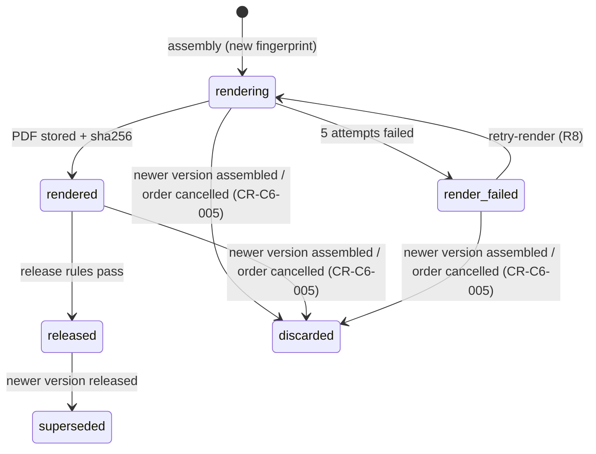
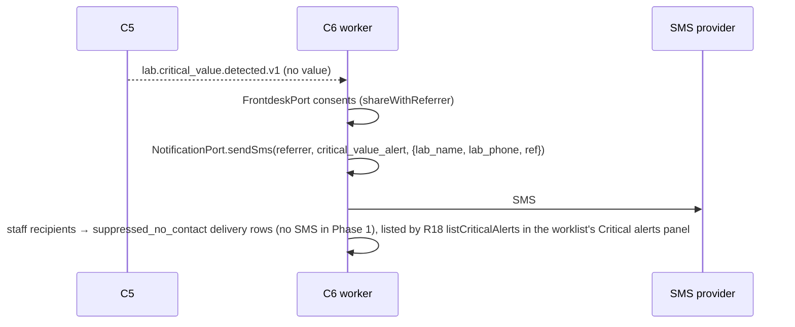
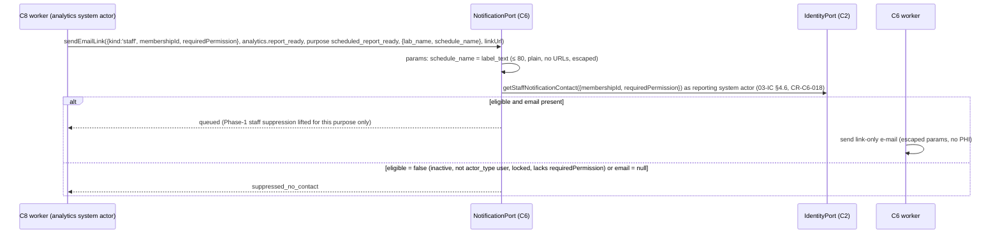
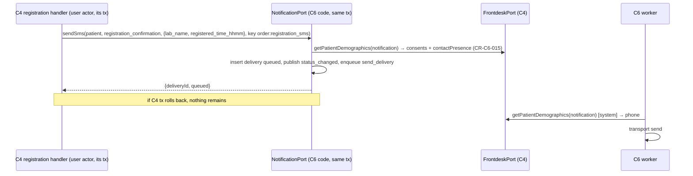

# C6 Reporting & Delivery — 03 App Flow

Status: DECISION, 2026-11-06. Read `01-PRD.md` and `02-TRD.md` first. State names, events and error codes are those of 03-IC §3.17, §3.18, §10.3 and 02-TRD §13. CR-dependent items are marked (CR-C6-0nn).

---

## 1. State machines

### 1.1 Report (`reporting.reports.state`)

| From | To | Trigger | Guard | Side effects | Events |
|---|---|---|---|---|---|
| (none) | `open` | `frontdesk.order.created.v1` consumer, or any C6 event/port that references an unknown order (created via `FrontdeskPort.getOrderSummary`) | order visible in tenant | `report_order_items`, narrative drafts created | — |
| `open` | `cancelled` | `frontdesk.order.cancelled.v1` | — | unreleased versions → `discarded`; narrative drafts → `cancelled`; if any version is `released` → `review_flag = released_order_cancelled` | — |

No transition leaves `cancelled`. Actions on a cancelled report → `409 reporting.report_cancelled` (CR-C6-004), except reading, downloading and printing already released versions.

Derived **display status** (for lists, 02-TRD §6.1), first match wins: `cancelled`; `render_failed` (latest version failed); `rendering`; `held` (latest version `rendered`, `held_basis` set); `ready_to_release` (latest `rendered`, not yet evaluated or manual mode); `released` (latest version `released`); `assembling` (`needs_assembly`); `awaiting_content`.

### 1.2 Report version (`reporting.report_versions.status`) — 03-IC §10.3 + CR-C6-005



| # | From | To | Trigger | Guard | Side effects | Events |
|---|---|---|---|---|---|---|
| V1 | (none) | `rendering` | `reporting.assemble_report` | fingerprint differs from latest non-discarded version; report `open`; complete or `partialReleaseAllowed` | snapshot frozen; QR token row; render task enqueued; older non-released, non-superseded versions → `discarded` | — |
| V2 | `rendering` | `rendered` | render task success | object written once at the D15 path | `pdf_*`, `page_count`, `rendered_at`; enqueue `release_if_eligible` | — |
| V3 | `rendering` | `render_failed` | last attempt failed | — | `last_render_error_code`; alert metric | — |
| V4 | `render_failed` | `rendering` | `retryRenderReportVersion` | latest version; permission `reporting.report.render` | attempts counter reset | — |
| V5 | `rendered` | `released` | release (manual, bulk, auto) | latest version; `BillingPort.getReleaseEligibility` eligible | release fields; report row update; deliveries dispatch; access log | `reporting.report.released.v1` |
| V6 | `released` | `superseded` | V5 of a newer version of the same report, same transaction | — | `superseded_at`, `superseded_by_version_no`; QR now verifies "superseded" | (carried by the new version's event: `supersedes_version_no`) |
| V7 | `rendering`/`rendered`/`render_failed` | `discarded` | V1 of a newer version, or order cancelled | never from `released`/`superseded` | `discarded_at`, `discard_reason` (`superseded_unreleased` / `order_cancelled`); QR → not verifiable | — |

Forbidden (unit tests): `released → rendered`, `superseded → released`, `discarded → *`, `rendering → released`, any change of content columns after V2 (trigger → `409 common.immutable_record`).

### 1.3 Narrative report and versions

| From | To | Trigger | Guard / permission | Side effects |
|---|---|---|---|---|
| (none) | `draft` (v1 draft) | order created/items added with a narrative test | — | sections pre-filled from the template matched by `test_id`, else by kind, else a single "Report" section |
| `draft` | `draft` | `saveNarrativeDraft` | `reporting.narrative.write`; `If-Match` | server-side sanitise; `version + 1` |
| `draft` | `signed` | `signNarrativeReport` | `reporting.narrative.sign` (aal2); required sections non-empty (text content after sanitise) | version `signed`, `signed_by_membership_id`, `content_sha256`; item `narrative_ready`; `needs_assembly`; access log `report.narrative_sign` |
| `signed` | `amending` | `startNarrativeAmendment` | `reporting.narrative.sign`; reason | new draft version n+1 copied from n |
| `amending` | `signed` | sign | as above | version n+1 `signed`, version n `superseded`; readiness marker changes → new report version (kind `amended` if a version was released) |
| `draft`/`amending` | `cancelled` | item removed / order cancelled | — | — |

Signed versions are immutable (trigger). While `amending`, the item stays ready with version n, so a pending amendment does not block other releases. The new report version appears only after the amendment is signed.

### 1.4 Input file (outsourced PDF, narrative image)

`pending_scan → scanning → (quarantined | sanitizing) → (ready | rejected) → confirmed (outsourced only) → withdrawn`. Narrative images go `ready` directly after re-encode (no confirm step). `quarantined`, `rejected`, `withdrawn` are terminal. `confirmed → withdrawn` is allowed only while the file is not in any `released`/`superseded` version (else `409 common.immutable_record`).

### 1.5 Delivery — 03-IC §3.18

| # | From | To | Trigger | Event |
|---|---|---|---|---|
| D1 | (none) | `queued` | NotificationPort call passes all checks | status_changed (from absent) |
| D2 | (none) | `suppressed` | channel disabled / no consent / no contact | status_changed (from absent) |
| D3 | `queued` | `suppressed` | consent withdrawn before send (send task re-check) | status_changed |
| D4 | `queued` | `sent` | transport accepted (provider message id) | status_changed |
| D5 | `sent` | `delivered` | provider callback `delivered` | status_changed |
| D6 | `delivered` or `sent` | `read` | WhatsApp callback `read` (a `read` before `delivered` implies delivered; `delivered_at` = `read_at`) | status_changed |
| D7 | `queued`/`sent` | `failed` | non-retryable transport error, retries exhausted, provider callback `failed` | status_changed (+ fallback creation D1 for the SMS delivery) |
| D8 | `failed` | `queued` | automatic retry is by Graphile within the same attempt chain (no state change); manual `retryDelivery` creates a **new** delivery (D1) — so D8 is used only when the send task re-queues after a circuit-open delay | status_changed |

Late callbacks never move a delivery backwards (e.g. `delivered` after `read` is ignored). Print deliveries are created directly in `sent` (`from_status` absent; channel `print`, purpose `report_ready`, no message template, idempotency key `<print_job_id>:print` — review fix #5). D3 with `failure_code` `channel_disabled` or `no_consent` on a WhatsApp delivery creates the SMS fallback (D1) at once (review fix #19).

### 1.6 OTP challenge and portal session

Challenge (08 A13 D-31): `pending_send` (destination not yet resolved, `destination_sha256` NULL) → `pending` (worker resolved the destination, stored the HMAC and queued the OTP) → `verified | exhausted | expired | superseded`. From `pending_send`: → `failed` (`no_contact`: no phone on file, or the link's known destination no longer matches), → `superseded` (a newer P1 for the link, or the per-destination send limit hit — `failure_code = send_rate_limited`), → `expired`. A new challenge for the same link moves the previous `pending_send`/`pending` one to `superseded`. P2 on a challenge that is not `pending` answers `auth.otp_invalid` (same as a wrong code). Session: `active → ended | expired` (idle 15 min, absolute 60 min [CONV]).

### 1.7 Portal payment request (`reporting.portal_payment_requests.status`) — 08 Addendum A11.1

| From | To | Trigger | Side effects |
|---|---|---|---|
| (none) | `queued` | PP1 (portal session of a patient link) | job `reporting.create_portal_payment_intent` |
| `queued` | `ready` | worker: `getOrderBalance` > 0 and `createIntent` succeeded | `intent_id`, `amount_paisa`, `action_json {url}`, `intent_expires_at` |
| `queued` | `failed` | worker: balance 0 (`nothing_due`), `payments.*` error (code suffix), link revoked (`link_revoked`), unsupported action, or stuck > 15 min (`timeout`) | — |
| `ready` | `ready` (`review = true`) | refresh: `held_for_review` | `action_json` scrubbed |
| `ready` | `completed` | refresh: `settled` / `refunded` / `partially_refunded` | `completed_at`; `action_json` scrubbed |
| `ready` | `failed` / `expired` | refresh: `failed` (`payment_failed`) / `expired`; cron: `intent_expires_at` + 30 min passed | `action_json` scrubbed |

Terminal states never change (trigger). The ledger is never touched by C6 (08 A11.1): C15 writes it with `BillingPort.recordGatewayPayment` inside its settle transaction; C4's `payments.intent.settled.v1` consumer is the idempotent safety net (08 A19 D-115).

### 1.8 Dues link (`portal_links` with `purpose = 'dues'`) — 08 Addendum A21.1

| From | To | Trigger | Guard | Side effects |
|---|---|---|---|---|
| (none) | issued | send task of a `dues_reminder` delivery (§4.6 rule 8 of 02-TRD) | version `rendered`, held `due_outstanding`, `dues_link_enabled`, patient consent for the channel | link row (`purpose = 'dues'`, `bound_version_no` = held version); message `reporting.dues_due` |
| issued | revoked (`dues_settled`) | release of any version of the report | — | report link sent by the normal `report_ready` dispatch |
| issued | expired | `expires_at` passed | — | P5 reissue sends a new **dues** link only while the report is still unreleased [CONV]; otherwise nothing |

A dues session can call only P6, P7, PP1, PP2; P3/P4 → `404 common.not_found`.

---

## 2. Cross-chunk sequences

### 2.1 Order → report shell → readiness → render → hold → pay → auto-release → WhatsApp → OTP → download → QR

```mermaid
sequenceDiagram
  autonumber
  participant C4 as C4 frontdesk/billing
  participant C5 as C5 lab
  participant W as C6 worker
  participant DB as reporting schema
  participant RN as renderer
  participant SB as pdf-sandbox
  participant ST as storage 'reports'
  participant PV as WhatsApp/SMS provider
  participant PO as apps/portal
  participant API as C6 API
  C4-->>W: frontdesk.order.created.v1
  W->>C4: CatalogPort.getTest (item kinds) [C3 port]
  W->>DB: reports + report_order_items + narrative drafts
  C5-->>W: lab.order.ready_for_report.v1 (complete, hash)
  W->>DB: lab_ready, needs_assembly; enqueue assemble (run_at +30 s)
  W->>C5: LabPort.getOrderResults(approved)
  W->>C4: FrontdeskPort.getOrderSummary / getPatientDemographics(report_render, portal_display)
  W->>DB: version v1 rendering + snapshot + QR token hash
  W->>RN: POST /internal/render (snapshot + data-URI assets)
  RN-->>W: main PDF
  W->>SB: POST /internal/assemble (main [+ outsourced]) + stamp Page N Of M
  SB-->>W: final PDF
  W->>ST: put-once {tenant}/{yyyy}/{mm}/{report}-v1.pdf
  W->>DB: v1 rendered
  W->>C4: BillingPort.getReleaseEligibility
  C4-->>W: not eligible (due_outstanding)
  W->>DB: held_basis = due_outstanding
  C4-->>W: billing.balance.changed.v1 (release_eligible true)
  W->>C4: BillingPort.getReleaseEligibility → paid_in_full
  W->>DB: v1 released; publish reporting.report.released.v1
  W->>DB: NotificationPort.sendWhatsAppTemplate → delivery queued
  W->>C4: FrontdeskPort.getPatientDemographics(notification) [system actor]
  W->>DB: issue deferred link (token hash only)
  W->>PV: send utility template (lab_name + link)
  W->>DB: delivery sent; status_changed event
  PV-->>API: POST /provider-callbacks/{token} (delivered)
  API->>DB: app.reporting_ingest_provider_callback → provider_events
  W->>DB: delivery delivered; status_changed event
  PO->>API: POST /portal/otp-challenges (X-Lims-Portal-Credential: link.<t>)
  API->>DB: challenge pending_send (no destination yet); enqueue send_portal_otp
  API-->>PO: 202 {challenge_id, channel}
  W->>C4: FrontdeskPort.getPatientDemographics(notification) [system] (link destination check or phone on file — D-31)
  W->>DB: challenge pending (destination_sha256, code_hmac); NotificationPort.sendSms (otp:p:<hex> limit)
  W->>PV: SMS OTP
  PO->>API: POST /portal/otp-challenges/{id}/verify
  API-->>PO: session token (cookie set by portal server)
  PO->>API: GET /portal/report, GET /portal/report-versions/{id}/pdf
  API->>ST: read object → stream (attachment)
```

### 2.2 Amendment → new version → supersede

```mermaid
sequenceDiagram
  participant C5 as C5 lab
  participant W as C6 worker
  participant DB as reporting
  C5-->>W: lab.result.amended.v1
  W->>DB: report_order_items.amendment_pending = true
  C5-->>W: lab.order.ready_for_report.v1 (contains_amendment true, new hash)
  W->>DB: assemble v2 (kind by 02-TRD §4.5: amended / addendum / final; amendmentNotes); render
  W->>DB: release v2 → v1 superseded (same tx)
  W-->>C5: reporting.report.released.v1 (version_no 2, supersedes_version_no 1, report_kind amended|addendum|final)
```

Deliveries for v2 use purpose `report_ready` with the template variant `reporting.report_updated` (seeded templates: 04-UI-UX §7, 05-SCHEMA §8). Links issued for v1 now show v2 (AC-11.7).

### 2.3 Manual release with C4 override

```mermaid
sequenceDiagram
  participant U as front desk (staff web)
  participant BFF as apps/web BFF
  participant C4 as C4 billing API
  participant API as C6 API
  U->>BFF: Release (report held — dues)
  BFF->>API: POST /report-versions/{id}/release
  API->>C4: BillingPort.getReleaseEligibility → due_outstanding
  API-->>BFF: 409 reporting.release_blocked_due (balance_due_paisa)
  U->>BFF: "Record override" (finance/tenant_admin only; aal2)
  BFF->>C4: POST /v1/billing/orders/{order_id}/release-overrides {reason_code, reason_text}
  C4-->>BFF: 201 override_id
  BFF->>API: POST /report-versions/{id}/release (new Idempotency-Key)
  API->>C4: BillingPort.getReleaseEligibility → override
  API-->>BFF: 200 released (release_basis override, release_override_id)
```

### 2.4 Outsourced PDF intake

```mermaid
sequenceDiagram
  participant U as technologist
  participant API as C6 API
  participant UP as ctx.uploads (C0)
  participant W as C6 worker
  participant SB as pdf-sandbox
  U->>API: POST /order-items/{id}/outsourced-files (multipart)
  API->>UP: accept(pdf, ≤15 MB, magic bytes, scan)
  API-->>U: 201 pending_scan
  W->>UP: scan result
  alt infected
    W->>W: state quarantined; metric; alert
  else clean
    W->>SB: /internal/sanitize
    SB-->>W: sanitised PDF + page_count | 422 reason
    W->>W: store outsourced/{file}.pdf; state ready (or rejected)
  end
  U->>API: POST /outsourced-files/{id}/confirm
  API->>API: state confirmed; item outsourced_ready; needs_assembly
```

### 2.5 Critical value alert



The SMS text has no value and no link (08 A13 D-35: no released report may exist yet).

### Scheduled-report e-mail to staff (C8 → C6, 08 Addendum A2.6 as corrected by A4.2/A4.3)



C5 keeps the clinical notification log (who was phoned, read-back). C6 deliveries are supplementary and visible in the delivery log.

### 2.7a Dues link under hold-till-paid (08 Addendum A21.1)

```mermaid
sequenceDiagram
  participant W as C6 worker
  participant C4 as BillingPort (C4)
  participant PV as SMS/WhatsApp
  participant PO as apps/portal
  participant API as C6 API
  W->>C4: getReleaseEligibility → due_outstanding (version held)
  W->>W: dues_link_enabled → delivery dues_reminder (reporting.dues_due, amount_text, key <version_id>:dues:<channel>)
  W->>PV: send; link issued with purpose 'dues'
  PO->>API: P1 / P2 (same OTP flow) → session link_purpose dues
  PO->>API: GET /portal/dues (balance, gateways) — P3/P4 → 404
  Note over PO,API: pay (PP1/PP2, §2.8) or "pay at the counter" before C15
  C4-->>W: billing.balance.changed.v1 (eligible, after the C15 settle transaction's recordGatewayPayment — D-115)
  W->>W: release (rule 5); dues links revoked dues_settled; report_ready dispatch as today
```

### 2.8 Portal dues payment (08 Addendum A11.1; ships with C15)

```mermaid
sequenceDiagram
  participant B as Browser (patient)
  participant PO as apps/portal
  participant API as C6 API (portal actor)
  participant W as C6 worker (system actor)
  participant BP as BillingPort (C4)
  participant PP as PaymentProviderPort (C15)
  participant GW as eSewa / Khalti
  B->>PO: POST /r/{token}/pay (form: gateway, nonce)
  PO->>API: POST /portal/payment-requests {gateway} (Idempotency-Key = nonce; session credential)
  API->>API: link recipient patient? gateway in settings? insert queued; enqueue create_portal_payment_intent
  API-->>PO: 202 {id, status: queued}
  PO-->>B: 303 → /r/{token}/payments/{id} (meta refresh 2 s)
  W->>BP: getOrderBalance(orderId)
  W->>PP: createIntent(orderId, gateway, rpt_<id>, returnUrl = cancelUrl = <PORTAL>/r/payments/{id}/done)
  W->>W: row ready (intent_id, amount, action url)
  B->>PO: GET /r/{token}/payments/{id}
  PO->>API: GET /portal/payment-requests/{id}
  API-->>PO: ready + action_url
  PO-->>B: "Continue to eSewa" (link to the gateway URL; Referrer-Policy no-referrer)
  B->>GW: pay
  GW-->>B: redirect (via C15) → <PORTAL>/r/payments/{id}/done?intent_id&outcome=…
  B->>PO: GET /r/payments/{id}/done (portal session cookie, SameSite=Lax)
  PO->>API: GET /portal/payment-requests/{id} (outcome ignored)
  API->>W: enqueue refresh_portal_payment_request (≥ 3 s since last check)
  W->>PP: getIntent(intentId) → settled
  W->>W: row completed
  Note over PP,BP: ledger: C15 calls BillingPort.recordGatewayPayment in its settle tx (03-IC X3); C4 settled.v1 consumer = idempotent safety net (08 A19 D-115)
```

### 2.6 QR verify

```mermaid
sequenceDiagram
  participant B as Browser (anyone)
  participant N as nginx (C1)
  participant PO as apps/portal
  participant API as C6 API
  B->>N: GET /v/{token}  (10 r/m per IP — nginx, portal origin only)
  N->>PO: proxied; path not logged; X-Forwarded-For overwritten by nginx
  PO->>API: POST /v1/reporting/verifications {qr_token} + X-Lims-Bff-Key (kind portal) + X-Forwarded-For (08 A13 D-32)
  API->>API: core sets app.client_ip from X-Forwarded-For (valid BFF key only); rate qr_verify (100/day per app.client_ip); anonymousTx; app.reporting_verify_qr(sha256)
  API-->>PO: 200 minimal fields | 404 reporting.verify_not_found
  PO-->>B: server-rendered page (no client JS), no-store, no-referrer
```

### 2.7 NotificationPort call from C4 (registration SMS)



---

## 3. Flows per screen and API

Each screen lists its states. Common states (all staff screens): **loading** = `LoadingSkeleton` (`loading.tsx`); **error** = `ErrorState` with request id and Retry; **permission denied** = shell `core.shell.forbidden` (route-level) or a disabled action with tooltip `reporting.common.no_permission`; **not found** = `core.shell.not_found`.

### 3.1 Reports worklist (`/reporting`)

1. Load `listReports` with the tab's `display_status` filter. Tabs: Awaiting content · Ready to release · Held (dues) · Render failed · Released today · All.
2. Row action Open → report detail. Multi-select (Ready to release / Held tabs) → Bulk release (privileged) → confirm dialog with the count → `bulkReleaseReportVersions` → per-row outcome toasts and a results table.
3. Search box (registration no. or barcode, scanner supported) → `searchReports` (POST body).
- Empty: "No reports here." per tab (copy in 04-UI-UX).
- Success: bulk results summary "130 released, 20 held for dues".
- Edge: the list refreshes by polling every 30 s through the BFF (02-CV §2.4), and a row whose status changed shows a subtle highlight.
4. Critical alerts panel (R18 `listCriticalAlerts`, same 30 s polling; review fix #16): badge with the count of alerts in the last 24 h; list rows (registration no., alert time, recipients with status). Empty: "No critical alerts in the last 24 hours." Error: inline ErrorState in the panel; the worklist stays usable. No acknowledge action in v1 (the call log is C5's) [CONV].

### 3.2 Report detail (`/reporting/reports/{report_id}`)

1. `getReport`. Panels: header (registration no., patient, centre, referrer, family), items readiness table, versions timeline, deliveries summary, actions.
2. Actions by version status and permission: Download PDF (R5) · Print with/without letterhead (R10 → poll R11 → open R12) · Release (R6) · Record override (C4 B14, only if `billing.release.override`) · Retry render (R8) · Regenerate (R9) · Resend (D3) · Revoke QR (R14) · Portal links (R15/R16).
3. Release flow: confirm dialog listing audiences (checkboxes default = computed set; patient cannot be removed except by "Print only") → R6. `409 release_blocked_due` → inline banner "Held: NPR {amount} due" + "Record override" button for permitted users. `409 version_not_latest` → refresh and toast.
- Empty versions: "No report version yet — waiting for {n} of {m} items." with the item list.
- Error: render_failed banner with code and Retry render.
- Partial: banner "Partial report — {k} items pending".

### 3.3 Outsourced queue (`/reporting/outsourced`)

`listOutsourcedItems` → row → upload dialog (FileUpload PDF, external lab name) → O1 → file card shows scan state (polling 5 s up to 2 min). `ready` → Preview (O5 download) → Confirm checkbox "I confirm this report belongs to this patient" → O3. Rejected/quarantined → danger card with reason and "Upload another file". Withdraw (O4) with reason.

### 3.4 Narrative worklist and editor (`/reporting/narratives`, `/reporting/narratives/{id}`)

1. List (N1) by status/kind.
2. Editor: template picker (N8), sections (RichTextEditor, CR-C6-010), images (N6 upload, captions), autosave draft every 20 s [CONV] and on blur (N3 with If-Match). `409 version_conflict` → dialog "Someone else changed this draft" with Reload.
3. Sign (N4): confirm dialog "Sign and lock this report?" → aal2 step-up handled by the shell (C2) if `auth.mfa_required`. `422 narrative_incomplete` → section errors.
4. Signed → read-only view with "Start amendment" (N5, reason dialog).

### 3.5 Deliveries (`/reporting/deliveries`)

D1 list with filters → D2 drawer (timeline from attempts, masked destination). The same content is the page `/reporting/deliveries/{delivery_id}` (route `staff.reporting.delivery`) for deep links (review fix #31). Failed → Retry (D4). Never shows message bodies or links.

### 3.6 Templates, messages, channels, settings

- Report templates: list (T1) → editor (T3/T4) form with live validation → Preview (T5 → print job poll) → Publish (T6, confirm). `422 template_invalid` → field errors from `errors[]`.
- Messages & channels: M1 table by template; edit text per channel (M2); placeholder chips only for declared params; WhatsApp: provider template name, language, variable order, approval status (manual record; banner "Approval happens in your WhatsApp Business account, not here"). Channel accounts (C1/C2/C3): callback URL shown once in a copy dialog.
- Settings: S1/S2 form; centre contacts (S3–S5); staff assignments (S6); referrer preferences (S7) from the report detail referrer link.

### 3.7 Portal (`apps/portal`)

| Step | Page | API | States |
|---|---|---|---|
| 1 | `/r/{token}` landing | none until the button (no OTP sent on page load; avoids link-preview bots triggering SMS) | valid-looking token → "Get a code" button; layout identical for every token until the API answers |
| 2 | press "Get a code" | P1 | 202 → step 3 with "Code sent to the mobile number registered with the lab" (no mask; 08 A13 D-31); 404 `link_invalid` → invalid page (with "Request a new link" button, which calls P5 and always shows the same confirmation, whatever the API answered); 429 → rate-limited page with Retry-After minutes |
| 3 | `/r/{token}/code` | P2 | wrong code → inline "That code is not right. {n} tries left."; exhausted → "Get a new code"; expired → same |
| 4 | `/r/{token}/report` | P3 | summary; `updated_notice` banner; Download → P4 via `/r/{token}/download` route (stream); "Health summary" section (08 Addendum A4.7, 04-UI-UX §4) rendered server-side from P3 `smart_summary` only — states: **hidden** (`smart_summary` absent, i.e. `smart_summary_json` NULL on the version: no section, no placeholder), **shown** (snapshot rendered read-only), **error** (snapshot present but cannot be rendered — fails `SmartSummary` shape validation or `status` ≠ `approved` [CONV]: section shows the error copy, rest of the page and Download unaffected; log `portal_smart_summary_invalid` without PHI [CONV]); a P3 failure uses the page-level "Generic error" state |
| 5 | session end | P6 on "Sign out"; idle → back to step 2 with "For your security, enter a new code." |
| 5a | dues link (08 A21.1) | P2 `link_purpose = dues` → `/r/{token}/dues` [CONV path] | P7 only: balance, pay buttons (or "Please pay at the lab counter" before C15), "Your report will be sent once payment is complete."; no report content, no Download; balance 0 → "Payment received — your report will be sent once it is released." |
| 6 | dues (08 A11.1; ships with C15) | P3 `dues` | absent → no section; `online_gateways` empty → amount + "Please pay at the lab counter or in the app" (no button); non-empty → amount + one form button per gateway (POST `/r/{token}/pay`, hidden nonce = Idempotency-Key) → PP1 → 303 to `/r/{token}/payments/{id}`; `open_request` present → "A payment is in progress" + link to its status page |
| 7 | `/r/{token}/payments/{id}` | PP2 (meta refresh every 2 s, up to 30 s [CONV]) | `queued` → "Preparing your payment…"; `ready` → "Continue to {eSewa|Khalti}" link to `action_url`; `ready` + `review` → "We are confirming your payment"; `failed` (`gateway_not_available`, `nothing_due`, other) → counter/app copy or "Nothing is due on this report"; `409 payment_in_progress` from PP1 → "A payment for this order is already in progress" |
| 8 | `/r/payments/{id}/done` (route `portal.payment_done`) | PP2 (meta refresh every 3 s, up to 60 s) | the `outcome` query value is ignored; `completed` → "Payment received. Thank you." + back to report; `ready` → "Checking your payment…", after 60 s "We have not received confirmation yet. If you paid, it will show at the lab shortly."; `expired`/`failed` → "The payment was not completed." + back to report; no portal session → data-free "Open your report link again to see your payment status." |

QR: `/v/{token}` → Q1 → Valid (green check + fields) / Superseded (amber) / Not found ("We couldn't verify this report. Check the code or contact the lab.") / rate-limited.

App-route fallbacks: `/app/reports/{report_id}` (route fallback `portal.report_link_required`) → data-free page "Open the link the lab sent you" (review fix #31); other `/app/*` and `/phlebo/*` paths → `portal.app_fallback` ("Open the app"), no data (08 A13 D-38).

All portal pages: no third-party assets, no analytics, `Referrer-Policy: no-referrer`, `Cache-Control: no-store`, CSP nonce, works without client JavaScript except the OTP input enhancement.

### 3.8 Internal API flows (worker)

**Assembly** (`reporting.assemble_report`): (1) `SELECT … FOR UPDATE` report row; (2) report cancelled → clear flag, exit; (3) compute readiness + fingerprint; (4) unchanged or not releasable (incomplete and partial not allowed) → clear `needs_assembly`, exit; (5) call ports (02-TRD §4.3); LabPort `approvedSetHash` ≠ stored hash → leave `needs_assembly`, retry in 30 s (max 10); (6) build document; (7) insert version n+1 `rendering` (whenever the smart section holds an `approved` summary — at first assembly and at Regenerate with reason `smart_summary_added` alike — with `smart_summary_json`/`smart_summary_id`/`smart_summary_version` set from the `SmartSummary`, 08 Addendum A2.3/A2.8/A4.4; otherwise all three NULL), QR row, discard older unreleased versions; (8) clear flag; enqueue render; commit.

**Render** (`reporting.render_report_version`): load snapshot + template version → collect assets by sha256 (IdentityPort.readBrandingAsset for branding — logo/letterhead, 08 A13 D-26; `IdentityPort.readSignatureImage({membershipId})` for each signatory's signature image — 08 A21.2, fake returns a placeholder until C2 implements it; `common.not_found` = no image on file; ctx.storage for narrative images in C6's bucket and, under 08 A13 P-13, instrument/anatomic images only by the `(bucket, objectPath)` the owner's port output or view returned) → POST renderer → collect outsourced/instrument PDFs (sanitised copies; instrument PDFs were sanitised at assembly, P-13) → POST sandbox assemble → `ctx.storage.put` (write-once; if the object already exists with the same sha256 → treat as success; different sha256 → `render_failed` + critical alert) → update version → enqueue `release_if_eligible`.

**Send** (`reporting.send_delivery`): lock delivery; terminal → exit; re-check tenant channel + consent (system actor) → suppressed; resolve contact; for report links issue a link (deferred); render text from tenant text or global default; call transport with the circuit breaker; record attempt; success → `sent` + provider id, schedule fallback check for WhatsApp; retryable → throw (Graphile retry); non-retryable → `failed` + fallback creation; last attempt → `failed` (`retries_exhausted`) + fallback.

---

## 4. Empty / loading / error / success / permission-denied matrix (staff screens)

| Screen | Empty | Loading | Error | Success | Permission denied |
|---|---|---|---|---|---|
| Worklist | per-tab empty copy | table skeleton | ErrorState + Retry | bulk summary toast | route hidden from nav; direct URL → forbidden page |
| Report detail | "No version yet" panel | detail skeleton | ErrorState | release toast "Report released. Messages are being sent." | buttons hidden when the permission is missing |
| Outsourced | "No outsourced tests waiting." | table skeleton | ErrorState | "File attached. Scanning…" | forbidden page |
| Narrative editor | template-less draft shows a single section | form skeleton | conflict dialog / ErrorState | "Draft saved {time}" / "Signed" | read-only view for users with `reporting.report.read` only |
| Deliveries | "No messages for these filters." | table skeleton | ErrorState | retry toast | forbidden page |
| Templates/messages/settings | seed rows always exist | form skeleton | field errors | "Saved" / "Published" | forbidden page |

---

## 5. Edge cases

| # | Case | Handling |
|---|---|---|
| E1 | Readiness event arrives before order.created | consumer creates the shell from `FrontdeskPort.getOrderSummary` (AC-01.5) |
| E2 | Stale readiness (lower `aggregate.seq`) | ignored |
| E3 | Amendment arrives while v1 is `rendered` but held | v2 assembled; v1 → `discarded`; v2 rendered and held; never both releasable |
| E4 | Two users release the same version concurrently | row lock + `If-Match`; second gets `409 common.version_conflict` or, with the same Idempotency-Key, the replayed 200 |
| E5 | Bulk release where one id fails mid-way | per-id savepoint; others unaffected |
| E6 | Release succeeds but delivery dispatch job fails | release committed; dispatch retried (10); deliveries idempotent on `<report_version_id>:<audience>:<channel>` keys |
| E7 | Order cancelled after a release | released versions stay valid; `review_flag`; tenant admin sees "Order cancelled after release" filter; may revoke QR/links (R14/R16) |
| E8 | Patient name corrected in C4 after release | staff runs Regenerate (R9, reason `demographic_correction`) → `amended` version by 02-TRD §4.5 rule 0 (08 A13 D-33), reason shown in the amendment box; Regenerate `smart_summary_added` keeps the kind of rules 1–4 |
| E9 | Branding/signature asset missing at render | render without that image, log `asset_missing`; never block (signature absence noted in a metric) |
| E10 | Renderer pool saturated | `503` from renderer → task retry with backoff; versions stay `rendering`; sweep re-enqueues stuck ones |
| E11 | Storage object exists with a different sha256 | `render_failed` + critical alert (should never happen; write-once violation) |
| E12 | WhatsApp delivered callback after the SMS fallback was sent | both recorded; no further fallback; event for each |
| E13 | Duplicate provider callback | `(provider_message_id, mapped_status)` dedupe; no transition |
| E14 | Callback for unknown provider message id | stored in `provider_events` with `delivery_id` null; ignored after 7 days |
| E15 | OTP requested twice quickly | second supersedes the first; both count against the link's 3/hour (`otp:l:<link_id>`); the per-phone 3/hour (`otp:p:<hex>`) is applied once per actual send (08 A13 D-31) |
| E16 | Link forwarded to someone else | they cannot pass OTP (code goes to the recipient's phone/email on file) |
| E17 | Patient has no phone and no email | release succeeds; deliveries `suppressed` (no contact); print and centre pickup remain |
| E18 | Link token pasted with trailing characters | treated as invalid (identical 404) |
| E19 | Narrative-only order | no lab readiness event; report readiness from narrative signatures alone |
| E20 | Outsourced file confirmed for the wrong patient | withdraw (if unreleased) or upload a corrected file → new amended version; old QR shows superseded |
| E21 | Offline (staff browser loses API) | shell offline banner; no optimistic state; forms keep values |
| E22 | Duplicate form submission | Idempotency-Key per dialog open; replay returns the same result |
| E23 | Smart summary still draft at assembly | section omitted and the three snapshot columns NULL (a summary already approved at first assembly is snapshotted on that version — 08 A4.4); when C14 approves later, no automatic new version in Phase 1 [DECISION]; staff may Regenerate (reason `smart_summary_added`) → the new version stores the approved `SmartSummary` snapshot (`smart_summary_json` + `_id` + `_version`, 08 A2.3/A2.8), which portal P3, partner (C13) and patient (C16) readers get through ReportingPort / portal reads — they never call `SmartReportPort` |
| E24 | Template published during a render | the version uses the template version frozen at assembly |
| E25 | Tenant disables WhatsApp while deliveries are queued | send task re-checks → `suppressed` (`channel_disabled`) → SMS fallback created at once if SMS is enabled and consented (02-TRD §4.8 fallback rule; AC-09.8) |
| E26 | Micro final replaces an approved preliminary (C5 amendment reason `module_phase_progression`) | new version of kind `final` (not "Amended"), supersedes the released preliminary version (02-TRD §4.5, 08 R1) |
| E27 | Anatomic addendum after sign-out (C5 amendment reason `supplementary_report`) | new version of kind `addendum`, status label "Addendum"; `report_kind = addendum` on the released event (x-extensible) |
| E28 | Partner or patient actor requests a report file | `ReportingPort.openReleasedReportFile` under the partner / patient RLS policies; released/superseded only; otherwise `common.not_found` (08 R8 rule 1) |
| E29 | C4/C8 worker renders an invoice/analytics PDF | `RenderPort.renderPdf` (system actor) → renderer → bytes returned; caller stores the file in its own bucket (08 R12c) |
| E30 | Link with no stored destination (C16 `patient_app`, `print_qr`, C13 access slip) asks for an OTP | worker sends to the patient's phone on file; none → challenge `failed` silently (08 A13 D-31) |
| E31 | Patient pays at the counter while a portal payment request is `ready` | C6 does nothing special: the intent and any resulting over-payment are handled by C15/C4 (03-IC §4.4 `GatewayPaymentInput.allowExceedsDue`); the done page shows the status `getIntent` reports |
| E32 | Portal session expires during the gateway payment | the done page shows the data-free "Open your report link again…" copy; the payment itself settles through C15 regardless |
| E34 | Version held for dues, then amended (v2 assembled, v1 discarded) | v2 held again → a new dues delivery (key per version); the v1 dues link stays valid until release revokes it |
| E35 | Patient opens a dues link after the report was released | link revoked (`dues_settled`) → invalid-link page; the `report_ready` message carries the report link |
| E33 | `redeemPortalLinkForApp` called 5 times with a wrong phone | the link is locked for app redemption (`redeem_failures = 5`; each increment survives its failing request through `ctx.commitOnError()`, 08 A19 P-42); portal OTP access through the same link is unaffected (08 A13 D-30) |
| E36 | Micro preliminary updated after an approved preliminary (C5 amendment reason `module_preliminary_update`, 08 A17 D-61) | new version of kind `preliminary` (label "Preliminary", not "Amended"), supersedes the released preliminary version at release (02-TRD §4.5 rules 1 and 3) |
| E37 | SmartReportPort throws `smartreport.*` during assembly after writing | the port's writes are rolled back to the savepoint (`ctx.db.tx`, 08 A19 P-44); the version is assembled without the smart section |
