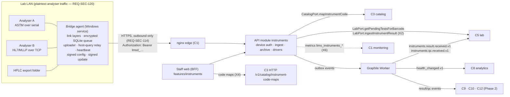

# C7 Instrument Integration — 02 Technical Requirements (TRD)

Status: DECISION, 2026-11-06. Names of tables, endpoints, events, ports, permissions and error codes follow 03-IC and 02-CV verbatim. Anything 03-IC lacks is in §16 "Change requests raised" and is designed as if accepted (marked **(CR-C7-nnn)**).

Abbreviations: 03-IC = `program/03-INTERFACE-CATALOG.md`; 02-CV = `program/02-CONVENTIONS.md`; 01-CM = `program/01-CHUNK-MAP.md`; "04 Xn" = row of `research/04-consolidated-decisions.md`; BC-LIS = Beckman Coulter, *UniCel DxI and Access 2 LIS Vendor Information*, document C03112-AF (May 2026) as printed on the document; the download URL's file segment reads `C03112AE` (https://www.beckmancoulter.com/download/file/wsr-228138/C03112AE?type=pdf, fetched 2026-11-06 and re-checked 2026-11-06 in the review fix pass), Chapter 2 "Low Level Transfer Protocol" — a vendor implementation of ASTM E1381-95 / LIS1-A. It is the same kind of source 04 N4 cites. Per 08 A13 D-41 its timer values are used as **[CONV] configurable defaults**, with BC-LIS as reference only (no research/04 row); only the frame format, checksum and contention values are backed by 04 N4. LIS1-A ↔ E1381 equivalence stays UNVERIFIED (04 N3).

---

## 1. Owned paths (01-CM §3)

| Path | Content |
|---|---|
| `apps/bridge-agent/` | Go module: agent service, launcher, CLI, simulator, link layers, queue, uploader, config, update, tests, synthetic sessions, release build scripts |
| `services/api/src/modules/instruments/` | API module: manifest, `authResolvers.deviceToken`, handlers, services, domain, **driver framework + drivers**, repository, events, mappers, tests |
| `services/worker/src/jobs/instruments/` | worker manifest, consumer of `catalog.changed.v1`, tasks, cron |
| `apps/web/src/app/(staff)/instruments/` | Next.js route segment |
| `apps/web/src/features/instruments/` | nav manifest, BFF server functions (incl. calls to C3 code-map operations — X4), components, hooks, forms, help |
| `docs/manual/instruments/` | user-manual pages (lab staff) and the site-installation runbook |

C7 never edits `db/`, `contracts/`, `packages/*`, `infra/` or any `core/`. `05-SCHEMA.md` and §7 below are the specification C0 implements (01-CM §0).

## 2. Stack and pinned libraries

### 2.1 Bridge agent (Go)

| Component | Version | Source |
|---|---|---|
| Go toolchain | ≥ 1.26, pinned identically in `go.mod` (`go 1.26.x` + `toolchain go1.26.x`) and the CI image (the image is C0-0A's; requested in CR-C7-013) | 04 S16; 02-CV §1.1 |
| `golang.org/x/sys` (incl. `windows/svc`, `windows/svc/mgr`, `windows/svc/eventlog`, DPAPI `CryptProtectData`/`CryptUnprotectData`, `WinVerifyTrustEx`) | **v0.49.0** | 04 S16, T7; function existence VERIFIED on pkg.go.dev for v0.49.0 (fetched 2026-11-06) |
| `go.bug.st/serial` | **v1.8.0** | 04 S16, T7 |
| SQLite driver | `modernc.org/sqlite` **v1.61.1** (CGo-free, windows/amd64 supported, WAL supported, BSD-3-Clause); listed on pkg.go.dev 2026-11-06 (published 31 Oct 2026). AG-T01 confirms the pin builds; a different version needs a TRD change (§2.3 row) | DECISION — 04 N11 requires SQLite but names no driver; CGo-free keeps the "static binary, cross-compiles from CI" property (03 §6.3) |
| Crypto | Go standard library only: `crypto/aes` + `crypto/cipher` (AES-256-GCM), `crypto/ed25519`, `crypto/sha256`, `crypto/rand`, `crypto/tls`, `crypto/x509` | DECISION |
| YAML for simulator session files | none — session files are JSON (`*.session.json`) so no YAML dependency is needed | DECISION |
| Lint | `go vet`, `staticcheck` [PIN-C0], `gofmt` | 02-CV §1.3 |

Target: `GOOS=windows GOARCH=amd64`, `CGO_ENABLED=0`, Windows 10/11 or Server 2016+ only (04 S16). `GOARCH=386` and Linux builds are not produced.

### 2.2 API, worker, web (TypeScript)

| Component | Version | Source |
|---|---|---|
| Node.js | 26.x LTS, exact patch pinned by C0 | 02-CV §1.1 |
| TypeScript, Fastify, Next.js (App Router) | C0 pins | 02-CV §1.1 |
| `fastify-openapi-glue` | 4.12.0 (mounted by core) | 04 T7 |
| Graphile Worker | 0.18.0 (via worker core) | 04 S10, T7 |
| PostgreSQL | 17 (`supabase/postgres:17.6.1.136`) | 04 D9 |
| `openapi-typescript` / `openapi-fetch` | 7.13.0 / 0.17.0 (generated `@lims/api-client-ts`) | 04 T7 |
| MSW | 3.0.3 (web tests) | 04 T7 |
| Ed25519 signing, SHA-256 | `node:crypto` (built in) via `@lims/shared-ts/crypto` where it offers the function; Ed25519 signing lives in `services/api/src/modules/instruments/service/signing.ts` (no new package) | DECISION |
| HL7/ASTM parsing on the server | **in-house** in `services/api/src/modules/instruments/drivers/` (no third-party parser) | 04 N13 (ASTM); DECISION for HL7: `node-hl7-client` 4.1.2 exists (04 T7) but is an MLLP client/server — the server never speaks MLLP, it only parses archived bytes, and one in-house tokeniser keeps golden tests identical for both protocols |
| UUIDv7, logger, errors, crypto | `@lims/shared-ts` | 02-CV §2.1 |

### 2.3 New third-party dependencies (02-CV §15.1)

| Name | Exact version | Licence | Purpose | Maintenance evidence | Alternatives considered |
|---|---|---|---|---|---|
| `modernc.org/sqlite` | v1.61.1 | BSD-3-Clause | local queue (04 N11) | release 31 Oct 2026 on pkg.go.dev | `mattn/go-sqlite3` (needs CGo → no static cross-compile); SQLCipher builds (CGo) |

No new npm packages.

## 3. Architecture overview



### 3.1 Key decisions

| # | Decision | Rationale |
|---|---|---|
| D-01 | **The agent is protocol-transport only; record parsing and host-query replies are built on the server.** The agent does framing, ACK/NAK, persistence, classification (result vs host query vs other, by record/message type), upload and relay. The server's driver parses the archived bytes and builds replies. | One parser per model, written once (TS), so archived messages can be re-parsed when a driver is fixed (REQ-ARCH-062 traceability; X2 replay). The agent keeps the 02-CV §2.6 package names: `internal/astm/` holds E1381 framing **and** the E1394 record *tokeniser* used for classification (04 N4/N5); `internal/drivers/<vendor>_<model>/` holds the per-model **session profile** (timers, ACK policy, encoding, which message types are host queries). |
| D-02 | Persist **every frame** (ASTM) / **every message** (MLLP) to SQLite with a synchronous commit before sending ACK | 04 N11 "persist raw frame … before ACK"; a crash after ACK cannot lose data |
| D-03 | Ingest is synchronous in the request transaction with one SAVEPOINT per message | 03-IC §3.14 trigger is "commit of the ingest transaction that stored, parsed and found…"; the volumes (§12) are small; per-message isolation (AC-09.8) |
| D-04 | Instruments have a commissioning lifecycle; only `live` instruments emit events; only `verified` drivers go live | B2 + 04 N14: no clinical effect from an unverified driver; shadow mode lets a site test against the real analyser |
| D-05 | Enrolment codes are credentials of the `deviceToken` security scheme, distinguished by prefix and an `extraClaims.credential_kind` | the C0 core has no tenant before a credential is resolved; reusing the `AuthResolver` path avoids a second anonymous path (C0 02-TRD §6.3) |
| D-06 | Ed25519 signatures over a canonical JSON for configs; Ed25519 internal signature + Authenticode for packages | 04 N11 requires "signed config + signed self-update (Authenticode + internal signature)" but names no algorithm; Ed25519 exists in both Go and Node standard libraries (no dependency) |
| D-07 | Local queue = SQLite (WAL) with per-row AES-256-GCM payload encryption; data key wrapped by DPAPI | REQ-SEC-117 "SQLCipher or DPAPI-protected at minimum"; SQLCipher needs CGo |
| D-08 | Self-update through a separate signed launcher that supervises versioned agent directories and rolls back | the running `.exe` cannot replace itself (03 §6.4 "swap on restart … or a tiny supervisor") |
| D-09 | No tray app; CLI + status file | no GUI dependency, no IPC listener (REQ-SEC-114); site staff rarely touch the PC |
| D-10 | File-drop folder watcher for pictures/PDFs | 01 §3.5 "the interface agent watches a folder per instrument, matches by sample ID in filename or by operator pick-list" |
| D-11 | Message records (parsed rows) are kept 90 days [CONV], counted from their message's `received_at`; raw bytes for `TenantSettings.retention.rawInstrumentYears` (C2; default 1, floor 1 year — 08 A13 D-42) | records are derivable from raw (preview parse); keeps the table small (§12.4) |
| D-12 | HL7 message-level key = MSH-10, but a reused MSH-10 with different bytes is archived as a new message | 04 N10 keeps true duplicates out; 06-GLOSSARY "MSH-10" notes instruments reuse control ids after restart, so dropping on MSH-10 alone could lose results |

## 4. API module internals (`services/api/src/modules/instruments/`)

```
index.ts                     ModuleManifest { name:'instruments', openapi:'contracts/openapi/instruments.yaml', handlers,
                               ports: {} (C7 owns no port), produces: ['instruments.result.received.v1',
                               'instruments.qc.received.v1','instruments.calibration.received.v1',
                               'instruments.agent.health_changed.v1'],   // = EVENT_PRODUCERS['instruments'] (03-IC §3.25)
                               authResolvers: { deviceToken: deviceTokenResolver } }
permissions.ts               the codes in §7.0
config.ts                    LIMS_INSTRUMENTS_* (§11)
auth/
  deviceTokenResolver.ts     AuthResolver (§7.1)
handlers/<operationId>.ts    one per operation in §7 (thin: load object → assertRole → service → mapper)
service/
  agents.service.ts          create/update/retire, revoke, enrolment codes, enrol
  credentials.service.ts     token/code generation (randomToken), hashing, touch throttle
  agentConfig.service.ts     build config document, canonicalise, sign, version
  signing.ts                 Ed25519 sign (key from file), canonical JSON (shared golden vector with Go)
  instruments.service.ts     CRUD, commissioning transitions, capability validation
  ingest.service.ts          submitMessageBatch pipeline (§6.4)
  hostQuery.service.ts       §6.6
  attachments.service.ts     upload acceptance, scan completion (worker), event emission
  reprocess.service.ts       reprocess + rematch (§6.7)
  heartbeat.service.ts       store status, commands delivery
  health.service.ts          evaluator (worker), transitions, events
  messages.service.ts        list/search/detail/raw/preview parse
  observedCodes.service.ts
  settings.service.ts
  commands.service.ts, logBundles.service.ts, releases.service.ts
domain/
  agent.state.ts             agent status machine (03-APP-FLOW §2.1)
  instrument.state.ts        commissioning machine (03-APP-FLOW §2.2)
  credential.state.ts
  health.ts                  pure evaluator (inputs → state)
  keys.ts                    message-level key, result-level key, QC key (04 N10; 03-IC §3.14/§3.15)
  instrumentTime.ts          local instrument time + IANA zone → UTC IsoUtc; offset computation
  transportSchemas.ts        JSON Schemas for transport / protocol_options / file_drop (§5.8)
  decimal.ts                 value_raw → DecimalString (03-IC §2.1 pattern) or undefined
drivers/
  types.ts                   InstrumentDriver interface (§6.1)
  registry.ts                code → driver; status from instruments.g_drivers
  astm/tokenizer.ts          E1394 record splitter (delimiters from H record)
  hl7/tokenizer.ts           segment/field/component splitter (MSH-1/MSH-2)
  astm_generic_e1394/        driver + options schema + testdata/
  hl7v2_generic_oru/         driver + options schema + testdata/
  file_drop_generic/         driver + testdata/
  mindray_bc5380_sketch/     ILLUSTRATIVE, status sketch_blocked (§6.3)
  mindray_bs200_sketch/      ILLUSTRATIVE, status sketch_blocked
repository/                  agents, credentials, configVersions, instruments, status, messages, runs, records,
                             observedCodes, duplicates, rejections, attachments, commands, logBundles, settings,
                             releases (G read), drivers (G read)
events/publish.ts            typed publishers for the four events (result, qc, calibration, agent health)
mappers/                     *.dto.ts (explicit allowlists; never serialise secret_sha256, raw_bytes)
__tests__/{unit,integration,contract,probes,golden}
```

Worker (`services/worker/src/jobs/instruments/`):

```
index.ts        WorkerManifest { module:'instruments', tasks:{…§10}, subscriptions:{ 'catalog.changed.v1': onCatalogChanged }, crontab:[…§10] }
                every crontab entry declares `tenantScope` ('per_tenant' | 'platform') as in §10 (08 A13 P-6)
consumers/catalog.changed.v1.ts
tasks/evaluate_agent_health.ts · scan_attachment.ts · refresh_observed_code_mapping.ts
      expire_credentials_and_commands.ts · purge_archive.ts · export_agent_state_metrics.ts · publish_release_configs.ts
cron.ts
```

Web (`apps/web/src/features/instruments/`): `nav.manifest.ts`, `server/*.server.ts` (one per operationId, including the four C3 code-map operations, `searchOrderables`, `getTestDetail`, `listUnits`), `components/`, `forms/` (from generated types), `help/<helpKey>.ts`, `__tests__/`. Route segment `apps/web/src/app/(staff)/instruments/` (pages in 04-UI-UX).

Layer rules (02-CV §2.2) apply. In addition: `drivers/**` is **pure** (no IO, no clock, no ports) so golden tests are deterministic; the service passes `receivedAt`, instrument config and options in.

## 5. Bridge agent (`apps/bridge-agent`)

### 5.1 Packages

```
go.mod / go.sum
cmd/agent/main.go            service entry ("run" under SCM) + CLI subcommands (§5.13)
cmd/launcher/main.go         bridge-launcher.exe: the registered service binary; verifies + supervises versions (§5.11)
cmd/simulator/main.go        instrument simulator / session replayer (dev + CI only; never shipped)
internal/transport/serial    go.bug.st/serial wrapper (open, mode, DTR/RTS, read deadline loop)
internal/transport/tcp       client (dial, reconnect) and LAN listener (bind IP, peer allowlist)
internal/astm                frame.go (encode/decode), checksum.go, link.go (§5.2 state machine), records.go (tokeniser), classify.go
internal/mllp                codec.go (stream → messages), session.go (send with ACK wait)
internal/hl7                 msh.go (MSH-1/2/3/4/5/6/7/9/10/12/15/16 read), ack.go (build ACK), classify.go
internal/drivers             profile.go (SessionProfile), registry.go; generic_astm/, generic_hl7/, file_drop/,
                             mindray_bc5380_sketch/, mindray_bs200_sketch/ (profiles only)
internal/filedrop            watcher.go (poll), stability.go, seen.go
internal/queue               db.go (open, WAL, pragmas), schema.sql, crypto.go (AES-GCM, key wrap), sessions.go, items.go, truncate.go
internal/uploader            batcher.go, backoff.go, ratebudget.go, client.go (HTTP + TLS), outcomes.go
internal/hostquery           relay.go (query → server → reply → link layer)
internal/heartbeat           heartbeat.go, commands.go
internal/config              signed.go (verify), canonical.go, apply.go, keys.go (embedded trusted public keys)
internal/update              download.go, verify.go (sha256 + ed25519), authenticode_windows.go (WinVerifyTrustEx), stage.go
internal/secrets             dpapi_windows.go, token.go
internal/clock               offset.go (§5.9)
internal/svc                 service_windows.go, install_windows.go, acl_windows.go, firewall_windows.go
internal/status              statusfile.go (§5.13)
internal/logging             ring.go (rotating JSON lines), redact.go (denylist)
internal/cli                 subcommands
build/                       build.ps1 / build.sh, sign step hooks (keys from C1 secret store), release-manifest generator
testdata/sessions/*.session.json   synthetic sessions (§15.3)
```

### 5.2 ASTM E1381 low-level layer (`internal/astm`) — in-house (04 N13)

#### 5.2.1 Control characters

| Name | Hex | Name | Hex |
|---|---|---|---|
| ENQ | 0x05 | STX | 0x02 |
| ACK | 0x06 | ETX | 0x03 |
| NAK | 0x15 | ETB | 0x17 |
| EOT | 0x04 | CR, LF | 0x0D, 0x0A |

#### 5.2.2 Frame format (04 N4; BC-LIS "Transfer Phase", "Frame Number", "Checksum")

`STX FN text (ETB | ETX) C1 C2 CR LF`
- FN: one ASCII digit. First frame of a transfer phase is `1`; each next frame is previous + 1 modulo 8 (`…7, 0, 1…`).
- `text` ≤ 240 characters; whole frame ≤ 247 characters (7 overhead characters).
- A record longer than 240 characters is split: intermediate frames end with `ETB`, the record's last frame ends with `ETX`. DECISION (sending side): each record (including its trailing `CR`) starts a new frame; frames never contain parts of two records.
- Checksum: sum of the byte values of FN, every text byte and the `ETB`/`ETX` byte, modulo 256, written as two **uppercase** hexadecimal ASCII characters `C1 C2`.

#### 5.2.3 Receiver frame validation (BC-LIS "Frame Number", "Defective Frames")

A received frame is **accepted** only if: starts with `STX`; FN is a digit equal to the expected FN (`1` first, previous + 1 mod 8) **or** equal to the previous accepted FN (retransmission → ACK, do not append); terminator `ETB` or `ETX`; checksum matches (case-insensitive compare on receive [CONV], uppercase on send); followed by `CR LF`; total length ≤ 247. Otherwise it is **defective** → reply `NAK`.

#### 5.2.4 Timers and counters (per instrument, `protocol_options.astm`)

All defaults below are **[CONV] configurable defaults** (08 A13 D-41). The "Reference" column names where a value was taken from; BC-LIS is a vendor implementation used as reference only. Only the contention values also match 04 N4.

| Key | Default | Meaning | Reference |
|---|---|---|---|
| `establish_reply_s` | 15 [CONV] | sender waits for a reply to `ENQ`; timeout → termination (`EOT`) | BC-LIS "Time-outs: No Reply During the Establishment Phase" |
| `nak_retry_delay_s` | 10 [CONV] | after `NAK` to `ENQ` (receiver not ready) wait, then resend `ENQ` | BC-LIS Establishment Phase, Table 2-1 |
| `host_contention_defer_s` | 20 [CONV] | host (agent) goes neutral after ENQ contention, until this time passes or the instrument's message completes | 04 N4; BC-LIS "Contention" |
| `instrument_contention_retry_s` | 1 [CONV] | informational: the instrument waits this long before re-sending `ENQ` (used by the simulator) | 04 N4; BC-LIS |
| `transfer_reply_s` | 15 [CONV] | sender waits for `ACK`/`NAK`/`EOT` after a frame; timeout → cancel, termination, message retained | BC-LIS "During the Transfer Phase" |
| `receiver_frame_wait_s` | 30 [CONV] | receiver waits for the next frame/`EOT`; timeout → discard incomplete message (agent: store as `incomplete`), neutral | BC-LIS "Receiver Waiting for Frame" |
| `receiver_interrupt_backoff_s` | 15 [CONV] | after the receiver answered a frame with `EOT` (stop request), the sender does not re-establish before this | BC-LIS "Receiver Interrupts" |
| `max_frame_sends` | 6 [CONV] | a frame sent 6 times without acceptance → sender terminates | BC-LIS "Defective Frames" |
| `max_establish_attempts` | 6 [CONV] | ENQ attempts per outbound message before giving up until the next retry cycle | — (not in source) |
| `outbound_retry_cycle_s` | 60 [CONV] | wait before a new attempt to send a retained outbound message | — |
| `max_outbound_cycles` | 3 [CONV] | retry cycles after which a retained outbound message is marked `failed` (03-APP-FLOW §3.2 `Giveup`; counter + heartbeat error) | — |
| `encoding` | `latin1` [CONV] | byte → string mapping for classification/logging only (raw bytes are archived unchanged) | instrument encodings UNVERIFIED per model |

Validation range for every `*_s` timer: 1–300 s [CONV]; `max_frame_sends` 1–10; `max_establish_attempts` 1–20; `max_outbound_cycles` 1–10.

#### 5.2.5 Physical layer
Serial settings are **required** per instrument (no assumed default). For reference only, BC-LIS states EIA-232, 8 data bits, no parity, 1 stop bit, default 9600 baud (configurable 1200–19200) for that vendor's instrument. ASTM over TCP uses the identical link layer on the byte stream (supported per instrument; vendor use UNVERIFIED).

#### 5.2.6 Golden vectors (computed by the rule in §5.2.2; synthetic data)

| FN | text (`<CR>` = 0x0D) | terminator | C1C2 |
|---|---|---|---|
| `1` | `H|\^&|||SIM-ANALYSER^0.1|||||||P|1<CR>` | ETX | `1C` |
| `2` | `P|1<CR>` | ETX | `3F` |
| `3` | `O|1|E2600000042||^^^GLU<CR>` | ETX | `E8` |
| `4` | `R|1|^^^GLU|5.4|mmol/L||N||F<CR>` | ETX | `04` |
| `5` | `L|1|N<CR>` | ETX | `08` |
| `0` | `R|8|^^^K|4.1<CR>` | ETB | `4A` |

SHA-256 of the assembled message (texts of frames 1–5 concatenated): `56ebd538f73ae63fd6cdc8ffc3bc2e4c948482e9570b7146c20f6c7878d0baaf`. Both the Go agent (`internal/astm/checksum_test.go`) and the TS server (`drivers/astm/tokenizer.test.ts`) assert these.

#### 5.2.7 "Raw" for archive and dedupe
For ASTM the archived `raw` = concatenation of the `text` of every accepted frame of one transfer phase, in order (retransmissions counted once), **excluding** STX, FN, terminator, checksum and CR LF. `raw_sha256` = SHA-256 of those bytes (04 N10 `sha256(raw)`). Link metadata (frame count, NAKs, retransmissions) travels separately in `link_meta` and is not hashed.

The state machines are in 03-APP-FLOW §3.1 (receive) and §3.2 (send).

### 5.3 E1394 record tokeniser and classification (`internal/astm/records.go`, `classify.go`)

- Records are split on `CR` (a trailing `LF` after `CR` is tolerated). The record type is the first character: H, P, O, R, C, Q, L, S, M (04 N5).
- Delimiters are read from the H record: field delimiter = 2nd character, then repeat, component, escape (the common `H|\^&` form). These positions follow common LIS2-A2 practice but the LIS2-A2 text was not opened in this research set → **UNVERIFIED**; the tokeniser fails closed (classification `other`) when the H record is missing.
- Classification (agent side): contains ≥ 1 `Q` record and no `R` record → `host_query`; contains ≥ 1 `R` record → `data`; otherwise `other` (still uploaded as `data`; the server decides). Q is the host-query record, not QC (06-GLOSSARY "ASTM record").

### 5.4 MLLP (`internal/mllp`) and HL7 (`internal/hl7`)

- Framing (04 N9): start block `0x0B`, message, end block `0x1C` followed by `0x0D`. Bytes outside a block are discarded and counted (`mllp_discarded_bytes`). A new `0x0B` inside a block discards the partial message (counted as `incomplete`). Maximum message size `max_message_bytes` 1 MiB [CONV]; above → connection reset, counter `oversize`.
- MSH parsing (agent): MSH-1 field separator (4th byte), MSH-2 encoding characters, then MSH-3…MSH-16 by field index. Positions used: MSH-3/4 sending application/facility, MSH-5/6 receiving, MSH-7 message date/time, MSH-9 message type, MSH-10 control id, MSH-12 version, MSH-15 accept-ack type, MSH-16 application-ack type. These are HL7 v2 standard positions (04 N9 "VERIFIED (specs)" for the message set); vendor deviations are handled by the session profile.
- Classification: MSH-9 in the profile's `host_query_message_types` (e.g. `QRY^Q02` — vendor-specific, UNVERIFIED per 04 N6/N7) → `host_query`; otherwise `data`.
- ACK (built by the agent **after** the message is committed to SQLite):

```
MSH|^~\&|<ack_sending_app>|<ack_sending_facility>|<orig MSH-3>|<orig MSH-4>|<now YYYYMMDDHHMMSS>||ACK|<new control id>|P|<orig MSH-12><CR>
MSA|<code>|<orig MSH-10><CR>
```

| Situation | Original mode (MSH-15 and MSH-16 empty) | Enhanced mode (MSH-15 present) |
|---|---|---|
| committed to queue | `AA` | `CA` (commit accept) |
| queue write failed (disk/DB) | `AR` | `CR` |
| MSH unparseable | no ACK (cannot echo MSH-10); stored as `incomplete` | same |

- `protocol_options.hl7v2.ack_mode` ∈ `auto` (default: decide from MSH-15/16 as above) | `original` | `enhanced` | `none` (profile for instruments that send no ACK request — UNVERIFIED per model). `ack_sending_app` default `LIMS`, `ack_sending_facility` default the agent code [CONV]; MSH-9 format of the ACK (`ACK` vs `ACK^R01^ACK`) is a profile option (`ack_message_type_format`) because vendors differ (UNVERIFIED per model).
- Application-level errors (unknown code, bad value) are **not** reported to the instrument with AE: the agent cannot know them before the server parses, and the record is quarantined server-side (REQ-SEC-121). DECISION.
- Sending (host-query replies): write block, wait `ack_timeout_s` (default 10 [CONV]) for an ACK whose `MSA-2` equals the sent control id; retry `send_retries` (default 3 [CONV]); then mark failed. Some vendor flows send a reply without expecting an ACK; the profile sets `expect_ack_on_reply` (UNVERIFIED per model).

The MLLP receive/send state machines are in 03-APP-FLOW §3.3.

### 5.5 Session profiles (`internal/drivers`)

```go
// internal/drivers/profile.go
type SessionProfile struct {
    Code                    string            // equals instruments.g_drivers.code (e.g. "astm_generic_e1394")
    Protocol                string            // "astm" | "hl7v2" | "file_drop"
    ASTMDefaults            *ASTMTimers       // §5.2.4 defaults (overridden by instrument protocol_options)
    HL7AckMode              string            // auto | original | enhanced | none
    HL7AckMessageTypeFormat string            // "ACK" | "ACK^{trigger}^ACK"
    HostQueryMessageTypes   []string          // HL7 MSH-9 values classified as host queries
    ExpectAckOnReply        bool
    ReplyTimeout            time.Duration     // how long the instrument waits for a host-query reply (UNVERIFIED per model)
}
```

An instrument whose `driver_code` has no agent profile uses the generic profile for its protocol and reports `driver_profile_unknown` in the heartbeat.

### 5.6 Local queue (`internal/queue`)

Location `C:\ProgramData\LIMS\BridgeAgent\queue\agent.db` (ACL §5.12). Pragmas: `journal_mode=WAL`, `synchronous=FULL` (D-02: commit is durable before ACK), `secure_delete=ON`, `foreign_keys=ON`, `busy_timeout=5000`. Schema (`schema.sql`, versioned with `PRAGMA user_version`):

```sql
CREATE TABLE kv (k TEXT PRIMARY KEY, v BLOB NOT NULL);             -- agent_id, wrapped data key, applied config, offset, counters
CREATE TABLE sessions (                                             -- ASTM transfer phase / MLLP message in progress
  id TEXT PRIMARY KEY,                                              -- UUIDv7
  instrument_id TEXT NOT NULL, protocol TEXT NOT NULL,
  started_at_agent TEXT NOT NULL, last_frame_at_agent TEXT NOT NULL,
  expected_fn INTEGER, frames INTEGER NOT NULL DEFAULT 0, retransmits INTEGER NOT NULL DEFAULT 0, naks_sent INTEGER NOT NULL DEFAULT 0);
CREATE TABLE session_chunks (session_id TEXT NOT NULL REFERENCES sessions(id) ON DELETE CASCADE,
  seq INTEGER NOT NULL, nonce BLOB NOT NULL, ct BLOB NOT NULL, PRIMARY KEY (session_id, seq));
CREATE TABLE items (
  id TEXT PRIMARY KEY,                                              -- = agent_message_id (UUIDv7)
  instrument_id TEXT NOT NULL,
  kind TEXT NOT NULL CHECK (kind IN ('data','incomplete','host_query','attachment')),
  protocol TEXT NOT NULL CHECK (protocol IN ('astm','hl7v2','file_drop')),
  nonce BLOB NOT NULL, ct BLOB NOT NULL,                            -- AES-256-GCM(raw bytes or file bytes)
  meta_nonce BLOB NOT NULL, meta_ct BLOB NOT NULL,                  -- AES-256-GCM(JSON: link_meta, file name, mtime …)
  raw_sha256 TEXT NOT NULL, size_bytes INTEGER NOT NULL,
  captured_at_agent TEXT NOT NULL, clock_offset_ms INTEGER NOT NULL,
  state TEXT NOT NULL CHECK (state IN ('pending','uploading','uploaded','rejected','oversize')),
  attempts INTEGER NOT NULL DEFAULT 0, last_error_code TEXT, next_attempt_at TEXT,
  uploaded_at TEXT, server_message_id TEXT, rejected_config_version INTEGER);
CREATE INDEX items__state_next ON items(state, next_attempt_at);
CREATE TABLE file_drop_seen (instrument_id TEXT NOT NULL, path_sha256 TEXT NOT NULL, size_bytes INTEGER NOT NULL,
  mtime TEXT NOT NULL, file_sha256 TEXT NOT NULL, item_id TEXT, first_seen_at TEXT NOT NULL,
  PRIMARY KEY (instrument_id, path_sha256, size_bytes, mtime));
CREATE TABLE outbound (id TEXT PRIMARY KEY, instrument_id TEXT NOT NULL, nonce BLOB NOT NULL, ct BLOB NOT NULL,
  created_at TEXT NOT NULL, attempts INTEGER NOT NULL DEFAULT 0, state TEXT NOT NULL CHECK (state IN ('pending','sent','failed')));
```

- **Encryption**: a 256-bit data key from `crypto/rand`, stored in `kv` only wrapped by DPAPI (`CryptProtectData`, service-account user scope; fallback machine scope `CRYPTPROTECT_LOCAL_MACHINE` + file ACL if user scope is unavailable for the virtual account — UNVERIFIED, spike AG-T02). Each payload: random 96-bit nonce; additional authenticated data = `table || ":" || row id || ":" || seq`.
- **Truncation** (04 I8; REQ-SEC-117): every 10 min [CONV] delete `uploaded` items whose `uploaded_at` is older than `upload.uploaded_retention_hours` (config, default 24, 1–72); delete `outbound` rows `sent`/`failed` older than 24 h; delete `session_chunks` of finalised sessions immediately; `PRAGMA incremental_vacuum` after deletes (database created with `auto_vacuum=INCREMENTAL`). **Pending, rejected and oversize items are never deleted automatically** (they show in status/heartbeat; an operator resolves them).
- **Disk guard**: if free disk on the queue volume < 500 MB [CONV], the ASTM receiver answers `NAK` to `ENQ`, the MLLP receiver answers `AR`/`CR` (AC-05.1, AC-07.3) and heartbeats report `disk_low`.

### 5.7 Uploader (`internal/uploader`)

| Rule | Value |
|---|---|
| Batch | ≤ 100 items and ≤ 3 MiB of JSON body (04 §4; [CONV] byte cap below the server's 4 MiB route limit — §7.2) |
| Flush | every 2 s when items are pending, or immediately when 100 are pending [CONV] |
| Attachments | one per request (`submitAttachment`, multipart) |
| Request budget | client-side token bucket of 60 requests/min shared by all calls (04 §4), with 20/min reserved for host queries and 2/min for heartbeats [CONV]; uploads use the remainder (≤ 38/min) |
| Idempotency | `Idempotency-Key` = UUIDv7 per batch; the same key is reused when the same batch is retried unchanged; items are locked in `uploading` while in flight |
| Backoff | on network error, `5xx`, `429`: 1 s × 2^n capped at 300 s, ±20 % jitter [CONV]; `Retry-After` overrides when larger |
| `401 auth.device_token_invalid` | stop all uploads, set `auth_state = rejected`, keep retrying heartbeat every 5 min [CONV] (an admin may have revoked the token; re-enrolment needed) |
| Outcomes | `accepted`/`duplicate`/`quarantined` → `uploaded`; `rejected` → `rejected` + `rejected_config_version` (retried once when the applied config version increases); `retry` → `pending` with backoff |
| Order | oldest `captured_at_agent` first; host-query relay calls (E05) bypass the queue order (they are synchronous) |
| Host-query items | every finalised query is also a queue item of kind `host_query` (single rule, review #23): E05 answered with `200` or with a 4xx other than `401`/`429` → the item becomes `uploaded` (the server has archived or rejected it); no response, `5xx` or `429` → the item stays `pending` and is uploaded later in a normal batch as `kind = host_query` (§6.4 step 9; agent-key dedupe makes it `duplicate` if E05 had in fact stored it); `401` → the §5.7 auth rule (item stays `pending`) |

TLS (REQ-SEC-115): `crypto/tls` with `MinVersion: tls.VersionTLS12`, verification against the Windows system roots (`x509.SystemCertPool`). Optional SPKI pins (`tls.spki_pins_sha256` in the signed config, empty by default): when non-empty, a connection whose chain contains none of the pinned SPKI hashes is refused. `InsecureSkipVerify` is banned by a CI grep gate (job `c7-go-insecure-tls-gate`, §16 CR-C7-013). Proxy: optional `proxy_url` in the local install config (`config.local.json`, written by the installer); proxy failure never falls back to direct or insecure.

### 5.8 Instrument transports and configuration schemas (shared by server validation and agent)

| `transport.kind` | Fields (all required unless marked) | Validation |
|---|---|---|
| `serial` | `port_name`, `baud_rate`, `data_bits`, `parity`, `stop_bits`, `dtr` (opt, default true [CONV]), `rts` (opt, default true [CONV]) | `port_name` `^COM[1-9][0-9]{0,2}$`; `baud_rate` ∈ {1200, 2400, 4800, 9600, 19200, 38400, 57600, 115200}; `data_bits` ∈ {7, 8}; `parity` ∈ {none, odd, even, mark, space}; `stop_bits` ∈ {"1", "1.5", "2"}. Line settings per instrument are UNVERIFIED until its manual (B2) |
| `tcp_client` | `host`, `port`, `connect_timeout_s` (opt 10), `reconnect_max_backoff_s` (opt 60) | `host` IPv4 dotted or hostname ≤ 253 (`^[A-Za-z0-9.-]{1,253}$`); `port` 1–65535; `connect_timeout_s` 1–60; `reconnect_max_backoff_s` 1–300 [CONV] |
| `tcp_server` | `bind_address`, `port`, `allowed_peers` | `bind_address` IPv4, not `0.0.0.0` and not a loopback address; `port` 1024–65535; `allowed_peers` 1–8 IPv4 addresses (connections from others are closed immediately) |
| `file_drop` | `directory`, `filename_pattern`, `barcode_regex` (opt), `allowed_types`, `stable_seconds` (opt 5), `move_after_capture` (opt false), `captured_subdirectory` (opt `captured`), `attachment_instrument_code` | `directory` absolute Windows path ≤ 240 chars (`^[A-Za-z]:\\` or `^\\\\`); `filename_pattern` and `barcode_regex` Go RE2 ≤ 200 chars, `barcode_regex` must contain the named group `(?P<barcode>…)`; `allowed_types` non-empty subset of {pdf, png, jpg}; `stable_seconds` 2–60; `captured_subdirectory` `^[A-Za-z0-9_-]{1,60}$`; `attachment_instrument_code` 1–64 chars |

`protocol_options.astm` = §5.2.4 keys; `protocol_options.hl7v2` = `ack_mode`, `ack_sending_app` (≤ 20, `^[A-Z0-9_]+$`), `ack_sending_facility` (≤ 20), `ack_timeout_s` (1–60), `send_retries` (0–5), `max_message_bytes` (1 KiB–1 MiB). `file_drop` may also appear as a **secondary channel** on an `astm`/`hl7v2` instrument (e.g. an HPLC analyser with an LIS link and a chromatogram export folder). The JSON Schemas live in `domain/transportSchemas.ts`; the agent re-validates the decoded config with identical rules (golden fixtures shared under `apps/bridge-agent/testdata/config/` and copied by CI into the API tests — the copy is checked byte-for-byte by job `c7-fixture-copy-check`, §16 CR-C7-013).

### 5.9 Clock offset (`internal/clock`; 04 N12, REQ-ARCH-059)

- Every agent-facing response carries `server_time` (IsoUtc, ms). For each successful call the agent records `t_send`/`t_recv` (monotonic + wall clock) and computes `offset_ms = server_time − (t_send + t_recv)/2`, `uncertainty_ms = (t_recv − t_send)/2` [DECISION, NTP-style midpoint]. It keeps the estimate with the smallest uncertainty in the last 10 min.
- Each queue item stores `captured_at_agent` (local wall clock) and the `clock_offset_ms` in force at capture. The server computes `captured_at = captured_at_agent + clock_offset_ms`.
- Instrument offset: when the driver extracts a message or result timestamp, `instrument_clock_offset_seconds = round((instrument_time_utc − captured_at)/1 s)`; stored on the record, the instrument status, and sent in the event (03-IC §3.14 field).

### 5.10 Signed configuration (`internal/config`; 04 N11, REQ-ARCH-060)

Envelope returned by `getAgentConfig`:

```json
{ "alg": "Ed25519", "key_id": "cfg-2026-11", "signature": "<base64url Ed25519 over canonical(document)>",
  "document": {
    "schema": "lims.bridge.config.v1", "agent_id": "01a1a98a-ac40-7000-8000-0000000d0101",
    "centre_id": "01a1a98a-ac40-7000-8000-000000020001", "config_version": 7, "issued_at": "2026-11-06T04:00:00.000Z",
    "heartbeat_interval_seconds": 60,
    "upload": { "max_batch_messages": 100, "max_batch_bytes": 3145728, "flush_interval_seconds": 2, "uploaded_retention_hours": 24 },
    "rate_budget": { "requests_per_minute": 60, "reserved_host_query_per_minute": 20, "reserved_heartbeat_per_minute": 2 },
    "tls": { "spki_pins_sha256": [] },
    "log_level": "info",
    "update": { "channel": "stable", "target": null, "allow_downgrade": false, "window": null },
    "instruments": [ { "instrument_id": "01a1a98a-ac40-7000-8000-0000000d0001", "instrument_code": "SIM-CHEM-1",
        "state": "commissioning", "protocol": "astm", "driver_code": "astm_generic_e1394",
        "transport": { "kind": "serial", "port_name": "COM3", "baud_rate": 9600, "data_bits": 8, "parity": "none", "stop_bits": "1" },
        "protocol_options": { "astm": { "establish_reply_s": 15, "transfer_reply_s": 15, "receiver_frame_wait_s": 30,
          "host_contention_defer_s": 20, "nak_retry_delay_s": 10, "receiver_interrupt_backoff_s": 15,
          "max_frame_sends": 6, "max_establish_attempts": 6, "outbound_retry_cycle_s": 60, "max_outbound_cycles": 3,
          "encoding": "latin1" } },
        "file_drop": null,
        "capabilities": { "host_query": false, "worklist_download": false } } ] } }
```

Rules:
- **Canonical JSON** (DECISION): UTF-8; object keys sorted by Unicode code point; no whitespace; strings escaped minimally (`"`, `\`, control characters as `\u00XX`); numbers are integers only (the document contains no fractional numbers — all timers are integers; `stop_bits` is a string); `null` allowed inside the document (it is not an API JSON body — 02-CV §4.2 applies to API resources; the signed document is an opaque payload, declared `type: object` with `additionalProperties: true` in the spec and validated by its own schema `lims.bridge.config.v1`). One golden vector (`testdata/config/canonical.vector.json` + expected bytes + signature with a test key) is asserted by Go and TS.
- Only instruments in `commissioning`, `live` or `suspended` are included (draft/retired are not, so the agent closes their ports).
- **`update` block** (review #10): `update = { channel: "stable"|"beta", target: Target | null, allow_downgrade: boolean, window: Window | null }`.
  - `Target = { release_id: Uuidv7, version: "^[0-9]+\.[0-9]+\.[0-9]+$", package_sha256: hex64, package_size: int > 0, signature: base64url, key_id: ≤32, authenticode_publisher: ≤200 }` — copied from the selected `g_agent_releases` row (05-SCHEMA §2.18).
  - Selected release = the agent's `pinned_release_id` when set and active; otherwise the active release with the highest version whose `channel` is the agent's channel (`beta` agents also see `stable` releases) [CONV]. No active release → `target: null`. The agent installs only when `target.version` ≠ its running version.
  - `allow_downgrade = (pinned_release_id IS NOT NULL)` [CONV: only an explicit manager pin may move an agent to a lower version; the launcher still checks `target.version` equals that version — §5.11].
  - `Window = { from: "HH:MM", to: "HH:MM", timezone: IANA }` from `settings.update_window_from/_to` and the tenant timezone (`IdentityPort.getTenantSettings`); `null` when unset (apply when idle). `to < from` means the window spans midnight.
- **Who creates config versions** (append-only `agent_config_versions`, 05-SCHEMA §2.5; each bumps `agents.latest_config_version`):
  - `agent_created` — E11 (version 1). `agent_changed` — E13 when `update_channel` or `pinned_release_id` changes; E01 re-enrolment does not create one.
  - `instrument_changed` — E24–E31 per 03-APP-FLOW §2.2.
  - `settings_changed` — E41, when `update_window_from/_to` change: one new version for **every non-retired agent of the tenant**, in the E41 transaction.
  - `release_changed` — task `instruments.publish_release_configs` (§10): for every non-retired agent whose selected release (rule above) differs from `update.target.release_id` (or `null`) of its latest config version, insert a new version. It runs per tenant after the release pipeline applies a `g_agent_releases` seed (cron, §10) and when a release is deactivated (`is_active = false` → target falls back).
- Agent checks before applying: `alg = Ed25519`; `key_id` in the agent's embedded trusted key list (current + next; rotation = release with the new key first); signature valid; `document.agent_id` = own id; `config_version` > applied version (or equal → no-op); schema valid. Failure → keep the old config, report `config.state` (AC-15.1).
- Signing key: `LIMS_INSTRUMENTS_CONFIG_SIGNING_KEY_FILE` (PKCS#8 Ed25519 private key from the secret store — REQ-SEC-128), `LIMS_INSTRUMENTS_CONFIG_SIGNING_KEY_ID`.
- The base URL of the API is **not** in the document; it is fixed at install (`config.local.json`), so a config cannot redirect an agent to another server.

### 5.11 Signed self-update (`internal/update`, `cmd/launcher`; 04 N11, REQ-SEC-119)

Release artefact: `bridge-agent-<version>-windows-amd64.zip` containing `agent.exe` (Authenticode-signed) and `manifest.json`. A global row in `instruments.g_agent_releases` (05-SCHEMA §2.11) carries `version`, `package_sha256`, `package_size`, `signature` (Ed25519 by the **release key**, over the raw SHA-256 bytes of the package), `key_id`, `authenticode_publisher` (expected certificate subject CN), `channel`.

Sequence: heartbeat response shows a newer `latest_config_version` → agent fetches config → `update.target` set → download via `downloadAgentRelease` to `C:\ProgramData\LIMS\BridgeAgent\versions\<version>.zip.part` → verify size + SHA-256 + Ed25519 (`key_id` in the embedded release-key list) → unzip to `versions\<version>\` → `WinVerifyTrustEx` (`WINTRUST_ACTION_GENERIC_VERIFY_V2`) on `agent.exe` and compare the signer subject with `authenticode_publisher` → write `pending.json` → wait for the apply conditions (AC-15.3: no active session for 60 s, inside `update.window` if set) → exit with code **75** [CONV] → the launcher re-verifies the same three checks, switches `current.json`, starts the new `agent.exe`. Health gate: the new agent writes `healthy.json` after its first successful heartbeat; if that does not happen within 5 min or the process exits 3 times within 10 min [CONV], the launcher restores the previous version and records `rolled_back`.

Anti-rollback: the launcher refuses `version` < current unless the applied signed config has `update.allow_downgrade = true` and `update.target.version` equals that version.

Authenticode certificate purchased and owned by the client (founder decision 2026-11-06, research/04 §13); held in the C1 secret store; the release pipeline applies it plus the internal Ed25519 signature (04 N11). `authenticode_publisher` = the subject CN of the client's certificate. Non-production builds may skip the Authenticode check only when built with the `nonprod` build tag (never in release builds — CI job `c7-go-release-tag-check` asserts the release binary lacks that tag, §16 CR-C7-013); the Ed25519 check is always enforced. Production release gate: signed with the client's certificate (06 §7 R3).

The launcher is installed only by the elevated installer into `C:\Program Files\LIMS\BridgeAgent\bridge-launcher.exe` (service account has read/execute only), so the agent cannot replace its own supervisor.

### 5.12 Windows service, account, files (REQ-SEC-114/116/117/118)

| Item | Value |
|---|---|
| Service name / display | `LimsBridgeAgent` / "LIMS Bridge Agent" |
| Binary registered with SCM | `C:\Program Files\LIMS\BridgeAgent\bridge-launcher.exe` |
| Account | virtual service account `NT SERVICE\LimsBridgeAgent` (DECISION; Microsoft documentation not opened in this research set → UNVERIFIED, spike AG-T02), fallback `NT AUTHORITY\LocalService` set by `install --account localservice` |
| Start type / recovery | automatic (delayed start); SCM recovery: restart after 60 s, 60 s, 300 s [CONV] |
| Data root | `C:\ProgramData\LIMS\BridgeAgent\` with `queue\`, `secrets\`, `logs\`, `versions\`, `config\`, `status\` |
| ACLs (set by installer with explicit DACL, inheritance disabled) | service SID: modify on data root; `BUILTIN\Administrators`: full; `SYSTEM`: full; no `Users` / `Authenticated Users` entries. `status\status.json` additionally readable by Administrators only |
| Device token | `secrets\device-token.bin` = DPAPI blob (service-account scope, optional entropy = agent id) (REQ-SEC-118); never in registry, ini or plain JSON |
| Listening sockets | none towards the internet. LAN listeners only for `tcp_server` instruments, bound to the configured LAN IP. The installer does **not** create a firewall rule unless `--allow-lan-listener` is passed; then a program-scoped inbound rule (profiles private + domain, remote `LocalSubnet`) via `netsh advfirewall`. Without it a `tcp_server` instrument reports `link_state = error`, `last_error_code = firewall_rule_missing` |
| Custom service controls | user-defined control codes 128–255 [CONV] used by the CLI to request "heartbeat now" (128), "flush uploads now" (129); delivery through `x/sys/windows/svc` is UNVERIFIED (spike AG-T02); fallback = the CLI writes `status\request.json` that the service polls every 5 s |

### 5.13 Status file and CLI

The service writes `status\status.json` every 10 s (atomic rename) with: service state, agent id, agent/launcher version, server reachability, last heartbeat time + outcome, auth state, applied config version + state, update state, queue counts per state, oldest pending age, disk free, per-instrument `{instrument_code, link_state, last_message_at_agent, messages_today, last_error_code}`, counters. **No barcodes, values, names or raw bytes.** CLI commands are in 04-UI-UX §2.

### 5.14 File-drop watcher (`internal/filedrop`)

- Poll the folder every 5 s [CONV] (no `ReadDirectoryChangesW` dependency; network shares behave consistently with polling). Consider files matching `filename_pattern` with an allowed extension and size ≤ 15 MB (02-CV §10.2).
- A file is **stable** when size and mtime are unchanged across `stable_seconds`; then read it, compute SHA-256, check `file_drop_seen` (instrument, sha256 of the full path, size, mtime) → skip if seen.
- Store as an `attachment` item (encrypted bytes + metadata: file name, mtime, size, extracted `barcode` if `barcode_regex` matches); record in `file_drop_seen` in the same SQLite transaction.
- If `move_after_capture`, move the file into `captured_subdirectory` after the item commit (the agent needs modify rights on the folder; documented in the site runbook); otherwise leave it.
- Never follow shortcuts/symlinks out of the folder; ignore files whose path contains `..` after normalisation.
- What HPLC/urine/allergy instruments actually write (file types, naming, whether sample ids appear in file names) is **UNVERIFIED** (01 §3.5; B2).

## 6. Server-side ingest and drivers

### 6.1 Driver interface (`drivers/types.ts`)

```ts
import type { Uuidv7, IsoUtc, DecimalString } from '@lims/contracts/ports/common';

export type DriverStatus = 'generic' | 'verified' | 'sketch_blocked';
export type DriverProtocol = 'astm' | 'hl7v2' | 'file_drop';
export type RecordKind = 'quantitative' | 'qualitative' | 'ordinal' | 'text' | 'organism_id' | 'ast' | 'attachment'; // 03-IC §3.14

export interface DriverCapabilities {
  readonly resultUpload: true; readonly hostQuery: boolean; readonly worklistDownload: boolean;
  readonly qc: boolean; readonly attachments: boolean;
  readonly calibration: boolean;               // = g_drivers.cap_calibration; true only for a verified driver whose manual classifies calibrators (B2)
}
export interface DriverContext {
  readonly receivedAt: IsoUtc;                 // server time
  readonly capturedAt: IsoUtc;                 // agent capture corrected by offset (§5.9)
  readonly instrumentTimezone: string;         // IANA, default tenant timezone
  readonly qcSampleIdPatterns: readonly RegExp[];
  readonly options: Readonly<Record<string, unknown>>;   // instrument.parser_options, already validated by optionsSchema
}
export interface ParsedRecord {
  readonly recordSeq: number;                  // 1..n within the message
  readonly recordClass: 'patient' | 'qc' | 'calibrator' | 'host_query' | 'other';   // 'calibrator' only when capabilities.calibration
  readonly sampleBarcode?: string;             // ≤ 40 (03-IC §3.14); patient records
  readonly controlIdRaw?: string; readonly controlLotRaw?: string; readonly controlLevel?: string;   // qc records
  readonly recordKind?: RecordKind;
  readonly instrumentAnalyteCode?: string;     // ≤ 64
  readonly valueRaw?: string; readonly unitRaw?: string;
  readonly instrumentFlags: readonly string[]; // each ≤ 16, ≤ 20 entries
  readonly instrumentResultTimeLocal?: string; // 'YYYY-MM-DDTHH:MM:SS' as sent, no zone
  readonly isRerun?: boolean;
  readonly organism?: { organismCodeRaw: string; isolateSeq?: number };
  readonly ast?: { antibioticCodeRaw: string; isolateSeq?: number; method: 'mic' | 'zone_diameter' | 'other';
                   rawValue: string; interpretationRaw?: string; standard?: 'CLSI' | 'EUCAST' | 'ECOFF' | 'unknown'; standardVersion?: string };
  readonly calibratorIdRaw?: string; readonly calibratorLotRaw?: string;   // calibrator records only; each ≤ 64 (stored in control_id_raw/control_lot_raw)
  readonly warnings: readonly string[];
}
export type ParseResult =
  | { readonly ok: true; readonly messageKind: 'results' | 'host_query' | 'other';
      readonly messageControlId?: string;                 // HL7 MSH-10
      readonly messageTimeLocal?: string;                 // message header time, no zone
      readonly records: readonly ParsedRecord[]; readonly warnings: readonly string[] }
  | { readonly ok: false; readonly errorCode: 'instruments.message_malformed'; readonly reason: string /* no PHI */ };

export interface HostQueryAnswer {
  readonly barcode: string; readonly status: 'found' | 'not_found' | 'not_receivable' | 'no_mapped_tests';
  readonly priority?: 'routine' | 'urgent'; readonly sex?: 'male' | 'female' | 'other' | 'unknown'; readonly ageDays?: number;
  readonly tests: readonly { readonly testId: Uuidv7; readonly analyteId: Uuidv7; readonly instrumentCode: string }[];
}
export interface InstrumentDriver {
  readonly code: string; readonly version: string;          // semver, bumped on any behaviour change
  readonly protocol: DriverProtocol; readonly status: DriverStatus;
  readonly capabilities: DriverCapabilities;
  readonly manualRef?: { readonly title: string; readonly documentId: string; readonly revision: string; readonly softwareVersion?: string };
  readonly optionsSchema: object;                            // JSON Schema for instrument.parser_options
  parse(raw: Uint8Array, ctx: DriverContext): ParseResult;   // pure
  extractHostQueryBarcodes?(parsed: Extract<ParseResult, { ok: true }>): readonly string[];  // ≤ 50 [CONV]
  buildHostQueryReply?(input: { query: Extract<ParseResult, { ok: true }>; answers: readonly HostQueryAnswer[];
                                ctx: DriverContext }): readonly Uint8Array[];   // messages for the agent to frame, in order
}
```

**Driver rule for microbiology records (CR-C10-007; 08 R13 — 04 N10 key unchanged).** The isolate is carried inside `instrument_analyte_code`, so the result-level key `(instrument_id, sample_barcode, instrument_analyte_code, instrument_result_time)` stays as in 04 N10:
- `organism_id` records: `instrument_analyte_code = 'ORG:' || <isolate_seq | 1>`;
- `ast` records: `instrument_analyte_code = 'AST:' || <isolate_seq | 1> || ':' || <antibiotic_code_raw> || ':' || <method>` (`method` ∈ `mic`, `zone_diameter`, `other`);
- the composite code is ≤ 64 characters; a longer code is rejected by the driver (record `skipped_invalid`, warning `instrument_analyte_code_too_long`, logged without the value) — never truncated.
Every driver that emits `organism_id`/`ast` implements this rule in `drivers/micro-code.ts` (one shared helper; golden-file tested). C5 ignores `organism_id`/`ast` records; C10 parses the composite code. Simulator fixtures (§15.3) include a session with **two isolates of the same specimen carrying the same antibiotic**, proving two distinct result keys.

`registry.ts` exports `getDriver(code)`; boot fails if a code in `instruments.g_drivers` has no implementation or vice versa (except rows with `is_active = false`). A driver's `status` and `capabilities` in code must equal the `g_drivers` row (`status`, `cap_*`) — CI job `c7-driver-registry-check` (§16 CR-C7-013), so promoting a driver to `verified` is a reviewed migration **and** a code change.

### 6.2 Generic drivers (status `generic` — commissioning/shadow only)

**`astm_generic_e1394`** — field positions are configurable; defaults follow common LIS2-A2 usage and are **UNVERIFIED** (the CLSI text was not opened; 04 N2 only confirms LIS2-A2 revises E1394):

| Option (`parser_options`) | Default | Used for |
|---|---|---|
| `sample_id_field` | `O.3` (specimen id), fallback `O.4` | `sample_barcode`; first component |
| `test_code_field` | `R.3`, component 4 (`^^^CODE`) | `instrument_analyte_code` |
| `value_field` / `unit_field` | `R.4` / `R.5` | `value_raw` / `unit_raw` |
| `flags_field` | `R.7` | `instrument_flags` (split on repeat delimiter) |
| `result_status_field` / `rerun_values` | `R.9` / `[]` | `is_rerun` when the status value is in `rerun_values` |
| `result_time_field` | `R.13`, fallback `H.14` | `instrument_result_time` (format `YYYYMMDDHHMMSS`) |
| `qc_marker` | `{ "field": null, "values": [] }` | optional field-based QC classification in addition to `qc_sample_id_patterns` |
| `control_id_field` | the `sample_id_field` value | `control_id_raw` of a QC record (first component); empty → the matched sample id (review #20) |
| `record_kind_default` | `quantitative` (numeric `value_raw`) / `text` otherwise | `record_kind` |

Host query: `extractHostQueryBarcodes` reads `Q.3` (starting range id, component 2) by default — UNVERIFIED; **`capabilities.hostQuery = false`** (04 N14). `buildHostQueryReply` exists for simulator tests only (H, P, O with `O.5` = `^^^code` repeated, L) and is never callable for a non-`verified` driver in production.

**`hl7v2_generic_oru`** — ORU^R01 per HL7 v2 (04 N9). Defaults (**UNVERIFIED** per vendor): sample id `OBR.3` (component 1) fallback `OBR.2`, then `SPM.2`; `control_id_field` default = the sample-id field (QC records, as for ASTM); analyte code `OBX.3` component 1; value `OBX.5`; unit `OBX.6` component 1; flags `OBX.8`; status `OBX.11` (rerun values configurable); result time `OBX.14` fallback `OBR.7`, then `MSH.7`; message control id `MSH.10`; message time `MSH.7`. No host query (`capabilities.hostQuery = false`).

**`file_drop_generic`** — produces exactly one `attachment` record: `sample_barcode` = metadata `barcode` (from the agent's `barcode_regex`), `instrument_analyte_code` = `file_drop.attachment_instrument_code`, `record_kind = attachment`.

### 6.3 Vendor drivers (BLOCKED B2) — sketches only

| Code | What the UNVERIFIED secondary copies say (04 N6/N7; 01 §3.2) | Status | What is built |
|---|---|---|---|
| `mindray_bc5380_sketch` | HL7 v2.3.1 over TCP + MLLP; instrument-initiated host query ORM^O01 → LIS replies ORR^O02 | `sketch_blocked` | agent session profile with `HostQueryMessageTypes: ["ORM^O01"]`; server driver that reuses `hl7v2_generic_oru` parsing and a placeholder `buildHostQueryReply` that **throws** `instruments.driver_not_available` |
| `mindray_bs200_sketch` | HL7 v2.3.1; ORU^R01 results; host query QRY^Q02 → LIS replies QCK^Q02 + DSR^Q03; BS-240 has no source | `sketch_blocked` | same pattern with `["QRY^Q02"]` |

Nothing else about Mindray segment contents is assumed.

**Instrument graphics (histogram/scattergram — 00 §3 item 3 "with graphs"; 08 A13 D-40, PRD IS-27).** Not dropped. BLOCKED B2 per model: no generic driver extracts graphics, because no manual in hand documents where a feed carries them. When a verified driver's manual does, that driver emits them as `record_kind = attachment` records (PNG when the instrument sends an image; otherwise the raw payload stays in the message archive), stored and scanned through the §6.8 path and shown in the C7 message viewer (SCR-10). The storage and viewer details for multiple graphics per message are specified in that driver's PR (06 §5 playbook) because `attachments` holds one object per message today. Printing on reports is a later C6 CR once such a driver exists. Autobio, Getein, urine analyser, ID/AST and HPLC drivers do not exist until their manuals arrive (04 N8). The procedure to build one is 06-IMPLEMENTATION-PLAN §5 ("driver playbook").

### 6.4 Ingest pipeline (`ingest.service.ts`) — `submitMessageBatch`

Request transaction (device claims: `{ sub: agent_id, tenant_id, centre_id, actor_type: 'device', credential_kind: 'device_token' }`). Hard time budget 8 s [CONV]: messages not started when the budget is used get outcome `retry`.

For each message, inside `ctx.db.tx` (SAVEPOINT):

| Step | Action | Outcome if it stops here |
|---|---|---|
| 1 | Decode `raw_base64`; size ≤ `LIMS_INSTRUMENTS_MAX_MESSAGE_BYTES` (1 MiB) | `rejected` `instruments.message_too_large` (+ `message_rejections` row with sha256 + size, raw **not** stored) |
| 2 | Load instrument by id (RLS: device sees only its centre); check `agent_id` = actor | not visible (another centre or tenant) → `rejected` `instruments.instrument_unknown`; visible but bound to another agent **of the same centre** → `rejected` `instruments.device_mismatch` (both: row in `message_rejections` with raw, in the device's centre — review #6) |
| 3 | Instrument state ∈ {commissioning, live, suspended} | `rejected` `instruments.instrument_unknown` |
| 4 | `INSERT … ON CONFLICT (tenant_id, agent_id, agent_message_id) DO NOTHING` into `messages` happens in step 7; first check existence of `(agent_id, agent_message_id)` | `duplicate` (+ `message_duplicates` row reason `agent_message_id`) |
| 5 | Verify `sha256(decoded) = raw_sha256` | mismatch → archive with run outcome `quarantined`, error `integrity_mismatch` → `quarantined` |
| 6 | Parse with the driver (pure). HL7: message key = MSH-10; ASTM: message key = `raw_sha256`; parse failure → message key = `raw_sha256` | — |
| 7 | Message-level dedupe (04 N10): existing row with `(instrument_id, message_key)` and same `raw_sha256` → `duplicate` (reason `message_key`); same key with different sha256 (HL7 only) → `message_key = MSH-10 || ':' || left(raw_sha256,16)`, warning `control_id_reused` (D-12) | `duplicate` |
| 8 | Insert `messages` (raw bytes, metadata, `captured_at`, `received_at = tx time`) | — |
| 9 | Decide the `processing_runs` outcome (`run_no` 1, `kind = live`; row inserted in step 12): parse failed → `quarantined` (`instruments.message_malformed`); kind `incomplete` from agent → `quarantined` (`incomplete_transfer`); instrument `commissioning`/`suspended` → `shadow`; `messageKind = host_query` uploaded as data → `parsed` with records class `host_query` (no events); else `parsed` | `quarantined` / `accepted` |
| 10 | For each record: compute keys (§6.5), map code (`CatalogPort.mapInstrumentCode({instrumentId, direction:'inbound', instrumentCode})`, memoised per batch; `catalog.instrument_code_unmapped` → `unmapped`), validate sizes (03-IC limits: barcode 1–40, code 1–64, value_raw ≤ 200, unit ≤ 32, flags ≤ 20 × ≤ 16, `DecimalString` only if `value_raw` trimmed matches `^-?[0-9]{1,12}(\.[0-9]{1,6})?$`), convert local time → UTC with `instrument.timezone`. **QC records** (03-IC §3.15 requires both): `control_id_raw` 1–64 (driver option `control_id_field`; empty → the matched sample id) and `value_raw` 1–64; otherwise `emit_status = skipped_invalid` (warning names the field only) — review #20. **Calibrator records** only when `driver.capabilities.calibration = true`; otherwise the driver must not produce them (CI golden check) | record `emit_status` per §6.5 |
| 11 | If run outcome `parsed` and instrument `live`: publish one event per emittable record (`patient` → `instruments.result.received.v1`; `qc` → `instruments.qc.received.v1`; `calibrator` → `instruments.calibration.received.v1` (calibration key §6.5) only when `driver.capabilities.calibration = true`); `events.publish` returns `duplicate: true` when the idempotency key was already published → `emit_status = duplicate_event` | — |
| 12 | Insert the `processing_runs` row (step 9 outcome, counters final) and the `message_records` rows (final `emit_status`, `event_id`); upsert `observed_codes`; update `instrument_status` (last message time, instrument offset) | — |
| 13 | Outcome `accepted` (also for `shadow` runs) with `instrument_message_id` | `accepted` |

Ordering (review fix pass): `processing_runs` and `message_records` are class A (INSERT only, no UPDATE grant), so steps 9–11 compute outcomes, counters and `emit_status` in memory and publish first; step 12 inserts the run and its records once, with final values. Run counters: `patient_records`, `qc_records`, `calibrator_records`, `host_query_records` by `record_class`; `unmapped_records` = records with `mapping_status = unmapped`; `skipped_no_barcode_records` = records with `emit_status = skipped_no_barcode` and `mapping_status = mapped` (so the two never count one record twice — 05-SCHEMA §6 `unmatched`); `emitted_events` = records `emitted`; `skipped_records` = records `skipped_invalid`.

An unexpected exception inside the savepoint → rollback to savepoint, outcome `retry`, `error_code: common.internal`, log with `request_id` and `agent_message_id` only.

Response `200`: `{ server_time, results: [{ agent_message_id, outcome, instrument_message_id?, error_code? }] }` in request order. The whole batch is rejected only for envelope-level problems (`413 instruments.batch_too_large` for > 100 messages; `413 common.payload_too_large` above 4 MiB; `400 common.validation_failed`).

### 6.5 Keys and record emission

| Key | Formula | Source |
|---|---|---|
| Agent key | `(tenant_id, agent_id, agent_message_id)` unique | DECISION (upload retries) |
| Message key | HL7 `MSH-10` (`msh10`; D-12 variant `msh10_reused` on reuse); ASTM / unparseable `raw_sha256` (`sha256`); **file-drop `file_sha256`** (`sha256`; the file's hash, not the metadata JSON's — review #22); host query re-sent byte-identical under a new agent id `raw_sha256 || ':' || agent_message_id` (`sha256_repeat`, §6.6) — unique `(tenant_id, instrument_id, message_key)`, ≤ 220 chars | 04 N10 |
| Result-level key (event `idempotency_key`) | `<instrument_id>:<sample_barcode>:<instrument_analyte_code>:<instrument_result_time or 'none'>` | 03-IC §3.14; 04 N10 |
| QC key | `<instrument_id>:qc:<control_id_raw>:<instrument_analyte_code>:<instrument_result_time or raw_sha256>` | 03-IC §3.15 |
| Calibration key (`instruments.calibration.received.v1`) | `<instrument_id>:cal:<instrument_analyte_code>:<instrument_result_time or sha256(raw)>` | 08 §4.10 (CR-C12-006) |
| `result_key_sha256` | SHA-256 hex of the result-level key, stored and logged instead of the key (it contains a barcode — 02-CV §9.2); a log/correlation digest, not a token hash (08 R24 does not apply) | DECISION |

`emit_status` values: `emitted`, `duplicate_event`, `shadow` (instrument not live), `skipped_no_barcode`, `skipped_invalid` (a field breaks 03-IC limits; warning lists the field name, never the value), `not_applicable` (host_query / other records), `pending_scan` (attachments until clean), `quarantined_attachment`. Calibrator records use the same values (no barcode rule: a calibrator record needs no `sample_barcode`).

Event payload mapping (`instruments.result.received.v1`): `instrument_message_id` = `messages.id`; `instrument_id`; `agent_id`; `centre_id` = instrument centre; `protocol`; `sample_barcode`; `record_kind`; `instrument_analyte_code`; `mapping_status`; `analyte_id`/`test_id` when mapped; `value_raw`; `value_numeric` when it matches the pattern; `unit_raw`; `unit_code` — **omitted in Phase 1** (C5 performs conversion from `unit_raw` with the code map; C5 02-TRD §4.5 step 10); `instrument_flags`; `instrument_result_time`; `instrument_clock_offset_seconds`; `received_at` = `messages.received_at`; `is_rerun`; `organism`/`ast` as received (04 D14); `attachment` for attachments. Optional `captured_at`, `processing_kind` (`live`|`reprocess`|`rematch`, absent = live), `source_record_id` (CR-C7-004, accepted in 08; additive within `.v1`, 08 R13). For `organism_id`/`ast` records `instrument_analyte_code` follows the driver rule of §6.1 (maxLength 64 unchanged). Aggregate `{ type: 'instrument_message', id: messages.id, seq: 1 }`. Actor = the device actor (live) or the user (reprocess/rematch).

### 6.6 Host query (`hostQuery.service.ts`) — `submitHostQuery`

1. Same steps 1–3 as §6.4, then the §6.4 step 4 and step 7 dedupe checks (review #12; `Idempotency-Key` is **required** on E05 — 08 A13 P-8, so an identical retry is replayed by the core before this code runs):
   - **agent-key duplicate** (same `(agent_id, agent_message_id)`): no new `messages` row; add a `message_duplicates` row (reason `agent_message_id`) and re-run steps 2–6 against the stored message to rebuild the reply (C5's pick-up in `getPendingTestsForBarcode` is idempotent);
   - **message-key duplicate with a different `agent_message_id`** (byte-identical ASTM query, or the same MSH-10 + same `raw_sha256`): normal analyser re-query → archive it as a new message with `message_key = raw_sha256 || ':' || agent_message_id`, `message_key_kind = sha256_repeat`;
   - same MSH-10 with a different `raw_sha256`: D-12 (`msh10_reused`).
   Otherwise store the query bytes in `messages` (`message_kind = host_query`) and a processing run.
2. Instrument must be `live`, driver `verified` with `capabilities.hostQuery`, and `instrument.capabilities.host_query = true`; else `422 instruments.capability_not_supported` (run outcome `rejected_capability`, transaction committed via `ctx.commitOnError()` so the archive row stays).
3. `driver.parse` → `extractHostQueryBarcodes` (≤ 50 [CONV]; more → `instruments.message_malformed`).
4. For each barcode: `ctx.ports.LabPort.getPendingTestsForBarcode(ctx, { instrumentId, barcode })` under the device context (C5 restricts to the device's centre). `lab.specimen_not_found` → `not_found`; `lab.specimen_not_receivable` → `not_receivable`. For each returned `(testId, analyteIds)`: `CatalogPort.mapInstrumentCode({ instrumentId, direction: 'outbound', analyteId })`; unmapped analytes are skipped; none mapped → `no_mapped_tests`.
5. `driver.buildHostQueryReply` → reply messages; store a `message_records` row per barcode (`record_class = host_query`, `emit_status = not_applicable`, answer status and test count in `detail`).
6. Response `200 { server_time, instrument_message_id, reply_messages: [{ raw_base64 }], answer_summary: [{ index, status, test_count }] }` — the summary carries no barcode.

### 6.7 Reprocess and re-match (`reprocess.service.ts`; X2)

- **Reprocess** (`reprocessInstrumentMessage`, user ctx, `instruments.message.rematch`): allowed for a message whose latest run outcome is `quarantined`, `shadow` or `parsed` (AC-19.1); message kind ≠ `host_query`, instrument ≠ `retired` (`409 instruments.reprocess_not_allowed`). New `processing_runs` row (`kind = reprocess`, reason). Parse with the current driver. For each patient record: call `LabPort.ingestInstrumentResult(ctx, input)`, store `port_outcome`/`port_reason_code`/`port_result_id`; then publish `instruments.result.received.v1` with `processing_kind: 'reprocess'` (CR-C7-004). QC records: publish `instruments.qc.received.v1` only; calibrator records: `instruments.calibration.received.v1` only (when `capabilities.calibration`). Writes `ctx.audit.access({ action: 'instrument_message.reprocess', entityType: 'instrument_message', entityId: messages.id, centreId })` in the same transaction (review #33). If the instrument is not `live`, reprocess runs as `shadow` preview (no port calls, no events) and says so in the response; the access-log row is still written.
- **`InstrumentResultInput` mapping (08 A13 D-10: 1:1 camelCase of the event payload, field for field).** `instrumentMessageId` ← `instrument_message_id`; `instrumentId`; `agentId`; `centreId`; `protocol`; `sampleBarcode`; `recordKind`; `instrumentAnalyteCode`; `mappingStatus`; `analyteId?`/`testId?` (mapped only); `valueRaw?`; `valueNumeric?`; `unitRaw?` (C5 runs unit conversion from it on the port path exactly as on the event path); `unitCode?` (omitted in Phase 1, §6.5); `instrumentFlags?` (sent as stored; absent = `[]`); `instrumentResultTime?`; `instrumentClockOffsetSeconds?`; `receivedAt`; `isRerun?` (absent = `false`; sent only when the driver gave a value); `organism?`/`ast?` (shapes as 03-IC §3.14); `capturedAt?`; `processingKind` (`reprocess`|`rematch`); `sourceRecordId?` (re-match only); `attachment?` (port only: `{ bucket, objectPath, sha256, mimeType }` for clean attachment records). The 03-IC §4.5 interface change is the program-doc owner's (handed off).
- **Re-match** (`rematchInstrumentRecord`): source record must be `record_class = patient` (or an attachment record) of the latest run; body `{ sample_barcode, reason_code, reason_text? }`; new barcode ≠ old (`400 common.validation_failed`, 08 A13 P-1); creates a run `kind = rematch` with one derived record (`source_record_id`), recomputed result key, port call, event publish (`processing_kind: 'rematch'`), `access_log` `instrument_message.rematch`.
- C5 semantics relied on: duplicate key → `duplicate`; approved target → `rejected_state` with `result_locked` (03-IC §4.5 test 8); a key with an open C5 exception is re-evaluated and the exception closed (C5 AC-14.6). Clarification requested in CR-C7-011.
- Order inside the transaction: port call first (synchronous outcome), then `events.publish`; the C5 consumer then sees `duplicate` for the same key. Other consumers (C9/C10/C12) receive the event.

### 6.8 Attachments (`attachments.service.ts`) — DECISION (prompt item; 01 §3.5)

| Step | Where | Action |
|---|---|---|
| 1 | agent | stable file → encrypted `attachment` item (§5.14) |
| 2 | `submitAttachment` (multipart: `metadata` JSON part + `file` part) | instrument checks as §6.4 steps 2–3; sha256 check against `metadata.file_sha256`; dedupe with message key `file_sha256` (§6.5; existing key → `duplicate`); then **only** `ctx.uploads.accept(file, { allow: ['application/pdf','image/png','image/jpeg'], maxBytes: 15 MB, bucket: 'instruments-attachments', objectPath: '{tenant_id}/q/{yyyy}/{mm}/{attachment_id}.{ext}', images: { reencode: true, stripMetadata: true }, scan: 'required' })` (CR-C2-011, 08 R12b; it checks magic bytes vs extension, size, writes the object and re-encodes PNG/JPEG without EXIF/GPS metadata — no separate `ctx.storage.put`, review #36). Store `AcceptedUpload.sha256` (the stored, re-encoded object's hash) in `attachments.sha256`. `AcceptedUpload.scanState = infected` → `attachments.scan_state = quarantined` at once (run outcome `quarantined`, no worker job); otherwise `scan_state = pending` and the worker scans (fail closed). Insert `messages` (protocol `file_drop`, raw = canonical JSON of the capture metadata, `message_key = file_sha256`), `attachments`, run (`kind = live`, outcome `parsed`), record (`emit_status = pending_scan`); enqueue `instruments.scan_attachment` |
| 3 | worker `scan_attachment` | scanner adapter (`ctx.files.scan`, CR-C2-011; CR-C4-005 merged into it — 08 R12b): clean → PDFs sanitised by qpdf in the sandboxed path the helper provides; move to `{tenant_id}/{yyyy}/{mm}/{attachment_id}.{ext}`; `scan_state = clean` (and `sha256` updated after sanitisation); append run `kind = attachment_scan` outcome `parsed` **and insert one new `message_records` row in that run** — a copy of the attachment record with the final `emit_status` (`emitted` / `shadow` / `skipped_no_barcode` / `duplicate_event`) and `event_id` (`message_records` is append-only; review #21); if instrument `live` and record has a barcode → publish `instruments.result.received.v1` (`record_kind = attachment`, `protocol = file_drop`, `attachment {bucket, object_path, sha256 (of the stored object), mime_type}`); hit → `quarantined`, run outcome `quarantined`, the new record row `quarantined_attachment`, metric + security alert; scanner unavailable → retry (5 attempts), then `failed` |
| 4 | UI | E37 `downloadInstrumentAttachment` streams the object through the API (P-2, below) only when `scan_state = clean`; `access_log` `instrument_message.attachment_view`. No Storage URL reaches the browser |

**Downloads (08 A13 P-2; review #2).** E37 `GET /v1/instruments/messages/{instrument_message_id}/attachment/content` reads the object with `ctx.storage.read` and returns it with the core streaming download helper (`Content-Disposition: attachment`, `X-Content-Type-Options: nosniff`, `Cache-Control: no-store`); the BFF proxies the stream. Not `clean` → `422 common.upload_quarantined`. `ctx.storage.signedUrl` is not used by C7 (03-IC §13.6: internal only, never sent to browsers). Consumers (C5 for attachment records, C6 for report assembly) read the object only through the `(bucket, objectPath)` they received in the event or port input (08 A13 P-13).

The storage object path's first segment is the tenant id (04 D15 pattern; C5 rejects otherwise — C5 02-TRD §4.5). All Storage access is server-side (`ctx.uploads`/`ctx.storage` under the module's service path); no end-user `storage.objects` access is used. Storage RLS with self-hosted claims is UNVERIFIED (04 D3): the probe suite must prove it before PHI attachments are enabled in production (CR-C7-007).

## 7. HTTP API (`contracts/openapi/instruments.yaml`, written by C0 from this section)

### 7.0 Permissions checked

`instruments.agent.read`, `instruments.agent.manage` (privileged), `instruments.message.read`, `instruments.message.rematch`, `instruments.ingest.submit`, `instruments.ingest.heartbeat`, `instruments.ingest.host_query`, `instruments.ingest.config_read` (03-IC §11) + `instruments.instrument.read`, `instruments.instrument.manage` (privileged), `instruments.ingest.enrol` (device) (CR-C7-001).

### 7.1 Device authentication (`auth/deviceTokenResolver.ts`)

- Security scheme `deviceToken`: `Authorization: Bearer <credential>` (scheme details CR-C7-009).
- Credential formats: device token `lmsd_` + 43 base64url chars (`randomToken(32)` — 256-bit, 04 A13); enrolment code `lmse_` + 22 base64url chars (`randomToken(16)` — 128-bit). Anything else → `undefined` (→ `401 auth.device_token_invalid`).
- `resolve(credential, tx)`: `sha256` of the full credential string (bytes) → `SELECT * FROM app.instruments_resolve_device_credential($1)` (DEFINER, CR-C7-006) → `{ tenantId, actor: { type: 'device', id: agent_id }, centreId, extraClaims: { credential_kind: 'device_token' | 'enrolment_code', credential_id } }`.
- Handlers check `credential_kind`: `enrolAgent` accepts only `enrolment_code`; all other device operations only `device_token` (AC-01.6). Mismatch → `401 auth.device_token_invalid`.
- `last_used_at` of the credential is updated inside the request transaction at most once per 300 s [CONV] (`LIMS_INSTRUMENTS_CREDENTIAL_TOUCH_SECONDS`).
- Failed resolutions increment `lims_instruments_device_auth_failures_total{reason}` (`format`, `unknown`) — no DB write is possible without a tenant.

### 7.2 Agent-facing operations (security `deviceToken`, `x-rate-limit-tier: ingest`)

| # | Method + path | operationId | Permission | Idempotency | Request | Response | Errors |
|---|---|---|---|---|---|---|---|
| E01 | POST `/v1/instruments/agent/enrolments` | `enrolAgent` | `instruments.ingest.enrol` (CR) | `none` — justification: the response carries a secret that must not be stored by the idempotency hook | `{ host_fingerprint_sha256: hex64, agent_version: ≤32, launcher_version: ≤32, os_version: ≤64 }` | `201 { agent_id, centre_id, device_token, server_time, config_version }` | `401 auth.device_token_invalid` |
| E02 | GET `/v1/instruments/agent/config` | `getAgentConfig` | `instruments.ingest.config_read` | none | — | `200 { alg, key_id, signature, document }` (§5.10) | 401 |
| E03 | POST `/v1/instruments/agent/heartbeats` | `submitAgentHeartbeat` | `instruments.ingest.heartbeat` | optional | Heartbeat (§7.4) | `200 { server_time, latest_config_version, health_state, commands: [{command_id, kind, params, expires_at}] }` | 401, 400 |
| E04 | POST `/v1/instruments/agent/message-batches` | `submitMessageBatch` | `instruments.ingest.submit` | **required** | `{ sent_at_agent: IsoUtc, clock_offset_ms: int, messages: Message[1..100] }` (§7.4); route body limit 4 MiB (CR-C7-009) | `200 { server_time, results: [...] }` (§6.4) | `413 instruments.batch_too_large`, `413 common.payload_too_large`, 401, 400 |
| E05 | POST `/v1/instruments/agent/host-queries` | `submitHostQuery` | `instruments.ingest.host_query` | **required** (08 A13 P-8: creates state; the agent reuses the key on retry) | `{ instrument_id, agent_message_id, protocol, raw_base64 (≤ 64 KiB decoded [CONV]), raw_sha256, captured_at_agent, clock_offset_ms }` | `200` (§6.6) | `422 instruments.capability_not_supported`, `404 instruments.instrument_unknown`, `403 instruments.device_mismatch`, `422 instruments.message_malformed`, `422 instruments.driver_not_available` |
| E06 | POST `/v1/instruments/agent/attachments` | `submitAttachment` | `instruments.ingest.submit` | **required** | multipart: `metadata` (`{ agent_message_id, instrument_id, file_name ≤255, file_sha256, file_size, barcode? ≤40, captured_at_agent, clock_offset_ms, file_mtime_agent }`) + `file` (binary ≤ 15 MB) | `202 { outcome: accepted|duplicate, instrument_message_id, attachment_id, scan_state }` | `413 common.payload_too_large`, `415 common.unsupported_media_type`, `404 instruments.instrument_unknown`, `403 instruments.device_mismatch`, `422 instruments.capability_not_supported` (file-drop not configured) |
| E07 | POST `/v1/instruments/agent/log-bundles` | `submitAgentLogBundle` | `instruments.ingest.heartbeat` | **required** | `{ command_id, lines: string[1..20000] each ≤ 1000, from_at_agent, to_at_agent }` (body ≤ 4 MiB) | `201 { bundle_id }` | 404 (unknown command), 409 `instruments.invalid_transition` (command not delivered/expired) |
| E08 | GET `/v1/instruments/agent/releases/{release_id}/package` | `downloadAgentRelease` | `instruments.ingest.config_read` | none | — | `200 application/octet-stream` (binary; `Content-Length`, `X-Package-Sha256`) | `404 common.not_found` (unknown/inactive release or not the agent's target) |

### 7.3 Staff operations (security `bearerJwt` via BFF, `x-rate-limit-tier: general`)

Object-level rule (02-CV §10.1): load the object through the repository (RLS) → `404 common.not_found` if invisible → `IdentityPort.assertRole(ctx, { permission, centreId: object.centre_id })`. Create operations assert with the target `centre_id` from the body.

| # | Method + path | operationId | Permission | Idem. | Request | Response | Errors |
|---|---|---|---|---|---|---|---|
| E10 | GET `/v1/instruments/agents` | `listAgents` | `instruments.agent.read` | – | `centre_id?`, `status?` csv, `health_state?` csv, `sort` ∈ {`agent_code`, `-last_heartbeat_at`}, cursor/limit | `{ data: AgentSummary[], page }` | 400 |
| E11 | POST `/v1/instruments/agents` | `createAgent` | `instruments.agent.manage` | R | `{ agent_code: ^[A-Z0-9-]{2,32}$, display_name: 1–80, centre_id, update_channel?: stable|beta, backlog_threshold?: 10–100000 }` | `201 Agent` | `409 instruments.code_duplicate`, `400 common.validation_failed` (centre kind `home_collection`/inactive; path `/centre_id` — 08 A13 P-1) |
| E12 | GET `/v1/instruments/agents/{agent_id}` | `getAgent` | `instruments.agent.read` | – | — | `Agent` (+ status, credentials summary, instruments summary) | 404 |
| E13 | PATCH `/v1/instruments/agents/{agent_id}` | `updateAgent` | `instruments.agent.manage` | – | `If-Match`; `{ display_name?, update_channel?, pinned_release_id?, backlog_threshold?, unset?: ['pinned_release_id'] }` | `Agent` | `409 common.version_conflict`, `409 instruments.agent_not_active` (retired), `404` (release not visible/inactive) |
| E14 | POST `/v1/instruments/agents/{agent_id}/enrolment-codes` | `issueEnrolmentCode` | `instruments.agent.manage` | none — justification: secret shown once | `{}` | `201 { enrolment_code, expires_at, credential_id }` | `409 instruments.agent_not_active` (retired) |
| E15 | POST `/v1/instruments/agents/{agent_id}/revoke` | `revokeAgent` | `instruments.agent.manage` | O | `If-Match`; `{ reason_code (x-coded-set instruments.g_cs_revoke_reasons), reason_text?: ≤300 }` | `Agent` | `409 instruments.invalid_transition` |
| E16 | POST `/v1/instruments/agents/{agent_id}/retire` | `retireAgent` | `instruments.agent.manage` | O | `If-Match`; `{ reason_code, reason_text? }` | `Agent` | `409 instruments.agent_has_active_instruments`, `409 instruments.invalid_transition` |
| E17 | POST `/v1/instruments/agents/{agent_id}/commands` | `requestAgentCommand` | `instruments.agent.manage` | R | `{ kind: upload_logs|refresh_config|restart_service|reupload_since, params?: { since?: IsoUtc } }` (`since` required for `reupload_since`, ≥ now − 72 h) | `202 AgentCommand` | `409 instruments.agent_not_active` |
| E18 | GET `/v1/instruments/agents/{agent_id}/commands` | `listAgentCommands` | `instruments.agent.read` | – | cursor/limit | `{ data: AgentCommand[], page }` | 404 |
| E19 | GET `/v1/instruments/agents/{agent_id}/health-transitions` | `listAgentHealthTransitions` | `instruments.agent.read` | – | `changed_at_from?/_to?`, cursor/limit (default 50) | `{ data: HealthTransition[], page }` | 404 |
| E20 | GET `/v1/instruments/agents/{agent_id}/log-bundles/{bundle_id}` | `getAgentLogBundle` | `instruments.agent.manage` | – | — | `{ bundle_id, lines[], from_at_agent, to_at_agent, created_at }` | 404 |
| E21 | GET `/v1/instruments/agent-releases` | `listAgentReleases` | `instruments.agent.read` | – | `channel?` | `{ data: AgentRelease[] }` | – |
| E22 | GET `/v1/instruments/drivers` | `listDrivers` | `instruments.instrument.read` (CR) | – | `protocol?`, `status?` | `{ data: Driver[] }` | – |
| E23 | GET `/v1/instruments/instruments` | `listInstruments` | `instruments.instrument.read` (CR) | – | `centre_id?`, `agent_id?`, `state?` csv, `protocol?`, `sort` ∈ {`instrument_code`, `-last_message_at`}, cursor/limit | `{ data: InstrumentSummary[], page }` | 400 |
| E24 | POST `/v1/instruments/instruments` | `createInstrument` | `instruments.instrument.manage` (CR) | R | `InstrumentCreate` (§7.4) | `201 Instrument` (state `draft`) | `409 instruments.code_duplicate`, `422 instruments.capability_not_supported`, `422 instruments.driver_not_available` (driver inactive, or `sketch_blocked` in production), `409 instruments.agent_not_active`, `400 common.validation_failed` |
| E25 | GET `/v1/instruments/instruments/{instrument_id}` | `getInstrument` | `instruments.instrument.read` | – | — | `Instrument` (+ status) | 404 |
| E26 | PATCH `/v1/instruments/instruments/{instrument_id}` | `updateInstrument` | `instruments.instrument.manage` | – | `If-Match`; any mutable `InstrumentCreate` field except `instrument_code`, `agent_id` (immutable — retire and recreate) | `Instrument` | as E24 + `409 common.version_conflict`, `409 instruments.invalid_transition` (retired) |
| E27 | POST `…/instruments/{instrument_id}/start-commissioning` | `startInstrumentCommissioning` | `instruments.instrument.manage` | O | `If-Match`; `{}` | `Instrument` | `409 instruments.invalid_transition`, `422 instruments.driver_not_available` |
| E28 | POST `…/instruments/{instrument_id}/go-live` | `goLiveInstrument` | `instruments.instrument.manage` | O | `If-Match`; `{ checklist: { manual_reference_confirmed, sample_comparison_done, qc_comparison_done, mappings_reviewed } (booleans), evidence_note: 10–2000 }` | `Instrument` | `422 instruments.driver_not_available`, `422 instruments.go_live_checklist_incomplete`, `409 instruments.invalid_transition` |
| E29 | POST `…/instruments/{instrument_id}/suspend` | `suspendInstrument` | `instruments.instrument.manage` | O | `If-Match`; `{ reason_text: 3–300 }` | `Instrument` | 409 |
| E30 | POST `…/instruments/{instrument_id}/resume` | `resumeInstrument` | `instruments.instrument.manage` | O | `If-Match`; `{}` | `Instrument` | 409, 422 driver |
| E31 | POST `…/instruments/{instrument_id}/retire` | `retireInstrument` | `instruments.instrument.manage` | O | `If-Match`; `{ reason_text: 3–300 }` | `Instrument` | 409 |
| E32 | GET `…/instruments/{instrument_id}/observed-codes` | `listObservedInstrumentCodes` | `instruments.instrument.read` | – | `record_class?` (patient, qc, calibrator), `mapping_status?`, cursor/limit | `{ data: ObservedCode[], page }` | 404 |
| E33 | GET `/v1/instruments/messages` | `listInstrumentMessages` | `instruments.message.read` | – | `received_at_from` + `received_at_to` (required; span ≤ 31 days [CONV]), `instrument_id?`, `agent_id?`, `centre_id?`, `message_kind?` csv, `latest_outcome?` csv, `has_unmapped?`, `has_qc?` (boolean: latest run `qc_records > 0` — the UI "QC" kind filter, review #35), `sort` ∈ {`-received_at`}, cursor/limit | `{ data: MessageSummary[], page }` | 400 |
| E34 | POST `/v1/instruments/messages/search` | `searchInstrumentMessages` | `instruments.message.read` | none (read) | `{ sample_barcode: ^[A-Z0-9]{1,40}$, received_at_from?, received_at_to?, instrument_id? }` (barcode in the body — REQ-SEC-098) | `{ data: MessageSummary[] }` (≤ 50) | 400 |
| E35 | GET `/v1/instruments/messages/{instrument_message_id}` | `getInstrumentMessage` | `instruments.message.read` | – | `preview_parse?: boolean` (parse raw now when stored records expired — D-11; no writes) | `MessageDetail` | 404 |
| E36 | GET `/v1/instruments/messages/{instrument_message_id}/raw` | `getInstrumentMessageRaw` | `instruments.message.read` | – | — | `{ raw_base64, raw_text_escaped, raw_sha256, size_bytes }`; writes `access_log` `instrument_message.raw_view` | 404, `422 instruments.reprocess_not_allowed` not used here |
| E37 | GET `/v1/instruments/messages/{instrument_message_id}/attachment/content` | `downloadInstrumentAttachment` | `instruments.message.read` | – | — | `200` binary stream (`application/pdf` / `image/png` / `image/jpeg`) via the core streaming download helper: `Content-Disposition: attachment`, `X-Content-Type-Options: nosniff`, `Cache-Control: no-store`, `Content-Length`; BFF proxies the stream; writes `access_log` `instrument_message.attachment_view` (08 A13 P-2) | `404 common.not_found`, `422 common.upload_quarantined` (not `clean`) |
| E38 | POST `/v1/instruments/messages/{instrument_message_id}/reprocess` | `reprocessInstrumentMessage` | `instruments.message.rematch` | R | `If-Match` not used (A-class); `{ reason_code (x-coded-set instruments.g_cs_reprocess_reasons), reason_text?: ≤300 }` | `200 { run: ProcessingRun, records: RecordView[] }`; writes `access_log` `instrument_message.reprocess` | `409 instruments.reprocess_not_allowed`, `422 instruments.driver_not_available` |
| E39 | POST `/v1/instruments/message-records/{record_id}/rematch` | `rematchInstrumentRecord` | `instruments.message.rematch` | R | `{ sample_barcode: ^[A-Z0-9]{1,40}$, reason_code, reason_text?: ≤300 }` | `200 { run, record: RecordView }` | `409 instruments.reprocess_not_allowed`, `400 common.validation_failed` (barcode equal to the original) |
| E40 | GET `/v1/instruments/settings` | `getInstrumentSettings` | `instruments.instrument.read` | – | — | `InstrumentSettings` | – |
| E41 | PUT `/v1/instruments/settings` | `updateInstrumentSettings` | `instruments.instrument.manage` | – | `If-Match`; `InstrumentSettings` mutable fields | `InstrumentSettings`; a change of `update_window_from/_to` creates a config version (`settings_changed`) for every non-retired agent of the tenant in the same transaction (§5.10) | `409 common.version_conflict`, `400 common.validation_failed` |
| E42 | GET `/v1/instruments/rejections` | `listMessageRejections` | `instruments.message.read` | – | `received_at_from/_to` (≤ 31 days), `agent_id?`, `reason?`, cursor/limit | `{ data: MessageRejection[], page }` (no raw) | 400 |

`sample_barcode` charset follows the barcode charset of 03-IC §9.3 `[A-Z0-9]`; instruments may send other characters (rare) — those records still store and emit (`sample_barcode` allows any printable ≤ 40 in the event) but the staff search accepts only `[A-Z0-9]`; a wider search pattern is a later change.

### 7.4 Schemas (all objects `additionalProperties: false`; no nulls on the wire)

- **Message** (E04): `agent_message_id` Uuidv7 · `instrument_id` Uuidv7 · `protocol` astm|hl7v2 · `kind` data|incomplete|host_query · `raw_base64` (≤ 1,398,104 chars ≈ 1 MiB decoded) · `raw_sha256` hex64 · `captured_at_agent` IsoUtc · `clock_offset_ms` int (±10^9) · `link_meta?` `{ frames?: int ≥0, retransmits?: int, naks_sent?: int, mllp_discarded_bytes?: int, incomplete_reason?: frame_timeout|new_enq|new_start_block|msh_unparseable|process_restart }`.
- **Heartbeat** (E03): `sent_at_agent`, `agent_version` ≤32, `launcher_version` ≤32, `os_version` ≤64, `queue { pending, uploading, rejected, oversize, uploaded_retained, oldest_pending_age_seconds }` (ints ≥0), `disk_free_mb` int, `clock_offset_ms` int, `clock_offset_uncertainty_ms` int ≥0, `config { applied_version int, state: ok|signature_invalid|agent_mismatch|rollback_rejected|schema_invalid }`, `update { state: idle|downloading|verifying|staged|applying|rolled_back|verify_failed|failed, target_version? ≤32, error_code? ≤64 }`, `auth_state: ok|rejected`, `instruments[≤50] { instrument_id, link_state: up|down|listening|connecting|error|disabled, last_message_at_agent?, messages_last_interval int, errors_last_interval int, last_error_code? ≤64 }`, `counters { astm_naks_sent, astm_naks_received, astm_incomplete_sessions, mllp_discarded_bytes, mllp_oversize, host_query_unavailable }`, `command_results[≤20] { command_id, state: completed|failed, result_code? ≤64 }`.
- **InstrumentCreate** (E24): `instrument_code` `^[A-Z0-9-]{2,32}$` · `display_name` 1–80 · `agent_id` · `vendor` 1–60 · `model` 1–60 (DDL CHECK `BETWEEN 1 AND 60`, review #38) · `serial_no?` ≤60 · `software_version?` ≤40 · `protocol` astm|hl7v2|file_drop · `driver_code` ≤64 · `transport` (§5.8, `oneOf` with `discriminator.propertyName: kind` + explicit mapping — 02-CV §4.12) · `protocol_options?` · `parser_options?` (validated by the driver's `optionsSchema`) · `file_drop?` · `capabilities { host_query: bool, worklist_download: bool }` · `qc_sample_id_patterns?` (≤10 RE2 ≤100 chars) · `timezone?` IANA ≤64 (default tenant timezone) · `silence_window_minutes?` 15–1440 · `silence_active_from?`/`silence_active_to?` `HH:MM` (local).
- **Agent**: `id, agent_code, display_name, centre_id, status, update_channel, pinned_release_id?, backlog_threshold, enrolled_at?, revoked_at?, revoke_reason_code?, retired_at?, version, health { state, health_version, last_heartbeat_at?, agent_version?, launcher_version?, os_version?, queue_depth, oldest_pending_age_seconds, queue_rejected, queue_oversize, disk_free_mb?, clock_offset_seconds?, clock_offset_ms?, clock_offset_uncertainty_ms?, config_version_applied?, config_state?, update_state?, update_target_version?, auth_state?, last_ip? (text ≤ 45, IPv4/IPv6), last_ip_changed_at? }, latest_config_version, credentials [{ credential_id, kind, status, issued_at, issued_by_display, expires_at?, used_at?, last_used_at?, revoked_at? }]` — never `secret_sha256`.
- **Instrument**: InstrumentCreate fields + `id, centre_id, state, driver_status, driver_version, commissioned_at?, live_at?, live_by_display?, go_live_checklist?, suspended_at?, retired_at?, version, status { link_state?, last_message_at?, last_message_at_agent?, last_link_error_code?, instrument_clock_offset_seconds?, silent_since? }`.
- **MessageSummary**: `id, instrument_id, instrument_code, agent_id, centre_id, protocol, message_kind, received_at, captured_at?, size_bytes, latest_run { run_no, kind, outcome, patient_records, qc_records, unmapped_records, emitted_events }` — **no barcode** (it would appear in lists; barcodes only in the detail view).
- **MessageDetail**: summary + `message_control_id?`, `message_key_kind`, `warnings[]`, `runs: ProcessingRun[]`, `records: RecordView[]` (latest run), `attachment?` `{ attachment_id, scan_state, mime_type, size_bytes, original_file_name }`, `records_expired: bool`.
- **RecordView**: `id, run_no, record_seq, record_class, sample_barcode?, control_id_raw?, record_kind?, instrument_analyte_code?, mapping_status?, analyte_id?, test_id?, value_raw?, unit_raw?, instrument_flags[], instrument_result_time?, is_rerun?, emit_status, event_id?, port_outcome?, port_reason_code?, port_result_id?, source_record_id?, warnings[]`.
- **AgentSummary** (E10 items): `id, agent_code, display_name, centre_id, status, update_channel, version, latest_config_version, health { state, last_heartbeat_at?, agent_version?, queue_depth, oldest_pending_age_seconds, clock_offset_seconds?, config_state?, update_state? }`.
- **AgentCommand** (E17 response, E18 items): `command_id, agent_id, kind (upload_logs|refresh_config|restart_service|reupload_since), params { since?: IsoUtc }, state (queued|delivered|completed|failed|expired), requested_at, requested_by_display (≤ 120), delivered_at?, completed_at?, result_code? (≤ 64), expires_at, log_bundle_id?` (`log_bundle_id` present for a completed `upload_logs` command — opens E20).
- **HealthTransition** (E19 items): `health_version, from_state? (online|offline|backlog|degraded), to_state, changed_at, last_heartbeat_at?, queue_depth, clock_offset_seconds?, silent_instrument_ids[] (≤ 50)`.
- **AgentRelease** (E21 items): `id, version (^[0-9]+\.[0-9]+\.[0-9]+$), channel (stable|beta), released_at, package_size, min_windows_build?, notes? (≤ 2000), is_active` — no signature or hash fields (they travel only in the signed config, §5.10).
- **Driver** (E22 items): `code, display_name, protocol, vendor?, model_pattern?, status (generic|verified|sketch_blocked), driver_version, capabilities { host_query, worklist_download, qc, attachments, calibration } (booleans), manual? { title, document_id, revision, software_version? }, is_active`.
- **InstrumentSummary** (E23 items): `id, instrument_code, display_name, vendor, model, protocol, agent_id, agent_code, centre_id, driver_code, driver_status, state, version, link_state?, last_message_at?, unmapped_code_count` (int ≥ 0 = `observed_codes` of this instrument with `last_mapping_status = unmapped`; SCR-05 "N unmapped", review #11/#35).
- **ObservedCode** (E32 items): `instrument_id, record_class (patient|qc|calibrator), instrument_analyte_code (1–64), first_seen_at, last_seen_at, seen_count (int ≥ 1), last_mapping_status (mapped|unmapped), last_analyte_id?, last_mapping_checked_at`.
- **ProcessingRun** (MessageDetail `runs[]`, E38/E39 `run`): `id, run_no, kind (live|reprocess|rematch|attachment_scan), driver_code, driver_version, outcome (parsed|shadow|quarantined|rejected_capability), error_code? (≤ 64), error_reason? (≤ 200, no PHI), patient_records, qc_records, calibrator_records, host_query_records, unmapped_records, skipped_no_barcode_records, emitted_events, skipped_records (ints ≥ 0), reason_code?, reason_text? (≤ 300), actor_type (device|user|system), actor_display? (≤ 120; users only), created_at`. E38 adds `preview: boolean` (true when the instrument is not live and nothing was sent).
- **InstrumentSettings** (E40/E41): `default_backlog_threshold` 10–100000 · `backlog_max_oldest_pending_seconds` 60–86400 · `clock_offset_warn_seconds` 30–3600 · `agent_uploaded_retention_hours` 1–72 · `update_window_from?`/`update_window_to?` `^([01][0-9]|2[0-3]):[0-5][0-9]$` (both or neither) · `version` (read-only; If-Match). Raw-archive retention is not here (C2 tenant setting, 08 A13 D-42).
- **MessageRejection** (E42 items): `id, received_at, agent_id, claimed_instrument_id, agent_message_id, reason_code (instruments.instrument_unknown|instruments.device_mismatch|instruments.message_too_large), size_bytes, raw_sha256` — never `raw_bytes`.
- **MessageSummary.latest_run** carries the ProcessingRun counters `run_no, kind, outcome, patient_records, qc_records, calibrator_records, unmapped_records, emitted_events`.

### 7.5 Access-log calls (08 A13 P-3)

Every `ctx.audit.access` call in C7 (all codes registered by CR-C7-008 in 03-IC §13.1):

| Operation | `action` | `entityType` / `entityId` |
|---|---|---|
| E14 `issueEnrolmentCode`; E01 `enrolAgent` when it replaces an active token (03-APP-FLOW A3) | `device_credential.issue` | `agent_credential` / new credential id |
| E15 `revokeAgent`; E16 `retireAgent` (revokes remaining credentials) [CONV: one row per revoked credential] | `device_credential.revoke` | `agent_credential` / credential id |
| E36 `getInstrumentMessageRaw` | `instrument_message.raw_view` | `instrument_message` / message id |
| E37 `downloadInstrumentAttachment` | `instrument_message.attachment_view` | `instrument_message` / message id |
| E38 `reprocessInstrumentMessage` | `instrument_message.reprocess` | `instrument_message` / message id |
| E39 `rematchInstrumentRecord` | `instrument_message.rematch` | `instrument_message` / message id (`detail.record_id` = source record id) |

## 8. Ports

**Implemented:** none (C7 owns no port — 01-CM §5.1). C7 provides `authResolvers.deviceToken` (C0 core contract).

**Consumed:**

| Port.method | Signature (03-IC) | Called from | Error handling |
|---|---|---|---|
| `LabPort.getPendingTestsForBarcode` | `(ctx, { instrumentId: Uuidv7; barcode: string }) → { specimenId; priority; patient: { sex; ageDays? }; tests: { orderItemId; testId; analyteIds }[] }` | `submitHostQuery` (device ctx) | `lab.specimen_not_found` → `not_found`; `lab.specimen_not_receivable` → `not_receivable`; others → `500`/`503` (agent sends no reply) |
| `LabPort.ingestInstrumentResult` | `(ctx, input: InstrumentResultInput) → { outcome: 'applied'|'duplicate'|'unmatched'|'rejected_state'|'held'; resultId?; specimenId?; reasonCode? }` | reprocess / rematch (user ctx) | stored as `port_outcome`; a thrown `LimsError` rolls back the savepoint of that record and is shown per record |
| `LabPort.listPendingForInstrument` | `(ctx, { instrumentId: Uuidv7; receivedSince?: IsoUtc; limit?: number /* ≤ 200 */; cursor?: string }) → Page<{ specimenId; barcode; priority; patient: { sex; ageDays? }; tests: { orderItemId; testId; analyteIds }[] }>` (03-IC §4.5, added by 08 §4.14; CR-C7-005 ACCEPTED) | worklist download — stays BLOCKED B2 per instrument (US-23) | received specimens of the device's centre with ≥ 1 pending result mapped outbound for the instrument; approved/cancelled excluded (contract case 29) |
| `CatalogPort.mapInstrumentCode` | `(ctx, { instrumentId; direction: 'inbound'|'outbound'; instrumentCode?; analyteId?; testId? }) → InstrumentCodeMapping` | ingest (inbound), host query (outbound), observed-code refresh | `catalog.instrument_code_unmapped` → `unmapped` |
| `IdentityPort.assertRole` | `(ctx, { permission; centreId? }) → void` | every handler | 403 codes pass through |
| `IdentityPort.getTenantSettings` | `(ctx, { keys: ['timezone', 'retention'] })` | default instrument timezone; config `update.window.timezone`; `retention.rawInstrumentYears` for `instruments.purge_archive` (system ctx, 08 A13 D-42) | — |

**Device-session boundary (08 A19.1).** RLS admits `device` claims through `app.is_staff_or_system()`, so the boundary is above the database: a `device` session reaches only `/v1/instruments/agent/*` (E01–E08; session-kind binding, 08 R10, C0 probe), and those handlers call only the ports of the table above whose "Called from" column names an agent handler or the ingest path. Test `services/api/src/modules/instruments/__tests__/integration/agent-port-allowlist.test.ts` [CONV path] runs E01–E08 against spy fakes of every port and fails if any other port method is called.

Memoisation: per request, `mapInstrumentCode` results are memoised by `(instrumentId, direction, code|analyteId)`; no cross-request cache in C7 (C3's port has its own cache invalidated by `catalog.changed.v1`).

## 9. Events

### 9.1 Produced

| Event | Exact trigger | Aggregate | Idempotency key |
|---|---|---|---|
| `instruments.result.received.v1` | (a) commit of a `submitMessageBatch` message savepoint that archived a message of a `live` instrument, parsed it, and found a `patient` record with a barcode and valid fields (§6.4 step 12); (b) commit of the `scan_attachment` transaction that marks a `live` instrument's attachment clean and the record has a barcode (§6.8); (c) commit of a reprocess or rematch transaction (§6.7). (b) and (c) per CR-C7-004 (accepted in 08); re-publication of an already published key is suppressed by `core.event_log` uniqueness. Payload optional `captured_at`, `processing_kind`, `source_record_id` | `instrument_message`, id = `messages.id`, seq 1 | result-level key (§6.5) |
| `instruments.qc.received.v1` | as (a)/(c) for records with `record_class = qc`; optional `captured_at`, `processing_kind` (CR-C7-004) | `instrument_message` | QC key (§6.5) |
| `instruments.calibration.received.v1` (new, 08 §4.10; CR-C12-006; consumer C12; P0) | commit that stores a parsed record with `record_class = calibrator` — produced **only by drivers with `capabilities.calibration = true`** (`g_drivers.cap_calibration`, allowed only for `verified` drivers whose official manual classifies calibrator records; B2; generic drivers never emit it), for a `live` instrument, as (a)/(c). Payload `calibrator_id_raw`/`calibrator_lot_raw` ← record `control_id_raw`/`control_lot_raw`. Payload: `instrument_message_id, instrument_id, centre_id, instrument_analyte_code, mapping_status, analyte_id?, test_id?, calibrator_id_raw?, calibrator_lot_raw?, instrument_result_time?, received_at` (no patient data) | `instrument_message` | calibration key (§6.5) |
| `instruments.agent.health_changed.v1` | commit of the `evaluate_agent_health` transaction in which an agent's computed state differs from `agent_status.health_state` (§10; 03-APP-FLOW §2.4) | `agent`, seq = new `health_version` | `<agent_id>:health:<health_version>` |

PHI classes per 03-IC: result P3 + P2, QC P0, health P0. Payloads are validated by `events.publish` (ajv) — a payload failure rolls back the savepoint (record `skipped_invalid` is decided **before** publishing so that this never happens in normal operation).

### 9.2 Consumed

| Event | Handler | Behaviour | Idempotency |
|---|---|---|---|
| `catalog.changed.v1` | `consumers/catalog.changed.v1.ts` | if `entity_type ∈ {instrument_code_map, global_reference}` **or an unknown value** (`entity_type` is `x-extensible`, 08 R13: unknown → invalidate all) → enqueue `instruments.refresh_observed_code_mapping` with `job_key = 'instruments.refresh:' || tenant_id` (coalesces bursts); other known entity types → no-op | `instruments.event_inbox` (02-CV §7.4) |

## 10. Background jobs (worker manifest)

| Task identifier | Trigger / schedule | Scope | Max attempts | Behaviour |
|---|---|---|---|---|
| `instruments.evaluate_agent_health` | cron `* * * * *` (every minute) | `tenantScope: 'per_tenant'` (08 A13 P-6; one job per tenant, tenant system-actor claims) | 1 (next minute re-runs) | 03-APP-FLOW §2.4: compute state per non-retired agent from `agent_status` + `instrument_status`; on change insert transition, bump `health_version`, update `agent_status`, publish event |
| `instruments.export_agent_state_metrics` | cron `* * * * *` | `tenantScope: 'platform'` (only calls the inventoried DEFINER, no tenant claims) | 1 | reads `app.instruments_agent_state_snapshot()` (DEFINER, CR-C7-006) and sets the gauges of §13 in the worker process registry |
| `instruments.scan_attachment` | enqueued by `submitAttachment` (`job_key = attachment_id`) | tenant | 5 | §6.8 step 3 |
| `instruments.refresh_observed_code_mapping` | enqueued by the consumer | tenant | 10 | for each `observed_codes` row of the tenant (≤ 5,000 [CONV] per run, paged): `mapInstrumentCode(inbound)` → update `last_mapping_status`, `last_analyte_id` |
| `instruments.expire_credentials_and_commands` | cron `*/15 * * * *` | `tenantScope: 'per_tenant'` (P-6) | 3 | enrolment codes past `expires_at` → `expired`; commands past `expires_at` in `queued`/`delivered` → `expired` |
| `instruments.publish_release_configs` | cron `7,22,37,52 * * * *` [CONV: every 15 min, off the hour] | `tenantScope: 'per_tenant'` (P-6) | 3 | §5.10 `release_changed` rule: for every non-retired agent whose selected release differs from its latest config's `update.target`, insert a signed config version (reason `release_changed`). Picks up a `g_agent_releases` seed applied by the release pipeline (CR-C7-012) within ≤ 15 min; idempotent (no change → no version) |
| `instruments.purge_archive` | cron `50 20 * * *` (20:50 UTC = 02:35 Asia/Kathmandu) | `tenantScope: 'per_tenant'` (P-6 / D-42) | 3 | (1) read `retention.rawInstrumentYears` via `IdentityPort.getTenantSettings` (system ctx; C2 default 1, floor 1); `p_raw_retention_days = rawInstrumentYears × 366` [CONV, 05-SCHEMA §5 notes]; (2) for attachments older than that, delete the Storage object with `ctx.storage.delete` (08 A13 P-12 (b): retention-expired object of the owning module's bucket, deleted by its purge task; metric `lims_core_storage_deletes_total{bucket,reason}` is the core's) and mark `object_path` `#deleted`; (3) call `app.purge_instruments_archive(p_raw_retention_days)` (CR-C7-006 as changed by D-42), which deletes **only the current tenant's** rows: `message_records` of messages older than 90 days (source and derived together); messages/runs/duplicates/attachment rows older than the retention; `message_duplicates` and `message_rejections` older than 90 days; `agent_log_bundles` older than 30 days; terminal `agent_commands` older than 90 days; `agent_health_transitions` and unseen `observed_codes` older than 400 days. Returned per-table counts feed `lims_instruments_archive_purged_rows_total{table}` |

All cron entries are in code (`cron.ts` — REQ-ARCH-042). Graphile Worker's built-in backoff applies (02-CV §7.5).

## 11. Configuration

Global (env, `LIMS_INSTRUMENTS_*`):

| Key | Default | Notes |
|---|---|---|
| `LIMS_INSTRUMENTS_CONFIG_SIGNING_KEY_FILE` | — (required in staging/prod) | Ed25519 PKCS#8 from secret store |
| `LIMS_INSTRUMENTS_CONFIG_SIGNING_KEY_ID` | — (required) | matches agent-embedded key list |
| `LIMS_INSTRUMENTS_RELEASES_DIR` | — (required) | read-only mount of signed release zips (C1) |
| `LIMS_INSTRUMENTS_MAX_MESSAGE_BYTES` | 1048576 | per-message raw cap |
| `LIMS_INSTRUMENTS_MAX_BATCH_BODY_BYTES` | 4194304 | route body limit for E04/E07 (CR-C7-009) |
| `LIMS_INSTRUMENTS_BATCH_TIME_BUDGET_MS` | 8000 | §6.4 |
| `LIMS_INSTRUMENTS_ENROLMENT_CODE_TTL_HOURS` | 24 | 1–72 |
| `LIMS_INSTRUMENTS_CREDENTIAL_TOUCH_SECONDS` | 300 | |
| `LIMS_INSTRUMENTS_OFFLINE_AFTER_INTERVALS` | 3 | 03-IC §3.16 [CONV] |
| `LIMS_INSTRUMENTS_HOST_QUERY_MAX_BARCODES` | 50 | |
| `LIMS_INSTRUMENTS_ATTACHMENT_BUCKET` | `instruments-attachments` | CR-C7-007 as modified by 08 R26 |
| `LIMS_INSTRUMENTS_ALLOW_SKETCH_DRIVERS` | `false` in production (boot fails if `true` with `NODE_ENV=production`), `true` elsewhere | AC-21.3 |

The heartbeat interval is fixed at 60 s (04 N11) and is a constant, not a setting.

Per tenant (`instruments.settings`, edited via E41):

| Field | Default | Range |
|---|---|---|
| `default_backlog_threshold` | 500 [CONV] | 10 – 100000 |
| `backlog_max_oldest_pending_seconds` | 900 [CONV] | 60 – 86400 |
| `clock_offset_warn_seconds` | 300 [CONV] | 30 – 3600 |
| `agent_uploaded_retention_hours` | 24 | 1 – 72 (04 I8) |
| `update_window_from` / `update_window_to` | unset (apply when idle) | `HH:MM` local |

Raw-archive retention is the C2 tenant setting `retention.rawInstrumentYears` (default 1, floor 1; 08 A13 D-42) — not a C7 setting.

Per agent: `update_channel`, `pinned_release_id`, `backlog_threshold`. Per instrument: §7.4 InstrumentCreate.

## 12. Performance targets (04 §14 assumptions, N = 10 labs)

### 12.1 Volumes
- Messages: upper 3,000/day/lab; peak hour 25 % → 750/h/lab = 0.21 msg/s/lab; × 10 = **2.1 msg/s**.
- Records: 04 §14 result rows 25,000/day/lab (upper; assume all from instruments) → peak 6,250/h/lab = 1.74/s/lab; × 10 = **17.4 records/s = 17.4 events/s**.
- Agents: ≤ 20 per lab (04 §14: 20 branches + centres; ASSUMPTION one agent per site with analysers) → 200 agents → heartbeats 200/min = 3.3 req/s.

### 12.2 Targets

| Operation | Target | Derivation |
|---|---|---|
| `submitMessageBatch`, 1–5 messages | p95 ≤ 300 ms [CONV] | steady state: agents flush every 2 s with few messages |
| `submitMessageBatch`, 100 messages (~830 records at 25,000/3,000 ≈ 8.3 records/message) | p95 ≤ 3 s [CONV]; hard budget 8 s | ≈ 100 archive + 100 run + 830 record + 830 event-log + 830 enqueue inserts ≈ 2,700 statements at ~1 ms; mapping memoised per batch (≤ ~40 distinct codes × C3's ≤ 20 ms p95) |
| Backlog drain of 9,000 messages (72 h × 3,000/day) | ≤ 15 min (AC-08.5) | 90 batches; request budget ≥ 38/min → 2.4 min of quota; server 90 × 3 s = 4.5 min sequential |
| `submitHostQuery` (server side) | p95 ≤ 500 ms [CONV] | LabPort ≤ 300 ms (03-IC §4.5) + ≤ 20 mapping calls (memoised; C3 ≤ 20 ms p95 warm) + build |
| `submitAgentHeartbeat` | p95 ≤ 100 ms [CONV] | two row updates |
| Event commit → C5 applied | p95 ≤ 5 s (C5's target) | C7 commits in-request; fan-out is C0/C5 |
| `evaluate_agent_health` | ≤ 2 s per run for 1,000 agents [CONV] | one indexed scan per tenant |
| Message list (31-day window) | p95 ≤ 400 ms per page of 50 [CONV] | index `(tenant_id, centre_id, received_at DESC)` + lateral latest run |

### 12.3 Agent
- Memory ≤ 150 MB resident, CPU < 5 % of one core at 10 messages/min [CONV].
- Frame persistence: one SQLite commit per frame; at 9600 baud (≈ 960 bytes/s) a 247-char frame takes ≈ 0.26 s on the wire, so a ≤ 20 ms commit [CONV target on SSD/HDD] never stalls the link.

### 12.4 Storage
- Raw archive ≈ 5.5 GB/year/lab (04 §14) → default 1 year (366 days) ≈ 5.5 GB/lab, ≈ 55 GB at N = 10; scales linearly with `retention.rawInstrumentYears`.
- `message_records`: 25,000/day × 90 days = 2.25 M rows/lab, ≈ 300 B/row → ≈ 0.7 GB/lab.
- Attachments: volume UNVERIFIED (depends on HPLC usage); bucket sized by C1.

## 13. Observability

Logs (02-CV §9): JSON lines; fields include `agent_id`, `instrument_id`, `instrument_message_id`, `agent_message_id`, `result_key_sha256`, `outcome`, `error_code`. **Never**: barcode, analyte value, raw bytes, file names, device token, enrolment code, signed URLs (02-CV §9.2). Agent logs follow the same denylist (`internal/logging/redact.go`) and are rotated: 10 files × 10 MB [CONV].

Metrics (Prometheus, 02-CV §9.4):

| Metric | Type | Labels | Notes |
|---|---|---|---|
| `lims_instruments_agent_state` | gauge | `tenant_id`, `centre_id`, `agent_id`, `state` ∈ {online, offline, backlog, degraded} | X6 / CR-C1-003 (C1 02-TRD §11.2 item 3, names and labels verbatim): 1 for the current state, 0 for the other three, all four series present per non-retired agent; worker, from `app.instruments_agent_state_snapshot()` |
| `lims_instruments_agent_last_heartbeat_timestamp_seconds` | gauge | `tenant_id`, `centre_id`, `agent_id` | Unix time of the last accepted heartbeat (absent while never heartbeated) |
| `lims_instruments_agent_queue_depth` | gauge | `tenant_id`, `centre_id`, `agent_id` | queue depth of the last heartbeat |
| `lims_instruments_agent_clock_offset_seconds` | gauge | `tenant_id`, `centre_id`, `agent_id` | `clock_offset_ms / 1000` (AC-14.4) |
| `lims_instruments_agent_silent_instruments` | gauge | `tenant_id`, `centre_id`, `agent_id` | `silent_instrument_count` of the snapshot |
| `lims_instruments_agent_info` | gauge (= 1) | `tenant_id`, `centre_id`, `agent_id`, `agent_version` | version tracking (REQ-ARCH-061) |
| `lims_instruments_agent_update_failures_total` | counter | `state` | from heartbeats (`verify_failed`, `rolled_back`, `failed`) |
| `lims_instruments_agent_config_rejections_total` | counter | `state` | |
| `lims_instruments_instrument_silence_seconds` | gauge | `instrument_id` | live instruments only |
| `lims_instruments_ingest_messages_total` | counter | `outcome` (accepted, duplicate, quarantined, rejected, retry), `protocol` | |
| `lims_instruments_ingest_records_total` | counter | `record_class`, `emit_status` | |
| `lims_instruments_ingest_batch_duration_seconds` | histogram | — | |
| `lims_instruments_host_query_duration_seconds` | histogram | `outcome` | |
| `lims_instruments_reprocess_total` | counter | `kind`, `port_outcome` | |
| `lims_instruments_attachment_scans_total` | counter | `outcome` (clean, quarantined, failed) | |
| `lims_instruments_device_auth_failures_total` | counter | `reason` | |
| `lims_instruments_archive_purged_rows_total` | counter | `table` | |

Plus the required per-service metrics of 02-CV §9.4.

The `lims_instruments_agent_*` series above are the only C7 metrics with `tenant_id`/`centre_id` labels (C1 02-TRD §11.2 item 2 allows them for this contract); the others carry no tenant or id labels except `instrument_id` on the silence gauge (device ids, not persons). The removed `lims_instruments_agent_last_heartbeat_age_seconds` is replaced by the timestamp gauge (C1 computes the age as `time() - …`).

#### Alert rules for C1 (08 A13 P-14; C1 owns and wires them through CR-C7-012)

Agent-state alerts already exist in C1 02-TRD §11.2 item 3 (`BridgeAgentOffline`, `BridgeAgentOfflineLong`, `BridgeAgentBacklog`, `BridgeAgentDegraded`, `BridgeAgentClockOffset`, `BridgeAgentMetricsAbsent`) and are not repeated. C7 proposes these additional rules; the rule file is kept in C7's path `services/worker/src/jobs/instruments/alerts/instruments.rules.yml` [CONV] for C1 to wire. Routes are C1's receivers (C1 02-TRD §11.3: `page` → `oncall-email`, `warn` → `ops-digest-email`).

| Alert | expr | for | severity | route |
|---|---|---|---|---|
| `InstrumentsAgentUpdateFailed` | `increase(lims_instruments_agent_update_failures_total[15m]) > 0` | 0m | page | `oncall-email` |
| `InstrumentsAgentConfigRejected` | `increase(lims_instruments_agent_config_rejections_total[15m]) > 0` (possible tampering) | 0m | page | `oncall-email` |
| `InstrumentsDeviceAuthFailureSpike` | `sum(rate(lims_instruments_device_auth_failures_total[5m])) > 0.1` (security) | 5m | page | `oncall-email` |
| `InstrumentsQuarantineRate` | `sum(rate(lims_instruments_ingest_messages_total{outcome="quarantined"}[1h])) / sum(rate(lims_instruments_ingest_messages_total[1h])) > 0.05` | 1h | warn | `ops-digest-email` |
| `InstrumentsAttachmentQuarantined` | `increase(lims_instruments_attachment_scans_total{outcome="quarantined"}[15m]) > 0` (security) | 0m | page | `oncall-email` |
| `InstrumentsIngestSlow` | `histogram_quantile(0.95, sum by (le) (rate(lims_instruments_ingest_batch_duration_seconds_bucket[15m]))) > 3` | 15m | warn | `ops-digest-email` |

Thresholds are [CONV] (unchanged from the earlier proposal).

## 14. Error codes used

From 03-IC §8: `common.validation_failed`, `common.not_found`, `common.version_conflict`, `common.precondition_required`, `common.idempotency_*`, `common.payload_too_large`, `common.unsupported_media_type`, `common.upload_quarantined`, `common.rate_limited`, `common.internal`, `common.dependency_unavailable`, `auth.forbidden`, `auth.mfa_required`, `auth.device_token_invalid`, `instruments.batch_too_large`, `instruments.message_malformed`, `instruments.device_mismatch`, `instruments.instrument_unknown`, `instruments.driver_not_available`, `instruments.config_signature_invalid` (reported state code shown in the UI; the agent reports it in heartbeats). New (CR-C7-002): `instruments.agent_not_active`, `instruments.agent_has_active_instruments`, `instruments.invalid_transition`, `instruments.go_live_checklist_incomplete`, `instruments.capability_not_supported`, `instruments.message_too_large`, `instruments.reprocess_not_allowed`, `instruments.code_duplicate`.

## 15. Test strategy

### 15.1 Layers

| Layer | Scope | Tooling / fakes |
|---|---|---|
| Go unit | checksum vectors (§5.2.6), frame encode/decode, link state machines (table-driven with a fake clock and an in-memory duplex), MLLP codec, MSH/ACK building, canonical JSON + Ed25519 vector, config verification (bad signature, wrong agent, rollback), queue encryption round trip + AAD tamper, truncation rules, backoff, rate budget, offset estimator | `go test`; fake clock interface in `internal/clock` |
| Go crash/durability | kill the process (`os.Exit` hook) after each link step; reopen DB; assert no loss and no duplicate finalisation (AC-05.7) | test helper that runs the agent core as a subprocess |
| Go Windows-only | DPAPI wrap/unwrap, ACL application, service install/uninstall, WinVerifyTrustEx on a test-signed binary | CI Windows runner (`GOOS=windows` tests tagged `windows`) — job `c7-go-windows` (CR-C7-013 to C0-0A) |
| Simulator sessions | §15.3 | `cmd/simulator` + `go test ./internal/... -run TestSessions` |
| TS unit | drivers (golden), keys, decimal, time conversion, transport schemas, health evaluator, state machines, mappers (no secret leaks) | test runner [PIN-C0] |
| TS integration | ingest pipeline against migrated Postgres with fakes for `LabPort`/`CatalogPort` (`@lims/fakes`), events validated against schemas, dedupe at all three levels, savepoint isolation, time budget | compose stack (C0) |
| HTTP contract | every operation vs `instruments.yaml` (request + response validation), one test per `x-error-codes` entry | fastify-openapi-glue runtime validation |
| Event contract | each produced payload validates; consumer duplicate delivery and unknown-field tolerance for `catalog.changed.v1` | ajv |
| Probes | cross-tenant + cross-centre for every operation and table (07-SECURITY §6) | C0 probe generator + hand-written device probes |
| E2E (nightly) | simulator (ASTM serial-over-pipe and HL7 TCP) → real agent binary (Linux-hosted test build of the core with Windows-only parts stubbed) → API (compose) → C5 fake/real consumer → result `resulted` | compose stack |
| On-site [manual] | per driver commissioning checklist (06 §5) | real analyser |

Fakes: `@lims/fakes` `LabPort` (seeded barcodes, `not_found`/`not_receivable`, outcomes per contract test list), `CatalogPort` (seeded inbound/outbound maps incl. `HGB`), `IdentityPort` (device and staff actors). C7-local fakes: scanner adapter (clean / EICAR hit / unavailable) until CR-C2-011 merges; storage adapter in-memory.

### 15.2 Golden files (driver tests)

```
services/api/src/modules/instruments/drivers/<driver>/testdata/
  <case>.raw                 exact bytes (ASTM: assembled frame texts; HL7: message between MLLP blocks)
  <case>.context.json        { receivedAt, capturedAt, instrumentTimezone, qcSampleIdPatterns, options }
  <case>.expected.json       ParseResult (and, for host-query cases, <case>.answers.json → <case>.reply.raw)
  SOURCE.md                  where every case comes from: "synthetic, built from manual <title/id/rev> §x" or "synthetic generic"
```
Rules: a new driver PR must include ≥ 1 case per message type in its manual, ≥ 1 malformed case, ≥ 1 QC case if the driver supports QC, and the host-query request/reply pair if it supports host query. Expected files are reviewed by a second person against the manual. Values are synthetic (barcodes `E26000000nn`, analyte codes as in the manual, numbers invented).

### 15.3 Simulator session format (`apps/bridge-agent/testdata/sessions/*.session.json`)

```json
{ "name": "astm-upload-single-glucose", "protocol": "astm", "transport": "pipe",
  "instrument_profile": "astm_generic_e1394", "options": { "receiver_frame_wait_s": 30 },
  "steps": [
    { "from": "instrument", "bytes": "<ENQ>" },
    { "expect": "agent", "bytes": "<ACK>", "within_ms": 200 },
    { "from": "instrument", "bytes": "<STX>1H|\\^&|||SIM-ANALYSER^0.1|||||||P|1<CR><ETX>1C<CR><LF>" },
    { "expect": "agent", "bytes": "<ACK>", "within_ms": 200 },
    { "from": "instrument", "bytes": "<EOT>" },
    { "expect_queue": { "items": 1, "kind": "data", "raw_sha256": "…" } } ] }
```
Additional required session (CR-C10-007, 08 R13): an ASTM/HL7 micro upload with **two isolates of the same specimen and the same antibiotic** → two `ast` records with distinct `instrument_analyte_code` (`AST:1:<ab>:<method>`, `AST:2:<ab>:<method>`) and two distinct result keys; plus an over-64-character composite code → `skipped_invalid`.

Mnemonics `<ENQ> <ACK> <NAK> <EOT> <STX> <ETX> <ETB> <CR> <LF> <VT>(0x0B) <FS>(0x1C)`; `{"wait_ms": n}` steps advance the fake clock. Required sessions (minimum): upload single/multi-frame/ETB-split; bad checksum → NAK → retransmit; duplicate retransmit; receiver timeout → incomplete; contention (agent and instrument ENQ cross); host query round trip with server stub; 6 failed sends → EOT; NAK to ENQ → 10 s retry; HL7 original and enhanced ACK; MLLP garbage before start block; oversize; reused MSH-10; file-drop stable/unstable file.

## 16. Change requests raised

> Status per `program/08-CR-REGISTER.md` (2026-11-06). CR texts below are kept as history.

| CR | Status |
|---|---|
| CR-C7-001 | ACCEPTED in 08 |
| CR-C7-002 | ACCEPTED in 08 |
| CR-C7-003 | ACCEPTED in 08 |
| CR-C7-004 | ACCEPTED in 08 |
| CR-C7-005 | ACCEPTED in 08 |
| CR-C7-006 | ACCEPTED in 08 |
| CR-C7-007 | ACCEPTED-MODIFIED in 08 — Renamed `instruments-attachments` (R26); uses CR-C2-011 API. |
| CR-C7-008 | ACCEPTED in 08 |
| CR-C7-009 | ACCEPTED in 08 |
| CR-C7-010 | ACCEPTED-MODIFIED in 08 — `SecretRevealOnce` gains `requireAcknowledgement` (C2 shares it). |
| CR-C7-011 | ACCEPTED in 08 |
| CR-C7-012 | ACCEPTED in 08; nginx value changed by 08 A13 D-43 (600 r/m/IP, burst 200); also carries the C7 alert-rule file (§13, P-14) |
| CR-C7-013 | NEW (review fix pass, 08 A13 P-14) — CI jobs for C0-0A (below) |
| CR-C7-014 | NEW (review fix pass, review #34) — list route `staff.lab.ingest_exceptions` with query `instrument_id` (to C5 + C0-0C) |
| Review fix pass 2026-11-06 | review/C7-instrument-integration.md + 08 Addendum A13 (plus A10.5 and A12.2 for the purge owner policies) applied |

**08 Addenda applied (08 A25 P-60: one row per addendum A1–A29; final check 2026-11-06)**

| Addendum | Status for C7 |
|---|---|
| A1 | not applicable |
| A2 | not applicable |
| A3 | not applicable |
| A4 | not applicable |
| A5 | not applicable |
| A6 | not applicable |
| A7 | not applicable |
| A8 | not applicable |
| A9 | not applicable |
| A10 | applied 2026-11-06 — A10.5 (TRD, SCH, SEC) |
| A11 | not applicable |
| A12 | applied 2026-11-06 — A12.1, A12.2, A12.7 (TRD, SCH, SEC) |
| A13 | applied 2026-11-06 — P-1, P-2, P-3, P-6, P-8, P-9, P-12, P-13, P-14, P-15, D-1, D-2, D-3, D-4, D-5, D-6, D-7, D-8, D-9, D-10, D-11, D-12, D-14, D-18, D-39, D-40, D-41, D-42, D-43 (PRD, TRD, AF, UI, SCH, PLAN, SEC) |
| A14 | not applicable |
| A15 | not applicable |
| A16 | applied 2026-11-06 — A16.1 `::uuid[]` cast in every centre predicate (SCH); A16.2 CR-C7-013 / CR-C7-014 recorded (TRD) |
| A17 | applied 2026-11-06 — P-16 `(SELECT app.is_staff_or_system())` in every `__tenant` policy (SCH); P-22 cites C7 settings as the existing lazy-creation precedent; no other A17 item names C7 |
| A18 | not applicable |
| A19 | applied 2026-11-06 — A19.1 device-session boundary and agent-handler port-allowlist test (TRD §8, final check); D-109 concerns `smartreport.*` only |
| A20 | not applicable |
| A21 | not applicable |
| A22 | not applicable |
| A23 | not applicable |
| A24 | not applicable |
| A25 | not applicable |
| A26 | not applicable |
| A27 | not applicable |
| A28 | not applicable |
| A29 | not applicable |


Template per `program/04-CHANGE-REQUESTS.md` §2. All designed as if accepted.

### CR-C7-001: Permission codes
- From C7 → C0-0C (`contracts/permissions.yaml`). Type: api. Blocking: no (fake IdentityPort accepts configured codes) — tasks API-T05, WEB-T02.
- Problem: US-03/US-04 need a registry permission separate from device-credential management (`instruments.agent.manage` = token issue/revoke, 03-IC §11); technologists need to read instrument names without agent powers; enrolment needs a device permission (US-01).
- Proposed:
  - `{ code: instruments.instrument.read, privileged: false, roles: [lab_manager, lab_technologist] }`
  - `{ code: instruments.instrument.manage, privileged: true, roles: [lab_manager] }` — instrument configuration, commissioning, go-live, module settings
  - `fixed_actor_permissions.device` += `instruments.ingest.enrol`; `{ code: instruments.ingest.enrol, privileged: false, roles: [] }`
- Backward compatible: yes. Security: `instrument.manage` privileged (aal2, 04 A4) because go-live changes what enters clinical results.

### CR-C7-002: Error codes
- From C7 → C0-0C (`contracts/errors.yaml`). Type: api.
- `{ code: instruments.agent_not_active, http: 409, owner: C7, title: "Agent not active", meaning: "Agent retired (or revoked where the action needs an active agent)" }`
- `{ code: instruments.agent_has_active_instruments, http: 409, owner: C7, title: "Agent still has instruments", meaning: "Retire or move instruments first" }`
- `{ code: instruments.invalid_transition, http: 409, owner: C7, title: "State change not allowed", meaning: "Agent/instrument/command state machine (03-APP-FLOW §2)" }`
- `{ code: instruments.go_live_checklist_incomplete, http: 422, owner: C7, title: "Go-live checklist incomplete", meaning: "All checklist items and an evidence note are required" }`
- `{ code: instruments.capability_not_supported, http: 422, owner: C7, title: "Capability not supported", meaning: "Driver/instrument does not support host query, worklist or file drop" }`
- `{ code: instruments.message_too_large, http: 413, owner: C7, title: "Message too large", meaning: "Single message above the per-message limit" }`
- `{ code: instruments.reprocess_not_allowed, http: 409, owner: C7, title: "Message cannot be reprocessed", meaning: "Host query, retired instrument, or record not eligible" }`
- `{ code: instruments.code_duplicate, http: 409, owner: C7, title: "Code already used", meaning: "agent_code or instrument_code exists in the tenant" }`

### CR-C7-003: Routes
- From C7 → C0-0C (`contracts/routes.yaml`). Type: api. Needed for nav entries (C0 04-UI-UX §3: routes with path params are not nav entries).
- `- { id: staff.instruments.agents, origin: staff_web, path: /instruments/agents, owner: C7, permission: instruments.agent.read }`
- `- { id: staff.instruments.instruments, origin: staff_web, path: /instruments/instruments, owner: C7, permission: instruments.instrument.read }`
- `- { id: staff.instruments.instrument, origin: staff_web, path: /instruments/instruments/{instrument_id}, owner: C7, permission: instruments.instrument.read }`
- `- { id: staff.instruments.instrument_mappings, origin: staff_web, path: /instruments/instruments/{instrument_id}/mappings, owner: C7, permission: instruments.instrument.read }`
- `- { id: staff.instruments.messages, origin: staff_web, path: /instruments/messages, owner: C7, permission: instruments.message.read }`
- `- { id: staff.instruments.settings, origin: staff_web, path: /instruments/settings, owner: C7, permission: instruments.instrument.read }`
- Existing `staff.instruments.agent` and `staff.instruments.message` are used unchanged.

### CR-C7-004: Event triggers and optional fields for `instruments.result.received.v1` / `instruments.qc.received.v1`
- From C7 → C0-0C (producer = C7; consumers C5, C9, C10, C12 informed). Type: event (additive).
- Problem: (1) the attachment event can only be emitted after the malware scan, in a worker transaction (US-12; REQ-SEC-084); (2) records parsed for the first time on reprocess (quarantine fixed) or re-matched with a corrected barcode (US-19) would otherwise never reach C9/C10/C12, because the port path (X2) reaches only C5; (3) after an outage `received_at` (server) can be hours after capture, so consumers cannot tell capture time (04 N12).
- Proposed: trigger text of §3.14/§3.15 extended with "or commit of the `scan_attachment` transaction that marks an attachment clean, or of a reprocess/re-match transaction, that produces a record whose key was not published before (re-publication is suppressed by `core.event_log` uniqueness)". New optional payload fields: `captured_at` (IsoUtc — agent capture time corrected by measured offset), `processing_kind` (`enum: [live, reprocess, rematch]`, absent = live), `source_record_id` (Uuidv7 — the C7 record a re-match derives from). Same three fields on `instruments.qc.received.v1` (except `source_record_id`).
- Backward compatible: yes (optional fields; consumers ignore unknown fields — 02-CV §7.2). Security: no new PHI.

### CR-C7-005: `LabPort.listPendingForInstrument` (worklist download)
- From C7 → C0-0C (port) + C5 (implements). Type: port. Blocking: no — US-23 stays BLOCKED (also B2).
- Problem: 01 §3.1 style 2 (LIS pushes pending orders) needs pending tests for an instrument, not for one barcode; `LabPort` has only `getPendingTestsForBarcode`.
- Proposed: `listPendingForInstrument(ctx, input: { instrumentId: Uuidv7; receivedSince?: IsoUtc; limit?: number /* ≤ 200 */; cursor?: string }): Promise<Page<{ specimenId; barcode: string; priority: Priority; patient: { sex: Sex; ageDays?: number }; tests: readonly { orderItemId; testId; analyteIds: readonly Uuidv7[] }[] }>>` — only received specimens in the device's centre with ≥ 1 pending result whose analyte has an outbound map for `instrumentId`. Contract tests mirror `getPendingTestsForBarcode` tests 3, 4, 12.
- Backward compatible: yes (new method). PHI: P2 (barcode) to a device actor of the same centre.

### CR-C7-006: DEFINER functions, owner-only policies, column grant
- From C7 → C0-0B. Type: schema. Blocking: API-T03 (device auth) — default meanwhile: a test-only resolver in the C7 module guarded by `NODE_ENV=test`.
- Proposed (full SQL in 05-SCHEMA §5): `app.instruments_resolve_device_credential(bytea)`, `app.instruments_agent_state_snapshot()`, `app.purge_instruments_archive()`; owner-only policies on `instruments.agent_credentials` / `instruments.agents` whose predicates read transaction-local GUCs set inside the function (no cross-tenant read outside the presented credential); no `SELECT` grant to `lims_app` on `agent_credentials.secret_sha256` (column-level grants). Inventory rows for `db/meta/definer-inventory.yaml`.
- **Current form (review fix pass 2026-11-06; supersedes the line above where they differ):** purge signature `app.purge_instruments_archive(p_raw_retention_days integer)` (08 A13 D-42), one tenant per call (`app.current_tenant_id()`), `REVOKE ALL … FROM PUBLIC`; snapshot returns `tenant_id, centre_id, agent_id, health_state, last_heartbeat_at, queue_depth, clock_offset_ms, agent_version, silent_instrument_count`; GUCs `app.pre_device_secret_sha256` / `app.pre_device_agent_id` (08 A12.1) and `app.maintenance = '<function name>'` (08 A12.2); full `__select__owner_only` / `__delete__owner_only` policies on every purge target (08 A10.5). The 03-IC §13.3 / 08 §4.7 inventory row needs the new purge signature (handed off).
- Security: REQ-SEC-019/020/021; 04 D7.

### CR-C7-007: Storage bucket `instrument-attachments` and upload helper use
- From C7 → C0-0B (storage policies) + C0-0D (helper) — depends on CR-C4-005. Type: schema/shared-lib. Blocking: AT-T01 partially (C7 uses in-module fake adapters until merged).
- Proposed: private bucket `instrument-attachments`; paths `{tenant_id}/q/{yyyy}/{mm}/{id}.{ext}` (quarantine) and `{tenant_id}/{yyyy}/{mm}/{id}.{ext}` (clean); `storage.objects` SELECT policy on first path segment = tenant (same template as `reports`, C0 05-SCHEMA §8), no INSERT/UPDATE/DELETE policies for end users (writes by the service path of CR-C4-005). 04 D3 probe required before production PHI.

### CR-C7-008: Access-log action codes
- From C7 → C0-0B (`audit.g_cs_access_actions` seed). Type: schema.
- Codes: `instrument_message.raw_view`, `instrument_message.attachment_view`, `instrument_message.reprocess`, `instrument_message.rematch`, `device_credential.issue`, `device_credential.revoke`.

### CR-C7-009: `deviceToken` scheme details and route limits
- From C7 → C0-0C (`_common.yaml`) + C0-0D (core). Type: api.
- Proposed: `deviceToken: { type: http, scheme: bearer, bearerFormat: "lims-device-credential" }`; `AuthResolver` result `extraClaims.credential_kind` and `credential_id` copied into `request.jwt.claims` (they carry no PHI); route-level JSON body limit 4 MiB for `submitMessageBatch` and `submitAgentLogBundle`; multipart 16 MB for `submitAttachment` (15 MB file + metadata); binary response (`application/octet-stream`, streamed) for `downloadAgentRelease`; operations `enrolAgent` and `issueEnrolmentCode` declared `x-idempotency: none` with the justification text of §7.2/§7.3.

### CR-C7-010: UI kit components
- From C7 → C0-0D. Type: ui-kit.
- `CodeBlock` — `{ label: string; text: string; renderControlChars?: boolean /* shows <STX>, <CR> … as badges */; maxHeight?: number; wrap?: boolean; allowCopy?: boolean /* default false for PHI */ }` (raw message viewer, AC-18.3).
- `SecretRevealOnce` — `{ label: string; secret: string; expiresAt?: IsoUtc; onAcknowledged: () => void }`: monospace secret with copy button, warning text, and a required checkbox "I have copied this code" before the dialog can close; secret never re-rendered after close (AC-01.3/01.4).
- `KeyValueListEditor` — editable list of `{key, value}` pairs with per-field `maxLength` and max rows (code-map `flag_map`, ≤ 20 entries).

### CR-C7-011: Clarification of `LabPort.ingestInstrumentResult` replay semantics (to C5)
- From C7 → C5 (and C0-0C JSDoc). Type: bug/clarification.
- C7 relies on: (a) a key already `applied` → `duplicate`; (b) a key whose stored outcome was `unmatched`/`rejected_state` with an **open** C5 exception → re-evaluated now and the exception closed on success (C5 AC-14.6); (c) approved target → `rejected_state` + `reasonCode: 'result_locked'`, never a throw (C5 CR-C5-008). C5's 02-TRD §4.5 step 1 says "conflict → read stored outcome", which reads as (b) never re-evaluating. Please confirm (b) in C5's TRD and add a port contract case "replay of an unmatched key after the exception's cause is fixed → applied".

### CR-C7-012: Infrastructure requests (to C1)
- From C7 → C1. Type: infra. Not a contract change; tracked as a CR for visibility.
- nginx: per-IP `limit_req` flood guard for `/v1/instruments/agent/` of **600 r/m burst 200** [CONV] (08 A13 D-43: several agents share one NAT at Nepali labs — A1 rationale; it only protects the unauthenticated resolver path against floods; the real limit is the per-device app tier `ingest`, 60/min — 04 §4); body size 4 MiB for the batch/log routes, 16 MB for attachments.
- Alert rules: wire `services/worker/src/jobs/instruments/alerts/instruments.rules.yml` (§13 "Alert rules for C1", 08 A13 P-14).
- Secret store entries: config signing key (Ed25519, rotation runbook), release signing key (kept **offline** from the API host; used only by the release pipeline).
- Read-only mount `LIMS_INSTRUMENTS_RELEASES_DIR` on API hosts; release pipeline that copies signed zips and applies the `g_agent_releases` seed SQL as `lims_migrator` → `lims_owner`.
- Prometheus scrape of the worker for `lims_instruments_*` and the alert rules of §13.
- Authenticode certificate purchased and owned by the client (founder decision 2026-11-06, research/04 §13); held in the C1 secret store; the release pipeline applies it plus the internal Ed25519 signature (04 N11).

### CR-C7-013: CI jobs for C0-0A (08 A13 P-14; review #13)
- From C7 → C0-0A (`.github/`, CI image). Type: infra/CI. Blocking: AG-T01, AG-T15, API-T07 (until wired, the scripts run locally and in the PR description).
- C7 keeps every script in its own paths; C0-0A only wires the jobs. Script names are [CONV].

| Job id | Trigger paths | Runner OS | Command |
|---|---|---|---|
| `c7-go-build` | `apps/bridge-agent/**` | Linux (CI image with the pinned Go toolchain, §2.1) | `apps/bridge-agent/build/ci.sh build` — `go vet`, `staticcheck`, `gofmt -l`, `GOOS=windows GOARCH=amd64 CGO_ENABLED=0 go build ./cmd/...`, `go test ./...` (non-Windows parts) |
| `c7-go-windows` | `apps/bridge-agent/**` | Windows (Windows Server 2022 hosted runner [CONV]) | `apps/bridge-agent/build/ci-windows.ps1` — `go test -tags windows ./internal/secrets/... ./internal/svc/... ./internal/update/...` (DPAPI, ACLs, service install, WinVerifyTrustEx on a test-signed binary) |
| `c7-go-sessions` | `apps/bridge-agent/**` | Linux | `apps/bridge-agent/build/ci.sh sessions` — simulator session suite (§15.3, AC-21.1) |
| `c7-go-insecure-tls-gate` | `apps/bridge-agent/**` | Linux | `apps/bridge-agent/build/ci.sh tls-gate` — fails on any `InsecureSkipVerify` outside `_test.go` (§5.7) |
| `c7-go-release-tag-check` | release workflow only | Linux | `apps/bridge-agent/build/ci.sh release-tag-check <agent.exe>` — fails if the release binary was built with the `nonprod` tag (§5.11) |
| `c7-fixture-copy-check` | `apps/bridge-agent/testdata/config/**`, `services/api/src/modules/instruments/__tests__/fixtures/config/**` | Linux | `services/api/src/modules/instruments/__tests__/ci/fixture-copy-check.sh` — byte-for-byte compare of the shared config/canonical-JSON fixtures (§5.8, §5.10) |
| `c7-driver-registry-check` | `services/api/src/modules/instruments/drivers/**`, `db/migrations/**` | Linux | `services/api/src/modules/instruments/__tests__/ci/driver-registry-check.ts` — code drivers ↔ `instruments.g_drivers` rows (`status`, `cap_*`) (§6.1) |
| `c7-synthetic-data-scan` | `apps/bridge-agent/testdata/**`, `services/api/src/modules/instruments/drivers/**/testdata/**` | Linux | `services/api/src/modules/instruments/__tests__/ci/synthetic-scan.ts` — rejects name-like `P`/`PID` content outside the synthetic allowlist (AC-21.4) |

### CR-C7-014: Route for the C5 ingest-exception list (review #34)
- From C7 → C5 (owner of the page) + C0-0C (`contracts/routes.yaml`). Type: api (route).
- Problem: SCR-10 links a record to C5's exception list filtered by instrument, but only `staff.lab.ingest_exception` (`/lab/ingest-exceptions/{exception_id}`) is registered (03-IC §7); the list page `/lab/ingest-exceptions` (C5 04-UI-UX nav) has no route id, and its `instrument_id` query parameter is not in C5's route contract.
- Proposed: `- { id: staff.lab.ingest_exceptions, origin: staff_web, path: /lab/ingest-exceptions, owner: C5, permission: lab.result.read }` with optional query `instrument_id` (Uuidv7, no PHI) that C5's list honours as a filter.
- Default meanwhile: SCR-10 shows the text "Check the lab's instrument exceptions" without a link.

