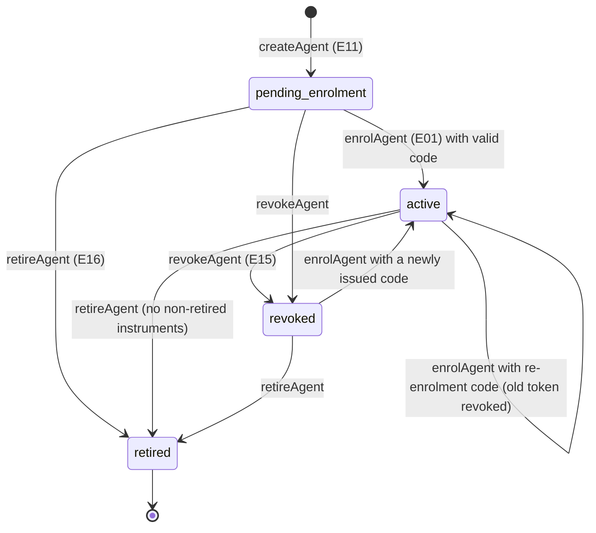
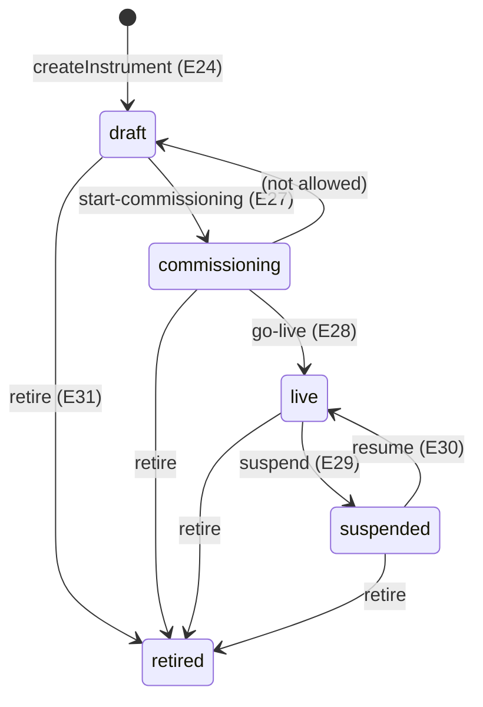
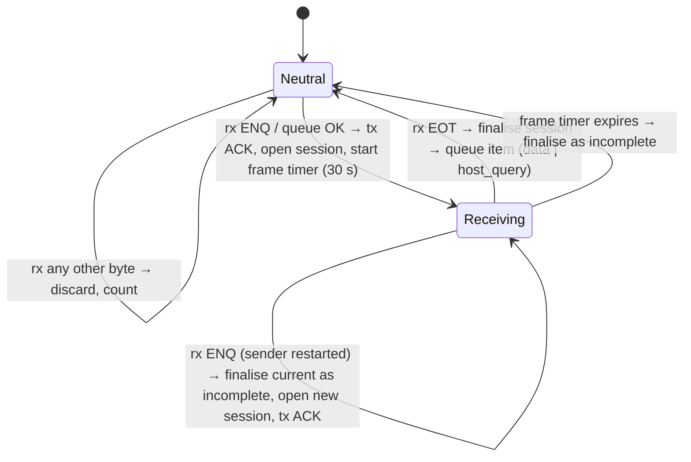
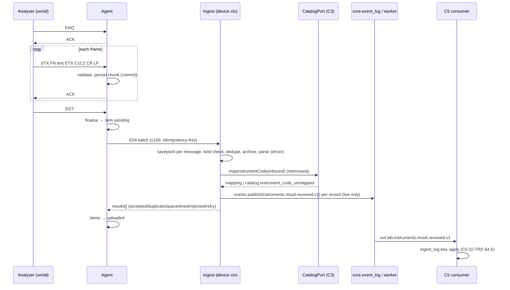
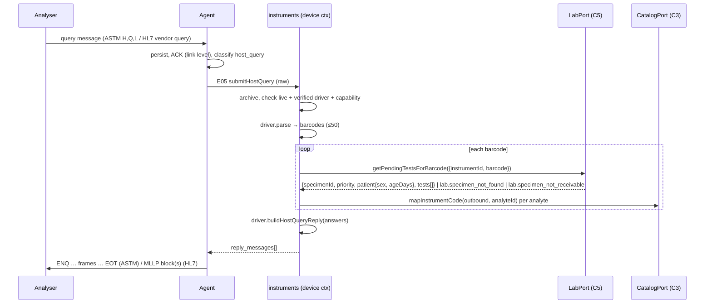
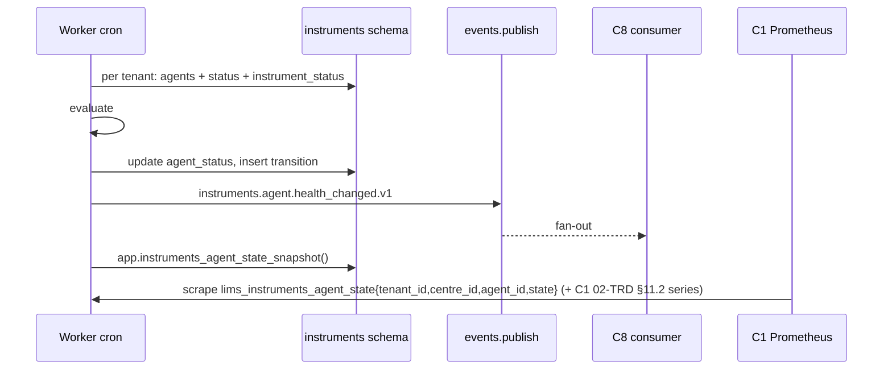
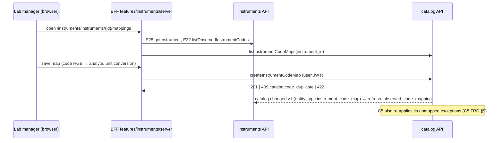

# C7 Instrument Integration — 03 App Flow (state machines, flows, sequences, edge cases)

Status: DECISION, 2026-11-06. Names follow 03-IC / 02-CV verbatim; CR-marked items are designed as if accepted (02-TRD §16). Endpoint numbers E01–E42 refer to 02-TRD §7. Timer defaults: 02-TRD §5.2.4 — [CONV] configurable defaults, BC-LIS vendor implementation used as reference only (08 A13 D-41).

---

## 1. Flow index

| Flow | Actor | Operations | Cross-chunk |
|---|---|---|---|
| F-01 Register agent + enrolment code | lab_manager (aal2) | E11, E14 | — |
| F-02 Install + enrol | site installer, agent | CLI `install`, E01, E02 | — |
| F-03 Revoke / re-enrol / retire | lab_manager | E15, E14, E01, E16 | — |
| F-04 Configure instrument | lab_manager | E24, E26 | config → agent (E03/E02) |
| F-05 Commissioning lifecycle | lab_manager | E27–E31 | — |
| F-06 ASTM receive → upload → ingest → events | instrument, agent, device | link layer, E04 | C3 port, C5/C9/C10/C12 events |
| F-07 HL7/MLLP receive → upload → ingest | same | E04 | same |
| F-08 Host query | instrument, agent, device | E05 | `LabPort.getPendingTestsForBarcode`, `CatalogPort.mapInstrumentCode` |
| F-09 File drop attachment | agent, worker | E06, task `scan_attachment` | `ctx.uploads`/`ctx.files.scan`/`ctx.storage` (CR-C2-011; 08 R12b), bucket `instruments-attachments`, C5 event |
| F-10 Heartbeat + commands | agent | E03, E07 | — |
| F-11 Health evaluation | worker | cron | `instruments.agent.health_changed.v1` → C8; metrics → C1 |
| F-12 Signed config apply | agent | E02 | — |
| F-13 Self-update | agent, launcher | E02, E08 | — |
| F-14 Code mapping | lab_manager | E32 + C3 #92–#95 | C3 HTTP (X4), `catalog.changed.v1` |
| F-15 Message browse / raw / attachment download | lab staff | E33–E37 | access_log; E37 streams through the API (08 A13 P-2) |
| F-16 Reprocess / re-match | lab_technologist | E38, E39 | `LabPort.ingestInstrumentResult` (X2), events |
| F-17 Archive purge | worker (per tenant) | cron | `IdentityPort.getTenantSettings` (`retention`), Storage |

---

## 2. Server-side state machines

### 2.1 Agent (`instruments.agents.status`)



| # | From → To | Trigger | Guard | Side effects | Events |
|---|---|---|---|---|---|
| A1 | ∅ → pending_enrolment | E11 | centre visible, active, `centre_kind ∈ {own, franchise}`; unique `agent_code` | insert `agents`, `agent_status` (health `offline`, version 1), config version 1 (empty instruments) | — |
| A2 | pending_enrolment → active | E01 | credential kind `enrolment_code`, status `active`, unexpired | code → `used`; new `device_token` credential; `enrolled_at`; status host/agent versions | — |
| A3 | active → active | E01 with a code issued while active | same | previous active token → `revoked`, `replaced_by_credential_id` = new token; access_log `device_credential.issue` | — |
| A4 | pending/active → revoked | E15 | `If-Match` | every `active` credential → `revoked` (reason); `revoked_at/by` ; access_log `device_credential.revoke`; health stays as computed (agent will go offline) | health_changed only via evaluator |
| A5 | revoked → active | E01 with new code | code issued after revocation | as A2 | — |
| A6 | * → retired | E16 | no instrument with state ≠ `retired` (`instruments.agent_has_active_instruments`) | all credentials revoked; `agent_status` excluded from evaluator and metrics | — |
| — | forbidden | e.g. E14 on retired → `409 instruments.agent_not_active`; E15 on retired → `409 instruments.invalid_transition` | | | |

### 2.2 Instrument commissioning (`instruments.instruments.state`)



| # | Transition | Guard | Side effects |
|---|---|---|---|
| I1 | ∅ → draft | agent not retired; driver active; `sketch_blocked` driver only if `LIMS_INSTRUMENTS_ALLOW_SKETCH_DRIVERS`; capabilities ⊆ driver capabilities; `worklist_download=false` while no `verified` driver declares it (B2) | insert instrument + `instrument_status`; **no** config version (draft not shipped) |
| I2 | draft → commissioning | transport valid; driver active | new config version for the agent (instrument included) |
| I3 | commissioning → live | driver `status = verified` (`instruments.driver_not_available`); checklist 4 × true + `evidence_note` (`instruments.go_live_checklist_incomplete`) | store checklist, `live_at/by`; new config version (state field) |
| I4 | live → suspended | reason 3–300 chars | new config version; ingest runs become `shadow` |
| I5 | suspended → live | driver still `verified` | new config version |
| I6 | any non-retired → retired | reason | new config version (instrument removed); ask user (UI) to deactivate C3 maps (C3 03-APP-FLOW E23) |
| — | anything else | `409 instruments.invalid_transition` | |

Every PATCH (E26) on a non-draft instrument that changes `transport`, `protocol_options`, `file_drop`, `capabilities`, `driver_code`, `timezone`, `qc_sample_id_patterns` creates a new config version in the same transaction (AC-03.5). `parser_options`, monitoring fields and display fields are server-only (no new version).

### 2.3 Credential (`instruments.agent_credentials.status`)

`active → used` (enrolment code redeemed) · `active → expired` (cron, enrolment codes only) · `active → revoked` (E15, E16, A3, issuing a new enrolment code revokes unused earlier codes) · terminal: `used`, `expired`, `revoked`.

### 2.4 Agent health (`instruments.agent_status.health_state`) — evaluator (cron every minute)

Inputs per non-retired agent: `last_heartbeat_at`, reported `queue_depth`, `oldest_pending_age_seconds`, its live instruments' `last_message_at` + silence settings, now, tenant timezone, agent `backlog_threshold` (or tenant default), tenant `backlog_max_oldest_pending_seconds`.

```
if last_heartbeat_at is null or now - last_heartbeat_at > 3 × 60 s           → offline
elif queue_depth > backlog_threshold or oldest_pending_age > max_oldest        → backlog
elif any live instrument with silence_window_minutes set, local time inside
     [silence_active_from, silence_active_to) (or all day if unset), and
     now - coalesce(last_message_at, live_at) > silence_window_minutes          → degraded (silent_instrument_ids)
else                                                                           → online
```

On change (computed ≠ stored): `health_version += 1`, update `agent_status.health_state/state_changed_at/silent_instrument_ids`, insert `agent_health_transitions`, publish `instruments.agent.health_changed.v1` (`from_state`, `to_state`, `last_heartbeat_at`, `agent_version`, `queue_depth`, `clock_offset_seconds`, `silent_instrument_ids`). `last_heartbeat_at` is required by the event schema — for a never-heartbeated agent the evaluator does **not** emit (state stays `offline` from creation; first transition is offline → online on first heartbeat). The heartbeat handler itself never changes `health_state` (single writer = evaluator, no race), except it returns the stored state.

### 2.5 Agent command (`instruments.agent_commands.state`)

`queued → delivered` (first heartbeat response carrying it) → `completed | failed` (agent `command_results`) · `queued|delivered → expired` (24 h, cron). A `delivered` command is re-sent in each heartbeat response until a result arrives (agent dedupes by `command_id`).

### 2.6 Attachment (`instruments.attachments.scan_state`)

`pending → clean | quarantined | failed`; `failed → pending` (worker retry within attempts); `clean`, `quarantined` terminal.

### 2.7 Processing run outcomes (append-only, not a machine)

Per message the **latest run** defines the displayed status: `parsed`, `shadow`, `quarantined`, `rejected_capability`, `preview` (never stored). Runs kinds: `live`, `reprocess`, `rematch`, `attachment_scan`.

---

## 3. Agent state machines

### 3.1 ASTM receiver (instrument → agent)



Rules:
1. "Persist chunk (commit)" = SQLite transaction with `synchronous=FULL` inserting the encrypted frame text into `session_chunks` and updating `sessions.expected_fn` — completed **before** the ACK byte is written (D-02; AC-05.2).
2. Finalise = one SQLite transaction: decrypt + concatenate chunks, compute `raw_sha256`, classify (02-TRD §5.3), insert `items` (state `pending`), delete chunks, delete session.
3. A finalised `host_query` item triggers the host-query relay (§3.4) immediately.
4. Restart recovery: on start, every open session is finalised as `incomplete` with `incomplete_reason = process_restart` **unless** its last chunk is an `L` record ending with ETX, in which case it is finalised normally (the instrument already saw all ACKs; only EOT was lost). The instrument may re-send; server dedupe handles it (AC-05.7).
5. Bytes received while the agent itself is sending (contention aside) are handled by §3.2.

### 3.2 ASTM sender (agent → instrument; host-query replies, future worklists)

```mermaid
stateDiagram-v2
  [*] --> Neutral
  Neutral --> Establishing: outbound pending and not in defer/backoff → tx ENQ, timer establish_reply_s (15 s), attempts++
  Establishing --> Transfer: rx ACK → FN=1, tx frame 1, timer transfer_reply_s (15 s), sends=1
  Establishing --> NakWait: rx NAK → wait nak_retry_delay_s (10 s)
  NakWait --> Establishing: timer → tx ENQ (if attempts < max_establish_attempts else Giveup)
  Establishing --> Receiving: rx ENQ (contention) → defer: set defer_until = now + 20 s, handle as receiver (§3.1 tx ACK)
  Establishing --> Terminate: establish timer expires → tx EOT
  Transfer --> Transfer: rx ACK → next frame (FN+1 mod 8), sends=1, restart timer
  Transfer --> Transfer: rx NAK / other char → resend same frame, sends++ (if sends < 6)
  Transfer --> Terminate: sends reaches 6 without ACK → tx EOT (retain message)
  Transfer --> Terminate: transfer timer expires → tx EOT (retain message)
  Transfer --> Interrupted: rx EOT (receiver interrupt) → tx EOT, backoff 15 s, retain whole message
  Transfer --> Done: rx ACK for last frame → tx EOT
  Done --> Neutral: outbound row → sent
  Terminate --> Neutral: outbound attempts++, next try after outbound_retry_cycle_s (60 s)
  Interrupted --> Neutral
  Giveup --> Neutral: outbound row → failed after max_outbound_cycles (default 3 [CONV], 02-TRD §5.2.4); counter + heartbeat error
```



Rules:
- `defer_until` (20 s) ends early when the instrument's message completes (`EOT` received) — BC-LIS contention rule; the agent then re-establishes.
- Frame building: each record → frames ≤ 240 text chars; ETB intermediate, ETX final (02-TRD §5.2.2).
- A retained message is always re-sent from frame 1 in a new transfer phase [CONV].
- Host-query replies older than the profile's `ReplyTimeout` (instrument has stopped waiting — UNVERIFIED per model, default 30 s [CONV]) are not sent; marked `failed` with `reply_expired`.

### 3.3 MLLP

Receiver (per TCP connection):

```mermaid
stateDiagram-v2
  [*] --> WaitStart
  WaitStart --> InBlock: rx 0x0B
  WaitStart --> WaitStart: rx other → discard, mllp_discarded_bytes++
  InBlock --> InBlock: rx byte → append (size ≤ max_message_bytes else Reset)
  InBlock --> InBlock: rx 0x0B → previous partial → incomplete(new_start_block), restart buffer
  InBlock --> SawFS: rx 0x1C
  SawFS --> Persist: rx 0x0D
  SawFS --> InBlock: rx other → append 0x1C + byte (literal)
  Persist --> WaitStart: commit item → tx ACK (AA/CA) per §02-TRD 5.4 ; commit fails → tx AR/CR
  InBlock --> Reset: size exceeded → close connection, mllp_oversize++
  Reset --> WaitStart: on reconnect
```



- MSH unparseable at Persist → store as `incomplete` (`msh_unparseable`), no ACK.
- Connection closed mid-block → partial stored as `incomplete`.
- TCP client mode: reconnect with backoff 1 s → `reconnect_max_backoff_s`; TCP server mode: accept only `allowed_peers`, one connection per instrument (a second connection replaces the first [CONV]).

Sender (host-query replies): `Idle → Sent` (write block) `→ WaitAck` (timer `ack_timeout_s` 10 s) `→ Idle` on ACK with matching MSA-2 (outbound `sent`); timeout → resend up to `send_retries` (3) → `failed`. Profiles with `ExpectAckOnReply=false` go straight to `sent`.

### 3.4 Host-query relay (agent)

1. Query item finalised (§3.1/§3.3). For HL7 the ACK has already been sent on commit.
2. If `auth_state = rejected` or the server was unreachable in the last 30 s → no reply (AC-10.6), counter `host_query_unavailable`.
3. Call E05 with the query bytes (uses the reserved 20/min budget). Timeout = profile `ReplyTimeout` − 1 s.
4. `200` → enqueue each `reply_messages[i]` into `outbound` (encrypted) → sender (§3.2/§3.3). `422`/`404`/`403` → no reply, log code. E05 carries an `Idempotency-Key` (required, 08 A13 P-8) reused on retry.
5. The query item (kind `host_query`) follows one rule (02-TRD §5.7 "Host-query items"; review #23): `200` or a 4xx other than `401`/`429` → marked `uploaded` (the server archived or rejected it); no response, `5xx` or `429` → stays `pending` and is uploaded later in a normal batch as `kind = host_query` (server §6.4 step 9; `duplicate` if E05 had stored it); `401` → auth rule (02-TRD §5.7), stays `pending`. It is never archived twice.

### 3.5 Upload item (`items.state`)

`pending → uploading` (in a batch) `→ uploaded` (accepted/duplicate/quarantined) | `pending` (retry, network error) | `rejected` (rejected outcome) ; `rejected → pending` once when the applied config version increases; `oversize` set at capture when size > 1 MiB (never uploaded; operator sees it; `diagnostics` reports it); `uploaded → (deleted)` after retention.

### 3.6 Update (agent + launcher)

`idle → downloading → verifying → staged → applying → idle (new version healthy)`; failures: `verifying → verify_failed`, `applying → rolled_back`, download error → `failed` (retry next config check, max 3/day [CONV]).

---

## 4. Flows

### F-01 Register agent + enrolment code
1. Manager opens `/instruments/agents` → "New agent" form → E11 (Idempotency-Key from BFF). Server: load centre via `ctx.core.centre` (404 if invisible), check kind/active, `assertRole(instruments.agent.manage, centreId)`, insert.
2. Manager presses "Issue enrolment code" → confirm dialog → E14. Server: revoke unused earlier codes, `randomToken(16)`, store SHA-256, access_log `device_credential.issue`, return code once.
3. UI shows `SecretRevealOnce` with `requireAcknowledgement` (CR-C7-010, 08 §4.6); closing requires the "copied" checkbox. The code is never retrievable again.

### F-02 Install + enrol (site)
1. Installer (Administrator) runs `bridge-agent.exe install --server https://<api origin> --enrolment-code lmse_…`.
2. The installer: verifies its own Authenticode signature (release builds; the client's certificate — founder decision 2026-11-06), creates `C:\Program Files\LIMS\BridgeAgent\` (copies launcher + first version), creates data dirs with ACLs (02-TRD §5.12), writes `config.local.json` (server URL, optional proxy), registers the service with the virtual account.
3. Before starting the service, the installer process calls E01 with the code (it has network access; the token must be wrapped under the **service account's** DPAPI scope → DECISION: the installer starts the service in "enrol" mode passing the code via a one-time file `secrets\enrol.code` (ACL service + Administrators) that the service reads, uses and deletes; the service performs E01 and wraps the token itself). UNVERIFIED-dependent: if user-scope DPAPI is unavailable for the virtual account, machine scope + ACL (02-TRD §5.6).
4. Service on success: stores token, deletes `enrol.code`, calls E02, applies config, sends first heartbeat → evaluator moves health offline → online within ≤ 60 s.
5. `install` waits up to 120 s polling `status.json` and prints the result (enrolled / failed with error code). Failure on `401` → "Enrolment code invalid or expired — ask your lab manager for a new code."

```mermaid
sequenceDiagram
  participant M as Lab manager (web)
  participant API as instruments API
  participant I as Installer (admin)
  participant S as Agent service
  M->>API: E11 createAgent
  M->>API: E14 issueEnrolmentCode
  API-->>M: lmse_… (once)
  M-->>I: code (out of band, typed/pasted on the PC)
  I->>S: install, write enrol.code, start service
  S->>API: E01 enrolAgent (Bearer lmse_…)
  API->>API: resolver (DEFINER) → code active → tx: code used, token created, agent active
  API-->>S: device_token (once)
  S->>S: DPAPI wrap token; delete enrol.code
  S->>API: E02 getAgentConfig (Bearer lmsd_…)
  S->>API: E03 heartbeat
```

### F-03 Revoke / re-enrol / retire
- Revoke (E15): confirm dialog with reason code → all credentials revoked. The agent's next call gets `401`; it sets `auth_state = rejected`, stops uploads, keeps receiving from instruments (data still persisted locally and ACKed — results are not lost), and retries heartbeat every 5 min. Status shows "Not authorised — re-enrol".
- Re-enrol: E14 → `bridge-agent enrol --code lmse_…` (admin CLI writes `enrol.code`, signals service) → A3/A5. Pending local items upload afterwards (they were captured under the same `agent_id`).
- Move to a new PC: install on the new PC with a new code (A3). The old PC's token is revoked automatically; its un-uploaded items are lost unless uploaded first → UI warning on E14 when `queue_depth > 0` ("This agent still has N messages waiting. Re-enrolling another PC will stop this PC from uploading them.").
- Retire (E16): only after instruments retired.

### F-04 Configure instrument
1. Manager: `/instruments/instruments` → New → form (04-UI-UX SCR-06). Driver select shows `listDrivers` with status badges; transport form switches by kind.
2. E24 → server validates schemas (02-TRD §5.8), driver options (`optionsSchema`), capabilities vs driver; state `draft`.
3. Edits (E26) with If-Match; config version bump rules §2.2.
4. Agent learns of a new config through `latest_config_version` in the next heartbeat (≤ 60 s) and fetches E02 (F-12).

### F-05 Commissioning
1. Start commissioning (E27) → agent opens the port within ≤ 60 s + fetch.
2. Site sends test/QC samples; messages appear in the browser with outcome `shadow`; manager reviews records, adds code maps (F-14), compares values to the instrument printout (manual step).
3. Go live (E28) with checklist and evidence note. From the next message, events are emitted.

### F-06 ASTM result end to end



### F-07 HL7 result
Same as F-06 with MLLP framing; the ACK is sent after the item commit (AC-07.2/07.3). Message key = MSH-10 (D-12 on reuse).

### F-08 Host query



C5 performs S6 pick-up (`in_process`) inside `getPendingTestsForBarcode` (C5 02-TRD §8); that write commits with C7's request transaction. If C7's transaction fails afterwards, C5's pick-up rolls back with it (ports run in the caller's tx — 02-CV §8.1). A retried query (same `agent_message_id`) or a byte-identical re-query under a new id is deduped per 02-TRD §6.6 step 1 (no unique-constraint error, reply rebuilt).

### F-09 File drop

```mermaid
sequenceDiagram
  participant FS as Export folder
  participant Ag as Agent
  participant API as instruments
  participant St as Storage (ctx.storage, bucket instruments-attachments)
  participant W as Worker scan_attachment
  participant C5 as C5
  FS->>Ag: new file (poll)
  Ag->>Ag: stable 5 s → read, sha256, encrypted item, seen-row
  Ag->>API: E06 multipart (metadata + file)
  API->>API: bind check, sha256, dedupe (message key = file_sha256)
  API->>St: ctx.uploads.accept → {tenant}/q/yyyy/mm/id.ext (magic bytes, size, PNG/JPEG re-encode without metadata)
  API->>API: messages + attachments(pending) + record(pending_scan); enqueue scan
  API-->>Ag: 202 accepted
  W->>St: scan (+ qpdf sanitise for PDF)
  alt clean
    W->>St: move to {tenant}/yyyy/mm/id.ext
    W->>W: scan_state clean, run attachment_scan
    W->>C5: instruments.result.received.v1 (record_kind attachment) if live + barcode
  else hit
    W->>W: quarantined, alert
  end
```

Viewing: SCR-10 "Open" → BFF → E37 `downloadInstrumentAttachment` → API reads the object (`ctx.storage.read`) and streams it with `Content-Disposition: attachment`, `nosniff`, `no-store`; `access_log` `instrument_message.attachment_view`. The browser never receives a Storage URL (08 A13 P-2). The `scan_attachment` run inserts a new `message_records` row with the final `emit_status` (records are append-only).

### F-10 Heartbeat + commands
1. Every 60 s (±2 s jitter [CONV]) agent → E03. Server: upsert `agent_status` (versions, queue, disk, offset, config/update/auth state, `last_heartbeat_at = now`, `last_ip`), upsert `instrument_status` link fields for listed instruments of this agent (others ignored), apply `command_results` (state machine §2.5), select up to 5 `queued`/`delivered` commands → mark `delivered`.
2. Response: `server_time`, `latest_config_version`, stored `health_state`, commands.
3. Agent executes commands: `refresh_config` (F-12 now), `restart_service` (graceful: finish sessions ≤ 60 s, exit; SCM recovery restarts), `upload_logs` (E07 with the last 24 h redacted lines), `reupload_since` (all retained `uploaded` items with `captured_at_agent ≥ since` → `pending`).

### F-11 Health evaluation
Cron each minute, one job per tenant (`tenantScope: 'per_tenant'`, 08 A13 P-6): one query joining `agents` (non-retired) ⋈ `agent_status` ⋈ live instruments' `instrument_status`; evaluate (§2.4); write changes + events. Separately `export_agent_state_metrics` sets gauges from `app.instruments_agent_state_snapshot()`.



### F-12 Signed config apply (agent)
1. Heartbeat shows `latest_config_version > applied` (or command `refresh_config`) → E02.
2. Verify (02-TRD §5.10). Fail → keep old, report state.
3. Diff instruments: closed/removed → finish active session (≤ 30 s) then close port; changed transport → reconnect; new → open.
4. Persist applied document in `kv`; heartbeat reports new `applied_version`; rejected items get one retry (§3.5).

### F-13 Self-update — see 02-TRD §5.11; states §3.6.

### F-14 Code mapping (X4)



The BFF calls C3's code-map operations only when the session user holds `catalog.instrument_code_map.manage` (C3 enforces it too; it is privileged → aal2 step-up on save, 08 A13 D-18); without it the Mappings panel is not rendered and no C3 call is made (D-39). C7 adds nothing to C3 data and never writes `catalog.*`.

### F-15 Browse / raw
- List E33 (range required); barcode search E34 (POST body). Detail E35; if `records_expired`, "Show parsed preview" calls E35 `?preview_parse=true` (parse in memory, nothing stored).
- Raw (E36) → `access_log` `instrument_message.raw_view` in the same transaction; the UI keeps raw in memory only while the panel is open.
- Attachment (E37, clean only) → streamed download, `access_log` `instrument_message.attachment_view`; non-clean → `422 common.upload_quarantined`.

### F-16 Reprocess / re-match

```mermaid
sequenceDiagram
  participant T as Technologist
  participant I as instruments API (user ctx)
  participant L as LabPort.ingestInstrumentResult (C5)
  participant E as events.publish
  T->>I: E39 rematch {sample_barcode, reason}
  I->>I: assertRole(message.rematch, centre); new run(rematch), derived record, new key
  I->>L: ingestInstrumentResult(input)
  L-->>I: {outcome, resultId?, reasonCode?}
  I->>E: instruments.result.received.v1 (processing_kind rematch)
  I->>I: access_log instrument_message.rematch
  I-->>T: outcome per record
  Note over E: C5 consumer sees duplicate key → no-op; C9/C10/C12 receive it
```

### F-17 Archive purge — 02-TRD §10 `purge_archive`, one job per tenant (08 A13 P-6/D-42): read `retention.rawInstrumentYears` (IdentityPort, system ctx) → delete expired Storage objects (`ctx.storage.delete`, P-12 (b)) and mark their paths `#deleted` → `app.purge_instruments_archive(rawInstrumentYears × 366)` deletes only that tenant's expired rows. Storage objects are deleted before rows; failures are retried next night (rows remain until objects are gone).

---

## 5. Screen states (summary; details 04-UI-UX)

| Screen | Empty | Loading | Error | Success | Permission denied |
|---|---|---|---|---|---|
| SCR-01 Agents list | "No agents yet. Create one for each lab PC that connects analysers." + New (if manage) | table skeleton | `ErrorState` + retry + reference | table | shell forbidden (`core.shell.forbidden`) |
| SCR-02 Agent detail | n/a | detail skeleton | 404 → `core.shell.not_found` | detail | forbidden; manage buttons hidden without `instruments.agent.manage` |
| SCR-03 Enrolment code dialog | — | button `isLoading` | toast danger with code | `SecretRevealOnce` | `auth.mfa_required` → banner "Confirm with your authenticator to continue" (C2 step-up link) |
| SCR-05 Instruments list | "No instruments registered." | skeleton | ErrorState | table | forbidden |
| SCR-06/07 Instrument form/detail | — | form skeleton | field errors via `Form problem` | toast "Saved. The agent picks this up within a minute." | read-only form |
| SCR-08 Mappings | "No codes seen yet. Codes appear here after the instrument sends results in commissioning." | skeleton | C3 error mapped to form | toast | without `catalog.instrument_code_map.manage`: Mappings panel hidden, text "Mappings are visible to users who can manage them", observed codes read-only (08 A13 D-39) |
| SCR-09 Messages list | "No messages in this period." | skeleton | ErrorState | table | forbidden |
| SCR-10 Message detail | records empty → "This message has no result records." | skeleton | 404 | detail | reprocess buttons hidden without `instruments.message.rematch` |
| SCR-11 Settings | — | skeleton | ErrorState | toast | read-only |

---

## 6. Edge cases

| # | Case | Handling |
|---|---|---|
| E1 | Agent offline for days | Instruments keep being ACKed (local persist); queue grows; health `offline` → C1 alert; drain on reconnect (AC-08.5); disk guard at 500 MB → NAK (results stay on the instrument) |
| E2 | Duplicate batch (network cut after server commit) | same Idempotency-Key → replay; changed batch → agent-key dedupe → `duplicate` |
| E3 | Same result re-sent in a new message (instrument resend) | result-level key → `core.event_log` duplicate → `emit_status = duplicate_event`; C5 ingest_log duplicate anyway |
| E4 | Rerun of a sample (new instrument time) | different key → new event; `is_rerun` per driver; C5 applies per its rules (R3 / exception) |
| E5 | Instrument result time missing | key part `'none'` (03-IC §3.14); two genuinely different results without time and same code+barcode collide → second becomes `duplicate_event` → visible in browser; mitigation: driver should extract a time; documented risk (06 R7) |
| E6 | Instrument clock wrong by years | stored as sent; offset metric/alert; C5 uses server time for TAT (06-GLOSSARY) |
| E7 | Same MSH-10 reused after restart | D-12 |
| E8 | Agent clock wrong | `captured_at` corrected by offset; offset uncertainty stored |
| E9 | Two API instances process overlapping batches from one agent | unique constraints (agent key, message key) — the loser's insert conflicts → `duplicate`; no double events (event_log unique) |
| E10 | Concurrent edits of an instrument | If-Match → `409 common.version_conflict` |
| E11 | Config change while a transfer is in progress | agent finishes the session (≤ 30 s) before reconfiguring the port |
| E12 | Instrument moved to another agent | not allowed (agent_id immutable) → retire + create; maps in C3 are per instrument id → recreate via bulk upsert (UI offers "copy maps from instrument X") |
| E13 | Barcode belongs to a specimen of another centre | event still emitted (C7 doesn't know); C5 matches by tenant + barcode per its rules; host query (device RLS) returns `not_found` (C5 P-09) |
| E14 | Unmapped code on a live instrument | event `unmapped`; C5 exception; observed code shows "Unmapped"; map → C5 re-applies |
| E15 | Driver bug discovered | fix driver (version bump); reprocess affected quarantined/shadow messages; already-emitted wrong values are corrected by C5 workflows (not by C7) — reprocess re-emits only new keys |
| E16 | Malformed / hostile payloads (fuzz) | schema validation, size caps, savepoint isolation, quarantine with raw kept (REQ-SEC-121) |
| E17 | Token stolen and used from elsewhere | `last_ip` change + heartbeat from two IPs alternating → UI warning (Agent DTO `health.last_ip`, `last_ip_changed_at`) [CONV]; revoke |
| E18 | Enrolment code intercepted | single use, 24 h TTL, A3 revokes the previous token only when the same agent re-enrols; manager sees enrolment time/host fingerprint |
| E19 | Retired instrument still sending | agent closed the port (not in config); if old agent version sends anyway → `rejected` |
| E20 | Host query arrives while server slow | agent timeout before profile `ReplyTimeout`; no reply; instrument behaviour per vendor (UNVERIFIED) |
| E21 | Host query rate exceeds reserved budget | agent queues further queries up to `ReplyTimeout`, then gives up (counter); risk 06 R5 |
| E22 | Attachment without barcode | record `skipped_no_barcode`; appears in "Needs re-match" filter; re-match provides barcode |
| E23 | Attachment scanner down | `failed` after 5 attempts → alert; a later re-scan is triggered by reprocess |
| E24 | Restore from backup lost last 15 min (04 I2) | ops issues `reupload_since` to every agent; dedupe absorbs the rest |
| E25 | Clock-offset sign confusion | single formula in `domain/instrumentTime.ts` + Go `internal/clock`; shared vectors |
| E26 | Approved result re-sent by instrument | C5 → `rejected_state`/`result_locked` (no change) |
| E27 | Partial ASTM message then process kill | §3.1 rule 4 |
| E28 | Duplicate retransmitted frame with different text but same FN | treated as retransmit by FN rule (BC-LIS) → ACK, not appended; text difference logged as warning counter (possible line noise) [DECISION] |
| E29 | Purge vs ongoing reprocess of an old message | purge deletes only the tenant's rows older than `rawInstrumentYears × 366` days; reprocess of a message within 1 day of expiry is allowed; if the row is gone mid-request → 404 |
| E30 | Tenant suspended | IdentityPort rejects device and staff calls (`identity.tenant_suspended`); the agent treats `403 identity.tenant_suspended` like 401 for uploads (backs off, keeps data); other 403 codes (e.g. `instruments.device_mismatch` on E05/E06) are per-item rejections and do not stop other uploads |
