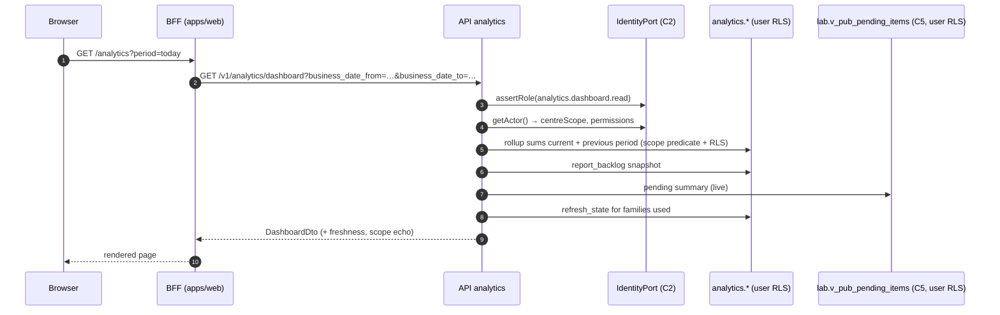
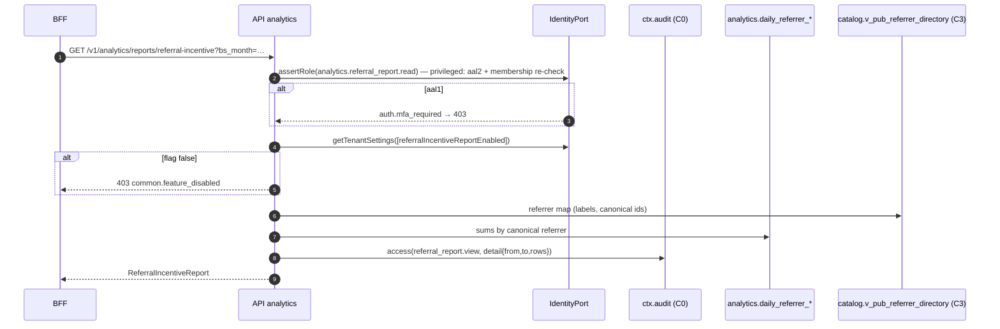

# C8 Analytics & MIS — 03 App Flow

Status: DECISION, 2026-11-06. Operation ids, fields and codes are those of `02-TRD.md` §5; metric ids those of `01-PRD.md` §8. Screens are specified visually in `04-UI-UX.md`.

## 1. Screen and flow inventory

| # | Screen / flow | Route (routes.yaml id) | Operations | Permission |
|---|---|---|---|---|
| S1 | Owner dashboard | `/analytics` (`staff.analytics.dashboard`) | `getAnalyticsDashboard`, `getAnalyticsFreshness`, `getPendingTestsSummary`, `requestAnalyticsRefresh`, `getAnalyticsFilterOptions` | `analytics.dashboard.read` |
| S2 | Report hub (tabs) | `/analytics/reports` (`staff.analytics.reports`, CR-C8-008) | — (links; the Collections tab links to S2b) | `analytics.dashboard.read` (08 A17 D-46) |
| S2b | Collections history | `/analytics/collections` (`staff.analytics.collections`, 08 A17 D-46) | `getCollectionsReport` (#4), `getCollectionsFilterOptions` (#30), `createAnalyticsExport` | `analytics.collections.read` (finance reaches it without `analytics.dashboard.read`) |
| S3 | Report page `/analytics/reports/{report_code}` for `income`, `department-income`, `volume`, `top-referrers`, `top-centres`, `tests-done`, `tat`, `pending-tests`, `quality-indicators`, `delivery`, `interfaces` | in-segment (not a routes.yaml entry) | the matching `get*Report` / `listPendingTests`; `searchAnalyticsReferrers`; `createAnalyticsExport` | per report registry (TRD §3.3) |
| S4 | Referral business report | `/analytics/referral-incentive` (`staff.analytics.referral_incentive`, CR-C8-008) | `getReferralIncentiveReport`, `createAnalyticsExport` | `analytics.referral_report.read` + tenant flag |
| S5 | My exports | `/analytics/exports` (`staff.analytics.exports`) | `listAnalyticsExports`, `getAnalyticsExport`, `downloadAnalyticsExport` | `analytics.data.export` |
| S6 | Schedules list / editor | `/analytics/schedules`, `/analytics/schedules/new`, `/analytics/schedules/{schedule_id}` (`staff.analytics.schedules`) | `listReportSchedules`, `createReportSchedule`, `getReportSchedule`, `updateReportSchedule`, `deactivateReportSchedule`, `getAnalyticsFilterOptions` (`recipients` list, present only with `analytics.schedule.manage`; 08 A17 D-47) | `analytics.schedule.manage` |
| S7 | Report run landing (from email) | `/analytics/report-runs/{report_run_id}` (`staff.analytics.report_run`) | `getReportRun`, then the report operations with the run's period | `analytics.dashboard.read` + recipient/owner |
| F1 | Event → dirty → refresh | worker | consumers, `analytics.refresh_tenant` | system |
| F2 | Sweeps, self-check, purge | worker cron | `analytics.sweep_recent`, `sweep_nightly`, `self_check`, `purge` | system |
| F3 | Export build | worker | `analytics.build_export` | system (requester re-validated) |
| F4 | Schedule dispatch | worker cron | `analytics.dispatch_schedules` | system |

## 2. Common page flow (S1, S2b, S3, S4)

1. Page server component calls the BFF server function for the operation with the URL's period/scope params (from the page's search params: `period`, `from`, `to`, `bs_month`, `fy`, `centre`, `branch`, `group_by`, … — **ids, codes and dates only**, REQ-SEC-098).
2. BFF → API with the session bearer token (CV §6). API: `assertRole` → `resolvePeriod` → `resolveScope` → service → mapper.
3. Response → page renders: header (title, period in A.D. and B.S., scope chips, freshness badge per family), filter bar, content (tiles/charts/tables), help panel.
4. Changing a filter updates the URL (shallow navigation) and re-fetches; the previous content stays visible with a loading overlay until the new data arrives (no blank flash).
5. Dashboard auto-refresh: every 5 min [CONV] while the tab is visible (`document.visibilityState`), never faster. Report pages do not auto-refresh.
6. "Export" button (shown only with `analytics.data.export`) → Export dialog (format, confirm) → `createAnalyticsExport` with a fresh `Idempotency-Key` (UUIDv7 generated in the BFF per dialog open, reused on retry) → toast "Export queued" + link to S5.
7. Unknown `report_code` in the URL → Next.js `notFound()` (404 page); API `analytics.report_unknown` never reached from the UI.

### 2.1 Period resolution in the UI

| Preset | Request params |
|---|---|
| Today / Yesterday | `business_date_from`, `business_date_to` computed in the BFF from the server clock in Asia/Kathmandu |
| This / last B.S. month | `bs_month=YYYY-MM` (BFF computes the current B.S. month with `adToBs(today)`) |
| This / last fiscal year | `fiscal_year_bs=YYYY/YY` (`fiscalYearBs(today).long`, previous = startsOn − 1 day) |
| This / last A.D. month | `business_date_from`/`_to` (first of month, first of next month) |
| Custom | `DateRangePicker` (calendar A.D./B.S. toggle); value is A.D.; `to` sent as picked end + 1 day (exclusive) |

The response `period` echo (both calendars) is what the header displays — the UI never formats a B.S. date it computed itself for the header.

## 3. Cross-chunk sequences

### 3.1 Event → dirty → refresh (F1)

```mermaid
sequenceDiagram
  autonumber
  participant C4 as C4 billing (producer)
  participant EL as core.event_log + fanout (C0)
  participant CON as evt.analytics.billing.invoice.issued.v1 (C8)
  participant DP as analytics.dirty_partitions
  participant Q as Graphile queue
  participant RT as analytics.refresh_tenant (C8)
  participant V as billing.v_pub_invoice_daily (C4 view)
  participant R as analytics.daily_income
  C4->>EL: publish invoice.issued (in C4 tx)
  EL->>CON: enqueue consumer job (job_key event_id:analytics)
  CON->>CON: inbox insert (dedupe event_id)
  CON->>DP: upsert (income, department_income, referrer_billing) @ bd(issued_at)
  CON->>Q: enqueue refresh_tenant(tenant) run_at now+60s, job_key per tenant
  Q->>RT: run (system actor, tenant claims)
  RT->>DP: read marks (no row locks)
  RT->>RT: per family-range tx: pg_advisory_xact_lock(tenant, family)
  RT->>V: SELECT … WHERE tenant_id=$t AND business_date in range
  RT->>R: DELETE range; INSERT rows (same tx)
  RT->>DP: delete marks with last_marked_at ≤ run start (same tx)
  RT->>RT: refresh_state upsert success (same tx; row created lazily, P-22)
```

Failure at steps 8–12: the transaction rolls back (old partition stays visible, dirty marks stay), `refresh_state.last_error_code` set in a separate tx, Graphile retries (max 5). Final failure → `core.dead_letters` (C0) + alert; the 10-minute sweep re-enqueues anyway.

### 3.2 Dashboard load (S1)



`results_approved` is centre-scoped like every other tile (CR-C8-004 accepted); `net_collected_paisa` is omitted without `analytics.collections.read` (checked by `getActor().permissions`, no extra round trip). Snapshot tiles (reports pending, pending tests) carry no previous value or delta.

### 3.3 Referral business report (S4)



### 3.4 Export request, build, download (S3/S4 → F3 → S5)

```mermaid
sequenceDiagram
  autonumber
  participant B as BFF
  participant A as API analytics
  participant IP as IdentityPort
  participant AU as ctx.audit
  participant X as analytics.exports
  participant W as analytics.build_export (worker)
  participant CORE as ctx.core
  participant RP as RenderPort (C6, pdf only)
  participant F as analytics.export_files
  B->>A: POST /v1/analytics/exports {report_code, format, params} + Idempotency-Key
  A->>IP: assertRole(analytics.data.export) (aal2) ; assertRole(report permission)
  A->>X: quota check; INSERT queued (scope snapshot)
  A->>AU: access(data.export, phase=request)
  A->>W: enqueue build_export(export_id) (same tx)
  A-->>B: 202 ExportDto(queued)
  W->>X: lock row; status building
  W->>CORE: membership active? permissions? current centre scope
  alt not eligible
    W->>X: failed (auth.forbidden)
  else eligible
    W->>W: rows via reports.service (explicit scope)
    opt format = pdf
      W->>RP: renderPdf(analytics.report, data, idempotencyKey) [system actor]
      RP-->>W: PDF bytes (base64) + sha256 — C6 stores nothing (08 R12c)
    end
    W->>F: INSERT bytes + sha256
    W->>X: ready, expires_at = now+24h
  end
  B->>A: GET /v1/analytics/exports/{id} (poll every 3 s up to 2 min [CONV])
  B->>A: GET /v1/analytics/exports/{id}/file
  A->>X: downloads_used+1 where < allowed
  A->>AU: access(data.export, phase=download)
  A-->>B: file stream (attachment, no-store)
```

### 3.5 Scheduled MIS (F4 → email → S7)

```mermaid
sequenceDiagram
  autonumber
  participant CR as cron dispatch_schedules (per tenant)
  participant S as analytics.schedules
  participant RR as analytics.report_runs (+recipients)
  participant CORE as ctx.core
  participant IP as IdentityPort
  participant NP as NotificationPort (C6)
  participant E as Email relay (C6 worker, outside C8)
  participant U as Staff browser
  participant A as API analytics
  CR->>S: due schedules FOR UPDATE SKIP LOCKED
  CR->>IP: getTenantSettings(referral flag) if pack contains referral_incentive
  CR->>RR: INSERT run ON CONFLICT (schedule, slot) DO NOTHING
  loop each active recipient (schedule_recipients.is_active)
    CR->>CORE: membership active? permissions?
    alt eligible
      CR->>NP: sendEmailLink(staff, analytics.report_ready, {lab_name, schedule_name}, linkUrl=<LIMS_ORIGIN_STAFF_WEB>/analytics/report-runs/{id})
      Note over NP,IP: recipient {kind staff, membershipId, requiredPermission = analytics.dashboard.read (08 A7.6)}; C6 calls IdentityPort.getStaffNotificationContact (08 A4.2); schedule_name = label_text (08 A4.3); linkUrl = absolute staff_url (08 A13 D-29)
      NP-->>CR: {deliveryId, status}
    else
      CR->>RR: recipient skipped_ineligible
    end
  end
  CR->>S: next_run_at = next slot
  NP->>E: (async, C6) link-only email
  U->>A: (after login) GET /v1/analytics/report-runs/{id}
  A->>RR: is caller a recipient or the owner? else 404
  A-->>U: ReportRunDto (period, report codes, viewer_omitted_report_codes, effective scope)
  U->>A: GET report operations with the run's period (only codes not omitted for this viewer)
```

### 3.6 Live pending tests (S3 `pending-tests`)

```mermaid
sequenceDiagram
  participant B as BFF
  participant A as API analytics
  participant IP as IdentityPort
  participant LV as lab.v_pub_pending_items (C5 view, invoker)
  participant CT as catalog.v_pub_test_directory
  B->>A: GET /v1/analytics/reports/pending-tests/items?overdue_only=true&limit=50
  A->>IP: assertRole(analytics.dashboard.read); getActor()
  A->>LV: SELECT … ORDER BY age_seconds DESC LIMIT 51 (user tx → C5 RLS is the only centre scope, 08 A17 D-49)
  A->>CT: labels for test ids on page
  A-->>B: page of PendingItemDto (open_route_id only if lab.result.read)
```

## 4. State machines (C8-internal; not in IC §10 because no other chunk depends on them)

### 4.1 Export (`analytics.exports.status`)

| # | From | To | Trigger / guard | Side effects |
|---|---|---|---|---|
| E1 | (none) | `queued` | `createAnalyticsExport` passes authz, validation, quota | access_log `data.export` (request); enqueue `build_export` |
| E2 | `queued` | `building` | worker picks job | — |
| E3 | `building` | `ready` | file written, size/rows within caps | `export_files` row; `expires_at = now + 24 h` |
| E4 | `queued`/`building` | `failed` | requester ineligible (`auth.forbidden`), flag off (`common.feature_disabled`), caps or render output > 10 MB (`analytics.export_too_large`), final attempt error — `helpers.job.attempts >= max_attempts` (C0 SP-2 mechanism; 02-TRD §10.2 step 8a) — or a render wiring/template bug (`common.internal`) | `failure_code` set; metric |
| E5 | `ready` | `expired` | `now ≥ expires_at` or `downloads_used = downloads_allowed` (purge job) | `export_files` row deleted |
| E6 | `building` | `queued` | worker retry after a transient error (attempt < 3) | — |

Forbidden: any transition out of `failed`/`expired`; `ready → building`. CHECK + trigger in 05-SCHEMA §3.

### 4.2 Schedule (`analytics.schedules.is_active`)

| From | To | Trigger | Guard |
|---|---|---|---|
| (none) | active | `createReportSchedule` | ≤ 20 active per tenant (`LIMS_ANALYTICS_MAX_SCHEDULES_PER_TENANT`; exceeded → `400 common.validation_failed`, `errors[0].path = ''`, 08 A13 P-1); recipients eligible at creation (`analytics.recipient_ineligible` otherwise); scope ⊆ creator's scope |
| active | active (version+1) | `updateReportSchedule` | `If-Match`; same guards; `next_run_at` recomputed; a recipient removed from the list is set `is_active = false`, a re-added one is reactivated (08 A17 D-45; never deleted) |
| active | inactive | `deactivateReportSchedule` | `If-Match` |
| inactive | — | no reactivation in v1 (create a new schedule) [CONV] | — |

### 4.3 Report run recipient outcome (`analytics.report_run_recipients.outcome`)

`queued` (NotificationPort accepted) · `suppressed` (NotificationPort returned `suppressed_*`; status stored verbatim in `notification_status`) · `skipped_ineligible` · `failed` (port threw; the run continues with other recipients and the error code is stored). Set once; never changed by C8 (delivery progress is C6's).

### 4.4 Family freshness (derived, `domain/freshness.ts`)

```
never_refreshed ──(first success)──▶ fresh ──(dirty older than 20 min | last success > 30 min)──▶ stale(refresh_lagging)
fresh ──(attempt failed)──▶ stale(refresh_failed) ──(success)──▶ fresh
```

## 5. Screen states (every screen)

| Screen | Loading | Empty | Error | Permission denied | Special |
|---|---|---|---|---|---|
| S1 dashboard | `LoadingSkeleton variant='page'` | tiles show 0 with `analytics.dashboard.empty` "No activity in this period" | `ErrorState` with request id + retry | route hidden; direct URL → shell 403 page `core.forbidden` | stale badge per tile; banner `analytics.tz.fixed_nepal` if tenant timezone ≠ Asia/Kathmandu (unreachable in v1, 08 A13 P-15; defensive) |
| S3 reports | `variant='table'` | `EmptyState` `analytics.report.empty` "No data for this period and filter" + "Change period" action | `ErrorState`; `analytics.range_too_large` → inline field error on the period picker "Choose 366 days or fewer"; `common.date_out_of_range` → "Dates must be between {min} and {max}" | 403 page | `tenant_wide_sections_hidden` → `Banner tone='info'` `analytics.scope.tenant_wide_only` |
| S3 pending-tests | skeleton | `EmptyState` "No pending tests" | ErrorState; `common.dependency_unavailable` (live query timeout) → "The lab list is busy — try again" + retry | 403 | age anchor note always visible |
| S4 referral | skeleton | EmptyState "No referred orders in this period" | ErrorState | `auth.mfa_required` → `Banner tone='warning'` "Verify with your authenticator to view this report" + action → C2 step-up route; `common.feature_disabled` → 404-style page "This report is not enabled for your lab" (no hint of content) | access is logged — footer note `analytics.referral.logged` |
| S5 exports | skeleton | EmptyState "You have no exports" | ErrorState | 403 | status chips; `ready` shows Download (remaining n/3, expires at); `failed` shows reason text by code; `410` on download → toast "This export is no longer available" and row refresh |
| S6 schedules | skeleton | EmptyState "No scheduled reports" + "New schedule" | form errors mapped by JSON Pointer (`Form problem`) | 403 | `version_conflict` → dialog "Someone else changed this schedule" + reload |
| S2b collections | `variant='table'` | `EmptyState` `analytics.report.empty` | `ErrorState` (as S3) | 403 page | NULL-centre rows "No centre (credit parties)" only for all-centre users |
| S7 report run | skeleton | — | `common.not_found` → "This report link is not for your account or has expired" (same text for every not-found cause) | 403 if lacking dashboard permission | shows "Figures as of now for <period>"; renders only `report_codes` minus `viewer_omitted_report_codes` (no card that would 403) |

## 6. Edge cases

| # | Case | Behaviour |
|---|---|---|
| X1 | Duplicate event delivery | inbox dedupe; dirty upsert idempotent (PRD US-20.1) |
| X2 | `order.cancelled` before `order.created` (unordered delivery) | placeholder `order_index` row (cancelled_at set, registered_on NULL); `order.created` completes it; nightly sweep corrects counts |
| X3 | Dirty mark arrives during a refresh | survives (`last_marked_at > run_started_at`), next run processes it |
| X4 | Two refresh jobs for the same tenant | no row locks on `dirty_partitions`; a family-range is replaced by one tx at a time (advisory lock `pg_advisory_xact_lock(hashtext('analytics:'||tenant||':'||family))` [CONV] at the start of each family-range tx); marks are deleted only when `last_marked_at <= run_started_at` (02-TRD §9.3) |
| X5 | Source view changed by a CR (new grouping column) | C8 release adds the column to the rollup; `analytics.backfill` rebuilds history within retention |
| X6 | Business day boundary 18:15 UTC | same SQL expression as views (PRD US-02.6) |
| X7 | B.S. month near FY start (Shrawan 1) | FY boundaries come from `fiscalYearBs`; `bs_month` groups never cross FY incorrectly because each date maps independently |
| X8 | Invoice cancelled in a later period | negative contribution on the cancellation date; M12 can be negative for a day (shown with minus sign and tooltip) |
| X9 | Credit-party charges vs invoices | M33 counts charges on charge date, M12 counts the periodic invoice on its issue date; both notes shown |
| X10 | Merged doctor | rolled up at query time via `canonical_referrer_id`; history changes retroactively (intended) |
| X11 | Deactivated centre/department/test/staff | labels still resolved (`activeOnly: false`), "(inactive)" suffix |
| X12 | Centre-restricted user with an export from when they had all centres | build-time intersection (PRD US-15.5) |
| X13 | Membership revoked between export ready and download | download requires `analytics.data.export` at aal2 now; revoked → 403 |
| X14 | Two parallel downloads at the limit | conditional `UPDATE … WHERE downloads_used < downloads_allowed` → exactly one succeeds, other `410` |
| X15 | Export double-submit (double click / retry) | same `Idempotency-Key` → replayed `202` (core); new key within the quota → second export (allowed) |
| X16 | Quota race (two requests at 9/10) | count + insert in one tx with `pg_advisory_xact_lock(hashtext('analytics:export:'||membership_id))` [CONV] |
| X17 | Schedule dispatcher runs twice for one slot | `report_runs` unique `(tenant_id, schedule_id, slot_start)` + NotificationPort idempotency key |
| X18 | Worker down for hours | sweeps catch up at next start; schedule slots missed by > 24 h are skipped (`skipped_late`) [CONV] and the next slot computed — no burst of old emails (02-TRD §9.6 step 2a) |
| X19 | Tenant flag turned off while a referral export is building | build re-checks the flag → `failed common.feature_disabled` |
| X20 | Live pending query times out (5 s) | `503 common.dependency_unavailable`; UI retry; dashboard still renders other tiles (pending tile shows "Unavailable") |
| X21 | Very large referrer set (quick-add duplicates) | SQL path aggregation (TRD §6.4) above 50,000 rows; `limit` ≤ 100 |
| X22 | Offline / API unreachable | shell offline banner (C0); pages keep last rendered data, no writes attempted |
| X23 | Tenant timezone setting not Asia/Kathmandu | banner; computations unchanged (views fixed to Nepal time) |
| X24 | Schedule recipient later becomes centre-restricted | run opens with recipient's scope ∩ schedule scope |
| X25 | Report run link opened by a non-recipient colleague | `404 common.not_found` |
| X26 | Final release moves to a later day (second report family becomes final) | TAT refresh deletes the order's old `total_final_release` fact by subject, then inserts it on the new day (02-TRD §9.2; no PK conflict) |
| X27 | Delivery status changes on a later day | dirties the delivery's creation day (`delivery_created_at`, cohort; 08 A17 D-48); without that field, the change day plus the nightly sweep |
| X28 | First manual refresh of a tenant (no `refresh_state` row yet) | the request inserts the `_manual` row (`202`); a second request within 5 min → `429` (08 A17 P-22) |
