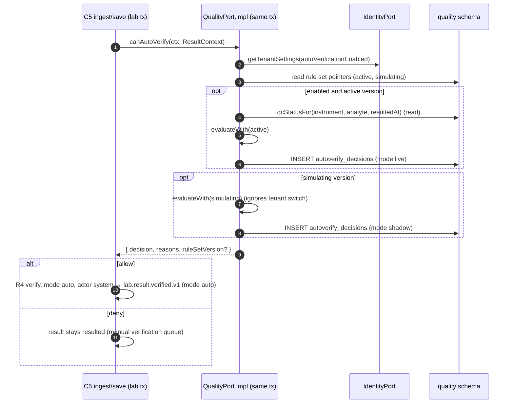
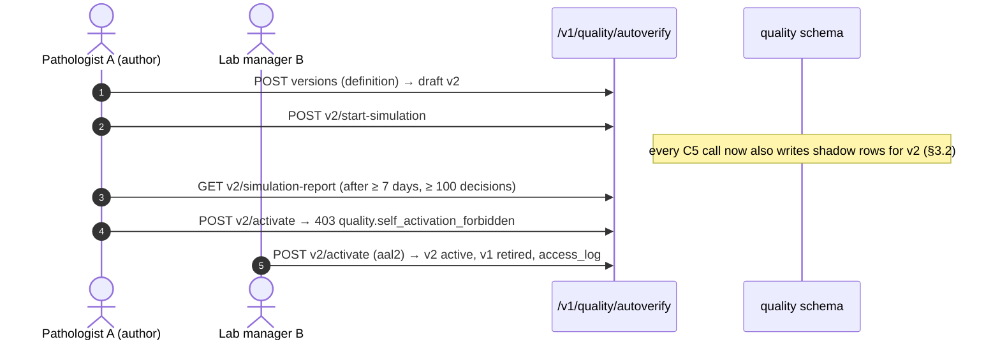

# C9 Quality Engine — 03 App Flow

Status: DECISION, 2026-11-06. Screens are specified field-by-field in `04-UI-UX.md`; endpoints in `02-TRD.md` §5 (numbers `#n` below refer to that table); tables in `05-SCHEMA.md`.

## 1. Actors and entry points

| Entry point | Actor | Flow |
|---|---|---|
| Staff web `/quality/**` (BFF → `/v1/quality/**`) | lab_technologist, lab_manager, pathologist | §4 |
| `QualityPort` (in-process, C5's transaction) | C5 result save | §3.2 |
| Event consumers (worker) | system actor `quality` | §3.1, §3.3, §3.4 |
| Crons (worker, per tenant, every minute) | system actor | §3.1, §3.3 |

## 2. State machines (internal to C9; DB CHECKs in 05-SCHEMA)

### 2.1 QC run (`quality.qc_runs.status` + `outcome`)

| # | From | To | Trigger / guard | Side effects | Event |
|---|---|---|---|---|---|
| QR1 | (none) | `collecting` | first `assigned` observation for the plan when no collecting run exists and it does not attach to an early-rejected run (QR6), or the current one is full/out of window (02-TRD §7.3) | `rule_mode` snapshot from C2, `plan_version_no` snapshot, `last_assembled_at = now()` | — |
| QR2 | `collecting` | `collecting` | member added; provisional evaluation finds no rejection | `observation_count + 1`, `last_member_received_at`, `last_assembled_at = now()` | — |
| QR3 | `collecting` | `evaluated` / `rejected` | provisional evaluation fires a rejection rule (early rejection) | `outcome = rejected`, `is_complete = false`, `hold_since`, `last_in_control_run_at`, `evaluated_at` | `quality.qc_run.rejected.v1` (same tx) |
| QR4 | `collecting` | `evaluated` / any outcome | composition complete → final evaluation | outcome per 02-TRD §7.5; `is_complete = true`; `qc_activity.last_qc_run_at = run_at`, `patient_results_since_last_qc = 0` when outcome accepted/accepted_warning | event iff `rejected` |
| QR5 | `collecting` | `evaluated` / `accepted` · `accepted_warning` · `incomplete` · `rejected` | `close_stale_runs` (`last_assembled_at` older than `run_window_minutes`, server time), next run opened for the pair (§7.3 step 3), or `evaluateQcRunNow` (#30, `quality.qc_run.review`) | `is_complete = false` unless full; review row `evaluate_now` for #30 | event iff `rejected` |
| QR6 | `evaluated` (`rejected`, `is_complete = false`) | `evaluated` (`rejected`) | late member of an early-rejected run: no collecting run exists, the run is the pair's latest such run, `o.observed_at − run_at ≤ run_window_minutes` and the member's level count is below the composition (02-TRD §7.3 step 1a, 08 A17 D-52) | member stored (`assigned`), `observation_count + 1`, `last_assembled_at`, `rule_detail` appended; never re-evaluated; outcome, `rules_violated`, `is_complete` frozen (trigger) | — (no second event) |
| QR7 | `evaluated` (`rejected`) | `closed` | #32 close; guards: ≥ 1 corrective action (`quality.corrective_action_required`; DB backstop in `quality.enforce_run_frozen`), a later run of the plan with outcome `accepted`/`accepted_warning` **and `run_at > R.run_at + run_window_minutes`** (`quality.rerun_required`; 08 A17 D-52) | `closed_at`, `closed_by`, review row `close` | — |

Forbidden (→ `409 quality.qc_run_already_evaluated` for #30/#27, `409 common.immutable_record` otherwise): any change of `outcome` once set; `closed → *` (also refused by the trigger `quality.enforce_run_frozen`); closing a non-rejected run; acknowledging a collecting run.

### 2.2 QC observation (`quality.qc_observations.status`)

| From | To | Trigger |
|---|---|---|
| (none) | any classification status | import (02-TRD §6.3) |
| `unmapped_control`, `no_plan`, `no_target`, `level_not_in_plan`, `unit_mismatch` | re-classified (any status) | `reprocess_pending_observations` (map/plan/target created) within `reprocess_window_days` |
| `no_plan` older than `reprocess_window_days` | `unmapped_control`, `level_not_in_plan`, `lot_expired`, `no_target`, `unit_mismatch`, or `late_unassigned` instead of `assigned` | plan activation (#18): adoption of Phase-1 history, 02-TRD §6.3 rows 4–8 only; never joins a run (08 A17 D-60) |
| `assigned` (run `collecting`), or any non-`assigned` status without a run | `excluded` | #27 (`quality.qc.manage`, reason code); trigger `quality.enforce_observation_exclusion` refuses it when the linked run is not `collecting` |
| `assigned` (run `evaluated`/`closed`) | — | forbidden: `409 quality.qc_run_already_evaluated` |

`unmapped_analyte`, `non_numeric`, `lot_expired`, `late_unassigned` are terminal (a new analyte mapping in C3 does not change C5's stored `analyte_id`; C5 owns that data).

### 2.3 Auto-verify version (`quality.autoverify_versions.status`)

| # | From | To | Guard | Permission | Side effects |
|---|---|---|---|---|---|
| AV1 | (none) | `draft` | definition valid (DSL) | `quality.autoverify.manage` (privileged: aal2 on every AV transition) | rule set row created on first version |
| AV2 | `draft` | `draft` | #39 replace; definition valid | same | — |
| AV3 | `draft` | `simulating` | no other `simulating` version | same | `simulation_started_at/by`; rule set `simulating_version_id` |
| AV4 | `simulating` | `stopped` (terminal) | #41 stop | same (aal2) | `simulation_stopped_at`; pointer cleared; shadow rows kept; a new draft is created with #37 `copy_from_version_id` (08 A17 D-55) |
| AV5 | `simulating` | `active` | `now − simulation_started_at ≥ sim_min_days` and shadow decisions ≥ `sim_min_decisions` (`quality.simulation_incomplete`); actor ≠ `created_by` (`quality.self_activation_forbidden`); aal2 (privileged) | `quality.autoverify.manage` (privileged) | previous `active` → `retired` (same tx); pointers swapped; access_log `autoverify.activate` |
| AV6 | `active` | `retired` | reason | same (privileged) | pointer cleared → all live decisions `rule_missing` |
| AV7 | `draft` | `discarded` | — | `quality.autoverify.manage` | — |

Forbidden (→ `409 quality.rule_set_invalid_transition`): editing anything not `draft`; `draft → active`; `stopped → draft`/`simulating`/`active`; any transition out of `stopped`/`retired`/`discarded` (terminal; also refused by the trigger `quality.enforce_version_frozen`); a second `simulating`.

### 2.4 TAT clock (`quality.tat_items.state`, `alert_level`)

| # | From | To | Trigger | Side effects |
|---|---|---|---|---|
| TC1 | (none) | `not_started` | sweep sees item, segment `within_lab`, `received_at` absent | row created with target and segment |
| TC2 | (none) | `running` | sweep sees item with start time (`within_lab`: `received_at`; `total`: `registered_at` from `reporting.v_pub_order_report_tat`, else earliest specimen `ordered_at` — 08 A17 D-59) | `started_at`, `start_basis` |
| TC3 | `not_started` | `running` | `received_at` appears | `started_at = received_at` |
| TC4 | `running` | `not_started` | `within_lab`: item now on a different specimen without `received_at` (recollection) | `restart_count + 1`, `alert_level = none`, ack cleared |
| TC5 | `running` | `running` (level ↑) | sweep: `pct ≥ warn` / `≥ 100` / `≥ escalate` | `tat_alert_events` row per first crossing; metric |
| TC6 | `running`, `not_started`, `cancelled` | `stopped` | `within_lab`: first `lab.result.verified.v1` for (order_item, test) | `stopped_at = verified_at`, `stop_source = verified_event`, `expires_at` |
| TC7 | `running` | `stopped` | `total`: a `final`/`partial` release whose `order_item_ids` contains the item, or a `final` release without `order_item_ids` (CR-C5-006; 02-TRD §9.1) | `stop_source = release_event` |
| TC8 | `running` | `stopped` | sweep fallback: `within_lab` item shows `item_status = verified` and no event yet | `stopped_at = now`, `stop_source = sweep` |
| TC9 | `running`, `not_started` | `cancelled` | item left the pending view: `within_lab`; or `total` without `first_verified_at` | `expires_at` |
| TC10 | `running` (`total`, left view, verified) | `orphan_closed` | `now − left_pending_view_at > tat_orphan_close_hours` | `expires_at` |
| TC11 | `running` | `running` (ack) | #50 acknowledge | `acknowledged_level = alert_level`, ack row |

### 2.5 Target (`quality.qc_targets.status`)

`draft → active` (#23; previous `active` for the same plan × lot → `superseded` with `effective_to = new.effective_from`, same tx); `active → retired` (#24); `draft → discarded` (#25). Values never change (trigger). Activating a target enqueues `reprocess_pending_observations` for the plan.

### 2.6 Plan (`quality.qc_plans.status`)

`inactive → active` (#18; guard: every composition level has an active target for at least one active lot → else `quality.qc_target_missing`); `active → inactive` (#19; a collecting run is finalised first as `incomplete`/`rejected`); new version (#17) any time — runs opened afterwards use it.

## 3. Cross-chunk flows (sequence diagrams)

### 3.1 QC observation → evaluation → C5 hold

```mermaid
sequenceDiagram
  autonumber
  participant AG as C7 ingest
  participant LAB as C5 consumer (lab)
  participant QC as C9 consumer (quality)
  participant SY as C9 sync task
  participant DB as quality schema
  participant OB as core.event_log / fan-out
  participant LH as C5 consumer: quality.qc_run.rejected.v1
  AG->>OB: instruments.qc.received.v1 (QC record, P0)
  OB->>LAB: evt.lab.instruments.qc.received.v1
  LAB->>LAB: INSERT lab.qc_results (dedupe on idempotency key)
  OB->>QC: evt.quality.instruments.qc.received.v1
  QC->>SY: enqueue quality.sync_qc_observations (job_key qcsync:tenant, +5 s)
  SY->>LAB: SELECT lab.v_pub_qc_result WHERE created_at ≥ cursor − overlap
  Note over SY,LAB: if C5 had not committed yet, the 1-min cron picks the row up
  SY->>DB: INSERT qc_observations ON CONFLICT DO NOTHING
  SY->>DB: lock qc_plans(pair) FOR UPDATE; classify; assemble run; evaluate
  alt rejection rule fires
    SY->>DB: UPDATE qc_runs outcome=rejected, hold_since …
    SY->>OB: events.publish quality.qc_run.rejected.v1 (same tx)
    OB->>LH: evt.lab.quality.qc_run.rejected.v1
    LH->>LH: holdResultsSince(instrument, [analyte], since=hold_since, qcRunId, 'qc_run_rejected')
  else accepted / warning
    SY->>DB: UPDATE qc_runs outcome, qc_activity reset
  end
```

Partial failure: if the sync transaction fails after insert, the whole pair transaction rolls back and the next run (≤ 1 min) re-imports (dedupe by `source_qc_result_id`). If event publish fails validation, the run update rolls back too (outbox, 02-CV §7.3).

### 3.2 Result save → `canAutoVerify` (Phase 2, CR-C9-004 behaviour)



If C5's transaction rolls back, the decision rows roll back with it (02-CV §8.1). Pathologist approval (R6) is never triggered by C9 (D-AV-1).

### 3.3 TAT clocks

```mermaid
sequenceDiagram
  autonumber
  participant CR as cron (1 min)
  participant TS as quality.tat_sweep
  participant LV as lab.v_pub_pending_items / v_pub_specimen_timeline
  participant CP as CatalogPort
  participant DB as quality.tat_items
  participant EV as consumers (verified / status_changed / released)
  CR->>TS: per tenant
  TS->>LV: SELECT pending items with targets (+ registered_at from reporting.v_pub_order_report_tat, else ordered_at, for new total clocks)
  TS->>CP: getTest(testId, asOf ordered_at) → tatTargetSegment (cached)
  TS->>DB: upsert items; start/restart; recompute levels; insert alert events
  TS->>DB: items not seen → cancelled / left_pending_view
  EV->>DB: lab.result.verified.v1 → stop within_lab (verified_at); set first_verified_at
  EV->>DB: reporting.report.released.v1 → stop total clocks of the items in order_item_ids (final without ids → whole order)
  EV->>TS: lab.specimen.status_changed.v1 → enqueue tat_refresh_order(order_id)
```

### 3.4 Simulation and activation (four-eyes)



### 3.5 Pickers through other modules' HTTP APIs (BFF)

The C9 set-up forms call, through the BFF with the user's session, `GET /v1/instruments/instruments` (C7, needs `instruments.instrument.read`) and `GET /v1/catalog/tests` / `GET /v1/catalog/tests/{test_id}` (C3, `catalog.test.read`). If the user lacks the C7 permission, the instrument picker shows the instrument id input only, with copy "You can't list instruments. Ask a lab manager." Labels in lists come from `instruments.v_pub_instrument_directory` server-side (CR-C9-006, ACCEPTED-MODIFIED in 08).

## 4. Screen and API flows

Every page has `loading.tsx` (skeleton), `error.tsx` (`ErrorState` with request id + Retry), an empty state and a permission-denied state (`403` from the BFF → `EmptyState` "You don't have access to this page" with the missing permission's plain-language name). Exact copy in 04-UI-UX.

| Screen | Steps | Empty | Error | Success | Permission |
|---|---|---|---|---|---|
| QC status board `/quality` | 1. GET #34 (poll 15 s while visible). 2. Row click → LJ chart for the plan. 3. "Needs action" chip → run detail. | "No QC plans yet." + "Set up QC" (if `quality.qc.manage`) | inline banner, keeps last data, "Updated hh:mm" | rows with status chips | `quality.qc_run.read` |
| Runs `/quality/runs` | filters → GET #28; row → `/quality/qc-runs/{id}` | "No QC runs match these filters." | ErrorState | list | `quality.qc_run.read` |
| Run detail `/quality/qc-runs/{qc_run_id}` | GET #29; actions by state: collecting → "Evaluate now" (#30); rejected → "Record corrective action" (#31), "Close" (#32); accepted_warning → "Acknowledge" (#33) | n/a | `404` → "This QC run doesn't exist or isn't in your lab." | toast + refetch | read: `quality.qc_run.read`; actions: `quality.qc_run.review` |
| LJ chart `/quality/lj?plan_id=` | pick level/lot/range → GET #35 (poll 15 s); click point → drawer with observation + run link; z-view toggle | "No QC values in this period." | ErrorState | chart + hidden table | `quality.qc_run.read` |
| Unassigned QC `/quality/observations` | GET #26 `status=unmapped_control,no_plan,no_target,…`; row action "Create map"/"Create plan"/"Add target" opens the relevant form pre-filled | "All QC values are assigned." | ErrorState | list | read `quality.qc_run.read`; fixes `quality.qc.manage` |
| Set-up: materials `/quality/setup/materials` | list #1; create #2; level #6; lot #8; edit #4/#7/#10 | "No control materials yet." | field errors from problem+json | toast | `quality.qc.manage` for writes |
| Set-up: maps `/quality/setup/maps` | #11/#12/#13 | "No control-ID maps." | | | same |
| Set-up: plans `/quality/setup/plans` | #14/#15/#17/#18/#19 | "No QC plans." | `qc_target_missing` banner on activate with link to targets | | same |
| Set-up: targets `/quality/setup/targets?plan_id=` | #20/#21/#22/#23/#24/#25; "Establish from data" wizard: range → preview n/mean/SD → create draft | "No targets for this plan." | `insufficient_qc_data` inline | | same |
| Auto-verification `/quality/autoverify` | GET #36; version list; "New version" (#37); open version | "Auto-verification has no rules yet." + "Create first version" | | | read `quality.autoverify.read`; writes `quality.autoverify.manage` |
| Version editor `/quality/autoverify/{version_id}` | draft: rule table editor → PUT #39; "Start simulation" (#40); simulating: report (#42), "Stop" (#41 → `stopped`, read-only, "Copy to new draft" → #37), "Activate" (#43, confirm dialog typing ACTIVATE); active: "Retire" (#44); stopped: report (#42) and "Copy to new draft" only | "No rules in this version." | `rule_set_invalid` errors mapped to rows | toast | as above; every write is privileged (aal2 prompt by C2 on `auth.mfa_required` for #37, #39–#41, #43–#45) |
| Decisions `/quality/autoverify/decisions` | date range (≤ 31 d) + filters → #46; row → #47 drawer | "No decisions in this period." | | | `quality.autoverify.read` |
| TAT alerts `/quality/tat-alerts` | GET #48 (poll 30 s [CONV]); acknowledge (#50); row → drawer #49 with link "Open specimen" (`staff.lab.specimen`) | "No open TAT alerts." | | toast | read `quality.tat_alert.read`; ack `quality.tat_alert.ack` |
| Settings `/quality/settings` | GET #51; PUT #52; coded sets #53/#54 | — | field errors | toast | read `quality.qc_run.read`; write `quality.config.manage` |

## 5. Edge cases

| # | Case | Behaviour |
|---|---|---|
| E1 | Two sync jobs for the same tenant overlap (cron + event trigger) | event-triggered jobs share `job_key qcsync:<tenant>` (`unsafe_dedupe`: a queued or running job absorbs new triggers); a cron job and an event job may run together: `ON CONFLICT DO NOTHING` + pair lock make the second a no-op and the cursor update never moves backwards (02-TRD §6.2 step 5) |
| E2 | C5 commits the QC row after C9's triggered sync ran | next cron sweep imports it (overlap window) |
| E3 | Agent uploads a QC backlog hours late | processed in `observed_at` order across keyset pages (02-TRD §6.2); stale-run close uses `last_assembled_at`, so a run spanning two pages is not closed early; rows older than the latest evaluated run → `late_unassigned` (never rewrite history) |
| E4 | Analyser clock wrong (instrument time > 24 h from received) | `observed_at` = server `received_at`, basis `server` (02-TRD §6.2) |
| E5 | Two QC events for the same level arrive in one run window | second one closes the current run (composition full for that level) and opens a new run (§7.3 step 3) — e.g. a repeated control |
| E6 | Early rejection, then the remaining levels arrive | attached to the rejected run when observed within `run_window_minutes` and the level is not full (QR6, 08 A17 D-52), outcome unchanged, no second event; later or surplus members open a new run |
| E7 | Westgard mode changed in C2 while a run is collecting | run keeps the mode snapshotted at open (QR1); next run uses the new mode |
| E8 | Plan version changed while a run is collecting | run keeps its `plan_version_no`; new runs use the new version |
| E9 | Target activated mid-day | observations keep their snapshot; `no_target` observations of the last 7 days are re-processed (only if newer than the latest evaluated run) |
| E10 | Duplicate `instruments.qc.received.v1` / reprocessed C7 message | inbox dedupe; C5 dedupes the QC row; C9 dedupes by `source_qc_result_id` |
| E11 | Concurrent `close` and new corrective action | close re-checks inside the tx with `If-Match`; the loser gets `409 common.version_conflict` |
| E12 | Rejected run while C5 is down / C5 consumer fails | event stays in the outbox/queue, retried up to 10 times, then dead letter → C1 alert (02-CV §7.5); C9's own state is already committed |
| E13 | `canAutoVerify` called for a result of an instrument × analyte without a QC plan | `qcStatusFor` → `no_qc_data` → deny `qc_no_data` |
| E14 | Rule set activated while tenant auto-verification is off | allowed; banner "Auto-verification is switched off in Admin › Tenant settings; this version takes effect when it is switched on." |
| E15 | C5's save transaction retried (serialization failure) | decision rows from the failed attempt rolled back; the retry writes new rows |
| E16 | TAT: test re-pointed to a recollection specimen | within-lab restart (TC4); total continues |
| E17 | TAT: order cancelled after verification | total clock continues (still `first_verified_at`) until `orphan_closed` after 72 h — documented imprecision; no FrontdeskPort/cancel event available to C9 |
| E18 | TAT: partial release without `order_item_ids` | total clocks keep running until a final release (CR-C5-006 removes the gap) |
| E19 | Duplicate submissions of create endpoints | `Idempotency-Key` (R) replays the stored response (02-CV §4.5) |
| E20 | Offline / network loss in the browser | BFF errors show the ErrorState with Retry; polling pages show "Connection lost — showing data from hh:mm" banner and retry with backoff (5 s, 15 s, 30 s [CONV]) |
| E21 | A QC event for an instrument retired in C7 | stored and evaluated if a plan exists; the status board shows the instrument state from the directory view (CR-C9-006) |
| E22 | Two people edit the same draft rule set | `If-Match` → `409 common.version_conflict`; editor offers "Reload" (unsaved rules kept in the page for copy) |
| E23 | A QC row in `lab.v_pub_qc_result` cannot be inserted (FK violation, value does not fit) | savepoint rollback for that row only; logged as `qc_result_id` + SQLSTATE, counted as `import_error`, alert `QualityQcImportError`; the cursor passes it (02-TRD §6.2 step 3) |
| E24 | Simulation stopped by mistake | the version is `stopped` (terminal); the user copies it into a new draft (#37) and starts a new simulation; the new report covers the new version's shadow rows only |
